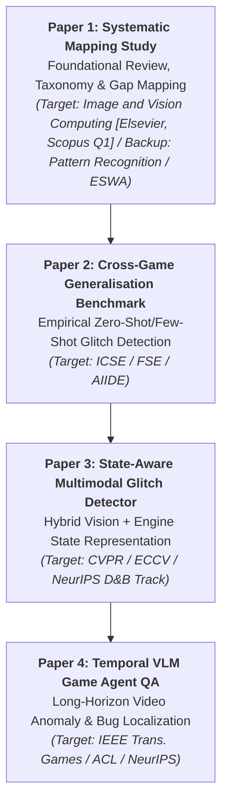

# PhD Research Roadmap: Intelligent Visual Quality Assurance for Video Games

## Programme Overview
This research programme addresses automated visual regression testing, anomaly detection, and glitch discovery in complex, real-time video game environments using modern Computer Vision (CV) and Vision-Language Models (VLMs).

---

## 4-Stage Research Portfolio (PhD by Publication)

### Stage 1: Foundational Review & Mapping (Paper 1)
- **Title:** *Computer Vision and Vision-Language Approaches to Visual Quality Assurance in Video Games: A Systematic Mapping Study of Tasks, Datasets, and Evaluation Methods*
- **Target Venues:** Primary: *Image and Vision Computing* (Elsevier, ScienceDirect, Scopus Q1, $0 APC Hybrid); Backup: *Pattern Recognition* / *Expert Systems with Applications* (Elsevier)
- **Core Contribution:**
  1. Multi-tier taxonomy of visual bugs in games (geometry, textures, UI/HUD, lighting/rendering, temporal/animation).
  2. Critical benchmark & dataset audit (public availability, game diversity, annotation quality).
  3. Evaluation matrix assessing generalisation vs. overfitting to single game assets.
  4. Comprehensive research agenda identifying open challenges.

---

### Stage 2: Empirical Benchmark on Cross-Game Generalisation (Paper 2)
- **Title:** *Cross-Game Generalisation in Visual Anomaly Detection: An Empirical Evaluation of Deep Representations under Severe Domain Shift*
- **Role in PhD:** Directly tackle the #1 gap identified in Stage 1 — models trained on Game A degrading catastrophically when evaluated on Game B.
- **Methodology:**
  - Curate a multi-genre visual glitch dataset spanning diverse art styles (photorealistic Unreal Engine, stylized Unity, 2D/isometric canvas).
  - Benchmark standard visual anomaly detectors (PatchCore, FastFlow), generic vision encoders (DINOv2, CLIP, SigLIP), and game-specific fine-tuned detectors.
  - Measure cross-domain transfer drop and calibrate domain adaptation techniques.

---

### Stage 3: Technical Contribution: State-Aware & Self-Supervised Detection (Paper 3)
- **Title:** *State-Aware Contrastive Learning for Object Clipping and Geometry Glitch Localization in Modern 3D Engines*
- **Role in PhD:** Novel model architecture solving subtle spatial defects (e.g., character mesh penetrating terrain, floating foliage) without requiring millions of manually annotated glitch frames.
- **Methodology:**
  - Synthesize controlled rendering variations inside Unreal Engine 5 / Unity.
  - Leverage lightweight engine hooks (depth maps, surface normals, bounding collision volumes) alongside RGB frames.
  - Formulate self-supervised contrastive objectives that detect non-physical geometry intersections.

---

### Stage 4: Frontier Investigation: Temporal Vision-Language QA (Paper 4)
- **Title:** *Temporal Vision-Language Models for Long-Horizon Video Game Bug Localization and Automated Bug Reporting*
- **Role in PhD:** Overcome the single-frame limitation by processing continuous gameplay streams and generating actionable, natural-language bug descriptions with exact timestamps.
- **Methodology:**
  - Extend models (e.g., Qwen2-VL, Video-LLaVA, Gemini API) on temporal glitch benchmarks (e.g., TempGlitch, VideoGameQA-Bench).
  - Solve temporal windowing challenges: detecting bugs that only manifest across multi-frame sequences (e.g., flickering LODs, physics oscillations, broken inverse kinematics).
  - Output structured bug reports with severity, glitch type, frame bounds, and recommended remediation.

---

## Deliverables & Milestones Timeline

| Milestone | Phase | Target Duration | Expected Output |
|---|---|---|---|
| **M1.1** | Protocol Finalization | Month 1 | Approved SMS Protocol (`protocol/`) |
| **M1.2** | Literature Screening | Month 2 | Complete search across IEEE, ACM, arXiv, OpenAlex |
| **M1.3** | Data Extraction & Synthesis | Month 3 | Completed Evidence Tables & Taxonomy |
| **M1.4** | Paper 1 Manuscript Submission | Month 4–5 | Submitted Review Paper |
| **M2.1** | Cross-Game Benchmark Design | Month 6–8 | Multi-game dataset & evaluation harness |
| **M2.2** | Paper 2 Experimental Study | Month 9–11 | Paper 2 submission |
| **M3.1** | Engine-Integrated Model Dev | Month 12–16 | Paper 3 technical contribution |
| **M4.1** | Temporal VLM Agent QA | Month 17–22 | Paper 4 submission |
| **PhD Completion** | Synthesizing Dissertation | Month 23–24 | Synoptic Thesis / Ph.D. Defense |
