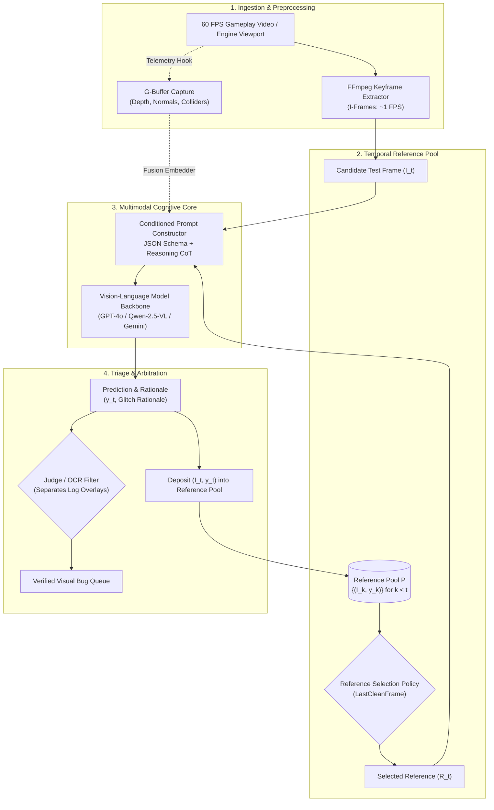

# System Architecture: Agent-Native Visual Bug Detection

## Component Graph

1. **Ingestion & Keyframe Extraction Layer:**
   - Ingests raw 60 FPS gameplay video streams or continuous playtesting runs.
   - Extracts sparse I-frames via FFmpeg to reduce temporal redundancy by ~98.8% while retaining full defect visibility.
   - Optionally captures synchronized engine telemetry G-buffers (depth, normal vectors, collision bounding hulls) where engine hooks are permissible.

2. **Temporal Reference Pool & Selection Policy:**
   - Maintains an in-memory sliding buffer of previously evaluated keyframes and their predicted defect states: $\mathcal{P}_t = \{ (I_k, \hat{y}_k) \}_{k=1}^{t-1}$.
   - Executes the `LastCleanFrame` policy: selects the most temporally recent frame certified as glitch-free ($\hat{y} = 0$).
   - Dynamically adapts comparison logic based on reference status (clean comparison vs. persistent bug warning).

3. **Multimodal Cognitive Core:**
   - Assembles structured multi-image prompts combining candidate frame $I_t$, reference frame $R_t$, and strict JSON output schemas.
   - Enforces intermediate Chain-of-Thought reasoning tokens in a dedicated `"reasoning"` JSON field prior to committing to binary output flags.

4. **Triage, Arbitration & Memory Deposit:**
   - Separates text-based engine log overlays (using fast OCR preprocessing) from visual asset/rendering defects.
   - Deposits newly evaluated test frames back into the reference pool to support downstream comparisons.
   - Generates structured bug triage reports for QA engineering queues.
