# Visual Bug Taxonomy in Video Games

A structured classification framework for visual defects, graphical glitches, and rendering anomalies encountered during automated game testing.

```mermaid
graph TD
    VB["Video Game Visual Bugs"]
    VB --> G1["1. Spatial & Geometry"]
    VB --> G2["2. Texture & Shading"]
    VB --> G3["3. Rendering & Lighting"]
    VB --> G4["4. Temporal & Animation"]
    VB --> G5["5. UI & Interface"]

    G1 --> G1a["Mesh Clipping / Penetration"]
    G1 --> G1b["Floating Assets"]
    G1 --> G1c["Vertex Stretching"]

    G2 --> G2a["Missing / Null Textures"]
    G2 --> G2b["LOD Pop-In / Stalling"]
    G2 --> G2c["UV Alignment Errors"]

    G3 --> G3a["Z-Fighting"]
    G3 --> G3b["Shadow Disconnection"]
    G3 --> G3c["Camera Penetration"]

    G4 --> G4a["T-Pose Freeze"]
    G4 --> G4b["Ragdoll Physics Chaos"]
    G4 --> G4c["Temporal Flickering"]

    G5 --> G5a["UI Element Overlap"]
    G5 --> G5b["Dialogue Text Overflow"]
    G5 --> G5c["Resolution Mismatch"]
```

---

## 1. Spatial & Geometry Anomalies
- **1.1 Object Clipping & Penetration:** A dynamic or static mesh penetrates another mesh without valid collision response (e.g., character limb passing through a concrete wall or weapon penetrating armor).
- **1.2 Floating Assets:** Objects intended to rest on terrain or floors that are positioned above ground level due to faulty procedural placement or heightmap miscalculations.
- **1.3 Vertex & Geometry Distortion:** Polygonal vertices stretched across screen space or collapsing into singularity coordinates due to skinning/rigging errors or numerical overflow in vertex shaders.
- **1.4 Invisible Collision / Missing Visual Mesh:** Physical collision boundaries exist where no visual geometry is rendered, or vice-versa.

---

## 2. Material, Texture & Shading Defects
- **2.1 Missing / Fallback Textures:** Rendering default magenta/purple checkerboard patterns, white dummy textures, or untextured gray polygons when asset references fail to resolve.
- **2.2 LOD (Level-of-Detail) Pop-In & Snapping:** High-detail mipmaps or Nanite meshes failing to stream in time, leaving low-polygon proxies or blurry textures visible in close proximity.
- **2.3 UV Mapping & Stretching:** Distorted or warped texture coordinates caused by incorrect UV unwrapping, seam mismatch, or dynamic deformation.
- **2.4 Broken Shader Pipelines:** Blown-out specular reflections, inverted normal maps causing inside-out illumination, or missing sub-surface scattering.

---

## 3. Rendering, Lighting & Camera Artifacts
- **3.1 Z-Fighting & Coplanar Flickering:** Two or more surfaces sharing nearly identical depth values, producing rapid, pixelated flickering as the depth buffer struggles to arbitrate visibility.
- **3.2 Shadow Bleeding & Disconnection:** Shadow cascades detaching from object contact bases (peter-panning), shadow acne, or hard jagged cascades caused by miscalibrated shadow bias.
- **3.3 Light Leaking:** Indirect global illumination or direct point lights penetrating solid interior rooms through unsealed mesh corners or imperfect ray tracing voxels.
- **3.4 Camera Geometry Clipping:** The virtual game camera frustum near-plane cutting into character heads, walls, or scenery, exposing back-face hollows.

---

## 4. Temporal, Physics & Animation Glitches
- **4.1 T-Pose / Reference Pose Freeze:** Character rigs falling back to default T-pose or A-pose due to state-machine transition failures or missing animation assets.
- **4.2 Ragdoll Physics Chaos:** Unstable constraint solvers causing character limbs to oscillate violently, stretch uncontrollably, or fling into the sky upon death.
- **4.3 Temporal Jitter & Motion Desynchronization:** Glitches that cannot be detected from a single static frame and only manifest across sequential video frames (e.g., foot sliding / ice-skating, alternating frame flicker).

---

## 5. User Interface (UI) & HUD Anomalies
- **5.1 Element Overlapping:** HUD components (health bars, minimaps, inventory icons) colliding or stacking illegibly on top of each other.
- **5.2 Text Overflow & Truncation:** Localized or dynamic dialogue text spilling outside UI containers or clipping out of readable frame boundaries.
- **5.3 Scaling & Anchor Distortion:** Non-standard aspect ratios causing HUD elements to stretch, squash, or detach from anchor edges (e.g., on ultrawide monitors).
- **5.4 Gameplay Occlusion:** UI modals failing to dismiss and obscuring critical game-world interaction points.
