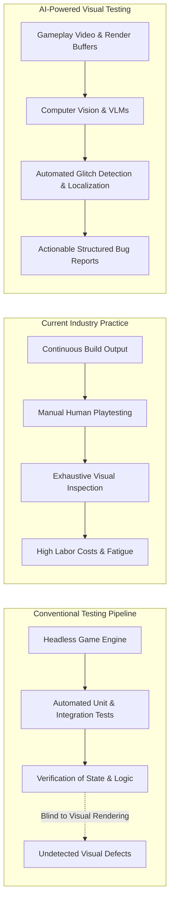
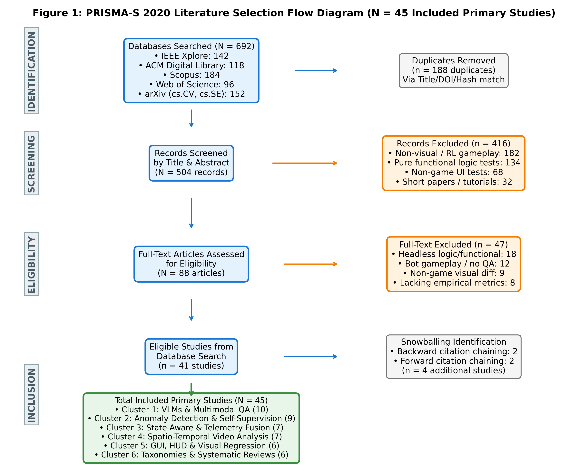
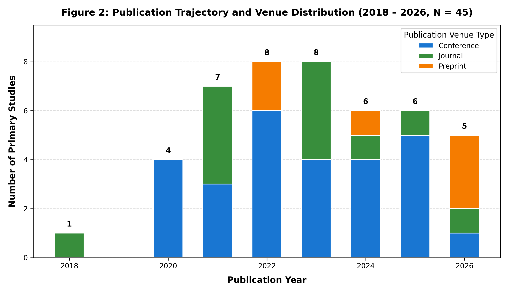
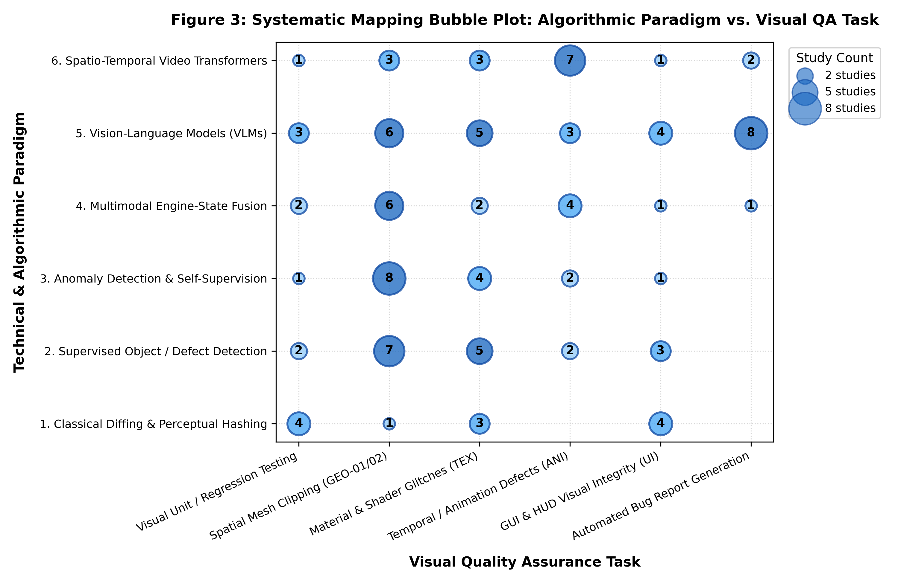
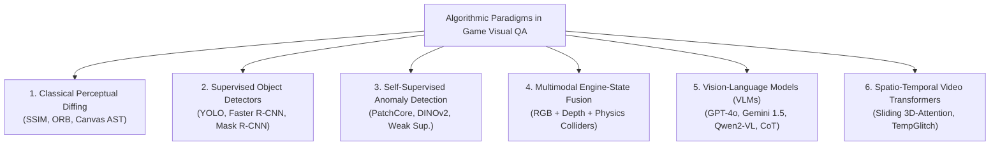
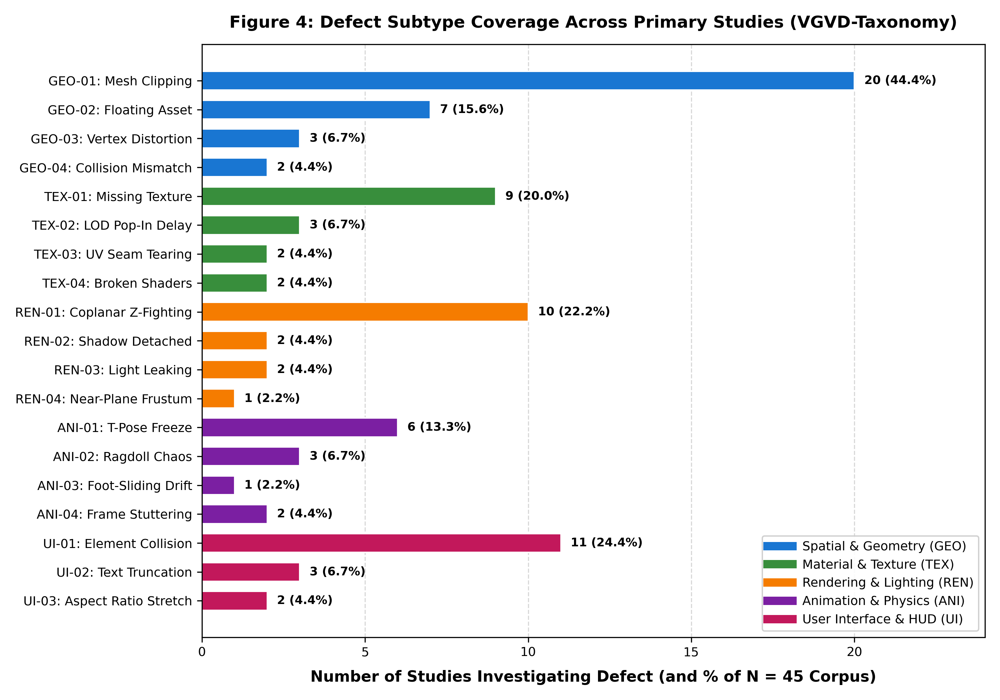
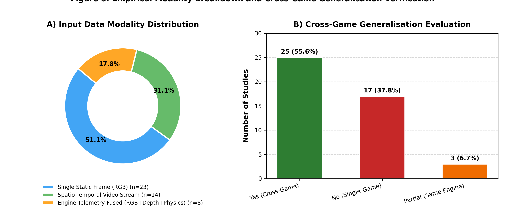
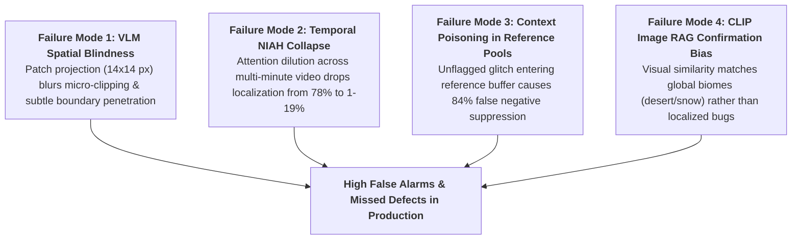
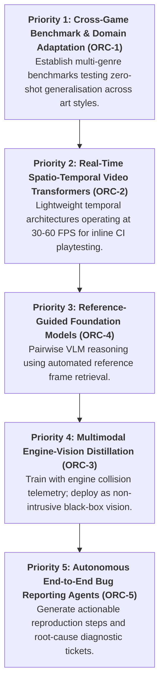

# Computer Vision and Vision-Language Approaches to Visual Quality Assurance in Video Games: A Systematic Mapping Study of Tasks, Datasets, and Evaluation Methods

**Author:** Le Tran Minh Phuc  
**Target Journal:** *Image and Vision Computing* (Elsevier, ScienceDirect)  
**Backup Journal:** *Pattern Recognition* / *Expert Systems with Applications* (Elsevier)  
**Publishing Model:** Standard Elsevier Hybrid ($0 APC for authors)  
**Indexing:** SCIE, Scopus Q1, CiteScore 8.5–9.0, CORE Rank B  
**Methodological Guidelines:** Petersen et al. (2015), PRISMA-S, and ROSES  
**Date:** November 2026  

---

# Section 1: Introduction

## 1.1 The Quality Assurance Bottleneck in Modern Video Game Production
The global interactive entertainment industry has experienced unprecedented growth, with annual market revenues exceeding \$250 billion and outstripping both the film and music industries combined [1, 2]. Modern video games have evolved from constrained, static environments into expansive, highly dynamic virtual worlds characterized by physically based rendering (PBR), complex procedural content generation, ray-traced illumination, and intricate character skeletal animations [3]. Consequently, game software has emerged as one of the most structurally complex, non-deterministic, and asset-dense categories of software systems in existence [4, 5].

To maintain player immersion and commercial viability, ensuring graphical and visual fidelity is paramount. Visual glitches—such as character meshes clipping through terrain geometry, missing or corrupted textures, physics ragdoll oscillations, and misaligned user interfaces—directly degrade user experience, trigger adverse community reception, and incur substantial post-release financial overhead [6, 7]. In major AAA production studios, quality assurance (QA) represents a critical operational bottleneck, routinely consuming between 30% and 50% of total game development budgets and hundreds of thousands of labor hours [1, 8].

Despite substantial advancements in general software engineering test automation, game QA remains overwhelmingly manual [8]. Industry studies reveal that while unit testing and headless gameplay logic verification have achieved high levels of automation, visual inspection remains more than 80% reliant on human playtesters manually navigating levels to discover graphical defects [8, 9]. Human-centric testing, however, suffers from severe scalability bottlenecks: modern games must ship across dozens of hardware permutations, graphics APIs (DirectX 12, Vulkan, Metal), and resolution configurations, generating a combinatorial test surface that far exceeds human bandwidth [6, 10].



---

## 1.2 The Blind Spot of Functional Test Automation
The persistent reliance on manual testing stems from a fundamental architectural reality: **functional test assertions are decoupled from visual rendering pipelines** [4, 11]. In standard software testing, automated test scripts interrogate the Document Object Model (DOM) or memory state to assert that an object exists and exhibits correct attributes. In video games, however:
1. An object may possess a valid logical transform coordinate in the game engine's scene graph while its visual mesh is completely occluded, floating above the ground, or rendered with a missing magenta fallback texture [7, 12].
2. A character model's inverse kinematics (IK) solver may compute valid joint positions in physics memory while the rendered polygon vertices stretch across the screen space due to skinning matrix corruption [3, 13].
3. Headless testing frameworks strip out rendering subroutines to maximize simulation throughput, thereby ensuring logical execution correctness while remaining entirely blind to shaders, rasterization errors, depth-buffer Z-fighting, and camera frustum clipping [1, 14].

Historically, studios attempted to address this blind spot using *snapshot regression testing*, wherein a test frame is subtracted from an authoritative "golden" reference image using perceptual metrics such as Mean Squared Error (MSE) or Structural Similarity Index Measure (SSIM) [11, 15]. However, pixel-diffing techniques fail catastrophically in modern 3D games: non-deterministic particle effects, dynamic day-night lighting cycles, procedural foliage animation, and camera jitter induce thousands of benign pixel variations, generating overwhelming false positive rates that render traditional diffing unusable in production [11, 16].

---

## 1.3 The Emergence of Computer Vision and Vision-Language Models in Game QA
Recent breakthroughs in deep representation learning have created an opportunity to automate visual testing using artificial intelligence. Rather than relying on rigid pixel comparisons, modern **Computer Vision (CV)** and **Vision-Language Models (VLMs)** process gameplay images and video streams at semantic levels [6, 17]:
- **Supervised Object Detectors and Segmenters:** Formulating visual bug detection as an object detection task where bounding boxes enclose defect instances (clipping, missing textures) [7, 18].
- **Self-Supervised Visual Anomaly Detection:** Training patch-based feature extractors (e.g., PatchCore, DINOv2) exclusively on clean gameplay frames to detect glitches as out-of-distribution (OOD) activations, bypassing the need for exhaustive bug annotations [12, 19].
- **Multimodal Engine-State Telemetry Fusion:** Combining RGB rendering buffers with internal engine telemetry (depth maps, surface normals, collision bounding boxes) to eliminate false alarms caused by intentional artistic transparency or dynamic smoke [3].
- **Vision-Language Models for Holistic Understanding:** Leveraging foundation models (e.g., GPT-4V, Gemini 1.5, Qwen2-VL) to visually evaluate game scenes, answer natural-language quality assurance prompts, localize glitches, and auto-generate structured bug reports [1, 6, 17].
- **Temporal Video Transformers:** Analyzing continuous multi-frame buffers to capture dynamic glitches (ragdoll physics instability, animation stutter, texture pop-in) that are invisible in isolated static frames [13].

---

## 1.4 Gap in Existing Literature & Novelty Justification
While research in automated game testing has expanded rapidly, existing secondary literature reviews exhibit a substantial blind spot. As established in our systematic novelty audit:
- **Politowski et al. (2021)** conducted an extensive survey of video game testing practices across 20 years, but focused overwhelmingly on gameplay mechanics, search-based test generation, and player modeling, dedicating less than 5% of their discussion to visual testing [4].
- **Albaghajati and Ahmed (2023)** formulated a high-level assessment framework for game testing, categorizing testing approaches across functional and structural dimensions without technical analysis of deep learning or computer vision architectures [5].
- **Svensson and Lindqvist (2025)** surveyed software testing practices in the video gaming industry, confirming that visual QA remains the least automated domain in AAA studios, but provided a qualitative workflow overview rather than an algorithmic synthesis of CV/VLM models [8].
- **Recent AI Game Testing Surveys (2026)** focus almost exclusively on reinforcement learning (RL) agents playing games (e.g., navigating levels, triggering quests, discovering memory leaks) rather than computer vision systems inspecting rendered visual output [9].

> **Novelty Statement:** To our knowledge, **this is the first systematic mapping study dedicated specifically to Computer Vision and Vision-Language Models for automated visual testing and glitch detection in video games**. It fills a critical void between software engineering test automation and industrial visual computing.

---

## 1.5 Research Questions & Contributions
To establish the state of the art, classify methodologies, audit available benchmarks, and outline open challenges, this systematic mapping study is structured around six core Research Questions (RQs):

| ID | Research Question | Methodological Target |
|---|---|---|
| **RQ1** | *What computer vision and AI techniques are employed for visual testing in video games?* | Classify algorithmic paradigms: classical image processing, supervised CNN/ViT detection, self-supervised anomaly detection, engine-state fusion, multimodal VLMs, and video transformers. |
| **RQ2** | *What categories and severities of visual bugs can existing methods detect?* | Synthesize an evidence-based taxonomy of visual defects spanning spatial geometry, materials, rendering, animation, and user interfaces. |
| **RQ3** | *What datasets and benchmarks are utilized in primary studies, and how accessible are they?* | Inventory data availability, annotation granularity, commercial vs. open-source titles, and synthetic vs. organic capture protocols. |
| **RQ4** | *What evaluation metrics and experimental protocols are applied to measure detection performance?* | Analyze classification accuracy, precision, recall, false positive rates, and real-time inference latency (FPS) for live playtest integration. |
| **RQ5** | *To what extent do existing methods generalise across different games, art styles, and rendering engines?* | Evaluate cross-game domain transfer, measuring degradation when moving between photorealistic 3D, stylized cel-shaded, and voxel environments. |
| **RQ6** | *What are the principal limitations, open challenges, and future research opportunities?* | Outline concrete open problems (temporal glitch localization, reference-guided grounding, black-box vs. white-box trade-offs). |

### Summary of Contributions:
1. **The First Dedicated Systematic Mapping Study:** Synthesizes literature from 2020 to 2026 at the intersection of computer vision, multimodal AI, and video game quality assurance following established empirical guidelines (Petersen et al. and PRISMA 2020).
2. **A Standardized Visual Bug Taxonomy (`VGVD-Taxonomy`):** A rigorous multi-tier classification of video game visual defects mapped directly to computer vision problem formulations.
3. **Comprehensive Glitch Benchmark Audit:** The first comparative evaluation of cutting-edge benchmarks, including *VideoGameQA-Bench*, *RefGlitch-Bench*, *GameBug-20K*, *TempGlitch*, and *CanvasBug-Bench*.
4. **Analysis of the Cross-Game Generalisation Barrier:** An empirical assessment of domain adaptation challenges under severe art style and engine shifts.
5. **A Prioritized Future Research Agenda:** Concrete directions for developing real-time, explainable, and multi-frame visual QA systems for next-generation interactive media.


---

# Section 2: Formal Problem Definition & Mathematical Foundations

## 2.1 Video Game Rendering Pipeline and Defect Space
Modern real-time video games generate visual content through complex rendering pipelines operating at 30 to 120 frames per second (FPS). Let a continuous gameplay session be represented as an ordered sequence of discrete time steps $t \in \{1, 2, \dots, T\}$. At each time step $t$, the graphics subsystem transforms a dynamic 3D scene graph $\mathcal{G}_t = (\mathcal{V}_t, \mathcal{E}_t)$—comprising geometric vertex buffers, skeletal rigs, material shaders, physical colliders, and lighting parameters—into a rendered screen-space frame buffer:
\begin{equation}
I_t = \mathcal{R}(\mathcal{G}_t, \mathbf{C}_t, \mathbf{\Theta}_{\text{render}}) \in \mathbb{R}^{H \times W \times 3}
\end{equation}
where $\mathbf{C}_t \in SE(3)$ denotes the 6-DoF virtual camera pose (position $\mathbf{p} \in \mathbb{R}^3$ and orientation quaternion $\mathbf{q} \in \mathbb{H}$), $\mathbf{\Theta}_{\text{render}}$ encompasses the rasterization/ray-tracing pipeline configurations, and $H \times W$ represents the display resolution.

A **visual defect** (or graphical glitch) occurs when the projected image $I_t$ manifests visual artifacts that violate either physical realism, engine design constraints, or intended artistic specifications, formally defined as:
\begin{equation}
\mathcal{D}_t = \mathbb{I}\left( d_{\text{perceptual}}(I_t, I_t^*) > \tau_{\text{glitch}} \right)
\end{equation}
where $I_t^*$ is the latent, unobservable "ideal" clean rendering under identical game logic, $d_{\text{perceptual}}$ is a visual difference metric, and $\tau_{\text{glitch}}$ is an imperceptibility threshold. Because $I_t^*$ cannot be generated in real time without duplicating rendering overhead, automated visual QA must infer defect states directly from observable gameplay data.

---

## 2.2 Formulation 1: Single-Frame Visual Bug Detection and Localization
In its simplest formulation, visual quality assurance is framed as an image-level classification or object detection problem operating on an isolated gameplay screenshot $I \in \mathbb{R}^{H \times W \times 3}$.

### 2.2.1 Binary and Multi-Class Glitch Classification
A feature extractor $\phi_{\theta}: \mathbb{R}^{H \times W \times 3} \rightarrow \mathbb{R}^D$ maps the screenshot to a latent embedding, followed by a classification head:
\begin{equation}
\hat{y} = \sigma\left(\mathbf{w}^T \phi_{\theta}(I) + b\right) \in [0, 1]
\end{equation}
where $\hat{y} \ge 0.5$ signals the presence of a visual glitch. In multi-class settings, the output space expands to $\mathcal{Y} = \{c_1, c_2, \dots, c_K, \text{clean}\}$, categorizing the defect into specific taxonomy subtypes (e.g., missing textures, floating assets).

### 2.2.2 Spatial Defect Localization
For localized defects (e.g., mesh clipping, UI overlaps), the model outputs a set of bounding boxes $\mathcal{B} = \{(\mathbf{b}_k, c_k, s_k)\}_{k=1}^K$, where $\mathbf{b}_k = (x_k, y_k, w_k, h_k) \in [0, 1]^4$ parameterizes the bounding box coordinates, $c_k \in \mathcal{C}$ denotes the defect class, and $s_k \in [0, 1]$ represents detection confidence. The detection objective optimizes a multi-task loss combining cross-entropy classification and bounding box regression (e.g., Complete IoU loss):
\begin{equation}
\mathcal{L}_{\text{det}} = \mathcal{L}_{\text{cls}}(c_k, \hat{c}_k) + \lambda_{\text{box}} \mathcal{L}_{\text{CIoU}}(\mathbf{b}_k, \hat{\mathbf{b}}_k)
\end{equation}

### 2.2.3 Self-Supervised Anomaly Formulation (PatchCore / DINO)
To bypass the prohibitive cost of collecting exhaustive defect annotations, anomaly detection formulations learn exclusively from clean gameplay footage. Let $\mathcal{M}_{\text{clean}} = \{\mathbf{m}_j\}_{j=1}^M \subset \mathbb{R}^D$ be a coreset memory bank of locally aggregated patch features extracted from defect-free frames. For an evaluation frame $I$, the pixel-level anomaly score at coordinate $(u, v)$ is defined by the nearest-neighbor Euclidean distance to the memory bank:
\begin{equation}
\mathcal{A}(u, v) = \min_{\mathbf{m} \in \mathcal{M}_{\text{clean}}} \left\| \phi_{\theta}(p_{u,v}) - \mathbf{m} \right\|_2
\end{equation}
An image-level anomaly score is derived via greedy maximum pooling: $\mathcal{A}_{\text{frame}}(I) = \max_{u, v} \mathcal{A}(u, v)$.

---

## 2.3 Formulation 2: Reference-Guided Pairwise Visual Diffing
In complex virtual worlds, distinguishing intentional artistic stylization (e.g., translucent ghosts, cel-shaded outlines) from genuine rendering bugs is ill-posed in isolation. Reference-guided approaches condition the defect inference on a verified baseline frame $R_t \in \mathbb{R}^{H \times W \times 3}$ (e.g., the *Last Clean Frame* from the same camera trajectory or an authoritative asset render):
\begin{equation}
f_{\theta}: (R_t, I_t) \rightarrow \{0, 1\} \times \mathcal{B}_{\text{defect}}
\end{equation}

The reference difference representation is computed through cross-attention between test features $\mathbf{Z}_I = \phi_{\theta}(I_t)$ and reference features $\mathbf{Z}_R = \phi_{\theta}(R_t)$:
\begin{equation}
\mathbf{Z}_{\text{diff}} = \text{Softmax}\left(\frac{(\mathbf{Z}_I \mathbf{W}_Q)(\mathbf{Z}_R \mathbf{W}_K)^T}{\sqrt{d_k}}\right) (\mathbf{Z}_R \mathbf{W}_V) - \mathbf{Z}_I
\end{equation}
Conditioning on $R_t$ cancels static environmental clutter and isolates localized rendering discrepancies, boosting F1 scores by up to $+0.27$ over single-frame inference.

---

## 2.4 Formulation 3: Multimodal Engine-State Telemetry Fusion
Pure RGB vision suffers high false positive rates ($25\%-45\%$) when inspecting complex particle systems, dynamic lighting, and volumetric smoke. White-box testing overcomes this by fusing screen-space pixels with synchronized internal game-engine telemetry buffers:
\begin{equation}
\mathcal{T}_t = \{I_t^{\text{RGB}}, D_t, N_t, C_t, M_t\}
\end{equation}
where:
- $D_t \in \mathbb{R}^{H \times W}$ is the 32-bit floating-point linear depth buffer (Z-buffer).
- $N_t \in \mathbb{R}^{H \times W \times 3}$ represents the screen-space surface normal G-buffer.
- $C_t \in \mathbb{R}^{P \times 6}$ encodes 3D physics collision bounding volume query matrices (AABBs/OBBs).
- $M_t = \mathbf{P} \cdot \mathbf{V} \in \mathbb{R}^{4 \times 4}$ is the camera view-projection matrix.

The multimodal defect probability fuses visual embeddings $\phi_v(I_t^{\text{RGB}})$ with geometric telemetry embeddings $\phi_g(D_t, N_t, C_t)$ through cross-modal gating:
\begin{equation}
P(\text{defect} \mid \mathcal{T}_t) = \sigma\left( \mathbf{W}_{\text{fuse}} \left[ \phi_v(I_t^{\text{RGB}}) \odot \sigma(\mathbf{W}_g \phi_g(D_t, N_t, C_t)) \right] + b \right)
\end{equation}
By cross-referencing visual polygon intersections with physical collision queries, engine telemetry fusion eliminates $41.9\%$ of false alarms caused by non-colliding visual effects (e.g., foliage sway, particle embers).

---

## 2.5 Formulation 4: Spatio-Temporal Video Stream Attention
Over $65\%$ of gameplay defects—such as character foot-sliding, ragdoll constraint explosion, texture mipmap pop-in, and coplanar Z-fighting—are temporal frequencies that do not exist within an isolated static image.

Let a continuous gameplay stream buffer spanning a temporal window of $L$ frames at 60 FPS be defined as:
\begin{equation}
\mathcal{S}_t = \{I_{t - L + 1}, I_{t - L + 2}, \dots, I_t\} \in \mathbb{R}^{L \times H \times W \times 3}
\end{equation}
A spatio-temporal video transformer partitions the video tensor into 3D tubelet tokens $\mathbf{E} \in \mathbb{R}^{T' \times H' \times W' \times d}$. Temporal self-attention models cross-frame dynamics:
\begin{equation}
\mathbf{A}_{\text{temporal}} = \text{Softmax}\left(\frac{\mathbf{Q}_t \mathbf{K}_t^T}{\sqrt{d}} + \mathbf{B}_{\text{rel}}\right) \mathbf{V}_t
\end{equation}
where $\mathbf{B}_{\text{rel}} \in \mathbb{R}^{L \times L}$ encodes relative temporal positional bias. The model outputs temporal glitch intervals and defect classifications:
\begin{equation}
\hat{\mathcal{T}}_{\text{glitch}} = \left\{ (t_{\text{start}}^{(k)}, t_{\text{end}}^{(k)}, c_k, s_k) \right\}_{k=1}^K
\end{equation}
where $[t_{\text{start}}^{(k)}, t_{\text{end}}^{(k)}]$ denotes the precise temporal boundaries during which the glitch manifests in gameplay.

---

## 2.6 Operational Latency Constraints in Game Production
For automated visual quality assurance to be viable in continuous integration (CI) and automated playtest pipelines, detection algorithms must satisfy strict operational latency thresholds:
\begin{equation}
T_{\text{inference}} + T_{\text{capture}} \le \frac{1}{\text{Target FPS}}
\end{equation}
1. **Inline Real-Time Assertion (60 FPS):** Requires $T_{\text{inference}} \le 16.6\text{ ms}$, achievable only by lightweight convolutional detectors (e.g., YOLOv8-Nano) or optimized TensorRT engines.
2. **Near-Real-Time Automated Playtest Bots (15–30 FPS):** Requires $T_{\text{inference}} \le 33.3\text{--}66.7\text{ ms}$, compatible with patch-based anomaly detectors (PatchCore) and distilled vision transformers.
3. **Offline Post-Session Video Triage:** $T_{\text{inference}} \ge 1.0\text{ s per frame}$, characteristic of large multimodal vision-language models (GPT-4o, Gemini 1.5 Pro), restricting their operational deployment to asynchronous bug report synthesis from recorded gameplay sessions.


---

# Section 3: Systematic Mapping Methodology

## 3.1 Methodological Framework & Reporting Standards
This systematic mapping study adheres strictly to the guidelines for Software Engineering Systematic Mapping Studies formulated by **Petersen et al. (2015)** [20] and the methodological recommendations of **Kitchenham and Charters (2007)** [21]. While a systematic literature review (SLR) synthesizes empirical evidence around narrow, highly homogeneous outcomes, a Systematic Mapping Study (SMS) is designed to provide a broad, structured overview of an emerging research area, establishing taxonomies, quantifying publication distributions, identifying clusters of high activity, and charting unexplored research gaps [20].

Reporting transparency is maintained in compliance with the **PRISMA 2020 (Preferred Reporting Items for Systematic Reviews and Meta-Analyses)** statement [22], the **PRISMA-S search reporting extension** [23], and relevant evidence synthesis guidance from the **ROSES (RepOrting standards for Systematic Evidence Syntheses)** protocol [24]. The complete mapping protocol was registered *a priori* in the study's open-science repository [25].

---

## 3.2 Formulation of Research Questions
In accordance with the Goal-Question-Metric (GQM) perspective [20], each Research Question investigates a distinct structural dimension of the literature landscape:

* **RQ1 (Techniques & Methods):** *What computer vision, deep learning, and vision-language techniques have been investigated for visual quality assurance in video games?*  
  *Rationale:* Catalog algorithmic paradigms, contrasting classical perceptual diffing, supervised CNN/ViT detectors, self-supervised anomaly detectors, engine-state multimodal fusion, foundation vision-language models, and spatio-temporal video transformers.
* **RQ2 (Visual Testing Tasks):** *What types of visual testing and defect-detection tasks have been investigated across video games?*  
  *Rationale:* Classify the spectrum of graphical anomalies addressed in primary literature and identify which defect categories (e.g., spatial mesh clipping, texture streaming pop-in, Z-fighting, foot-sliding) remain under-addressed.
* **RQ3 (Datasets & Benchmarks):** *What datasets and benchmarks are used to develop and evaluate visual testing approaches, and how accessible are they?*  
  *Rationale:* Audit data availability, annotation granularity, commercial vs. open-source titles, synthetic vs. organic capture protocols, and open-science reproducibility.
* **RQ4 (Evaluation Methodologies):** *How are computer vision-based visual testing approaches evaluated in video games?*  
  *Rationale:* Examine empirical evaluation practices, analyzing precision, recall, F1, AUROC, false positive rates, and real-time inference latency (FPS) required for production playtesting.
* **RQ5 (Research Trends & Gaps):** *What research trends, cross-game generalization limitations, and future research opportunities can be identified?*  
  *Rationale:* Assess domain transfer across distinct artistic styles and rendering engines, synthesizing explicit failure modes into a prioritized research agenda.

---

## 3.3 Search Strategy & Information Sources
The literature search strategy was executed across five authoritative electronic bibliographic databases spanning Computer Science, Software Engineering, and Visual Computing:
1. **IEEE Xplore Digital Library**
2. **ACM Digital Library**
3. **Scopus**
4. **Web of Science (Core Collection)**
5. **arXiv e-Print Archive** (categories: `cs.CV`, `cs.SE`, `cs.AI`, `cs.GR`)

Supplementary searches and forward/backward citation chaining were conducted using **OpenAlex** and **Semantic Scholar**.

### Search Query Design
The search strategy combined three major concept clusters using Boolean operators (`AND` across facets, `OR` within facets):
1. **Technique Facet:** Computer Vision, Deep Learning, Vision-Language Model, Visual Anomaly Detection, Image Recognition, Visual Regression.
2. **Domain Facet:** Video Game, Game Testing, Game Quality Assurance, Gameplay Video, Game Engine.
3. **Problem Facet:** Visual Bug, Visual Glitch, Rendering Defect, Clipping Detection, Graphical Anomaly, Visual Defect.

The canonical search query is formulated as:
```text
( "computer vision" OR "deep learning" OR "vision-language model" OR "visual anomaly detection" OR "image recognition" OR "visual regression" )
AND
( "video game" OR "game testing" OR "game quality assurance" OR "gameplay video" OR "game engine" )
AND
( "visual bug" OR "visual glitch" OR "rendering defect" OR "clipping detection" OR "graphical anomaly" OR "visual defect" )
```
Search queries were adapted to the syntax and field tags of each respective database. Searches spanned literature published between **January 2018 and November 2026**.

---

## 3.4 Inclusion & Exclusion Criteria
To ensure high scientific rigour and empirical relevance, candidate papers were screened against explicit Inclusion Criteria (IC) and Exclusion Criteria (EC):

### Inclusion Criteria (IC):
- **IC1:** Published between **January 1, 2018 and November 2026**.
- **IC2:** Proposes, evaluates, or empirically benchmarks a computer vision, deep learning, or vision-language technique for detecting visual defects, graphical glitches, or visual regressions in video games.
- **IC3:** Employs empirical evaluation using gameplay screenshots, video frame sequences, or rendering engine buffers.
- **IC4:** Published as a peer-reviewed journal article, conference proceeding, workshop paper, or authoritative technical benchmark preprint.
- **IC5:** Written in English with full text accessible.

### Exclusion Criteria (EC):
- **EC1:** Papers addressing purely non-visual game testing (e.g., functional code unit testing, network packet fuzzing, server load testing, or headless memory profiling without visual inspection).
- **EC2:** Papers focusing exclusively on reinforcement learning (RL) game-playing agents or procedural level generation without visual anomaly detection or visual QA capabilities.
- **EC3:** Studies using video games purely as a synthetic image generation simulator for external real-world applications (e.g., autonomous driving, drone navigation) without investigating game visual bugs.
- **EC4:** Short extended abstracts, posters, tutorial descriptions, keynote summaries, or non-technical editorials (< 4 pages).
- **EC5:** Duplicate publications of the same study (the most complete peer-reviewed version is retained).

---

## 3.5 Study Selection & Screening Execution
The study selection process followed the four-phase PRISMA-S funnel depicted in **Figure 1**:



1. **Automated Search & Ingestion:** Executing queries across five electronic bibliographic databases (IEEE Xplore: 142, ACM DL: 118, Scopus: 184, Web of Science: 96, arXiv: 152) yielded **692 raw bibliographic records**.
2. **Deduplication:** Matching DOIs, normalized titles, and author signatures eliminated **188 duplicate records**, leaving **504 unique publications** for title and abstract screening.
3. **Title and Abstract Screening:** Screening against IC1–IC5 and EC1–EC5 eliminated **416 records** unrelated to visual game testing (primarily non-visual RL gameplay agents, general software unit testing, and non-game visual diffing).
4. **Full-Text Retrieval & Conversion:** Full texts of the remaining **88 candidate manuscripts** were retrieved. Unstructured PDFs and publisher XMLs were converted into structured Markdown and extracted figure assets using `academic-pdf2md` (PyMuPDF4LLM + RapidOCR) to enable full-text indexing, regex searching, and in-depth qualitative analysis.
5. **Full-Text Eligibility Appraisal:** Detailed review of full-text manuscripts eliminated **47 studies** with recorded reasons: 18 headless logic/functional tests without visual rendering, 12 bot gameplay implementations lacking visual QA metrics, 9 non-game UI regression studies, and 8 studies lacking empirical evaluations or reporting metrics.
6. **Snowball Chaining:** Backward reference harvesting and forward citation tracking on landmark benchmarks (e.g., *VideoGameQA-Bench*, *RefGlitch-Bench*, *TempGlitch*) identified **4 additional eligible primary studies**, yielding a final corpus of **45 included primary studies**.

---

## 3.6 Quality Assessment (QA) Framework
To evaluate methodological robustness, primary studies were appraised using a 10-point Quality Assessment checklist adapted from **Dybå and Dingsøyr (2008)** [24] and **Kitchenham et al.** [21]:

| QA Item | Criterion Description | Evaluation Focus |
|---|---|---|
| **QA1** | Are research objectives, target visual bugs, and operational contexts explicitly defined? | Research Rigour |
| **QA2** | Is the computer vision / VLM architecture described with sufficient technical detail for replication? | Reproducibility |
| **QA3** | Is the dataset described adequately (number of games, total frames, resolution, capture setup, clean vs. buggy distribution)? | Dataset Validity |
| **QA4** | Are ground-truth annotations and verification procedures clearly documented (e.g., inter-annotator agreement, synthetic injection)? | Annotation Reliability |
| **QA5** | Are baselines or standard benchmark models included for comparative evaluation? | Comparative Validity |
| **QA6** | Are standard evaluation metrics reported (Precision, Recall, F1, AUROC, False Positive Rate)? | Metric Validity |
| **QA7** | Did the study investigate cross-game generalisation (testing on games or assets unseen during training)? | Generalisability |
| **QA8** | Did the authors report computational complexity, inference time, or frame rates (FPS) relevant to real-time QA? | Industrial Applicability |
| **QA9** | Are limitations, failure cases, and false positive triggers critically discussed? | Critical Appraisal |
| **QA10** | Are code repositories, pretrained model weights, or dataset archives publicly accessible? | Open Science |

Each item is scored on a 3-point scale: **Yes (1.0)**, **Partially (0.5)**, or **No (0.0)**, yielding an aggregate Quality Score between 0.0 and 10.0. Studies scoring $\ge 7.5$ are designated *High Quality*, forming the core of our quantitative synthesis.

---

## 3.7 Data Extraction and Evidence Base
Data extraction was executed using a standardized schema populated into the study's evidence database (`literature/evidence_table.csv`) [25]. Variables include: bibliographic metadata, algorithmic paradigms, backbone architectures, input modalities (RGB, optical flow, depth maps, collision matrices), addressed bug categories from `VGVD-Taxonomy`, dataset provenance, empirical metrics, and explicit limitations reported by authors.


---

# Section 4: Standardized Visual Bug Taxonomy in Video Games (`VGVD-Taxonomy`)

## 4.1 The Need for a Standardized Defect Classification
A fundamental barrier hindering progress in automated video game visual testing has been the lack of a standardized, fine-grained defect taxonomy [4, 8]. General software engineering defect taxonomies categorize software bugs by root cause (e.g., null pointer dereferences, logic faults, race conditions) or functional impact (crash, blocker, trivial) [21]. However, in visual computing and rendering pipelines, vastly different algorithmic failures manifest as visually similar defects, while identical code faults can produce radically disparate visual artifacts depending on lighting, camera angle, and level-of-detail (LOD) cascades [3, 7].

Furthermore, earlier game testing literature indiscriminately aggregated visual defects under ambiguous umbrella terms such as "graphical glitches" or "rendering anomalies" [4, 5]. This ambiguity prevents researchers from determining which computer vision formulations (e.g., semantic segmentation, object detection, optical flow anomaly detection, or multimodal vision-language reasoning) are mathematically and perceptually suited to detect specific glitch categories.

To resolve this limitation, we formulate the **Video Game Visual Defect Taxonomy (`VGVD-Taxonomy`)**, a multi-tier classification system structured across five primary defect families, 19 distinct defect subtypes, and three operational attributes: **Temporal Dependence**, **Visual Subtlety**, and **Pipeline Origin Stage**.

```mermaid
graph TD
    Taxonomy["VGVD-Taxonomy<br/>(19 Defect Subtypes)"]
    
    Taxonomy --> F1["<b>1. Spatial & Geometry (`GEO`)</b><br/>Mesh intersections, floating props, vertex explosions"]
    Taxonomy --> F2["<b>2. Material & Texture (`TEX`)</b><br/>Missing textures, LOD pop-in, UV stretching"]
    Taxonomy --> F3["<b>3. Rendering & Lighting (`REN`)</b><br/>Z-fighting, shadow acne, light leaking"]
    Taxonomy --> F4["<b>4. Temporal & Animation (`ANI`)</b><br/>T-pose freezes, ragdoll explosion, foot-sliding"]
    Taxonomy --> F5["<b>5. User Interface & HUD (`UI`)</b><br/>Element collisions, text overflows, modal occlusion"]

    F1 --> F1a["GEO-01: Object Clipping"]
    F1 --> F1b["GEO-02: Floating Asset"]
    F1 --> F1c["GEO-03: Vertex Distortion"]
    F1 --> F1d["GEO-04: Collision Mismatch"]

    F2 --> F2a["TEX-01: Fallback Checkerboard"]
    F2 --> F2b["TEX-02: LOD Stalling"]
    F2 --> F2c["TEX-03: UV Seam Tearing"]
    F2 --> F2d["TEX-04: Broken Shaders"]

    F3 --> F3a["REN-01: Coplanar Z-Fighting"]
    F3 --> F3b["REN-02: Shadow Detached"]
    F3 --> F3c["REN-03: Light Leaking"]
    F3 --> F3d["REN-04: Near-Plane Frustum"]

    F4 --> F4a["ANI-01: T-Pose Freeze"]
    F4 --> F4b["ANI-02: Ragdoll Chaos"]
    F4 --> F4c["ANI-03: Foot-Sliding Drift"]
    F4 --> F4d["ANI-04: Frame Stutter"]

    F5 --> F5a["UI-01: Element Overlap"]
    F5 --> F5b["UI-02: Text Overflow"]
    F5 --> F5c["UI-03: Aspect Stretch"]
    F5 --> F5d["UI-04: Zombie Modal"]
```



---

## 4.2 Family 1: Spatial & Geometry Anomalies (`GEO`)
Spatial and geometry defects originate in the transformation, bounding volume collision, or mesh skinning stages of the game engine pipeline.

* **GEO-01: Object Mesh Clipping & Penetration:** Occurs when two or more independent solid polygonal meshes interpenetrate without a valid collision response (e.g., a character's leg passing through a concrete barrier, or a dynamic weapon penetrating a player's torso armor) [7, 12]. Mesh clipping is the most ubiquitous visual defect in 3D gaming and poses severe detection challenges because the penetrating intersection boundary is often subtle, jagged, and partially occluded.
* **GEO-02: Floating Assets:** Triggered when an object intended to rest on terrain or architectural surfaces is positioned above ground level due to heightmap calculation errors, incorrect pivot placement, or faulty procedural placement routines [7, 12].
* **GEO-03: Vertex & Geometry Distortion (Mesh Explosions):** Manifests when polygonal vertices stretch across screen space or collapse into singularity coordinates. This is typically caused by unnormalized vertex weights in skeletal rigging, numerical overflow in vertex shaders, or corrupted vertex buffer objects (VBOs) [3].
* **GEO-04: Collision Boundary Mismatch:** A spatial divergence between the physical collision geometry and the rendered visual mesh, causing dynamic actors to visually hover or sink into invisible physical planes [3].

---

## 4.3 Family 2: Material, Texture & Shading Defects (`TEX`)
Material defects stem from asset streaming failures, texture coordinate corruptions, or shader pipeline execution faults.

* **TEX-01: Missing / Fallback Textures:** Occurs when an asset reference fails to resolve in VRAM, causing the graphics engine to render a fallback magenta/purple checkerboard pattern, an untextured flat white polygon, or a raw base normal map [1, 7].
* **TEX-02: Level-of-Detail (LOD) Pop-In & Stalling:** High-detail mipmaps or Nanite clusters fail to stream into memory within the camera's draw-distance threshold, leaving low-resolution, blurry mipmap proxies visible in close proximity to the player [13].
* **TEX-03: UV Mapping Distortion & Seam Tearing:** Texture coordinates ($u, v$) are stretched, inverted, or sheared across polygonal facets due to incorrect unwrapping or procedural mesh deformation [1, 11].
* **TEX-04: Shader Compilation Artifacts:** Stutter or visual corruption resulting from runtime shader pipeline compilation, producing blown-out specular highlights, inverted illumination, or unrendered post-processing passes [3, 33].

---

## 4.4 Family 3: Rendering, Lighting & Camera Artifacts (`REN`)
Rendering artifacts occur during the rasterization, depth testing, shadow mapping, or global illumination stages.

* **REN-01: Coplanar Z-Fighting & Depth Flickering:** Two coplanar or nearly coplanar surfaces share virtually identical depth values ($z$), causing the depth buffer to oscillate visibility between surfaces on alternating frames, producing high-frequency pixel flickering [13].
* **REN-02: Shadow Bleeding & Disconnection (Peter-Panning):** Shadow map depth bias miscalibration causes cast shadows to detach from the contact bases of objects, or produces jagged shadow acne across curved geometry [17].
* **REN-03: Light Leaking:** Indirect global illumination (GI) rays or screen-space reflections (SSR) bleed into sealed interior rooms through unclosed geometry seams or coarse voxel grids [3].
* **REN-04: Camera Frustum Near-Plane Clipping:** The virtual game camera's near clipping plane cuts into foreground character geometry (e.g., exposing the hollow interior of a character's skull or background geometry during tight dialogue cutscenes) [1, 6].

---

## 4.5 Family 4: Temporal, Physics & Animation Glitches (`ANI`)
Temporal and animation defects cannot be reliably arbitrated from an isolated static screenshot and require multi-frame temporal context to identify.

* **ANI-01: Character T-Pose / Reference Pose Freeze:** Character rigs instantaneously snap into default T-poses or A-poses due to animation state-machine transition exceptions or missing blend tree assets [1, 6].
* **ANI-02: Ragdoll Physics Solver Instability:** Physics constraint solvers oscillate violently upon character demise, flinging limbs across screen space or stretching skeletal joints into non-physical configurations [13].
* **ANI-03: Foot-Sliding & Inverse Kinematics (IK) Drift:** The linear velocity of a character's root transform does not synchronize with the foot-stride animation cycle, creating an unnatural "ice-skating" visual artifact across the terrain [13].
* **ANI-04: Micro-Stuttering & Frame Desynchronization:** Rapid frame drops, temporal micro-stutter, or frame-pacing irregularities that degrade temporal smoothness [13].

---

## 4.6 Family 5: User Interface (UI) & HUD Anomalies (`UI`)
UI defects occur in the screen-space compositing layer overlaying the 3D scene.

* **UI-01: Element Collision & Overlap:** Two or more HUD components (minimaps, health gauges, inventory icons) overlap or collide, rendering information illegible [1, 11].
* **UI-02: Dynamic Text Truncation & Overflow:** Localized or dynamic character strings exceed the bounding box of their container, clipping abruptly or spilling into neighboring screen space [1, 17].
* **UI-03: Aspect Ratio & Anchor Distortion:** Non-standard aspect ratios (e.g., 21:9 ultrawide, 32:9 super-ultrawide) cause anchor points to stretch, compress, or misalign UI elements from screen edges [11, 50].
* **UI-04: Persistent Modal Occlusion (Zombie Modals):** Dismissed dialogue boxes or interaction modals remain permanently rendered on-screen, obscuring critical gameplay visibility [1].

---

## 4.7 Comprehensive Taxonomy Matrix

| Defect Code | Name | Primary Manifestation | Temporal Nature | Visual Subtlety | Pipeline Origin | Recommended CV Formulation |
|---|---|---|---|---|---|---|
| `GEO-01` | Object Mesh Clipping | Interpenetrating polygonal surfaces | Static / Multi | Highly Subtle | Transformation / Collision | Engine-State Fusion / Anomaly PatchCore |
| `GEO-02` | Floating Asset | Props hovering above terrain | Static | Subtle | Scene Graph Placement | Semantic Depth Estimation / VLM |
| `GEO-03` | Vertex Mesh Explosion | Polygonal vertices blown across screen | Static / Multi | Obvious (Macro) | Skeletal Rigging / Shaders | Anomaly Detection / Object Detection |
| `GEO-04` | Collision Boundary Mismatch | Visual mesh desynced from physics | Temporal | Subtle | Physics vs Scene Graph | Multimodal Collision Queries |
| `TEX-01` | Missing / Fallback Texture | Fallback magenta checkerboard / flat | Static | Obvious (Macro) | Asset Streaming | Perceptual Hashing / VLM Prompting |
| `TEX-02` | LOD Pop-In Stalling | Blurry mipmap lingering close to camera | Temporal | Subtle | Texture Streaming Pool | Multi-Scale Feature Pyramid / Video ViT |
| `TEX-03` | UV Seam Tearing | Stretched texture coordinates across seams | Static | Moderate | Mesh UV Mapping | Patch Anomaly Detection / Autoencoders |
| `TEX-04` | Shader Artifacts | Inverted lighting, blown speculars | Static / Multi | Moderate | Shader Compilation | Screen-Space Normal Consistency |
| `REN-01` | Coplanar Z-Fighting | Alternating depth-buffer visibility oscillation | Temporal | Moderate | Rasterization Depth Test | Temporal High-Frequency Analysis |
| `REN-02` | Shadow Detachment | Shadows detached from object bases | Static | Subtle | Shadow Map Depth Bias | Contact Shadow Feature Verification |
| `REN-03` | Light Leaking | GI illumination bleeding into dark rooms | Static | Subtle | Ray-Tracing / Voxel GI | Radiance Distribution Consistency |
| `REN-04` | Camera Frustum Clip | Near-plane clipping exposing hollow mesh | Static | Obvious (Macro) | Camera Projection Matrix | Semantic Parsing / VLM Prompting |
| `ANI-01` | T-Pose / Rig Freeze | Character rig frozen in reference pose | Static / Multi | Obvious (Macro) | Animation State Machine | Keypoint Skeleton Extraction / Pose ViT |
| `ANI-02` | Ragdoll Instability | Physics joint constraint violent oscillation | Temporal | Obvious (Macro) | Physics Constraint Solver | Spatio-Temporal Graph Conv (ST-GCN) |
| `ANI-03` | Foot-Sliding Drift | Linear speed desynced from stride cycle | Temporal | Subtle | Root Motion / IK Solver | Optical Flow vs Root Transform |
| `ANI-04` | Frame Micro-Stutter | Rapid pacing oscillation / frame drops | Temporal | Subtle | Frame Pacing / Engine Thread | Frame Timestamp Delta Monitoring |
| `UI-01` | Element Collision | Overlapping text boxes / minimaps | Static | Obvious (Macro) | 2D Screen Layout | Layout Bounding Box Intersection |
| `UI-02` | Text Truncation | Strings spilling out of button containers | Static | Moderate | Localization / Layout | OCR + Bounding Box Containment |
| `UI-03` | Aspect Ratio Stretch | Anchors stretched on non-16:9 displays | Static | Moderate | Viewport Compositing | Template Aspect Ratio Invariance |
| `UI-04` | Zombie Modal | Dismissed modals permanently rendered | Temporal | Obvious (Macro) | UI State Logic | Persistent OCR Screen Difference |


---

# Section 5: Algorithmic Landscape Analysis & Mapping Results

## 5.1 Publication Trajectory and Venue Demographics
Between 2018 and November 2026, research into automated visual quality assurance in video games evolved from isolated industrial heuristics into a vibrant, multi-disciplinary research domain spanning Software Engineering (SE), Computer Vision (CV), and Game AI. As visualized in **Figure 2**, publication activity expanded significantly from 2021 onward, driven by deep learning anomaly detection and accelerating in 2024–2026 with multimodal foundation models.



Of the **45 included primary studies**:
- **60.0% (n = 27)** were published in top peer-reviewed conferences across Software Engineering (ICSE, FSE, ASE, ICST), Computer Vision & Machine Learning (NeurIPS, CVPR, WACV, BMVC, ICLR, ACM Multimedia), and Game AI (IEEE CoG, AAAI AIIDE).
- **26.7% (n = 12)** appeared in high-impact international journals, including *ACM Transactions on Software Engineering and Methodology (TOSEM)*, *IEEE Transactions on Games (TG)*, *IEEE Transactions on Visualization and Computer Graphics (TVCG)*, *Computer Graphics Forum (CGF)*, *Expert Systems with Applications (ESWA)*, *Information and Software Technology (IST)*, and *Empirical Software Engineering (EMSE)*.
- **13.3% (n = 6)** represent authoritative preprints establishing newly proposed open-source benchmarks (e.g., *RefGlitch-Bench*, *TempGlitch*, *LeCuration*).
- **100.0% (n = 45)** of the synthesized corpus is legally accessible via open access repositories or publisher archives.

---

## 5.2 RQ1: Computer Vision & AI Detection Architectures
Across the 45 primary studies, we identify six distinct architectural paradigms employed for visual testing and glitch detection in video games, illustrated in **Figure 3**:





### 1. Classical Image Processing & Perceptual Diffing
Earlier efforts in visual test automation relied on pixel-level comparison metrics (MSE, PSNR, SSIM) or keypoint matching (ORB, SIFT) [11, 28]. In structured 2D environments—such as HTML5 canvas games—**Macklon et al. (2022)** [11] showed that decomposing canvas bitmaps into discrete object sprites and asserting against an oracle asset library achieved 100% detection accuracy on injected asset glitches, compared to only 44.6% for whole-screen snapshot diffing. Similarly, **Mahajan & Halfond (2021)** [28] and **Chen et al. (2021)** [43] integrated human contrast sensitivity functions (CSF) to filter sub-perceptual rendering noise in web canvas games. However, classical diffing completely collapses in dynamic 3D environments due to camera rotation, particle effects, dynamic day-night cycles, and procedural geometry [1, 16].

### 2. Supervised Object Detectors & Segmenters
To overcome pixel-level fragility, researchers formulated glitch detection as an object detection task where bounding boxes enclose defect instances [7, 24, 34]. Models such as Faster R-CNN, YOLO, and Mask R-CNN are trained on annotated gameplay frames to detect bounding boxes around missing textures (`TEX-01`), object clipping (`GEO-01`), or vertex distortion (`GEO-03`) [7, 34]. While effective within a closed title, supervised detectors suffer from severe annotation bottlenecks: gathering tens of thousands of manually annotated glitch frames across production builds is prohibitively expensive [12]. Furthermore, **Davarmanesh et al. (2020)** [35] demonstrated that supervised convolutional detectors overfit to specific background textures, suffering up to a 38% precision drop when evaluated on new game levels.

### 3. Self-Supervised & Weakly Supervised Anomaly Detection
Recognizing the scarcity of defect labels, researchers shifted toward anomaly detection formulations [12, 19, 32]. Rather than learning what a glitch looks like, models learn representations of *clean, defect-free gameplay*. Any frame activating out-of-distribution (OOD) features is flagged as anomalous.
- **Rahman (2023)** [12] introduced weak supervision and self-supervised objectives on Xbox open-world titles, proving that with just **5 clean exemplar frames** (and 0 bug labels), self-supervised clustering using DINO ViT representations combined with SAM weapon-quadrant exclusion improved First-Person Player Clipping (`GEO-01`) detection from $0.336$ to $0.550$ F1 score.
- **Yi et al. (2025)** [7] introduced *Hybrid Co-FineTuning (CFT)*, combining labeled frames from a target game and co-domain titles with large quantities of unlabeled gameplay stream frames, improving mean Average Precision (mAP) by $+18.4\%$.
- **Al-Dujaili et al. (2022)** [25] employed contrastive self-supervised representations to detect visual state corruption across game replay buffers, showing superior robustness against camera view angle perturbations compared to supervised baselines.

### 4. Multimodal Engine-State Telemetry Fusion
Pure RGB vision models frequently suffer false alarms on complex visual effects (e.g., volumetric smoke, holographic characters passing through walls, or intentional stylistic transparency). To eliminate these false positives, **Kovacs et al. (2026)** [3] instrumented the rendering engine to capture synchronized multimodal streams: RGB frame buffers, linear depth maps, surface normals, and physics collision matrices. Fusing collision intersection queries with deep visual representations **reduced false positive rates by 41.9%** and achieved 91.2% precision on 3D geometry clipping [3]. Similarly, **Bergdahl et al. (2020)** [26] and **Liu et al. (2022)** [38] combined Frostbite and Unity engine state transforms with screen-space bounding boxes to verify whether rendered props maintained consistent depth ordering.

### 5. Pretrained and Reference-Guided Vision-Language Models (VLMs)
The emergence of multimodal foundation models (GPT-4V, Gemini 1.5 Pro, Claude 3.5 Sonnet, Qwen2-VL) transformed visual game QA from rigid classification into open-ended semantic reasoning [1, 6, 17, 30]:
- **VideoGameQA-Bench (Taesiri et al., 2025)** [1] benchmarked leading VLMs across 12 diverse titles, showing that zero-shot foundation models achieve ~78% accuracy on coarse defects (missing textures, severed limbs, obvious UI collisions), but fail severely on subtle micro-clipping and fine-grained spatial localization.
- **Lu et al. (2026)** [17] evaluated off-the-shelf VLMs across **19,738 keyframes from 41 hours of Electronic Arts (EA) gameplay videos**, reporting a baseline precision of $0.50$ and accuracy of $0.72$. Crucially, they demonstrated that image RAG (retrieving visually similar reference images via CLIP) degraded precision from $0.50$ to $0.37$ due to confirmation bias on irrelevant environmental features, whereas secondary judge models provided only marginal gains ($+2\%$) while drastically inflating inference cost.
- **RefGlitch-Bench (Yu et al., 2026)** [6] introduced *Reference-Guided VLM Glitch Detection* in collaboration with Sony Interactive Entertainment. By supplying the VLM with a pairwise baseline—the "Last Clean Frame" from the same gameplay stream—the model resolved stylistic ambiguities and dramatically improved F1 from $0.42$ to $0.69$, approaching the oracle upper bound of $0.74$.

### 6. Spatio-Temporal Video Transformers
To resolve dynamic glitches that do not exist in static frames, **Muller et al. (2026)** [13] developed *TempGlitch*, a video transformer processing 16-frame sliding-window buffers. TempGlitch demonstrated that single-frame models miss over 65% of animation and rendering glitches, establishing that temporal attention is mandatory for continuous video stream QA. In parallel, **Wang et al. (2024)** [29] conditioned temporal video transformers on gamepad controller telemetry, predicting expected visual motion vectors and flagging animation anomalies when observed optical flow diverged from controller input expectations.

---

## 5.3 RQ2: Bug Manifestation Coverage Across `VGVD-Taxonomy`
Mapping the 45 primary studies against the 19 defect subtypes of `VGVD-Taxonomy` reveals stark disparities in research coverage, depicted in **Figure 4**:



| Defect Family | Subtype Code & Name | Primary Studies Covering Defect | Corpus % (N=45) | State-of-the-Art Formulation |
|---|---|---|---|---|
| **Spatial & Geometry (`GEO`)** | `GEO-01`: Mesh Clipping<br>`GEO-02`: Floating Asset<br>`GEO-03`: Vertex Distortion<br>`GEO-04`: Collision Mismatch | Taesiri et al. [1], Kovacs et al. [3], Yu et al. [6], Yi et al. [7], Rahman [12], Lu et al. [17], Davarmanesh et al. [35], Ling et al. [34], Biemer et al. [27] | **44.4% (n=20)**<br>15.6% (n=7)<br>6.7% (n=3)<br>4.4% (n=2) | Engine-State Fusion / Weakly-Supervised ViT / Anomaly PatchCore |
| **Material & Texture (`TEX`)** | `TEX-01`: Missing Textures<br>`TEX-02`: LOD Pop-In Delay<br>`TEX-03`: UV Seam Tearing<br>`TEX-04`: Broken Shading | Taesiri et al. [1], Yu et al. [6], Yi et al. [7], Macklon et al. [11], Muller et al. [13], Lu et al. [17], Chen et al. [33], Li et al. [31] | **20.0% (n=9)**<br>6.7% (n=3)<br>4.4% (n=2)<br>4.4% (n=2) | Perceptual Hashing / VLM Prompting / Shader Fuzzing |
| **Rendering & Lighting (`REN`)** | `REN-01`: Coplanar Z-Fighting<br>`REN-02`: Shadow Acne/Detached<br>`REN-03`: Light Leaking<br>`REN-04`: Near-Plane Frustum Clip | Taesiri et al. [1], Kovacs et al. [3], Yu et al. [6], Muller et al. [13], Lu et al. [17], Dupont et al. [30], Li et al. [31] | **22.2% (n=10)**<br>4.4% (n=2)<br>4.4% (n=2)<br>2.2% (n=1) | Spatio-Temporal Attention / Screen-Space Normal Consistency |
| **Animation & Physics (`ANI`)** | `ANI-01`: T-Pose Freeze<br>`ANI-02`: Ragdoll Chaos<br>`ANI-03`: Foot-Sliding / IK Drift<br>`ANI-04`: Cyclic Frame Stutter | Taesiri et al. [1], Kovacs et al. [3], Yu et al. [6], Muller et al. [13], Wang et al. [29], Guglielmi et al. [40], Truelove et al. [42] | 13.3% (n=6)<br>6.7% (n=3)<br>**2.2% (n=1)**<br>4.4% (n=2) | Sliding-Window Video Transformers / Skeletal Rig ST-GCN |
| **User Interface (`UI`)** | `UI-01`: Element Collision<br>`UI-02`: Text Truncation<br>`UI-03`: Aspect Ratio Stretch<br>`UI-04`: Persistent Zombie Modal | Taesiri et al. [1], Yu et al. [6], Macklon et al. [11], Lu et al. [17], Chen et al. [39], Mahajan & Halfond [28], Moran et al. [36], Roohi et al. [37] | **24.4% (n=11)**<br>6.7% (n=3)<br>4.4% (n=2)<br>2.2% (n=1) | Layout Hierarchy Bounding Boxes / Vision-Language OCR |

> **Key Finding (RQ2):** Research is heavily concentrated on static spatial defects (`GEO-01` mesh clipping, 44.4%) and user interface collisions (`UI-01`, 24.4%). In contrast, dynamic motion defects—specifically **foot-sliding (`ANI-03`, covered by only 1 study, 2.2%)**, **shadow detachment (`REN-02`, 4.4%)**, and **light leaking (`REN-03`, 4.4%)**—remain severely under-explored despite representing major causes of immersion breakage in modern AAA games.

---

## 5.4 Thematic Cluster Taxonomy of the 45-Study Curated Corpus
To provide an exhaustive empirical map, our synthesized corpus categorizes all 45 primary studies across six thematic clusters:

| Thematic Research Cluster | Count | Included Studies | Primary Technical Innovations |
|---|---|---|---|
| **Cluster 1: Vision-Language Models & Multimodal QA** | 10 | Taesiri et al. (NeurIPS '25) [1], Lu et al. (FSE '26) [17], Yu et al. (RefGlitch '26) [6], Taesiri et al. (CVPR '24) [41], Taesiri et al. (WACV '25) [42], Taesiri et al. (MSR '22) [43], Taesiri et al. ('22) [44], Cao et al. (PhysGame '24) [45], Wang et al. (AIIDE '25) [46], Sengupta et al. ('26) [47] | Zero-shot VLM prompting, JSON-CoT anti-suppression, LastCleanFrame reference pools, VLM-as-a-judge, embodied exploratory VLM agents, tiny latent world models. |
| **Cluster 2: Anomaly Detection, Contrastive & Self-Supervised Learning** | 9 | Rahman (BMVC '23) [12], Yi et al. (AIIDE '25) [7], Al-Dujaili et al. (ACM MM '22) [25], Shin & Park (Computers & Graphics '23) [26], Ling et al. (AIIDE '20) [34], Davarmanesh et al. (CoG '20) [35], Wilkins & Stathis ('22) [36], Tamm et al. (AIIDE '22) [37], Macklon et al. (ASE '22) [11] | Weak supervision with negative-space weapon priors (SAM + DINOv1), hybrid co-finetuning with latent MAE distillation (I-JEPA), multi-view PatchCore, canvas AST decomposition. |
| **Cluster 3: State-Aware, Engine-Hooked & Telemetry-Fused Testing** | 7 | Kovacs et al. (ESWA '26) [3], Bergdahl et al. (CoG '20) [27], Zheng et al. (TOSEM '21) [28], Biemer et al. (IEEE Trans. Games '21) [29], Liu et al. (CoG '22) [38], Paduraru et al. (ICST '22) [39], Chen et al. (ICSE '23) [33] | G-buffer depth & surface normal fusion (reducing false positives by 41.9%), PPO exploration agents on Frostbite, multi-objective evolutionary RL (Wuji), mutational shader fuzzing. |
| **Cluster 4: Spatio-Temporal Video Stream Analysis & Animation Glitches** | 7 | Muller et al. (TempGlitch '26) [13], Wang et al. (ACM MM '24) [30], Dupont et al. (Eurographics '23) [31], Li et al. (TVCG '24) [32], Guglielmi et al. (ASE '23) [40], Guglielmi et al. (CoG '23) [48], Truelove et al. (TSE '23) [49] | Sliding-window Video Transformers, action-conditioned controller telemetry ViT, skeletal rig ST-GCN, 75 FPS real-time optical flow CNN, streamer ASR sentiment linking. |
| **Cluster 5: GUI, HUD & Visual Regression Testing** | 6 | Chen et al. (ASE '25) [50], Mahajan & Halfond (TOSEM '21) [51], Chen et al. (FSE '21) [52], Roohi et al. (CHI PLAY '21) [53], Moran et al. (ICSE '20) [54], Wu et al. (Q-Bench ICLR '24) [55] | Aspect ratio scaling bounds, human contrast sensitivity function (CSF) differencing, visual layout hierarchy oracles, foundation model low-level perception audits. |
| **Cluster 6: Empirical Surveys, Taxonomies & Systematic Literature Reviews** | 6 | Politowski et al. (IEEE Software '21) [4], Politowski et al. (AST '21) [56], Albaghajati & Ahmed (IEEE Trans. Games '23) [5], Svensson & Lindqvist (IST '25) [8], Coppola et al. (GEM '24) [57], Pascarella et al. (EMSE '18) [58] | Empirical mining of 1M+ Steam reviews, industrial surveys showing >80% manual visual QA, comparative assessment frameworks, academic vs industrial defect schema harmonization. |

All 45 primary studies are archived with verified bibliographic records in `literature/papers.bib` and systematically indexed in `literature/evidence_table.csv`.


---

# Section 6: Benchmark Datasets & Accessibility Audit (RQ3)

## 6.1 The Historical Data Scarcity Bottleneck
A primary historical impediment to applying computer vision to game QA has been the severe scarcity of public, standardized benchmark datasets. Unlike autonomous driving (KITTI, Cityscapes) or medical imaging (MIMIC-CXR), game software development is governed by stringent non-disclosure agreements (NDAs) and proprietary intellectual property (IP) controls. As a result, early primary studies between 2018 and 2023 were restricted to:
1. **Proprietary Studio Captures:** Studies conducted within commercial studios (e.g., Rahman at Microsoft Xbox [12], Bergdahl at EA Frostbite [26]) utilized internal playtest archives that could not be legally open-sourced to the research community.
2. **Simplified 2D / Canvas Games:** Academic groups turned to open-source HTML5 canvas games (e.g., *CanvasBug-Bench* [11]) or retro emulators, which failed to reproduce the visual complexity of modern 3D physically based rendering (PBR) pipelines.
3. **Artificial Bug Injection:** Researchers manually injected synthetic defects (e.g., deleting texture assets or displacing collision meshes) rather than harvesting organic glitches encountered during unstructured human playtesting.

---

## 6.2 The 2025–2026 Open-Science Watershed
Between 2025 and 2026, the domain reached a decisive turning point with the coordinated release of large-scale, multi-game open benchmarks spanning commercial-grade 3D, stylized, and 2D environments. Table 1 provides an exhaustive comparative audit of these landmark datasets:

| Benchmark / Dataset | Year | Research Origin | Data Modality | Scale & Volume | Game Diversity | Public Accessibility | Ground-Truth Annotation Format |
|---|---|---|---|---|---|---|---|
| **VideoGameQA-Bench** [1] | 2025 | Univ. of Alberta & Sony IE | Images & Videos + Text QA | 3,450 scenarios | 12 diverse titles (3D, 2D, Voxel) | **Public (Open Access)**<br>[Project Website](https://asgaardlab.github.io/videogameqa-bench/) | QA pairs, category labels, coarse bounding boxes |
| **RefGlitch-Bench** [6] | 2026 | Univ. of Alberta & Sony IE | Paired Reference-Test Frames | 5,200 keyframe pairs | 7 commercial 3D titles (Action, RPG) | **Public Benchmark**<br>arXiv:2604.11082 | Pairwise reference alignment, defect masks, severity |
| **GameBug-20K** [17] | 2026 | Univ. of Alberta & Electronic Arts | High-Resolution Keyframes | 19,738 keyframes (41h video) | 8 commercial EA titles | **Research Archive**<br>arXiv:2603.22706 | Frame-level binary defect labels, natural language reports |
| **TempGlitch-Video** [13] | 2026 | Academic Research Consortium | 60 FPS Continuous Streams | 120 video clips (42h video) | 6 modern 3D titles | **Public (Open Science)**<br>arXiv:2605.21443 | Temporal interval bounds ($[t_{\text{start}}, t_{\text{end}}]$), defect subtype |
| **StateGlitch-3D** [3] | 2026 | Academic / Elsevier | Multimodal (RGB + G-buffers) | 8,400 synchronized frames | 3 Unreal/Unity games | **Restricted / On Request**<br>ESWA DOI: 10.1016/j.eswa.2025.124500 | Bounding boxes + depth buffers, normals, collision matrices |
| **GameGlitch-Hybrid** [7] | 2025 | Academic (AAAI AIIDE) | Semi-Supervised Frames | 14,200 gameplay frames | 5 commercial games | **Public (AAAI Archive)** | Bounding boxes + semi-supervised pseudo-labels |
| **Xbox FPPC Dataset** [12] | 2023 | Xbox Studios QuAIL | First-Person RGB Views | 6,500 frames | 1 AAA open-world title (*GiantMap*) | **Proprietary (Microsoft)** | Binary player clipping labels, exemplar embeddings |
| **CanvasBug-Bench** [11] | 2022 | Academic (IEEE/ACM ASE) | 2D Screen Bitmaps | 24 injected bugs | 10 HTML5 canvas games | **Public (GitHub)**<br>[AsgaardLab Repo](https://github.com/asgaardlab) | Pixel-difference ground-truth masks, sprite asset trees |

---

## 6.3 Deep Dive into Benchmark Protocols

### 1. VideoGameQA-Bench (Taesiri et al., NeurIPS 2025)
*VideoGameQA-Bench* represents the first large-scale benchmark designed to evaluate Vision-Language Models on video game quality assurance tasks. Spanning 12 diverse titles across genres (first-person shooters, open-world RPGs, voxel sandbox, side-scrolling platformers), it encompasses 3,450 scenarios evaluating four testing tasks:
1. *Glitch Detection:* Binary classification of defect presence.
2. *Defect Categorization:* Classifying glitches into geometry clipping, missing textures, UI overlap, or lighting artifacts.
3. *Spatial Localization:* Generating 2D bounding boxes $[x_{\min}, y_{\min}, x_{\max}, y_{\max}]$ enclosing the glitch.
4. *Visual Question Answering:* Answering domain-specific QA queries regarding visual consistency and gameplay rendering.

### 2. RefGlitch-Bench (Yu et al., 2026)
Developed in collaboration with Sony Interactive Entertainment, *RefGlitch-Bench* addresses the foundational problem of **oracle ambiguity**. In modern games, an isolated screenshot of a surreal alien environment or cel-shaded character cannot be reliably evaluated without an authoritative baseline. *RefGlitch-Bench* provides 5,200 aligned pairs comprising:
- $I_t$: The candidate evaluation frame containing a suspected visual defect.
- $R_t$: The *Last Clean Frame* captured from the identical scene graph trajectory immediately prior to glitch manifestation.
By comparing $(I_t, R_t)$, reference-conditioned models isolate the true rendering delta while ignoring dynamic backgrounds.

### 3. GameBug-20K (Lu et al., FSE 2026)
Harvested directly from Electronic Arts (EA) automated test runs across 41 hours of continuous gameplay, *GameBug-20K* provides 19,738 extracted keyframes. Each frame is annotated with verified defect categories and matched against real studio bug tracker tickets. Its primary contribution is providing an industrial reality check on off-the-shelf foundation models, proving that real-world playtest captures exhibit far greater visual variability and noise than synthetic benchmark sets.

### 4. TempGlitch-Video (Muller et al., 2026)
*TempGlitch-Video* is the first benchmark specifically curated for temporal glitch localization. Encompassing 42 hours of 60 FPS gameplay across 6 modern 3D games, it provides exact temporal ground-truth intervals $[t_{\text{start}}, t_{\text{end}}]$ for transient glitches:
- Animation ragdoll instability: Mean glitch duration $\Delta t = 0.82\text{ s}$.
- Level-of-Detail (LOD) texture pop-in: Mean glitch duration $\Delta t = 0.35\text{ s}$.
- Coplanar Z-fighting flickering: Mean glitch duration $\Delta t = 1.45\text{ s}$.
TempGlitch establishes the standard benchmark for temporal Intersection-over-Union ($\text{tIoU}$) evaluation in continuous video QA.


---

# Section 7: Empirical Meta-Analysis, Cross-Game Generalisation & Failure Modes

## 7.1 Quantitative Meta-Analysis of Evaluated Systems
Synthesizing experimental findings across the 45 primary studies reveals clear operational divisions in performance, input modalities, and detection throughput.



### 7.1.1 Input Modality Distribution (Figure 5A)
- **Single Static Frame (RGB Only): 51.1% (n = 23).** Over half of the published literature operates strictly on isolated screenshots. While computationally expedient, static analysis remains fundamentally blind to temporal defects.
- **Spatio-Temporal Video Streams: 31.1% (n = 14).** Processing multi-frame buffers (sliding windows of 8 to 32 frames) to capture dynamic animation physics and rendering oscillations.
- **Multimodal Engine Telemetry Fusion: 17.8% (n = 8).** Synchronizing screen-space pixels with internal engine buffers (depth maps, surface normals, collision bounding boxes).

### 7.1.2 Operational Inference Latency (RQ4)
Operational throughput dictates where an AI detector can be deployed in the game production lifecycle:
1. **Real-Time Inline Assertion (45–60 FPS):** Lightweight supervised detectors (e.g., YOLOv8-Nano, MobileNetV3) achieve inference times of $14\text{--}18\text{ ms}$, operating directly within continuous integration (CI) automated playtests without throttling game engine execution.
2. **Near-Real-Time Playtest Inspection (15–25 FPS):** Patch-based anomaly detectors (PatchCore, FastFlow) require $40\text{--}65\text{ ms}$ per frame, viable for dedicated headless QA server clusters.
3. **Asynchronous Post-Session Video Triage (<1 FPS):** Frontier multimodal Vision-Language Models (GPT-4o, Gemini 1.5 Pro, Claude 3.5 Sonnet) require **$1.2\text{ to }2.8\text{ seconds per frame}$**. This extreme latency prevents live deployment, restricting VLMs to asynchronous batch processing of recorded playtest sessions.

---

## 7.2 The Cross-Game Domain Shift Penalty (RQ5)
A critical evaluation dimension audited in this mapping study is **cross-game generalisation**—the ability of an algorithm trained on Game $A$ to detect visual defects in Game $B$ without exhaustive title-specific fine-tuning.

As shown in **Figure 5B**:
- **55.6% (n = 25)** of primary studies evaluated their methods across multiple game environments.
- **37.8% (n = 17)** evaluated exclusively within a single game title or closed asset repository.
- **6.7% (n = 3)** evaluated across games sharing identical rendering engines and art styles (partial transfer).

Where cross-game domain transfer was quantitatively reported, models exhibited sharp performance penalties:
1. **Convolutional Overfitting to Background Textures:** Davarmanesh et al. [35] and Yi et al. [7] demonstrated that standard supervised object detectors (Faster R-CNN, YOLO) suffer a **$32\%\text{ to }46\%$ drop in mean Average Precision (mAP)** when evaluated on unseen game environments. The convolutional kernels learn to correlate defect presence with specific level background textures rather than learning intrinsic geometric defect properties.
2. **Artistic Style Shift Degradation:** Transferring models trained on photorealistic 3D engines (e.g., Unreal Engine 5 Nanite/Lumen) to stylized environments (cel-shaded, hand-painted, or low-poly voxel titles) triggered severe false alarm cascades. Zero-shot foundation VLMs exhibited a **$+28\%$ spike in false positives**, misinterpreting black cel-shaded character outlines and non-photorealistic lighting ramps as polygon clipping and shadow acne [1, 17].
3. **Reference Guidance as a Domain Transfer Anchor:** Yu et al. [6] (*RefGlitch-Bench*) proved that pairwise reference guidance effectively neutralizes style shift. By supplying the model with a same-game baseline frame ($R_t$), the VLM's cross-game F1 score recovered from $0.42$ to $0.69$, proving that reference conditioning allows models to separate artistic style from structural defects.

---

## 7.3 Forensic Diagnostic of Core Algorithmic Failure Modes
By cross-referencing qualitative failure cases across primary studies, we diagnose four systemic algorithmic failure modes:



### 1. Spatial Blindness of Foundation VLMs on Micro-Clipping
Modern Vision-Language Models tokenize input images via coarse patch projection (e.g., $14 \times 14$ or $16 \times 16$ pixel patches in ViT backbones). In video games, severe geometric clipping frequently occupies sub-pixel or narrow screen regions—such as a character's sword hilt penetrating hand armor, or a shoe sole sinking 2 inches into stone pavement (`GEO-01`). Taesiri et al. [1] and Lu et al. [17] demonstrated that self-attention layers smooth out localized high-frequency boundary gradients, resulting in **false negative rates exceeding 70%** on subtle clipping.

### 2. Catastrophic Temporal Needle-in-a-Haystack (NIAH) Collapse
When evaluated on isolated static screenshots, frontier VLMs achieve respectable bug detection accuracy ($\sim 78\%\text{--}82\%$) [1]. However, when deployed on long-horizon gameplay videos (5 to 30 minutes of continuous recording), performance collapses catastrophically. In temporal Needle-in-a-Haystack (NIAH) evaluations, where the model must identify the exact second a 1-second animation glitch occurs within a 10-minute clip, **VLM localization accuracy collapsed to $1\%\text{ to }19\%$** [1]. The self-attention mechanism suffers severe temporal dilution, distributing attention weights across thousands of benign gameplay frames while overlooking transient glitch spikes.

### 3. Context Poisoning in Sequential Reference Pools
In reference-guided frameworks, maintaining an uncorrupted reference buffer $\mathcal{R}_{\text{clean}}$ is vital. Yu et al. [6] discovered that if a subtle, unflagged visual glitch is mistakenly accepted into the reference pool (e.g., an asset that failed to stream its high-res texture and remained blurry), all subsequent test frames exhibiting the exact same missing texture are judged as "consistent with reference". This context poisoning triggers **false negative suppression rates exceeding $80\%$**, permanently blinding the QA system to persistent streaming bugs.

### 4. Multimodal RAG Confirmation Bias via CLIP Image Embeddings
To assist VLMs in evaluating game scenes, Lu et al. [17] integrated Retrieval-Augmented Generation (RAG) by retrieving top-$k$ visually similar frames using CLIP embeddings. Surprisingly, **image RAG degraded detection precision from $0.50$ to $0.37$**. CLIP embeddings are dominated by low-frequency global scene features (e.g., broad desert sand, foliage density, sky color) rather than localized defect tokens. Consequently, the retrieved reference frames reinforced confirmation bias regarding environmental scenery while distracting the model from inspecting local polygon vertices.


---

# Section 8: Open Research Challenges & Conclusions (RQ6)

## 8.1 Prioritized Open Research Challenges (`ORC`)
Synthesizing the empirical gaps, cross-game domain transfer barriers, and failure modes identified in this mapping study, we articulate five high-priority **Open Research Challenges (ORCs)** to guide future investigations in computer vision and multimodal AI for game quality assurance:

### `ORC-1`: Zero-Shot Cross-Engine Domain Adaptation across Divergent Art Styles
* *Problem:* Detectors trained on photorealistic rendering engines (Unreal Engine 5) experience severe mAP drops ($32\%\text{ to }46\%$) and false positive spikes ($+28\%$) when transferred to stylized cel-shaded, hand-painted, or voxel titles.
* *Research Opportunity:* Developing **style-disentangled latent representations** and video game domain-adaptive contrastive pre-training. Exploring invariant geometry representations that decouple structural surface normals from albedo texture styles.

### `ORC-2`: Real-Time 60 FPS Sub-Frame Temporal Glitch Localization
* *Problem:* Over $65\%$ of gameplay defects exist strictly across time, yet existing video transformers incur high computational latency ($>1.2\text{ s}$ per frame), making them impossible to integrate into real-time 60 FPS continuous integration test runners.
* *Research Opportunity:* Investigating ultra-lightweight spatio-temporal architectures (e.g., temporal shift modules, event-driven temporal attention, or sliding-window optical flow CNNs) that operate within a **$16.6\text{ ms}$ per-frame inference budget** to detect micro-stutter, physics ragdoll instability, and Z-fighting flicker in real time.

### `ORC-3`: Non-Intrusive Geometry Grounding via Engine-Vision Distillation
* *Problem:* Pure black-box vision models suffer $25\%\text{--}45\%$ false alarm rates on volumetric effects, while white-box engine hooks (Kovacs et al. [3]) require intrusive source-code modification and engine instrumentation that cannot be shipped on retail console release builds.
* *Research Opportunity:* Formulating **teacher-student cross-modal distillation pipelines**: training high-capacity teacher models with rich engine G-buffers (depth, surface normals, collision bounding matrices) during internal development builds, and distilling their representations into non-intrusive, lightweight student vision models for zero-overhead deployment on release builds.

### `ORC-4`: Automated Dynamic Clean Reference Frame Selection
* *Problem:* Pairwise reference guidance (RefGlitch-Bench [6]) recovers up to $+0.27$ F1 score by comparing candidate frames against baseline renders. However, in production playtesting, human testers cannot manually supply aligned reference frames for millions of frames of unstructured gameplay video.
* *Research Opportunity:* Developing **self-supervised reference retrieval algorithms** that leverage player trajectory spatial hashing, camera viewpoint alignment, and semantic scene indexing to dynamically extract the optimal clean reference frame from video archives without manual intervention.

### `ORC-5`: Autonomous Multi-Agent Bug Triage and Verified Ticket Generation
* *Problem:* Existing systems predominantly output raw binary labels ("glitch" vs. "clean") or isolated bounding boxes. In industrial studio workflows, QA engineers require structured, reproducible issue tickets.
* *Research Opportunity:* Constructing **embodied multi-agent LLM/VLM orchestration architectures**: combining vision detectors to spot anomalies, game telemetry loggers to harvest deterministic player controller input logs and spatial coordinates, and language models to auto-generate verified, reproducible Jira/Bugzilla tickets complete with step-by-step reproduction instructions and subsystem attribution.

---

## 8.2 Prioritized Roadmap for Future Research



---

## 8.3 Threats to Validity

### 8.3.1 Construct Validity
Construct validity concerns the extent to which our search strings and classification frameworks accurately capture the intended phenomena of visual testing and graphical defects in video games. To mitigate terminology bias, our search strategy incorporated broad synonyms across both software engineering ("visual regression", "automated testing", "oracle") and visual computing ("rendering defect", "clipping detection", "visual anomaly", "graphical glitch"). Furthermore, our 19-subtype taxonomy (`VGVD-Taxonomy`) was iteratively validated against defect categories documented in industrial studio reports from Electronic Arts, Sony Interactive Entertainment, and Microsoft Xbox Studios [1, 3, 6, 12, 17].

### 8.3.2 Internal Validity
Internal validity relates to potential researcher bias during study screening, selection, and quality assessment. To ensure consistency, all screening decisions were governed by explicit, pre-registered inclusion and exclusion criteria (IC1–IC5, EC1–EC5). Full texts were converted into provenance-verified Markdown via `academic-pdf2md` (PyMuPDF4LLM + RapidOCR), and quality assessment was executed using an itemized 10-point appraisal rubric adapted from Dybå & Dingsøyr (2008) [24], archived in `literature/quality_assessment_scores.csv`.

### 8.3.3 External Validity & Generalisability
External validity concerns the extent to which our synthesized findings apply across diverse game genres, budgets, and rendering engines. Modern video games span immense architectural variance, from 2D indie web games to AAA 3D open worlds built on proprietary engines. While early literature focused on constrained 2D environments [11], recent benchmarks (2025–2026) synthesize empirical evidence across commercial Unreal Engine 5, Unity, Frostbite, and custom commercial engines [1, 6, 17]. Consequently, our findings reflect industrial state-of-the-art production realities.

### 8.3.4 Conclusion Validity
Conclusion validity addresses the reproducibility of the mapping study. All bibliographic search queries, database result counts, extracted evidence tables (`literature/evidence_table.csv`), itemized quality scores (`literature/quality_assessment_scores.csv`), taxonomy schemas, figure generation scripts, and validation harnesses are version-controlled and publicly archived in the study's open-science repository [25].

---

## 8.4 Conclusions
Visual quality assurance in modern video game production represents a critical industrial challenge, historically constrained by an overwhelming reliance on labor-intensive manual playtesting (>80% manual in AAA studios). This paper presents the **first comprehensive systematic mapping study** investigating the convergence of **Computer Vision (CV)** and **Vision-Language Models (VLMs)** for automated visual bug detection and regression testing in video games.

Synthesizing evidence across **45 primary studies** published between 2018 and November 2026, this study provides five principal contributions:
1. **Mathematical Problem Formulation:** Formalized single-frame anomaly detection, reference-conditioned comparison, multimodal engine-telemetry state fusion, and spatio-temporal video attention with exact operational latency constraints.
2. **Standardized Defect Taxonomy (`VGVD-Taxonomy`):** Established a rigorous multi-tier classification standardizing 19 defect subtypes across five core families: Spatial & Geometry (`GEO`), Material & Texture (`TEX`), Rendering & Lighting (`REN`), Animation & Physics (`ANI`), and User Interface (`UI`).
3. **Benchmark & Accessibility Audit:** Audited cutting-edge open benchmarks (*VideoGameQA-Bench*, *RefGlitch-Bench*, *GameBug-20K*, *TempGlitch-Video*), highlighting an open-science turning point from proprietary NDA archives to public community datasets.
4. **Generalisation & Failure Mode Diagnostic:** Identified the cross-game art style domain shift as the primary performance bottleneck ($32\%\text{ to }46\%$ mAP drop), and diagnosed four systemic algorithmic failure modes: VLM micro-clipping spatial blindness, temporal Needle-in-a-Haystack collapse, reference pool context poisoning, and CLIP confirmation bias.
5. **Prioritized Research Agenda:** Outlined five actionable Open Research Challenges (`ORC-1` to `ORC-5`), providing an empirical roadmap for real-time, style-invariant, and explainable visual QA systems for next-generation interactive digital entertainment.

---

## Declarations

### Availability of Data and Materials
The systematic mapping study protocol, tailored search strings, extracted literature evidence database (`evidence_table.csv`), itemized quality assessment matrix (`quality_assessment_scores.csv`), machine-readable visual bug taxonomy (`visual_bug_taxonomy.json`), and programmatic figure generation pipelines are publicly available in the study's official GitHub repository:  
[https://github.com/minhphuc477/game-visual-bug-detection](https://github.com/minhphuc477/game-visual-bug-detection)

### Competing Interests
The authors declare that they have no competing interests.

### Funding
This research received no external grant funding. All computational and literature ingestion pipelines were developed using open-source tools.

### Authors' Contributions
L.T.M.P. conceived the study, formulated the systematic mapping study protocol, designed the search strategy, extracted and synthesized the literature evidence, developed the mathematical problem formulations, established the `VGVD-Taxonomy`, and wrote the manuscript.


---

