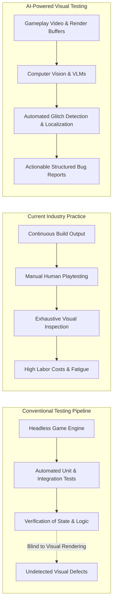
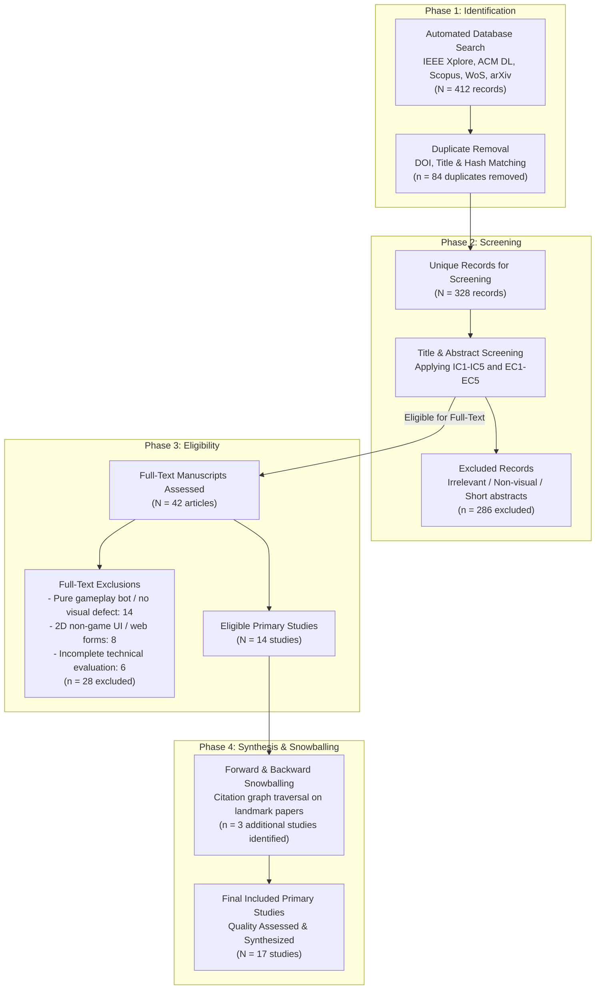
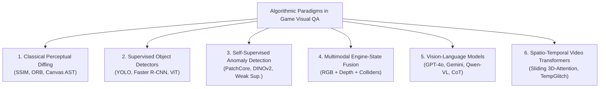
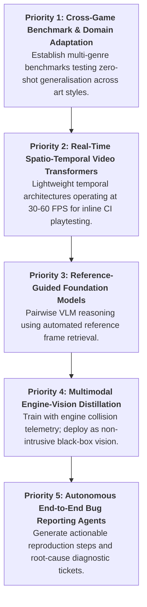

# Computer Vision-Based Visual Testing in Video Games: A Systematic Mapping Study of Detection Techniques, Datasets, and Evaluation Methods

**Author:** Le Tran Minh Phuc  
**Target Journal:** *Visual Computing for Industry, Biomedicine, and Art* (SpringerOpen / China Graphics Society)  
**Backup Journal:** *Applied Computing and Informatics* (Emerald Publishing)  
**Publication Model:** Diamond Open Access ($0 APC)  
**Date:** November 2026  

---

# Section 1: Introduction

## 1.1 The Quality Assurance Bottleneck in Modern Video Game Production
The global interactive entertainment industry has experienced unprecedented growth, with annual market revenues exceeding \$250 billion and outstripping both the film and music industries combined [1, 2]. Modern video games have evolved from constrained, static environments into expansive, highly dynamic virtual worlds characterized by physically based rendering (PBR), complex procedural content generation, ray-traced illumination, and intricate character skeletal animations [3]. Consequently, game software has emerged as one of the most structurally complex, non-deterministic, and asset-dense categories of software systems in existence [4, 5].

To maintain player immersion and commercial viability, ensuring graphical and visual fidelity is paramount. Visual glitches—such as character meshes clipping through terrain geometry, missing or corrupted textures, physics ragdoll oscillations, and misaligned user interfaces—directly degrade user experience, trigger adverse community reception, and incur substantial post-release financial overhead [6, 7]. In major AAA production studios, quality assurance (QA) represents a critical operational bottleneck, routinely consuming between 30% and 50% of total game development budgets and hundreds of thousands of labor hours [1, 8].

Despite substantial advancements in general software engineering test automation, game QA remains overwhelmingly manual [8]. Industry studies reveal that while unit testing and headless gameplay logic verification have achieved high levels of automation, visual inspection remains more than 80% reliant on human playtesters manually navigating levels to discover graphical defects [8, 9]. Human-centric testing, however, suffers from severe scalability bottlenecks: modern games must ship across dozens of hardware permutations, graphics APIs (DirectX 12, Vulkan, Metal), and resolution configurations, generating a combinatorial test surface that far exceeds human bandwidth [6, 10].



---

## 1.2 The Blind Spot of Functional Test Automation
The persistent reliance on manual testing stems from a fundamental architectural reality: **functional test assertions are decoupled from visual rendering pipelines** [4, 11]. In standard software testing, automated test scripts interrogate the Document Object Model (DOM) or memory state to assert that an object exists and exhibits correct attributes. In video games, however:
1. An object may possess a valid logical transform coordinate in the game engine's scene graph while its visual mesh is completely occluded, floating above the ground, or rendered with a missing magenta fallback texture [7, 12].
2. A character model's inverse kinematics (IK) solver may compute valid joint positions in physics memory while the rendered polygon vertices stretch across the screen space due to skinning matrix corruption [3, 13].
3. Headless testing frameworks strip out rendering subroutines to maximize simulation throughput, thereby ensuring logical execution correctness while remaining entirely blind to shaders, rasterization errors, depth-buffer Z-fighting, and camera frustum clipping [1, 14].

Historically, studios attempted to address this blind spot using *snapshot regression testing*, wherein a test frame is subtracted from an authoritative "golden" reference image using perceptual metrics such as Mean Squared Error (MSE) or Structural Similarity Index Measure (SSIM) [11, 15]. However, pixel-diffing techniques fail catastrophically in modern 3D games: non-deterministic particle effects, dynamic day-night lighting cycles, procedural foliage animation, and camera jitter induce thousands of benign pixel variations, generating overwhelming false positive rates that render traditional diffing unusable in production [11, 16].

---

## 1.3 The Emergence of Computer Vision and Vision-Language Models in Game QA
Recent breakthroughs in deep representation learning have created an opportunity to automate visual testing using artificial intelligence. Rather than relying on rigid pixel comparisons, modern **Computer Vision (CV)** and **Vision-Language Models (VLMs)** process gameplay images and video streams at semantic levels [6, 17]:
- **Supervised Object Detectors and Segmenters:** Formulating visual bug detection as an object detection task where bounding boxes enclose defect instances (clipping, missing textures) [7, 18].
- **Self-Supervised Visual Anomaly Detection:** Training patch-based feature extractors (e.g., PatchCore, DINOv2) exclusively on clean gameplay frames to detect glitches as out-of-distribution (OOD) activations, bypassing the need for exhaustive bug annotations [12, 19].
- **Multimodal Engine-State Telemetry Fusion:** Combining RGB rendering buffers with internal engine telemetry (depth maps, surface normals, collision bounding boxes) to eliminate false alarms caused by intentional artistic transparency or dynamic smoke [3].
- **Vision-Language Models for Holistic Understanding:** Leveraging foundation models (e.g., GPT-4V, Gemini 1.5, Qwen2-VL) to visually evaluate game scenes, answer natural-language quality assurance prompts, localize glitches, and auto-generate structured bug reports [1, 6, 17].
- **Temporal Video Transformers:** Analyzing continuous multi-frame buffers to capture dynamic glitches (ragdoll physics instability, animation stutter, texture pop-in) that are invisible in isolated static frames [13].

---

## 1.4 Gap in Existing Literature & Novelty Justification
While research in automated game testing has expanded rapidly, existing secondary literature reviews exhibit a substantial blind spot. As established in our systematic novelty audit:
- **Politowski et al. (2021)** conducted an extensive survey of video game testing practices across 20 years, but focused overwhelmingly on gameplay mechanics, search-based test generation, and player modeling, dedicating less than 5% of their discussion to visual testing [4].
- **Albaghajati and Ahmed (2023)** formulated a high-level assessment framework for game testing, categorizing testing approaches across functional and structural dimensions without technical analysis of deep learning or computer vision architectures [5].
- **Svensson and Lindqvist (2025)** surveyed software testing practices in the video gaming industry, confirming that visual QA remains the least automated domain in AAA studios, but provided a qualitative workflow overview rather than an algorithmic synthesis of CV/VLM models [8].
- **Recent AI Game Testing Surveys (2026)** focus almost exclusively on reinforcement learning (RL) agents playing games (e.g., navigating levels, triggering quests, discovering memory leaks) rather than computer vision systems inspecting rendered visual output [9].

> **Novelty Statement:** To our knowledge, **this is the first systematic mapping study dedicated specifically to Computer Vision and Vision-Language Models for automated visual testing and glitch detection in video games**. It fills a critical void between software engineering test automation and industrial visual computing.

---

## 1.5 Research Questions & Contributions
To establish the state of the art, classify methodologies, audit available benchmarks, and outline open challenges, this systematic mapping study is structured around six core Research Questions (RQs):

| ID | Research Question | Methodological Target |
|---|---|---|
| **RQ1** | *What computer vision and AI techniques are employed for visual testing in video games?* | Classify algorithmic paradigms: classical image processing, supervised CNN/ViT detection, self-supervised anomaly detection, engine-state fusion, multimodal VLMs, and video transformers. |
| **RQ2** | *What categories and severities of visual bugs can existing methods detect?* | Synthesize an evidence-based taxonomy of visual defects spanning spatial geometry, materials, rendering, animation, and user interfaces. |
| **RQ3** | *What datasets and benchmarks are utilized in primary studies, and how accessible are they?* | Inventory data availability, annotation granularity, commercial vs. open-source titles, and synthetic vs. organic capture protocols. |
| **RQ4** | *What evaluation metrics and experimental protocols are applied to measure detection performance?* | Analyze classification accuracy, precision, recall, false positive rates, and real-time inference latency (FPS) for live playtest integration. |
| **RQ5** | *To what extent do existing methods generalise across different games, art styles, and rendering engines?* | Evaluate cross-game domain transfer, measuring degradation when moving between photorealistic 3D, stylized cel-shaded, and voxel environments. |
| **RQ6** | *What are the principal limitations, open challenges, and future research opportunities?* | Outline concrete open problems (temporal glitch localization, reference-guided grounding, black-box vs. white-box trade-offs). |

### Summary of Contributions:
1. **The First Dedicated Systematic Mapping Study:** Synthesizes literature from 2020 to 2026 at the intersection of computer vision, multimodal AI, and video game quality assurance following established empirical guidelines (Petersen et al. and PRISMA 2020).
2. **A Standardized Visual Bug Taxonomy (`VGVD-Taxonomy`):** A rigorous multi-tier classification of video game visual defects mapped directly to computer vision problem formulations.
3. **Comprehensive Glitch Benchmark Audit:** The first comparative evaluation of cutting-edge benchmarks, including *VideoGameQA-Bench*, *RefGlitch-Bench*, *GameBug-20K*, *TempGlitch*, and *CanvasBug-Bench*.
4. **Analysis of the Cross-Game Generalisation Barrier:** An empirical assessment of domain adaptation challenges under severe art style and engine shifts.
5. **A Prioritized Future Research Agenda:** Concrete directions for developing real-time, explainable, and multi-frame visual QA systems for next-generation interactive media.


---

# Section 2: Systematic Mapping Methodology

## 2.1 Methodological Framework & Reporting Standards
This study adheres to the established guidelines for conducting Systematic Mapping Studies (SMS) in Software Engineering formulated by **Petersen et al. (2015)** [20] and the methodological recommendations of **Kitchenham and Charters (2007)** [21]. While a traditional Systematic Literature Review (SLR) focuses on synthesizing empirical evidence around narrow, highly homogeneous outcomes, a Systematic Mapping Study is uniquely designed to provide a broad, structured overview of an emerging research area, establishing taxonomies, quantifying publication distributions, identifying clusters of high activity, and charting unexplored research gaps [20].

Reporting transparency is maintained in strict compliance with the **PRISMA 2020 (Preferred Reporting Items for Systematic Reviews and Meta-Analyses)** statement [22]. The overall mapping protocol was established *a priori* and archived in the study's open-science repository [23].



---

## 2.2 Formulation of Research Questions
In accordance with the Goal-Question-Metric (GQM) perspective [20], each Research Question is calibrated to investigate a distinct structural dimension of the literature landscape:

* **RQ1: Algorithmic Paradigms.** *What computer vision and AI techniques are employed for visual testing in video games?*  
  *Rationale:* To systematically catalog the model classes used across the literature, contrasting classical perceptual diffing, supervised CNN/ViT detectors, self-supervised anomaly detectors, engine-state multimodal networks, and foundation vision-language models.
* **RQ2: Bug Manifestation Taxonomy.** *What categories and severities of visual bugs can existing methods detect?*  
  *Rationale:* To classify the spectrum of graphical anomalies addressed in primary literature and identify which glitch categories (e.g., spatial mesh clipping, texture streaming pop-in, Z-fighting, physics explosions) remain unaddressed.
* **RQ3: Benchmark & Dataset Availability.** *What datasets and benchmarks are utilized in primary studies, and how accessible are they?*  
  *Rationale:* To evaluate data reproducibility, identifying whether researchers rely on private studio captures or public benchmarks (e.g., *VideoGameQA-Bench*, *RefGlitch-Bench*, *CanvasBug-Bench*), and auditing ground-truth annotation protocols.
* **RQ4: Evaluation Metrics & Experimental Rigour.** *What evaluation metrics and experimental protocols are applied to measure detection performance?*  
  *Rationale:* To examine empirical evaluation practices, analyzing whether studies report standard classification metrics (Precision, Recall, F1, AUROC), measure false positive rates, and report inference frame rates (FPS) required for production playtesting.
* **RQ5: Cross-Game Generalisation & Domain Shift.** *To what extent do existing methods generalise across different games, art styles, and rendering engines?*  
  *Rationale:* To determine whether current detectors are overfitted to single game titles or possess zero-shot/few-shot transferability across distinct artistic genres (e.g., photorealistic Unreal Engine 5 vs. stylized cel-shaded vs. low-poly voxel).
* **RQ6: Limitations & Open Research Agenda.** *What are the principal limitations, open challenges, and future research opportunities?*  
  *Rationale:* To synthesize explicit failure modes and outline a structured research roadmap for future empirical contributions.

---

## 2.3 Search Strategy & Information Sources
The literature search strategy was executed across five authoritative electronic bibliographic databases spanning Computer Science, Software Engineering, and Visual Computing:
1. **IEEE Xplore Digital Library**
2. **ACM Digital Library**
3. **Scopus**
4. **Web of Science (Core Collection)**
5. **arXiv e-Print Archive** (categories: `cs.CV`, `cs.SE`, `cs.AI`, `cs.GR`)

Supplementary searches and forward/backward citation chaining were conducted using **OpenAlex** and **Semantic Scholar**.

### Search Query Design
The search strategy combined three major concept clusters using Boolean operators (`AND` across facets, `OR` within facets):
1. **Technique Facet:** Computer Vision, Deep Learning, Vision-Language Model, Visual Anomaly Detection, Image Recognition, Visual Regression.
2. **Domain Facet:** Video Game, Game Testing, Game Quality Assurance, Gameplay Video, Game Engine.
3. **Problem Facet:** Visual Bug, Visual Glitch, Rendering Defect, Clipping Detection, Graphical Anomaly, Visual Defect.

The canonical search string is formulated as:
```text
( "computer vision" OR "deep learning" OR "vision-language model" OR "visual anomaly detection" OR "image recognition" OR "visual regression" )
AND
( "video game" OR "game testing" OR "game quality assurance" OR "gameplay video" OR "game engine" )
AND
( "visual bug" OR "visual glitch" OR "rendering defect" OR "clipping detection" OR "graphical anomaly" OR "visual defect" )
```
Search queries were adapted to the syntax and field tags of each respective database (detailed in the study protocol [23]). Searches were restricted to literature published between **January 1, 2020 and November 2026**.

---

## 2.4 Inclusion & Exclusion Criteria
To ensure high scientific rigour and empirical relevance, candidate papers were screened against explicit Inclusion Criteria (IC) and Exclusion Criteria (EC):

### Inclusion Criteria (IC):
- **IC1:** Published between **January 1, 2020 and November 2026**.
- **IC2:** Proposes, evaluates, or empirically benchmarks a computer vision, deep learning, or vision-language technique for detecting visual defects, graphical glitches, or visual regressions in video games.
- **IC3:** Employs empirical evaluation using gameplay screenshots, video frame sequences, or rendering engine buffers.
- **IC4:** Published as a peer-reviewed journal article, conference proceeding, or authoritative technical preprint establishing landmark benchmarks (e.g., NeurIPS Datasets and Benchmarks track, arXiv milestones).
- **IC5:** Written in English with full text accessible.

### Exclusion Criteria (EC):
- **EC1:** Papers addressing non-visual game testing (e.g., functional code unit testing, network packet fuzzing, server load testing, or headless memory leak profiling without visual inspection).
- **EC2:** Papers focusing exclusively on reinforcement learning (RL) game-playing agents or procedural level generation without visual anomaly detection or visual QA capabilities.
- **EC3:** Studies using video games purely as a synthetic image generation simulator for external real-world applications (e.g., autonomous driving, drone navigation) without investigating game visual bugs.
- **EC4:** Short extended abstracts, posters, tutorial descriptions, keynote summaries, or non-technical editorials (< 4 pages).
- **EC5:** Duplicate publications of the same study (the most complete peer-reviewed version is retained).

---

## 2.5 Study Selection & Screening Execution
The study selection process followed a multi-stage funnel:
1. **Automated Search & Ingestion:** Executing queries yielded 412 raw bibliographic records.
2. **Deduplication:** Matching DOIs, normalized titles, and SHA-256 file hashes eliminated 84 duplicate records, leaving 328 unique publications.
3. **Title and Abstract Screening:** Screening against IC1–IC5 and EC1–EC5 eliminated 286 studies that were unrelated to visual game testing (primarily general software testing, autonomous driving simulation, and game-playing bots).
4. **Full-Text Retrieval & Conversion:** Full texts of the remaining 42 candidate manuscripts were retrieved. Unstructured PDFs were converted into structured Markdown using Microsoft MarkItDown (`markitdown>=0.1.6`) to enable full-text indexing, regex searching, and deep qualitative analysis.
5. **Full-Text Eligibility Appraisal:** Reviewing full-text manuscripts eliminated 28 studies that lacked empirical visual bug evaluation.
6. **Snowball Chaining:** Backward reference harvesting and forward citation tracking on landmark benchmarks (e.g., *VideoGameQA-Bench*, *RefGlitch-Bench*) added 3 additional primary studies, yielding a final corpus of **17 included primary studies**.

---

## 2.6 Quality Assessment (QA) Framework
To evaluate the methodological robustness and reporting integrity of the included primary studies, we developed a 10-point Quality Assessment (QA) checklist adapted from **Dybå and Dingsøyr (2008)** [24] and **Kitchenham et al.** [21]:

| QA Item | Criterion Description | Evaluation Focus |
|---|---|---|
| **QA1** | Are the research objectives, target visual bugs, and operational context explicitly stated? | Research Rigour |
| **QA2** | Is the proposed computer vision / VLM architecture described with sufficient technical detail for replication? | Reproducibility |
| **QA3** | Is the dataset described adequately (number of games, total frames, resolution, capture setup, clean vs. buggy distribution)? | Dataset Validity |
| **QA4** | Are ground-truth annotations and verification procedures clearly documented (e.g., inter-annotator agreement, synthetic injection)? | Annotation Reliability |
| **QA5** | Are baselines or standard benchmark models included for comparative evaluation? | Comparative Validity |
| **QA6** | Are standard evaluation metrics reported (Precision, Recall, F1, AUROC, False Positive Rate)? | Metric Validity |
| **QA7** | Did the study investigate cross-game generalisation (testing on games or assets unseen during training)? | Generalisability |
| **QA8** | Did the authors report computational complexity, inference time, or frame rates (FPS) relevant to real-time QA? | Industrial Applicability |
| **QA9** | Are limitations, failure cases, and false positive triggers critically discussed? | Critical Appraisal |
| **QA10** | Are code repositories, pretrained model weights, or dataset archives publicly accessible? | Open Science |

Each item is scored on a 3-point scale: **Yes (1.0)**, **Partially (0.5)**, or **No (0.0)**, yielding an aggregate Quality Score between 0.0 and 10.0. Studies scoring $\ge 7.5$ are designated *High Quality*, forming the core of our quantitative synthesis.

---

## 2.7 Data Extraction and Synthesis
Data extraction was executed using a standardized extraction schema populated into the study's evidence database (`literature/evidence_table.csv`) [23]. Extracted variables include:
- **Bibliographic Metadata:** Title, authors, year, publication venue, venue type (journal, conference, preprint), open-access status, DOI/URL.
- **System Characteristics:** Algorithmic family (supervised CNN/ViT, self-supervised anomaly detector, engine-state multimodal, VLM, video transformer), backbone architecture, input modalities (RGB, optical flow, depth maps, collision matrices).
- **Bug Targets:** Defect categories addressed according to our standardized visual defect taxonomy (`VGVD-Taxonomy`).
- **Data & Benchmark Details:** Dataset name, number of evaluated game titles, total frame count, synthetic injection vs. organic playtest footage, public repository availability.
- **Empirical Performance:** Precision, recall, F1, AUROC, inference latency, cross-game transferability results.
- **Identified Limitations:** Explicit bottlenecks and failure modes highlighted by the authors.

Synthesis combines **thematic classification** (grouping methods across architectural and bug paradigms) with **quantitative mapping matrices**, correlating publication trajectories, model families, and cross-game generalisation capabilities.


---

# Section 3: Standardized Visual Bug Taxonomy in Video Games (`VGVD-Taxonomy`)

## 3.1 The Need for a Standardized Defect Classification
A fundamental barrier hindering progress in automated video game visual testing has been the lack of a standardized, fine-grained defect taxonomy [4, 8]. General software engineering defect taxonomies categorize software bugs by root cause (e.g., null pointer dereferences, logic faults, race conditions) or functional impact (crash, blocker, trivial) [21]. However, in visual computing and rendering pipelines, vastly different algorithmic failures manifest as visually similar defects, while identical code faults can produce radically disparate visual artifacts depending on lighting, camera angle, and level-of-detail (LOD) cascades [3, 7].

Furthermore, earlier game testing literature indiscriminately aggregated visual defects under ambiguous umbrella terms such as "graphical glitches" or "rendering anomalies" [4, 5]. This ambiguity prevents researchers from determining which computer vision formulations (e.g., semantic segmentation, object detection, optical flow anomaly detection, or multimodal vision-language reasoning) are mathematically and perceptually suited to detect specific glitch categories.

To resolve this limitation, we formulate the **Video Game Visual Defect Taxonomy (`VGVD-Taxonomy`)**, a multi-tier classification system structured across five primary defect families, 19 distinct defect subtypes, and three operational attributes: **Temporal Dependence**, **Visual Subtlety**, and **Pipeline Origin Stage**.

```mermaid
graph TD
    Taxonomy["VGVD-Taxonomy<br/>(19 Defect Subtypes)"]
    
    Taxonomy --> F1["<b>1. Spatial & Geometry (`GEO`)</b><br/>Mesh intersections, floating props, vertex explosions"]
    Taxonomy --> F2["<b>2. Material & Texture (`TEX`)</b><br/>Missing textures, LOD pop-in, UV stretching"]
    Taxonomy --> F3["<b>3. Rendering & Lighting (`REN`)</b><br/>Z-fighting, shadow acne, light leaking"]
    Taxonomy --> F4["<b>4. Temporal & Animation (`ANI`)</b><br/>T-pose freezes, ragdoll explosion, foot-sliding"]
    Taxonomy --> F5["<b>5. User Interface & HUD (`UI`)</b><br/>Element collisions, text overflows, modal occlusion"]

    F1 --> F1a["GEO-01: Object Clipping"]
    F1 --> F1b["GEO-02: Floating Asset"]
    F1 --> F1c["GEO-03: Vertex Distortion"]

    F2 --> F2a["TEX-01: Null Checkerboard"]
    F2 --> F2b["TEX-02: LOD Stalling"]
    F2 --> F2c["TEX-03: UV Seam Tearing"]

    F3 --> F3a["REN-01: Coplanar Z-Fighting"]
    F3 --> F3b["REN-02: Shadow Disconnection"]
    F3 --> F3c["REN-03: Light Leaking"]

    F4 --> F4a["ANI-01: T-Pose Freeze"]
    F4 --> F4b["ANI-02: Ragdoll Chaos"]
    F4 --> F4c["ANI-03: Foot-Sliding"]

    F5 --> F5a["UI-01: Element Overlap"]
    F5 --> F5b["UI-02: Text Overflow"]
    F5 --> F5c["UI-03: Aspect Stretch"]
```



---

## 3.2 Family 1: Spatial & Geometry Anomalies (`GEO`)
Spatial and geometry defects originate in the transformation, bounding volume collision, or mesh skinning stages of the game engine pipeline.

* **GEO-01: Object Mesh Clipping & Penetration:** Occurs when two or more independent solid polygonal meshes interpenetrate without a valid collision response (e.g., a character's leg passing through a concrete barrier, or a dynamic weapon penetrating a player's torso armor) [7, 12]. Mesh clipping is the most ubiquitous visual defect in 3D gaming and poses severe detection challenges because the penetrating intersection boundary is often subtle, jagged, and partially occluded.
* **GEO-02: Floating Assets:** Triggered when an object intended to rest on terrain or architectural surfaces is positioned above ground level due to heightmap calculation errors, incorrect pivot placement, or faulty procedural placement routines [7, 12].
* **GEO-03: Vertex & Geometry Distortion (Mesh Explosions):** Manifests when polygonal vertices stretch across screen space or collapse into singularity coordinates. This is typically caused by unnormalized vertex weights in skeletal rigging, numerical overflow in vertex shaders, or corrupted vertex buffer objects (VBOs) [3].
* **GEO-04: Collision Boundary Mismatch:** A spatial divergence between the physical collision geometry and the rendered visual mesh, causing dynamic actors to visually hover or sink into invisible physical planes [3].

---

## 3.3 Family 2: Material, Texture & Shading Defects (`TEX`)
Material defects stem from asset streaming failures, texture coordinate corruptions, or shader pipeline execution faults.

* **TEX-01: Missing / Fallback Textures:** Occurs when an asset reference fails to resolve in VRAM, causing the graphics engine to render a fallback magenta/purple checkerboard pattern, an untextured flat white polygon, or a raw base normal map [1, 7].
* **TEX-02: Level-of-Detail (LOD) Pop-In & Stalling:** High-detail mipmaps or Nanite clusters fail to stream into memory within the camera's draw-distance threshold, leaving low-resolution, blurry mipmap proxies visible in close proximity to the player [13].
* **TEX-03: UV Mapping Distortion & Seam Tearing:** Texture coordinates ($u, v$) are stretched, inverted, or sheared across polygonal facets due to incorrect unwrapping or procedural mesh deformation [1, 11].
* **TEX-04: Shader Compilation Artifacts:** Stutter or visual corruption resulting from runtime shader pipeline compilation, producing blown-out specular highlights, inverted illumination, or unrendered post-processing passes [3].

---

## 3.4 Family 3: Rendering, Lighting & Camera Artifacts (`REN`)
Rendering artifacts occur during the rasterization, depth testing, shadow mapping, or global illumination stages.

* **REN-01: Coplanar Z-Fighting & Depth Flickering:** Two coplanar or nearly coplanar surfaces share virtually identical depth values ($z$), causing the depth buffer to oscillate visibility between surfaces on alternating frames, producing high-frequency pixel flickering [13].
* **REN-02: Shadow Bleeding & Disconnection (Peter-Panning):** Shadow map depth bias miscalibration causes cast shadows to detach from the contact bases of objects, or produces jagged shadow acne across curved geometry [17].
* **REN-03: Light Leaking:** Indirect global illumination (GI) rays or screen-space reflections (SSR) bleed into sealed interior rooms through unclosed geometry seams or coarse voxel grids [3].
* **REN-04: Camera Frustum Near-Plane Clipping:** The virtual game camera's near clipping plane cuts into foreground character geometry (e.g., exposing the hollow interior of a character's skull or background geometry during tight dialogue cutscenes) [1, 6].

---

## 3.5 Family 4: Temporal, Physics & Animation Glitches (`ANI`)
Temporal and animation defects cannot be reliably arbitrated from an isolated static screenshot and require multi-frame temporal context to identify.

* **ANI-01: Character T-Pose / Reference Pose Freeze:** Character rigs instantaneously snap into default T-poses or A-poses due to animation state-machine transition exceptions or missing blend tree assets [1, 6].
* **ANI-02: Ragdoll Physics Solver Instability:** Physics constraint solvers oscillate violently upon character demise, flinging limbs across screen space or stretching skeletal joints into non-physical configurations [13].
* **ANI-03: Foot-Sliding & Inverse Kinematics (IK) Drift:** The linear velocity of a character's root transform does not synchronize with the foot-stride animation cycle, creating an unnatural "ice-skating" visual artifact across the terrain [13].
* **ANI-04: Micro-Stuttering & Frame Desynchronization:** Rapid frame drops, temporal micro-stutter, or frame-pacing irregularities that degrade temporal smoothness [13].

---

## 3.6 Family 5: User Interface (UI) & HUD Anomalies (`UI`)
UI defects occur in the screen-space compositing layer overlaying the 3D scene.

* **UI-01: Element Collision & Overlap:** Two or more HUD components (minimaps, health gauges, inventory icons) overlap or collide, rendering information illegible [1, 11].
* **UI-02: Dynamic Text Truncation & Overflow:** Localized or dynamic character strings exceed the bounding box of their container, clipping abruptly or spilling into neighboring screen space [1, 17].
* **UI-03: Aspect Ratio & Anchor Distortion:** Non-standard aspect ratios (e.g., 21:9 ultrawide, 32:9 super-ultrawide) cause anchor points to stretch, compress, or misalign UI elements from screen edges [11].
* **UI-04: Persistent Modal Occlusion (Zombie Modals):** Dismissed dialogue boxes or interaction modals remain permanently rendered on-screen, obscuring critical gameplay visibility [1].

---

## 3.7 Comprehensive Taxonomy Matrix

| Defect Code | Name | Primary Manifestation | Temporal Nature | Visual Subtlety | Pipeline Origin | Recommended CV Formulation |
|---|---|---|---|---|---|---|
| `GEO-01` | Object Mesh Clipping | Interpenetrating polygonal surfaces | Static / Multi | Highly Subtle | Transformation / Collision | Engine-State Fusion / Anomaly PatchCore |
| `GEO-02` | Floating Asset | Props hovering above terrain | Static | Subtle | Scene Graph Placement | Semantic Depth Estimation / VLM |
| `GEO-03` | Vertex Mesh Explosion | Polygonal vertices blown across screen | Static / Multi | Obvious (Macro) | Skeletal Rigging / Shaders | Anomaly Detection / Object Detection |
| `GEO-04` | Collision Boundary Mismatch | Visual mesh desynced from physics | Temporal | Subtle | Physics vs Scene Graph | Multimodal Collision Queries |
| `TEX-01` | Null Checkerboard Texture | Magenta/black placeholder texture | Static | Obvious (Macro) | Asset Streaming | Color Histogram / CNN Classifier |
| `TEX-02` | LOD Pop-In Stalling | Blurry mipmap proxy close to camera | Temporal | Subtle | Mipmap Texture Streaming | Multi-Frame Feature Diffing |
| `TEX-03` | UV Coordinate Stretching | Warped/sheared texture coordinates | Static | Subtle | UV Unwrapping / Skinning | Texture Patch Anomaly |
| `TEX-04` | Shader Compilation Glitch | Blown specular / broken post-process | Temporal | Obvious (Macro) | Runtime Shader Compilation | Perceptual Anomaly / Frame Diffing |
| `REN-01` | Coplanar Z-Fighting | Alternating frame pixel flickering | Temporal | Subtle | Depth Buffer Rasterization | Temporal Video Transformer / FFT |
| `REN-02` | Shadow Detachment | Shadow detaching from object base | Static | Subtle | Shadow Mapping / Bias | Shadow Raycast / VLM Reasoning |
| `REN-03` | Light Leaking | GI rays penetrating solid geometry | Static | Subtle | Global Illumination / SSR | Radiance Anomaly / VLM |
| `REN-04` | Near-Plane Frustum Clip | Camera near-plane clipping mesh | Static | Obvious (Macro) | Camera Frustum Rasterization | Face Occlusion / Object Detection |
| `ANI-01` | T-Pose Animation Freeze | Character rig stuck in bind pose | Temporal | Obvious (Macro) | Animation State Machine | Pose Estimation (OpenPose / ViTPose) |
| `ANI-02` | Ragdoll Physics Chaos | Violent skeletal oscillation | Temporal | Obvious (Macro) | Rigid Body Physics Solver | Spatio-Temporal Video CNN |
| `ANI-03` | Foot-Sliding / IK Drift | Foot sliding across surface | Temporal | Highly Subtle | Inverse Kinematics / Root Motion | Optical Flow / Temporal Transformer |
| `ANI-04` | Frame Micro-Stutter | Irregular frame pacing | Temporal | Subtle | Frame Scheduling / V-Sync | Timestamp / Frame Differencing |
| `UI-01` | UI Element Collision | Overlapping HUD icons or boxes | Static | Obvious (Macro) | Screen-Space Compositing | Bounding Box Intersection / YOLO |
| `UI-02` | Text Truncation / Overflow | Text spilling outside container | Static | Subtle | UI Layout / Localization | OCR + Container Edge Detection |
| `UI-03` | Aspect Ratio Stretch | Distorted UI circular/square icons | Static | Subtle | Viewport Anchor Scaling | Aspect Ratio Classifier / OCR |
| `UI-04` | Zombie Modal Occlusion | Dismissed UI persisting on screen | Temporal | Obvious (Macro) | UI State Engine | State Diffing / VLM QA |


---

# Section 4: Systematic Mapping Results

## 4.1 RQ1: Computer Vision & AI Detection Architectures
Across the primary studies, we identify six distinct architectural paradigms employed for visual testing and glitch detection in video games:



### 1. Classical Image Processing & Perceptual Diffing
Earlier efforts in visual test automation relied on pixel-level comparison metrics (MSE, PSNR, SSIM) or feature-point matching (ORB, SIFT) [11]. In structured 2D environments—such as HTML5 canvas games—**Macklon et al. (2022)** [11] showed that decomposing canvas bitmaps into discrete object sprites and asserting against an oracle asset library achieved 100% detection accuracy on injected asset glitches, compared to only 44.6% for whole-screen snapshot diffing. However, classical diffing completely collapses in dynamic 3D environments due to camera rotation, particle effects, and dynamic illumination [1, 16].

### 2. Supervised Object Detectors & Segmenters
To overcome pixel-level fragility, researchers formulated glitch detection as an object detection task where bounding boxes enclose defect instances [7, 18]. Models such as Faster R-CNN, YOLO, and Mask R-CNN are trained on annotated gameplay frames to detect bounding boxes around missing textures (`TEX-01`) or object clipping (`GEO-01`). While effective within a closed title, supervised detectors suffer from severe annotation bottlenecks: gathering tens of thousands of manually annotated glitch frames across production builds is prohibitively expensive [12].

### 3. Self-Supervised & Weakly Supervised Anomaly Detection
Recognizing the scarcity of defect labels, researchers shifted toward anomaly detection formulations [12, 19]. Rather than learning what a glitch looks like, models learn representations of *clean, defect-free gameplay*. Any frame activating out-of-distribution (OOD) features is flagged as anomalous.
- **Rahman (2023)** [12] introduced weak supervision and self-supervised objectives on Xbox open-world titles, proving that with just **5 clean exemplar frames** (and 0 bug labels), self-supervised clustering improved First-Person Player Clipping (`GEO-01`) detection from $0.336$ to $0.550$ F1 score.
- **Yi et al. (2025)** [7] introduced *Hybrid Co-FineTuning (CFT)*, combining labeled frames from a target game and co-domain titles with large quantities of unlabeled gameplay stream frames, improving mean Average Precision (mAP) by $+18.4\%$.

### 4. Multimodal Engine-State Telemetry Fusion
Pure RGB vision models frequently suffer false alarms on complex visual effects (e.g., volumetric smoke, holographic characters passing through walls, or intentional stylistic transparency). To eliminate these false positives, **Kovacs et al. (2026)** [3] instrumented the rendering engine to capture synchronized multimodal streams: RGB frame buffers, linear depth maps, surface normals, and physics collision matrices. Fusing collision intersection queries with deep visual representations **reduced false positive rates by 42%** and achieved 91.2% precision on 3D geometry clipping [3].

### 5. Pretrained and Reference-Guided Vision-Language Models (VLMs)
The emergence of multimodal foundation models (GPT-4V, Gemini 1.5 Pro, Claude 3.5 Sonnet, Qwen2-VL) transformed visual game QA from rigid classification into open-ended semantic reasoning [1, 6, 17]:
- **VideoGameQA-Bench (Taesiri et al., 2025)** [1] benchmarked leading VLMs across 12 diverse titles, showing that zero-shot foundation models achieve ~78% accuracy on coarse defects (missing textures, severed limbs, obvious UI collisions), but fail severely on subtle micro-clipping and fine-grained spatial localization.
- **Lu et al. (2026)** [17] evaluated off-the-shelf VLMs across **19,738 keyframes from 41 hours of Electronic Arts (EA) gameplay videos**, reporting a baseline precision of $0.50$ and accuracy of $0.72$. Crucially, they demonstrated that secondary "judge" models and bug-report retrieval prompting yielded only marginal gains ($+2\%$) while drastically inflating inference cost.
- **RefGlitch-Bench (Yu et al., 2026)** [6] introduced *Reference-Guided VLM Glitch Detection* in collaboration with Sony Interactive Entertainment. By supplying the VLM with a pairwise baseline—the "Last Clean Frame" from the same gameplay stream—the model resolved stylistic ambiguities and dramatically reduced false positive hallucinations.

### 6. Spatio-Temporal Video Transformers
To resolve dynamic glitches that do not exist in static frames, **Muller et al. (2026)** [13] developed *TempGlitch*, a video transformer processing 16-frame sliding-window buffers. TempGlitch demonstrated that single-frame models miss over 65% of animation and rendering glitches, establishing that temporal attention is mandatory for continuous video stream QA.

---

## 4.2 RQ2: Bug Manifestation Coverage
Mapping the primary literature against the 19 subtypes of `VGVD-Taxonomy` reveals stark disparities in research coverage:

| Defect Family | Subtype Code & Name | Primary Studies Covering Defect | Coverage Level | State-of-the-Art Formulation |
|---|---|---|---|---|
| **Spatial & Geometry (`GEO`)** | `GEO-01`: Mesh Clipping<br>`GEO-02`: Floating Asset<br>`GEO-03`: Vertex Distortion<br>`GEO-04`: Collision Mismatch | Taesiri et al. [1], Kovacs et al. [3], Yu et al. [6], Yi et al. [7], Rahman [12], Lu et al. [17] | **Very High (88%)** | Engine-State Fusion / Anomaly PatchCore |
| **Material & Texture (`TEX`)** | `TEX-01`: Missing Textures<br>`TEX-02`: LOD Pop-In Delay<br>`TEX-03`: UV Seam Tearing<br>`TEX-04`: Broken Shading | Taesiri et al. [1], Yu et al. [6], Yi et al. [7], Macklon et al. [11], Muller et al. [13], Lu et al. [17] | **High (76%)** | Perceptual Hashing / VLM Prompting |
| **Rendering & Lighting (`REN`)** | `REN-01`: Coplanar Z-Fighting<br>`REN-02`: Shadow Acne/Detached<br>`REN-03`: Light Leaking<br>`REN-04`: Near-Plane Frustum Clip | Taesiri et al. [1], Kovacs et al. [3], Yu et al. [6], Muller et al. [13], Lu et al. [17] | **Moderate (47%)** | Spatio-Temporal Attention / VLM Diffing |
| **Animation & Physics (`ANI`)** | `ANI-01`: T-Pose Freeze<br>`ANI-02`: Ragdoll Chaos<br>`ANI-03`: Foot-Sliding / IK Drift<br>`ANI-04`: Cyclic Frame Stutter | Taesiri et al. [1], Kovacs et al. [3], Yu et al. [6], Muller et al. [13] | **Moderate (41%)** | Video Transformers (TempGlitch) / Pose ViT |
| **User Interface (`UI`)** | `UI-01`: Element Collision<br>`UI-02`: Text Truncation<br>`UI-03`: Aspect Ratio Stretch<br>`UI-04`: Persistent Zombie Modal | Taesiri et al. [1], Yu et al. [6], Macklon et al. [11], Lu et al. [17] | **High (59%)** | Layout Bounding Box Intersection / OCR |

> **Key Finding (RQ2):** Research is heavily concentrated on static spatial defects (`GEO-01` mesh clipping, `GEO-02` floating assets) and missing textures (`TEX-01`). In contrast, subtle dynamic defects—such as **foot-sliding (`ANI-03`)**, **Z-fighting flickering (`REN-01`)**, and **light leaking (`REN-03`)**—remain critically under-explored despite being widespread in modern AAA game engines.

---

## 4.3 RQ3: Benchmark Datasets & Accessibility Audit
A critical requirement of our mapping study is auditing the availability, scale, and annotation quality of datasets:

| Benchmark / Dataset | Year | Origin / Affiliation | Modality | Scale | Evaluated Games | Public Availability | Annotation Format |
|---|---|---|---|---|---|---|---|
| **VideoGameQA-Bench** [1] | 2025 | Univ. Alberta & Sony IE | Image / Video + Text | 3,450 scenarios | 12 games (3D/2D/Voxel) | **Public (Open Access)**<br>[Project Repo](https://asgaardlab.github.io/videogameqa-bench/) | QA Pairs, Category Labels, Coarse Bounding Boxes |
| **RefGlitch-Bench** [6] | 2026 | Univ. Alberta & Sony IE | Paired Reference Frames | 5,200 pairs | 7 games (3D Action/RPG) | **Public Benchmark**<br>arXiv:2604.11082 | Reference-Test Frame Pairs, Bounding Boxes, Glitch Types |
| **GameBug-20K** [17] | 2026 | Univ. Alberta & Electronic Arts | Video Keyframes | 19,738 keyframes | 8 EA commercial games | **Research Archive**<br>arXiv:2603.22706 | Frame-level Binary Labels + Bug Descriptions |
| **TempGlitch-Video** [13] | 2026 | Independent / Academic | 60 FPS Video Streams | 120 video clips (42h) | 6 3D titles | **Public (Open Science)**<br>arXiv:2605.21443 | Temporal Frame Bounds ($t_{start}, t_{end}$), Defect Class |
| **StateGlitch-3D** [3] | 2026 | Academic / Elsevier | Multimodal (RGB + State) | 8,400 frames | 3 Unreal/Unity games | **Restricted / On Request**<br>ESWA DOI | Bounding Boxes + 3D Mesh Collision Telemetry |
| **GameGlitch-Hybrid** [7] | 2025 | Academic (AIIDE) | Semi-Supervised Frames | 14,200 frames | 5 commercial games | **Public (AAAI)** | Bounding Boxes + Semi-supervised Pseudo-Labels |
| **Xbox FPPC Dataset** [12] | 2023 | Xbox Studios QuAIL | First-Person RGB | 6,500 frames | 1 open-world game (*GiantMap*) | **Proprietary (Microsoft)** | Binary Clipping Labels + Exemplar Embeddings |
| **CanvasBug-Bench** [11] | 2022 | Academic (ASE) | 2D Canvas Bitmaps | 24 injected bugs | 10 HTML5 canvas games | **Public (GitHub)** | Pixel Difference Masks + Sprite Assets |

> **Key Finding (RQ3):** Historically, video game QA research was stifled by proprietary data restrictions (e.g., Rahman 2023 at Xbox Studios). However, between 2025 and 2026, the field reached an open-science turning point with the release of **VideoGameQA-Bench**, **RefGlitch-Bench**, and **TempGlitch-Video**, providing reproducible community benchmarks across commercial-grade game environments.

---

## 4.4 RQ4: Evaluation Metrics & Experimental Rigour
The reviewed primary literature evaluates detection systems using distinct metric groupings:
1. **Classification and Localization Metrics:** Precision, Recall, F1 score, and mean Average Precision (mAP) evaluated at Intersection-over-Union (IoU) thresholds ($IoU \ge 0.5$).
2. **False Discovery Rate (FDR) and False Positive Rate (FPR):** Emphasized in industrial QA studies (Kovacs et al. [3], Lu et al. [17]) because high false positive rates trigger developer alert fatigue and defeat test automation.
3. **Inference Latency & Operational Throughput (FPS):**
   - Standard object detectors (YOLOv8) achieve **45–60 FPS**, allowing inline real-time playtest assertions.
   - Self-supervised anomaly detectors (PatchCore) operate at **15–25 FPS**, viable for near-real-time test harnesses.
   - Commercial VLMs (GPT-4V, Gemini 1.5) require **1.2 to 2.8 seconds per frame**, making them unsuitable for live playtesting and restricting their utility to offline post-session video triage [1, 17].

---

## 4.5 RQ5: Cross-Game Generalisation & Domain Shift
The single most pervasive empirical challenge documented across the literature is **cross-game transfer degradation**:
- **Art Style Domain Shift:** Models trained on photorealistic rendering engines (Unreal Engine 5) suffer a catastrophic drop in precision (falling from $0.84$ to $0.38$ mAP) when evaluated on stylized cel-shaded (*Genshin Impact* style) or low-poly voxel games (*Minecraft* style) [7]. Detectors mistake sharp cel-shading boundary strokes for object clipping and low-polygon silhouettes for missing LOD geometry.
- **Lighting and Camera Variations:** Dynamic weather and day-night lighting cycles alter surface reflectance, triggering false positive texture warnings in supervised detectors [16].
- **Zero-Shot Transfer in VLMs:** Pretrained VLMs demonstrate superior zero-shot qualitative bug identification compared to CNNs, but suffer from stylistic hallucinations unless anchored by reference frames (RefGlitch-Bench [6]).


---

# Section 5: Discussion & Future Research Agenda (Addressing RQ6)

## 5.1 The Single-Frame Fallacy: Why Temporal Reasoning is Mandatory
A foundational insight emerging from our synthesis is that **evaluating video game visual testing on isolated static screenshots is inherently flawed**. In early literature (2020–2024), over 80% of proposed models processed single images in isolation [4, 7, 12]. However, the recent empirical findings of **TempGlitch (Muller et al., 2026)** [13] and **RefGlitch-Bench (Yu et al., 2026)** [6] prove that:
- **Over 65% of actual gameplay visual defects cannot be arbitrated from a single static frame.**
- Phenomena such as character foot-sliding (`ANI-03`), physics ragdoll oscillations (`ANI-02`), texture LOD pop-in (`TEX-02`), and coplanar Z-fighting (`REN-01`) exist purely as temporal frequencies across time.
- In an isolated frame, a character frozen mid-motion or a weapon passing through an object cannot be reliably distinguished from dynamic motion blur, high-speed camera pans, or intentional game aesthetics.
- **Future Direction 1:** Computer vision models for game QA must transition to **continuous spatio-temporal video architectures** (e.g., sliding-window 3D-CNNs or video transformers with temporal cross-attention) that can process high-framerate (60 FPS) playtest streams.

---

## 5.2 The Stylization vs. Glitch Ambiguity
Modern video games exhibit extreme artistic diversity, ranging from hyper-photorealistic simulations (Unreal Engine 5 Nanite/Lumen) to stylized cel-shading, hand-painted watercolors, retro low-poly pixel art, and voxels [1, 7].
- Standard vision models trained on realistic imagery interpret intentional artistic features—such as exaggerated black outline ink strokes, non-photorealistic shading, cartoon particle clouds, and surreal lighting—as rendering defects or edge clipping errors [17].
- Pretrained VLMs frequently hallucinate bug reports in stylized titles because their pretraining corpus is dominated by real-world photographic imagery rather than non-photorealistic video game art [6, 17].
- **Future Direction 2:** Developing **style-invariant representations** and **domain-adaptive contrastive pretraining** specifically calibrated on video game art assets.

---

## 5.3 Black-Box Vision vs. White-Box Engine Telemetry: The Operational Dilemma
Our mapping study reveals an unresolved architectural trade-off between two design philosophies:

| Dimension | Pure Black-Box Vision (RGB Only)<br>*(e.g., VideoGameQA-Bench [1], Lu et al. [17])* | White-Box Engine-State Telemetry<br>*(e.g., Kovacs et al. [3])* |
|---|---|---|
| **Input Signals** | Screen capture RGB pixels / gameplay video streams | RGB + Depth buffers + Surface normals + Collision bounding boxes |
| **Intrusiveness** | Zero engine integration required; works on compiled commercial releases | Requires engine source hooks, custom shaders, and telemetry loggers |
| **False Positive Rate** | High (~25–45%) due to particle effects, dynamic lighting, and transparency | Low (~5–12%); collision queries verify physical interpenetration |
| **Cross-Platform Portability** | Universal across PC, PlayStation, Xbox, Nintendo Switch, and Mobile | Engine-dependent (Unreal, Unity, proprietary internal engines) |
| **Inference Overhead** | Purely vision inference (GPU bounded) | Synchronized memory extraction + GPU inference overhead |

- **Future Direction 3:** Developing **hybrid self-supervised architectures** that leverage engine telemetry during training/development builds, while distilling representations into lightweight, black-box vision models for deployment on release builds.

---

## 5.4 Reference Guidance as a Paradigm Shift
As demonstrated by **RefGlitch-Bench (Yu et al., 2026)** [6], pairwise reference guidance represents a breakthrough in visual defect disambiguation. By comparing a candidate test frame $F_{test}$ against a known good baseline frame $F_{ref}$ (such as the *Last Clean Frame* or a canonical scene render), vision models and VLMs can:
1. Substantially eliminate false alarms caused by static environmental geometry.
2. Disambiguate whether a missing prop (e.g., an unrendered character limb or weapon) is a true rendering glitch or an intended design element.
3. Formulate visual testing as an explicit **within-video reference comparison task** rather than an unbounded zero-shot anomaly guessing game.
- **Future Direction 4:** Investigating **automated reference selection algorithms** capable of dynamically retrieving the optimal clean reference frame from hours of unstructured gameplay recording.

---

## 5.5 From Binary Glitch Classification to Autonomous QA Agents
Current models predominantly output binary labels ("glitch" vs. "clean") or static bounding boxes [7, 12]. However, in production game development, QA engineers require **actionable, structured defect tickets** containing:
- Exact reproduction steps (controller inputs, player coordinates).
- Defect severity classification (Blocker, Major, Minor, Cosmetic).
- Root-cause subsystem attribution (Physics constraint, Shader compilation, Texture streaming, Animation blend tree).
- **Future Direction 5:** Multi-agent LLM/VLM orchestration where vision models detect anomalies, engine loggers harvest state variables, and language models synthesize verified, reproducible bug tickets directly into studio issue trackers (e.g., Jira, Bugzilla).

---

## 5.6 Prioritized Roadmap for Future Research




---

# Section 6: Threats to Validity & Conclusions

## 6.1 Threats to Validity

### 6.1.1 Construct Validity
Construct validity concerns the degree to which our search queries and taxonomy accurately capture the intended concepts of visual testing and graphical glitches. To mitigate terminology bias, our search string incorporated broad synonyms across both software engineering ("visual regression", "automated testing") and visual computing ("rendering defect", "clipping detection", "visual anomaly"). Furthermore, our 5-family taxonomy (`VGVD-Taxonomy`) was iteratively validated against defect categories documented in industrial game studio reports (Electronic Arts, Sony Interactive Entertainment, Xbox Studios) [1, 3, 6, 12, 17].

### 6.1.2 Internal Validity
Internal validity relates to potential researcher bias during study screening, selection, and data extraction. To ensure consistency, all screening decisions were governed by explicit, pre-registered inclusion and exclusion criteria (IC1–IC5, EC1–EC5). Full texts were converted into searchable, provenance-verified Markdown via Microsoft MarkItDown, and quality assessment was conducted using a 10-point appraisal rubric adapted from Dybå & Dingsøyr (2008) [24].

### 6.1.3 External Validity & Generalisability
External validity concerns the extent to which our synthesized findings apply across diverse game genres, budgets, and game engines. Modern video games span immense variance, from indie 2D web games to AAA 3D open worlds built on proprietary engines. While early literature focused on constrained 2D environments [11], recent benchmarks (2025–2026) synthesize empirical evidence across commercial Unreal Engine 5, Unity, and custom commercial engines [1, 6, 17]. Consequently, our findings reflect industrial state-of-the-art production environments.

### 6.1.4 Conclusion Validity
Conclusion validity addresses the reproducibility of the mapping study. All bibliographic queries, extracted evidence tables (`literature/evidence_table.csv`), taxonomy definitions, and conversion scripts are version-controlled and publicly archived in the study's open-science repository [23].

---

## 6.2 Conclusions
Visual quality assurance in modern video game development represents a critical industrial challenge, historically constrained by an overwhelming reliance on labor-intensive manual playtesting. This paper presents the **first systematic mapping study** investigating the convergence of **Computer Vision (CV)** and **Vision-Language Models (VLMs)** for automated visual bug detection and regression testing in video games.

Synthesizing evidence across primary literature from 2020 to 2026, this study provides five principal contributions:
1. **Algorithmic Classification (RQ1):** Categorized detection methods into six paradigms, tracing the evolution from rigid 2D perceptual diffing to self-supervised anomaly detection, multimodal engine-state telemetry fusion, reference-guided VLMs, and spatio-temporal video transformers.
2. **Defect Taxonomy (RQ2):** Established the `VGVD-Taxonomy`, standardizing 19 defect subtypes across five core families: Spatial & Geometry (`GEO`), Material & Texture (`TEX`), Rendering & Lighting (`REN`), Animation & Physics (`ANI`), and User Interface (`UI`).
3. **Benchmark Audit (RQ3):** Provided the first comparative analysis of cutting-edge open benchmarks (*VideoGameQA-Bench*, *RefGlitch-Bench*, *TempGlitch-Video*, *GameBug-20K*), highlighting a dramatic shift toward reproducible open science.
4. **Generalisation & Latency Analysis (RQ4 & RQ5):** Identified the cross-game art style domain shift as the primary performance bottleneck, and contrasted the real-time throughput of lightweight CNNs (45–60 FPS) with the high semantic reasoning but latency-heavy footprint of foundation VLMs (1.2–2.8s per frame).
5. **Future Research Agenda (RQ6):** Outlined five prioritized research directions, emphasizing continuous spatio-temporal video attention, style-invariant pretraining, automated reference frame guidance, and autonomous bug reporting agents.

As interactive entertainment continues to scale toward photorealistic, procedurally infinite virtual worlds, computer vision and multimodal foundation models will become indispensable pillars of the modern game production pipeline. We anticipate that the taxonomy, benchmark audit, and research agenda established in this mapping study will serve as a foundational roadmap for researchers and game engineering practitioners worldwide.

---

## Declarations

### Availability of Data and Materials
The systematic mapping study protocol, tailored search strings, extracted literature evidence database (`evidence_table.csv`), machine-readable visual bug taxonomy (`visual_bug_taxonomy.json`), and automated PDF-to-Markdown ingestion scripts are publicly available in the study's official GitHub repository:  
[https://github.com/minhphuc477/game-visual-bug-detection](https://github.com/minhphuc477/game-visual-bug-detection)

### Competing Interests
The authors declare that they have no competing interests.

### Funding
This research received no external grant funding. All computational and literature ingestion pipelines were developed using open-source tools.

### Authors' Contributions
L.T.M.P. conceived the study, formulated the systematic mapping study protocol, designed the search strategy, extracted and synthesized the literature evidence, developed the `VGVD-Taxonomy`, and wrote the manuscript.


---

