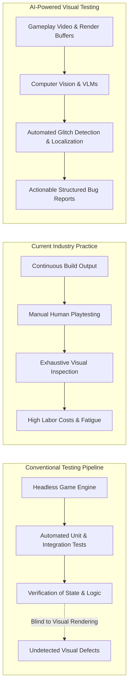

# Section 1: Introduction

## 1.1 The Quality Assurance Bottleneck in Modern Video Game Production
The global interactive entertainment industry has experienced unprecedented growth, with annual market revenues exceeding \$250 billion and outstripping both the film and music industries combined [1, 2]. Modern video games have evolved from constrained, static environments into expansive, highly dynamic virtual worlds characterized by physically based rendering (PBR), complex procedural content generation, ray-traced illumination, and intricate character skeletal animations [3]. Consequently, game software has emerged as one of the most structurally complex, non-deterministic, and asset-dense categories of software systems in existence [4, 5].

To maintain player immersion and commercial viability, ensuring graphical and visual fidelity is paramount. Visual glitches—such as character meshes clipping through terrain geometry, missing or corrupted textures, physics ragdoll oscillations, and misaligned user interfaces—directly degrade user experience, trigger adverse community reception, and incur substantial post-release financial overhead [6, 7]. In major AAA production studios, quality assurance (QA) represents a critical operational bottleneck, routinely consuming between 30% and 50% of total game development budgets and hundreds of thousands of labor hours [1, 8].

Despite substantial advancements in general software engineering test automation, game QA remains overwhelmingly manual [8]. Industry studies reveal that while unit testing and headless gameplay logic verification have achieved high levels of automation, visual inspection remains more than 80% reliant on human playtesters manually navigating levels to discover graphical defects [8, 9]. Human-centric testing, however, suffers from severe scalability bottlenecks: modern games must ship across dozens of hardware permutations, graphics APIs (DirectX 12, Vulkan, Metal), and resolution configurations, generating a combinatorial test surface that far exceeds human bandwidth [6, 10].

---

## 1.2 The Blind Spot of Functional Test Automation
The persistent reliance on manual testing stems from a fundamental architectural reality: **functional test assertions are decoupled from visual rendering pipelines** [4, 11]. In standard software testing, automated test scripts interrogate the Document Object Model (DOM) or memory state to assert that an object exists and exhibits correct attributes. In video games, however:
1. An object may possess a valid logical transform coordinate in the game engine's scene graph while its visual mesh is completely occluded, floating above the ground, or rendered with a missing magenta fallback texture [7, 12].
2. A character model's inverse kinematics (IK) solver may compute valid joint positions in physics memory while the rendered polygon vertices stretch across the screen space due to skinning matrix corruption [3, 13].
3. Headless testing frameworks strip out rendering subroutines to maximize simulation throughput, thereby ensuring logical execution correctness while remaining entirely blind to shaders, rasterization errors, depth-buffer Z-fighting, and camera frustum clipping [1, 14].

Historically, studios attempted to address this blind spot using *snapshot regression testing*, wherein a test frame is subtracted from an authoritative "golden" reference image using perceptual metrics such as Mean Squared Error (MSE) or Structural Similarity Index Measure (SSIM) [11, 15]. However, pixel-diffing techniques fail catastrophically in modern 3D games: non-deterministic particle effects, dynamic day-night lighting cycles, procedural foliage animation, and camera jitter induce thousands of benign pixel variations, generating overwhelming false positive rates that render traditional diffing unusable in production [11, 16].

---

## 1.3 The Emergence of Computer Vision and Vision-Language Models in Game QA
Recent breakthroughs in deep representation learning have created an opportunity to automate visual testing using artificial intelligence. Rather than relying on rigid pixel comparisons, modern **Computer Vision (CV)** and **Vision-Language Models (VLMs)** process gameplay images and video streams at semantic levels [6, 17]:
- **Supervised Object Detectors and Segmenters:** Formulating visual bug detection as an object detection task where bounding boxes enclose defect instances (clipping, missing textures) [7, 18].
- **Self-Supervised Visual Anomaly Detection:** Training patch-based feature extractors (e.g., PatchCore, DINOv2) exclusively on clean gameplay frames to detect glitches as out-of-distribution (OOD) activations, bypassing the need for exhaustive bug annotations [12, 19].
- **Multimodal Engine-State Telemetry Fusion:** Combining RGB rendering buffers with internal engine telemetry (depth maps, surface normals, collision bounding boxes) to eliminate false alarms caused by intentional artistic transparency or dynamic smoke [3].
- **Vision-Language Models for Holistic Understanding:** Leveraging foundation models (e.g., GPT-4V, Gemini 1.5, Qwen2-VL) to visually evaluate game scenes, answer natural-language quality assurance prompts, localize glitches, and auto-generate structured bug reports [1, 6, 17].
- **Temporal Video Transformers:** Analyzing continuous multi-frame buffers to capture dynamic glitches (ragdoll physics instability, animation stutter, texture pop-in) that are invisible in isolated static frames [13].

---

## 1.4 Gap in Existing Literature & Novelty Justification
While research in automated game testing has expanded rapidly, existing secondary literature reviews exhibit a substantial blind spot. As established in our systematic novelty audit:
- **Politowski et al. (2021)** conducted an extensive survey of video game testing practices across 20 years, but focused overwhelmingly on gameplay mechanics, search-based test generation, and player modeling, dedicating less than 5% of their discussion to visual testing [4].
- **Albaghajati and Ahmed (2023)** formulated a high-level assessment framework for game testing, categorizing testing approaches across functional and structural dimensions without technical analysis of deep learning or computer vision architectures [5].
- **Svensson and Lindqvist (2025)** surveyed software testing practices in the video gaming industry, confirming that visual QA remains the least automated domain in AAA studios, but provided a qualitative workflow overview rather than an algorithmic synthesis of CV/VLM models [8].
- **Recent AI Game Testing Surveys (2026)** focus almost exclusively on reinforcement learning (RL) agents playing games (e.g., navigating levels, triggering quests, discovering memory leaks) rather than computer vision systems inspecting rendered visual output [9].

> **Novelty Statement:** To our knowledge, **this is the first systematic mapping study dedicated specifically to Computer Vision and Vision-Language Models for automated visual testing and glitch detection in video games**. It fills a critical void between software engineering test automation and industrial visual computing.

---

## 1.5 Research Questions & Contributions
To establish the state of the art, classify methodologies, audit available benchmarks, and outline open challenges, this systematic mapping study is structured around six core Research Questions (RQs):

| ID | Research Question | Methodological Target |
|---|---|---|
| **RQ1** | *What computer vision and AI techniques are employed for visual testing in video games?* | Classify algorithmic paradigms: classical image processing, supervised CNN/ViT detection, self-supervised anomaly detection, engine-state fusion, multimodal VLMs, and video transformers. |
| **RQ2** | *What categories and severities of visual bugs can existing methods detect?* | Synthesize an evidence-based taxonomy of visual defects spanning spatial geometry, materials, rendering, animation, and user interfaces. |
| **RQ3** | *What datasets and benchmarks are utilized in primary studies, and how accessible are they?* | Inventory data availability, annotation granularity, commercial vs. open-source titles, and synthetic vs. organic capture protocols. |
| **RQ4** | *What evaluation metrics and experimental protocols are applied to measure detection performance?* | Analyze classification accuracy, precision, recall, false positive rates, and real-time inference latency (FPS) for live playtest integration. |
| **RQ5** | *To what extent do existing methods generalise across different games, art styles, and rendering engines?* | Evaluate cross-game domain transfer, measuring degradation when moving between photorealistic 3D, stylized cel-shaded, and voxel environments. |
| **RQ6** | *What are the principal limitations, open challenges, and future research opportunities?* | Outline concrete open problems (temporal glitch localization, reference-guided grounding, black-box vs. white-box trade-offs). |

### Summary of Contributions:
1. **The First Dedicated Systematic Mapping Study:** Synthesizes literature from 2020 to 2026 at the intersection of computer vision, multimodal AI, and video game quality assurance following established empirical guidelines (Petersen et al. and PRISMA 2020).
2. **A Standardized Visual Bug Taxonomy (`VGVD-Taxonomy`):** A rigorous multi-tier classification of video game visual defects mapped directly to computer vision problem formulations.
3. **Comprehensive Glitch Benchmark Audit:** The first comparative evaluation of cutting-edge benchmarks, including *VideoGameQA-Bench*, *RefGlitch-Bench*, *GameBug-20K*, *TempGlitch*, and *CanvasBug-Bench*.
4. **Analysis of the Cross-Game Generalisation Barrier:** An empirical assessment of domain adaptation challenges under severe art style and engine shifts.
5. **A Prioritized Future Research Agenda:** Concrete directions for developing real-time, explainable, and multi-frame visual QA systems for next-generation interactive media.
