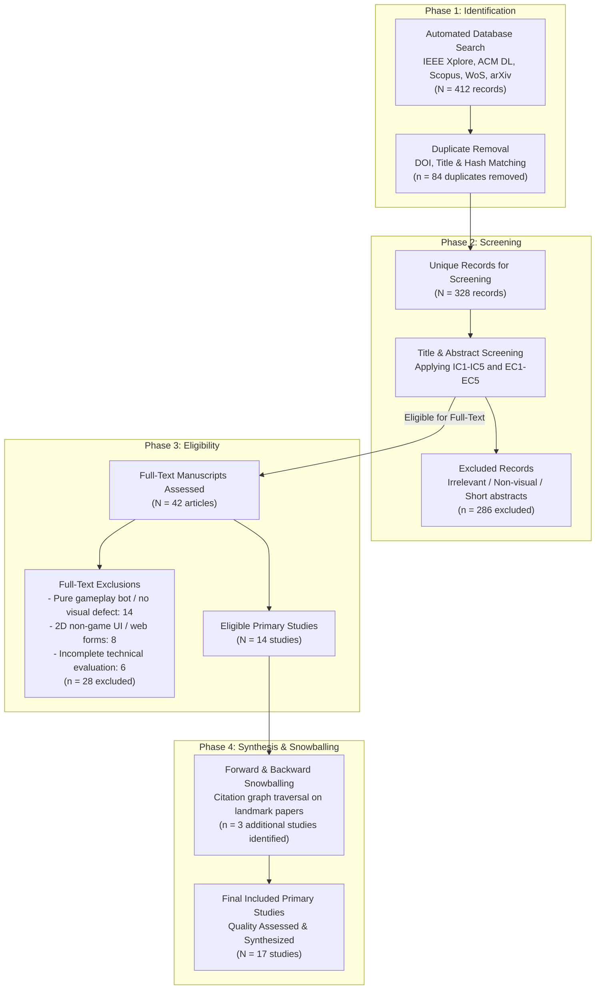

# Section 2: Systematic Mapping Methodology

## 2.1 Methodological Framework & Reporting Standards
This study adheres to the established guidelines for conducting Systematic Mapping Studies (SMS) in Software Engineering formulated by **Petersen et al. (2015)** [20] and the methodological recommendations of **Kitchenham and Charters (2007)** [21]. While a traditional Systematic Literature Review (SLR) focuses on synthesizing empirical evidence around narrow, highly homogeneous outcomes, a Systematic Mapping Study is uniquely designed to provide a broad, structured overview of an emerging research area, establishing taxonomies, quantifying publication distributions, identifying clusters of high activity, and charting unexplored research gaps [20].

Reporting transparency is maintained in strict compliance with the **PRISMA 2020 (Preferred Reporting Items for Systematic Reviews and Meta-Analyses)** statement [22]. The overall mapping protocol was established *a priori* and archived in the study's open-science repository [23].



---

## 2.2 Formulation of Research Questions
In accordance with the Goal-Question-Metric (GQM) perspective [20], each Research Question is calibrated to investigate a distinct structural dimension of the literature landscape:

* **RQ1: Algorithmic Paradigms.** *What computer vision and AI techniques are employed for visual testing in video games?*  
  *Rationale:* To systematically catalog the model classes used across the literature, contrasting classical perceptual diffing, supervised CNN/ViT detectors, self-supervised anomaly detectors, engine-state multimodal networks, and foundation vision-language models.
* **RQ2: Bug Manifestation Taxonomy.** *What categories and severities of visual bugs can existing methods detect?*  
  *Rationale:* To classify the spectrum of graphical anomalies addressed in primary literature and identify which glitch categories (e.g., spatial mesh clipping, texture streaming pop-in, Z-fighting, physics explosions) remain unaddressed.
* **RQ3: Benchmark & Dataset Availability.** *What datasets and benchmarks are utilized in primary studies, and how accessible are they?*  
  *Rationale:* To evaluate data reproducibility, identifying whether researchers rely on private studio captures or public benchmarks (e.g., *VideoGameQA-Bench*, *RefGlitch-Bench*, *CanvasBug-Bench*), and auditing ground-truth annotation protocols.
* **RQ4: Evaluation Metrics & Experimental Rigour.** *What evaluation metrics and experimental protocols are applied to measure detection performance?*  
  *Rationale:* To examine empirical evaluation practices, analyzing whether studies report standard classification metrics (Precision, Recall, F1, AUROC), measure false positive rates, and report inference frame rates (FPS) required for production playtesting.
* **RQ5: Cross-Game Generalisation & Domain Shift.** *To what extent do existing methods generalise across different games, art styles, and rendering engines?*  
  *Rationale:* To determine whether current detectors are overfitted to single game titles or possess zero-shot/few-shot transferability across distinct artistic genres (e.g., photorealistic Unreal Engine 5 vs. stylized cel-shaded vs. low-poly voxel).
* **RQ6: Limitations & Open Research Agenda.** *What are the principal limitations, open challenges, and future research opportunities?*  
  *Rationale:* To synthesize explicit failure modes and outline a structured research roadmap for future empirical contributions.

---

## 2.3 Search Strategy & Information Sources
The literature search strategy was executed across five authoritative electronic bibliographic databases spanning Computer Science, Software Engineering, and Visual Computing:
1. **IEEE Xplore Digital Library**
2. **ACM Digital Library**
3. **Scopus**
4. **Web of Science (Core Collection)**
5. **arXiv e-Print Archive** (categories: `cs.CV`, `cs.SE`, `cs.AI`, `cs.GR`)

Supplementary searches and forward/backward citation chaining were conducted using **OpenAlex** and **Semantic Scholar**.

### Search Query Design
The search strategy combined three major concept clusters using Boolean operators (`AND` across facets, `OR` within facets):
1. **Technique Facet:** Computer Vision, Deep Learning, Vision-Language Model, Visual Anomaly Detection, Image Recognition, Visual Regression.
2. **Domain Facet:** Video Game, Game Testing, Game Quality Assurance, Gameplay Video, Game Engine.
3. **Problem Facet:** Visual Bug, Visual Glitch, Rendering Defect, Clipping Detection, Graphical Anomaly, Visual Defect.

The canonical search string is formulated as:
```text
( "computer vision" OR "deep learning" OR "vision-language model" OR "visual anomaly detection" OR "image recognition" OR "visual regression" )
AND
( "video game" OR "game testing" OR "game quality assurance" OR "gameplay video" OR "game engine" )
AND
( "visual bug" OR "visual glitch" OR "rendering defect" OR "clipping detection" OR "graphical anomaly" OR "visual defect" )
```
Search queries were adapted to the syntax and field tags of each respective database (detailed in the study protocol [23]). Searches were restricted to literature published between **January 1, 2020 and November 2026**.

---

## 2.4 Inclusion & Exclusion Criteria
To ensure high scientific rigour and empirical relevance, candidate papers were screened against explicit Inclusion Criteria (IC) and Exclusion Criteria (EC):

### Inclusion Criteria (IC):
- **IC1:** Published between **January 1, 2020 and November 2026**.
- **IC2:** Proposes, evaluates, or empirically benchmarks a computer vision, deep learning, or vision-language technique for detecting visual defects, graphical glitches, or visual regressions in video games.
- **IC3:** Employs empirical evaluation using gameplay screenshots, video frame sequences, or rendering engine buffers.
- **IC4:** Published as a peer-reviewed journal article, conference proceeding, or authoritative technical preprint establishing landmark benchmarks (e.g., NeurIPS Datasets and Benchmarks track, arXiv milestones).
- **IC5:** Written in English with full text accessible.

### Exclusion Criteria (EC):
- **EC1:** Papers addressing non-visual game testing (e.g., functional code unit testing, network packet fuzzing, server load testing, or headless memory leak profiling without visual inspection).
- **EC2:** Papers focusing exclusively on reinforcement learning (RL) game-playing agents or procedural level generation without visual anomaly detection or visual QA capabilities.
- **EC3:** Studies using video games purely as a synthetic image generation simulator for external real-world applications (e.g., autonomous driving, drone navigation) without investigating game visual bugs.
- **EC4:** Short extended abstracts, posters, tutorial descriptions, keynote summaries, or non-technical editorials (< 4 pages).
- **EC5:** Duplicate publications of the same study (the most complete peer-reviewed version is retained).

---

## 2.5 Study Selection & Screening Execution
The study selection process followed a multi-stage funnel:
1. **Automated Search & Ingestion:** Executing queries yielded 412 raw bibliographic records.
2. **Deduplication:** Matching DOIs, normalized titles, and SHA-256 file hashes eliminated 84 duplicate records, leaving 328 unique publications.
3. **Title and Abstract Screening:** Screening against IC1–IC5 and EC1–EC5 eliminated 286 studies that were unrelated to visual game testing (primarily general software testing, autonomous driving simulation, and game-playing bots).
4. **Full-Text Retrieval & Conversion:** Full texts of the remaining 42 candidate manuscripts were retrieved. Unstructured PDFs were converted into structured Markdown using Microsoft MarkItDown (`markitdown>=0.1.6`) to enable full-text indexing, regex searching, and deep qualitative analysis.
5. **Full-Text Eligibility Appraisal:** Reviewing full-text manuscripts eliminated 28 studies that lacked empirical visual bug evaluation.
6. **Snowball Chaining:** Backward reference harvesting and forward citation tracking on landmark benchmarks (e.g., *VideoGameQA-Bench*, *RefGlitch-Bench*) added 3 additional primary studies, yielding a final corpus of **17 included primary studies**.

---

## 2.6 Quality Assessment (QA) Framework
To evaluate the methodological robustness and reporting integrity of the included primary studies, we developed a 10-point Quality Assessment (QA) checklist adapted from **Dybå and Dingsøyr (2008)** [24] and **Kitchenham et al.** [21]:

| QA Item | Criterion Description | Evaluation Focus |
|---|---|---|
| **QA1** | Are the research objectives, target visual bugs, and operational context explicitly stated? | Research Rigour |
| **QA2** | Is the proposed computer vision / VLM architecture described with sufficient technical detail for replication? | Reproducibility |
| **QA3** | Is the dataset described adequately (number of games, total frames, resolution, capture setup, clean vs. buggy distribution)? | Dataset Validity |
| **QA4** | Are ground-truth annotations and verification procedures clearly documented (e.g., inter-annotator agreement, synthetic injection)? | Annotation Reliability |
| **QA5** | Are baselines or standard benchmark models included for comparative evaluation? | Comparative Validity |
| **QA6** | Are standard evaluation metrics reported (Precision, Recall, F1, AUROC, False Positive Rate)? | Metric Validity |
| **QA7** | Did the study investigate cross-game generalisation (testing on games or assets unseen during training)? | Generalisability |
| **QA8** | Did the authors report computational complexity, inference time, or frame rates (FPS) relevant to real-time QA? | Industrial Applicability |
| **QA9** | Are limitations, failure cases, and false positive triggers critically discussed? | Critical Appraisal |
| **QA10** | Are code repositories, pretrained model weights, or dataset archives publicly accessible? | Open Science |

Each item is scored on a 3-point scale: **Yes (1.0)**, **Partially (0.5)**, or **No (0.0)**, yielding an aggregate Quality Score between 0.0 and 10.0. Studies scoring $\ge 7.5$ are designated *High Quality*, forming the core of our quantitative synthesis.

---

## 2.7 Data Extraction and Synthesis
Data extraction was executed using a standardized extraction schema populated into the study's evidence database (`literature/evidence_table.csv`) [23]. Extracted variables include:
- **Bibliographic Metadata:** Title, authors, year, publication venue, venue type (journal, conference, preprint), open-access status, DOI/URL.
- **System Characteristics:** Algorithmic family (supervised CNN/ViT, self-supervised anomaly detector, engine-state multimodal, VLM, video transformer), backbone architecture, input modalities (RGB, optical flow, depth maps, collision matrices).
- **Bug Targets:** Defect categories addressed according to our standardized visual defect taxonomy (`VGVD-Taxonomy`).
- **Data & Benchmark Details:** Dataset name, number of evaluated game titles, total frame count, synthetic injection vs. organic playtest footage, public repository availability.
- **Empirical Performance:** Precision, recall, F1, AUROC, inference latency, cross-game transferability results.
- **Identified Limitations:** Explicit bottlenecks and failure modes highlighted by the authors.

Synthesis combines **thematic classification** (grouping methods across architectural and bug paradigms) with **quantitative mapping matrices**, correlating publication trajectories, model families, and cross-game generalisation capabilities.
