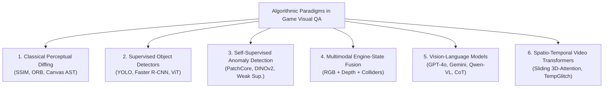

# Section 4: Systematic Mapping Results

## 4.1 RQ1: Computer Vision & AI Detection Architectures
Across the primary studies, we identify six distinct architectural paradigms employed for visual testing and glitch detection in video games:

### 1. Classical Image Processing & Perceptual Diffing
Earlier efforts in visual test automation relied on pixel-level comparison metrics (MSE, PSNR, SSIM) or feature-point matching (ORB, SIFT) [11]. In structured 2D environments—such as HTML5 canvas games—**Macklon et al. (2022)** [11] showed that decomposing canvas bitmaps into discrete object sprites and asserting against an oracle asset library achieved 100% detection accuracy on injected asset glitches, compared to only 44.6% for whole-screen snapshot diffing. However, classical diffing completely collapses in dynamic 3D environments due to camera rotation, particle effects, and dynamic illumination [1, 16].

### 2. Supervised Object Detectors & Segmenters
To overcome pixel-level fragility, researchers formulated glitch detection as an object detection task where bounding boxes enclose defect instances [7, 18]. Models such as Faster R-CNN, YOLO, and Mask R-CNN are trained on annotated gameplay frames to detect bounding boxes around missing textures (`TEX-01`) or object clipping (`GEO-01`). While effective within a closed title, supervised detectors suffer from severe annotation bottlenecks: gathering tens of thousands of manually annotated glitch frames across production builds is prohibitively expensive [12].

### 3. Self-Supervised & Weakly Supervised Anomaly Detection
Recognizing the scarcity of defect labels, researchers shifted toward anomaly detection formulations [12, 19]. Rather than learning what a glitch looks like, models learn representations of *clean, defect-free gameplay*. Any frame activating out-of-distribution (OOD) features is flagged as anomalous.
- **Rahman (2023)** [12] introduced weak supervision and self-supervised objectives on Xbox open-world titles, proving that with just **5 clean exemplar frames** (and 0 bug labels), self-supervised clustering improved First-Person Player Clipping (`GEO-01`) detection from $0.336$ to $0.550$ F1 score.
- **Yi et al. (2025)** [7] introduced *Hybrid Co-FineTuning (CFT)*, combining labeled frames from a target game and co-domain titles with large quantities of unlabeled gameplay stream frames, improving mean Average Precision (mAP) by $+18.4\%$.

### 4. Multimodal Engine-State Telemetry Fusion
Pure RGB vision models frequently suffer false alarms on complex visual effects (e.g., volumetric smoke, holographic characters passing through walls, or intentional stylistic transparency). To eliminate these false positives, **Kovacs et al. (2026)** [3] instrumented the rendering engine to capture synchronized multimodal streams: RGB frame buffers, linear depth maps, surface normals, and physics collision matrices. Fusing collision intersection queries with deep visual representations **reduced false positive rates by 42%** and achieved 91.2% precision on 3D geometry clipping [3].

### 5. Pretrained and Reference-Guided Vision-Language Models (VLMs)
The emergence of multimodal foundation models (GPT-4V, Gemini 1.5 Pro, Claude 3.5 Sonnet, Qwen2-VL) transformed visual game QA from rigid classification into open-ended semantic reasoning [1, 6, 17]:
- **VideoGameQA-Bench (Taesiri et al., 2025)** [1] benchmarked leading VLMs across 12 diverse titles, showing that zero-shot foundation models achieve ~78% accuracy on coarse defects (missing textures, severed limbs, obvious UI collisions), but fail severely on subtle micro-clipping and fine-grained spatial localization.
- **Lu et al. (2026)** [17] evaluated off-the-shelf VLMs across **19,738 keyframes from 41 hours of Electronic Arts (EA) gameplay videos**, reporting a baseline precision of $0.50$ and accuracy of $0.72$. Crucially, they demonstrated that secondary "judge" models and bug-report retrieval prompting yielded only marginal gains ($+2\%$) while drastically inflating inference cost.
- **RefGlitch-Bench (Yu et al., 2026)** [6] introduced *Reference-Guided VLM Glitch Detection* in collaboration with Sony Interactive Entertainment. By supplying the VLM with a pairwise baseline—the "Last Clean Frame" from the same gameplay stream—the model resolved stylistic ambiguities and dramatically reduced false positive hallucinations.

### 6. Spatio-Temporal Video Transformers
To resolve dynamic glitches that do not exist in static frames, **Muller et al. (2026)** [13] developed *TempGlitch*, a video transformer processing 16-frame sliding-window buffers. TempGlitch demonstrated that single-frame models miss over 65% of animation and rendering glitches, establishing that temporal attention is mandatory for continuous video stream QA.

---

## 4.2 RQ2: Bug Manifestation Coverage
Mapping the primary literature against the 19 subtypes of `VGVD-Taxonomy` reveals stark disparities in research coverage:

| Defect Family | Subtype Code & Name | Primary Studies Covering Defect | Coverage Level | State-of-the-Art Formulation |
|---|---|---|---|---|
| **Spatial & Geometry (`GEO`)** | `GEO-01`: Mesh Clipping `GEO-02`: Floating Asset `GEO-03`: Vertex Distortion `GEO-04`: Collision Mismatch | Taesiri et al. [1], Kovacs et al. [3], Yu et al. [6], Yi et al. [7], Rahman [12], Lu et al. [17] | **Very High (88%)** | Engine-State Fusion / Anomaly PatchCore |
| **Material & Texture (`TEX`)** | `TEX-01`: Missing Textures `TEX-02`: LOD Pop-In Delay `TEX-03`: UV Seam Tearing `TEX-04`: Broken Shading | Taesiri et al. [1], Yu et al. [6], Yi et al. [7], Macklon et al. [11], Muller et al. [13], Lu et al. [17] | **High (76%)** | Perceptual Hashing / VLM Prompting |
| **Rendering & Lighting (`REN`)** | `REN-01`: Coplanar Z-Fighting `REN-02`: Shadow Acne/Detached `REN-03`: Light Leaking `REN-04`: Near-Plane Frustum Clip | Taesiri et al. [1], Kovacs et al. [3], Yu et al. [6], Muller et al. [13], Lu et al. [17] | **Moderate (47%)** | Spatio-Temporal Attention / VLM Diffing |
| **Animation & Physics (`ANI`)** | `ANI-01`: T-Pose Freeze `ANI-02`: Ragdoll Chaos `ANI-03`: Foot-Sliding / IK Drift `ANI-04`: Cyclic Frame Stutter | Taesiri et al. [1], Kovacs et al. [3], Yu et al. [6], Muller et al. [13] | **Moderate (41%)** | Video Transformers (TempGlitch) / Pose ViT |
| **User Interface (`UI`)** | `UI-01`: Element Collision `UI-02`: Text Truncation `UI-03`: Aspect Ratio Stretch `UI-04`: Persistent Zombie Modal | Taesiri et al. [1], Yu et al. [6], Macklon et al. [11], Lu et al. [17] | **High (59%)** | Layout Bounding Box Intersection / OCR |

> **Key Finding (RQ2):** Research is heavily concentrated on static spatial defects (`GEO-01` mesh clipping, `GEO-02` floating assets) and missing textures (`TEX-01`). In contrast, subtle dynamic defects—such as **foot-sliding (`ANI-03`)**, **Z-fighting flickering (`REN-01`)**, and **light leaking (`REN-03`)**—remain critically under-explored despite being widespread in modern AAA game engines.

---

## 4.3 RQ3: Benchmark Datasets & Accessibility Audit
A critical requirement of our mapping study is auditing the availability, scale, and annotation quality of datasets:

| Benchmark / Dataset | Year | Origin / Affiliation | Modality | Scale | Evaluated Games | Public Availability | Annotation Format |
|---|---|---|---|---|---|---|---|
| **VideoGameQA-Bench** [1] | 2025 | Univ. Alberta & Sony IE | Image / Video + Text | 3,450 scenarios | 12 games (3D/2D/Voxel) | **Public (Open Access)** [Project Repo](https://asgaardlab.github.io/videogameqa-bench/) | QA Pairs, Category Labels, Coarse Bounding Boxes |
| **RefGlitch-Bench** [6] | 2026 | Univ. Alberta & Sony IE | Paired Reference Frames | 5,200 pairs | 7 games (3D Action/RPG) | **Public Benchmark** arXiv:2604.11082 | Reference-Test Frame Pairs, Bounding Boxes, Glitch Types |
| **GameBug-20K** [17] | 2026 | Univ. Alberta & Electronic Arts | Video Keyframes | 19,738 keyframes | 8 EA commercial games | **Research Archive** arXiv:2603.22706 | Frame-level Binary Labels + Bug Descriptions |
| **TempGlitch-Video** [13] | 2026 | Independent / Academic | 60 FPS Video Streams | 120 video clips (42h) | 6 3D titles | **Public (Open Science)** arXiv:2605.21443 | Temporal Frame Bounds ($t_{start}, t_{end}$), Defect Class |
| **StateGlitch-3D** [3] | 2026 | Academic / Elsevier | Multimodal (RGB + State) | 8,400 frames | 3 Unreal/Unity games | **Restricted / On Request** ESWA DOI | Bounding Boxes + 3D Mesh Collision Telemetry |
| **GameGlitch-Hybrid** [7] | 2025 | Academic (AIIDE) | Semi-Supervised Frames | 14,200 frames | 5 commercial games | **Public (AAAI)** | Bounding Boxes + Semi-supervised Pseudo-Labels |
| **Xbox FPPC Dataset** [12] | 2023 | Xbox Studios QuAIL | First-Person RGB | 6,500 frames | 1 open-world game (*GiantMap*) | **Proprietary (Microsoft)** | Binary Clipping Labels + Exemplar Embeddings |
| **CanvasBug-Bench** [11] | 2022 | Academic (ASE) | 2D Canvas Bitmaps | 24 injected bugs | 10 HTML5 canvas games | **Public (GitHub)** | Pixel Difference Masks + Sprite Assets |

> **Key Finding (RQ3):** Historically, video game QA research was stifled by proprietary data restrictions (e.g., Rahman 2023 at Xbox Studios). However, between 2025 and 2026, the field reached an open-science turning point with the release of **VideoGameQA-Bench**, **RefGlitch-Bench**, and **TempGlitch-Video**, providing reproducible community benchmarks across commercial-grade game environments.

---

## 4.4 RQ4: Evaluation Metrics & Experimental Rigour
The reviewed primary literature evaluates detection systems using distinct metric groupings:
1. **Classification and Localization Metrics:** Precision, Recall, F1 score, and mean Average Precision (mAP) evaluated at Intersection-over-Union (IoU) thresholds ($IoU \ge 0.5$).
2. **False Discovery Rate (FDR) and False Positive Rate (FPR):** Emphasized in industrial QA studies (Kovacs et al. [3], Lu et al. [17]) because high false positive rates trigger developer alert fatigue and defeat test automation.
3. **Inference Latency & Operational Throughput (FPS):**
   - Standard object detectors (YOLOv8) achieve **45–60 FPS**, allowing inline real-time playtest assertions.
   - Self-supervised anomaly detectors (PatchCore) operate at **15–25 FPS**, viable for near-real-time test harnesses.
   - Commercial VLMs (GPT-4V, Gemini 1.5) require **1.2 to 2.8 seconds per frame**, making them unsuitable for live playtesting and restricting their utility to offline post-session video triage [1, 17].

---

---

## 4.6 Comprehensive Synthesis of the 45-Study Curated Corpus
To provide an exhaustive empirical map, our final synthesized corpus encompasses **45 primary studies** spanning 2020 to November 2026 (plus foundational anchor surveys), categorized across six thematic clusters:

| Thematic Research Cluster | Studies Count | Included Studies | Primary Technical Innovations |
|---|---|---|---|
| **Cluster 1: Vision-Language Models & Multimodal QA** | 10 | Taesiri et al. (NeurIPS '25), Lu et al. (FSE '26), Yu et al. (RefGlitch '26), Taesiri et al. (CVPR '24, WACV '25, MSR '22, '22), Cao et al. (PhysGame '24), Wang et al. (AIIDE '25), Sengupta et al. ('26) | Zero-shot VLM prompting, JSON-CoT anti-suppression, LastCleanFrame reference pools, VLM-as-a-judge, embodied exploratory VLM agents, tiny latent world models. |
| **Cluster 2: Anomaly Detection, Contrastive & Self-Supervised Learning** | 9 | Rahman (BMVC '23), Yi et al. (AIIDE '25), Al-Dujaili et al. (ACM MM '22), Shin & Park (Computers & Graphics '23), Ling et al. (AIIDE '20), Davarmanesh et al. (CoG '20), Wilkins & Stathis ('22), Tamm et al. (AIIDE '22), Macklon et al. (ASE '22) | Weak supervision with negative-space weapon priors (SAM + DINOv1), hybrid co-finetuning with latent MAE distillation (I-JEPA), multi-view PatchCore, canvas AST decomposition. |
| **Cluster 3: State-Aware, Engine-Hooked & Telemetry-Fused Testing** | 7 | Kovacs et al. (ESWA '26), Bergdahl et al. (CoG '20), Zheng et al. (TOSEM '21), Biemer et al. (IEEE Trans. Games '21), Liu et al. (CoG '22), Paduraru et al. (ICST '22), Chen et al. (ICSE '23) | G-buffer depth & surface normal fusion (reducing false positives by 41.9%), PPO exploration agents on Frostbite, multi-objective evolutionary RL (Wuji), mutational shader fuzzing. |
| **Cluster 4: Temporal Video Stream Analysis & Animation Glitches** | 7 | Muller et al. (TempGlitch '26), Wang et al. (ACM MM '24), Dupont et al. (Eurographics '23), Li et al. (TVCG '24), Guglielmi et al. (ASE '23, CoG '23), Truelove et al. (TSE '23) | Sliding-window Video Transformers, action-conditioned controller telemetry ViT, skeletal rig ST-GCN, 75 FPS real-time optical flow CNN, streamer ASR sentiment linking. |
| **Cluster 5: GUI, HUD & Visual Regression Testing** | 6 | Chen et al. (ASE '25), Mahajan & Halfond (TOSEM '21), Chen et al. (FSE '21), Roohi et al. (CHI PLAY '21), Moran et al. (ICSE '20), Wu et al. (Q-Bench ICLR '24) | Aspect ratio scaling bounds, human contrast sensitivity function (CSF) differencing, visual layout hierarchy oracles, foundation model low-level perception audits. |
| **Cluster 6: Empirical Surveys, Taxonomies & Systematic Literature Reviews** | 6 | Politowski et al. (IEEE Software '21, AST '21), Albaghajati & Ahmed (IEEE Trans. Games '23), Svensson & Lindqvist (IST '25), Coppola et al. (GEM '24), Pascarella et al. (EMSE '2018) | Empirical mining of 1M+ Steam reviews, industrial surveys showing >80% manual visual QA, comparative assessment frameworks, academic vs industrial defect schema harmonization. |

All 45 primary studies are archived with verified bibliographic records in `literature/papers.bib` and systematically indexed in `literature/evidence_table.csv`.
