# Section 4: Standardized Visual Bug Taxonomy in Video Games (`VGVD-Taxonomy`)

## 4.1 The Need for a Standardized Defect Classification
A fundamental barrier hindering progress in automated video game visual testing has been the lack of a standardized, fine-grained defect taxonomy [4, 8]. General software engineering defect taxonomies categorize software bugs by root cause (e.g., null pointer dereferences, logic faults, race conditions) or functional impact (crash, blocker, trivial) [21]. However, in visual computing and rendering pipelines, vastly different algorithmic failures manifest as visually similar defects, while identical code faults can produce radically disparate visual artifacts depending on lighting, camera angle, and level-of-detail (LOD) cascades [3, 7].

Furthermore, earlier game testing literature indiscriminately aggregated visual defects under ambiguous umbrella terms such as "graphical glitches" or "rendering anomalies" [4, 5]. This ambiguity prevents researchers from determining which computer vision formulations (e.g., semantic segmentation, object detection, optical flow anomaly detection, or multimodal vision-language reasoning) are mathematically and perceptually suited to detect specific glitch categories.

To resolve this limitation, we formulate the **Video Game Visual Defect Taxonomy (`VGVD-Taxonomy`)**, a multi-tier classification system structured across five primary defect families, 19 distinct defect subtypes, and three operational attributes: **Temporal Dependence**, **Visual Subtlety**, and **Pipeline Origin Stage**.

```mermaid
graph TD
    Taxonomy["VGVD-Taxonomy<br/>(19 Defect Subtypes)"]
    
    Taxonomy --> F1["<b>1. Spatial & Geometry (`GEO`)</b><br/>Mesh intersections, floating props, vertex explosions"]
    Taxonomy --> F2["<b>2. Material & Texture (`TEX`)</b><br/>Missing textures, LOD pop-in, UV stretching"]
    Taxonomy --> F3["<b>3. Rendering & Lighting (`REN`)</b><br/>Z-fighting, shadow acne, light leaking"]
    Taxonomy --> F4["<b>4. Temporal & Animation (`ANI`)</b><br/>T-pose freezes, ragdoll explosion, foot-sliding"]
    Taxonomy --> F5["<b>5. User Interface & HUD (`UI`)</b><br/>Element collisions, text overflows, modal occlusion"]

    F1 --> F1a["GEO-01: Object Clipping"]
    F1 --> F1b["GEO-02: Floating Asset"]
    F1 --> F1c["GEO-03: Vertex Distortion"]
    F1 --> F1d["GEO-04: Collision Mismatch"]

    F2 --> F2a["TEX-01: Fallback Checkerboard"]
    F2 --> F2b["TEX-02: LOD Stalling"]
    F2 --> F2c["TEX-03: UV Seam Tearing"]
    F2 --> F2d["TEX-04: Broken Shaders"]

    F3 --> F3a["REN-01: Coplanar Z-Fighting"]
    F3 --> F3b["REN-02: Shadow Detached"]
    F3 --> F3c["REN-03: Light Leaking"]
    F3 --> F3d["REN-04: Near-Plane Frustum"]

    F4 --> F4a["ANI-01: T-Pose Freeze"]
    F4 --> F4b["ANI-02: Ragdoll Chaos"]
    F4 --> F4c["ANI-03: Foot-Sliding Drift"]
    F4 --> F4d["ANI-04: Frame Stutter"]

    F5 --> F5a["UI-01: Element Overlap"]
    F5 --> F5b["UI-02: Text Overflow"]
    F5 --> F5c["UI-03: Aspect Stretch"]
    F5 --> F5d["UI-04: Zombie Modal"]
```

---

## 4.2 Family 1: Spatial & Geometry Anomalies (`GEO`)
Spatial and geometry defects originate in the transformation, bounding volume collision, or mesh skinning stages of the game engine pipeline.

* **GEO-01: Object Mesh Clipping & Penetration:** Occurs when two or more independent solid polygonal meshes interpenetrate without a valid collision response (e.g., a character's leg passing through a concrete barrier, or a dynamic weapon penetrating a player's torso armor) [7, 12]. Mesh clipping is the most ubiquitous visual defect in 3D gaming and poses severe detection challenges because the penetrating intersection boundary is often subtle, jagged, and partially occluded.
* **GEO-02: Floating Assets:** Triggered when an object intended to rest on terrain or architectural surfaces is positioned above ground level due to heightmap calculation errors, incorrect pivot placement, or faulty procedural placement routines [7, 12].
* **GEO-03: Vertex & Geometry Distortion (Mesh Explosions):** Manifests when polygonal vertices stretch across screen space or collapse into singularity coordinates. This is typically caused by unnormalized vertex weights in skeletal rigging, numerical overflow in vertex shaders, or corrupted vertex buffer objects (VBOs) [3].
* **GEO-04: Collision Boundary Mismatch:** A spatial divergence between the physical collision geometry and the rendered visual mesh, causing dynamic actors to visually hover or sink into invisible physical planes [3].

---

## 4.3 Family 2: Material, Texture & Shading Defects (`TEX`)
Material defects stem from asset streaming failures, texture coordinate corruptions, or shader pipeline execution faults.

* **TEX-01: Missing / Fallback Textures:** Occurs when an asset reference fails to resolve in VRAM, causing the graphics engine to render a fallback magenta/purple checkerboard pattern, an untextured flat white polygon, or a raw base normal map [1, 7].
* **TEX-02: Level-of-Detail (LOD) Pop-In & Stalling:** High-detail mipmaps or Nanite clusters fail to stream into memory within the camera's draw-distance threshold, leaving low-resolution, blurry mipmap proxies visible in close proximity to the player [13].
* **TEX-03: UV Mapping Distortion & Seam Tearing:** Texture coordinates ($u, v$) are stretched, inverted, or sheared across polygonal facets due to incorrect unwrapping or procedural mesh deformation [1, 11].
* **TEX-04: Shader Compilation Artifacts:** Stutter or visual corruption resulting from runtime shader pipeline compilation, producing blown-out specular highlights, inverted illumination, or unrendered post-processing passes [3, 33].

---

## 4.4 Family 3: Rendering, Lighting & Camera Artifacts (`REN`)
Rendering artifacts occur during the rasterization, depth testing, shadow mapping, or global illumination stages.

* **REN-01: Coplanar Z-Fighting & Depth Flickering:** Two coplanar or nearly coplanar surfaces share virtually identical depth values ($z$), causing the depth buffer to oscillate visibility between surfaces on alternating frames, producing high-frequency pixel flickering [13].
* **REN-02: Shadow Bleeding & Disconnection (Peter-Panning):** Shadow map depth bias miscalibration causes cast shadows to detach from the contact bases of objects, or produces jagged shadow acne across curved geometry [17].
* **REN-03: Light Leaking:** Indirect global illumination (GI) rays or screen-space reflections (SSR) bleed into sealed interior rooms through unclosed geometry seams or coarse voxel grids [3].
* **REN-04: Camera Frustum Near-Plane Clipping:** The virtual game camera's near clipping plane cuts into foreground character geometry (e.g., exposing the hollow interior of a character's skull or background geometry during tight dialogue cutscenes) [1, 6].

---

## 4.5 Family 4: Temporal, Physics & Animation Glitches (`ANI`)
Temporal and animation defects cannot be reliably arbitrated from an isolated static screenshot and require multi-frame temporal context to identify.

* **ANI-01: Character T-Pose / Reference Pose Freeze:** Character rigs instantaneously snap into default T-poses or A-poses due to animation state-machine transition exceptions or missing blend tree assets [1, 6].
* **ANI-02: Ragdoll Physics Solver Instability:** Physics constraint solvers oscillate violently upon character demise, flinging limbs across screen space or stretching skeletal joints into non-physical configurations [13].
* **ANI-03: Foot-Sliding & Inverse Kinematics (IK) Drift:** The linear velocity of a character's root transform does not synchronize with the foot-stride animation cycle, creating an unnatural "ice-skating" visual artifact across the terrain [13].
* **ANI-04: Micro-Stuttering & Frame Desynchronization:** Rapid frame drops, temporal micro-stutter, or frame-pacing irregularities that degrade temporal smoothness [13].

---

## 4.6 Family 5: User Interface (UI) & HUD Anomalies (`UI`)
UI defects occur in the screen-space compositing layer overlaying the 3D scene.

* **UI-01: Element Collision & Overlap:** Two or more HUD components (minimaps, health gauges, inventory icons) overlap or collide, rendering information illegible [1, 11].
* **UI-02: Dynamic Text Truncation & Overflow:** Localized or dynamic character strings exceed the bounding box of their container, clipping abruptly or spilling into neighboring screen space [1, 17].
* **UI-03: Aspect Ratio & Anchor Distortion:** Non-standard aspect ratios (e.g., 21:9 ultrawide, 32:9 super-ultrawide) cause anchor points to stretch, compress, or misalign UI elements from screen edges [11, 50].
* **UI-04: Persistent Modal Occlusion (Zombie Modals):** Dismissed dialogue boxes or interaction modals remain permanently rendered on-screen, obscuring critical gameplay visibility [1].

---

## 4.7 Comprehensive Taxonomy Matrix

| Defect Code | Name | Primary Manifestation | Temporal Nature | Visual Subtlety | Pipeline Origin | Recommended CV Formulation |
|---|---|---|---|---|---|---|
| `GEO-01` | Object Mesh Clipping | Interpenetrating polygonal surfaces | Static / Multi | Highly Subtle | Transformation / Collision | Engine-State Fusion / Anomaly PatchCore |
| `GEO-02` | Floating Asset | Props hovering above terrain | Static | Subtle | Scene Graph Placement | Semantic Depth Estimation / VLM |
| `GEO-03` | Vertex Mesh Explosion | Polygonal vertices blown across screen | Static / Multi | Obvious (Macro) | Skeletal Rigging / Shaders | Anomaly Detection / Object Detection |
| `GEO-04` | Collision Boundary Mismatch | Visual mesh desynced from physics | Temporal | Subtle | Physics vs Scene Graph | Multimodal Collision Queries |
| `TEX-01` | Missing / Fallback Texture | Fallback magenta checkerboard / flat | Static | Obvious (Macro) | Asset Streaming | Perceptual Hashing / VLM Prompting |
| `TEX-02` | LOD Pop-In Stalling | Blurry mipmap lingering close to camera | Temporal | Subtle | Texture Streaming Pool | Multi-Scale Feature Pyramid / Video ViT |
| `TEX-03` | UV Seam Tearing | Stretched texture coordinates across seams | Static | Moderate | Mesh UV Mapping | Patch Anomaly Detection / Autoencoders |
| `TEX-04` | Shader Artifacts | Inverted lighting, blown speculars | Static / Multi | Moderate | Shader Compilation | Screen-Space Normal Consistency |
| `REN-01` | Coplanar Z-Fighting | Alternating depth-buffer visibility oscillation | Temporal | Moderate | Rasterization Depth Test | Temporal High-Frequency Analysis |
| `REN-02` | Shadow Detachment | Shadows detached from object bases | Static | Subtle | Shadow Map Depth Bias | Contact Shadow Feature Verification |
| `REN-03` | Light Leaking | GI illumination bleeding into dark rooms | Static | Subtle | Ray-Tracing / Voxel GI | Radiance Distribution Consistency |
| `REN-04` | Camera Frustum Clip | Near-plane clipping exposing hollow mesh | Static | Obvious (Macro) | Camera Projection Matrix | Semantic Parsing / VLM Prompting |
| `ANI-01` | T-Pose / Rig Freeze | Character rig frozen in reference pose | Static / Multi | Obvious (Macro) | Animation State Machine | Keypoint Skeleton Extraction / Pose ViT |
| `ANI-02` | Ragdoll Instability | Physics joint constraint violent oscillation | Temporal | Obvious (Macro) | Physics Constraint Solver | Spatio-Temporal Graph Conv (ST-GCN) |
| `ANI-03` | Foot-Sliding Drift | Linear speed desynced from stride cycle | Temporal | Subtle | Root Motion / IK Solver | Optical Flow vs Root Transform |
| `ANI-04` | Frame Micro-Stutter | Rapid pacing oscillation / frame drops | Temporal | Subtle | Frame Pacing / Engine Thread | Frame Timestamp Delta Monitoring |
| `UI-01` | Element Collision | Overlapping text boxes / minimaps | Static | Obvious (Macro) | 2D Screen Layout | Layout Bounding Box Intersection |
| `UI-02` | Text Truncation | Strings spilling out of button containers | Static | Moderate | Localization / Layout | OCR + Bounding Box Containment |
| `UI-03` | Aspect Ratio Stretch | Anchors stretched on non-16:9 displays | Static | Moderate | Viewport Compositing | Template Aspect Ratio Invariance |
| `UI-04` | Zombie Modal | Dismissed modals permanently rendered | Temporal | Obvious (Macro) | UI State Logic | Persistent OCR Screen Difference |
