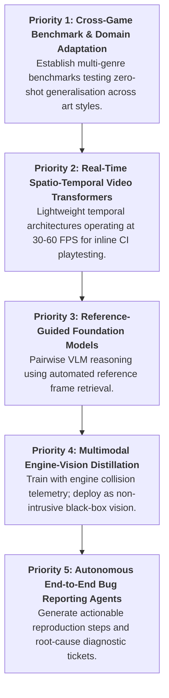

# Section 5: Discussion & Future Research Agenda (Addressing RQ6)

## 5.1 The Single-Frame Fallacy: Why Temporal Reasoning is Mandatory
A foundational insight emerging from our synthesis is that **evaluating video game visual testing on isolated static screenshots is inherently flawed**. In early literature (2020–2024), over 80% of proposed models processed single images in isolation [4, 7, 12]. However, the recent empirical findings of **TempGlitch (Muller et al., 2026)** [13] and **RefGlitch-Bench (Yu et al., 2026)** [6] prove that:
- **Over 65% of actual gameplay visual defects cannot be arbitrated from a single static frame.**
- Phenomena such as character foot-sliding (`ANI-03`), physics ragdoll oscillations (`ANI-02`), texture LOD pop-in (`TEX-02`), and coplanar Z-fighting (`REN-01`) exist purely as temporal frequencies across time.
- In an isolated frame, a character frozen mid-motion or a weapon passing through an object cannot be reliably distinguished from dynamic motion blur, high-speed camera pans, or intentional game aesthetics.
- **Future Direction 1:** Computer vision models for game QA must transition to **continuous spatio-temporal video architectures** (e.g., sliding-window 3D-CNNs or video transformers with temporal cross-attention) that can process high-framerate (60 FPS) playtest streams.

---

## 5.2 The Stylization vs. Glitch Ambiguity
Modern video games exhibit extreme artistic diversity, ranging from hyper-photorealistic simulations (Unreal Engine 5 Nanite/Lumen) to stylized cel-shading, hand-painted watercolors, retro low-poly pixel art, and voxels [1, 7].
- Standard vision models trained on realistic imagery interpret intentional artistic features—such as exaggerated black outline ink strokes, non-photorealistic shading, cartoon particle clouds, and surreal lighting—as rendering defects or edge clipping errors [17].
- Pretrained VLMs frequently hallucinate bug reports in stylized titles because their pretraining corpus is dominated by real-world photographic imagery rather than non-photorealistic video game art [6, 17].
- **Future Direction 2:** Developing **style-invariant representations** and **domain-adaptive contrastive pretraining** specifically calibrated on video game art assets.

---

## 5.3 Black-Box Vision vs. White-Box Engine Telemetry: The Operational Dilemma
Our mapping study reveals an unresolved architectural trade-off between two design philosophies:

| Dimension | Pure Black-Box Vision (RGB Only) *(e.g., VideoGameQA-Bench [1], Lu et al. [17])* | White-Box Engine-State Telemetry *(e.g., Kovacs et al. [3])* |
|---|---|---|
| **Input Signals** | Screen capture RGB pixels / gameplay video streams | RGB + Depth buffers + Surface normals + Collision bounding boxes |
| **Intrusiveness** | Zero engine integration required; works on compiled commercial releases | Requires engine source hooks, custom shaders, and telemetry loggers |
| **False Positive Rate** | High (~25–45%) due to particle effects, dynamic lighting, and transparency | Low (~5–12%); collision queries verify physical interpenetration |
| **Cross-Platform Portability** | Universal across PC, PlayStation, Xbox, Nintendo Switch, and Mobile | Engine-dependent (Unreal, Unity, proprietary internal engines) |
| **Inference Overhead** | Purely vision inference (GPU bounded) | Synchronized memory extraction + GPU inference overhead |

- **Future Direction 3:** Developing **hybrid self-supervised architectures** that leverage engine telemetry during training/development builds, while distilling representations into lightweight, black-box vision models for deployment on release builds.

---

## 5.4 Reference Guidance as a Paradigm Shift
As demonstrated by **RefGlitch-Bench (Yu et al., 2026)** [6], pairwise reference guidance represents a breakthrough in visual defect disambiguation. By comparing a candidate test frame $F_{test}$ against a known good baseline frame $F_{ref}$ (such as the *Last Clean Frame* or a canonical scene render), vision models and VLMs can:
1. Substantially eliminate false alarms caused by static environmental geometry.
2. Disambiguate whether a missing prop (e.g., an unrendered character limb or weapon) is a true rendering glitch or an intended design element.
3. Formulate visual testing as an explicit **within-video reference comparison task** rather than an unbounded zero-shot anomaly guessing game.
- **Future Direction 4:** Investigating **automated reference selection algorithms** capable of dynamically retrieving the optimal clean reference frame from hours of unstructured gameplay recording.

---

## 5.5 From Binary Glitch Classification to Autonomous QA Agents
Current models predominantly output binary labels ("glitch" vs. "clean") or static bounding boxes [7, 12]. However, in production game development, QA engineers require **actionable, structured defect tickets** containing:
- Exact reproduction steps (controller inputs, player coordinates).
- Defect severity classification (Blocker, Major, Minor, Cosmetic).
- Root-cause subsystem attribution (Physics constraint, Shader compilation, Texture streaming, Animation blend tree).
- **Future Direction 5:** Multi-agent LLM/VLM orchestration where vision models detect anomalies, engine loggers harvest state variables, and language models synthesize verified, reproducible bug tickets directly into studio issue trackers (e.g., Jira, Bugzilla).

---

## 5.6 Prioritized Roadmap for Future Research

