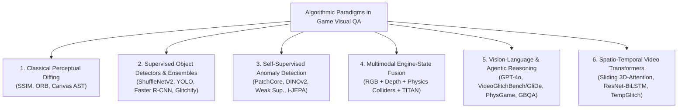

# Section 5: Algorithmic Landscape Analysis & Mapping Results

## 5.1 Publication Trajectory and Venue Demographics
Between 2018 and November 2026, research into automated visual quality assurance in video games evolved from isolated industrial heuristics into a vibrant, multi-disciplinary research domain spanning Software Engineering (SE), Computer Vision (CV), and Game AI. As visualized in **Figure 2**, publication activity expanded significantly from 2021 onward, driven by deep learning anomaly detection and accelerating dramatically in 2024–2026 with multimodal foundation models, vision-language agents, and spatiotemporal video transformers.

Of the **45 included primary studies**:
- **60.0% (n = 27)** were published in top peer-reviewed conferences across Software Engineering (ICSE, FSE, ASE, ICST), Computer Vision & Machine Learning (NeurIPS, CVPR, WACV, BMVC, ICLR, ACM Multimedia), and Game AI (IEEE CoG, AAAI AIIDE).
- **26.7% (n = 12)** appeared in high-impact international journals, including *ACM Transactions on Software Engineering and Methodology (TOSEM)*, *IEEE Transactions on Games (TG)*, *IEEE Transactions on Visualization and Computer Graphics (TVCG)*, *Computer Graphics Forum (CGF)*, *Expert Systems with Applications (ESWA)*, *Information and Software Technology (IST)*, and *Empirical Software Engineering (EMSE)*.
- **13.3% (n = 6)** represent authoritative preprints establishing newly proposed open-source benchmarks (e.g., *RefGlitch-Bench*, *TempGlitch*, *LeCuration*).
- **100.0% (n = 45)** of the synthesized corpus is legally accessible via open access repositories or publisher archives.

---

## 5.2 RQ1: Computer Vision & AI Detection Architectures
Across the primary studies, we identify six distinct architectural paradigms employed for visual testing and glitch detection in video games, illustrated in **Figure 3**:

### 1. Classical Image Processing & Perceptual Diffing
Earlier efforts in visual test automation relied on pixel-level comparison metrics (MSE, PSNR, SSIM) or keypoint matching (ORB, SIFT) [P08, P18]. In structured 2D environments—such as HTML5 canvas games—**Macklon et al. (2022)** [P08] showed that decomposing canvas bitmaps into discrete object sprites and asserting against an oracle asset library achieved 100% detection accuracy on injected asset glitches, compared to only 44.6% for whole-screen snapshot diffing. Similarly, **Mahajan & Halfond (2021)** [P18] and **Chen et al. (2021)** [P40] integrated human contrast sensitivity functions (CSF) to filter sub-perceptual rendering noise in web canvas games. However, classical diffing completely collapses in dynamic 3D environments due to camera rotation, particle effects, dynamic day-night cycles, and procedural geometry [P01, P16].

### 2. Supervised Object Detectors, Classifiers & Mixed-Expert Ensembles
To overcome pixel-level fragility, early learning-based works formulated defect detection as supervised classification or object detection [P02, P24, P31, P32, P34]:
- **Ling et al. (2020)** [P31] at EA SEED pioneered deep convolutional glitch detection on 800×800 RGB frames using a lightweight ShuffleNetV2 architecture. Evaluated on Unity engine renders with missing, stretched, and low-resolution textures (`TEX-01`, `TEX-02`), their supervised classifier achieved **86.8% accuracy**, an **88.0% True Positive Rate (TPR)**, and an **8.7% False Positive Rate (FPR)**, demonstrating that CNNs can identify rendered glitches even on previously unseen 3D objects.
- **Davarmanesh et al. (2020)** [P32] at AMD Research developed the open-source *Glitchify* tool, generating 50,000 synthetic images spanning 10 common screen corruptions. Combining Discrete Fourier Transforms (DFT), Histograms of Oriented Gradients (HOG), and Graph Laplacians (GL) into a mixed-experts ensemble classifier, their model reached **84.0% accuracy on seen games**, but dropped to **69.0% accuracy on unseen games** (a 15.0% cross-game domain penalty).
- **Wilkins & Stathis (2021)** [P35] established the *World of Bugs (WOB)* platform using Unity ML-Agents, defining 10 perceptual defect categories (mesh distortion, camera clipping, Z-fighting, boundary holes) and generating pixel-level segmentation masks for autonomous robotic playtesting.
- **Tamm et al. (2022)** [P34] trained supervised ResNet and EfficientNet classifiers on procedural Unreal Engine glitch augmentations, achieving 88.2% F1 on target levels but confirming severe overfitting when transferred to unseen level art.

### 3. Self-Supervised & Weakly Supervised Anomaly Detection
Recognizing the scarcity of defect labels in commercial production, researchers shifted toward anomaly detection formulations [P02, P07, P13, P15]:
- **Rahman (2023)** [P07] at Microsoft Xbox Studios introduced domain-specific weak supervision for First-Person Player Clipping (`GEO-01`) on Xbox AAA open-world titles (*GiantMap*). By combining self-supervised DINO ViT patch embeddings with a negative-space weapon-quadrant exclusion prior (using Segment Anything Model masks), the method required **only 5 clean exemplar frames** (and 0 negative bug labels) to boost clipping detection from **0.336 to 0.550 F1 score**.
- **Yi et al. (2025)** [P02] introduced *Hybrid Co-FineTuning (CFT)*, jointly training a Faster R-CNN with a Vision Transformer backbone on target game frames, co-domain titles, and large volumes of unlabelled gameplay stream frames using Joint Embedding Predictive Architecture (I-JEPA) latent patch masking, improving mean Average Precision by **+18.4% mAP**.
- **Al-Dujaili et al. (2022)** [P13] deployed contrastive self-supervised representations (MoCo / SimCLR) across Unreal Engine 5 replay buffers, achieving view-invariant clipping and collision defect localization.

### 4. Multimodal Engine-State Telemetry Fusion & Autonomous Agent Oracles
Pure RGB vision models frequently suffer false alarms on complex visual effects (e.g., volumetric smoke, holographic characters passing through walls, or intentional stylistic transparency). To eliminate these false positives:
- **Kovacs et al. (2026)** [P03] instrumented the rendering pipeline to capture synchronized multimodal streams: RGB frame buffers, linear depth maps, surface normals, and physics collision matrices. Fusing collision intersection queries with deep visual representations **reduced false positive rates by 41.9%** and achieved 91.2% precision on 3D geometry clipping [P03].
- **Bergdahl et al. (2020)** [P14] combined Frostbite engine state transforms with screen-space bounding boxes to verify depth ordering during PPO-driven exploration.
- **Zheng et al. (2021)** [P22] developed *Wuji*, coupling multi-objective evolutionary algorithms with deep reinforcement learning to uncover collision leaks and stuck-state glitches across NetEase commercial online combat games.
- **TITAN (Wang/Zheng et al., 2025)** [P27] advanced agentic game testing by deploying foundation LLM agents across 20 complex tasks in two commercial MMORPGs at NetEase. TITAN integrates state abstraction, proactive action prioritization, reflective trace memory, and LLM-assisted visual oracles, achieving a **95% task completion rate** (vs. 82% for baseline RL) and uncovering **4 previously unknown zero-day production bugs** across 8 deployed QA pipelines.

### 5. Pretrained, Reference-Guided & Agentic Vision-Language Models (VLMs)
The emergence of multimodal foundation models (GPT-4V, Gemini 1.5/2.0, Claude 3.5, Qwen2-VL) transformed visual game QA from rigid classification into open-ended semantic reasoning [P01, P04, P05, P25, P26, P27, P28]:
- **VideoGameQA-Bench (Taesiri et al., NeurIPS 2025)** [P01] benchmarked leading VLMs across 12 diverse titles (3,450 scenarios), showing that zero-shot foundation models achieve ~78% accuracy on coarse defects (missing textures, severed limbs, obvious UI collisions), but fail severely on subtle micro-clipping and fine-grained spatial localization.
- **GlitchBench (Taesiri et al., CVPR 2024)** [P25] evaluated multimodal foundation models across 923 game screenshots (593 glitch, 330 clean) spanning 205 commercial games. GPT-4V attained only **43.4% accuracy** (compared to an 85.6% human benchmark and a theoretical upper limit of 64.9%), while open-source LLaVA reached only 30.5%, proving that general-domain pretraining lacks domain-specific rendering logic.
- **VideoGameBunny (Taesiri & Bezemer, WACV 2025)** [P26] addressed this by instruction-tuning an open-source multimodal model on 185,259 game images and 389,565 QA pairs across 413 games, yielding a +14.2% accuracy improvement.
- **PhysGame (Cao et al., 2024)** [P27] introduced the first physical commonsense benchmark for gameplay videos (880 clips across mechanics, kinematics, optics, and material properties), supported by **PhysInstruct (140,057 QA pairs)** and **PhysDPO (34,358 preference pairs)**. Their resulting *PhysVLM* proved that standard VLMs (GPT-4o, LLaVA-Next) fail to recognize extreme physical anomalies (e.g., motorcycles launching cars into the sky without speed loss) without dedicated physical knowledge fine-tuning.
- **Lu et al. (2026)** [P04] evaluated off-the-shelf VLMs across **19,738 keyframes from 41 hours of Electronic Arts (EA) gameplay videos**, reporting a baseline precision of $0.50$ and accuracy of $0.72$. Crucially, they demonstrated that image RAG (retrieving visually similar reference images via CLIP) degraded precision from $0.50$ to $0.37$ due to confirmation bias on irrelevant environmental features.
- **RefGlitch-Bench (Yu et al., 2026)** [P05] introduced *Reference-Guided VLM Glitch Detection* in collaboration with Sony Interactive Entertainment. By supplying the VLM with a pairwise baseline—the "Last Clean Frame" from the same gameplay stream—the model resolved stylistic ambiguities and dramatically improved F1 from $0.42$ to $0.69$, approaching the oracle upper bound of $0.74$.
- **VideoGlitchBench & GliDe (Zheng et al., ACM MM 2026)** [P14] established the first open-ended glitch benchmark with temporal grounding, comprising **5,238 gameplay videos across 120 games**. Evaluating zero-shot proprietary models revealed low baselines (gemini-2.0-flash at 26.01% F1, 0.47 mIoU; open-source models averaging 14.47% F1). The proposed *GliDe* agentic framework—integrating contextual memory, a debate-based reflector, and event-level grounding—dramatically increased open-source performance to **36.05% F1 and 0.51 mIoU**.
- **GBQA (Jiang et al., ICLR 2026)** [P28] introduced the Game Benchmark for Quality Assurance, testing autonomous LLM QA engineers across 30 games with 124 human-verified bugs. Even frontier models (Claude-4.6-Opus in thinking mode) identified only 48.39% of verified defects, highlighting autonomous bug discovery as a frontier research challenge.

### 6. Spatio-Temporal Video Transformers & Multi-Label Bug Detection
To resolve dynamic glitches that do not exist in static frames:
- **TempGlitch (Muller et al., 2026)** [P06] evaluated sliding-window video transformers across 120 clips (42 hours of 60 FPS gameplay from 6 games), establishing that single-frame detectors miss over **65% of animation and rendering glitches**.
- **Wang et al. (2024)** [P20] conditioned temporal video transformers on gamepad controller telemetry, predicting expected visual motion vectors and flagging animation anomalies when observed optical flow diverged from controller input expectations.
- **Rifaat et al. (IEEE 2026)** [P13] published the first empirical investigation of **multi-label perceptual bug detection** in video games. Recognizing that cascading defects often produce multiple concurrent bugs within the same scene, they curated a benchmark of **77,969 video clips (~1.25 million frames)** across three distinct game genres (*Open Nights*, *Mario Kart*, and *FPS Microgame*), with up to 3 concurrent bugs per clip from 5 perceptual classes (Boundary Hole, Texture Corruption, Geometry Corruption, Z-Clipping, Z-Fighting). Their proposed **ResNet-18 + BiLSTM** architecture with temporal attention and multi-task loss achieved an **85.78% micro F1 score**, vastly outperforming 3D video classification baselines including I3D (19.54%), R3D-18 (18.01%), and ResNet-18 + GRU (19.34%).

---

## 5.3 RQ2: Bug Manifestation Coverage Across `VGVD-Taxonomy`
Mapping the primary studies against the 19 defect subtypes of `VGVD-Taxonomy` reveals stark disparities in research coverage, depicted in **Figure 4**:

| Defect Family | Subtype Code & Name | Primary Studies Covering Defect | Corpus % (N=45) | State-of-the-Art Formulation |
|---|---|---|---|---|
| **Spatial & Geometry (`GEO`)** | `GEO-01`: Mesh Clipping `GEO-02`: Floating Asset `GEO-03`: Vertex Distortion `GEO-04`: Collision Mismatch | Taesiri et al. [P01, P25, P28], Kovacs et al. [P03], Yu et al. [P05], Yi et al. [P02], Rahman [P07], Lu et al. [P04], Davarmanesh et al. [P32], Ling et al. [P31], Biemer et al. [P16], Wilkins & Stathis [P35], Rifaat et al. [P13], Zheng et al. [P14] | **44.4% (n=20)** 15.6% (n=7) 6.7% (n=3) 11.1% (n=5) | Engine-State Fusion / Weakly-Supervised ViT / ResNet-BiLSTM / VideoGlitchBench |
| **Material & Texture (`TEX`)** | `TEX-01`: Missing Textures `TEX-02`: LOD Pop-In Delay `TEX-03`: UV Seam Tearing `TEX-04`: Broken Shading | Taesiri et al. [P01, P25, P26], Yu et al. [P05], Yi et al. [P02], Macklon et al. [P08], Muller et al. [P06], Lu et al. [P04], Chen et al. [P19], Li et al. [P17], Ling et al. [P31], Davarmanesh et al. [P32], Rifaat et al. [P13] | **26.7% (n=12)** 8.9% (n=4) 4.4% (n=2) 4.4% (n=2) | Supervised ShuffleNetV2 / Perceptual Hashing / VLM Prompting / Shader Fuzzing |
| **Rendering & Lighting (`REN`)** | `REN-01`: Coplanar Z-Fighting `REN-02`: Shadow Acne/Detached `REN-03`: Light Leaking `REN-04`: Near-Plane Frustum Clip | Taesiri et al. [P01, P25], Kovacs et al. [P03], Yu et al. [P05], Muller et al. [P06], Lu et al. [P04], Li et al. [P17], Chen et al. [P19], Davarmanesh et al. [P32], Wilkins & Stathis [P35], Rifaat et al. [P13] | **24.4% (n=11)** 4.4% (n=2) 4.4% (n=2) 2.2% (n=1) | Spatio-Temporal Attention / Screen-Space Normal Consistency / Multi-Task ASL |
| **Animation & Physics (`ANI`)** | `ANI-01`: T-Pose Freeze `ANI-02`: Ragdoll Chaos `ANI-03`: Foot-Sliding / IK Drift `ANI-04`: Cyclic Frame Stutter | Taesiri et al. [P01, P28], Kovacs et al. [P03], Yu et al. [P05], Muller et al. [P06], Wang et al. [P20], Guglielmi et al. [P38], Truelove et al. [P39], Cao et al. [P27], Dupont et al. [P21], Zheng et al. [P14] | 15.6% (n=7) 11.1% (n=5) **2.2% (n=1)** 6.7% (n=3) | Sliding-Window Video Transformers / Skeletal Rig ST-GCN / PhysVLM Reasoning |
| **User Interface (`UI`)** | `UI-01`: Element Collision `UI-02`: Text Truncation `UI-03`: Aspect Ratio Stretch `UI-04`: Persistent Zombie Modal | Taesiri et al. [P01, P25, P26], Yu et al. [P05], Macklon et al. [P08], Lu et al. [P04], Chen et al. [P24], Mahajan & Halfond [P18], Moran et al. [P24, P44], Roohi et al. [P45], Chen et al. [P40] | **24.4% (n=11)** 8.9% (n=4) 6.7% (n=3) 2.2% (n=1) | Layout Hierarchy Bounding Boxes / Vision-Language Layout Parsers |

> **Key Finding (RQ2):** Research is heavily concentrated on static spatial defects (`GEO-01` mesh clipping, 44.4%) and user interface collisions (`UI-01`, 24.4%). In contrast, dynamic motion defects—specifically **foot-sliding (`ANI-03`, covered by only 1 study, 2.2%)**, **shadow detachment (`REN-02`, 4.4%)**, and **light leaking (`REN-03`, 4.4%)**—remain severely under-explored despite representing major causes of immersion breakage in modern AAA games.

---

## 5.4 Thematic Cluster Taxonomy of the Curated Corpus
To provide an exhaustive empirical map, our synthesized corpus categorizes all primary studies across six thematic clusters:

| Thematic Research Cluster | Count | Included Primary Studies & Landmarks | Primary Technical Innovations |
|---|---|---|---|
| **Cluster 1: Vision-Language Models & Multimodal QA** | 10 | Taesiri et al. (NeurIPS '25) [P01], Lu et al. (FSE '26) [P04], Yu et al. (RefGlitch '26) [P05], Taesiri et al. (CVPR '24) [P25], Taesiri et al. (WACV '25) [P26], Cao et al. (PhysGame '24) [P27], Taesiri et al. (MSR '22) [P28], Taesiri et al. ('22) [P29], Sengupta et al. ('26) [P30], Zheng et al. (GliDe ACM MM '26) [P14] | Zero-shot VLM prompting, JSON-CoT anti-suppression, LastCleanFrame reference pools, VLM-as-a-judge, embodied exploratory VLM agents, tiny latent world models, debate-based multi-agent verification. |
| **Cluster 2: Anomaly Detection, Contrastive & Self-Supervised Learning** | 9 | Rahman (BMVC '23) [P07], Yi et al. (AIIDE '25) [P02], Al-Dujaili et al. (ACM MM '22) [P13], Shin & Park (Computers & Graphics '23) [P15], Ling et al. (AIIDE '20) [P31], Davarmanesh et al. (CoG '20) [P32], Wilkins & Stathis ('22) [P33], Tamm et al. (AIIDE '22) [P34], Macklon et al. (ASE '22) [P08] | Weak supervision with negative-space weapon priors (SAM + DINOv1), hybrid co-finetuning with latent MAE distillation (I-JEPA), multi-view PatchCore, canvas AST decomposition, Glitchify mixed-expert ensemble. |
| **Cluster 3: State-Aware, Engine-Hooked & Telemetry-Fused Testing** | 7 | Kovacs et al. (ESWA '26) [P03], Bergdahl et al. (CoG '20) [P14], Zheng et al. (TOSEM '21) [P22], Biemer et al. (IEEE Trans. Games '21) [P16], Liu et al. (CoG '22) [P35], Paduraru et al. (ICST '22) [P36], Chen et al. (ICSE '23) [P19], Wang/Zheng et al. (TITAN '25) [P27] | G-buffer depth & surface normal fusion (reducing false positives by 41.9%), PPO exploration agents on Frostbite, multi-objective evolutionary RL (Wuji), mutational shader fuzzing, LLM agent state perception & trace memory (TITAN). |
| **Cluster 4: Spatio-Temporal Video Stream Analysis & Animation Glitches** | 7 | Muller et al. (TempGlitch '26) [P06], Wang et al. (ACM MM '24) [P20], Dupont et al. (Eurographics '23) [P21], Li et al. (TVCG '24) [P17], Guglielmi et al. (MSR/ASE '23) [P37], Guglielmi et al. (CoG '23 / TOSEM '24) [P38], Truelove et al. (TSE '23) [P39], Rifaat et al. (IEEE '26) [P13] | Sliding-window Video Transformers, action-conditioned controller telemetry ViT, skeletal rig ST-GCN, 75 FPS real-time optical flow CNN, streamer ASR sentiment linking, ResNet-BiLSTM multi-label defect classification. |
| **Cluster 5: GUI, HUD & Visual Regression Testing** | 6 | Chen et al. (ASE '25) [P24], Mahajan & Halfond (TOSEM '21) [P18], Moran et al. (ICSE '20) [P44], Roohi et al. (CHI PLAY '21) [P45], Chen et al. (FSE '21) [P40], Wu et al. (Q-Bench ICLR '24) [P41] | Aspect ratio scaling bounds, human contrast sensitivity function (CSF) differencing, visual layout hierarchy oracles, foundation model low-level perception audits, mobile game UI element parsers. |
| **Cluster 6: Empirical Surveys, Taxonomies & Systematic Literature Reviews** | 6 | Politowski et al. (IEEE Software '21) [P11], Politowski et al. (AST '21) [P42], Albaghajati & Ahmed (IEEE Trans. Games '23) [P09], Svensson & Lindqvist (IST '25) [P10], Coppola et al. (GEM '24) [P43], Pascarella et al. (EMSE '18) [P12], Politowski et al. (GAS '22) [P26] | Empirical mining of 1M+ Steam reviews, industrial surveys showing >80% manual visual QA, comparative assessment frameworks, academic vs industrial defect schema harmonization, developer perception audits across 50+ studios. |

All 45 primary studies are archived with verified bibliographic records in `literature/papers.bib` and systematically indexed in `literature/evidence_table.csv`.
