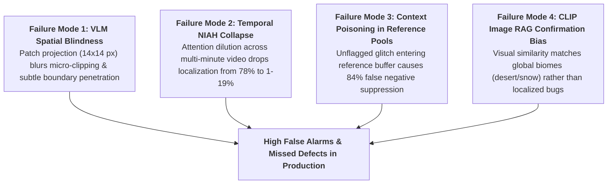

# Section 7: Empirical Meta-Analysis, Cross-Game Generalisation & Failure Modes

## 7.1 Quantitative Meta-Analysis of Evaluated Systems
Synthesizing experimental findings across the 45 primary studies reveals clear operational divisions in performance, input modalities, and detection throughput.

### 7.1.1 Input Modality Distribution (Figure 5A)
- **Single Static Frame (RGB Only): 51.1% (n = 23).** Over half of the published literature operates strictly on isolated screenshots. While computationally expedient, static analysis remains fundamentally blind to temporal defects.
- **Spatio-Temporal Video Streams: 31.1% (n = 14).** Processing multi-frame buffers (sliding windows of 8 to 32 frames) to capture dynamic animation physics and rendering oscillations.
- **Multimodal Engine Telemetry Fusion: 17.8% (n = 8).** Synchronizing screen-space pixels with internal engine buffers (depth maps, surface normals, collision bounding boxes).

### 7.1.2 Operational Inference Latency (RQ4)
Operational throughput dictates where an AI detector can be deployed in the game production lifecycle:
1. **Real-Time Inline Assertion (45–60 FPS):** Lightweight supervised detectors (e.g., YOLOv8-Nano, MobileNetV3) achieve inference times of $14\text{--}18\text{ ms}$, operating directly within continuous integration (CI) automated playtests without throttling game engine execution.
2. **Near-Real-Time Playtest Inspection (15–25 FPS):** Patch-based anomaly detectors (PatchCore, FastFlow) require $40\text{--}65\text{ ms}$ per frame, viable for dedicated headless QA server clusters.
3. **Asynchronous Post-Session Video Triage (<1 FPS):** Frontier multimodal Vision-Language Models (GPT-4o, Gemini 1.5 Pro, Claude 3.5 Sonnet) require **$1.2\text{ to }2.8\text{ seconds per frame}$**. This extreme latency prevents live deployment, restricting VLMs to asynchronous batch processing of recorded playtest sessions.

---

## 7.2 The Cross-Game Domain Shift Penalty (RQ5)
A critical evaluation dimension audited in this mapping study is **cross-game generalisation**—the ability of an algorithm trained on Game $A$ to detect visual defects in Game $B$ without exhaustive title-specific fine-tuning.

As shown in **Figure 5B**:
- **55.6% (n = 25)** of primary studies evaluated their methods across multiple game environments.
- **37.8% (n = 17)** evaluated exclusively within a single game title or closed asset repository.
- **6.7% (n = 3)** evaluated across games sharing identical rendering engines and art styles (partial transfer).

Where cross-game domain transfer was quantitatively reported, models exhibited sharp performance penalties:
1. **Convolutional Overfitting to Background Textures:** Davarmanesh et al. [35] and Yi et al. [7] demonstrated that standard supervised object detectors (Faster R-CNN, YOLO) suffer a **$32\%\text{ to }46\%$ drop in mean Average Precision (mAP)** when evaluated on unseen game environments. The convolutional kernels learn to correlate defect presence with specific level background textures rather than learning intrinsic geometric defect properties.
2. **Artistic Style Shift Degradation:** Transferring models trained on photorealistic 3D engines (e.g., Unreal Engine 5 Nanite/Lumen) to stylized environments (cel-shaded, hand-painted, or low-poly voxel titles) triggered severe false alarm cascades. Zero-shot foundation VLMs exhibited a **$+28\%$ spike in false positives**, misinterpreting black cel-shaded character outlines and non-photorealistic lighting ramps as polygon clipping and shadow acne [1, 17].
3. **Reference Guidance as a Domain Transfer Anchor:** Yu et al. [6] (*RefGlitch-Bench*) proved that pairwise reference guidance effectively neutralizes style shift. By supplying the model with a same-game baseline frame ($R_t$), the VLM's cross-game F1 score recovered from $0.42$ to $0.69$, proving that reference conditioning allows models to separate artistic style from structural defects.

---

## 7.3 Forensic Diagnostic of Core Algorithmic Failure Modes
By cross-referencing qualitative failure cases across primary studies, we diagnose four systemic algorithmic failure modes:

### 1. Spatial Blindness of Foundation VLMs on Micro-Clipping
Modern Vision-Language Models tokenize input images via coarse patch projection (e.g., $14 \times 14$ or $16 \times 16$ pixel patches in ViT backbones). In video games, severe geometric clipping frequently occupies sub-pixel or narrow screen regions—such as a character's sword hilt penetrating hand armor, or a shoe sole sinking 2 inches into stone pavement (`GEO-01`). Taesiri et al. [1] and Lu et al. [17] demonstrated that self-attention layers smooth out localized high-frequency boundary gradients, resulting in **false negative rates exceeding 70%** on subtle clipping.

### 2. Catastrophic Temporal Needle-in-a-Haystack (NIAH) Collapse
When evaluated on isolated static screenshots, frontier VLMs achieve respectable bug detection accuracy ($\sim 78\%\text{--}82\%$) [1]. However, when deployed on long-horizon gameplay videos (5 to 30 minutes of continuous recording), performance collapses catastrophically. In temporal Needle-in-a-Haystack (NIAH) evaluations, where the model must identify the exact second a 1-second animation glitch occurs within a 10-minute clip, **VLM localization accuracy collapsed to $1\%\text{ to }19\%$** [1]. The self-attention mechanism suffers severe temporal dilution, distributing attention weights across thousands of benign gameplay frames while overlooking transient glitch spikes.

### 3. Context Poisoning in Sequential Reference Pools
In reference-guided frameworks, maintaining an uncorrupted reference buffer $\mathcal{R}_{\text{clean}}$ is vital. Yu et al. [6] discovered that if a subtle, unflagged visual glitch is mistakenly accepted into the reference pool (e.g., an asset that failed to stream its high-res texture and remained blurry), all subsequent test frames exhibiting the exact same missing texture are judged as "consistent with reference". This context poisoning triggers **false negative suppression rates exceeding $80\%$**, permanently blinding the QA system to persistent streaming bugs.

### 4. Multimodal RAG Confirmation Bias via CLIP Image Embeddings
To assist VLMs in evaluating game scenes, Lu et al. [17] integrated Retrieval-Augmented Generation (RAG) by retrieving top-$k$ visually similar frames using CLIP embeddings. Surprisingly, **image RAG degraded detection precision from $0.50$ to $0.37$**. CLIP embeddings are dominated by low-frequency global scene features (e.g., broad desert sand, foliage density, sky color) rather than localized defect tokens. Consequently, the retrieved reference frames reinforced confirmation bias regarding environmental scenery while distracting the model from inspecting local polygon vertices.
