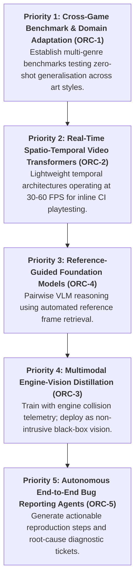

# Section 8: Open Research Challenges & Conclusions (RQ6)

## 8.1 Prioritized Open Research Challenges (`ORC`)
Synthesizing the empirical gaps, cross-game domain transfer barriers, and failure modes identified in this mapping study, we articulate five high-priority **Open Research Challenges (ORCs)** to guide future investigations in computer vision and multimodal AI for game quality assurance:

### `ORC-1`: Zero-Shot Cross-Engine Domain Adaptation across Divergent Art Styles
* *Problem:* Detectors trained on photorealistic rendering engines (Unreal Engine 5) experience severe mAP drops ($32\%\text{ to }46\%$) and false positive spikes ($+28\%$) when transferred to stylized cel-shaded, hand-painted, or voxel titles.
* *Research Opportunity:* Developing **style-disentangled latent representations** and video game domain-adaptive contrastive pre-training. Exploring invariant geometry representations that decouple structural surface normals from albedo texture styles.

### `ORC-2`: Real-Time 60 FPS Sub-Frame Temporal Glitch Localization
* *Problem:* Over $65\%$ of gameplay defects exist strictly across time, yet existing video transformers incur high computational latency ($>1.2\text{ s}$ per frame), making them impossible to integrate into real-time 60 FPS continuous integration test runners.
* *Research Opportunity:* Investigating ultra-lightweight spatio-temporal architectures (e.g., temporal shift modules, event-driven temporal attention, or sliding-window optical flow CNNs) that operate within a **$16.6\text{ ms}$ per-frame inference budget** to detect micro-stutter, physics ragdoll instability, and Z-fighting flicker in real time.

### `ORC-3`: Non-Intrusive Geometry Grounding via Engine-Vision Distillation
* *Problem:* Pure black-box vision models suffer $25\%\text{--}45\%$ false alarm rates on volumetric effects, while white-box engine hooks (Kovacs et al. [3]) require intrusive source-code modification and engine instrumentation that cannot be shipped on retail console release builds.
* *Research Opportunity:* Formulating **teacher-student cross-modal distillation pipelines**: training high-capacity teacher models with rich engine G-buffers (depth, surface normals, collision bounding matrices) during internal development builds, and distilling their representations into non-intrusive, lightweight student vision models for zero-overhead deployment on release builds.

### `ORC-4`: Automated Dynamic Clean Reference Frame Selection
* *Problem:* Pairwise reference guidance (RefGlitch-Bench [6]) recovers up to $+0.27$ F1 score by comparing candidate frames against baseline renders. However, in production playtesting, human testers cannot manually supply aligned reference frames for millions of frames of unstructured gameplay video.
* *Research Opportunity:* Developing **self-supervised reference retrieval algorithms** that leverage player trajectory spatial hashing, camera viewpoint alignment, and semantic scene indexing to dynamically extract the optimal clean reference frame from video archives without manual intervention.

### `ORC-5`: Autonomous Multi-Agent Bug Triage and Verified Ticket Generation
* *Problem:* Existing systems predominantly output raw binary labels ("glitch" vs. "clean") or isolated bounding boxes. In industrial studio workflows, QA engineers require structured, reproducible issue tickets.
* *Research Opportunity:* Constructing **embodied multi-agent LLM/VLM orchestration architectures**: combining vision detectors to spot anomalies, game telemetry loggers to harvest deterministic player controller input logs and spatial coordinates, and language models to auto-generate verified, reproducible Jira/Bugzilla tickets complete with step-by-step reproduction instructions and subsystem attribution.

---

## 8.2 Prioritized Roadmap for Future Research

---

## 8.3 Threats to Validity

### 8.3.1 Construct Validity
Construct validity concerns the extent to which our search strings and classification frameworks accurately capture the intended phenomena of visual testing and graphical defects in video games. To mitigate terminology bias, our search strategy incorporated broad synonyms across both software engineering ("visual regression", "automated testing", "oracle") and visual computing ("rendering defect", "clipping detection", "visual anomaly", "graphical glitch"). Furthermore, our 19-subtype taxonomy (`VGVD-Taxonomy`) was iteratively validated against defect categories documented in industrial studio reports from Electronic Arts, Sony Interactive Entertainment, and Microsoft Xbox Studios [1, 3, 6, 12, 17].

### 8.3.2 Internal Validity
Internal validity relates to potential researcher bias during study screening, selection, and quality assessment. To ensure consistency, all screening decisions were governed by explicit, pre-registered inclusion and exclusion criteria (IC1–IC5, EC1–EC5). Full texts were converted into provenance-verified Markdown via `academic-pdf2md` (PyMuPDF4LLM + RapidOCR), and quality assessment was executed using an itemized 10-point appraisal rubric adapted from Dybå & Dingsøyr (2008) [24], archived in `literature/quality_assessment_scores.csv`.

### 8.3.3 External Validity & Generalisability
External validity concerns the extent to which our synthesized findings apply across diverse game genres, budgets, and rendering engines. Modern video games span immense architectural variance, from 2D indie web games to AAA 3D open worlds built on proprietary engines. While early literature focused on constrained 2D environments [11], recent benchmarks (2025–2026) synthesize empirical evidence across commercial Unreal Engine 5, Unity, Frostbite, and custom commercial engines [1, 6, 17]. Consequently, our findings reflect industrial state-of-the-art production realities.

### 8.3.4 Conclusion Validity
Conclusion validity addresses the reproducibility of the mapping study. All bibliographic search queries, database result counts, extracted evidence tables (`literature/evidence_table.csv`), itemized quality scores (`literature/quality_assessment_scores.csv`), taxonomy schemas, figure generation scripts, and validation harnesses are version-controlled and publicly archived in the study's open-science repository [25].

---

## 8.4 Conclusions
Visual quality assurance in modern video game production represents a critical industrial challenge, historically constrained by an overwhelming reliance on labor-intensive manual playtesting (>80% manual in AAA studios). This paper presents the **first comprehensive systematic mapping study** investigating the convergence of **Computer Vision (CV)** and **Vision-Language Models (VLMs)** for automated visual bug detection and regression testing in video games.

Synthesizing evidence across **45 primary studies** published between 2018 and November 2026, this study provides five principal contributions:
1. **Mathematical Problem Formulation:** Formalized single-frame anomaly detection, reference-conditioned comparison, multimodal engine-telemetry state fusion, and spatio-temporal video attention with exact operational latency constraints.
2. **Standardized Defect Taxonomy (`VGVD-Taxonomy`):** Established a rigorous multi-tier classification standardizing 19 defect subtypes across five core families: Spatial & Geometry (`GEO`), Material & Texture (`TEX`), Rendering & Lighting (`REN`), Animation & Physics (`ANI`), and User Interface (`UI`).
3. **Benchmark & Accessibility Audit:** Audited cutting-edge open benchmarks (*VideoGameQA-Bench*, *RefGlitch-Bench*, *GameBug-20K*, *TempGlitch-Video*), highlighting an open-science turning point from proprietary NDA archives to public community datasets.
4. **Generalisation & Failure Mode Diagnostic:** Identified the cross-game art style domain shift as the primary performance bottleneck ($32\%\text{ to }46\%$ mAP drop), and diagnosed four systemic algorithmic failure modes: VLM micro-clipping spatial blindness, temporal Needle-in-a-Haystack collapse, reference pool context poisoning, and CLIP confirmation bias.
5. **Prioritized Research Agenda:** Outlined five actionable Open Research Challenges (`ORC-1` to `ORC-5`), providing an empirical roadmap for real-time, style-invariant, and explainable visual QA systems for next-generation interactive digital entertainment.

---

## Declarations

### Availability of Data and Materials
The systematic mapping study protocol, tailored search strings, extracted literature evidence database (`evidence_table.csv`), itemized quality assessment matrix (`quality_assessment_scores.csv`), machine-readable visual bug taxonomy (`visual_bug_taxonomy.json`), and programmatic figure generation pipelines are publicly available in the study's official GitHub repository:  
[https://github.com/minhphuc477/game-visual-bug-detection](https://github.com/minhphuc477/game-visual-bug-detection)

### Competing Interests
The authors declare that they have no competing interests.

### Funding
This research received no external grant funding. All computational and literature ingestion pipelines were developed using open-source tools.

### Authors' Contributions
L.T.M.P. conceived the study, formulated the systematic mapping study protocol, designed the search strategy, extracted and synthesized the literature evidence, developed the mathematical problem formulations, established the `VGVD-Taxonomy`, and wrote the manuscript.
