Proceedings of Thirteenth Workshop “Solar Influences on the Magnetosphere, Ionosphere and Atmosphere” _Primorsko, Bulgaria_ <u>,</u> _September, 2021_ 

# **Determination of the Solar Rotation Elements and Period from Ruđer Bošković's Sunspot Observations in 1777** 

_Roša, D.__1_ _, Hržina, D.__1_ _, Husak, M.__2_ _, Brajša, R.__3_ _, Špoljarić, D.__3_ _, Skokić, I.__3_ , _Maričić, D.__1_ _, Šterc, F.__1_ , _Romštajn, I.__1_ 

1 Zagreb Astronomical Observatory, Zagreb, Croatia 

2 Trakošćanska 20, 42000 Varaždin, Croatia, https://orcid.org/0000-0002-2814-5119 

3 Geodetski fakultet Sveučilišta u Zagrebu, Opservatorij Hvar, Fra Andrije Kačića Miošića 

26, 10000 Zagreb, Croatia E-mail: drosa@zvjezdarnica.hr 

## **Keywords:** 

Ruđer Bošković, sunspot observations, solar rotation elements, solar rotation period 

## **Abstract** 

This paper focuses on the observations of sunspots made by Ruđer Bošković in 1777. We derived the expressions needed to calculate the elements of the Sun's rotation and period from observations. We used modern ephemeris data in the processing of the observation results. Obtained results are very similar to Bošković's original calculations. In addition to historical significance, they also provide scientifically valuable data on the Sun's differential rotation, which plays a significant role in generating and maintaining solar magnetic activity. 

## **Introduction** 

Ruđer Bošković (1711 - 1787) was one of the most famous Croatian scientists. He was a Jesuit priest and had broad interests and achievements in mathematics, science, civil engineering, philosophy, as well as in poetry and diplomacy (James, 2004). His main research field was astronomy (Špoljarić and Kren, 2016; Špoljarić and Solarić, 2016). Among other things, Bošković developed several methods for the determination of the solar rotation elements and the rotational period of the Sun and applied the methods to his own sunspot observations made in 1777 in Noslon near Sens, 120 km south from Paris (Husak et al., 2021a; Husak et al., 2021b). He was there as a guest of the cardinal Paul d'Albert de Luynes (1703–1788), an amateur astronomer. 

Bošković's historical observations are significant because they provide additional data about the solar differential rotation. Many observations show that the solar rotation changes in time (Brajša et al., 1997; Brajša et al., 2006; Wöhl et al., 2010). These changes are in correlation with the solar activity cycle (Jurdana-Šepić et al., 2011; Ruždjak et al., 2017). 

Bošković observed sunspots using the telescope with optical micrometre and pendulum for time measurement. In this way it is possible to determine (relatively accurate) the positions of the sunspots on the solar disk. Knowing the coordinates of the centre of the solar disk (e.g. from an astronomical almanac) it is possible to determine the (celestial) equatorial coordinates <mark>(declination and right ascension</mark> ) of the observed sunspot. 

As an example, Figure 1 shows a drawing of the solar disk and the position of one sunspot. The line WE passing through the centre of the solar disk is parallel to the plane of the celestial equator. The angular distance of the sunspot from the direction WE corresponds to the difference between the declination of the sunspot ( _δ_ f) and the declination ( _δ_ S) of the centre of the solar disk. The right ascension of the sunspot ( _α_ f) is equal to: 

86 

Topic:   Sun and Solar Activity 

Proceedings of Thirteenth Workshop “Solar Influences on the Magnetosphere, Ionosphere and Atmosphere” _Primorsko, Bulgaria_ <u>,</u> _September, 2021_ 

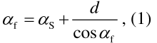

<!-- Start of picture text -->
d  f   S  , (1) cos  f <!-- End of picture text -->

where _d_ is the angular distance of the sunspot from the arc NS which is perpendicular to WE and which passes through the centre of the solar disk and _α_ S is right ascension of the centre of the solar disk. 

From the quantities _α_ and _δ_ , we can easily calculate topocentric ecliptic coordinates of the sunspot (topocentric ecliptic latitude _β_ 'f and topocentric ecliptic longitude _λ_ 'f) according to the well-known transformation formulas between the equatorial and ecliptic coordinate systems: 

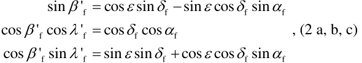

<!-- Start of picture text -->
sin  'f  cos  sin  f  sin  cos  f sin  f ' cos  'f cos  f  cos  f cos  f  , (2 a, b, c) ' cos  'f sin  f  sin  sin  f  cos  cos  f sin  f <!-- End of picture text -->

where _ε_ is the <mark>obliquity of the ecliptic.</mark> 

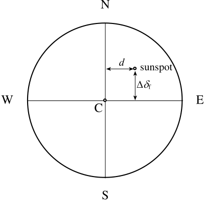

<!-- Start of picture text -->
N d sunspot  f W E C S <!-- End of picture text -->

_Fig. 1: drawing of a solar disk with the position of a single spot. Line_ WE _is parallel to the plane of the equator and is easily determined from observations._ 

## **Expressions needed to find the elements of the Sun's rotation and period from observations** 

By the following procedure one can determine the elements of the Sun's rotation and the period from observations. Another approach can be found for e.g. in Waldmeier, 1941. With the known obliquity of the ecliptic _ε_ at the observation times _t_ and from the expression (2) we can calculate the apparent topocentric ecliptic coordinates of the sunspot ( _λ_ 'f, _β_ 'f). The apparent angular and rectangular topocentric coordinates of the Sun (( _λ_ 'S, _β_ 'S) and ( _x_ S, _y_ S, _z_ S)) as well as the current distance to the Sun can be determined using some of the publicly available ephemeris. Due to the small apparent angular distance of the sunspot from the centre of the Sun ( _σ_ ) following expression can be used: 

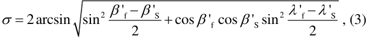

<!-- Start of picture text -->
  2arcsin sin 2  'f  2  'S  cos  'f cos  'S sin 2  'f  2  'S , (3) <!-- End of picture text -->

Topic:   Sun and Solar Activity 

87 

Proceedings of Thirteenth Workshop “Solar Influences on the Magnetosphere, Ionosphere and Atmosphere” _Primorsko, Bulgaria_ <u>,</u> _September, 2021_ 

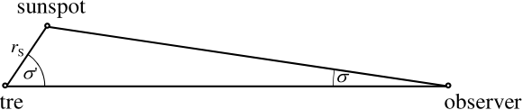

<!-- Start of picture text -->
sunspot r S  '  observer <!-- End of picture text -->

Sun centre 

_Fig. 2: with known distance between observer and the Sun (d_ observer-S _), apparent angular distance between centre of the Sun and sunspot (σ) and Solar radius (r_ S _), angle (σ_ ' _) can be determined, as well as heliocentric coordinates of sunspot._ 

The heliocentric angular distance between the sunspot and observer is equal to (Fig. 2): 

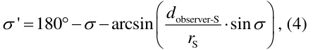

<!-- Start of picture text -->
 '  180   arcsin  d observer-S  sin  , (4) r  S  <!-- End of picture text -->

where _d_ observer-S is the topocentric distance to the Sun's centre, and _r_ S is the radius of the Sun. The topocentric distance to the sunspot ( _d_ f-S) is: 

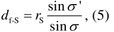

<!-- Start of picture text -->
sin  ' d f-S  r S sin  , (5) <!-- End of picture text -->

The heliocentric rectangular ecliptic coordinates of the sunspot ( _x_ f, _y_ f, _z_ f) are: 

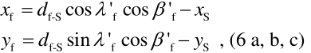

<!-- Start of picture text -->
x f  d f-S cos  'f cos  'f  x S y f  d f-S sin  'f cos  'f  y S  , (6 a, b, c) <!-- End of picture text -->

_z_ f  _d_ f-S sin  'f  _z_ S 

and finally heliocentric ecliptic coordinates of the sunspot (instead of _λ_ f, _β_ f in the following text we will use notation _λ_ , _β_ ): 

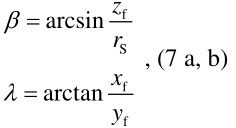

<!-- Start of picture text -->
  arcsin z f r S  , (7 a, b)  arctan x f y f <!-- End of picture text -->

In this procedure we use value of the obliquity of the ecliptic for the instant of time of each observation, i.e. the same that was used during individual transformation of the equatorial coordinates to the ecliptic. 

Figure 3 shows the heliocentric celestial sphere. X denotes the position of a sunspot that has coordinates ( _λ_ , _β_ ) in the celestial heliocentric ecliptic system and coordinates ( _l_ , _b_ ) in the heliographic system ( _b_ is the heliographic latitude, _l_ is arc NX ', where N is the ascending node of the solar equator). Point P0 is the north ecliptic pole, and point PS is the north pole of the Sun's rotational axis. 

The direction of the solar axis in space can be unambiguously determined by two elements: inclination ( _i_ ) - the angle between the ecliptic plane and the solar equatorial plane and ecliptic longitude ( _Ω_ ) of the ascending node of the solar equator - the angle, in the ecliptic plane, between the equinox direction and the direction where the solar equator intersects (N on Fig. 1) the ecliptic from the South, i.e. in the sense of rotation. 

Topic:   Sun and Solar Activity 

88 

Proceedings of Thirteenth Workshop “Solar Influences on the Magnetosphere, Ionosphere and Atmosphere” _Primorsko, Bulgaria_ <u>,</u> _September, 2021_ 

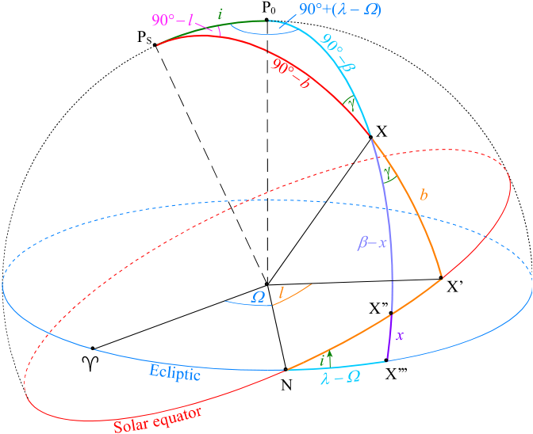

<!-- Start of picture text -->
i P0 90°+(  ) 90°  l PS X b  x X’  l X’’ x  i X’’’ N <!-- End of picture text -->

_Fig. 3: coordinates of sunspot_ X _on heliocentric celestial sphere in celestial ecliptic system and heliographic system_ 

By applying the basic formulas of spherical trigonometry to a spherical triangle PSXP0, we have: cos _i_  cos  90  _b_  cos  90   sin  90  _b_  sin  90  cos  , (8) 

from which we find the expression: 

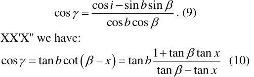

<!-- Start of picture text -->
cos i  sin b sin  cos   . (9) cos b cos  cos   tan b cot  x   tan b 1tan  tan  tantan xx   (10) <!-- End of picture text -->

From the triangle XX'X'' we have: 

and from the triangle NX''X''' we find: 

sin    tan _x_ cot _i_ . (11)  tan _x_  sin   tan _i_  sin  cos  tan _i_  cos  sin  tan _i_   

By eliminating the angle  from equations (9) and (10) we can get the expression: 

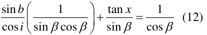

<!-- Start of picture text -->
sin b  1 tan x 1      (12) cos i  sin  cos  sin  cos  <!-- End of picture text -->

and by substituting tan _x_ according to expression (11), we finally find: 

_X_  _Y_ cos  sin  _Z_ cos  cos  sin  , (13) where the _X_ = sin _b_ /cos _i_ , _Y =_ cos  tan _i_ and _Z_ = sin  tan _i_ are unknown quantities. 

Topic:   Sun and Solar Activity 

89 

Proceedings of Thirteenth Workshop “Solar Influences on the Magnetosphere, Ionosphere and Atmosphere” _Primorsko, Bulgaria_ <u>,</u> _September, 2021_ 

Expression (13) for processing measurements originates from Delambre, (1814). Equation (13) contains three unknowns. So it is necessary to have at least three equations to determine _X_ , _Y_ and _Z_ . In other words, we need to have at least three observations of a sunspot to get one value of _b_ , _Ω_ and _i_ . Of course, we neglect the already small meridional motions of the sunspot, that is, we assume that _b_ is a constant for a particular sunspot. After we determine _X_ , _Y_ , _Z_ we easily calculate _b_ , _Ω_ , _i_ with the following expressions: 

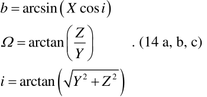

<!-- Start of picture text -->
b  arcsin  X cos i   Z    arctan    . (14 a, b, c)  Y  2 2 i  arctan Y  Z   <!-- End of picture text -->

If we have more than three observations, we can calculate the error of quantity  and _i_ (Stark and Wöhl, 1981). 

To calculate the sidereal velocity of the Sun's rotation (and sidereal period of rotation), it is sufficient to determine the change in the quantity _l_ in time. It is possible to derive different formulas for calculating the quantity _l_ , but the most suitable is the one in which _l_ is the argument of the tangent function. From a spherical triangle PSP0X (Fig. 3) we find: 

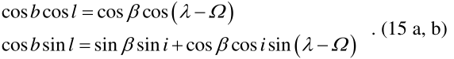

<!-- Start of picture text -->
cos b cos l  cos  cos     . (15 a, b) cos b sin l  sin  sin i  cos  cos i sin   <!-- End of picture text -->

If we substitute the cos _b_ from the first formula into the second, we have: 

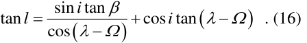

<!-- Start of picture text -->
tan l  cossin i  tan    cos i tan     . (16)   <!-- End of picture text -->

From the sidereal period, we can calculate the synodic period by taking into account the details of the Earth's motion (Roša et al., 1995; Skokić et al., 2014). 

## **Processing of Bošković's measurements** 

The individual observation times _t_ x (for first and second contacts of the solar disk, and for the sunspot) recorded in Bošković's work (Boscovich, 1785) have been measured as the time that elapsed from the moment when Sun was in upper culmination in Sens, France. Therefore, the right ascension is directly given by measured time. Distance in declination from northern edge of the Sun was measured by use of micrometer. The instant of measurement time can be expressed as _t_ xUT1 = _t_ s kulmUT1 + _t_ x . There where 6 days of observations (between 12 and 19 September 1777) of the same sunspot with set of 5 measurements each day of observation. Let the observation time _t_ be the arithmetic mean of the first _t_ 1UT1 and the last moment of observation _t_ nUT1. Also, Δ _α_ f and Δ _δ_ f are the mean distances from the centre of the solar disc in right ascension and declination respectably for a given set of measurements.  Then the coordinates of the sunspot at the moment of observation ( _t_ ) are the difference between the apparent topocentric equatorial coordinates of the Sun ( _α_ s; _δ_ s) and the observed angular distances of the sunspot from the centre of the solar disc in right ascension and declination respectively (Δ _α_ f, Δ _δ_ f). Heliocentric ecliptic coordinates of the sunspot ( _λ_ , _β_ ) are then obtained by using expressions (2 a, b, c), (3), (4), (5), (6 a, b, c) and (7 a, b). By a combination of coordinates obtained from three observations and solving system of three equations (13) we calculate _b_ , _Ω_ , _i_ using expressions (14 a, b, c) for each triplet of observations. Mean values of _b_ = 26.43°, _Ω_ = 65.61°, _i_ = 7.88° are used for calculation of _l_ (expression 16) for each of 6 sets 

Topic:   Sun and Solar Activity 

90 

Proceedings of Thirteenth Workshop “Solar Influences on the Magnetosphere, Ionosphere and Atmosphere” _Primorsko, Bulgaria_ <u>,</u> _September, 2021_ 

of measurements. Result for sidereal period at mean latitude _b_ = 26.43° using least square method is _P_ = (26.696 ± 0.044) days ( _ω_ = (13.485 ± 0.022) °/day) which corresponds to mean value of the synodic period of _P_ = (28.780 ± 0.047) days ( _ω_ = 12.508 ± 0.020 °/day). In calculation of the sidereal period from synodic we used mean angular heliocentric velocity of the Earth (0,9765°/day) during period between 12 and 19 September 1777. Bošković's results for sidereal period is 26.77 days and it is close to our result. 

## **Conclusions** 

This paper presents an analysis of a part of Bošković's observations of sunspots with a presented mathematical approach and with the use of modern ephemeris parameters. The obtained values for the solar rotation parameters and the rotation period are close to Bošković's results, which indicates the accuracy of Bošković's methods. Furthermore, we plan to extend the processing to all of Bošković's observations and compare them with the results of other historical and modern measurements. 

## **Acknowledgements** 

R. Brajša and I. Skokić acknowledge the support by the Croatian Science Foundation under the project 7549 "Millimeter and submillimeter observations of the solar chromosphere with ALMA". 

## **References** 

Boscovich, R. J. (1785): _Opuscule II: Sur les éléments de la rotation du soleil sur son axe déterminés par l'observation de ses taches._ in: Opera pertinentia as opticam, et astronomiam. Maxima ex parte nova, & omnia hucusque inedita, In quinque Tomos distributa Ludovico XVI. Galliarum Regi Potentissimo Dicata. Tomus quintus, Bassani, 75-178. (in French) 

Brajša, R., Ruždjak, D. and Wöhl, H. (2006): Temporal variations of the solar rotation determined by sunspot groups. Solar Physics, 237, 365-382 

Brajša, R., Ruždjak, V., Vršnak, B., Pohjolainen, S., Urpo, S., Schroll, A. and Wöhl, H. (1997): On the possible changes of the solar differential rotation during the activity cycle determined using microwave low brightnesstemperature regions and H-alpha filaments as tracers. Solar Physics, 171, 1-34. 

Delambre (1814): Astronomie Theorique, Paris 

Husak, M.; Brajša, R.; Špoljarić, D. (2021a): On the Determination of the Solar Rotation Elements i, Ω and Period using Sunspot Observations by Ruđer Bošković in 1777, Rudarsko-geološko-naftni zbornik (The Mining-Geology-Petroleum Engineering Bulletin), 77-98 

Husak, M.; Brajša, R.; Špoljarić, D. (2021b): Solar Rotation Eelements _i_ , _Ω_ And Period Determined using 

Sunspot observation by Ruđer Bošković in 1777, Central European Astrophysical Bulletin (2021) 45:1, 1–7. James, I. (2004). Remarkable Physicists, Cambridge University Press, Cambridge Jurdana-Šepić, R., Brajša, R., Wöhl, H., Hanslmeier, A., Poljančić, I., Svalgaard, L. and Gissot, S. F. (2011): A relationship between the solar rotation and activity in the period 1998–2006 analysed by tracing small bright coronal structures in SOHO-EIT images. Astronomy and Astrophysics, 534, A17, 1-6 

Roša, D.; Brajša, R.; Vršnak, B.; Wöhl, H. (1995): The relation between the synodic and sidereal rotation period of the Sun, Solar Physics, 159, 393–398 

Ruždjak, D., Brajša, R., Sudar, D., Skokić, I. and Poljančić Beljan, I. (2017): A Relationship Between the Solar Rotation and Activity Analysed by Tracing Sunspot Groups. Solar physics, 292, 179, 1-11 

Skokić, I.; Brajša, R.; Roša, D.; Hržina, D.; Wöhl, H. (2014): Validity of the Relations Between the Synodic and Sidereal Rotation Velocities of the Sun, Solar Physics, 289, 1471-1476 

Špoljarić, D. and Kren, T. (2016): Ruđer Bošković and Astronomy. In: Lapaine, M. (ed.): Ruđer Bošković and Geosciences. Faculty of Geodesy, University of Zagreb, Zagreb 

Špoljarić, D. and Solarić, N. (2016): Bošković, Perfector and Inventor of Geodetic, Astronomic and Optical Instruments. In: Lapaine, M. (ed.): Ruđer Bošković and Geosciences. Faculty of Geodesy, University of Zagreb, Zagreb 

Stark, D. and Wöhl, H. (1981): On the Solar Rotation Elements as Determined from Sunspot Observations. Astronomy and Astrophysics, 93, 241-244 

Waldmeier, M. (1941): Ergebnisse und Probleme der Sonnonforschung, Leipzig 

Wöhl, H., Brajša, R., Hanslmeier, A. and Gissot, S. F. (2010): A precise measurement of the solar differential rotation by tracing small bright coronal structures in SOHO-EIT images. Astronomy and Astrophysics, 520, A29, 1-11 

Topic:   Sun and Solar Activity 

91 

