# Domain Adaptive Pose Estimation Via Multi-level Alignment 

## Yugan Chen 

_School of computer science and engineering Nanjing University of Science and Technology_ Nanjing, China chenyugan@njust.edu.cn 

## Lin Zhao* 

_School of computer science and engineering Nanjing University of Science and Technology_ 

Nanjing, China zhaolin@njust.edu.cn 

## Yalong Xu 

_School of computer science and engineering Nanjing University of Science and Technology_ 

Nanjing, China xuyalong@njust.edu.cn 

## Honglei Zu 

_School of computer science and engineering Nanjing University of Science and Technology_ 

Nanjing, China zuhonglei@njust.edu.cn 

## Xiaoqi An 

_School of computer science and engineering Nanjing University of Science and Technology_ 

Nanjing, China xiaoqi.an@njust.edu.cn 

## Guangyu Li 

_School of computer science and engineering Nanjing University of Science and Technology_ Nanjing, China guangyu.li2017@njust.edu.cn 

**_Abstract_ —Domain adaptive pose estimation aims to enable deep models trained on source domain (synthesized) datasets produce similar results on the target domain (real-world) datasets. The existing methods have made significant progress by conducting image-level or feature-level alignment. However, only aligning at a single level is not sufficient to fully bridge the domain gap and achieve excellent domain adaptive results. In this paper, we propose a multi-level domain adaptation approach, which aligns different domains at the image, feature, and pose levels. Specifically, we first utilize image style transfer to ensure that images from the source and target domains have a similar distribution. Subsequently, at the feature level, we employ adversarial training to make the features from the source and target domains preserve domain-invariant characteristics as much as possible. Finally, at the pose level, a self-supervised approach is utilized to enable the model to learn diverse knowledge, implicitly addressing the domain gap. Experimental results demonstrate that significant improvement can be achieved by the proposed multi-level alignment method in pose estimation, which outperforms previous state-of-the-art in human pose by up to 2.4% and animal pose estimation by up to 3.1% for dogs and 1.4% for sheep. The codes are available at the link.** 

**_Index Terms_ —Unsupervised Domain Adaption, Pose Estimation, Self-supervised Learning** 

### I. INTRODUCTION 

Recently, significant progress has been made in 2D pose estimation using deep learning methods [1]–[5]. However, 

This work was supported by the National Natural Science Fund of China under Grant No.62172222, the Postdoctoral Innovative Talent Support Program of China under Grant 2020M681609. 

* Corresponding author. 

these methods train high-performance models by using a large amount of labeled data, which is often time-consuming and expensive to obtain, especially with real-world datasets. To address the lack of the labels of the real-world datasets, domain adaptation (DA) [6] are being explored. By leveraging labeled virtual datasets, DA can transfer knowledge learned from virtual datasets (source domain) to unlabeled real-world datasets (target domain). Due to the development of computer technology and virtual reality techniques, labeled virtual data is much more cost-effective than real-world data. As a result, domain adaptive pose estimation has attracted a lot of attention. 

While domain adaptation methods for classification tasks [7]–[10] and semantic segmentation tasks [11], [12] have seen significant progress in recent years, there has been relatively little research applying these methods to pose estimation. Existing works, whether for human pose estimation or animal pose estimation, can be broadly classified into two categories. One focuses on narrowing the domain gap between domains by performing domain alignment on the image-level, while the other primarily focuses on the pose-level. UDAPE [13] proposes a style transfer technique that aims to align domains at the image-level. RegDA [14] employs adversarial training with two different regressors to correct pose errors. CC-SSL [15] and UDA-ANIMAL [16] achieve pose-level alignment by designing different strategies to continuously update pseudo-labels. Although these methods all successfully improve the accuracy and performance of pose estimation, 

aligning domains at a single level fails to bridge domain gap comprehensively. 

In order to comprehensively bridge the domain gap, in this work, we propose a multi-level alignment framework for DA pose estimation. The framework performs image, feature and pose levels alignment to effectively bridge the gap between different domains. First, at the image-level, the source image is transferred to the style of the target image, so that they can have similar data distributions. Second, at the featurelevel, we utilize adversarial learning, which is achieved by incorporating a discriminator with gradient reverse layer, to align the distribution of features between two domains. This approach effectively makes model produces domain-invariant features. Lastly, at the pose-level, we utilize an information maximization self-supervised learning technique. This enables the model to learn meaningful and diverse pose representations and prevent it from biasing toward the source domain. We evaluate the proposed method on multiple datasets and demonstrate its effectiveness in bridging the domain gap. The main contributions of our work are as follows: 

- We propose a novel framework that leverages different alignment strategies at the image, feature, and pose levels to address the domain gap in cross-domain pose estimation. 

- We conduct comprehensive experiments on both human and animal domain adaptive pose estimation benchmarks and achieve the state-of-the-art performance. For example, we achieve 84.4% of accuracy on the task _SURREAL → LSP_ , which is 2.4% higher than the previous SOTA. 

### II. RELATED WORK 

### _A. Pose Estimation_ 

Pose estimation is a foundational visual task. Existing works can be mainly divided into two categories: CNN-based [1], [2], [5] and transformer-based [3], [4]. Simplebaseline [2] introduces a simple and effective model based on ResNet [17]. HRNet [1] maintains high-resolution images throughout the entire training phase, achieving significant results. ViTPose [3] achieves excellent results by utilizing a regular ViT [18] structure as the backbone and combining it with a lightweight decoder. These methods have achieved near-human-level estimation results, but they require a large amount of labeled data for training. Hence, in this work, we focus on addressing the domain gap issue in domain adaptive pose estimation, which makes it possible to train high-performance models solely using synthetic data. 

### _B. Domain Adaptive Pose Estimation_ 

Currently, there are two main categories of domain adaptation frameworks for pose estimation. The first category utilizes shared network structures, where the weights of the network are the same for both the source and target domains. RegDA [14] employs two independent regressors to narrow the domain gap adversarially. CC-SSL [15] utilizes consistency transformation and refinement of pseudo-labels. The second 

category involves non-shared network structures, typically employing a teacher-student paradigm to update weights. UDAPE [13] provides a good framework for DA pose estimation by style transfer. UDA-Animal [16] combines pseudo-label updates with the mean-teacher [19] framework. However, the aforementioned works only conduct alignment on a single level. Our work aims to achieve domain adaption through a multi-level approach. 

### III. METHODOLOGY 

### _A. Preliminaries and Overview_ 

In the source domain, a labeled pose dataset _S ∈_ �� _x__i_ _s__, y_ _s__i_ �� _Ni_ =1includes_N_samples,where_x_ _s__i∈_R_C×H×W_ represents a training image and _ys__i∈_R_K×_2 represents the corre- sponding keypoint coordinates. Here, _H_ , _W_ , _C_ and _K_ denote the height, width, the number of channels and the number of keypoints respectively. In the target domain, an unlabeled pose dataset _T ∈_ � _x__i_ _t_ � _Mi_ =1includes_M_samples.Inmost2D pose estimation methods, a model is trained to output a set of heatmaps _H∈_ R_K×H′×W ′_ , where _H__′_ and _W__′_ are the height and width of the heatmap. The final keypoint coordinates are obtained by processing these heatmaps. Ground truth heatmaps are generated through a function (usually Gaussian) _G_ : R_K×_2 _→_ R_K×H′×W ′_ . The entire training process is supervised using the MSE loss by comparing the predicted heatmaps with the ground truth. 

The overview of the proposed DA framework is presented in Figure 1. Our model adopts the mean-teacher [19] framework, which consists of a student model _fs_ and a teacher model _ft_ . We train our model by using three alignment methods at the image, feature and pose levels respectively. To begin with, we pretrain a pose estimation model in the labeled source domain and let both the teacher and student share the same parameters from the pretrained model initially. During the image-level alignment, we make the source domain and the target domain have similar distribution by transferring the source image style to match the target image. Furthermore, we utilize the feature adversarial learning to align the distributions of features from two domains in student model, which will allow the student model to reduce domain gap. Finally, self-supervised learning is employed at the pose-level to reduce the student’s bias towards the source domain and improve the teacher’s ability to generate dependable pseudo-labels. 

### _B. Image-Level Alignment_ 

Inspired by [13], we utilize image style transfer to align the images from two domains. Firstly, a pre-trained VGG [20] _fv_ is used to extract corresponding features from the content image _xs_ and style image _xt_ . Then, the generator _g_ in AdaIN [21] is employed to generate the desired stylized output: 

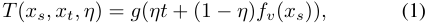

<!-- Start of picture text -->
T ( xs, xt, η ) =  g ( ηt  + (1  − η ) fv ( xs )) , (1) <!-- End of picture text -->

where _t_ = AdaIN( _fv_ ( _xs_ ) _, fv_ ( _xt_ )) and _η_ is a weight parameter controlling the ratio between the content image and style image. Through the style transfer method, we are able to 

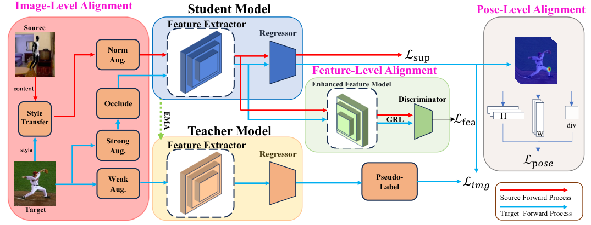

<!-- Start of picture text -->
Image-Level Alignment Student Model Pose-Level Alignment Source Feature Extractor Regressor NormAug. ℒ��� Feature-Level Alignment Enhanced Feature Model content Discriminator Occlude TransferStyle GRL ℒ��� H div Teacher Model W Strong Feature Extractor style Aug. Regressor ℒ���� Weak Pseudo- Aug. Label ℒ��� Source Forward Process Target Target  Forward Process EMA <!-- End of picture text -->

Fig. 1. **Overview of our proposed method** . The framework consists of two branches: 1) Student model for cross-domain learning and 2) Teacher model that provides pseudo-labels for the Student model. We employ image-level alignment through style transfer during the input image processing, feature-level alignment through adversarial learning and pose-level alignment through self-supervised learning to update the student model’s parameters, and use exponential moving averages (EMA) to update the teacher model. **GRL** refers to Gradient Reversal Layer, which is used to align the distributions of the two domains using a discriminator with gradient inversion layers. 

transform the images from the source domain into _xs→t_ = _T_ ( _xs, xt, η_ ) and narrow the domain gap at the image level. 

Moreover, to prevent the model from forgetting knowledge learned from the source domain during the learning process, we still need to supervise the student model using the labels of the source domain. After style transfer, we apply normal augmentation _A_ 1 to the style transferred images. Therefore, the supervised loss in the student model is: 

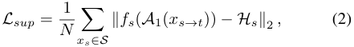

<!-- Start of picture text -->
Lsup = N 1 � ∥fs ( A 1( xs→t ))  −Hs∥ 2  , (2) xs∈S <!-- End of picture text -->

where _∥·∥_ 2 refers to the MSE loss and _Hs_ refers to the ground truth heatmap from the source domain. 

To generate more reliable pseudo-labels, for the images from the target domain, we use different augmentation for the student model and teacher model. For the input of the student model, we first apply strong augmentation _A_ 2 to transform it, and then randomly occlude keypoints in the foreground to simulate various types of noise via an occluded operation: _x_ ˆ _t_ = _O_ ( _A_ 2( _xt_ )). For the input of the teacher model, we only use weak augmentation _A_ 3. Meanwhile, we set a random threshold _τi_ to simulate the occurrence of random noise on the teacher side. Only when the activation value is greater than the set threshold _τi_ , do we perform consistent learning between the teacher and student models. Therefore, the loss function can be defined as follows: 

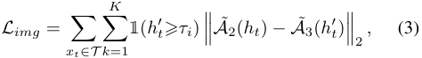

<!-- Start of picture text -->
K Limg = � � 1 ( h ′ t ⩾ τi ) ��� A ˜2( ht )  − A ˜ 3( h ′ t ) ���2 , (3) xt∈T k =1 <!-- End of picture text -->

where _A_ ˜ denotes the reverse operation of _A_ , _ht_ = _fs_ ( ˆ _xt_ ) denotes the outputs of the student model, _h__′_ _t_=_ft_(_A_2(_xt_)) denotes the normalized output heatmap of the teacher model 

and 1 ( _·_ ) denotes the function which can choose activation value. 

### _C. Feature-Level Alignment_ 

Considering that pseudo-labels from the teacher model are influenced by the source domain, there is a risk of unintentionally biasing the student towards that domain. In order to make the model learn domain invariant feature representation, we apply adversarial learning. Through adversarial learning, the student model can leverage information from both domains to narrow the domain gap and align distributions before applying pseudo-label supervision. 

The specific method involves using the student’s feature encoder _F_ to obtain the initial features, and then using a feature enhancement model _fe_ to remove noise from both domains and enhance more representative information. A feature discriminator _D_ is introduced to distinguish whether the features come from the source or the target domain. For each input sample, assume the probability of it belonging to the source domain as _D_ ( _fe_ ( _F_ ( _X_ ))), otherwise it is 1 _−D_ ( _fe_ ( _F_ ( _X_ )). We use binary cross-entropy loss to update the discriminator, and the domain label _d_ is set to 0 if the sample comes from the source domain, otherwise 1. The discriminator loss function can be represented as follows: 

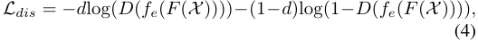

<!-- Start of picture text -->
Ldis =  −d log( D ( fe ( F ( X )))) − (1 −d )log(1 −D ( fe ( F ( X )))) , (4) <!-- End of picture text -->

where _X_ denotes the inputs from source or target domain after the augmentation. 

Similar to GAN [22], we need to encourage our discriminator to distinguish the features from source or target domains as accurately as possible, while also ensuring that feature encoder 

can generate features that the discriminator cannot distinguish. Therefore, the final loss function can be defined as follows: 

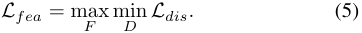

<!-- Start of picture text -->
Lfea = max min (5) F D Ldis. <!-- End of picture text -->

In this work, we utilize the method [7] to optimize the max-min problem by generating reverse gradients between the feature encoder and discriminator. 

### _D. Pose-Level Alignment_ 

Due to the availability of labels only in the source domain and the student model can access inputs from both the source and target domains, the student model may exhibit a bias towards the source domain. To further narrow the gap between domains, we implicitly align domains at the pose level. Specifically, inspired by [23], an Information Maximization (IM) loss is used to achieve this goal. The IM loss aims to encourage the model to maximize the mutual information between the learned features from the input data, thereby making the model’s output more deterministic at individual keypoints and more diverse on a global scale. This alignment does not involve explicit operations directly handling domain discrepancies, but it can improve the accuracy and robustness of the outputs of the student model. Therefore, it is referred to as implicit alignment. 

Following the concept introduced by [24], we decompose the heatmap into H-direction and W-direction vectors using projection vectors to mitigate the impact of keypoint sparsity. Additionally, considering that projection vectors may stack some irrelevant points together, we only apply the Information Maximization to points with confidence greater than a threshold _τp_ to prevent the model from incorrectly shifting to non-keypoint areas. The self-supervised loss is defined as follows: 

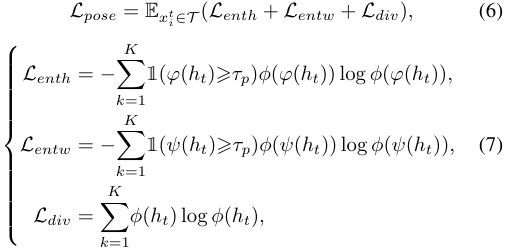

<!-- Start of picture text -->
Lpose = E xti ∈T  ( Lenth  +  Lentw  +  Ldiv ) , (6)  Lenth =  −k � KK =1 1 ( φ ( ht )⩾ τp ) ϕ ( φ ( ht )) log  ϕ ( φ ( ht )) ,  LLentwdiv ==  − � Kk �=1 ϕ ( 1 h ( tψ ) log( ht ϕ )⩾( hτpt )) ,ϕ ( ψ ( ht )) log  ϕ ( ψ ( ht )) , (7)  k =1 <!-- End of picture text -->

where _φ_ ( _·_ ) denotes the operation to map _·_ to a vector in direction of H, _ψ_ ( _·_ ) denotes the operation to map _·_ to a vector in direction of W, and _ϕ_ ( _·_ ) denotes the operation of softmax. 

### _E. Training Details_ 

In summary, the entire objective loss function can be defined 

as: 

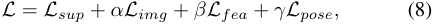

<!-- Start of picture text -->
L  =  Lsup  +  αLimg  +  βLfea  +  γLpose, (8) <!-- End of picture text -->

where _α_ , _β_ and _γ_ are trade-off parameters. 

After conducting all the alignments, the student model can undergo normal gradient updates, while the parameters of the 

teacher are updated using the parameters of the student model through exponential moving average (EMA): 

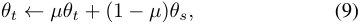

<!-- Start of picture text -->
θt ← µθt  + (1  − µ ) θs, (9) <!-- End of picture text -->

where _θt_ and _θs_ denote the model parameters of the teacher and student, respectively. _µ_ denotes the smoothing coefficient and the out default setting is 0.999. 

### IV. EXPERIMENTS 

To validate the effectiveness of our approach on pose estimation tasks, we conduct experiments on benchmark datasets including human and animal pose estimation and compare our method with previous state-of-the-art models. 

**Datasets.** For human pose estimation, _SURREAL_ [25] and _Leeds Sports Pose_ (LSP) [26] datasets are used. _SURREAL_ is a synthetic dataset used as the source domain, comprising a total of 6 million images. _Leeds Sports Pose_ is a real-world dataset containing 2k annotated images of athletes’ poses. Our task is to perform domain adaptation from _SURREAL_ as the source domain to _LSP_ as the target domain. 

We utilized three datasets for animal pose estimation. The first one is _SynAnimal_ [15], which is a synthetic dataset generated by rendering CAD models. It consists of five different animals: horse, tiger, sheep, hound and elephant. Each animal category contains 10k images. The second dataset is _TigDog_ [27], a real-world dataset obtained by slicing frames from videos. It includes 30k images of horses and tigers. The third dataset is _AnimalPose_ [28], which contains 6.1k real-world animal images of dogs, cats, cows, sheep, and horses. Our task is to perform domain adaptation from _SynAnimal_ as the source domain to _TigDog_ and _AnimalPose_ as the target domains. 

**Implementation Details.** The pose estimation network is based on SimpleBaseline [2]. We use a pre-trained ResNet101 as the backbone network. The Adam [29] optimizer is employed with an initial learning rate of 1e-4, which gradually decreases to 1e-5 at the 22500th iteration and finally reaches 1e-6 after 30000 iterations. As for hyperparameters, we set _α_ = 1, _β_ = 0.1 and _σ_ = 0.3. After the training is completed, the teacher model is used for the final inference. 

### _A. Main Results_ 

In this section, the baselines, metrics and quantitative results on different tasks are shown. 

**Baselines.** We compare our approach with the following baseline methods in domain adaptation for pose estimation: CC-SSL [15], RegDA [14], and UDAPE [13]. All baseline methods utilize ResNet-101 as the backbone. 

**Metrics.** To evaluate our approach, the Percentage of Correct Keypoints (PCK) is used as the metric, which gives the percentage of correctly estimated keypoints. In Tables 1-5, we report PCK@0.05 that measures the percentage of accurate predictions, with a threshold of 5% relative to the image size. For the human pose estimation task, we follow the same setting as other methods [13], [14] and focus on the following keypoints: Shoulder (Sld), Elbow (Elb), Wrist, Hip, Knee, and Ankle. As for the animal pose estimation tasks, we also follow 

TABLE I 

PCK@0.05 ON TASK _SURREAL → LSP_ 

|method|Sld|Elb|Wrist|Hip|Knee|Ankle|All|
|---|---|---|---|---|---|---|---|
|Source-only|50.6|64.8|63.3|70.1|71.2|70.1|65.0|
|CCSSL [15] (CVPR’20)|36.8|66.3|63.9|59.6|67.3|70.4|60.7|
|UDA-Animal [16](CVPR’21)|61.4|77.7|75.5|65.8|76.7|78.3|69.2|
|RegDA [14] (CVPR’21)|62.7|76.7|71.1|81.0|80.3|75.3|74.6|
|UDAPE [13] (ECCV’22)|69.2|84.9|83.3|85.5|84.7|84.4|82.0|
|Ours|**78.2**|**86.6**|**83.7**|**87.1**|**85.2**|**85.5**|**84.4**|

the common settings as other methods [13], [16]. In _TigDog_ , we select the Eye, Chin, Shoulder (Sld), Hip, Elbow (Elb), Knee, and Hoof. In _AnimalPose_ , the Eye, Hoof, Knee, and Elbow are selected. 

**Results on Human Pose Estimation.** Table 1 presents the results of the human pose estimation task _SURREAL → LSP_ . Our method achieves the best performance outperforming the previous state-of-the-art method UDAPE [13] by 2.4%. Moreover, our method consistently surpasses the baseline methods in every keypoint for human pose estimation. 

**Results on Animal Pose Estimation.** Tables 2-5 present the quantitative comparing results of animal pose estimation tasks: _SynAnimal → TigDog_ and _SynAnimal → AnimalPose_ . On _TigDog_ , our method achieves the best results on the tiger category (Table 2), surpassing UDAPE [13] by 0.5%. On the horse category (Table 3), the performance of our method is on par with UDAPE and slightly lower than that of UDA-Animal. On _AnimalPose_ , our model achieves the best results on the dog and sheep categories, improving the previous best results by 3.1% and 1.4%, respectively. 

#### TABLE V 

PCK@0.05 ON TASK _SynAnimal → AnimalPose (Sheep)_ 

|method|Eye|Hoof|Knee|Elb|All|
|---|---|---|---|---|---|
|Source-only|59.9|60.7|46.2|31.0|47.9|
|CCSSL [15] (CVPR’20)|44.3|55.4|43.5|28.5|42.8|
|RegDA [14] (CVPR’21)|62.8|68.5|57.0|42.4|56.9|
|UDA-Animal [16](CVPR’21)|48.2|52.9|49.9|29.7|44.9|
|UDAPE [13] (ECCV’22)|61.6|**77.4**|57.7|44.6|60.2|
|Ours|**66.8**|75.8|**61.6**|**44.8**|**61.6**|

### _B. Ablation Study_ 

We conduct ablation studies to investigate the effectiveness of each module proposed in our method. 

**Effect of loss functions.** We evaluate the performance of each component of our framework through the task _SURREAL → LSP_ in Table 6. We adopt the mean-teacher method [19] as our baseline. Building upon image-level alignment, we introduce additional loss functions for both feature-level alignment and pose-level alignment: adversarial loss and selfsupervised loss respectively. Experimental results demonstrate that feature-level alignment significantly enhances the model’s performance, resulting in a 0.7% improvement. Pose-level alignment alone does not provide significant benefits, yielding a marginal improvement of 0.3%. Nevertheless, when both pose-level and feature-level alignment are conducted, an additional 1.1% improvement is observed. In summary, our proposed multi-level alignment strategy proves to be crucial in bridging the domain gap. 

TABLE VI 

TABLE II 

THE EFFECT OF LOSS FUNCTIONS ON TASK _SURREAL → LSP_ 

PCK@0.05 ON TASK _SynAnimal → TigDog (Tiger)_ 

|method|Eye|Chin|Sld|Hip|Elb|Knee|Hoof|All|
|---|---|---|---|---|---|---|---|---|
|Source-only|85.4|81.8|44.6|70.8|39.6|48.4|55.5|54.8|
|CCSSL [15] (CVPR’20)|94.3|91.3|49.5|70.2|**53.9**|59.1|70.2|66.7|
|RegDA [14] (CVPR’21)|93.3|92.8|50.3|67.8|50.2|55.4|60.7|61.8|
|UDA-Animal [16](CVPR’21)|98.4|87.2|49.4|**74.9**|49.8|62.0|73.4|67.7|
|UDAPE [13] (ECCV’22)|**98.5**|**96.9**|56.2|63.7|52.3|62.8|72.8|67.9|
|Ours|98.0|95.4|**60.4**|64.1|52.1|**63.3**|**73.6**|**68.4**|
|||TABL|E III||||||
|PCK@0.05 ON|TAS|K_SynA_|_nima_|_l →Ti_|_gDog _|_(Horse_|_)_||
|method|Eye|Chin|Sld|Hip|Elb|Knee|Hoof|All|
|Source-only|82.0|90.0|59.2|79.5|65.8|66.9|57.7|67.4|
|CCSSL [15] (CVPR’20)|89.3|92.6|69.5|78.1|70|73.1|65|73.1|
|RegDA [14] (CVPR’21)|89.2|92.3|70.5|77.5|71.5|72.7|63.2|73.2|
|UDA-Animal [16](CVPR’21)|86.9|**93.7**|**76.4**|**81.9**|70.6|**79.1**|**72.6**|**77.5**|
|UDAPE [13] (ECCV’22)|**91.3**|92.5|74.0|74.2|75.8|77.0|66.6|76.4|
|Ours|82.3|92.7|72.6|69.2|**76.4**|77.8|68.5|76.3|
|||TABL|E IV||||||
|PCK@0.05 ON|TASK|_SynAn_|_imal _|_→Ani_|_malPo_|_se (Do_|_g)_||
|method||Ey|e|Hoof|Kn|ee |Elb|All|
|Source-only||38|.2|43.2|25.|7 2|4.1|32.0|
|CCSSL [15] (CVPR’20|)|34|.7|37.4|25.|4 1|9.6|27.0|
|RegDA [14] (CVPR’21)||46|.8|54.6|32.|9 3|1.2|40.6|
|UDA-Animal [16](CVP|R’21)|26|.2|39.8|31.|6 2|4.7|31.1|
|UDAPE [13] (ECCV’22|)|56|.1|**59.2**|38.|9 3|2.7|45.4|
|Ours||**70**|**.6**|59.1|**40.**|**2** **3**|**5.2**|**48.5**|

|method|Sld|Elb|Wrist|Hip|Knee|Ankle|All|
|---|---|---|---|---|---|---|---|
|MT|57.1|70.6|65.7|74.6|76.1|74.5|69.8|
|_Limg_|69.3|86.3|84.5|86.3|84.6|84.4|82.6|
|_Limg_&_Lfea_|72.8|86.0|**84.9**|85.9|85.0|85.0|83.3|
|_Limg_&_Lpose_|71.2|86.4|84.5|86.4|84.7|84.5|82.9|
|_Limg_&_Lfea_&_Lpose_|**78.2**|**86.6**|83.7|**87.1**|**85.2**|**85.5**|**84.4**|

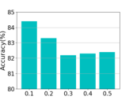

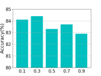

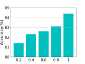

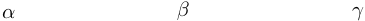

<!-- Start of picture text -->
α β γ <!-- End of picture text -->

Fig. 2. Analysis of the influences of parameters on _SURREAL → LSP_ . 

**Analysis of parameters.** We illustrate the sensitivity of the parameters _α_ , _β_ and _γ_ in Equation 8, through the task _SURREAL → LSP_ . The results are shown in Fig 2. Increasing _α_ shows better performance and confirms the effectiveness of pre-alignment. However, increasing _β_ leads to a decline in performance and potentially causes overfitting. Lastly, the performance for _γ_ remains stable with little variation. It can be observed that our model exhibits the best performance when _α_ = 1, _β_ = 0 _._ 1 and _γ_ = 0 _._ 3. 

### V. CONCLUSION 

In this paper, we propose a novel approach for unsupervised domain adaption on pose estimation. Based on the meanteacher framework, we propose multi-level domain alignment strategy including image-level alignment through style transfer, feature-level alignment through adversarial learning and pose-level alignment through self-supervised learning method. The strategy effectively alleviates the domain gap and the source domain bias issues. The effectiveness and superiority of this approach have been verified in human and animal pose estimation domain adaption tasks. 

- [23] Jian Liang, Dapeng Hu, and Jiashi Feng, “Do we really need to access the source data? source hypothesis transfer for unsupervised domain adaptation,” in _ICCV_ , 2020, pp. 6028–6039. 

- [24] Qucheng Peng, Ce Zheng, and Chen Chen, “Source-free domain adaptive human pose estimation,” in _ICCV_ , 2023, pp. 4826–4836. 

- [25] Gul Varol, Javier Romero, and Xavier Martin, “Learning from synthetic humans,” in _CVPR_ , 2017, pp. 109–117. 

- [26] Sam Johnson and Mark Everingham, “Clustered pose and nonlinear appearance models for human pose estimation.,” in _BMVC_ , 2010, p. 5. 

- [27] Luca Del Pero, Susanna Ricco, and Rahul Sukthankar, “Articulated motion discovery using pairs of trajectories,” in _CVPR_ , 2015, pp. 2151– 2160. 

- [28] Jinkun Cao, Hongyang Tang, and Hao-Shu Fang, “Cross-domain adaptation for animal pose estimation,” in _ICCV_ , 2019, pp. 9498–9507. 

- [29] Diederik P Kingma and Jimmy Ba, “Adam: A method for stochastic optimization,” _arXiv preprint arXiv:1412.6980_ , 2014. 

### REFERENCES 

- [1] Ke Sun, Bin Xiao, and Dong Liu, “Deep high-resolution representation learning for human pose estimation,” in _CVPR_ , 2019, pp. 5693–5703. 

- [2] Bin Xiao, Haiping Wu, and Yichen Wei, “Simple baselines for human pose estimation and tracking,” in _ECCV_ , 2018, pp. 466–481. 

- [3] Yufei Xu, Jing Zhang, and Qiming Zhang, “Vitpose: Simple vision transformer baselines for human pose estimation,” in _NeurIPS_ , 2022, pp. 38571–38584. 

- [4] Xinyu Yi, Yuxiao Zhou, and Feng Xu, “Transpose: Real-time 3d human translation and pose estimation with six inertial sensors,” _TOG_ , vol. 40, no. 4, pp. 1–13, 2021. 

- [5] Lin Zhao, Nannan Wang, and Chen Gong, “Estimating human pose efficiently by parallel pyramid networks,” _TIP_ , vol. 30, pp. 6785–6800, 2021. 

- [6] Kate Saenko, Brian Kulis, Mario Fritz, and Trevor Darrell, “Adapting visual category models to new domains,” in _ECCV_ , 2010, pp. 213–226. 

- [7] Yaroslav Ganin and Victor Lempitsky, “Unsupervised domain adaptation by backpropagation,” in _ICML_ , 2015, pp. 1180–1189. 

- [8] Judy Hoffman, Dequan Wang, and Fisher Yu, “Fcns in the wild: Pixel-level adversarial and constraint-based adaptation,” _arXiv preprint arXiv:1612.02649_ , 2016. 

- [9] Mingsheng Long, Yue Cao, and Jianmin Wang, “Learning transferable features with deep adaptation networks,” in _ICML_ , 2015, pp. 97–105. 

- [10] Yuchen Zhang, Tianle Liu, and Mingsheng Long, “Bridging theory and algorithm for domain adaptation,” in _ICML_ , 2019, pp. 7404–7413. 

- [11] Lukas Hoyer, Dengxin Dai, Haoran Wang, and Luc Van Gool, “Mic: Masked image consistency for context-enhanced domain adaptation,” in _CVPR_ , 2023, pp. 11721–11732. 

- [12] Yunsheng Li, Lu Yuan, and Nuno Vasconcelos, “Bidirectional learning for domain adaptation of semantic segmentation,” in _CVPR_ , 2019, pp. 6936–6945. 

- [13] Donghyun Kim, Kaihong Wang, and Kate Saenko, “A unified framework for domain adaptive pose estimation,” in _ECCV_ , 2022, pp. 603–620. 

- [14] Junguang Jiang, Yifei Ji, and Ximei Wang, “Regressive domain adaptation for unsupervised keypoint detection,” in _CVPR_ , 2021, pp. 6780–6789. 

- [15] Jiteng Mu, Weichao Qiu, and Gregory D Hager, “Learning from synthetic animals,” in _CVPR_ , 2020, pp. 12386–12395. 

- [16] Chen Li and Gim Hee Lee, “From synthetic to real: Unsupervised domain adaptation for animal pose estimation,” in _CVPR_ , 2021, pp. 1482–1491. 

- [17] Kaiming He, Xiangyu Zhang, and Shaoqing Ren, “Deep residual learning for image recognition,” in _CVPR_ , 2016, pp. 770–778. 

- [18] Alexey Dosovitskiy, Lucas Beyer, and Alexander Kolesnikov, “An image is worth 16x16 words: Transformers for image recognition at scale,” _arXiv preprint arXiv:2010.11929_ , 2020. 

- [19] Antti Tarvainen and Harri Valpola, “Mean teachers are better role models: Weight-averaged consistency targets improve semi-supervised deep learning results,” in _NeurIPS_ , 2017. 

- [20] Karen Simonyan and Andrew Zisserman, “Very deep convolutional networks for large-scale image recognition,” _arXiv preprint arXiv:1409.1556_ , 2014. 

- [21] Xun Huang and Serge Belongie, “Arbitrary style transfer in real-time with adaptive instance normalization,” in _ICCV_ , 2017, pp. 1501–1510. 

- [22] Ian Goodfellow, Jean Pouget-Abadie, and Mehdi Mirza, “Generative adversarial nets,” in _NeurIPS_ , 2014. 

