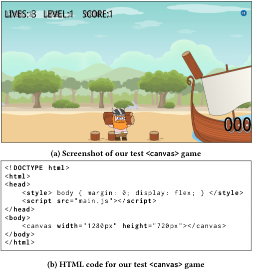
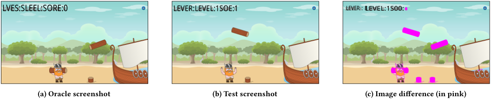
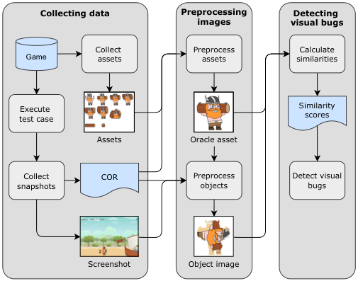
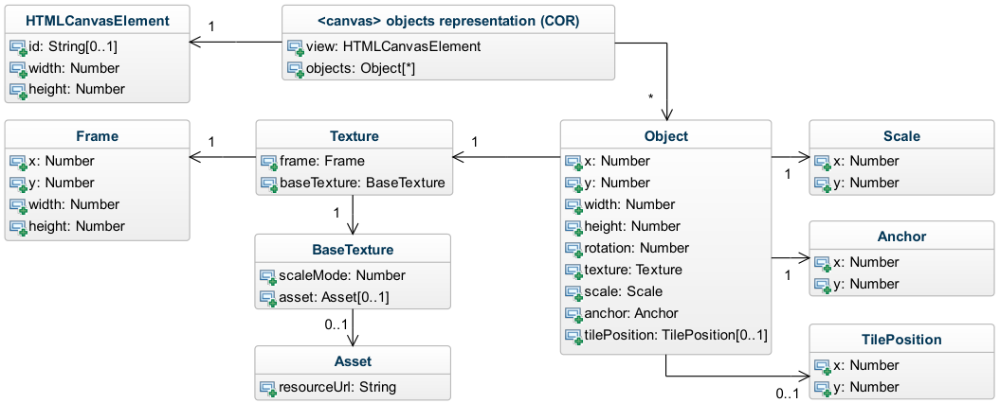
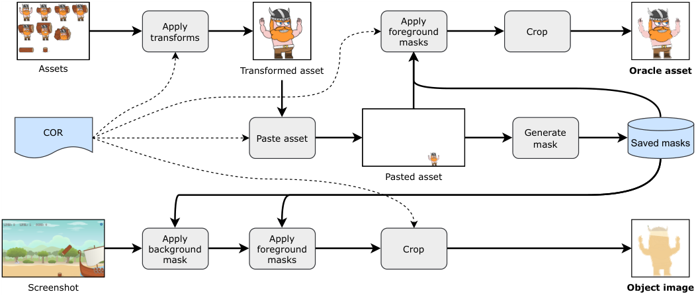
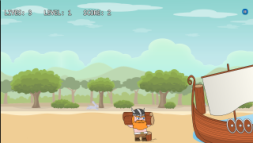
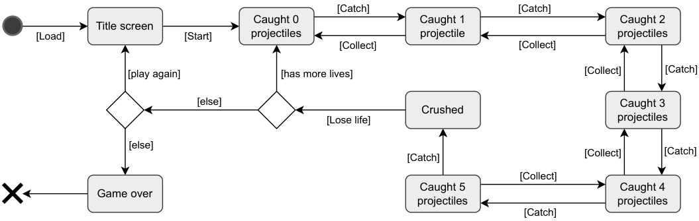
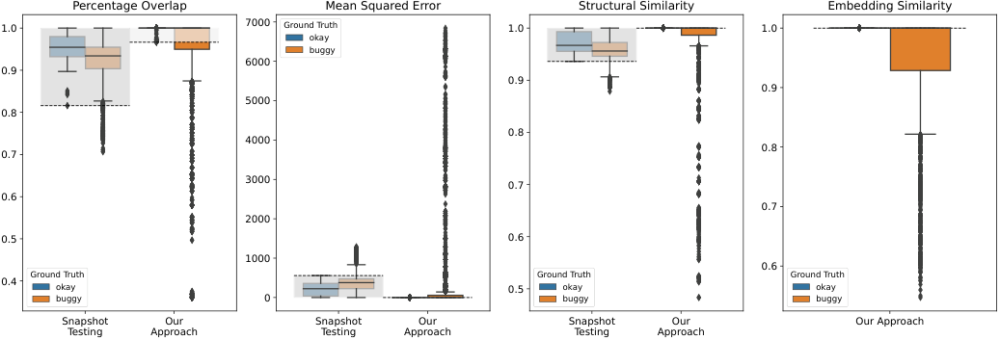

# **Automatically Detecting Visual Bugs in HTML5 <canvas> Games** 

Finlay Macklon macklon@ualberta.ca University of Alberta Edmonton, AB, Canada 

Stefan Antoszko santoszk@ualberta.ca University of Alberta Edmonton, AB, Canada 

Mohammad Reza Taesiri taesiri@ualberta.ca University of Alberta Edmonton, AB, Canada 

Natalia Romanova natalia.romanova@prodigygame.com Prodigy Education Toronto, ON, Canada 

Markos Viggiato viggiato@ualberta.ca University of Alberta Edmonton, AB, Canada 

Dale Paas dale.paas@prodigygame.com Prodigy Education Toronto, ON, Canada 

Cor-Paul Bezemer bezemer@ualberta.ca University of Alberta Edmonton, AB, Canada 

## **ABSTRACT** 

The HTML5 <canvas> is used to display high quality graphics in web applications such as web games (i.e., <canvas> games). However, automatically testing <canvas> games is not possible with existing web testing techniques and tools, and manual testing is laborious. Many widely used web testing tools rely on the Document Object Model (DOM) to drive web test automation, but the contents of the <canvas> are not represented in the DOM. The main alternative approach, snapshot testing, involves comparing oracle snapshot images with test-time snapshot images using an image similarity metric to catch visual bugs, i.e., bugs in the graphics of the web application. However, creating and maintaining oracle snapshot images for <canvas> games is onerous, defeating the purpose of test automation. In this paper, we present a novel approach to automatically detect visual bugs in <canvas> games. By leveraging an internal representation of objects on the <canvas>, we decompose snapshot images into a set of object images, each of which is compared with a respective oracle asset (e.g., a sprite) using four similarity metrics: percentage overlap, mean squared error, structural similarity, and embedding similarity. We evaluate our approach by injecting 24 visual bugs into a custom <canvas> game, and find that our approach achieves an accuracy of 100%, compared to an accuracy of 44.6% with traditional snapshot testing. 

## **CCS CONCEPTS** 

• **Software and its engineering** → **Software testing and debugging** . 

<!-- Start of picture text -->
LIVES: 3 LEVEL:1 SCORE:1 000 (a) Screenshot of our test <canvas> game <! DOCTYPE html > < html > < head > < style  > body { margin: 0; display: flex; } </ style  > < script src ="main.js"></ script  > </ head > < body > <canvas width ="1280px" height ="720px"></canvas > </ body > </ html > (b) HTML code for our test <canvas> game <!-- End of picture text -->

**Figure 1: The graphics of a <canvas> game are represented as a bitmap, and not in the DOM, while the game’s source code resides in the script main.js.** 

## **KEYWORDS** 

visual bugs, test automation, HTML canvas, web games 

## **1 INTRODUCTION** 

The HTML <canvas> is used to display high-quality graphics in web applications, and is particularly useful for web games (i.e., <canvas> games) [13, 18, 30, 31, 50]. HTML5 <canvas> games are receiving growing attention from industry [26, 33], but it is challenging to automatically test <canvas> games, as widely used web testing techniques and tools do not work for the <canvas> [23]. Many 

commonly used web testing techniques leverage the Document Object Model (DOM) to drive test automation, but as demonstrated in Figure 1, the contents of the <canvas> are not represented in the DOM. 

To overcome this challenge, snapshot testing has become the industry standard approach to visual testing for <canvas> applications, as it does not rely on the DOM, but instead relies on screenshots of the web application. Snapshot testing targets visual bugs, i.e., bugs that are related to the graphics of the application, by automatically comparing oracle screenshots with screenshots that are 

Finlay Macklon, Mohammad Reza Taesiri, Markos Viggiato, Stefan Antoszko, Natalia Romanova, Dale Paas, and Cor-Paul Bezemer 

recorded during the execution of a test case. However, as we discuss in Section 2.2 and show in Figure 2, snapshot testing cannot deal with the dynamic nature of <canvas> games, as this dynamism causes variation between the screenshots that is hard to account for automatically. 

Because of the technical challenges of <canvas> testing, and the inherent difficulties of testing games [16, 19, 28, 32, 34, 39], <canvas> games are mostly tested manually. Manual testing requires large amounts of manual time and effort, limiting the amount of bugs that quality assurance (QA) analysts can realistically discover and report. 

Therefore, we propose an automated approach for the visual testing of <canvas> games. Rather than (manually) curating oracle screenshots, we use game assets (see Section 2.1) to automatically generate visual test oracles during the test, and automatically compare these oracle assets with individual objects on a screenshot of the <canvas>. Our approach leverages the game’s internal representation of objects on the <canvas>, i.e., the <canvas> objects representation (COR), to decompose screenshots of the <canvas> into individual object images. 

We evaluated our approach by injecting 24 unique visual bugs from 4 different bug types (state, appearance, layout, rendering) as defined by Macklon et al. [23] into a custom <canvas> test game. Our approach performed automated visual comparisons of the oracle assets and the rendered objects using four similarity metrics: percentage overlap, mean squared error, structural similarity, and embedding similarity. We compared our approach with a baseline approach that is the industry standard, i.e., snapshot testing. We found that when using mean squared error, structural similarity, or embedding similarity as the similarity metric, our approach achieves an accuracy of 100% for the 24 injected bugs in our test game, compared to an accuracy of 44.6% with the baseline approach. The main contributions of our paper are as follows: 

- We designed 24 synthetic visual bugs to evaluate automated testing approaches for <canvas> games, and we confirmed with an industrial partner that these bugs were representative of the bugs found in real <canvas> games. 

- We created a testbed for evaluating visual testing techniques for <canvas> games, i.e., a test <canvas> game, which includes a non-buggy version and a buggy version of the game containing the 24 synthetic bugs. 

- We extensively evaluated combinations of four widely-used similarity metrics for automatically detecting visual bugs in <canvas> games. 

- For reproducibility, we open-sourced our testbed and visual bugs dataset at the following link: https://github.com/ asgaardlab/canvas-visual-bugs-testbed. 

- A live version of our test <canvas> game is available at the following link: https://asgaardlab.github.io/canvas-visualbugs-testbed/game. 

The remainder of our paper is structured as follows. Section 2 discusses background information. Section 3 discusses related work. Section 4 presents our approach. Section 5 details our experiment setup. Section 6 presents our results. Section 7 contains threats to validity. Section 8 is the conclusion to our paper. 

## **2 BACKGROUND** 

In this section, we give background information about HTML5 <canvas> games and snapshot testing. 

## **2.1 HTML5 <canvas> games** 

By combining the high-quality graphics of the <canvas> with browser events, such as mouse clicks, game developers can create complete games that run in a web browser. 

_Open-source frameworks._ It is difficult to integrate the <canvas> with other parts of a web application [23], and so <canvas> _frameworks_ are used to ease the development of <canvas> games. There exist several free and open-source (FOSS) <canvas> frameworks that are widely-used to develop <canvas> games. For example, PixiJS and Phaser receive much attention from game developers, as indicated by the high number of forum posts related to each framework on the HTML5 Game Devs [10] and Stack Overflow [1] forums. Such <canvas> frameworks typically provide a custom internal representation of objects on the <canvas>, i.e., a <canvas> objects representation (COR), which can be manipulated by developers to easily create animations on the <canvas>. For example, in PixiJS, the COR is termed _scene graph_ , and has a tree structure. 

_Assets._ A common way to integrate graphics into a video game is using source images ( _assets_ ) that are used to display objects in the game. For <canvas> games, assets are loaded by the web application client from some file server through web requests, like any other image in a web application. However, assets are not rendered as image () elements on a web page, but instead are used as source bitmaps that are displayed on the <canvas> bitmap. 

## **2.2 Snapshot testing** 

Snapshot testing, e.g., using Percy, is the industry standard for visually testing web applications [36]. Visual testing is used to target visual bugs; visual bugs are mismatches between actual and expected visual properties in the graphics of a software application [15]. Traditional snapshot testing typically involves comparing screenshots of the web application from the same test across different runs, after some change(s) to the source code (e.g., a pull request). To perform traditional snapshot testing, first a set of oracle screenshots that have been collected during a test run must be manually verified, and then new test screenshots can be automatically collected and compared at a later time using an image comparison algorithm. If a screenshot does not pass the image comparison check, that screenshot (or test case) is flagged for manual review. 

Figure 2 shows how most of the visual differences between the oracle and test screenshots occur due to random elements of the <canvas> game, which are desired functionality, rather than the injected visual bug. It is difficult to distinguish between visual bugs and intended functionality for <canvas> games when using snapshot testing. This problem can lead to many false positives, increasing the manual workload (due to oracle re-verification) and reducing the benefit of using snapshot testing as an automated testing approach. Therefore, the industry-standard approach for snapshot testing is far from ideal for testing many <canvas> applications, particularly <canvas> games. 

Automatically Detecting Visual Bugs in HTML5 <canvas> Games 

<!-- Start of picture text -->
LVES:SLEEL:SORE:0 LEVER:LEVEL:1SOE:1 LEVER：8LEVEL:1S00: (a) Oracle screenshot (b) Test screenshot (c) Image difference (in pink) <!-- End of picture text -->

**Figure 2: Two screenshots from our test game. In the test screenshot, the viking character is missing a log on his shoulders (injected visual bug S4 in Table 3,** **_viking animation not updating_ ). However, as observed in the third screenshot, the in-game randomness causes a larger difference between the screenshots than the bug itself.** 

## **3 RELATED WORK** 

In this section, we discuss related work on <canvas> testing, visual web and GUI testing, and visual game testing. 

## **3.1 <canvas> testing** 

Macklon et al. [23] analyzed open source projects on GitHub that utilize the <canvas>, and proposed a taxonomy of <canvas> bugs. They showed that the most frequently reported bugs in the open source projects are visual bugs, i.e., bugs that are related to the graphics of an application. Their findings emphasize that research on <canvas> testing is at an early stage and has many opportunities, and that visual bugs are a primary concern for <canvas> testing. 

Only one prior study has investigated testing methods for the <canvas>. Bajammal and Mesbah propose an approach to enable DOM-based testing of the <canvas> by leveraging traditional computer vision techniques to detect objects on the <canvas>, and subsequently augment the DOM with a representation of those objects [4]. They report high accuracy in detecting objects on the <canvas> that should not be present (similar to visual bug S6 in Table 3), however any other type of overlapping visual bug on the <canvas> would pose challenges for their visual inference algorithm. In contrast, we evaluate our approach on 24 unique bugs from 4 visual bugs types, and find that our approach shows strong performance for catching a wide variety of visual bugs that are representative of bugs found in real-world <canvas> games. 

## **3.2 Visual web and GUI testing** 

As previously outlined, existing automated web testing techniques and tools do not work for the <canvas>, but prior research has also indicated that <canvas> bugs overlap with visual bugs found in graphical user interfaces (GUIs) and generic web applications [23]. We refer to the survey of computer vision applications in software engineering by Bajammal et al. [5] and the grey literature review of AI-based test automation techniques by Ricca et al. [36] for an overview of visual testing for GUIs and web apps. Here, we only discuss related work that was not covered in the survey by Bajammal et al. [5]. 

Several prior studies have proposed the use of visual analysis to assist in automated testing methods for web applications. Yandrapally and Mesbah [48] proposed a method to automatically detect near-duplicate states in web applications by comparing fragments 

of a web page instead of entire screenshots. They decomposed the DOM along with screenshots and performed automatic structural and visual comparisons between automatically inferred web page states. Bajammal and Mesbah [3] automatically inferred the semantic role of regions in a web page and automated the testing of web accessibility requirements. In another work by Bajammal and Mesbah [2], they combined visual analysis with DOM attributes to improve automated web page segmentation, which can assist with bug localization. These works focus on segmenting and testing the structure of web pages, i.e., what is represented in the DOM, but as previously explained, the contents of the <canvas> are not represented in the DOM, meaning these approaches cannot be used to automatically catch visual bugs in <canvas> games. 

Several prior studies proposed the use of computer vision to leverage the visual aspect of a software application in an automated testing process. Mazinanian et al. [25] automatically predicted actionable elements on a web page through a supervised deep learning approach. White et al. [46] proposed a supervised deep learning approach and automatically identified GUI components to improve the coverage of random testing. Xue et al. [47] proposed a supervised deep learning approach to assist in performing record-and-replay GUI testing in a mobile or web application. Mozgovoy and Pyshkin [27] used template matching to recognize objects and GUI elements in a screenshot of a mobile game, which allow test assertions to be made against the visual content of the game. Ye et al. [49] proposed a similar GUI widget detection approach for mobile games, in which they instrumented the source code of a mobile game to automatically extract samples of GUI widgets, and subsequently trained a supervised deep learning model for GUI widget detection. Visual bugs would interfere with the GUI element identification methods in the aforementioned works, while our approach instead targets visual bugs in <canvas> games without training any new models. 

Zhao et al. proposed the use of unsupervised deep learning methods to detect anomalous GUI animations, which requires only several ground truth samples of a correct GUI animation to detect the anomalous animations [52]. Given the dynamic nature of <canvas> games, it would be extremely challenging to collect ground truth samples of all correct animations in a <canvas> game, which does not solve the problems posed by snapshot testing. We avoid this problem in our approach by automatically generating visual test oracles during the test. 

Finlay Macklon, Mohammad Reza Taesiri, Markos Viggiato, Stefan Antoszko, Natalia Romanova, Dale Paas, and Cor-Paul Bezemer 

## **3.3 Visual game testing** 

Given that the <canvas> is often used to build web games, we provide an overview of visual testing in video games. 

Automated methods for graphics glitch detection in video games have been proposed in prior work. Nantes et al. propose a semiautomated approach to detect shadow glitches in a video game using traditional computer vision techniques [29]. However, in our work we propose a fully automated approach to detect a wider range of visual bugs that are relevant to <canvas> games. 

Other studies have utilized relatively recent advancements in deep learning to detect graphics glitches in video games [7, 9, 20] or to leverage the visual aspect of video games for sprite and event extraction [17, 21, 22, 38, 41]. However, these methods all require either significant manual effort to prepare the data or in-house machine learning expertise to train and fine-tune the models, or they target only a limited set of visual bugs (when compared to the four types evaluated in our paper). As our approach utilizes a pre-trained model, it requires only very basic applied machine learning knowledge, and it does not require much data preparation. 

<!-- Start of picture text -->
Collecting data Preprocessing Detecting images visual bugs Collect   Preprocess Calculate Game assets assets similarities Execute   Similarity test case scores Assets Oracle asset Collect COR Preprocess Detect visual snapshots objects bugs Screenshot Object image <!-- End of picture text -->

**Figure 3: Overview of our approach (shown with visual bug L4 in Table 3,** **_Viking has wrong rotation_ ).** 

## **4 OUR APPROACH** 

In this section, we present our approach for automatically detecting visual bugs in <canvas> games. Figure 3 shows an overview of the steps of our approach. 

## **4.1 Collecting data** 

We begin by automatically instrumenting the rendering loop of the <canvas> game with our custom code to collect snapshots and assets. Each snapshot contains a screenshot of the <canvas> and a respective <canvas> objects representation (COR) from the same point in time. 

For each snapshot, we automatically collect a screenshot and its respective COR. Figure 4 illustrates what a COR contains in our approach. A COR is used by a <canvas> game to determine how to render game objects to the <canvas>, such as the player character, background layers, and projectiles. Each object in the COR has properties such as position, size, and rotation. 

While performing a snapshot, we prevent new animation frames from being rendered, and save a frozen copy of the COR along with a synchronized screenshot of the current animation frame (as rendered to the <canvas>). Although our snapshot operation briefly prevents the rendering of a few new frames, it does not necessarily interrupt the main game loop (depending upon how a game is implemented). 

As described in Section 2.1 of our paper, assets in <canvas> games are served through web requests, and so we created a custom crawler to collect assets based on the resource URLs of objects in a <canvas> game. As can be seen in Figure 4, game objects are linked to their respective assets in the COR, meaning associating a game object with its respective asset is straightforward. 

## **4.2 Preprocessing images** 

For each snapshot, we leverage the COR to automatically generate oracle assets and extract object images for comparison. Figure 5 shows our automated image processing pipeline. Below, we detail our preprocessing steps for oracle assets and object images. 

We automatically preprocess game assets to generate oracle assets during the execution of a test using the following process: 

- (1) Apply transformations to the asset as specified in the COR. For example, crop, scale, tile, and/or rotate the asset. 

- (2) Paste the asset onto a blank image that is the same size as the <canvas>. The paste location is determined by the COR, and will match the location of the game object in the screenshot if no bugs are present. 

- (3) Generate an image mask from the pasted asset (i.e., the result from the previous step) and save for later masking operations. 

- (4) For any overlapping objects, apply their saved masks over top of the pasted asset. Figure 6 shows an example of what this might look like. 

- (5) Crop the pasted asset. 

We automatically decompose screenshots into a set of individual object images according to the following process: 

- (1) Apply the background mask, i.e., the mask generated from the object’s respective asset. 

- (2) Apply the foreground masks, i.e., the masks that were generated from assets belonging to overlapping objects. 

- (3) Crop the object image out of the screenshot. 

After preprocessing, we have a set of image pairs, with each pair containing an oracle asset and object image, which should be exactly the same if no visual bugs are present. 

## **4.3 Detecting visual bugs** 

For each pair of oracle asset and object image, we use an image similarity metric to automatically perform a visual comparison of the images. Our approach relies on a threshold for this similarity metric to decide if a visual test case should pass or fail. This threshold should be defined empirically and for each game, as different games may have different levels of in-game randomness that could affect the similarity metric. 

Automatically Detecting Visual Bugs in HTML5 <canvas> Games 

<!-- Start of picture text -->
HTMLCanvasElement 1 <canvas> objects representation (COR) id: String[0..1] view: HTMLCanvasElement width: Number objects: Object[*] height: Number * Frame 1 Texture 1 Object Scale x: Number frame: Frame x: Number x: Number 1 y: Number baseTexture: BaseTexture y: Number y: Number width: Number width: Number 1 height: Number height: Number Anchor BaseTexture rotation: Number x: Number scaleMode: Number texture: Texture 1 asset: Asset[0..1] scale: Scale y: Number anchor: Anchor 0..1 tilePosition: TilePosition[0..1] TilePosition Asset x: Number resourceUrl: String 0..1 y: Number <!-- End of picture text -->

**Figure 4: Unified modeling language (UML) class diagram for a <canvas> objects representation (COR).** 

<!-- Start of picture text -->
Apply Apply transforms foreground Crop masks Assets Transformed asset Oracle asset COR Generate Paste asset mask Saved masks Pasted asset Apply Apply background foreground Crop mask masks Screenshot Object image <!-- End of picture text -->

**Figure 5: Automated image preprocessing pipeline (shown with visual bug S1,** **_player-character is invisible_ ).** 

<!-- Start of picture text -->
(a) Input screenshot (b) The background mask (c) One of the foreground masks (d) Output object image <!-- End of picture text -->

**Figure 6: A background mask and all overlaying foreground masks are applied to isolate object images in our approach.** 

Finlay Macklon, Mohammad Reza Taesiri, Markos Viggiato, Stefan Antoszko, Natalia Romanova, Dale Paas, and Cor-Paul Bezemer 

## **5 EXPERIMENT SETUP** 

In this section, we describe our experiment setup for evaluating the performance of our approach and the baseline approach for automatically detecting visual bugs. We selected snapshot testing as the baseline approach for comparison with our approach, as snapshot testing is the industry standard approach for detecting visual bugs in <canvas> applications. 

## **5.1 The test game** 

To evaluate our approach, we created a custom <canvas> game using the PixiJS1 library and a freely available asset pack2 . PixiJS is a popular free and open-source <canvas> rendering library for creating 2D animations with the <canvas>. Figure 8 shows the state machine diagram for our test game. Our test game is a socalled catching game, i.e., a game in which projectiles are randomly thrown for the player to catch. The test game contains a variety of animations, including animated sprites, rotating sprites, and background tiling sprites. The test game was designed to be played at a resolution of 720p, with a maximum frame rate of 60 FPS. 

## **5.2 The test case** 

We wrote an automated test case for our <canvas> game. In our test case, the game was automatically opened in a browser window with size 1280 _𝑝𝑥_ × 720 _𝑝𝑥_ . Next, the game was started through an automated user click, and then the player-character was moved back and forth across the screen with automated mouse movements until the player lost a life (after which, the test case ended). During each test case execution, 10 snapshots were taken. 

## **5.3 Injected visual bugs** 

We evaluated the performance of the approaches by injecting visual bugs into our test game. To target bugs that are relevant to <canvas> games, we used the taxonomy of <canvas> bugs constructed by Macklon et al. [23], and verified with an industrial partner that our injected bugs were relevant to industrial <canvas> games. In Table 1, we provide each visual bug type and an example description of a bug of that type as defined in the taxonomy of <canvas> bugs. 

For each of the four visual bug types defined in the taxonomy of <canvas> bugs, we injected six different bugs, with some primarily affecting foreground objects, and others primarily affecting background objects. In total, we injected 24 visual bugs. Figure 7 shows four example instances of visual bugs we injected into the test game, while Table 3 provides detailed descriptions of each injected bug. 

We injected most of the visual bugs by altering an asset during test execution, and then replaced it with the non-bugged (original) asset at the preprocessing stage of our approach. We injected most of the visual bugs this way because real visual bugs can be very complex and difficult to reproduce [23]. Some of our visual bugs were injected through modifications in the test game’s source code, for example, for rendering bug R1 (objects are distorted) we injected rounding errors in the image scaling. Although our injected visual bugs had a different root cause than real visual bugs on the <canvas>, we confirmed with an industrial partner that the visual effects were similar to visual bugs found in real <canvas> games, 

> 1https://pixijs.com/ 

> 2https://raventale.itch.io/parallax-background 

**Table 1: Visual bug types found in <canvas> applications [23].** 

|**Type**|**Example Desc**|**ription**|
|---|---|---|
|State Appearance Layout Rendering|Object visible b Object has inco Object has inco Object is distort|ut should be invisible. rrect colour. rrect position, size, layer, etc. ed, blurry, or contains artifacts.|
|**(a) Rendering b** **_Viking and logs_**|**ug R3 in Table 3.** **_are blurred._**|**(b) Layout bug L5 in Table 3.** **_Trees are in the wrong layer._**|
|**(c) State bug S5 i** **_log animation i_**|**n Table 3.****_Fallen_** **_s not updating._**|**(d) Appearance bug A4 in Ta-** **ble 3.****_Logs are a different colour._**|

**Figure 7: Sample instances of our injected visual bugs.** 

meaning our injected visual bugs were suitable for evaluating our approach. 

## **5.4 Similarity metrics** 

In our experiments we used four similarity metrics to compare images. 

_Percentage overlap (PCT)._ We selected percentage overlap as a similarity metric because it is the simplest method for calculating the similarity of two images, and is used in industry-standard tools such as Percy. We calculated the PCT for a pair of images by calculating the percentage of pixels that exactly match between the two images. 

_Mean squared error (MSE)._ We selected mean squared error as a similarity metric because it is widely used in image processing as an image quality index [11, 44], i.e., to measure degradation between original and reconstructed images. The MSE actually captures the amount of difference (i.e., lower is better) instead of similarity (i.e., higher is better). We calculated the mean squared error for a pair of images using the scikit-image3 library. 

_Structural similarity (SSIM)._ We selected structural similarity as a similarity metric because it is intended to be complementary to mean squared error as an image quality index [45]. We used the scikit-image library to calculate structural similarity for each pair of images. 

> 3https://scikit-image.org/ 

Automatically Detecting Visual Bugs in HTML5 <canvas> Games 

<!-- Start of picture text -->
[Catch] [Catch] Caught 0 Caught 1 Caught 2 Title screen [Load] [Start] projectiles projectile projectiles [Collect] [Collect] [play again] [has more lives] [Collect] [Catch] [else] Caught 3 Crushed [Lose life] projectiles [else] [Collect] [Catch] [Catch] [Collect] Caught 5 Caught 4 Game over projectiles projectiles [Catch] <!-- End of picture text -->

**Figure 8: Finite state machine diagram for our test <canvas> game.** 

_Embedding similarity (ESIM)._ Our fourth and final metric, embedding similarity, was the similarity of two images when represented as embeddings of an image classification model, i.e., a deep learning vision model. Embeddings are the vision model’s inner-layer representation(s) of an image, i.e., the feature representations of the image before the classification layer. We implemented embedding similarity in our experiments by encoding the images as the embeddings of the final convolutional layer of the ResNet-50 model pre-trained on the ImageNet dataset [14]. These image embeddings had a feature volume of (2048 _,_ 7 _,_ 7). We selected the pre-trained ResNet-50 model as the ResNet architecture is widely used for transfer learning applications [6, 22, 35]. We extracted the embeddings of the final convolutional layer of the ResNet-50 model, as is done in prior work [12, 40]. To calculate the similarity of the embeddings, we selected cosine similarity, a widely used similarity metric [41, 42, 43, 51]. 

We used the pre-trained model in inference mode, meaning we did not have to perform any data labelling, training, or fine-tuning, i.e., we used the model out-of-the-box. We performed inference with the pre-trained ResNet-50 model on an NVIDIA Titan RTX graphics card. We loaded the model from the torchvision4 library and used the PyTorch5 library to calculate cosine similarity. 

## **5.5 Empirical threshold selection** 

We empirically selected a single threshold for each similarity metric used in each approach to decide whether a test case is buggy. To empirically determine the thresholds, we calculated the similarities of all image pairs for 10 repetitions of test data with no bugs injected (i.e., with non-buggy snapshots), and took the overall lowest (or highest for MSE) similarity score for each metric as our thresholds. Hence, we chose the thresholds to yield zero false positives, as false positives result in a wasted effort from the game developer’s perspective (as they need to investigate the false positive). 

## **5.6 Evaluating the experiments** 

Here we describe the methods we used to evaluate our experiments. 

> 4https://pytorch.org/vision/stable/index.html 

> 5https://pytorch.org/ 

_Statistical significance and effect sizes._ We used the Mann-Whitney U test [24] to determine if the populations of similarity scores were statistically significantly different. The Mann-Whitney U test is a non-parametric test that compares two distributions of unrelated populations to determine how much the populations statistically overlap, with some probability _𝑝_ . Generally, a _𝑝_ value of less than 0 _._ 05 indicates that the populations display a statistically significant difference, as a very low _𝑝_ value indicates it is very unlikely that two populations are statistically similar. 

To better understand the results of the Mann-Whitney U test, we also calculated Cliff’s delta [8] to determine the extent to which the populations of buggy and non-buggy similarity scores were different per metric. To interpret the Cliff’s delta values ( _𝑑_ ), we used the thresholds provided by Romano et al. [37] to determine the effect sizes, as done in prior work [16]. The thresholds used were as follows: 

|| negligible|if||_𝑑_| ≤0_._147|
|---|---|---|---|
|Efft i=| small|if|0_._147_<_ |_𝑑_| ≤0_._33|
|fec sze| medium|if|0_._33_<_ |_𝑑_| ≤0_._474|
|| large|if|0_._474_<_ |_𝑑_| ≤1|

_Accuracy._ Our choice of threshold selection (Section 5.5) meant that it was only possible for there to be true positive (TP) and false negative (FN) cases in our results for visual bug detection. Therefore, the best choice of evaluation metric was accuracy, which was <u>(#</u> _true positives_ <u>)</u> calculated as follows: _accuracy_ = (# _true positives_ ) + (# _false negatives_ ). 

## **6 RESULTS** 

In this section, we present our experimental results for automatically detecting visual bugs with our approach and the baseline approach. When using MSE, SSIM, or ESIM as the similarity metric, we find that our approach achieves an accuracy of 100% for our 24 injected visual bugs, compared to an accuracy of 44 _._ 6% with the baseline approach (with PCT as the similarity metric). Our results show that our approach is much more effective for automatically detecting visual bugs in <canvas>-based applications than the baseline approach (traditional snapshot testing). 

Finlay Macklon, Mohammad Reza Taesiri, Markos Viggiato, Stefan Antoszko, Natalia Romanova, Dale Paas, and Cor-Paul Bezemer 

**Table 2: Mann-Whitney U test and Cliff’s delta results.** 

||**Metric**|**Mann-Whitney U test** **Significant difference**|**Cliff’s delta** **Effect size**|
|---|---|---|---|
|**Snapshot**|**PCT**|_yes_|_small_|
|**Testing**|**MSE** **SSIM**|_yes_ _yes_|_medium_ _small_|
|**Our**|**PCT**|_yes_|_medium_|
|**Approach**|**MSE**|_yes_|_medium_|
||**SSIM**|_yes_|_medium_|
||**ESIM**|_yes_|_large_|

## **6.1 Similarity scores** 

Figure 9 shows the distributions of the similarity scores for each of the evaluated similarity metrics, with the minimum similarity for normal snapshots providing the thresholds for bug detection, as described in Section 5.5. For each distribution, scores above the set threshold (within the greyed-out areas) would be accepted as within the normal range, whereas scores below the threshold would indicate a visual bug is present. While the distributions are significantly different for all similarity metrics, the effect sizes show that there is a lot of overlap between the metrics when using the snapshot testing approach. As a result, a threshold is much harder to select for snapshot testing, and there will always be a trade-off between precision and recall. For our approach, the effect size (Table 2) is much larger indicating there is far less overlap between the distributions, allowing us to choose better-performing thresholds (which can also be observed from Figure 9). Clearly, there is much more overlap between normal and buggy cases when using snapshot testing than when using our approach with any of the similarity metrics. 

## **6.2 Bug detection** 

Table 3 shows the results for bug detection with each evaluated approach and similarity metric. Our approach achieves a considerably higher accuracy (with any of our four evaluated similarity metrics) than snapshot testing. In particular, our approach shows exciting potential for detecting visual bugs when MSE, SSIM, or ESIM is used as the similarity metric. Our results indicate that only a single similarity metric is needed for our approach – combining several metrics does not improve our overall results. 

## **6.3 Execution duration** 

To better understand the performance of our approach, we timed the executions of our approach and the baseline approach. Our approach took considerably longer (3 additional seconds per snapshot) to run than the baseline approach. However, the accuracy of the baseline approach indicates that it is not a very useful one in practice. The bulk of time in our approach is spent preprocessing the images, whereas calculating the similarities is relatively quick, with the exception of SSIM. In practice, we would not have to compute SSIM, because MSE, SSIM, and ESIM provide similar accuracy in our experiments. 

## **7 THREATS TO VALIDITY** 

_Construct validity._ Our results may be biased towards the set of visual bugs that we injected in our experiments. However, our injected visual bugs covered all four visual bug types that are relevant to the <canvas>, as defined in prior work [23]. While the visual bugs we injected may not have the same cause as real visual bugs found in <canvas> applications, the visual effects are the same; each injected visual bug was designed to resemble a real world example. To mitigate the threat of injecting unrealistic bugs we also confirmed with an industrial partner that our injected bugs were representative of real visual bugs in industrial <canvas> games. 

There are different possible choices of image comparison metrics for snapshot testing, the baseline approach used in our experiments. We selected PCT as an image comparison metric because Percy, a widely used snapshot testing tool, uses a threshold-based image comparison metric that is similar to PCT. We also empirically evaluated MSE and SSIM for snapshot testing, and determined that neither were better than PCT for snapshot testing. 

_Internal validity._ In our approach, we utilized the <canvas> objects representation (COR) combined with the game assets to automatically generate visual test oracles (i.e., oracle assets). Our approach therefore assumes that no bugs originate in these parts of the game. It is fair to assume that the assets provide accurate baselines for comparison with the rendered game objects on the <canvas>. In addition, it is fair to assume that the COR can be used to generate test oracles for detecting visual bugs, as any bug present in the COR would not be a visual bug. 

A threat to internal validity is our choice of background fill colour when applying masks during image preprocessing in our experiments. A fill colour must be selected to fill the blank space that results from the masking operations. To address this threat, we ran our experiments with three different fill colours in 8-bit RGBA format: (0, 0, 0, 255), (255, 255, 255, 255), and (255, 0, 0, 255). We empirically determined that for our test game, changing the fill colour for masking only affected our results with embedding similarity (ESIM), indicating that our use of ESIM may not be appropriate due to our extensive preprocessing. 

A threat to internal validity is related to how we handle assets that have partial transparency in our experiments. In our experiments, we chose to remove all partial transparency (i.e., make it fully transparent), as we empirically determined that this choice provided the best performance. However, this means that we may miss some visual bugs that (primarily) affect the partially transparent areas of an object on the <canvas>. More work is required to better handle assets with partial transparency when generating masks. 

_External validity._ Our approach has only been evaluated with a single <canvas> game. Thresholds for detecting visual bugs with our approach will most likely differ on a per-game basis, and not all games may have as clear similarity thresholds as those found for our test game. Therefore, automatically setting the thresholds to detect visual bugs may not be as effective for other <canvas> games, meaning manual adjustment may be required. We designed our test game with the randomness and a variety of animations that were inspired by the visual styles and effects of industrial <canvas> 

Automatically Detecting Visual Bugs in HTML5 <canvas> Games 

<!-- Start of picture text -->
Percentage Overlap Mean Squared Error Structural Similarity Embedding Similarity 1.0 7000 Ground Truth 1.0 1.0 okay buggy 6000 0.9 0.9 0.9 5000 0.8 0.8 4000 0.8 0.7 3000 0.7 0.6 0.7 2000 0.5 0.6 1000 0.6 Ground Truth Ground Truth Ground Truth 0.4 okay 0.5 okay okay buggy 0 buggy buggy Snapshot Our Snapshot Our Snapshot Our Our Approach Testing Approach Testing Approach Testing Approach <!-- End of picture text -->

**Figure 9: Boxplots of similarity scores for each evaluated similarity metric in each approach. Our selected thresholds are indicated by the grey dotted lines. Similarity scores in the greyed-out ranges are classified as non-buggy by each approach.** 

**Table 3: Number of repetitions (out of 10) each visual bug was detected for each approach with each similarity metric. As detailed in Section 5.4, we use the following similarity metrics: percentage overlap (PCT), mean squared error (MSE), structural similarity (SSIM), and embedding similarity (ESIM).** 

||||**Snapsh**|**ot Testing**||**Our Ap**|**proach**|||
|---|---|---|---|---|---|---|---|---|---|
|**Type**|**Key **|**Bug Description**|**PCT**|**MSE**|**SSIM**|**PCT**|**MSE**|**SSIM**|**ESIM**|
||S1|_Viking is invisible._|1|0|0|10|10|10|10|
||S2|_A background hill is invisible._|8|4|6|0|10|10|10|
|ate|S3|_Ship is invisible._|10|10|10|10|10|10|10|
|St|S4|_Viking animation is not updating._|1|0|2|10|10|10|10|
||S5|_Fallen log animation is not updating._|7|3|5|10|10|10|10|
||S6|_Button should be hidden._|5|10|8|0|10|10|10|
||A1|_Viking has the wrong beard colour._|1|4|4|10|10|10|10|
|nce|A2|_Entire viking has the wrong colour._|2|7|3|10|10|10|10|
|ara|A3| _Viking and logs are grey-scaled._|3|0|3|10|10|10|10|
|pe|A4|_Logs have the wrong colour._|3|1|4|10|10|10|10|
|Ap|A5|_The ship’s sail has the wrong colour._|9|3|7|10|10|10|10|
||A6|_A background bunny has the wrong colour._|3|3|5|0|10|10|10|
||L1|_Ship is in the wrong location._|10|10|10|10|10|10|10|
|t|L2|_Viking is in the wrong location._|2|2|2|10|10|10|10|
|ou|L3| _Background clouds are in the wrong location._|10|5|3|10|10|10|10|
|Lay|L4|_Viking has the wrong rotation._|2|0|2|10|10|10|10|
||L5|_Background trees are in the wrong layer._|8|7|10|10|10|10|10|
||L6|_Logs have the wrong rotation._|2|1|1|10|10|10|10|
||R1|_Viking and logs are very distorted._|2|1|2|10|10|10|10|
|ng|R2|_Viking and logs are slightly distorted._|2|1|3|10|10|10|10|
|eri|R3| _Viking and logs are blurred._|2|0|0|10|10|10|10|
|nd|R4| _Background trees covered in patches._|7|8|8|0|10|10|10|
|Re|R5|_Background bushes have artifacts._|2|0|2|0|10|10|10|
||R6| _Background beach has tearing._|5|0|7|0|10|10|10|
|**Accuracy**|||**44.6%**|**33.3%**|**44.6%**|**75.0%**|**100.0%**|**100.0%**|**100.0%**|

Finlay Macklon, Mohammad Reza Taesiri, Markos Viggiato, Stefan Antoszko, Natalia Romanova, Dale Paas, and Cor-Paul Bezemer 

games. However, future studies should investigate further how different styles of games impact the performance of our approach. 

Our approach is evaluated only a 2D <canvas> game that was built with the PixiJS <canvas> rendering framework. More work is required to understand how well our approach works for other 2D <canvas> games, 3D <canvas> games, and non-<canvas> games. 

In our experiments we leverage an existing <canvas> objects representation (COR) provided by PixiJS. If a COR is not available in a <canvas> game, our approach would not work for that game. Similarly, in our experiments we leverage existing <canvas> game assets to generate visual test oracles during the test, but if a <canvas> game does not use assets for its graphics rendering, then our approach would not work for that game. 

Some types of graphics (e.g., skeletal animations, particle effects) are not in our test game, and are therefore not accounted for in the implementation of our approach. More work is required to understand how our method performs when implemented for other types of graphics that are common in 2D <canvas> games. 

## **8 CONCLUSION** 

In this paper, we present a novel approach for automatically detecting visual bugs in <canvas> games. By leveraging the <canvas> objects representation (COR), we are able to automatically generate oracle assets for comparison with isolated object images (as rendered to the <canvas>) and detect a wide variety of visual bugs in <canvas> games. We found that our approach far outperforms the current industry standard approach (traditional snapshot testing) for automatically detecting visual bugs in <canvas> games. We evaluated four similarity metrics with our approach, and found that mean squared error (MSE), structural similarity (SSIM), and embedding similarity (ESIM) each provided an accuracy of 100% for our 24 injected visual bugs. An implementation of our approach and our testbed is available at the following link: https://github.com/asgaardlab/canvas-visual-bugs-testbed. 

## **ACKNOWLEDGMENTS** 

The research reported in this article has been supported by Prodigy Education and the Natural Sciences and Engineering Research Council of Canada under the Alliance Grant project ALLRP 550309. 

## **REFERENCES** 

- [1] Farag Almansoury, Sègla Kpodjedo, and Ghizlane El Boussaidi. 2020. Investigating Web3D topics on StackOverflow: a preliminary study of WebGL and Three.js. In _The 25th International Conference on 3D Web Technology_ , 1–2. 

- [2] Mohammad Bajammal and Ali Mesbah. 2021. Page segmentation using visual adjacency analysis. _arXiv preprint arXiv:2112.11975_ . 

- [3] Mohammad Bajammal and Ali Mesbah. 2021. Semantic web accessibility testing via hierarchical visual analysis. In _2021 IEEE/ACM 43rd International Conference on Software Engineering (ICSE)_ . IEEE, 1610–1621. 

- [4] Mohammad Bajammal and Ali Mesbah. 2018. Web canvas testing through visual inference. In _2018 IEEE 11th International Conference on Software Testing, Verification and Validation (ICST)_ . IEEE, 193–203. 

- [5] Mohammad Bajammal, Andrea Stocco, Davood Mazinanian, and Ali Mesbah. 2020. A survey on the use of computer vision to improve software engineering tasks. _IEEE Transactions on Software Engineering_ . 

- [6] Jieshan Chen, Chunyang Chen, Zhenchang Xing, Xiwei Xu, Liming Zhut, Guoqiang Li, and Jinshui Wang. 2020. Unblind your apps: predicting naturallanguage labels for mobile gui components by deep learning. In _2020 IEEE/ACM 42nd International Conference on Software Engineering (ICSE)_ . IEEE, 322–334. 

- [7] Ke Chen, Yufei Li, Yingfeng Chen, Changjie Fan, Zhipeng Hu, and Wei Yang. 2021. GLIB: towards automated test oracle for graphically-rich applications. In _Proceedings of the 29th ACM Joint Meeting on European Software Engineering_ 

   - _Conference and Symposium on the Foundations of Software Engineering_ , 1093– 

1104. 

[8] Norman Cliff. 1993. Dominance statistics: ordinal analyses to answer ordinal questions. _Psychological bulletin_ , 114, 3, 494. 

- [9] Parmida Davarmanesh, Kuanhao Jiang, Tingting Ou, Artem Vysogorets, Stanislav Ivashkevich, Max Kiehn, Shantanu H Joshi, and Nicholas Malaya. 2020. Automating artifact detection in video games. _arXiv preprint arXiv:2011.15103_ . 

- [10] HTML5 Game Devs. 2022. Forum - frameworks. Last accessed 4 May 2022. (2022). https://www.html5gamedevs.com/forum/13-frameworks/. 

- [11] Ahmet M Eskicioglu and Paul S Fisher. 1995. Image quality measures and their performance. _IEEE Transactions on communications_ , 43, 12, 2959–2965. 

- [12] MohammadAmin Fazli, Ali Owfi, and Mohammad Reza Taesiri. 2021. Under the skin of foundation NFT auctions. _arXiv preprint arXiv:2109.12321_ . 

- [13] Steve Fulton and Jeff Fulton. 2013. _HTML5 canvas: native interactivity and animation for the web_ . O’Reilly Media, Inc. 

- [14] Kaiming He, Xiangyu Zhang, Shaoqing Ren, and Jian Sun. 2015. Deep residual learning for image recognition. arxiv 2015. _arXiv preprint arXiv:1512.03385_ . 

- [15] Ayman Issa, Jonathan Sillito, and Vahid Garousi. 2012. Visual testing of graphical user interfaces: an exploratory study towards systematic definitions and approaches. In _2012 14th IEEE International Symposium on Web Systems Evolution (WSE)_ . IEEE, 11–15. 

- [16] Arthur Kamienski and Cor-Paul Bezemer. 2021. An empirical study of Q&A websites for game developers. _Empirical Software Engineering_ , 26, 6, 1–39. 

- [17] Chanha Kim, Jaden Kim, and Joseph C Osborn. 2020. Synthesizing retro game screenshot datasets for sprite detection. In _AIIDE Workshops_ . 

- [18] Evdokimos I Konstantinidis, Giorgos Bamparopoulos, and Panagiotis D Bamidis. 2016. Moving real exergaming engines on the web: the webFitForAll case study in an active and healthy ageing living lab environment. _IEEE journal of biomedical and health informatics_ , 21, 3, 859–866. 

- [19] Chris Lewis, Jim Whitehead, and Noah Wardrip-Fruin. 2010. What went wrong: a taxonomy of video game bugs. In _Proceedings of the fifth international conference on the foundations of digital games_ , 108–115. 

- [20] Carlos Ling, Konrad Tollmar, and Linus Gisslén. 2020. Using deep convolutional neural networks to detect rendered glitches in video games. In _Proceedings of the AAAI Conference on Artificial Intelligence and Interactive Digital Entertainment_ number 1. Volume 16, 66–73. 

- [21] Zijin Luo, Matthew Guzdial, Nicholas Liao, and Mark Riedl. 2018. Player experience extraction from gameplay video. In _Fourteenth Artificial Intelligence and Interactive Digital Entertainment Conference_ . 

- [22] Zijin Luo, Matthew Guzdial, and Mark Riedl. 2019. Making cnns for video parsing accessible: event extraction from dota2 gameplay video using transfer, zero-shot, and network pruning. In _Proceedings of the 14th International Conference on the Foundations of Digital Games_ , 1–10. 

- [23] Finlay Macklon, Markos Viggiato, Natalia Romanova, Chris Buzon, Dale Paas, and Cor-Paul Bezemer. 2022. A taxonomy of HTML5 canvas bugs. _arXiv preprint arXiv:2201.07351_ . 

- [24] Henry B Mann and Donald R Whitney. 1947. On a test of whether one of two random variables is stochastically larger than the other. _The annals of mathematical statistics_ , 50–60. 

- [25] Davood Mazinanian, Mohammad Bajammal, and Ali Mesbah. 2021. Styleguided web application exploration. _arXiv preprint arXiv:2111.12184_ . 

- [26] Ani Mohan. 2020. GameSnacks brings quick, casual games to any device. Last accessed 4 May 2022. (February 2020). https://blog.google/technology/area120/gamesnacks-brings-quick-casual-games-any-device/. 

- [27] Maxim Mozgovoy and Evgeny Pyshkin. 2017. Unity application testing automation with appium and image recognition. In _International Conference on Tools and Methods for Program Analysis_ . Springer, 139–150. 

- [28] Emerson Murphy-Hill, Thomas Zimmermann, and Nachiappan Nagappan. 2014. Cowboys, ankle sprains, and keepers of quality: how is video game development different from software development? In _Proceedings of the 36th International Conference on Software Engineering_ , 1–11. 

- [29] Alfredo Nantes, Ross Brown, and Frederic Maire. 2008. A framework for the semi-automatic testing of video games. In _AIIDE_ . 

- [30] Tony Parisi. 2014. _Programming 3D Applications with HTML5 and WebGL: 3D Animation and Visualization for Web Pages_ . O’Reilly Media, Inc. 

- [31] Tony Parisi. 2012. _WebGL: up and running_ . O’Reilly Media, Inc. [32] Fábio Petrillo, Marcelo Pimenta, Francisco Trindade, and Carlos Dietrich. 2009. What went wrong? a survey of problems in game development. _Computers in Entertainment (CIE)_ , 7, 1, 1–22. 

- [33] Playco. 2021. Playco, global leader in instant games, acquires Goodboy Digital, creators of PixiJS, the number one HTML5 game engine. Last accessed 5 May 2022. (September 2021). https://www.play.co/press/playco-official-pressrelease-210928-en?utm_sq=guxn7m9l5r. 

- [34] Cristiano Politowski, Fabio Petrillo, Gabriel Cavalheiro Ullmann, Josias de Andrade Werly, and Yann-Gaël Guéhéneuc. 2020. Dataset of video game development problems. In _Proceedings of the 17th International Conference on Mining Software Repositories_ , 553–557. 

Automatically Detecting Visual Bugs in HTML5 <canvas> Games 

- [35] Edmar Rezende, Guilherme Ruppert, Tiago Carvalho, Fabio Ramos, and Paulo De Geus. 2017. Malicious software classification using transfer learning of resnet-50 deep neural network. In _2017 16th IEEE International Conference on Machine Learning and Applications (ICMLA)_ . IEEE, 1011–1014. 

- [36] Filippo Ricca, Alessandro Marchetto, and Andrea Stocco. 2021. AI-based test automation: a grey literature analysis. In _2021 IEEE International Conference on Software Testing, Verification and Validation Workshops (ICSTW)_ . IEEE, 263–270. 

- [37] Jeanine Romano, Jeffrey D Kromrey, Jesse Coraggio, Jeff Skowronek, and Linda Devine. 2006. Exploring methods for evaluating group differences on the nsse and other surveys: are the t-test and cohen’sd indices the most appropriate choices. In _annual meeting of the Southern Association for Institutional Research_ . Citeseer, 1–51. 

- [38] Dmitriy Smirnov, Michael Gharbi, Matthew Fisher, Vitor Guizilini, Alexei Efros, and Justin M Solomon. 2021. Marionette: self-supervised sprite learning. _Advances in Neural Information Processing Systems_ , 34. 

- [39] Patrick Stacey and Joe Nandhakumar. 2009. A temporal perspective of the computer game development process. _Information Systems Journal_ , 19, 5, 479– 497. 

- [40] Mohammad Reza Taesiri, Moslem Habibi, and Mohammad Amin Fazli. 2020. A video game testing method utilizing deep learning. _Iran Journal of Computer Science_ , 17, 2. 

- [41] Mohammad Reza Taesiri, Finlay Macklon, and Cor-Paul Bezemer. 2022. CLIP meets GamePhysics: towards bug identification in gameplay videos using zero-shot transfer learning. In _2022 IEEE/ACM 19th International Conference on Mining Software Repositories (MSR)_ . IEEE. 

- [42] Markos Viggiato, Dale Paas, Chris Buzon, and Cor-Paul Bezemer. 2022. Identifying similar test cases that are specified in natural language. _IEEE Transactions on Software Engineering_ . 

   - [44] Zhou Wang and Alan C Bovik. 2002. A universal image quality index. _IEEE signal processing letters_ , 9, 3, 81–84. 

   - [45] Zhou Wang, Alan C Bovik, Hamid R Sheikh, and Eero P Simoncelli. 2004. Image quality assessment: from error visibility to structural similarity. _IEEE transactions on image processing_ , 13, 4, 600–612. 

   - [46] Thomas D White, Gordon Fraser, and Guy J Brown. 2019. Improving random gui testing with image-based widget detection. In _Proceedings of the 28th ACM SIGSOFT International Symposium on Software Testing and Analysis_ , 307–317. 

   - [47] Feng Xue, Junsheng Wu, and Tao Zhang. 2022. Learning-replay based automated robotic testing for mobile app. _Mobile Information Systems_ , 2022. 

   - [48] Rahulkrishna Yandrapally and Ali Mesbah. 2021. Fragment-based test generation for web apps. _arXiv preprint arXiv:2110.14043_ . 

   - [49] Jiaming Ye, Ke Chen, Xiaofei Xie, Lei Ma, Ruochen Huang, Yingfeng Chen, Yinxing Xue, and Jianjun Zhao. 2021. An empirical study of GUI widget detection for industrial mobile games. In _Proceedings of the 29th ACM Joint Meeting on European Software Engineering Conference and Symposium on the Foundations of Software Engineering_ , 1427–1437. 

   - [50] Resa Yogya and Raymond Kosala. 2014. Comparison of physics frameworks for WebGL-based game engine. In _EPJ Web of Conferences_ . Volume 68. EDP Sciences, 00035. 

   - [51] Richard Zhang, Phillip Isola, Alexei A Efros, Eli Shechtman, and Oliver Wang. 2018. The unreasonable effectiveness of deep features as a perceptual metric. In _Proceedings of the IEEE conference on computer vision and pattern recognition_ , 586–595. 

   - [52] Dehai Zhao, Zhenchang Xing, Chunyang Chen, Xiwei Xu, Liming Zhu, Guoqiang Li, and Jinshui Wang. 2020. Seenomaly: vision-based linting of gui animation effects against design-don’t guidelines. In _2020 IEEE/ACM 42nd International Conference on Software Engineering (ICSE)_ . IEEE, 1286–1297. 

- [43] Markos Viggiato, Dale Paas, Chris Buzon, and Cor-Paul Bezemer. 2022. Using natural language processing techniques to improve manual test case descriptions. In _International Conference on Software Engineering - Software Engineering in Practice (ICSE - SEIP) Track_ . (May 8, 2022). 

