# **Automated Reporting of GUI Design Violations for Mobile Apps** 

Kevin Moran, Boyang Li, Carlos Bernal-Cárdenas, Dan Jelf, and Denys Poshyvanyk 

College of William & Mary Department of Computer Science 

Williamsburg, VA, USA 

{kpmoran,boyang,cebernal,dkjelf,denys}@cs.wm.edu 

## **ABSTRACT** 

The inception of a mobile app often takes form of a mock-up of the Graphical User Interface (GUI), represented as a static image delineating the proper layout and style of GUI widgets that satisfy requirements. Following this initial mock-up, the design artifacts are then handed off to developers whose goal is to accurately implement these GUIs and the desired functionality in code. Given the sizable abstraction gap between mock-ups and code, developers often introduce mistakes related to the GUI that can negatively impact an app’s success in highly competitive marketplaces. Moreover, such mistakes are common in the evolutionary context of rapidly changing apps. This leads to the time-consuming and laborious task of design teams verifying that each screen of an app was implemented according to intended design specifications. 

This paper introduces a novel, automated approach for verifying whether the GUI of a mobile app was implemented according to its intended design. Our approach resolves GUI-related information from both implemented apps and mock-ups and uses computer vision techniques to identify common errors in the implementations of mobile GUIs. We implemented this approach for Android in a tool called Gvt and carried out both a controlled empirical evaluation with open-source apps as well as an industrial evaluation with designers and developers from Huawei. The results show that Gvt solves an important, difficult, and highly practical problem with remarkable efficiency and accuracy and is both useful and scalable from the point of view of industrial designers and developers. The tool is currently used by over one-thousand industrial designers & developers at Huawei to improve the quality of their mobile apps. 

## **CCS CONCEPTS** 

### • **Software and its engineering** → **Software design engineering** ; _Requirements analysis_ ; 

#### **ACM Reference Format:** 

Kevin Moran, Boyang Li, Carlos Bernal-Cárdenas, Dan Jelf, and Denys Poshyvanyk. 2018. Automated Reporting of GUI Design Violations for Mobile Apps. In _ICSE ’18: ICSE ’18: 40th International Conference on Software Engineering , May 27-June 3, 2018, Gothenburg, Sweden._ ACM, New York, NY, USA, 11 pages. https://doi.org/10.1145/3180155.3180246 

Permission to make digital or hard copies of all or part of this work for personal or classroom use is granted without fee provided that copies are not made or distributed for profit or commercial advantage and that copies bear this notice and the full citation on the first page. Copyrights for components of this work owned by others than the author(s) must be honored. Abstracting with credit is permitted. To copy otherwise, or republish, to post on servers or to redistribute to lists, requires prior specific permission and/or a fee. Request permissions from permissions@acm.org. _ICSE ’18, May 27-June 3, 2018, Gothenburg, Sweden_ 

© 2018 Copyright held by the owner/author(s). Publication rights licensed to the Association for Computing Machinery. ACM ISBN 978-1-4503-5638-1/18/05...$15.00 

## **1 INTRODUCTION** 

Intuitive, elegant graphical user interfaces (GUIs) embodying effective user experience (UX) and user interface (UI) design principles are essential to the success of mobile apps. In fact, one may argue that these design principles are largely responsible for launching the modern mobile platforms that have become so popular today. Apple Inc’s launch of the iPhone in 2007 revolutionized the mobile handset industry (heavily influencing derivative platforms including Android) and largely centered on an elegant, well-thought out UX experience, putting multitouch gestures and a natural GUI at the forefront of the platform experience. A decade later, the most successful mobile apps on today’s highly competitive app stores ( _e.g.,_ Google Play[5] and Apple’s App Store[3]) are those that embrace this focus on ease of use, and blend intuitive user experiences with beautiful interfaces. In fact, given the high number of apps in today’s marketplaces that perform remarkably similar functions [7], the design and user experience of an app are often differentiating factors, leading to either success or failure [12]. 

Given the importance of a proper user interface and user experience for mobile apps, development usually begins with UI/UX design experts creating highly detailed mock-ups of app screens using one of several different prototyping techniques [25, 44]. The most popular of these techniques and the focus of this paper, is referred to as _mock-up driven development_ where a designer (or group of designers) creates pixel perfect representations of app UIs using software such as Sketch[10] or PhotoShop[1]. Once the design artifacts (or _mock-ups_ ) are completed, they are handed off to development teams who are responsible for implementing the designs in code for a target platform. In order for the design envisioned by the UI/UX experts (who carry domain knowledge that front-end developers may lack) to be properly transferred to users, an accurate translation of the mock-up to code is _essential_ . 

Yet, implementing an intuitive and visually appealing UI in code is well-known to be a challenging undertaking [37, 39, 46]. As such, many mobile development platforms such as Apple’s Xcode IDE and Android Studio include powerful built-in GUI editors. Despite the ease of use such technologies are intended to facilitate, a controlled study has illustrated that such interface builders can be difficult to operate, with users prone to introducing bugs [49]. Because apps under development are prone to errors in their GUIs, this typically results in an iterative workflow where UI/UX teams will frequently _manually audit_ app implementations during the development cycle and report any violations to the engineering team who then aims to fix them. This incredibly time consuming back-and-forth process is further complicated by several underlying challenges specific to mobile app development including: (i) continuous pressure for frequent releases [22, 24], (ii) the need to address user reviews 

https://doi.org/10.1145/3180155.3180246 

ICSE ’18, May 27-June 3, 2018, Gothenburg, Sweden 

K. Moran, B. Li, C. Bernal-Cárdenas, D. Jelf, and D. Poshyvanyk 

quickly to improve app quality [19, 20, 40, 41], (iii) frequent platform updates and API instability [15, 27, 28, 33] including changes in UI/UX design paradigms inducing the need for GUI re-designs ( _e.g.,_ material design), and (iv) the need for custom components and layouts to support complex design mock-ups. Thus, there is a practical need for effective automated support to improve the process of detecting and reporting design violations and providing developers with more accurate and actionable information. 

The difficulty that developers experience in creating effective GUIs stems from the need to manually bridge a staggering abstraction gap that involves reasoning concise and accurate UI code from pixel-based graphical representations of GUIs. The GUI errors that are introduced when attempting to bridge this gap are known in literature as _presentation failures_ . Presentation failures have been defined in the context of web applications in previous work as _“a discrepancy between the actual appearance of a webpage [or mobile app screen] and its intended appearance"_ [32]. We take previous innovative work that aims to detect presentation errors in web applications [18, 31, 32, 42] as motivation to design equally effective approaches in the domain of mobile apps. Presentation failures are typically comprised of several _visual symptoms_ or specific mismatches between visual facets of the intended GUI design and the implementation of those GUI-components [32] in an app. These visual symptoms can vary in type and frequency depending on the domain ( _e.g.,_ web vs. mobile), and in the context of mock-up driven development, we define them as _design violations_ . 

In this paper, we present an approach, called Gvt ( **G** ui **V** erification sys **T** em), developed in close collaboration with Huawei. Our approach is capable of automated, precise reporting of the design violations that induce presentation failures between an app mockup and its implementation. Our technique decodes the hierarchal structure present in both mockups and dynamic representations of app GUIs, effectively matching the corresponding components. Gvt then uses a combination of computer vision techniques to accurately detect design violations. Finally, Gvt constructs a report containing screenshots, links to static code information (if code is provided ), and precise descriptions of design violations. _GVT was developed to be practical and scalable, was built in close collaboration with the UI/UX teams at Huawei, and is currently in use by over one-thousand designers and engineers at the company._ 

To evaluate the performance and usefulness of Gvt we conducted three complementary studies. First, we empirically validated Gvt’s _performance_ by measuring the precision and recall of detecting synthetically injected design violations in popular open source apps. Second, we conducted a user study to measure the _usefulness_ of our tool, comparing Gvt’s ability to detect and report design violations to the ability of developers, while also measuring the perceived utility of Gvt reports. Finally, to measure the _applicability_ of our approach in an industrial context, we present the results of an industrial case study including: (i) findings from a survey sent to industrial developers and designers who use Gvt in their development workflow and (ii) semi-structured interviews with both design and development team managers about the impact of the tool. Our findings from this wide-ranging evaluation include the following key points: (i) In our study using synthetic violations Gvt is able to detect design violations with an overall precision of 98% and recall of 96%; (ii) Gvt is able to outperform developers 

with Android development experience in identifying design violations while taking less time; (iii) developers generally found Gvt’s reports useful for quickly identifying different types of design violations; and (iv) Gvt had a meaningful impact on the design and development of mobile apps for our industrial partner, contributing to increased UI/UX quality. 

Our paper contributions can be summarized as follows: 

- We formalize the concepts of _presentation failures_ and _design violations_ for mock-up driven development in the domain of mobile apps, and empirically derive common types of design violations in a study on an industrial dataset; 

- We present a novel approach for detecting and reporting these violations embodied in a tool called Gvt that uses hierarchal representations of an app’s GUI and computer vision techniques to detect and accurately report _design violations;_ 

- We conduct a wide-ranging evaluation of the Gvt studying its _performance_ , _usefulness_ , and industrial _applicability_ ; 

- We include an online appendix [35] with examples of reports generated by Gvt and our evaluation dataset. Additionally, we make the Gvt tool and code available upon request. 

## **2 PROBLEM STATEMENT & ORIGIN** 

In this section we formalize the problem of detecting _design violations_ in GUIs of mobile apps and discuss the origin of the problem rooted in industrial mobile app design & development. 

## **2.1 Problem Statement** 

At a high level, our goal is to develop an automated approach capable of detecting, classifying, and accurately describing _design violations_ that exist for a single screen of a mobile app to help developers resolve _presentation failures_ more effectively. In this section we formalize this scenario in order to allow for an accurate description and scope of our proposed approach. While this section focuses on concepts, Sec. 4 focuses on the implementation details. _2.1.1 GUI-Components & Screens._ There are two main logical constructs that define the concept of the GUI of an app: _GUIcomponents_ (or GUI-widgets) and _Screens_ . A _GUI-component_ is a discrete object with a set of attributes (such as size and location among others) associated with a particular _Screen_ of an app. A _Screen_ is an invisible canvas of size corresponding to the physical screen dimensions of a mobile device. We define two types of screens, those created by designers using professional-grade tools like Sketch, and those collected from implemented apps at runtime. Each of these two types of Screens has an associated set of GUIcomponents (or _components_ ). Each set of components associated with a screen is structured as a cumulative hierarchy comprising a tree structure, starting with a single root node, where the spatial layout of parent always encompasses contained child components. **_Definition 1: GUI-Component (GC) -_** A discrete object _GC_ with a corresponding set of attributes _a_ which can be represented as a four-tuple in the form _(<x-position,y-position>, <height,width>, <text>, <image>)_ . Here the first four elements of the tuple describe the location of the top left point for the bounding box of the component, and the height and width attributes describe the size of the bounding box. The text attribute corresponds to text displayed by the component and the image attribute represents an image of the component with bounds adhering to the first two attributes. 

Automated Reporting of GUI Design Violations for Mobile Apps 

ICSE ’18, May 27-June 3, 2018, Gothenburg, Sweden 

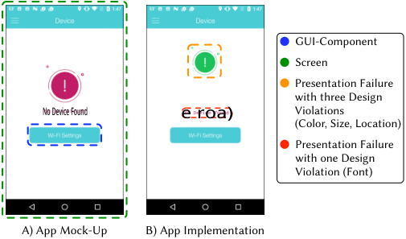

<!-- Start of picture text -->
GUI-Component Screen Presentation Failure with three Design No Device Found e roa) Violations (Color, Size, Location) Presentation Failure with one Design Violation (Font) A) App Mock-Up B) App Implementation <!-- End of picture text -->

**Figure 1: Examples of Formal Definitions** 

**_Definition 2: Screen (S) -_** A canvas _S_ with a predefined height and width corresponding to the physical display dimensions of a smartphone or tablet. Each Screen contains a cumulative hierarchy of components, which can be represented as a nested set such that: 

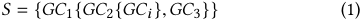

<!-- Start of picture text -->
S = { GC 1{ GC 2{ GCi  }, GC 3}} (1) <!-- End of picture text -->

where each _GC_ has a unique attribute tuple and the nested set can be ordered in either depth-first (Exp. 1) or in a breadth-first manner. We are concerned with two specific types of screens: screens representing mock-ups of mobile apps _S__m_ and screens representing real implementations of these apps, or _S__r_ . 

_2.1.2 Design Violations & Presentation Failures._ As described earlier, _design violations_ correspond to visual symptoms of _presentation failures_ , or differences between the intended design and implementation of a mobile app screen. Presentation failures can be made up of one or more design violations of different types. **_Definition 3: Design Violation (DV) -_** As shown in Exp. 2, a mismatch between the attribute tuples of two corresponding leaflevel ( _i.e.,_ having no direct children) GUI-components _GCi__m_and_GCr_ _j_ of two screens _S__m_ and _S__r_ imply a design violation _DV_ associated with those components. In this definition leaf nodes _correspond_ to one another if their location and size on a screen ( _i.e., <x-position,yposition>, <height,width>_ ) match within a given threshold. _Equality_ between leaf nodes is measured as a tighter matching threshold across all attributes. As we illustrate in the next section, inequalities between different attributes in the associated tuples of the _GCs_ lead to different types of design violations. 

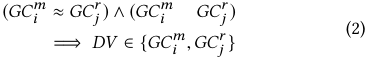

<!-- Start of picture text -->
( GCi m ≈ GC r j ) ∧( GC i m GC r j ) (2) =⇒ DV ∈{ GCi m , GCr j } <!-- End of picture text -->

**_Definition 4: Presentation Failure (PF) -_** A set of one or more _DVs_ attributed to a set of corresponding GUI-components between two screens _Sm_ and _Sr_ , as shown in Exp. 3. For instance, as shown in Fig. 1, a single set of corresponding components may have differences in both the _<x,y>_ and _<height,width>_ attributes leading to two constituent design violations that induce a single presentation failure _PF_ . Thus, each presentation failure between two Screens _S_ corresponds to at least one mismatch between the attribute vectors of two corresponding leaf node GUI-components _GCim_ and _GCir_ . 

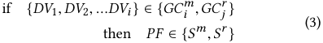

<!-- Start of picture text -->
if { DV 1,  DV 2, ... DVi  } ∈{ GCi m , GCr j } (3) then PF ∈{ S m , S r } <!-- End of picture text -->

_2.1.3 Problem Statement._ Given these definitions, the problem being solved in this paper is the following: Given two screens _S__m_ and _S__r_ corresponding to the mock-up and implementation screens of a mobile application, we aim to detect and describe the set of presentation failures { _PF_ 1, _PF_ 2, ... _PFi_ } ∈{ _S__m_ , _S__r_ }. Thus, we aim to report all design violations on corresponding _GC_ pairs: 

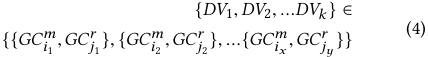

<!-- Start of picture text -->
{ DV 1,  DV 2, ... DVk  } ∈ (4) {{ GCi m 1 , GCr j 1 }, { GC i m 2 , GCr j 2 }, ...{ GC i m x , GCr jy }} <!-- End of picture text -->

## **2.2 Industrial Problem Origins** 

A typical industrial mobile development process includes the following steps (as confirmed by our collaborators at Huawei): (i) First a team of designers creates highly detailed mockups of an app’s screens using the Sketch [10] (or similar) prototyping software. These mock-ups are typically “pixel-perfect" representations of the app for a given screen dimension; (ii) The mock-ups are then handed off to developers in the form of exported images with designer added annotations stipulating spatial information and constraints. Developers use this information to implement representations of the GUIs for Android using a combination of Java and xml; (iii) Next, after the initial version of the app has been implemented, compiled Android Application Package(s) ( _i.e.,_ apks) are sent back to the designers who then install these apps on target devices, generate screenshots for the screens in question, and manually search for discrepancies compared to the original mock-ups; (iv) Once the set of violations are identified, these are communicated back to the developers via textual descriptions and annotated screenshots at the cost of significant manual effort from the design teams. Developers must then identify and resolve the _DVs_ using this information. The process is often repeated in several iterations causing substantial delays in the development process. 

The goal of our work is to drastically improve this iterative process by: (i) automating the identification of _DVs_ on the screens of mobile apps - saving both the design and development teams time and effort, and (ii) providing highly accurate information to the developers regarding these _DVs_ in the form of detailed reports - in order to reduce their effort in resolving the problem. 

## **3 DESIGN VIOLATIONS IN PRACTICE** 

In order to gain a better understanding of the types of _DVs_ that occur in mobile apps in practice, we conducted a study using a dataset from Huawei. While there do exist a small collection of taxonomies related to visual GUI defects [23, 26] and faults in mobile apps [21, 29], we chose to conduct a contextualized study with our industrial partner for the following reasons: (i) existing taxonomies for visual GUI defects were not detailed enough, containing only general faults ( _e.g.,_ “incorrect appearance”), (ii) existing fault taxonomies for mobile apps either did not contain visual GUI faults or were not complete, and (iii) we wanted to derive a contextualized _DV_ taxonomy for apps developed at Huawei. The findings from this study underscore the existence and importance of the problem that our approach aims to solve in this context. Due to an NDA, we are not able to share the dataset or highlight specific examples, in order to avoid revealing information about future products at Huawei. However, we present aggregate results in this section. 

ICSE ’18, May 27-June 3, 2018, Gothenburg, Sweden 

K. Moran, B. Li, C. Bernal-Cárdenas, D. Jelf, and D. Poshyvanyk 

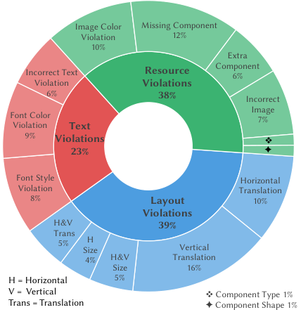

<!-- Start of picture text -->
Image Color  Missing Component Violation 12% 10% Extra Incorrect Text  Resource  Component6% Violation Violations 6% 38% Incorrect Font Color  Image 7% Violation Text 9% Violations ❖ 23% ✦ Font Style  Horizontal Violation Translation 8% Layout   10% Violations H&V 39% Trans 5% SizeH  Vertical 4% H&V Translation Size 16% H = Horizontal  5% V =  Vertical ❖ Component Type 1% Trans = Translation ✦ Component Shape 1% <!-- End of picture text -->

## **Figure 2: Distribution of Different Types of Industrial** **_DVs_ 3.1 Study Setting & Methodology** 

The _goal_ of this study is to derive a taxonomy of the different types of _DVs_ and examine the distribution of these types induced during the mobile app development process. The _context_ of this study is comprised of a set of 71 representative mobile app mockup and implementation screen pairs from more than 12 different internal apps, annotated by design teams from our industrial partner to highlight specific instances of _resolved DVs_ . This set of screen pairs was specifically selected by the industrial design team to be representative both in terms of diversity and distribution of violations that typically occur during the development process. 

In order to develop a taxonomy and distribution of the violations present in this dataset, we implement an open coding methodology consistent with constructivist grounded theory [17]. Following the advice of recent work within the SE community [45], we stipulate our specific implementation of this type of grounded theory while discussing our deviations from the methods in the literature. We derived our implementation from the material discussed in [17] involving the following steps: (i) establishing a research problem and questions, (ii) data-collection and initial coding, and (iii) focused coding. We excluded other steps described in [17], such as memoing because we were building a taxonomy of labels, and seeking new specific data due to our NDA limiting the data that could be shared. The study addressed the following research question: _What are the different types and distributions of GUI design violations that occur during industrial mobile app development processes?_ 

During the initial coding process, three of the authors were sent the full set of 71 screen pairs and were asked to code four pieces of information for each example: (i) a general category for the violation, (ii) a specific description of the violation, (iii) the severity of the violation (if applicable), and (iv) the Android _GC_ types affected ( _e.g.,_ button). Finally, we performed a second round of coding that combined the concepts of focused and axial coding as described in [17]. During this round two of the authors merged the responses from all three types of coding information where at least two of the three coders agreed. During this phase similar coding labels 

were merged ( _e.g.,_ “layout violation" vs. “spatial violation"), conflicts were resolved, two screen pairs were discarded due to ambiguity, and cohesive categories and subcategories were formed. The author agreement for each of the four types of tags is as follows: (i) general violation category (100%), (ii) specific violation description (96%), (iii) violation severity (100%), and (iv) affected _GC_ types (84.5%). 

## **3.2 Grounded Theory Study Results** 

Our study revealed three major categories of design violations, each with several specific subtypes. We forgo detailed descriptions and examples of violations due to space limitations, but provide examples in our online appendix [35]. The derived categories and subcategories of _DVs_ , and their distributions, are illustrated in Fig. 2. Overall 82 _DVs_ were identified across the 71 unique screen pairs considered in our study. The most prevalent category of _DVs_ in our taxonomy are _Layout Violations_ (≈ 40%), which concern either a translation of a component in the _x_ or _y_ direction or a change in the component size, with translations being more common. The second most prevalent category (≈ 36%) consists of _Resource Violations_ , which concern missing components, extra components, color differences, and image differences. Finally, about one-quarter (≈ 24%) of these violations are _Text Violations_ , which concern differences in components that display text. We observed that violations typically only surfaced for “leaf-level" components in the GUI hierarchy. That is, violations typically only affected atomic components & not containers or backgrounds. Only 5/82 of examined violations (≈ 6%) affected backgrounds or containers. Even in these few cases, the violations also affected “leaf-level" components. 

The different types of violations correspond to different inequalities between the attribute tuples of corresponding GUI-components defined in Sec. 2. This taxonomy shows that designers are charged with identifying several different types of design violations, a daunting task, particularly for hundreds of screens across several apps. 

## **4 THE** GVT **APPROACH** 

## **4.1 Approach Overview** 

The workflow of Gvt (Fig. 3) proceeds in three stages: First in the _GUI-Collection Stage_ , GUI-related information from both mock-ups and running apps is collected; Next, in the _GUI-Comprehension Stage_ leaf-level _GCs_ are parsed from the trees and a KNN-based algorithm is used to match corresponding _GCs_ using spatial information; Finally, in the _Design Violation Detection Stage DVs_ are detected using a combination of methods that leverage spatial _GC_ information and computer vision techniques. 

## **4.2 Stage 1: GUI Collection** 

_4.2.1 Mock-Up GUI Collection._ Software UI/UX design professionals typically use professional-grade image editing software (such as Photoshop[1] or Sketch[10]) to create their mock-ups. Designers employed by our industrial partner utilize the Sketch design software. Sketch is popular among mobile UI/UX designers due to its simple but powerful features, ease of use, and large library of extensions [11]. When using these tools designers often construct graphical representations of smartphone applications by placing _objects_ representing _GCs_ (which we refer to as _mock-up GCs_ ) on a _canvas_ (representing a Screen _S_ ) that matches the typical display size of a target device. In order to capture information encoded in these mock-ups we decided to leverage an export format that 

### Automated Reporting of GUI Design Violations for Mobile Apps 

ICSE ’18, May 27-June 3, 2018, Gothenburg, Sweden 

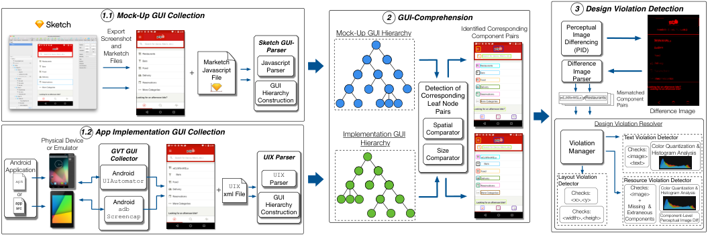

<!-- Start of picture text -->
3   Design Violation Detection 1.1  Mock-Up GUI Collection 2   GUI-Comprehension ScreenshotMarketch Export and  Sketch GUI-Parser Mock - Up GUI Hierarchy Identified Corresponding Component Pairs Differencing Perceptual Image (PID) Files Marketch  Javascript  Difference + Javascript  Parser Image File Parser GUI Detection of ConstructionHierarchy  Corresponding Leaf Node  ≠ MismatchedComponentPairs Pairs Difference Image Spatial  Design Violation Resolver Android Physical Deviceor Emulator 1.2  App Implementation GUI CollectionCollectorGVT GUI  UIX Parser Implementation GUI Hierarchy ComparatorComparatorSize  ManagerViolation  Text Violation Detector<image>Checks:<text> Color Quantization & Histogram Analysis Application.app  apk srcor UIAutomatorScreencap AndroidAndroid  adb  + xml File UIX ConstructionHierarchyParser UIX GUI  Layout Violation Detector<width>,<heigh><x>,<y>Checks:Checks: Resource Violation DetectorComponentsExtraneous Missing  & <image>Checks:+ Component-LevelPerceptual Image DiffColor Quantization & Histogram Analysis <!-- End of picture text -->

**Figure 3: Overview of GVT Workflow** 

was already in use by our industrial partner, an open-source Sketch extension called Marketch [6] that exports mock-ups as an html page including a screenshot and JavaScript file. Thus, as input from the mock-up, Gvt receives a screenshot (to be used later in the _Design Violation Detection Phase_ ) and a directory containing the Marketch information. The JavaScript file contains several pieces of information for each mock-up _GC_ including, (i) the location of the mock-up _GC_ on the canvas, (ii) size of the bounding box, and (iii) the text/font displayed by the mock-up _GC_ (if any). As shown in Figure 3- 1.1 , we built a parser to read this information. _However, it should be noted that our approach is not tightly coupled to Sketch or Marketch files._1 After the Marketch files have been parsed, Gvt examines the extracted spatial information to build a _GC_ hierarchy. The result can be logically represented as a rooted tree where leaf nodes contain the atomic UI-elements with which a typical user might interact. Non-leaf node components typically represent containers, that form logical groupings of leaf node components and other containers. In certain cases, our approximation of using mock-up _GCs_ to represent implementation _GCs_ may not hold. For instance, an icon which should be represented as a single _GC_ may consist of several mock-up _GCs_ representing parts of the icon. Gvt handles such cases in the _GUI-Comprehension_ stage. 

_4.2.2 Dynamic App GUI-Collection._ In order to compare the the mock-up of an app to its implementation Gvt must extract GUI-related meta-data from a running Android app. Gvt is able to use Android’s uiautomator framework [2] intended for UI testing to capture xml files and screenshots for a target screen of an app running on a physical device or emulator. Each uiautomator file contains information related to the runtime GUI-hierarchy of the target app, including the following attributes utilized by Gvt: (i) The Android component type ( _e.g.,_ android.widget.ImageButton), (ii) the location on the screen, (iii) the size of the bounding box, (iv) text displayed, (v) a developer assigned id. The hierarchal structure of components is encoded directly in the uiautomator file, and thus we built a parser to extract GUI-hierarchy using this information directly (see Fig. 3- 1.2 ). 

## **4.3 Stage 2: GUI Comprehension** 

In order for Gvt to find visual discrepancies between components existing in the mock-up and implementation of an app, it must 

> 1Similar information regarding mock-up _GCs_ can be parsed from the html or Scalable Vector Graphics (.svg) format exported by other tools such as Photoshop[1]. 

determine which components correspond to one another. Unfortunately, the GUI-hierarchies parsed from both the Marketch, and uiautomator files tend to differ dramatically due to several factors, making tree-based _GC_ matching difficult. First, since the hierarchy constructed using the Marketch files is generated using information from the Sketch mock-up of app, it is using information derived from designers. While designers have tremendous expertise in constructing visual representations of apps, they typically do not take the time to construct programmatically-oriented groupings of components. Furthermore, designers are typically not aware of the correct Android component types that should be attributed to different objects in a mock-up. Second, the uiautomator representation of the GUI-hierarchy contains the runtime hierarchal structure of _GCs_ and correct _GC_ types. This tree is typically far more complex, containing several levels of containers grouping _GCs_ together, which is required for the responsive layouts typical of mobile apps. 

To overcome this challenge, Gvt instead forms two collections of _leaf-node_ components from both the mock-up and implementation GUI-hierarchies (Fig. 3- 2 ), as this information can be easily extracted. As we reported in Sec. 3, the vast majority of _DVs_ affects leaf-node components. Once the leaf node components have been extracted from each hierarchy, GVT employs a K-NearestNeighbors (KNN) algorithm utilizing a similarity function based on the location and size of the _GCs_ in order to perform matching. In this setting, an input leaf-node component from the mock-up would be matched against it closest ( _e.g.,_ K=1) neighbor from the implementation based upon the following similarity function: 

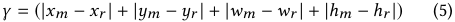

<!-- Start of picture text -->
γ = (| xm − xr  | + | ym − yr  | + | wm − wr  | + | hm − hr  |) (5) <!-- End of picture text -->

Where _γ_ is a similarity score where smaller values represent closer matches. The _x_ , _y_ , _w_ and _h_ variables correspond to the _x_ & _y_ location of the top and left-hand borders of the bounding box, and the height and width of the bounding boxes for the mock-up and implementation _GCs_ respectively. The result is a list of _GCs_ that should logically correspond to one another ( _corresponding GCs_ ). 

It is possible that there exist instances of missing or extraneous components between the mock-up and implementation. To identify these cases, our KNN algorithm employs a _GC-Matching Threshold_ ( _MT_ ). If the similarity score of the nearest neighbor match for a given input mock-up _GC_ exceeds this threshold, it is not matched with any component, and will be reported as a _missing GC_ violation. 

K. Moran, B. Li, C. Bernal-Cárdenas, D. Jelf, and D. Poshyvanyk 

ICSE ’18, May 27-June 3, 2018, Gothenburg, Sweden 

If there are unmatched _GCs_ from the implementation, they are later reported as _extraneous GC_ violations. 

Also, there may be cases where a logical _GC_ in the implementation is represented as small group of mock-up _GCs_ . Gvt is able to handle these cases using the similarity function outlined above. For each mock-up _GC_ , Gvt checks whether the neighboring _GCs_ in the mockup are closer than the closest corresponding _GC_ in the implementation. If this is the case, they are merged, with the process repeating until a logical GUI-component is represented. 

## **4.4 Stage 3: Design Violation Detection** 

In the _Design Violation Detection_ stage of the Gvt workflow, the approach uses a combination of computer vision techniques and heuristic checking in order to effectively detect the different categories of _DVs_ derived in our taxonomy presented in Section 3. 

_4.4.1 Perceptual Image Differencing._ In order to determine corresponding _GCs_ with visual discrepancies Gvt uses a technique called Perceptual Image Differencing (PID) [48] that operates upon the mock-up and implementation screenshots. PID utilizes a model of the human visual system to compare two images and detect visual differences, and has been used to successfully identify visual discrepancies in web applications in previous work [31, 32]. We use this algorithm in conjunction with the _GC_ information derived in the previous steps of Gvt to achieve accurate violation detection. For a full description of the algorithm, we refer readers to [48]. The PID algorithm uses several adjustable parameters including: _F_ which corresponds to the visual field of view in degrees, _L_ which indicates the luminance or brightness of the image, and _C_ which adjusts sensitivity to color differences. The values used in our implementation are stipulated in Section 4.5. 

The output of the PID algorithm is a single _difference image_ (Fig. 3- 3 ) containing _difference pixels_ , which are pixels considered to be perceptually different between the two images. After processing the difference image generated by PID, Gvt extracts the implementation bounding box for each corresponding pair of _GCs_ , and overlays the box on top of the generated difference image. It then calculates the number of difference pixels contained within the bounding box where higher numbers of difference pixels indicate potential visual discrepancies. Thus, Gvt collects all “suspicious" _GC_ pairs with a % of difference pixels higher than a _Difference Threshold DT_ . This set of suspicious components is then passed to the _Violation Manager_ (Fig. 3- 3 ) so that specific instances of _DVs_ can be detected. 

_4.4.2 Detecting Layout Violations._ The first general category of _DVs_ that Gvt detects are _Layout Violations_ . According the taxonomy derived in Sec. 3 there are six specific layout _DV_ categories that relate to two component properties: (i) screen location ( _i.e., <x,y>_ position) and (ii) size ( _i.e., <h,w>_ of the _GC_ bounding box). Gvt first checks for the three types of translation _DVs_ utilizing a heuristic that measures the distance from the top and left-hand edges of matched components. If the difference between the components in either the _x_ or _y_ dimension is greater than a _Layout Threshold_ ( _LT_ ), then these components are reported as a _Layout DV_ . Using the _LT_ avoids trivial location discrepancies within design tolerances being reported as violations, and can be set by a designer or developer using the tool. When detecting the three types of size _DVs_ in the derived design violation taxonomy, Gvt utilizes a heuristic that compares the width and height of the bounding boxes of corresponding components. If 

the width or height of the bounding boxes differ by more than the _LT_ , then a layout violation is reported. 

_4.4.3 Detecting Text Violations._ The next general type of _DV_ that Gvt detects are _Text Violations_ , of which there are three specific types: (i) Font Color, (ii) Font Style, and (iii) Incorrect Text Content. These detection strategies are only applied to pairs of text-based components as determined by uiautomator information. To detect font color violations, Gvt extracts cropped images for each pair of suspicious text components by cropping the mock-up and implementation screenshots according to the component’s respective bounding boxes. Next, _Color Quantization (CQ)_ is applied to accumulate instances of all unique RGB values expressed in the component-specific images. This quantization information is then used to construct a _Color Histogram (CH)_ (Fig. 3- 3 ). Gvt computes the normalized Euclidean distance between the extracted Color Histograms for the corresponding _GC_ pairs, and if the Histograms do not match within a _Color Threshold (CT)_ then a _Font-Color DV_ is reported and the top-3 colors (i.e, centroids) from each CH are recorded in the Gvt report. Likewise, if the colors do match, then the PID discrepancy identified earlier is due to the Font-Style changing (provided no existing layout _DVs_ ), and thus a Font-Style Violation is reported. Finally, to detect incorrect text content, Gvt utilizes the textual information, preprocessed to remove whitespace and normalize letter cases, and performs a string comparison. If the strings do not match, then an _Incorrect Text Content DV_ is reported. 

_4.4.4 Detecting Resource Violations._ Gvt is able to detect the following resource _DVs_ : (i) missing component, (ii) extraneous component, (iii) image color, (iv) incorrect images, and (v) component shape. The detection and distinction between _Incorrect Image DVs_ and _Image Color DVs_ requires an analysis that combines two different computer vision techniques. To perform this analysis, cropped images from the mock-up and implementation screenshots according to corresponding _GCs_ respective bounding boxes are extracted. The goal of this analysis is to determine when the content of imagebased _GCs_ differ, as opposed to only the colors of the _GCs_ differing. To accomplish this, Gvt leverages PID applied to extracted _GC_ images converted to a binary color space ( _B-PID_ ) in order to detect differences in _content_ and CQ and CH analysis to determine differences in _color_ (Sec. 4.4.3). To perform the B-PID procedure, cropped _GC_ images are converted to a binary color space by extracting pixel intensities, and then applying a binary transformation to the intensity values ( _e.g.,_ converting the images to intensity independent black & white). Then PID is run on the color-neutral version of these images. If the images differ by more than an _Image Difference Threshold_ ( _IDT_ ), then an _Incorrect Image DV_ (which encompasses the _Component Shape DV_ ) is reported. If the component passes the binary PID check, then Gvt utilizes the same CQ and CH processing technique described above to detect _image color DVs_ . Missing and extraneous components are detected as described in Sec. 4.3. 

_4.4.5 Generating Violation Reports._ In order to provide developers and designers with effective information regarding the detected _DVs_ , Gvt generates an html report that, for each detected violation contains the following: (i) a natural language description of the design violation(s), (ii) an annotated screenshot of the app implementation, with the affected GUI-component highlighted, (iii) cropped screenshots of the affected _GCs_ from both the design and 

ICSE ’18, May 27-June 3, 2018, Gothenburg, Sweden 

Automated Reporting of GUI Design Violations for Mobile Apps 

implementation screenshots, (iv) links to affected lines of application source code, (v) color information extracted from the CH for _GCs_ identified to have color mismatches, and (vi) the difference image generated by PID. The source code links are generated by matching the ids extracted from the uiautomator information back to their declarations in the layout xml files in the source code ( _e.g.,_ those located in the /res/ directory of an app’s source code). We provide examples of generated reports in our online appendix [35]. 

## **4.5 Implementation & Industrial Collaboration** 

Our implementation of Gvt was developed in Java with a Swing GUI. In addition to running the Gvt analysis the tool executable allows for one-click capture of uiautomator files and screenshots from a connected device or emulator. Several acceptance tests of mock-up/implementation screen pairs with pre-existing violations from apps under development within our industrial partner were used to guide the development of the tool. 12 Periodic releases of binaries for both Windows and Mac were made to deploy the tool to designers and developers within the company. The authors of this paper held regular bi-weekly meetings with members of the design and development teams to plan features and collect feedback. 

Using the acceptance tests and feedback from our collaborators we tuned the various thresholds and parameters of the tool for best performance. The PID algorithm settings were tuned for sensitivity to capture subtle visual inconsistencies which are then later filtered through additional CV techniques: _F_ was set to 45◦ , _L_ was set to 100 _cdm_2 , and _C_ was set to 1. The _GC_ - _Matching Threshold_ ( _MC_ ) was set to 1/8 _th_ the screen width of a target device; the _DT_ for determining suspicious _GCs_ was set to 20%; The _LT_ was set to 5 pixels (based on designer preference); the _CT_ which determines the degree to which colors must match for color-based _DVs_ was set to 85%; and finally, the _IDT_ was set to 20%. Gvt allows for a user to change these settings if desired, additionally users are capable of defining areas of dynamic content ( _e.g.,_ loaded from network activity), which should be ignored by the Gvt analysis. 

## **5 DESIGN OF THE EXPERIMENTS** 

To evaluate Gvt’s _performance_ , _usefulness_ and _applicability_ , we perform three complimentary studies answering the following RQs: 

- **RQ** 1: _How well does_ Gvt _perform in terms of detecting and classifying design violations?_ 

- **RQ** 2: _What utility can_ Gvt _provide from the viewpoint of Android developers?_ 

• **RQ** 3: _What is the industrial applicability of_ Gvt _in terms of improving the mobile application development workflow?_ RQ1 and RQ2 focus on quantitatively measuring the performance of Gvt and the utility it provides to developers through a controlled empirical and a user study respectively. RQ3 reports the results of a survey and semi-structured interviews with our collaborators aimed at investigating the industrial applicability of Gvt. 

## **5.1 Study 1:** Gvt **Effectiveness & Performance** 

The _goal_ of the first study is to quantitatively measure Gvt in terms of its precision and recall in both detecting and classifying _DVs_ . 

_5.1.1 Study Context._ To carry out a controlled quantitative study, we manually reverse engineered Sketch mockups for ten screens for eight of the most popular apps on Google Play. To derive this set, we downloaded the top-10 apps from each category on 

the Google-Play store removing the various categories corresponding to games (as these have non-standard GUI-components that Gvt does not support). We then randomly sampled one app from each of the remaining 33 categories, eliminating duplicates (since apps can belong to more than one category). We then manually collected screenshots and uiautomator files from two screens for each application using a Nexus 5, attempting to capture the “main” screen that a user would typically interact with, and one secondary screen. Using the uiautomator files, we generated cropped screenshots of all the leaf nodes components for each screen of the app. From these we were able generate 10 screens from 8 applications that successfully ran through Gvt without any reported violations. 

_5.1.2 Synthetic DV Injection._ With a set of correct mock-ups corresponding to implementation screens in an app, we needed a suitable method to introduce _DVs_ into our subjects. To this end, we constructed a _synthetic DV injection tool_ that modifies the uiautomator xml files and corresponding screenshots in order to introduce design violations from our taxonomy presented in Sec. 3. The tool is composed of two components: (i) an _XML Parser_ that reads and extracts components from the screen, then (ii) a _Violation Generator_ that randomly selects components and injects synthetic violations. We implemented injection for the following types of DVs: 

**Location Violation:** The component is moved either horizontally, vertically, or in both directions within the same container. However, the maximum distance from the original point is limited by a quarter of the width of the screen size. This was based on the severity of Layout Violations in our study described in Section 3. In order to generate the image we cropped the component and moved it to the new location replacing all the original pixels by the most prominent color from the surroundings in the original location. 

**Size Violation:** The component size either increases or decreases by 20% of the original size. For instances where the component size decreases, we replaced all the pixels by the most prominent color from the surroundings of the original size. 

**Missing Component Violation:** This violation removes a leaf component from the screen, replacing the original pixels by the most prominent color from the surrounding background. **Image Violation:** We perturb 40% of the pixels in an image by randomly generating an RGB value for the pixels affected. **Image Color Violation:** This rule perturbs the color of an image by shifting the hue of image colors by 30°. 

**Component Color Violation:** This uses the same process as for _Image Color Violations_ but we change the color by 180°. **Font Violation:** This violation randomly selects a font from the set of: _Arial_ , _Comic Sans MS_ , _Courier_ , _Roboto_ , or _Times Roman_ and applies it to a TextView component. 

**Font Color Violation:** changes the text color of a TextView component. We extracted the text color using CH analysis, then we changed the color using same strategy as for _Image Color Violations_ . 

_5.1.3 Study Methodology._ In injecting the synthetic faults, we took several measures to simulate the creation of realistic faults. First, we delineated 200 different types of design violations according to the distribution defined in our _DV_ taxonomy in Sec. 3. We then created a pool of 100 screens by creating random copies of the both the uiautomator xml files and screenshots from our initial set of 10 screens. We then used the _synthetic DV injection tool_ to seed faults into the pool of 100 screens according to the following 

ICSE ’18, May 27-June 3, 2018, Gothenburg, Sweden 

### K. Moran, B. Li, C. Bernal-Cárdenas, D. Jelf, and D. Poshyvanyk 

criteria: (i) No screen can contain more than 3 injected _DVs_ , (ii) each _GC_ should have a maximum of 1 _DV_ injected, and (iii) Each screen must have at least 1 injected _DV_ . After the _DVs_ were seeded, each of the 100 screens and 200 _DVs_ were manually inspected for correctness. Due to the random nature of the tool, a small number of erroneous _DVs_ were excluded and regenerated during this process ( _e.g.,_ color perturbed to perceptually similar color.). The breakdown of injected _DVs_ is shown in Figure 4, and the full dataset with description is included in our online appendix [35]. 

Once the final set of screens with injected violations was derived, we ran Gvt across these subjects and measured four metrics: (i) detection precision ( _DP_ ), (ii) classification precision ( _CP_ ), (iii) recall ( _R_ ), and (iv) execution time per screen ( _ET_ ). We make a distinction between detection and classification in our dataset because it is possible that Gvt is capable of detecting, but misclassifying a particular _DV_ ( _e.g.,_ an _image color DV_ misclassified as an _incorrect image DV_ ). _DP_ , _CP_ and _R_ were measured according to the following formulas: 

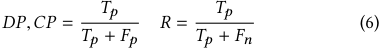

<!-- Start of picture text -->
Tp Tp DP , CP = R = (6) Tp +  Fp Tp +  Fn <!-- End of picture text -->

where for _DP_ , _Tp_ represent injected design violations that were detected, and for _CP_ , _Tp_ represents injected violations that were both detected and classified correctly. In each case _Fp_ correspond to detected _DVs_ that were either not injected or misclassified. For Recall, _Tp_ represents injected violations that were correctly detected and _Fn_ represents injected violations that were not detected. To collect these measures, two authors manually examined the reports from Gvt in order to collect the metrics. 

## **5.2 Study 2:** Gvt **Utility** 

Since the ultimate goal of an approach like Gvt is to improve the workflow of developers, the _goal_ of this second study is to measure the utility ( _i.e.,_ benefit) that Gvt provides to developers by investigating two phenomena: (i) The accuracy and effort of developers in detecting and classifying _DVs_ , and (ii) the perceived utility of Gvt reports in helping to identify and resolve _DVs_ . 

_5.2.1 Study Context._ We randomly derived two sets of screens to investigate the two phenomena outlined above. First, we randomly sampled two mutually exclusive sets of 25, and 20 screens respectively from the 100 used in Study 1, ensuring at least one instance of each type of _DV_ was included in the set. This resulted in both sets of screens containing 40 design violations in total. The correct mockup screenshot corresponding to each screen sampled from the study were also extracted, creating pairs of “correct" mockup and “incorrect" implementation screenshots. 10 participants with at least 5 years of Android development experience were contacted via email to participate in the survey. 

_5.2.2 Study Methodology._ We created an online survey with four sections. In the first section, participants were given background information regarding the definition of _DVs_ , and the different types of _DVs_ derived in our taxonomy. In the second section, participants were asked about demographic information such as programming experience and education level. In the third section, each participant was exposed to 5 mock-up/ implementation screen pairs (displayed side by side on the survey web page) and asked to identify any observed design violations. Descriptions of the _DVs_ were given at the top of this page for reference. For each screen pair, participants were presented with a dropdown menu to select 

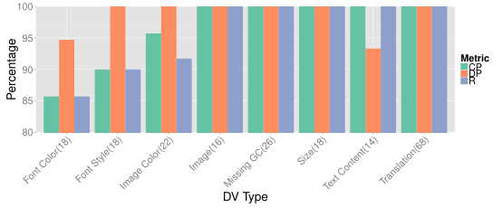

<!-- Start of picture text -->
100 95 Metric 90 CPDP R 85 80 DV Type Font Color(18) Font Style(18)Image Color(22) Image(16)Missing GC(26) Size(18)Text Content(14)Translation(68) Percentage <!-- End of picture text -->

**Figure 4: Study 1 - Detection Precision (** _DP_ **), Classification Precision (** _CP_ **), and Recall (** _R_ **)** 

a type for an observed _DV_ , and a text field to describe the error in more detail. For each participant, one of the 5 mock-up screens was a control, containing no injected violations. The 25 screens were assigned to participants such that each screen was observed by two participants and the order of the screens presented to each participant was randomized to avoid bias. To measure the effectiveness of participants in detecting and describing _DVs_ , we leverage the _DP_ , _CP_ and _R_ metrics introduced in Study 1. In the fourth section, participants were presented with two screen pairs from the second set of 20 sampled from the user study, as well as the Gvt reports for these screens. Participants were then asked to answer 5 _user-preferences (UP)_ and 5 _user experience (UX)_ questions about these reports which are presented in the following section. The _UP_ questions were developed according to the user experience honeycomb originally developed by Morville [36] and were posed to participants as free form text entry questions. We forgo a discussion of the free-form question responses due to space limitations, but we offer full anonymized participant responses in our online appendix [35]. We derived the Likert scale-based _UX_ questions using the SUS usability scale by Brooke [16]. 

## **5.3 Study 3: Industrial Applicability of** Gvt 

The _goal_ of this final study is determine industrial applicability of Gvt. To investigate this, we worked with Huawei to collect two sources of information: (i) the results of a survey sent to designers and developers who used Gvt in their daily development/design workflow, and (ii) semi-structured interviews with both design and development managers whose teams have adopted the use of Gvt. 

_5.3.1 Study Context & Methodology._ We created a survey posing questions related to the _applicability_ of Gvt to industrial designers and developers. These questions are shown in Fig. 7. The semistructured interviews were conducted in Chinese, recorded, and then later translated. During the interview, managers were asked to respond to four questions related to the _impact_ and _performance_ of the tool in practice. We include discussions of the responses in Section 6 and stipulate full questions in our appendix. 

## **6 EMPIRICAL RESULTS** 

## **6.1 Study 1 Results: GVT Performance** 

The results of Study 1, are shown in Figure 4. This figure shows the average _DP_ , _CP_ , and _R_ for each type of seeded violation over the 200 seeded faults and the number of faults seeded into each category (following the distributions of our derived taxonomy) are shown on the x-axis. Overall, these results are extremely encouraging, with the overall _DP_ achieving 99.4%, the average _CP_ being 98.4%, and 

ICSE ’18, May 27-June 3, 2018, Gothenburg, Sweden 

Automated Reporting of GUI Design Violations for Mobile Apps 

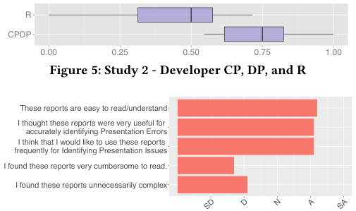

<!-- Start of picture text -->
R CPDP 0.00 0.25 0.50 0.75 1.00 Figure 5: Study 2 - Developer CP, DP, and R These reports are easy to read/understand I thought these reports were very useful for accurately identifying Presentation Errors I think that I would like to use these reports frequently for Identifying Presentation Issues I found these reports very cumbersome to read. I found these reports unnecessarily complex SD D N A SA <!-- End of picture text -->

**Figure 6: Study 2 - UX Question Responses. SD=Strongly Disagree, D=Disagree, N=Neutral, A=Agree, SA=Strongly Agree** the average _R_ reaching 96.5%. This illustrates that Gvt is capable of detecting seeded faults designed to emulate both the type and distribution of _DVs_ encountered in industrial settings. While Gvt achieved at least 85% precision for each type of seeded _DV_ , it performed worse on some types of violations compared to others. For instance, Gvt saw its lowest precision values for the _Font-Style_ and _Font-Color_ violations, typically due to the fact that the magnitude of perturbation for the color or font type was not large enough to surpass the Color or Image Difference Thresholds ( _CT_ & _IDT_ ). Gvt took 36.8 mins to process and generate reports for the set of 100 screens with injected _DVs_ , or 22 sec per screen pair. This execution cost was generally acceptable by our industrial collaborators. 

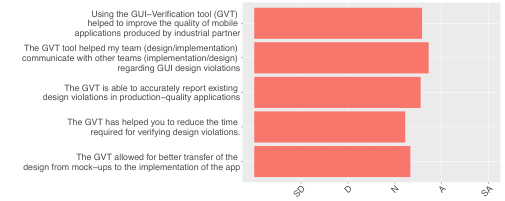

<!-- Start of picture text -->
Using the GUI−Verification tool (GVT)        helped to improve the quality of mobile        applications produced by industrial partner The GVT tool helped my team (design/implementation)        communicate with other teams (implementation/design)        regarding GUI design violations The GVT is able to accurately report existing        design violations in production−quality applications The GVT has helped you to reduce the time        required for verifying design violations. The GVT allowed for better transfer of the        design from mock−ups to the implementation of the app SD D N A SA <!-- End of picture text -->

**Figure 7: Study 3 - Applicability Questions. SD=Strongly Disagree, D=Disagree, N=Neutral, A=Agree, SA=Strongly Agree** 

to developers, or developers disagreeing with designers over the existence or type of a _DV_ . In contrast to this fragmented process, Gvt provides clear, unambiguous reports that facilitate communication between designers and developers. 

Figure 6 illustrates the responses to the likert based UX questions, and the results are quite encouraging. In general, participants found that the reports from Gvt were easy to read, useful for identifying _DVs_ and indicated that they would like to use the reports for identifying _DVs_ . Participants also indicated that the reports were not unnecessarily complex or difficult to read. We asked the participants about their preferences for the Gvt reports as well, asking about the most and least useful information in the reports. _Every single_ participant indicated that the highlighted annotations on the screenshots in the report were the most useful element. Whereas most users tended to dislike the PID output included at the bottom of the report, citing this information as difficult to comprehend. 

## **6.3 Study 3 Results: Industrial Applicability** 

## **6.2 Study 2 Results: GVT Utility** 

The _DP_ , _CP_ and _R_ results, representing the Android developers ability to correctly detect and classify _DVs_ is shown in Figure 5 as box-plots across all 10 participants. Here we found _CP_ = _DP_ , as when a user misclassified violations, they also did not detect them. As this figure shows, the Android developers generally performed much worse compared to Gvt achieving an average _CP_ of under ≈ 60% and an average _R_ of ≈ 50%. The sources of this performance loss for the study participants compared to Gvt was fourfold: (i) participants tended to report minor, acceptable differences in fonts across the examples (despite the instructions clearly stating _not_ to report such violations); (ii) users tended to attribute more than one _DV_ to a single component, specifically for _font style_ and _font color_ violations despite instructions to report only one; (iii) users tended to misclassify _DVs_ based on the provided categories ( _e.g.,_ classifying a _layout DV_ for a Text _GC_ as an _incorrect text DV_ ), and (iv) participants missed reporting many of the injected _DVs_ , leading to the low recall numbers. These results indicate that, at the very least, developers can struggle to both detect and classify _DVs_ between mock-up and implementation screen pairs, signaling the need for an automated system to check for _DVs_ before implemented apps are sent to a UI/UX team for auditing. This result confirms the notion that developers may not be as sensitive to small _DVs_ in the GUI as the designers who created the GUI specifications. Furthermore, this finding is notable, because as part of the iterative process of resolving design violations, designers must communicate to developers _DVs_ and developers must recognize and understand these _DVs_ in order to properly resolve them. This process is often complicated due to ambiguous descriptions of _DVs_ from designers 

The results for the _applicability_ questions asked to 20 designers and developers who use Gvt in their daily activities is shown in Figure 7. A positive outcome for each of these statements correlates to responses indicating that developers “agree” or “strongly agree”. The results of this study indicate a weak agreement of developers for these statements, indicating that while Gvt is generally applicable, there are some drawbacks that prevented developers and designers from giving the tool unequivocal support. We explore these drawbacks by conducting semi-structured interviews. 

In conducting the interviews, one of the authors asked the questions presented in Figure 7 to 3 managers (2 from UI/UX teams and 1 from a Front-End development team). When asked whether Gvt contributed to an increased quality of mobile applications at the company, all three managers tended to agree that this was the case. For instance, one of the design managers stated, _“Certainly yes. The tool is the industry’s first"_ and the other designer manager added, _“When the page is more complicated, the tool is more helpful"_ . 

When asked about the overall performance and accuracy of the tool in detecting _DVs_ , the manager from the implementation team admitted that the current detection performance of the tool is good, but suggested that dynamic detection of some components may improve it, stating, _“[DVs ] can be detected pretty well... [but the tool is] not very flexible. For example, a switch component in the design is open, but the switch is off in the implementation"_ . He suggested that properly handling cases such as this would make the tool more useful from a developers perspective. One of the design team managers held a similar view stating that, _“Currently, most errors are layout errors, so tool is accurate. Static components are basically detected, [but] maybe the next extension should focus on dynamic_ 

ICSE ’18, May 27-June 3, 2018, Gothenburg, Sweden 

K. Moran, B. Li, C. Bernal-Cárdenas, D. Jelf, and D. Poshyvanyk 

_components."_ While the current version of the Gvt allows for the exclusion of regions with dynamic components, it is clear that both design and development teams would appreciate proper detection of _DVs_ for dynamic components. Additionally, two of the managers commented on the “ _rigidity_ ” of the Gvt’s current interface, and explained that a more streamlined UI would help improve its utility. 

When asked about whether Gvt improved communication between the design and development teams, the development team manager felt that while the tool has not improved communication yet, it did have the potential to do so, _“At present there is no [improvement] but certainly there is the potential possibility."_ The design managers generally stated that the tool has helped with communication, particularly in clarifying subtle _DVs_ that may have caused arguments between teams in the past, _“If you consider the time savings on discussion and arguments between the two teams, this tool saves us a lot of time"_ . Another designer indicated that the tool is helpful at describing _DVs_ to developers who may not be able to recognize them with the naked eye _“We found that the tool can indeed detect something that the naked eye cannot"_ . While there are certainly further refinements that can be made to Gvt, it is clear that the tool has begun to have a positive impact of the development of mobile apps, and as the tool evolves within the company, should allow for continued improvements in quality and time saved. 

## **7 LIMITATIONS & THREATS TO VALIDITY** 

**_Limitations_** : While we have illustrated that Gvt is applicable in an industrial setting, the tool is not without its limitations. Currently, the tool imposes lightweight restrictions on designers creating Sketch mock-ups, chief among these being the requirement that bounding boxes of components do not overlap. Currently, Gvt will try to resolve such cases during the _GUI-Comprehension stage_ using an Intersection over union (IOU) metric. 

**_Internal Validity_** : While deriving the taxonomy of _DVs_ , mistakes in classification arising from subjectiveness may have introduced unexpected coding. To mitigate this threat we followed a set methodology, merged coding results, and performed conflict resolution. **_Construct Validity_** : In our initial study (Sec. 3), a threat to construct validity arises in the form of the manner in which coders were exposed to presentation failures. To mitigate this threat, designers from our industrial partner manually annotated the screen pairs in order to clearly illustrate the affected _GCs_ on the screen. In our evaluation of Gvt threats arise from our method of _DV_ injection using the _synthetic fault injection tool_ . However, we designed this tool to inject faults based upon both the type and distribution of faults from our _DV_ taxonomy to mitigate this threat. 

**_External Validity_** : In our initial study related to the _DV_ taxonomy, we utilized a dataset from a single (albeit large) company with examples across several different applications and screens. There is the potential that this may not generalize to other industrial mobile application development environments and platforms or mobile app development in general. However given the relatively consistent design paradigms of mobile apps, we expect the categories and the sub-categories within the taxonomy to hold, although it is possible that the distribution across these categories may vary across application development for different domains. In Study 3 we surveyed employees at a single (though large) company, and findings may differ in similar studies at other companies. 

## **8 RELATED WORK** 

**_Web Presentation Failures_** : The work most closely related to our approach are approaches that aim at detecting, classifying and fixing presentation failures in web applications [30–32, 42]. In comparison to these approaches, Gvt also performs detection and localization of presentation failures, but is the first to do so for mobile apps. In addition to the engineering challenges associated with building an approach to detect presentation failures in the mobile domain ( _e.g.,_ collection and processing of GUI-related data) Gvt is the first approach to leverage metadata from software mock-up artifacts ( _e.g.,_ Marketch) to perform _GC_ matching based upon the spatial information collected from both mock-ups and dynamic application screens, allowing for precise detection of the different types of _DVs_ delineated in our industrial _DV_ taxonomy. Gvt is also the first to apply the processes of CQ, CH analysis, and B-PID toward detecting differences in the content and color of icons and images displayed in mobile apps. Gvt also explicitly identifies and reports different faulty properties (such as errors in component location, or text). **_Cross Browser Testing_** : Approaches for XBT (or cross browser testing) by Roy Choudhry _et. al._ [18, 42, 43] examine and automatically report differences in web pages rendered in multiple browsers. These approaches are currently not directly applicable to mock-up driven development for mobile apps. 

**_Visual GUI Testing_** : A concept known as Visual GUI Testing (VGT) aims to test certain visual aspects of a software application’s GUI as well as the underlying functional properties. To accomplish this visual GUI testing usually executes actions on a target applications in order to exercise app functionality [13, 14, 23, 38]. In contrast to these approaches, Gvt is designed to apply to mobile-specific _DVs_ , is tailored for the mock-up driven development practice, and is aimed _only_ at verifying visual properties of a mobile app’s GUI. **_Other Approaches_** : There are other approaches and techniques that related to identifying problems or differences with GUIs of mobile apps. Xie _et al._ introduced GUIDE [47], a tool for GUI differencing between successive releases of GUIs for an app by matching components between GUI-hierarchies. Gvt utilizes a matching procedure for leaf node components as direct tree comparisons are not possible in the context of mock-up driven development. There has also been both commercial and academic work related to graphical software built specifically for creating high-fidelity mobile app mock-ups or mockups that encode information for automated creation of code for a target platform [4, 8, 9, 34]. However, such tools tend to either impose too many restrictions on designers or do not allow for direct creation of code, thus _DVs_ still persist in practice. 

## **9 CONCLUSION & FUTURE WORK** 

In this paper, we have formalized the problem of detecting design violations in mobile apps, and derived a taxonomy of design violations based on a robust industrial dataset. We presented Gvt, an approach for automatically detecting, classifying, and reporting design violations in mobile apps, and conducted a wide ranging study that measured performance, utility, and industrial applicability of this tool. Our results indicate that Gvt is effective in practice, offers utility for developers, and is applicable in industrial contexts. 

## **ACKNOWLEDGMENTS** 

The authors would like to thank Kebing Xie, Roozbeh Farahbod, and the developers and designers at Huawei for their support. 

ICSE ’18, May 27-June 3, 2018, Gothenburg, Sweden 

Automated Reporting of GUI Design Violations for Mobile Apps 

## **REFERENCES** 

- [1] Adobe photoshop http://www.photoshop.com. 

- [2] Android uiautomator http://developer.android.com/tools/help/uiautomator/ index.html. 

- [3] Apple app store https://www.apple.com/ios/app-store/. 

- [4] Fuild-ui https://www.fluidui.com. 

- [5] Google play store https://play.google.com/store?hl=en. 

- [6] The marketch plugin for sketch https://github.com/tudou527/marketch. 

- [7] Mobile apps: What consumers really need and want https://info.dynatrace.com/ rs/compuware/images/MobileAppSurveyReport.pdf. 

- [8] Mockup.io https://mockup.io/about/. 

- [9] Proto.io https://proto.io. 

- [10] The sketch design tool https://www.sketchapp.com. 

- [11] Sketch extensions https://www.sketchapp.com/extensions/. 

- [12] Why your app’s ux is more important than you think http://www.codemag.com/ Article/1401041. 

- [13] E. Alégroth and R. Feldt. On the long-term use of visual gui testing in industrial practice: a case study. _Empirical Software Engineering_ , 22(6):2937–2971, Dec 2017. 

- [14] E. Alegroth, Z. Gao, R. Oliveira, and A. Memon. Conceptualization and evaluation of component-based testing unified with visual gui testing: An empirical study. In _2015 IEEE 8th International Conference on Software Testing, Verification and Validation (ICST)_ , pages 1–10, April 2015. 

- [15] G. Bavota, M. Linares-Vásquez, C. Bernal-Cárdenas, M. Di Penta, R. Oliveto, and D. Poshyvanyk. The impact of api change- and fault-proneness on the user ratings of android apps. _Software Engineering, IEEE Transactions on_ , 41(4):384–407, April 2015. 

- [16] J. Brooke. SUS: A quick and dirty usability scale. In P. W. Jordan, B. Weerdmeester, A. Thomas, and I. L. Mclelland, editors, _Usability evaluation in industry_ . Taylor and Francis, London, 1996. 

- [17] K. Charmaz. _Constructing Grounded Theory_ . SAGE Publications Inc., 2006. 

- [18] S. R. Choudhary, M. R. Prasad, and A. Orso. Crosscheck: Combining crawling and differencing to better detect cross-browser incompatibilities in web applications. In _Proceedings of the 2012 IEEE Fifth International Conference on Software Testing, Verification and Validation_ , ICST ’12, pages 171–180, Washington, DC, USA, 2012. IEEE Computer Society. 

- [19] A. Ciurumelea, A. SchaufelbÃČÂijhl, S. Panichella, and H. C. Gall. Analyzing reviews and code of mobile apps for better release planning. In _2017 IEEE 24th International Conference on Software Analysis, Evolution and Reengineering (SANER)_ , pages 91–102, Feb 2017. 

- [20] A. Di Sorbo, S. Panichella, C. V. Alexandru, J. Shimagaki, C. A. Visaggio, G. Canfora, and H. C. Gall. What would users change in my app? summarizing app reviews for recommending software changes. In _Proceedings of the 2016 24th ACM SIGSOFT International Symposium on Foundations of Software Engineering_ , FSE 2016, pages 499–510, New York, NY, USA, 2016. ACM. 

- [21] K. Holl and F. Elberzhager. A mobile-specific failure classification and its usage to focus quality assurance. In _2014 40th EUROMICRO Conference on Software Engineering and Advanced Applications_ , pages 385–388, Aug 2014. 

- [22] G. Hu, X. Yuan, Y. Tang, and J. Yang. Efficiently, effectively detecting mobile app bugs with appdoctor. In _Proceedings of the Ninth European Conference on Computer Systems_ , EuroSys ’14, pages 18:1–18:15, New York, NY, USA, 2014. ACM. 

- [23] A. Issa, J. Sillito, and V. Garousi. Visual testing of graphical user interfaces: An exploratory study towards systematic definitions and approaches. In _2012 14th IEEE International Symposium on Web Systems Evolution (WSE)_ , pages 11–15, Sept 2012. 

- [24] N. Jones. Seven best practices for optimizing mobile testing efforts. Technical Report G00248240, Gartner. 

- [25] K. Kuusinen and T. Mikkonen. Designing user experience for mobile apps: Longterm product owner perspective. In _2013 20th Asia-Pacific Software Engineering Conference_ , volume 1 of _APSEC’13_ , pages 535–540, Dec 2013. 

- [26] V. Lelli, A. Blouin, and B. Baudry. Classifying and qualifying gui defects. In _2015 IEEE 8th International Conference on Software Testing, Verification and Validation (ICST)_ , pages 1–10, April 2015. 

- [27] M. Linares-Vásquez, G. Bavota, C. Bernal-Cárdenas, M. Di Penta, R. Oliveto, and D. Poshyvanyk. Api change and fault proneness: A threat to the success of android apps. In _Proceedings of the 2013 9th Joint Meeting on Foundations of Software Engineering_ , ESEC/FSE’13, pages 477–487, New York, NY, USA, 2013. ACM. 

- [28] M. Linares-Vásquez, G. Bavota, M. D. Penta, R. Oliveto, and D. Poshyvanyk. How do API changes trigger Stack Overflow discussions? a study on the android SDK. 

   - In _Proceedings of the 22nd International Conference on Program Comprehension_ , ICPC’14, pages 83–94, 2014. 

- [29] M. Linares-Vásquez, G. Bavota, M. Tufano, K. Moran, M. Di Penta, C. Vendome, C. Bernal-Cárdenas, and D. Poshyvanyk. Enabling mutation testing for android apps. In _Proceedings of the 2017 11th Joint Meeting on Foundations of Software Engineering_ , ESEC/FSE 2017, pages 233–244, New York, NY, USA, 2017. ACM. 

- [30] S. Mahajan, A. Alameer, P. McMinn, and W. G. Halfond. Automated repair of layout cross browser issues using search-based techniques. In _International Conference on Software Testing and Analysis_ , ISSTA’17, 2017. 

- [31] S. Mahajan and W. G. J. Halfond. Detection and localization of html presentation failures using computer vision-based techniques. In _Proceedings of the 8th IEEE International Conference on Software Testing, Verification and Validation_ , ICST’15, April 2015. 

- [32] S. Mahajan, B. Li, P. Behnamghader, and W. G. Halfond. Using visual symptoms for debugging presentation failures in web applications. In _Proceeding of the 9th IEEE International Conference on Software Testing, Verification, and Validation (ICST)_ , ICST’16, April 2016. 

- [33] T. McDonnell, B. Ray, and M. Kim. An empirical study of api stability and adoption in the android ecosystem. In _Proceedings of the 2013 International Conference on Software Maintenance_ , ICSM’13, pages 70–79, 2013. 

- [34] J. Meskens, K. Luyten, and K. Coninx. Plug-and-design: Embracing mobile devices as part of the design environment. In _Proceedings of the 1st ACM SIGCHI Symposium on Engineering Interactive Computing Systems_ , EICS ’09, pages 149– 154, New York, NY, USA, 2009. ACM. 

- [35] K. Moran, B. Li, C. Bernal-Cárdenas, D. Jelf, and D. Poshyvanyk. Gvt online appendix http://www.android-dev-tools.com/gvt. 

- [36] P. Morville. User experience design. http://semanticstudios.com/user_ experience_design/. 

- [37] B. Myers. Challenges of hci design and implementation. _interactions_ , 1(1):73–83, Jan. 1994. 

- [38] B. N. Nguyen, B. Robbins, I. Banerjee, and A. Memon. Guitar: An innovative tool for automated testing of gui-driven software. _Automated Software Engg._ , 21(1):65–105, Mar. 2014. 

- [39] T. A. Nguyen and C. Csallner. Reverse engineering mobile application user interfaces with REMAUI. In _Proceedings of the 2015 30th IEEE/ACM International Conference on Automated Software Engineering_ , ASE’15, pages 248–259, Washington, DC, USA, 2015. IEEE Computer Society. 

- [40] F. Palomba, M. Linares-Vásquez, G. Bavota, R. Oliveto, M. D. Penta, D. Poshyvanyk, and A. D. Lucia. User reviews matter! tracking crowdsourced reviews to support evolution of successful apps. In _2015 IEEE International Conference on Software Maintenance and Evolution (ICSME)_ , pages 291–300, Sept 2015. 

- [41] F. Palomba, P. Salza, A. Ciurumelea, S. Panichella, H. Gall, F. Ferrucci, and A. De Lucia. Recommending and localizing change requests for mobile apps based on user reviews. In _Proceedings of the 39th International Conference on Software Engineering_ , ICSE ’17, pages 106–117, Piscataway, NJ, USA, 2017. IEEE Press. 

- [42] S. Roy Choudhary, M. R. Prasad, and A. Orso. X-pert: Accurate identification of cross-browser issues in web applications. In _Proceedings of the 2013 International Conference on Software Engineering_ , ICSE ’13, pages 702–711, Piscataway, NJ, USA, 2013. IEEE Press. 

- [43] S. Roy Choudhary, H. Versee, and A. Orso. Webdiff: Automated identification of cross-browser issues in web applications. In _Proceedings of the 2010 IEEE International Conference on Software Maintenance_ , ICSM ’10, pages 1–10, Washington, DC, USA, 2010. IEEE Computer Society. 

- [44] T. Silva da Silva, A. Martin, F. Maurer, and M. Silveira. User-centered design and agile methods: A systematic review. In _Proceedings of the 2011 Agile Conference_ , AGILE ’11, pages 77–86, Washington, DC, USA, 2011. IEEE Computer Society. 

- [45] K.-J. Stol, P. Ralph, and B. Fitzgerald. Grounded theory in software engineering research: A critical review and guidelines. In _Proceedings of the 38th International Conference on Software Engineering_ , ICSE ’16, pages 120–131, New York, NY, USA, 2016. ACM. 

- [46] A. B. Tucker. _Computer Science Handbook, Second Edition_ . Chapman & Hall/CRC, 2004. 

- [47] Q. Xie, M. Grechanik, C. Fu, and C. Cumby. Guide: A gui differentiator. In _2009 IEEE International Conference on Software Maintenance_ , ICSM’09. 

- [48] H. Yee, S. Pattanaik, and D. P. Greenberg. Spatiotemporal sensitivity and visual attention for efficient rendering of dynamic environments. _ACM Trans. Graph._ , 20(1):39–65, Jan. 2001. 

- [49] C. Zeidler, C. Lutteroth, W. Stuerzlinger, and G. Weber. _Evaluating Direct Manipulation Operations for Constraint-Based Layout_ , pages 513–529. Springer Berlin Heidelberg, Berlin, Heidelberg, 2013. 

