# Structural properties of additive binary hard-sphere mixtures. III. Direct correlation functions 

S�lawomir Pieprzyk,1, ∗ Santos B. Yuste,2, † Andr´es Santos,2, ‡ Mariano L´opez de Haro,3, § and Arkadiusz C. Bra´nka1, ¶ 

> 1Institute of Molecular Physics, Polish Academy of Sciences, 

M. Smoluchowskiego 17, 60-179 Pozna´n, Poland 

> 2Departamento de F´ısica and Instituto de Computaci´on Cient´ıfica Avanzada (ICCAEx), Universidad de Extremadura, Badajoz, E-06006, Spain 

> 3Instituto de Energ´ıas Renovables, Universidad Nacional Aut´onoma de M´exico (U.N.A.M.), Temixco, Morelos 62580, Mexico 

(Dated: December 2, 2021) 

An analysis of the direct correlation functions cij (r) of binary additive hard-sphere mixtures of diameters σs and σb (where the subscripts s and b refer to the “small” and “big” spheres, respectively), as obtained with the rational-function approximation method and the WM scheme introduced in previous work [S. Pieprzyk et al., Phys. Rev. E 101, 012117 (2020)], is performed. The results indicate that the functions css(r < σs) and cbb(r < σb) in both approaches are monotonic and can be well represented by a low-order polynomial, while the function csb(r <1 2(σb +σs)) isnot monotonic and exhibits a well defined minimum near r =1 2(σb −σs),whosepropertiesarestudied in detail. Additionally, we show that the second derivative c′′ sb(r)presentsajumpdiscontinuityat r = 21(σb −σs)whosemagnitudesatisfiesthe samerelationshipwiththe contactvaluesofthe radial distribution function as in the Percus-Yevick theory. 

## I. INTRODUCTION 

Systems composed of hard spheres (HSs) are important in the description of fluids, often playing the role of a generic or reference model system. They have become one of the most investigated off-lattice many-body physical systems, and considerable knowledge on them has been accumulated over decades. Nevertheless, the development of additional theoretical methods and current possibilities to perform effective simulations of large numbers of particles open up the opportunity to investigate in more depth or reveal new, hardly identified features of HS systems. This is especially important in the case of HS mixtures, which are obviously more complex than monocomponent systems. 

In this paper, we continue with a series dealing with the behavior of the structural correlation functions of additive binary hard-sphere (BHS) mixtures. In the first paper [1], we presented a method, referred to as the WM method, which combines molecular dynamics (MD) simulation data, residue theorem analysis, and the Ornstein– Zernike (OZ) relations, allowing one to obtain an accurate representation of the structural correlation functions of this kind of mixtures. Both the above method and the so-called rational-function approximation (RFA), which turn out to be in very good agreement with each other, were employed in the same paper to test the direct correlation functions and to confirm the presence of a structural crossover for a particular mixture, namely, one with 

> ∗ slawomir.pieprzyk@ifmpan.poznan.pl 

> † santos@unex.es; http://www.unex.es/eweb/fisteor/santos/ 

> ‡ andres@unex.es; http://www.unex.es/eweb/fisteor/andres/ 

> § malopez@unam.mx; https://www.ier.unam.mx/academicos/mlh/ 

> ¶ branka@ifmpan.poznan.pl 

a fixed diameter ratio q = 0.648 and a fixed total packing fraction η = 0.5 (which was the system analyzed previously theoretically and through experimental data by Statt et al. [2]). In the second paper [3], we used the same methodology to carry out a more thorough analysis of the role of the pole structure of the Fourier transforms of the total correlation functions hij (r) of various BHS mixtures on the asymptotic behavior r →∞ of hij(r), and its relation with structural crossovers in these functions. This allowed us, on the one hand, to confirm the power of our theoretical tool to study structural properties in BHS mixtures and, on the other hand and in the same vein as in Ref. [4], to discuss a coarse-grained scenario that provides a fair picture of what goes on in the plane ηs vs ηb (where ηs and ηb are the partial packing fractions of the “small” and “big” spheres, respectively) when one varies the size ratio q = σs/σb of the mixture (where σs and σb are the small and big diameters, respectively). In the present third paper we continue with a further use of our theoretical tools and concentrate on the analysis of the direct correlation functions (DCFs) of BHS mixtures, which are some of the most hardly accessible and least studied structural properties of these systems. 

In a simple fluid, the DCF c(r) may be computed as the second derivative of the intrinsic free energy functional with respect to the number density ρ [5], but it is usually defined through the OZ relation 

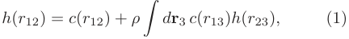

<!-- Start of picture text -->
h(r12) = c(r12) + ρ dr3 c(r13)h(r23), (1) � <!-- End of picture text -->

where h(r) = g(r) − 1 is the total correlation function, g(r) being the radial distribution function. The subscripts (1, 2, and 3) denote the positions of three particles, where the separation between particles i and j is rij = |ri − rj|. The function c(r) represents that part of the total correlation function which results from the direct correlation between particles 1 and 2, and is also 

2 

connected with the dimensionless isothermal compressibility of the fluid (χ) via the exact relation 

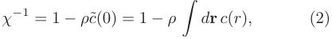

<!-- Start of picture text -->
χ −1 = 1 − ρc˜(0) = 1 − ρ dr c(r), (2) � <!-- End of picture text -->

with c˜(0) denoting the zero wave number value of the Fourier transform ˜c(k) of c(r). Its importance in the theory of liquids may be judged from the following facts. First of all, if c(r) is available, h(r) (and hence the corresponding equation of state) may be readily obtained using the OZ relation. Such availability also allows one to get insight into how the presence of density fluctuations affects the free energy of the system. Further, knowledge of c(r) in a homogeneous fluid may serve to develop approximate free energy density functionals for the inhomogeneous system. 

Various aspects of the DCFs of hard-core systems have been reported in the literature. While the following description is certainly far from complete, we shall attempt to provide here an overview of the main developments. To our knowledge, the earliest analytic result for c(r) in a three-dimensional system was reported by Wertheim [6] for a homogeneous HS fluid within the Percus-Yevick (PY) approximation. An exact result up to third order in density for this correlation function was obtained by Ashcroft and March [7]. More recently, other approximate expressions for the DCFs of hard-core systems have been proposed. For hard-disk fluids, where there is no analytical solution in the PY theory, an expression for c(r) was introduced by Ripoll and Tejero [8], who also considered a generalization valid for hard-core fluids in arbitrary d dimensions. The DCF of two- and three-dimensional systems was also addressed by Guo and Riebel [9], who derived yet other approximate expressions for a monolayer of monodisperse hard disks and spheres. Due to the fact that in HS systems specification of the tail of the DCF is enough to derive the total correlation function h(r) for all distances r, such a tail was analyzed by Henderson and Grundke [10], who introduced a parametrization of the tail to obtain an expression for the DCF of a HS fluid. A similar analysis of the tail of c(r) was carried out by Katsov and Weeks [11] for fluids whose molecules interact via a potential with a soft repulsive core of finite extent and a weaker and longer ranged tail. Baus and Colot [12] also derived an approximation of c(r) for hard-core fluids in d dimensions using rescaled virial expansions. While some of us [13, 14] derived the explicit expression for c(r) for a HS fluid in the RFA, another two of us obtained an accurate representation of this DCF using the WM scheme [15], and Fukudome et al. [16] obtained an approximate c(r) of the same system in connection with scaled particle theory. Numerical simulation results for the function c(r) of a HS fluid have been reported by Groot et al. [17]. Analytical expressions for the DCFs in a multicomponent HS mixture were derived by Lebowitz [18] from the exact solution of the corresponding PY equation, while those of the RFA for the same system have been derived 

by some of us [13, 19]. A sixth-order virial expansion was used by Dennison et al. [20] to obtain the DCF of a HS fluid that presents good agreement with simulation data. In a different vein, the DCFs of symmetric equimolar BHS mixtures with negatively nonadditive diameters have been computed by Gazillo [21] in the PY approximation and those of the Widom–Rowlinson model by Fantoni and Pastore [22] through Monte Carlo numerical simulations. Also using Monte Carlo data, Henderson et al. [23] obtained DCFs for HSs near a large HS. 

Among the different systems considered within density-functional-theory approaches in which the DCFs are involved, the following few have been selected for this brief overview. Samborsky and Evans [24] calculated the phase diagram of binary liquid crystal mixtures made of HSs and hard ellipsoids, while, by generalizing Rosenfeld’s density functional theory for HS mixtures [25], Charmoux and Perera [26] derived analytical approximations for the DCFs of molecular fluids and their mixtures. A simple weighted density approach for the one-particle correlation functions of the nonuniform system, requiring as input only the one- and two-particle DCFs of the corresponding uniform system, was used by Patra [27] to study the structure of BHS mixtures near a hard wall. Another simple weighted density approximation was considered by Zhou and Ruckenstein [28] to derive DCFs of uniform fluids of all orders, finding that, in the case of uniform HS fluids, the third-order DCF was in satisfactory agreement with simulation data. In a similar path, Roth et al. [29] developed a density functional for HS mixtures which has the same structure as the one of Rosenfeld’s fundamental measure theory [25], but also includes the Boubl´ık-Mansoori-Carnahan-Starling-Leland (BMCSL) bulk equation of state [30, 31]. By considering a generic free energy functional which requires the knowledge of the DCF of the homogeneous solvent (a quantity that may be extracted directly from MD simulations of the pure solvent), Ramirez et al. [32] computed the DCFs of polar solvents. Moradi and Khordad [33] used a formalism based on the work by Chamoux and Perera [26] mentioned above to obtain the DCFs of binary mixtures of hard Gaussian overlap molecules, while Avazpour and Moradi [34] combined the PY DCF and the one introduced by Roth et al. [29] to obtain a new expression for the DCF of HS fluids which they afterwards used to calculate the DCF of hard ellipsoidal fluids. With the aim of providing reference results for on-lattice density functional theories and related perturbation theories, Siderius and Gelb [35] used both simulation results and theory to obtain thermodynamic and structural properties of onlattice HS fluids. More recently, Lutsko [36] derived the DCF from the consistent fundamental-measure free energies [37] for HS mixtures. Finally, Lin et al. [38], on the basis of the fundamental-measure concept, computed the DCF of a HS crystal and showed that it differs significantly from its liquid counterpart at coexistence. 

After this overview of the literature pertaining to the DCF, we turn to the subject with which this paper is 

3 

mainly concerned. In the case of BHS mixtures, there are three DCFs: cbb(r), css(r), and csb(r). The functions cij(r) are known to present a discontinuity at the contact distance σij = 12(σi+ σj),exhibitingthethreeof them an oscillatory fast decaying behavior for r > σij . As we will discuss below, the behavior inside the core (i.e., r < σij ) is qualitatively different for the different DCFs. In particular, the functions cbb(r) and css(r) are monotonically increasing (concave) functions, similarly to what occurs with c(r) in the monocomponent case. On the other hand, the cross DCF csb(r) changes very little (it is almost flat) up to a certain distance near r = λsb ≡1 2(σb−σs)andthenincreasesconsiderably. The form of this latter function has not been systematically studied and it is usually thought to be a monotonic function with a constant value in the range 0 < r < λsb, as predicted by the PY theory [18, 39], which is the standard approximation used in the literature [7, 8, 22, 26– 28, 34]. 

As pointed out later, we have found that, in fact, the function csb is not a monotonically increasing function for r < σij but presents a state-dependent minimum. One major aim of this paper is to reveal details of the DCFs with the focus on their core part, which represents a substantial part of the whole function. In passing, we will also establish that the RFA can predict well the features of the DCFs of additive BHS mixtures and, in particular, the nonmonotonic behavior of csb(r) inside the core. 

The paper is organized as follows. In Sec. II A, we recall the explicit expressions of the Fourier transforms of the DCFs in terms of the Fourier transforms of the total correlation functions that follow from the OZ relation. In order to make the paper self-contained, in Secs. II B and II C we provide the explicit results for the Fourier transforms of the DCFs in BHS mixtures, as obtained with the WM scheme and the RFA, respectively. Section III profits from the previous derivation, allowing us to explicitly compute the DCFs of different mixtures. This is complemented with a comparison between the results of the WM method and the RFA predictions, as well as with the outcome of the PY theory and a subsequent discussion. The paper is closed in Sec. IV with some concluding remarks. 

## II. METHODS 

## A. The Ornstein–Zernike relation and the direct correlation functions 

The DCFs cij(r) in a general Nc-component mixture are defined through the OZ relation, 

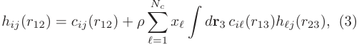

<!-- Start of picture text -->
Nc hij (r12) = cij(r12) + ρ � xℓ dr3 ciℓ(r13)hℓj(r23), (3) � ℓ=1 <!-- End of picture text -->

where ρ is the number density of the mixture and xi = ρi/ρ is the mole fraction of species i (where ρi = Ni/V is 

the partial number density, Ni and V being the number of particles of species i and the volume of the system, respectively). In Fourier space, the OZ relation takes the following form [40]: 

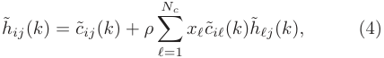

<!-- Start of picture text -->
Nc h˜ij (k) = ˜cij(k) + ρ � xℓc˜iℓ(k)h ˜ ℓj(k), (4) ℓ=1 <!-- End of picture text -->

where h˜ ij(k) and ˜cij (k) denote the corresponding Fourier transforms of hij(r) and cij(r), k being the wave number. They are given by 

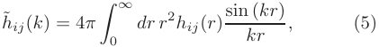

<!-- Start of picture text -->
h˜ij(k) = 4π dr r 2 hij (r) sin (kr) , (5) �0∞ kr <!-- End of picture text -->

with a similar expression for c˜ij(k). 

We shall now restrict ourselves to the case of an additive BHS fluid mixture in which the species of small spheres is labeled as species s and the one of big spheres is labeled as species b. In this system, the hard core of the interaction between a sphere of species i and a sphere of species j (i, j = s, b) is given by σij = 21(σi + σj),with the diameter of a sphere of species i being σii = σi. Let the size ratio be q = σs/σb < 1. In this instance, one can define the partial packing fractions ηi =π 6ρiσ i3and the total packing fraction η =π 6ρσ b3(xb +xsq3) = ηb +ηs. Then, from Eq. (4) with Nc = 2 one can get the following results, 

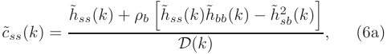

<!-- Start of picture text -->
h˜ss(k) + ρb h˜ss(k)˜hbb(k) − h˜ 2 sb (k) � � c˜ss(k) = , (6a) D(k) <!-- End of picture text -->

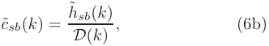

<!-- Start of picture text -->
h˜sb(k) c˜sb(k) = (6b) D(k) , <!-- End of picture text -->

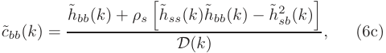

<!-- Start of picture text -->
h˜bb(k) + ρs h˜ss(k)˜hbb(k) − h˜ 2 sb (k) � � c˜bb(k) = , (6c) D(k) <!-- End of picture text -->

where 

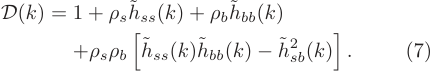

<!-- Start of picture text -->
D(k) = 1 + ρsh ˜ ss(k) + ρb ˜ hbb(k) +ρsρb h˜ss(k)˜hbb(k) − h˜ 2 sb (k) . (7) � � <!-- End of picture text -->

Therefore, provided one can have accurate approximations of the Fourier transforms h˜ ij(k) of the total correlation functions, it is immediate to also obtain accurate approximations to the Fourier transforms c˜ij(k) from Eqs. (6). Finally, the DCFs cij (r) are readily computed by taking inverse Fourier transforms: 

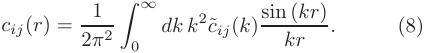

<!-- Start of picture text -->
1 cij (r) = dk k 2 c˜ij(k) sin (kr) . (8) 2π 2 �0∞ kr <!-- End of picture text -->

The large-k behavior of c˜ij(k) has the structure [1] 

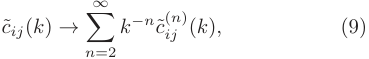

<!-- Start of picture text -->
∞ c˜ij(k) → � k −n c˜ ( ij n)(k), (9) n=2 <!-- End of picture text -->

4 

where c˜( ijn)(k)isaboundfunctionexpressedasacombi- nation of sine and cosine functions of σsk, σbk, and σsbk. Thus, at a practical level, it is useful to introduce an arbitrarily large cutoff wave number Q and decompose cij(r) into two contributions: 

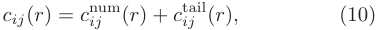

<!-- Start of picture text -->
cij (r) = c num ij (r) + c tail ij (r), (10) <!-- End of picture text -->

with 

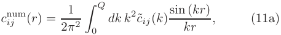

<!-- Start of picture text -->
1 c num ij (r) = 2π 2 �0Q dk k 2 c˜ij (k) sin ( kr kr) , (11a) <!-- End of picture text -->

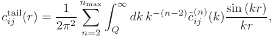

<!-- Start of picture text -->
1 nmax c tail ij (r) = 2π 2 n�=2 �Q∞ dk k −(n−2) c˜ ( ij n)(k)sin ( kr kr) , <!-- End of picture text -->

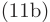

<!-- Start of picture text -->
(11b) <!-- End of picture text -->

where nmax is a conveniently chosen integer. Assuming that c˜ij(k) is analytically known, the contribution (11a) can be obtained numerically, whereas the contribution (11b) can be evaluated analytically term by term. 

## B. WM scheme 

The WM scheme [1, 3] allows one to obtain analytic forms for ˜cij(k). The method relies on accurate MD simulation data (here obtained via the DynamO program [41]) for the total correlation functions in combination with their pole structure representation and the OZ equation. 

The MD simulation data hMD ij(r)arefittedtothe semiempirical approximation 

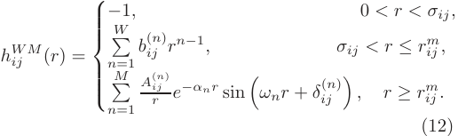

<!-- Start of picture text -->
h WM ij (r) = −nn��WM=1=11, bA ( ijij ( r nn))ren−−α1n,r sin �ωnr + δij (n) σ�ij,0< r < rr ≥≤< σrrij m ij m ij ., , (12) <!-- End of picture text -->

where rijmischosenasthepositionofthefirstmin- imum of hWM ij (r), and {b( ijn); n = 1, . . . , W } and {A( ijn), αn, ωn, δ ij(n); n=1, . . . , M}arefittingparame- ters. Moreover, the continuity of hWM ij (r) and their first derivatives at r = rijm,aswellastheBoubl´ık- Grundke-Henderson-Lee-Levesque (BGHLL) contact values [30, 42, 43], are enforced. Convenient choices for the parameters W and M are W = 15 and M = 10. To get sufficient accuracy, the data for hMD ij (r) were obtained from long simulations (∼ 109 total collisions in production) and for a large number of particles (typically 16384– 48668 particles, depending on density and the size ratio). For further details on the MD simulations and the WM scheme, the reader is referred to Refs. [1, 3]. 

From the parametrization (12), it is possible to obtain the Fourier transforms h˜WM ij (k) analytically [1]. Next, the OZ relations (6) yield analytic expressions 

for c˜WM ij (k), from which the associated asymptotic functions c˜WM ij(n) (k) follow [see Eq. (9)]. Finally, the DCFs are obtained from Eqs. (10) and (11) with the choices Q = 200/σij and nmax = 6. In summary, 

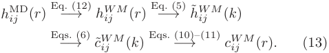

<!-- Start of picture text -->
h MD ij (r) Eq.−→(12) h WM ij (r) Eq.−→(5) h ˜WM ij (k) Eqs. (6) Eqs. (10)–(11) −→ c˜ WM ij (k) −→ c WM ij (r). (13) <!-- End of picture text -->

## C. Rational-function approximation 

We shall now sketch the RFA approach to obtain the structural properties of additive HS mixtures. The detailed description may be found elsewhere [19, 40, 44–46]. First, we introduce the Laplace transforms of rgij (r): 

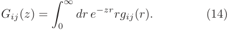

<!-- Start of picture text -->
Gij (z) = dr e −zr rgij (r). (14) �0∞ <!-- End of picture text -->

The Fourier transform� hij (k) is related to Gij (z) by 

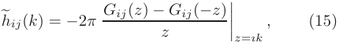

<!-- Start of picture text -->
�hij(k) = −2π Gij (z) − Gij (−z) , (15) z ����z=ık <!-- End of picture text -->

ı being the imaginary unit. Next, we propose the following form for Gij (z): 

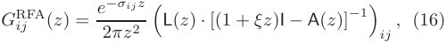

<!-- Start of picture text -->
G RFA ij (z) = e 2 − πz σij2z �L(z) · [(1 + ξz)I − A(z)] −1� ij , (16) <!-- End of picture text -->

where I is the unit matrix, ξ is a parameter to be fixed, and 

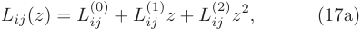

<!-- Start of picture text -->
Lij(z) = L (0) ij + L(1) ij z + L(2) ij z2, (17a) <!-- End of picture text -->

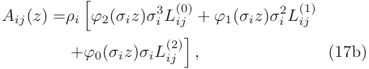

<!-- Start of picture text -->
Aij (z) =ρi �ϕ2(σiz)σi 3L(0) ij + ϕ1(σiz)σ i 2L(1) ij +ϕ0(σiz)σiL (2) ij � , (17b) <!-- End of picture text -->

the functions ϕn(x) being defined by 

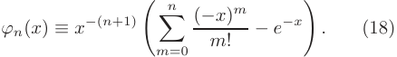

<!-- Start of picture text -->
n (−x) m ϕn(x) ≡ x −(n+1) � m! − e −x . (18) �m=0 � <!-- End of picture text -->

Then, by imposing certain consistency conditions, the elements of the matrices L(0) , L(1) , L(2) are expressed as linear functions of ξ. In particular, L(2) ij = 2πξσij gijc, where gijc≡g(σ ij+)arethecontactvaluesoftheradial distribution functions. 

The special choice ξ = 0 gives the PY solution [18, 39]. On the other hand, by an appropriate determination of ξ̸ = 0 as the physical root of a polynomial equation, the RFA can be made thermodynamically consistent and, additionally, allows one to freely choose the contact values gijc, a convenient choice being the BGHLL expression [30, 42, 43]. 

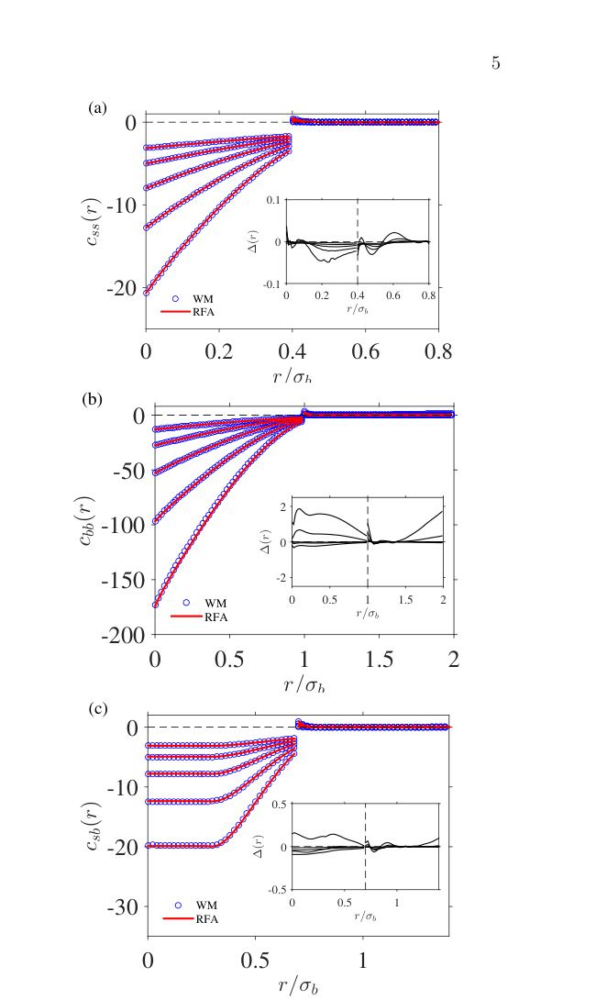

<!-- Start of picture text -->
5 (a) 0 -10 0.1 0 -20 WM -0.1 0 0.2 0.4 0.6 0.8 RFA r/σb 0 0.2 0.4 0.6 0.8 r/σb (b) 0 -50 2 -100 0 -150 -2 WM 0 0.5 1 1.5 2 RFA r/σb -200 0 0.5 1 1.5 2 r/σb (c) 0 -10 0.5 -20 0 -0.5 -30 WM 0 0.5 1 RFA r/σb 0 0.5 1 r/σb ()crss ()∆r ()crbb ()∆r ()crsb ()∆r <!-- End of picture text -->

Once GRFA ij (z) is analytically known, h˜RFA ij (k) can be obtained from application of the exact relationship (15). From here, the procedure is similar to the WM case: analytic expressions for ˜cRFA ij (k) are obtained from Eqs. (6), from which one gets the asymptotic functions ˜cRFA( ijn) (k); then, the RFA DCFs are numerically obtained by application of Eqs. (10) and (11) again with the choices Q = 200/σij and nmax = 6. Thus, 

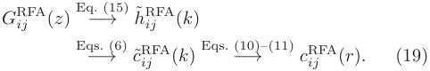

<!-- Start of picture text -->
Eq. (15) G RFA ij (z) −→ h˜ RFA ij (k) Eqs. (6) Eqs. (10)–(11) −→ c˜ RFA ij (k) −→ c RFA ij (r). (19) <!-- End of picture text -->

## III. RESULTS 

We now present the results of the comparison between the DCFs predicted by the RFA with those obtained via the WM scheme from our MD simulations. 

Figure 1 shows the comparison for the rather disparate BHS mixture q = 0.4 at fixed ηb = 0.2 and several values of ηs. For all three DCFs, we observe very good agreement between the WM method and the RFA, once more confirming our previous findings [1, 3]. In fact, the relative differences for the DCFs are small (usually smaller than 2–4% in the core region, depending on density), even for the densest cases. In contrast, the differences with the PY theory are generally quite significant (not shown). 

We also observe that the like-like functions css(r < σs) and cbb(r < σb) inside the core are monotonic and can be well represented by a low-order polynomial (usually, fourth or sixth degree is sufficient). Also, their limiting values css(r = 0), cbb(r = 0), css(r = σs−),and cbb(r = σb−)canbedeterminedfairlyaccurately. On the other hand, while hardly apparent in Fig. 1(c), both approaches (the WM method and the RFA) indicate that the cross function csb(r < σsb) is not monotonic inside the core, what requires a separate more detailed analysis to be carried out below. Outside the core, the functions css(r > σs), cbb(r > σb), and csb(r > σsb) are oscillatory decaying for the WM method, monotonically decaying for the RFA, and vanishing for the PY theory [1]. As discussed in Ref. [1], the part of the DCFs outside the core, namely, cij(r > σij), is quite important for the asymptotic behavior of the total correlation functions, and cannot be omitted as in the PY theory. 

FIG. 1. Plot of (a) css(r), (b) cbb(r), and (c) csb(r) for a size ratio q = 0.4, a partial packing fraction ηb = 0.2, and (from top to bottom in each panel) ηs = 0.05, 0.1, 0.15, 0.2, and 0.25. The blue circles are the WM results and the red thick lines correspond to the RFA values. The insets show the differences ∆(r) = cW M ij (r) − cRFA ij (r), which tend to increase with increasing ηs. 

We next focus on the analysis of the cross function csb(r). Careful inspection shows that, in all studied cases with both the WM method and the RFA, this function has a minimum at some r = rsbmin < σsb (i.e., inside the core). To the best of our knowledge this feature has not been so far discussed in the literature. Whether a physical meaning to such a feature may be ascribed or whether it may influence or be correlated with other physical properties is not clear to us at this stage, but we are persuaded that it should be further explored in the future. 

The characteristic form of the DCF csb(r) inside the core (r < σsb) is shown in Fig. 2 for the size ratio q = 0.4 and the partial packing fractions ηb = 0.2 and ηs = 0.05. The inset in Fig. 2 demonstrates that, in contrast to the PY theory, a minimum value at r = rsbmin ≈ λsb is present in the WM and RFA results. Nevertheless, the minimum cmin sb ≡ csb(rsbmin)isveryshallow,andonemaynotnotice it on a usual scale with typically obtainable accuracy. In 

6 

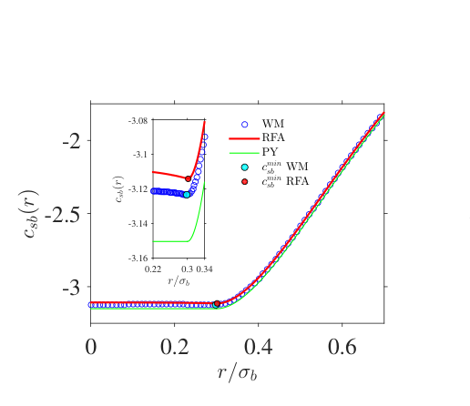

<!-- Start of picture text -->
-3.08 WM -2 RFA -3.1 P Y c min sb WM -3.12 c min sb RFA -2.5 -3.14 -3.16 0.22 0.3 0.34 -3 r/σb 0 0.2 0.4 0.6 r/σb ()crsb ()crsb <!-- End of picture text -->

So far as cmin sb,asalreadyobservedinFig.4,itdecreases almost exponentially with increasing ηs at fixed ηb. Once the behavior of the DCFs has been discussed, let us consider their first and second derivatives c′ ij(r)and c′′ ij(r),respectively.BothintheWMandRFAschemes, they can be obtained from the analytic knowledge of c˜ij(k) by application of expressions analogous to Eqs. (10) and (11), except for the formal replacements 

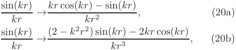

<!-- Start of picture text -->
sin(kr) → kr cos(kr) − sin(kr) , (20a) kr kr 2 sin(kr) → (2 − k2r2) sin(kr) − 2kr cos(kr) , (20b) kr kr 3 <!-- End of picture text -->

for c′ ij(r)andc′′ ij(r),respectively. The shapes of c′ sb(r)andc′′ sb(r)arepresentedinFigs. 6 and 7, respectively, for the same cases as in Fig. 3. An excellent agreement between the WM and RFA values is again observed. Moreover, the three approaches (WM, RFA, and PY) provide almost indistinguishable values of the second derivative c′′ sb(r)intherangeλsb<r<σsb. Note also that c′ sb(r)andc′′ sb(r)arediscontinuousat r = σsb [1], which is not surprising, given the fact that the DCFs cij(r) themselves are discontinuous at r = σij . More interesting is the discontinuity of the second derivative c′′ sb(r)atr=λsb,itsexistencealreadycapturedby the PY theory [18], according to which 

FIG. 2. Plot of csb(r) inside the core (r < σsb) for a size ratio q = 0.4 and partial packing fractions ηb = 0.2 and ηs = 0.05. The blue circles are the WM results, the red thick lines correspond to the RFA values, and the green thin lines represent the PY values. The inset shows details of the curves in the range 0.22 ≤ r/σb ≤ 0.34. The cyan and red solid circles indicate the position of the minimum for WM and RFA, respectively. 

fact, the general shape of the DCF csb(r) inside the core is rather similar to the one of the PY theory, and thus the minimum may be easily overlooked. It is worth noting that the fact that csb(r) = const for 0 < r < λsb in the PY theory may be linked to the tail property cij (r) = 0 for r > σij in that approximation. 

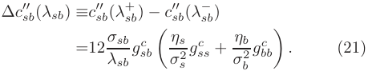

<!-- Start of picture text -->
∆c ′′ sb (λsb) ≡c′′ sb (λ+ sb ) − c sb ′′ (λ− sb ) =12 σsb gsb c gss c + ηb gbb c . (21) λsb � σηss 2 σb 2 � <!-- End of picture text -->

We have observed that the position of the minimum is always localized close to and above r = λsb =1− 2qσb, its precise value slightly depending on the mixture composition and density. This is illustrated in Fig. 3, where csb(r) in a spatial region around r = λsb is plotted for three different values of the size ratio q and, in each case, two pairs (representing moderate and dense systems) of packing fractions ηs, ηb. Also, the corresponding PY results are plotted for a comparison. 

Taking into account that the PY values of gijcare exact to first order in density [40], it follows that the discontinuity of c′′ sb(r)atr=λsbisanexactpropertyandnotan artifact of the PY, RFA, or WM approaches. In fact, taking into account that [18] 

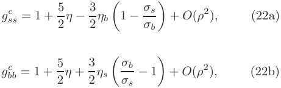

<!-- Start of picture text -->
gss c = 1 + 5 1 − σs + O(ρ 2 ), (22a) 2 η − 3 2 ηb � σb � gbb c = 1 + 5 − 1 + O(ρ 2 ), (22b) 2 η + 3 2 ηs � σσsb � <!-- End of picture text -->

A more quantitative dependence of the minimum value (cmin sb)anditsposition(r sbmin)onηsispresentedinFig.4 for q = 0.648, 0.4, and 0.3 at some representative values of ηb. We observe that the value of the minimum becomes monotonically more negative as ηs increases, with an excellent agreement between WM and RFA. Also, we observe that, in the log-linear scale, this dependence is well represented by a linear function. At a given q, the influence of density on the position rsbmin is rather weak. Depending on the values of q and ηb, the change of rsbmin with increasing ηs can be monotonic or nonmonotonic. A more complete 3D view of the density dependence of cmin sb and rsbmin on density, as predicted by the RFA, is given by Fig. 5 for the same values of q as in Fig. 4. One can observe that, in all the cases, ∆sb ≡ rsbmin − λsb > 0 but ∆sb/σb ∼ 10−3 . Furthermore, as density (ηs and/or ηb) decreases, the difference ∆sb tends to 0. The qualitative shape of the surface rsbmin(ηs, ηb)israthersimilarfor different values of q: at fixed ηs (or ηb), rsbmin first tends to increase and then to decrease with increasing ηb (or ηs). 

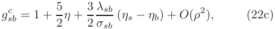

<!-- Start of picture text -->
λsb gsb c = 1 + 5 (ηs − ηb) + O(ρ 2 ), (22c) 2 η + 2 3 σsb <!-- End of picture text -->

one gets the exact result 

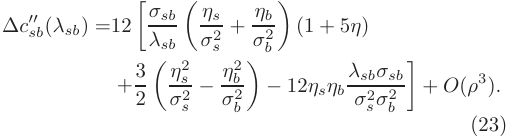

<!-- Start of picture text -->
∆c ′′ sb (λsb) =12 + ηb (1 + 5η) � λσsbsb � σηss 2 σb 2 � + 3 s − η b 2 − 12ηsηb λsbσsb + O(ρ 3 ). 2 � ση2s 2 σb 2 � σs 2 σb 2 � (23) <!-- End of picture text -->

Since the singularities of cij(r) are independent of Q in Eqs. (11) and cnum sb (r) is regular, it turns out that the 

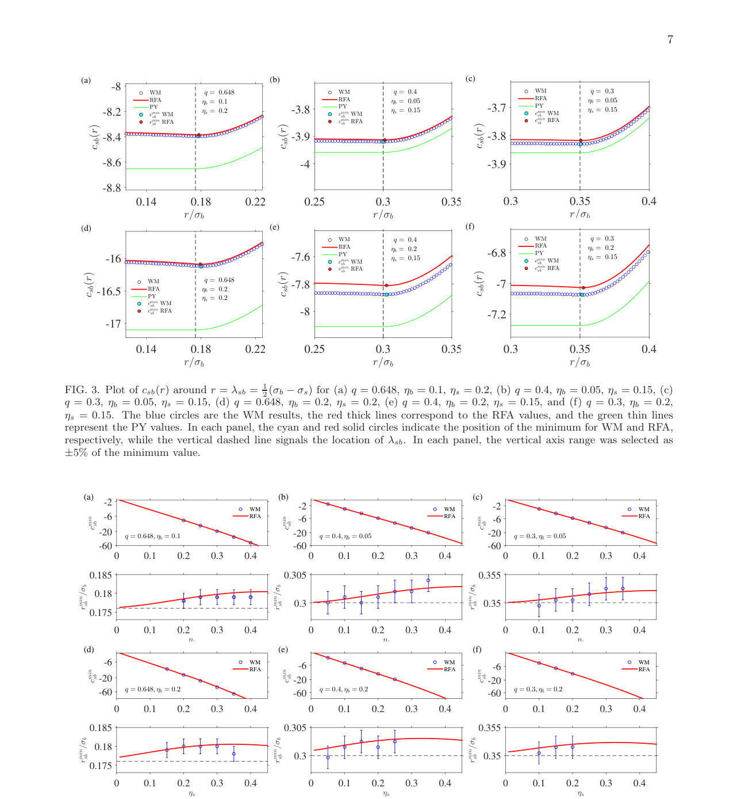

<!-- Start of picture text -->
7 (a) (b) (c) -8 WM q = 0.648 WM q = 0.4 WM q = 0.3 -8.2 RFA P cc min sb min sbY WMRFA ηηbs == 0.10.2 -3.8 RFA P cc min sb min sbY WMRFA ηηbs == 0.050.15 -3.7 RFA P cc min sb min sbY WMRFA ηηbs == 0.050.15 -8.4 -3.9 -3.8 -8.6 -4 -3.9 -8.8 0.14 0.18 0.22 0.25 0.3 0.35 0.3 0.35 0.4 r/σb r/σb r/σb (d) (e) (f) WM q = 0.4 WM q = 0.3 -16 -7.6 RFA P cc min sb min sbY WMRFA ηηbs == 0.20.15 -6.8 RFA P cc min sb min sbY WMRFA ηηbs == 0.20.15 -16.5 WMRFA P Y ηηqbs === 0.20.20.648 -7.8 -7 c min sb WM c min sb RFA -8 -7.2 -17 0.14 0.18 0.22 0.25 0.3 0.35 0.3 0.35 0.4 r/σb r/σb r/σb FIG. 3. Plot of csb(r) around r = λsb = 2 1 (σb − σs) for (a) q = 0.648, ηb = 0.1, ηs = 0.2, (b) q = 0.4, ηb = 0.05, ηs = 0.15, (c) q = 0.3, ηb = 0.05, ηs = 0.15, (d) q = 0.648, ηb = 0.2, ηs = 0.2, (e) q = 0.4, ηb = 0.2, ηs = 0.15, and (f) q = 0.3, ηb = 0.2, ηs = 0.15. The blue circles are the WM results, the red thick lines correspond to the RFA values, and the green thin lines represent the PY values. In each panel, the cyan and red solid circles indicate the position of the minimum for WM and RFA, respectively, while the vertical dashed line signals the location of λsb. In each panel, the vertical axis range was selected as ±5% of the minimum value. (a) (b) (c) -2 WM -2 WM -2 WM -6 RFA -6 RFA -6 RFA -20 q = 0.648, ηb = 0.1 -20 q = 0.4, ηb = 0.05 -20 q = 0.3, ηb = 0.05 -60 -60 -60 0 0.1 0.2 0.3 0.4 0 0.1 0.2 0.3 0.4 0 0.1 0.2 0.3 0.4 0.185 0.305 0.355 0.18 0.3 0.35 0.175 0 0.1 0.2 0.3 0.4 0 0.1 0.2 0.3 0.4 0 0.1 0.2 0.3 0.4 ηs ηs ηs (d) (e) (f) -6 WMRFA -6 WMRFA -6 WMRFA -20 -20 -20 -60 q = 0.648, ηb = 0.2 -60 q = 0.4, ηb = 0.2 -60 q = 0.3, ηb = 0.2 0 0.1 0.2 0.3 0.4 0 0.1 0.2 0.3 0.4 0 0.1 0.2 0.3 0.4 0.185 0.305 0.355 0.18 0.3 0.35 0.175 0 0.1 0.2 0.3 0.4 0 0.1 0.2 0.3 0.4 0 0.1 0.2 0.3 0.4 ηs ηs ηs ()crsb ()crsb ()crsb ()crsb ()crsb ()crsb mincsb mincsb mincsb min/rσbsb min/rσbsb min/rσbsb mincsb mincsb mincsb min/rσbsb min/rσbsb min/rσbsb <!-- End of picture text -->

FIG. 4. Dependence of cmin sb (in logarithmic scale) and rsbmin on ηs for (a) q = 0.648, ηb = 0.1, (b) q = 0.4, ηb = 0.05, (c) q = 0.3, ηb = 0.05, (d) q = 0.648, ηb = 0.2, (e) q = 0.4, ηb = 0.2, and (f) q = 0.3, ηb = 0.2. The blue circles are the WM results and the red thick lines correspond to the RFA values. In each plot of rsbmin,thehorizontaldashedlinesignalsthelocationofλsb. 

8 

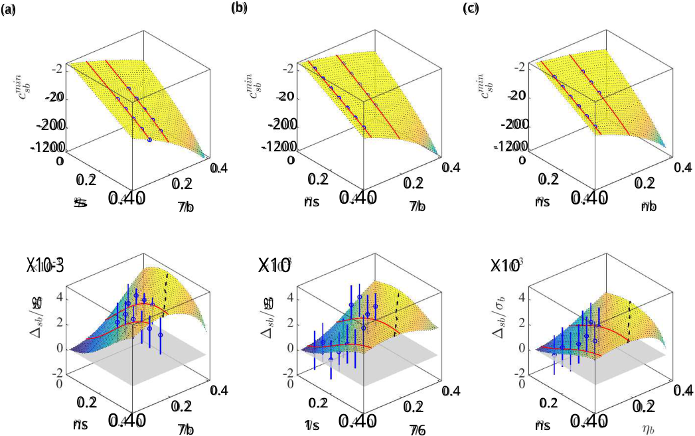

<!-- Start of picture text -->
(a) (b) (c) -20 20 20 -200 -200 -200 -1200 -1200 -1200 0 0 0 0.4 0.4 0.4 0.2 0.2 0.2 0.2 0.2 0.2 s 0.40 7b ns 0.40 7b ns 0.40 nb X10-3 X10 X10 90 90 0.4 0.4 0.4 0.2 0.2 0.2 0.2 0.2 0.2 ns 0.40 7b 1s 0.40 76 ns 0.40 <!-- End of picture text -->

FIG. 5. 3D plots, as predicted by the RFA, showing the density dependence of cmin sb (in logarithmic scale) and the difference ∆sb ≡ rsbmin − λsb for (a) q = 0.648, (b) q = 0.4, and (c) q = 0.3. The red solid lines represent the cases presented in Fig. 4, and the blue circles (with error bars) are the results from the WM scheme. The black dashed lines show the maximum values of ∆sb at fixed ηb. 

singularities of ctail ij(r)determinethoseofthefullfunc- tions cij (r). In particular, the discontinuity of the second derivative c′′ sb(r)atr= λsbis 

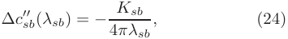

<!-- Start of picture text -->
∆c ′′ sb (λsb) = − Ksb , (24) 4πλsb <!-- End of picture text -->

where Ksb is the coefficient of a term of the form cos(kλsb) in the function c˜(4) sb(k) defined in Eq. (9). Taking into account that cos(kσsb) cos(kσs,b) = 12[cos(kλsb) + cos(k(σsb + σs,b))]onecanfindfromEq. (16b) of Ref. [1] that Ksb = − 21C sb(1) ρsCss(1)+ ρ bC bb(1) , where Cij(1) = 4πσijgijc[1].InsertingallofthisintoEq. (24), one finally arrives at Eq. (21). This proves that the relationship between ∆c′′ sb(λsb) and the contact values g ijc given by Eq. (21) is an exact property, even though the PY contact values are only approximate. 

A peculiar prediction of the PY theory is that the zero-separation values of css(r) and csb(r) are equal, i.e., cPY ss(0)=cPY sb(0).However,asFig.8shows,thissimple property is not fulfilled by either WM or RFA, and one actually has csb(0) > css(0), the difference csb(0) − css(0) tending to increase as the packing fraction of the small spheres increases. 

## IV. CONCLUDING REMARKS 

In this work, we have confirmed the excellent performance of the RFA for additive BHS mixtures when compared with the simulation-fed WM scheme [1, 3], this time in connection with the DCFs. 

We have mainly focused on the properties of the cross DCF csb(r) and highlighted a new feature of this structural function. Such function (for all BHS fluids) has a minimum inside the core, its location and magnitude depending on density and mixture composition. However, the minimum is rather shallow and hence the nonmonotonic character of the DCF csb(r) may be hardly visible. The minimum is always localized near r = λsb, and we have been able to analyze some characteristic dependence of both its value and position on density and composition. The observed disappearance of the minimum at the low density limit is in agreement with the known zero-density limit of cij(r) (negative of the Mayer f functions). 

The physical origin of such a minimum and its relation to other properties are not clear at this stage. The comparison with the PY result may suggest that oversimplification of the csb(r) outside the core [i.e., the condition cPY sb(r>σsb)=0]mayleadtothemonotonicbehavior 

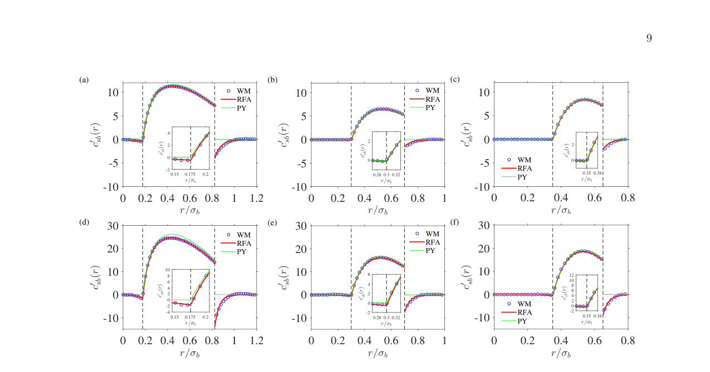

<!-- Start of picture text -->
9 (a) (b) (c) 10 WM 10 WM 10 R FA R FA P Y P Y 5 5 5 4 0 2 0 2 0 2 -5 0 -5 0 -5 WM 0 -2 R FA 0.15 0.175r/σb 0.2 0.28r/0.3σb0.32 P Y r/0.35σb 0.38 -10 -10 -10 0 0.2 0.4 0.6 0.8 1 1.2 0 0.2 0.4 0.6 0.8 1 0 0.2 0.4 0.6 0.8 r/σb r/σb r/σb (d) 30 (e) 30 (f) 30 WM WM R FA R FA 20 P Y 20 P Y 20 10 108 10 6 10 12 0 -2642 0 0 42 0 0 WM 108642 0 -10 -4 0.15 0.175r/σb 0.2 -10 -2 0.28r/0.3σb0.32 -10 RP YFA -2 r/0.35σb 0.38 0 0.2 0.4 0.6 0.8 1 1.2 0 0.2 0.4 0.6 0.8 1 0 0.2 0.4 0.6 0.8 r/σb r/σb r/σb ()rsb ()rsb ()rsb ′c ()′rcsb ′c ()′rcsb ′c ()′rcsb ()rsb ()rsb ()rsb ′c ()′rcsb ′c ()′rcsb ′c ()′rcsb <!-- End of picture text -->

FIG. 6. Plot of c′ sb(r)for(a)q= 0.648,ηb= 0.1,ηs= 0.2,(b)q= 0.4,ηb= 0.05,ηs= 0.15,(c)q= 0.3,ηb= 0.05,ηs= 0.15, (d) q = 0.648, ηb = 0.2, ηs = 0.2, (e) q = 0.4, ηb = 0.2, ηs = 0.15, and (f) q = 0.3, ηb = 0.2, ηs = 0.15. The blue circles are the WM results, the red thick lines correspond to the RFA values, and the green lines are PY. In each panel, the vertical dashed lines signals the locations of λsb and σsb. The insets show magnifications of csb′(r)aroundr= λsb. 

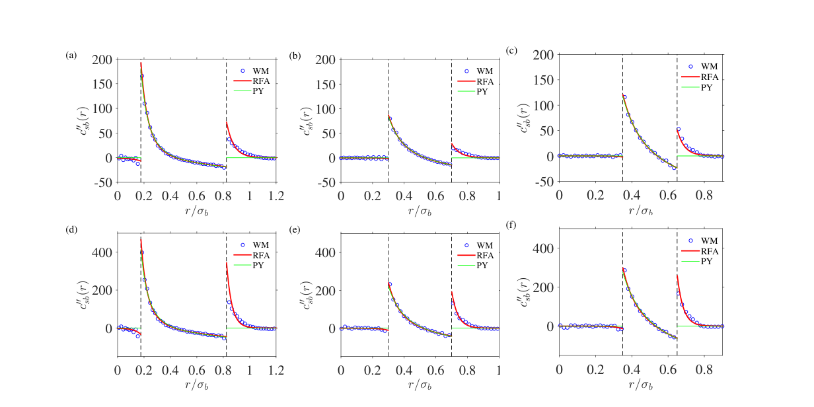

<!-- Start of picture text -->
(a) 200 (b) 200 (c) 200 WM WM WM 150 RP YFA 150 RP YFA 150 RP YFA 100 100 100 50 50 50 0 0 0 -50 -50 -50 0 0.2 0.4 0.6 0.8 1 1.2 0 0.2 0.4 0.6 0.8 1 0 0.2 0.4 0.6 0.8 r/σb r/σb r/σb (f) (d) (e) WM 400 WM R FA 400 WM R FA 400 R FA P Y P Y P Y 200 200 200 0 0 0 0 0.2 0.4 0.6 0.8 1 1.2 0 0.2 0.4 0.6 0.8 1 0 0.2 0.4 0.6 0.8 r/σb r/σb r/σb ′′()rcsb ′′()rcsb ′′()crsb ′′()rcsb ′′()rcsb ′′()crsb <!-- End of picture text -->

FIG. 7. Plot of c′′ sb(r)for(a)q= 0.648,ηb= 0.1,ηs= 0.2,(b)q= 0.4,ηb= 0.05,ηs= 0.15,(c)q= 0.3,ηb= 0.05,ηs= 0.15, (d) q = 0.648, ηb = 0.2, ηs = 0.2, (e) q = 0.4, ηb = 0.2, ηs = 0.15, and (f) q = 0.3, ηb = 0.2, ηs = 0.15. The blue circles are the WM results, the red thick lines correspond to the RFA values, and the green lines are PY. In each panel, the vertical dashed lines signals the locations of λsb and σsb. 

10 

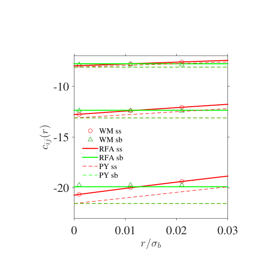

<!-- Start of picture text -->
-10 WM ss -15 WM sb R FA ss R FA sb P Y ss P Y sb -20 0 0.01 0.02 0.03 r/σb ()crij <!-- End of picture text -->

FIG. 8. Plot of css(r) (red lines and symbols) and csb(r) (green lines and symbols) near the origin for a size ratio q = 0.4, a partial packing fraction ηb = 0.2, and (from top to bottom) partial packing fractions ηs = 0.15, 0.20, and 0.25. The symbols (red circles for css and green triangles for csb) are the WM results, the solid thick lines correspond to the RFA values, and the dashed lines represent the PY values. 

- of cPY sb(r)insidethecoreinthisapproximation. Moreover, we have studied the behavior of the first and 

- [1] S. Pieprzyk, A. C. Bra´nka, S. B. Yuste, A. Santos, and M. L´opez de Haro, Structural properties of additive binary hard-sphere mixtures, Phys. Rev. E 101, 012117 (2020). 

- [2] A. Statt, R. Pinchaipat, F. Turci, R. Evans, and C. P. Royall, Direct observation in 3d of structural crossover in binary hard sphere mixtures, J. Chem. Phys. 144, 144506 (2016). 

- [3] S. Pieprzyk, S. B. Yuste, A. Santos, M. L´opez de Haro, and A. C. Bra´nka, Structural properties of additive binary hard-sphere mixtures. II. Asymptotic behavior and structural crossovers, Phys. Rev. E 104, 024128 (2021). 

- [4] C. Grodon, M. Dijkstra, R. Evans, and R. Roth, Decay of correlation functions in hard-sphere mixtures: Structural crossover, J. Chem. Phys. 121, 7869 (2004). 

- [5] J.-P. Hansen and I. R. McDonald, Theory of Simple Liquids, 4th ed. (Academic Press, London, 2013). 

- [6] M. S. Wertheim, Exact solution of the Percus– Yevick integral equation for hard spheres, Phys. Rev. Lett. 10, 321 (1963). 

- [7] N. W. Ashcroft and N. H. March, Structure factor and direct correlation function for a classical hard sphere fluid, Proc. R. Soc. Lond. A 297, 336 (1967). 

- [8] M. S. Ripoll and C. F. Tejero, Approximate analytical expression for the direct correlation-function of hard discs within the Percus-Yevick equation, Mol. Phys. 85, 423 (1995). 

- [9] X. A. Guo and U. Riebel, Theoretical direct correlation function for two-dimensional fluids of monodisperse hard 

second spatial derivatives c′ sb(r)andc sb′′(r),respectively. From the analysis of c′′ sb(r)oneconcludesisthatthereis a discontinuity of this derivative at r = λsb whose size has exactly the same expression in terms of the contact values gijcasthatofthecorrespondingPYresult. 

We hope that our study can stimulate further investigations on the properties of the DCFs in fluid mixtures different from the additive BHS model. 

## ACKNOWLEDGMENTS 

S.B.Y. and A.S. acknowledge financial support from Grant PID2020-112936GB-I00 funded by MCIN/AEI/10.13039/501100011033, and from Grants IB20079 and GR18079 funded by Junta de Extremadura (Spain) and by ERDF A way of making Europe. It must be acknowledged that the Grant GR18079 also financed the summer visit of M.L.H. to Universidad de Extremadura, where a first draft of the paper was prepared. S.P. is grateful to the Universidad de Extremadura, where most of this work was carried out during his scientific internship, which was supported by Grant No. DEC-2018/02/X/ST3/03122 financed by the National Science Center, Poland. Some of the calculations were performed at the Pozna´n Supercomputing and Networking Center (PCSS). 

   - spheres, J. Chem. Phys.. 125, 144504 (2006). 

- [10] D. Henderson and E. W. Grundke, Direct correlation function: Hard sphere fluid, J. Chem. Phys. 63, 601 (1975). 

- [11] K. Katsov and J. D. Weeks, Determining liquid structure from the tail of the direct correlation function, J. Stat. Phys. 100, 107 (2000). 

- [12] M. Baus and J. L. Colot, Thermodynamics and structure of a fluid of hard rods, disks, spheres, or hyperspheres from rescaled virial expansions, Phys. Rev. A 36, 3912 (1987). 

- [13] S. B. Yuste, A. Santos, and M. L´opez de Haro, Direct correlation functions and bridge functions in additive hardsphere mixtures, Mol. Phys. 98, 439 (2000). 

- [14] C. F. Tejero and M. L´opez de Haro, Direct correlation function of the hard-sphere fluid, Mol. Phys. 105, 2999 (2007). 

- [15] S. Pieprzyk, A. C. Bra´nka, and D. M. Heyes, Representation of the direct correlation function of the hard-sphere fluid, Phys. Rev. E 95, 062104 (2017). 

- [16] T. Fukudome, D. Mitarai, and M. Irisa, An analytical expression for the direct correlation function of a hardsphere liquid derived from the extended scaled particle theory, J. Mol. Liq. 200, 95 (2014). 

- [17] R. D. Groot, J. P. van der Eerden, and N. M. Faber, The direct correlation-function in hard-sphere fluids, J. Chem. Phys. 87, 2263 (1987). 

- [18] J. L. Lebowitz, Exact solution of generalized Percus– Yevick equation for a mixture of hard spheres, 

11 

- Phys. Rev. 133, A895 (1964). 

- [19] A. Santos, S. B. Yuste, and M. L´opez de Haro, Structural and thermodynamic propertiesof hard-sphere fluids, J. Chem. Phys. 153, 120901 (2020). 

- [20] M. Dennison, A. J. Masters, D. L. Cheung, and M. P. Allen, Calculation of direct correlation function for hard particles using a virial expansion, Mol. Phys. 107, 375 (2009). 

- [21] D. Gazzillo, Direct correlation-functions for negatively non-additive hard-spheres in the PY approximation, Mol. Phys. 64, 535 (1988). 

- [22] R. Fantoni and G. Pastore, Direct correlation functions of the Widom-Rowlinson model, Physica A 332, 349 (2004). Note that there is a misprint in Eq. (13), which should read ¯h12(k) = c¯12(k)[1 − ρ1ρ2c¯2 12(k)]−1. 

- [23] D. Henderson, K.-Y. Chan, and L. Degr´eve, The direct correlation-functions and bridge functions for hard-spheres near a large hard-sphere, J. Chem. Phys. 101, 6975 (1994). 

- [24] A. Samborski and G. T. Evans, Binary hard sphere, hard ellipsoid liquid crystal mixtures, J. Chem. Phys. 101, 6005 (1994). 

- [25] Y. Rosenfeld, Free-energy model for the inhomogeneous hard-sphere fluid mixture and density-functional theory of freezing, Phys. Rev. Lett. 63, 980 (1989). 

- [26] A. Chamoux and A. Perera, Approximations for the direct correlation function in multicomponent molecular fluids, J. Chem. Phys. 104, 1493 (1996). 

- [27] C. N. Patra, Structure of binary hard-sphere mixtures near a hard wall: A simple weighted-density-functional approach, J. Chem. Phys. 111, 6573 (1999). 

- [28] S. Q. Zhou and E. Ruckenstein, High-order direct correlation functions of uniform fluids and their application to the high-order perturbative density functional theory, Phys. Rev. E 61, 2704 (2000). 

- [29] R. Roth, R. Evans, A. Lang, and G. Kahl, Fundamental measure theory for hard-sphere mixtures revisited: the White Bear version, J. Phys.: Condens. Matter 14, 12063 (2002). 

- [30] T. Boubl´ık, Hard-sphere equation of state, J. Chem. Phys. 53, 471 (1970). 

- [31] G. A. Mansoori, N. F. Carnahan, K. E. Starling, and T. W. Leland, Jr., Equilibrium thermodynamic properties of the mixture of hard spheres, J. Chem. Phys. 54, 1523 (1971). 

- [32] R. Ramirez, M. Mareschal, and D. Borgis, Direct correlation functions and the density functional theory of polar solvents, Chem. Phys. 319, 261 (2005). 

- [33] M. Moradi and R. Khordad, Direct correlation functions of binary mixtures of hard Gaussian overlap molecules, J. Chem. Phys. 125, 214504 (2006). 

- [34] A. Avazpour and M. Moradi, The direct correlation functions of hard Gaussian overlap and hard ellipsoidal fluids, Physica B 392, 242 (2007). 

- [35] D. W. Siderius and L. D. Gelb, Thermodynamic and structural properties of finely discretized on-lattice hard-sphere fluids: Virial coefficients, free energies, and direct correlation functions, J. Chem. Phys. 131, 084503 (2009). 

- [36] J. F. Lutsko, Direct correlation function from the consistent fundamental-measure free energies for hard-sphere mixtures, Phys. Rev. E 87, 014103 (2013). 

- [37] A. Santos, Class of consistent fundamentalmeasure free energies for hard-sphere mixtures, Phys. Rev. E 86, 040102(R) (2012). 

- [38] S.-C. Lin, M. Oettel, J. M. H¨aring, R. Haussmann, M. Fuchs, and G. Kahl, Direct correlation function of a crystalline solid, Phys. Rev. Lett. 127, 085501 (2021). 

- [39] J. A. Barker and D. Henderson, What is “liquid”? Understanding the states of matter, Rev. Mod. Phys. 48, 587 (1976). 

- [40] A. Santos, A Concise Course on the Theory of Classical Liquids. Basics and Selected Topics, Lecture Notes in Physics, Vol. 923 (Springer, New York, 2016). 

- [41] M. N. Bannerman, R. Sargant, and L. Lue, DynamO: a free O(n) general event-driven molecular dynamics simulator, J. Comput. Chem. 32, 3329 (2011). 

- [42] E. W. Grundke and D. Henderson, Distribution functions of multi-component fluid mixtures of hard spheres, Mol. Phys. 24, 269 (1972). 

- [43] L. L. Lee and D. Levesque, Perturbation theory for mixtures of simple liquids, Mol. Phys. 26, 1351 (1973). 

- [44] S. B. Yuste, A. Santos, and M. L´opez de Haro, Structure of multicomponent hard-sphere mixtures, J. Chem. Phys. 108, 3683 (1998). 

- [45] M. L´opez de Haro, S. B. Yuste, and A. Santos, Alternative approaches to the equilibrium properties of hardsphere liquids, in Theory and Simulation of Hard-Sphere Fluids and Related Systems, Lecture Notes in Physics, Vol. 753, edited by A. Mulero (Springer, Berlin, 2008) pp. 183–245. 

- [46] A code using the Mathematica computer algebra system to obtain Gij (s) and gij(r) with the RFA method is available at http://www.unex.es/eweb/ fisteor/santos/filesRFA.html. 

