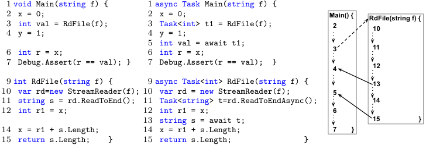
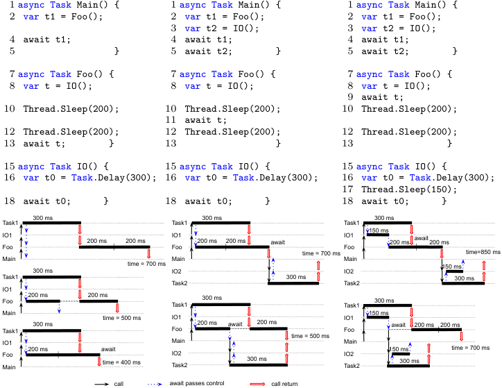
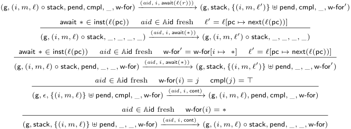
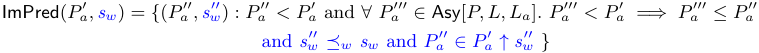

# **Automated Synthesis of Asynchronizations**<sup>**_⋆_**</sup> 

Sidi Mohamed Beillahi<sup>1</sup> , Ahmed Bouajjani<sup>2</sup> , Constantin Enea<sup>3</sup> , and Shuvendu Lahiri<sup>4</sup> 

> 1 University of Toronto, Canada 

```
sm.beillahi@utoronto.ca
```

> 2 Universit´e Paris Cit´e, IRIF, CNRS, Paris, France 

```
abou@irif.fr
```

> 3 LIX, Ecole Polytechnique, CNRS and Institut Polytechnique de Paris, France `cenea@irif.fr` 

> 4 Microsoft Research Lab - Redmond 

```
shuvendu@microsoft.com
```

**Abstract.** Asynchronous programming is widely adopted for building responsive and efficient software, and modern languages such as C# provide async/await primitives to simplify the use of asynchrony. In this paper, we propose an approach for refactoring a sequential program into an asynchronous program that uses async/await, called asynchronization. The refactoring process is parametrized by a set of methods to replace with asynchronous versions, and it is constrained to avoid introducing data races. We investigate the delay complexity of enumerating all data race free asynchronizations, which quantifies the delay between outputting two consecutive solutions. We show that this is polynomial time modulo an oracle for solving reachability in sequential programs. We also describe a pragmatic approach based on an interprocedural dataflow analysis with polynomial-time delay complexity. The latter approach has been implemented and evaluated on a number of non-trivial C# programs extracted from open-source repositories. 

## **1 Introduction** 

Asynchronous programming is widely adopted for building responsive and efficient software. As an alternative to explicitly registering callbacks with asynchronous calls, C# 5.0 [3] introduced the `async` / `await` primitives. These primitives allow the programmer to write code in a familiar sequential style without explicit callbacks. An asynchronous procedure, marked with `async` , returns a task object that the caller uses to “await” it. Awaiting may suspend the execution of the caller, but does not block the thread it is running on. The code after `await` is the continuation called back when the callee result is ready. This paradigm has become popular across many languages, C++, JavaScript, Python. 

The `async` / `await` primitives introduce concurrency which is notoriously complex. The code in between a call and a matching `await` (referring to the same task) may execute before some part of the awaited task or after the awaited 

> _⋆_ This work is supported in part by the European Research Council (ERC) under the Horizon 2020 research and innovation programme (grant agreement No 678177). 

2 S.M. Beillahi, A. Bouajjani, C. Enea, and S. Lahiri. 





<!-- Start of picture text -->
1  void Main(string f) { 1  async Task Main(string f) {<br>2 x = 0; 2 x = 0; Main() { RdFile(string f) {<br>3 int val = RdFile(f); 3 Task<int> t1 = RdFile(f);   2    10<br>4 y = 1; 4 y = 1;<br>6 int r = x; 56 intint valr = =x;await t1;   3    11<br>7 Debug.Assert(r == val); } 7 Debug.Assert(r == val); }   4   12<br>9  int RdFile(string f) { 9  async Task<int> RdFile(string f) {   13<br>10 var rd=new StreamReader(f); 10 var rd = new StreamReader(f);   5<br>11 string s = rd.ReadToEnd(); 11 Task<string> t=rd.ReadToEndAsync();   14<br>12 int r1 = x; 12 int r1 = x;   6<br>13 string s = await t;   15                     }<br>14 x = r1 + s.Length; 14 x = r1 + s.Length;   7        }<br>15 return s.Length; } 15 return s.Length; }<br><!-- End of picture text -->

Fig. 1: Synchronous and asynchronous C# programs ( `x` , `y` are static variables). 

task finished. For instance, on the middle of Fig. 1, the assignment `y=1` at line 4 can execute before or after `RdFile` finishes. The `await` for `ReadToEndAsync` in `RdFile` (line 13) may suspend `RdFile` ’s execution because `ReadToEndAsync` did not finish, and pass the control to `Main` which executes `y=1` . If `ReadToEndAsync` finishes before this `await` executes, then the latter has no effect and `y=1` gets executed after `RdFile` finishes. The resemblance with sequential code can be especially deceitful since this non-determinism is opaque. It is common that `await` s are placed immediately after the corresponding call which limits the benefits that can be obtained from executing steps in the caller and callee concurrently [25]. 

In this paper, we address the problem of writing efficient asynchronous code that uses `async` / `await` . We propose a procedure for automated synthesis of asynchronous programs _equivalent_ to a given synchronous (sequential) program _𝑃_ . This can be seen as a way of refactoring synchronous code to asynchronous code. Solving this problem in its full generality would require checking equivalence between arbitrary programs, which is known to be hard. Therefore, we consider a restricted space of asynchronous program candidates defined by substituting synchronous methods in _𝑃_ with asynchronous versions (assumed to be behaviorally equivalent). The substituted methods are assumed to be leaves of the call-tree (they do not call any method in _𝑃_ ). Such programs are called _asynchronizations_ of _𝑃_ . A practical instantiation is replacing IO synchronous calls for reading/writing files or managing http connections with asynchronous versions. 

For instance, the sequential C# program on the left of Fig. 1 contains a `Main` that invokes a method `RdFile` that returns the length of the text in a file. The file name input to `RdFile` is an input to `Main` . The program uses a variable `x` to aggregate the lengths of all files accessed by `RdFile` ; this would be more useful when `Main` calls `RdFile` multiple times which we omit for simplicity. Note that this program passes the assertion at line 7. The time consuming method `ReadToEnd` for reading a file is an obvious choice for being replaced with an equivalent _asynchronous_ version whose name is suffixed with `Async` . Performing such tasks asynchronously can lead to significant performance boosts. The program on the middle of Fig. 1 is an example of an asynchronization defined by this substitution. The syntax of `async` / `await` imposes that every method that transitively 

Automated Synthesis of Asynchronizations 3 

calls one of the substituted methods, i.e., `Main` and `RdFile` , must also be declared as asynchronous. Then, every asynchronous call must be followed by an `await` that specifies the control location where that task should have completed. For instance, the `await` for `ReadToEndAsync` is placed at line 13 since the next instruction (at line 14) uses the computed value. Therefore, synthesizing such refactoring reduces to finding a correct placement of `await` s (that implies equivalence) for every call of a method that transitively calls a substituted method (we do not consider “deeper” refactoring like rewriting conditionals or loops). 

We consider an equivalence relation between a synchronous program and an asynchronization that corresponds to absence of data races in the asynchronization. Data race free asynchronizations are called _sound_ . Relying on absence of data races avoids reasoning about equality of sets of reachable states which is harder in general, and an established compromise in reasoning about concurrency. For instance, the asynchronization in Fig. 1 is sound because the call to `RdFile` accessing `x` finishes before the read of `x` in `Main` (line 6). Therefore, accesses to `x` are performed in the same order as in the synchronous program. 

The asynchronization on the right of Fig. 1 is not the only sound (data-race free) asynchronization of the program on the left. The `await` at line 13 can be moved one statement up (before the read of `x` ) and the resulting program remains equivalent to the sequential one. In this paper, we investigate the problem of enumerating _all_ sound asynchronizations of a sequential program _𝑃_ w.r.t. substituting a set of methods with asynchronous versions. This makes it possible to deal separately with the problem of choosing the best asynchronization in terms of performance based on some metric (e.g., performance tests). 

Identifying the most efficient asynchronization is difficult and can not be done syntactically. It is tempting to consider that increasing the distance between calls and matching `await` s so that more of the caller code is executed while waiting for an asynchronous task to finish increases performance. However, this is not true in general. We use the programs in Fig. 2 to show that the best `await` placement w.r.t. performance depends on execution times of code blocks in between calls and `await` s in a non-trivial manner. Note that estimating these execution times, especially for IO operations like http connections, can not be done statically. 

The programs in Fig. 2 use `Thread.Sleep(n)` to abstract sequential code executing in _𝑛_ milliseconds and `Task.Delay(n)` to abstract an asynchronous call executing in _𝑛_ milliseconds on a different thread. The functions named `Foo` differ only in the position of `await t` . We show that modifying this position worsens execution time in each case. For the left program, best performance corresponds to maximal distance between `await t` in `Foo` and the corresponding call. This allows the `IO` call to execute in parallel with the caller, as depicted on the bottomleft of Fig. 2. The executions corresponding to the other two positions of `await t` are given just above. For the middle program, placing `await t` in between the two code blocks in `Foo` optimizes performance (note the extra `IO` call in `Main` ): the `IO` call in `Foo` executes in parallel with the first code block in `Foo` and the `IO` call in `Main` executes in parallel with the second one. This is depicted on the bottom-middle of Fig. 2. The execution above shows that placing `await t` as on 

4 S.M. Beillahi, A. Bouajjani, C. Enea, and S. Lahiri. 





<!-- Start of picture text -->
1  async Task Main() { 1  async Task Main() { 1  async Task Main() {<br>2 var t1 = Foo(); 2 var t1 = Foo(); 2 var t1 = Foo();<br>3 var t2 = IO(); 3 var t2 = IO();<br>4 await t1; 4 await t1; 4 await t1;<br>5 } 5 await t2; } 5 await t2; }<br>7  async Task Foo() { 7  async Task Foo() { 7  async Task Foo() {<br>8 var t = IO(); 8 var t = IO(); 8 var t = IO();<br>9 await t;<br>10 Thread.Sleep(200); 10 Thread.Sleep(200); 10 Thread.Sleep(200);<br>11 await t;<br>12 Thread.Sleep(200); 12 Thread.Sleep(200); 12 Thread.Sleep(200);<br>13 await t; } 13 } 13 }<br>15  async Task IO() { 15  async Task IO() { 15  async Task IO() {<br>16 var t0 = Task.Delay(300); 16 var t0 = Task.Delay(300); 16 var t0 = Task.Delay(300);<br>17 Thread.Sleep(150);<br>18 await t0; } 18 await t0; } 18 await t0; }<br>300 ms 300 ms 300 ms<br>Task1 Task1 Task1<br>150 ms<br>IO1 200 ms 200 ms IO1 200 ms 200 ms await IO1 200 ms await 200 ms<br>Foo Foo Foo<br>time = 700 ms time=850 ms<br>Main Main Main<br>300 ms time = 700 ms IO2 IO2 150 ms<br>Task1 300 ms 300 ms<br>Task2 Task2<br>IO1<br>Foo 200 ms 200 ms Task1 300 ms Task1 300 ms<br>MainTask1 300 ms time = 500 ms IO1Foo 200 ms await 200 ms IO1Foo 150 ms await 200 ms 200 ms<br>time = 500 ms<br>IO1 Main Main<br>FooMain 200 ms await time = 400 ms IO2Task2 300 ms IO2Task2 150 ms300 ms time = 700 ms<br>call await passes control call return<br><!-- End of picture text -->

Fig. 2: Asynchronous C# programs and executions. On the bottom, time durations of executing code blocks from the same method are aligned horizontally, and time goes from left to right. Vertical single-line arrows represent method call steps, dashed arrows represent `await` s passing control to the caller, and doubleline arrows represent a call return. Total execution time is marked `time=...` . 

the left (after the two code blocks) leads to worse execution time (placing `await t` immediately after the call is also worse). Finally, for the right program, placing `await t` immediately after the call is best (note that `IO` executes another code block before `await` ). The `IO` call in `Main` executes in parallel with `Foo` as shown on the bottom-right of Fig. 2. The execution above shows the case where `await t` is placed in the middle (the await has no effect because `IO` already finished, and `Foo` continues to execute). This leads to worse execution time (placing `await t` after the two code blocks is also worse). These differences in execution times have been confirmed by running the programs on a real machine. 

As demonstrated by the examples in Fig. 2, the performance of an asynchronization depends on the execution environment, e.g., the overhead of IO operations like http connections and disk access (in Fig. 2, we use `Thread.Sleep(n)` or `Task.Delay(n)` to model such overheads). Since modeling the behavior of an execution environment w.r.t. performance is difficult in general, selecting the most performant asynchronization using static reasoning is also difficult. As a way of sidestepping this difficulty, we focus on enumerating _all_ sound asynchro- 

Automated Synthesis of Asynchronizations 5 

nizations that allows to evaluate performance separately in a dynamic manner using performance tests for instance (for each sound asynchronization). 

In the worst-case, the number of (sound) asynchronizations is exponential in the number of method calls in the program. Therefore, we focus on the _delay complexity_ of the problem of enumerating sound asynchronizations, i.e., the complexity of the delay between outputting two consecutive (distinct) solutions, and show that this is polynomial time modulo an oracle for solving reachability (assertion checking) in _sequential_ programs. Note that a trivial enumeration of all asynchronizations and checking equivalence for each one of them has an exponential delay complexity modulo an oracle for checking equivalence. 

As an intermediate step, we consider the problem of computing _maximal_ sound asynchronizations that maximize the distance between every call and its matching `await` . We show that rather surprisingly, there exists a _unique_ maximal sound asynchronization. This is not trivial since asynchronizations can be incomparable w.r.t. distances between calls and `await` s (i.e., better for one `await` and worse for another, and vice-versa). This holds even if maximality is relative to a given asynchronization _𝑃𝑎_ imposing an upper bound on the distance between awaits and calls. In principle, avoiding data races could reduce to a choice between moving one await or another closer to the matching call. We show that this is not necessary because the maximal asynchronization is required to be equivalent to a _sequential_ program, which executes statements in a fixed order. 

As a more pragmatic approach, we define a procedure for computing sound asynchronizations which relies on a bottom-up interprocedural data-flow analysis. The placement of awaits is computed by traversing the call graph bottom up and using a data-flow analysis that computes read or write accesses made in the callees. We show that this procedure computes maximal sound asynchronizations of abstracted programs where every Boolean condition is replaced with non-deterministic choice. These asynchronizations are sound for the concrete programs as well. This procedure enables a polynomial-time delay enumeration of sound asynchronizations of abstracted programs. 

We implemented the asynchronization enumeration based on data-flow analysis in a prototype tool for C# programs. We evaluated this implementation on a number of non-trivial programs extracted from open source repositories to show that our techniques have the potential to become the basis of refactoring tools that allow programmers to improve their usage of async/await primitives. 

In summary, this paper makes the following contributions: 

- Define the problem of data race-free (sound) asynchronization synthesis for refactoring sequential code to equivalent asynchronous code (Section 3). 

- Show that the problem of computing a sound asynchronization that maximizes the distance between calls and awaits has a unique solution (Section 4). 

- The delay complexity of sound asynchronization synthesis (Sections 5–6). 

- A pragmatic algorithm for computing sound asynchronizations based on a data-flow analysis (Section 7). 

- A prototype implementation of this algorithm and an evaluation of this prototype on a benchmark of non-trivial C# programs (Section 8). 

- Additional formalization and proofs are included in the appendix. 

6 S.M. Beillahi, A. Bouajjani, C. Enea, and S. Lahiri. 

_⟨prog⟩_ ::= `program` _⟨md ⟩ ⟨md ⟩_ ::= `method` _⟨m⟩{ ⟨inst⟩} |_ `async method` _⟨m⟩{ ⟨inst⟩} | ⟨md ⟩⟨md ⟩ ⟨inst⟩_ ::= _⟨x ⟩_ `:=` _⟨le⟩| ⟨r ⟩_ `:=` _⟨x ⟩| ⟨r ⟩_ := `call` _⟨m⟩|_ `return` _|_ `await` _⟨r ⟩ |_ `await` _* |_ `if` _⟨le⟩{⟨inst⟩}_ `else` _{⟨inst⟩} |_ `while` _⟨le⟩{⟨inst⟩} | ⟨inst⟩_ ; _⟨inst⟩_ 

Fig. 3: Syntax. _⟨𝑚⟩_ , _⟨𝑥⟩_ , and _⟨𝑟⟩_ represent method names, program and local variables, resp. _⟨𝑙𝑒⟩_ is an expression over local variables, or _*_ which is nondeterministic choice. 

## **2 Asynchronous Programs** 

We consider a simple programming language to formalize our approach, shown in Fig. 3. A _program_ is a set of methods, including a distinguished `main` , which are classified as _synchronous_ or _asynchronous_ . Synchronous methods run continuously until completion when they are invoked. Asynchronous methods, marked using the keyword `async` , can run only partially and be interrupted when executing an `await` . Only asynchronous methods can use `await` , and all methods using `await` must be defined as asynchronous. We assume that methods are not (mutually) recursive. A program is called _synchronous_ if it is a set of synchronous methods. 

A method is defined by a name from a set M and a list of statements over a set PV of _program variables_ , which can be accessed from different methods (ranged over using _𝑥_ , _𝑦_ , _𝑧_ , _. . ._ ), and a set LV of method _local variables_ (ranged over using _𝑟_ , _𝑟_ 1, _𝑟_ 2, _. . ._ ). Input/return parameters are modeled using program variables. Each method call returns a _unique task identifier_ from a set T, used to record control dependencies imposed by `await` s (for uniformity, synchronous methods return a task identifier as well). Our language includes assignments, `await` s, `return` s, loops, and conditionals. Assignments to a local variable _𝑟_ := _𝑥_ , where _𝑥_ is a program variable, are called _reads_ of _𝑥_ , and assignments to a program variable _𝑥_ := _𝑙𝑒_ ( _𝑙𝑒_ is an expression over local variables) are called _writes_ to _𝑥_ . A _base_ method is a method whose body does _not_ contain method calls. **Asynchronous methods.** Asynchronous methods can use `await` s to wait for the completion of a task (invocation) while _the control is passed to their caller_ . The parameter _𝑟_ of the `await` specifies the id of the awaited task. As a sound abstraction of awaiting the completion of an IO operation (reading or writing a file, an http request, etc.), which we do not model explicitly, we use a variation `await` _*_ . This has a non-deterministic effect of either continuing to the next statement in the same method (as if the IO operation already completed), or passing the control to the caller (as if the IO operation is still pending). 

Fig. 4 lists our modeling of the IO method `ReadToEndAsync` used in Fig. 1. We use program variables to represent system resources such as the file system. The await for the completion of accesses to such resources is modeled by `await` _*_ . This enables capturing racing accesses to system resources in asynchronous executions. Parameters or return 

`async method ReadToEndAsync() { await` _*_ `; ind = Stream.index; len = Stream.content.Length; if (ind >= len) retVal = ""; return Stream.index = len; retVal = Stream.content(ind,len); return }` Fig. 4: An IO method. 

Automated Synthesis of Asynchronizations 7 

values are modeled using program variables. `ReadToEndAsync` is modeled using reads/writes of the index/content of the input stream, and `await` _*_ models the await for their completion. 

We assume that the body of every asynchronous method _𝑚_ satisfies several well-formedness syntactic constraints, defined on its control-flow graph (CFG). We recall that each node of the CFG represents a basic block of code (a maximallength sequence of branch-free code), and nodes are connected by directed edges which represent a possible transfer of control between blocks. Thus, 

1. every call _𝑟_ := `call` _𝑚_<sup>_′_</sup> uses a distinct variable _𝑟_ (to store task identifiers), 

2. every CFG block containing an `await` _𝑟_ is dominated by the CFG block containing the call _𝑟_ := `call` _. . ._ (i.e., every CFG path from the entry to the await has to pass through the call), 

3. every CFG path starting from a block containing a call _𝑟_ := `call` _. . ._ to the exit has to pass through an `await` _𝑟_ statement. 

The first condition simplifies the technical exposition, while the last two ensure that _𝑟_ stores a valid task identifier when executing an `await` _𝑟_ , and that every asynchronous invocation is awaited before the caller finishes. Languages like C# or Javascript do not enforce the latter constraint, but it is considered bad practice due to possible exceptions that may arise in the invoked task and are not caught. We forbid passing task identifiers as method parameters (which is possible in C#). A statement `await` _𝑟_ is said to _match_ a statement _𝑟_ := `call` _𝑚_<sup>_′_</sup> . 

In Fig. 5, we give three `async method m { async method m { async method m { r = call m1; while` _*_ `r = call m1;` examples of programs to ex- `while` _*_ `r = call m1;` plain in more details the `if` _*_ `r’ = call m1; await r’; await r; await r;` well-formedness syntactic con- `await r; } }` straints. The program on the `}` Fig. 5: Examples of programs left of Fig. 5 does not satisfy 

the second condition since `await r` can be reached without entering the loop. The program in the center of Fig. 5 does not satisfy the third condition since we can reach the end of the method without entering the if branch and thus, without executing `await r` . The program on the right of Fig. 5 satisfies both conditions. 

**Semantics.** A program configuration is a tuple (g _,_ stack _,_ pend _,_ cmpl _,_ c-by _,_ w-for) where g is composed of the valuation of the program variables excluding the program counter, stack is the call stack, pend is the set of asynchronous tasks, e.g., continuations predicated on the completion of some method call, cmpl is the set of completed tasks, c-by represents the relation between a method call and its caller, and w-for represents the control dependencies imposed by `await` statements. The activation frames in the call stack and the asynchronous tasks are represented using triples ( _𝑖, 𝑚, ℓ_ ) where _𝑖 ∈_ T is a task identifier, _𝑚 ∈_ M is a method name, and _ℓ_ is a valuation of local variables, including as usual a dedicated program counter. The set of completed tasks is represented as a function cmpl : T _→{⊤, ⊥}_ such that cmpl( _𝑖_ ) = _⊤_ when _𝑖_ is completed and cmpl( _𝑖_ ) = _⊥_ , otherwise. We define c-by and w-for as partial functions T _⇀_ T with the meaning that c-by( _𝑖_ ) = _𝑗_ , resp., w-for( _𝑖_ ) = _𝑗_ , iff _𝑖_ is called by _𝑗_ , resp., _𝑖_ is 

8 S.M. Beillahi, A. Bouajjani, C. Enea, and S. Lahiri. 

waiting for _𝑗_ . We set w-for( _𝑖_ ) = _*_ if the task _𝑖_ was interrupted because of an `await` _*_ statement. 

The semantics of a program _𝑃_ is defined as a labeled transition system (LTS) [ _𝑃_ ] = (C _,_ Act _,_ ps0 _, →_ ) where C is the set of program configurations, Act is a set of transition labels called _actions_ , ps0 is the initial configuration, and _→⊆_ C _×_ Act _×_ C is the transition relation. Each program statement is interpreted as a transition in [ _𝑃_ ]. The set of actions is defined by (Aid is a set of action identifiers): 

Act = _{_ ( _aid , 𝑖, ev_ ) : _aid ∈_ Aid _, 𝑖 ∈_ T _, ev ∈{_ rd( _𝑥_ ) _,_ wr( _𝑥_ ) _,_ call( _𝑗_ ) _,_ await( _𝑘_ ) _,_ return _,_ cont : _𝑗 ∈_ T _, 𝑘 ∈_ T _∪{*}, 𝑥 ∈_ PV _}}_ 

The transition relation _→_ is defined in Fig. 6. Transition labels are written on top of _→_ . 

Transitions labeled by ( _aid , 𝑖,_ rd( _𝑥_ )) and ( _aid , 𝑖,_ wr( _𝑥_ )) represent a read and a write accesses to the program variable _𝑥_ , respectively, executed by the task (method call) with identifier _𝑖_ . A transition labeled by ( _aid , 𝑖,_ call( _𝑗_ )) corresponds to the fact that task _𝑖_ executes a method call that results in creating a task _𝑗_ . Task _𝑗_ is added on the top of the stack of currently executing tasks, declared pending (setting cmpl( _𝑗_ ) to _⊥_ ), and c-by is updated to track its caller (c-by( _𝑗_ ) = _𝑖_ ). A transition ( _aid , 𝑖,_ return) represents the return from task _𝑖_ . Task _𝑖_ is removed from the stack of currently executing tasks, and cmpl( _𝑖_ ) is set to _⊤_ to record the fact that task _𝑖_ is finished. 

A transition ( _aid , 𝑖,_ await( _𝑗_ )) relates to task _𝑖_ waiting asynchronously for task _𝑗_ . Its effect depends on whether task _𝑗_ is already completed. If this is the case (i.e., cmpl[ _𝑗_ ] = _⊤_ ), task _𝑖_ continues and executes the next statement. Otherwise, task _𝑖_ executing the await is removed from the stack and added to the set of pending tasks, and w-for is updated to track the waiting-for relationship (w-for( _𝑖_ ) = _𝑗_ ). Similarly, a transition ( _aid , 𝑖,_ await( _*_ )) corresponds to task _𝑖_ waiting asynchronously for the completion of an unspecified task. Nondeterministically, task _𝑖_ continues to the next statement, or task _𝑖_ is interrupted and transferred to the set of pending tasks (w-for( _𝑖_ ) is set to _*_ ). 

A transition ( _aid , 𝑖,_ cont) represents the scheduling of the continuation of task _𝑖_ . There are two cases depending on whether _𝑖_ waited for the completion of another task _𝑗_ modeled explicitly in the language (i.e., w-for( _𝑖_ ) = _𝑗_ ), or an unspecified task (i.e., w-for( _𝑖_ ) = _*_ ). In the first case, the transition is enabled only when the call stack is empty and _𝑗_ is completed. In the second case, the transition is always enabled. The latter models the fact that methods implementing IO operations (waiting for unspecified tasks in our language) are executed in background threads and can interleave with the main thread (that executes the `Main` method). Although this may seem restricted because we do not allow arbitrary interleavings between IO methods and `Main` , this is actually sound when focusing on the existence of data races as in our approach. As shown later in Table 1, any two instructions that follow an `await` _*_ are not happens-before related and form a race. 

By the definition of _→_ , every action _a ∈_ Act _∖{_ ( _, ,_ cont) _}_ corresponds to executing some statement in the program, which is denoted by S( _𝑎_ ). 

Automated Synthesis of Asynchronizations 9 

`r` := `x` _∈_ inst( _ℓ_ (pc)) _aid ∈_ Aid fresh _ℓ_<sup>_′_</sup> = _ℓ_ [ _𝑟 ↦→_ g( _𝑥_ ) _,_ pc _↦→_ next( _ℓ_ (pc))] ( _aid, 𝑖,_ rd( _𝑥_ )) (g _,_ ( _𝑖, 𝑚, ℓ_ ) _∘_ stack _, , , ,_ ) _−−−−−−−−→_ (g _,_ ( _𝑖, 𝑚, ℓ_<sup>_′_</sup> ) _∘_ stack _, , , ,_ ) `x` := `le` _∈_ inst( _ℓ_ (pc)) _aid ∈_ Aid fresh _ℓ_<sup>_′_</sup> = _ℓ_ [pc _↦→_ next( _ℓ_ (pc))] g<sup>_′_</sup> = g[ _𝑥 ↦→ ℓ_ ( `le` )] ( _aid, 𝑖,_ wr( _𝑥_ )) (g _,_ ( _𝑖, 𝑚, ℓ_ ) _∘_ stack _, , , ,_ ) _−−−−−−−−−→_ (g<sup>_′_</sup> _,_ ( _𝑖, 𝑚, ℓ_<sup>_′_</sup> ) _∘_ stack _, , , ,_ ) _𝑟_ := call _𝑚 ∈_ inst( _ℓ_ (pc)) _aid ∈_ Aid fresh _ℓ_ 0 = init(g _, 𝑚_ ) _𝑗 ∈_ T fresh _ℓ_<sup>_′_</sup> = _ℓ_ <u>[</u> _𝑟 ↦→_ _<u>𝑗,</u>_ <u>pc</u> _↦→_ next( _ℓ_ <u>(pc))]</u> cmpl<sup>_′_</sup> = cmpl[ _<u>𝑗</u> ↦→⊥_ <u>]</u> c-by<sup>_′_</sup> = c-by[ _<u>𝑗</u> ↦→ 𝑖_ <u>]</u> ( _aid, 𝑖,_ call( _𝑗_ )) (g _,_ ( _𝑖, 𝑚_<sup>_′_</sup> _, ℓ_ ) _∘_ stack _, ,_ cmpl _,_ c-by _,_ ) _−−−−−−−−−→_ (g _,_ ( _𝑗, 𝑚, ℓ_ 0) _∘_ ( _𝑖, 𝑚_<sup>_′_</sup> _, ℓ_<sup>_′_</sup> ) _∘_ stack _, ,_ cmpl<sup>_′_</sup> _,_ c-by<sup>_′_</sup> _,_ ) return _∈_ inst( _ℓ_ (pc)) _aid ∈_ Aid fresh cmpl<sup>_′_</sup> = cmpl[ _𝑖 ↦→⊤_ ] ( _aid, 𝑖,_ return) (g _,_ ( _𝑖, 𝑚, ℓ_ ) _∘_ stack _, ,_ cmpl _, ,_ ) _−−−−−−−−→_ (g _,_ stack _, ,_ cmpl<sup>_′_</sup> _, ,_ ) await `r` _∈_ inst( _ℓ_ (pc)) _aid ∈_ Aid fresh cmpl( _ℓ_ ( _𝑟_ )) = _⊤ ℓ_<sup>_′_</sup> = _ℓ_ [pc _↦→_ next( _ℓ_ (pc))] ( _aid, 𝑖,_ await( _ℓ_ ( _𝑟_ ))) (g _,_ ( _𝑖, 𝑚, ℓ_ ) _∘_ stack _, ,_ cmpl _, ,_ ) _−−−−−−−−−−−−→_ (g _,_ ( _𝑖, 𝑚, ℓ_<sup>_′_</sup> ) _∘_ stack _, ,_ cmpl _, ,_ ) await `r` _∈_ inst( _ℓ_ (pc)) _aid ∈_ Aid fresh cmpl( _ℓ_ ( _𝑟_ )) = _⊥_ w-for<sup>_′_</sup> = w-for[ _𝑖 ↦→ ℓ_ ( _𝑟_ )] _ℓ_<sup>_′_</sup> = _ℓ_ <u>[pc</u> _↦→_ next( _ℓ_ <u>(pc))]</u> 





<!-- Start of picture text -->
( aid, 𝑖,  await( ℓ ( 𝑟 )))<br>(g ,  ( 𝑖, 𝑚, ℓ )  ∘ stack ,  pend ,  cmpl , ,  w-for) −−−−−−−−−−−−→ (g ,  stack , { ( 𝑖, 𝑚, ℓ ′ ) } ⊎ pend ,  cmpl , ,  w-for ′ )<br>await * ∈ inst( ℓ (pc)) aid ∈ Aid fresh ℓ ′ = ℓ [pc ↦→ next( ℓ (pc))]<br>( aid, 𝑖,  await( * ))<br>(g ,  ( 𝑖, 𝑚, ℓ )  ∘ stack , , , , ) −−−−−−−−−−→ (g ,  ( 𝑖, 𝑚, ℓ ′ )  ∘ stack , , , , )<br>await * ∈ inst( ℓ (pc)) aid ∈ Aid fresh w-for ′ = w-for[ 𝑖 ↦→* ] ℓ ′ = ℓ [pc ↦→ next( ℓ (pc))]<br>( aid, 𝑖,  await( * ))<br>(g ,  ( 𝑖, 𝑚, ℓ )  ∘ stack ,  pend , , ,  w-for) −−−−−−−−−−→ (g ,  stack , { ( 𝑖, 𝑚, ℓ ′ ) } ⊎ pend , , ,  w-for ′ )<br>aid ∈ Aid fresh w-for( 𝑖 ) = 𝑗 cmpl( 𝑗 ) = ⊤<br>( aid, 𝑖,  cont)<br>(g , 𝜖, { ( 𝑖, 𝑚, ℓ ) } ⊎ pend ,  cmpl , ,  w-for) −−−−−−−−→ (g ,  ( 𝑖, 𝑚, ℓ ) ,  pend ,  cmpl , ,  w-for)<br>aid ∈ Aid fresh w-for( 𝑖 ) = *<br>( aid, 𝑖,  cont)<br>(g ,  stack , { ( 𝑖, 𝑚, ℓ ) } ⊎ pend , , ,  w-for) −−−−−−−−→ (g ,  ( 𝑖, 𝑚, ℓ )  ∘ stack ,  pend , , ,  w-for)<br><!-- End of picture text -->

Fig. 6: Program semantics. For a function _𝑓_ , we use _𝑓_ [ _𝑎 ↦→ 𝑏_ ] to denote a function _𝑔_ such that _𝑔_ ( _𝑐_ ) = _𝑓_ ( _𝑐_ ) for all _𝑐̸_ = _𝑎_ and _𝑔_ ( _𝑎_ ) = _𝑏_ . The function inst returns the instruction at some given control location while next gives the next instruction to execute. We use _∘_ to denote sequence concatenation and init to denote the initial state of a method call. 

An execution of _𝑃_ is a sequence _𝜌_ = ps0 _−→a_ 1 ps1 _−→a_ 2 _. . ._ of transitions starting in the initial configuration ps0 and leading to a configuration ps where the call stack and the set of pending tasks are empty. C[ _𝑃_ ] denotes the set of all program variable valuations included in configurations that are reached in executions of _𝑃_ . Since we are only interested in reasoning about the sequence of actions _a_ 1 _·a_ 2 _·. . ._ labeling the transitions of an execution, we will call the latter an execution as well. The set of executions of a program _𝑃_ is denoted by Ex( _𝑃_ ). 

**Traces.** The _trace_ of an execution _𝜌 ∈_ Ex( _𝑃_ ) is a tuple tr( _𝜌_ ) = ( _𝜌,_ MO _,_ CO _,_ SO _,_ HB) of strict partial orders between the actions in _𝜌_ defined in Table 1. The _method invocation order_ MO records the order between actions in the same invocation, and the _call order_ CO is an extension of MO that additionally orders actions before an invocation with respect to those inside that invocation. The _synchronous happens-before order_ SO orders the actions in an execution as if all the invocations were synchronous (even if the execution may contain asynchronous ones). 

10 S.M. Beillahi, A. Bouajjani, C. Enea, and S. Lahiri. 

It is an extension of CO where additionally, every action inside a callee is ordered before the actions following its invocation in the caller. The (asynchronous) _happens-before order_ HB contains typical control-flow constraints: it is an extension of CO where every action _𝑎_ inside an asynchronous invocation is ordered before the corresponding `await` in the caller, and before the actions following its invocation in the caller if _𝑎_ precedes the first<sup>5</sup> `await` in MO (an invocation can be interrupted only when executing an `await` ) or if the callee does not contain an `await` (it is synchronous). Tr( _𝑃_ ) is the set of traces of _𝑃_ . 

Table 1: Strict partial orders included in a trace. CO, SO, and HB are the smallest satisfying relations. 

|_a_1 _<𝜌a_2|_a_1 occurs before _a_2 in _𝜌_and _a_1_̸_ =_a_2|
|---|---|
|_a_1 _∼a_2|_a_1 = (<br>_, 𝑖,_<br>) and _a_2 = (<br>_, 𝑖,_<br>)|
|(_a_1_, a_2)_∈_MO|_a_1 _∼a_2_∧a_1 _<𝜌a_2|
|(_a_1_, a_2)_∈_CO|(_a_1_, a_2)_∈_MO_∨_(_a_1 = (<br>_, 𝑖,_call(_𝑗_))_∧a_2 = (<br>_, 𝑗,_<br>))<br>_∨_(_∃a_3_._ (_a_1_, a_3)_∈_CO_∧_(_a_3_, a_2)_∈_CO)|
|(_a_1_, a_2)_∈_SO|(_a_1_, a_2)_∈_CO_∨_(_∃a_3_._ (_a_1_, a_3)_∈_SO_∧_(_a_3_, a_2)_∈_SO)<br>_∨_(_a_1 = (<br>_, 𝑗,_<br>)_∧a_2 = (<br>_, 𝑖,_<br>)_∧∃a_3 = (<br>_, 𝑖,_call(_𝑗_))_. a_3 _<𝜌a_2)|
|(_a_1_, a_2)_∈_HB|(_a_1_, a_2)_∈_CO_∨_(_∃a_3_._ (_a_1_, a_3)_∈_HB_∧_(_a_3_, a_2)_∈_HB)<br>_∨_( _a_1 = (<br>_, 𝑗,_<br>)_∧a_2 = (<br>_, 𝑖,_<br>)_∧∃a_3 = (<br>_, 𝑖,_await(_𝑗_))_. a_3 _<𝜌a_2 )<br>_∨_( _a_1 = (<br>_, 𝑗,_await(_𝑖_<sup>_′_</sup>)) is the first await in _𝑗∧_<br>_a_2 = (<br>_, 𝑖,_<br>)_∧∃a_3 = (<br>_, 𝑖,_call(_𝑗_))_. a_3 _<𝜌a_2 )<br>_∨_( _a_1 = (<br>_, 𝑗,_<br>) _∧̸ ∃_(<br>_, 𝑗,_await(<br>))_∈𝜌∧_<br>_a_2 = (<br>_, 𝑖,_<br>)_∧∃a_3 = (<br>_, 𝑖,_call(_𝑗_))_. a_3 _<𝜌a_2 )|


On the right of Fig. 1, we show a trace where two statements (represented by the corresponding lines numbers) are linked by a dotted arrow if the corresponding actions are related by MO, a dashed arrow if the corresponding actions are related by CO but not by MO, and a solid arrow if the corresponding actions are related by the HB but not by CO. 

## **3 Synthesizing Asynchronous Programs** 

Given a synchronous program _𝑃_ and a subset of _base_ methods _𝐿 ⊆ 𝑃_ , our goal is to synthesize _all_ asynchronous programs _𝑃𝑎_ that are equivalent to _𝑃_ and that are obtained by substituting every method in _𝐿_ with an equivalent _asynchronous_ version. The base methods are considered to be models of standard library calls (e.g., IO operations) and asynchronous versions are defined by inserting `await` _*_ statements in their body. We use _𝑃_ [ _𝐿_ ] to emphasize a subset of base methods _𝐿_ in a program _𝑃_ . Also, we call _𝐿_ a _library_ . A library is called (a)synchronous when all methods are (a)synchronous. 

**Asynchronizations of a synchronous program.** Let _𝑃_ [ _𝐿_ ] be a synchronous program, and _𝐿𝑎_ a set of asynchronous methods obtained from those in _𝐿_ by 

> 5 Code in between two awaits can execute before or after the control is returned to the caller, depending on whether the first awaited task finished or not. 

Automated Synthesis of Asynchronizations 11 

inserting at least one `await` _*_ statement in their body (and adding the keyword `async` ). Each method in _𝐿𝑎_ corresponds to a method in _𝐿_ with the same name, and vice-versa. _𝑃𝑎_ [ _𝐿𝑎_ ] is called an _asynchronization_ of _𝑃_ [ _𝐿_ ] with respect to _𝐿𝑎_ if it is a syntactically correct program obtained by replacing the methods in _𝐿_ with those in _𝐿𝑎_ and adding `await` statements as necessary. More precisely, let _𝐿_<sup>_*_</sup> _⊆ 𝑃_ be `method m { async method m { async method m {` the set of all methods of _𝑃_ `r1 = call m1; r1 = call m1; r1 = call m1;` that transitively call methods of `r2 = x; awaitr2 = x;r1; r2 = x;` _𝐿_ . Formally, _𝐿_<sup>_*_</sup> is the smallest `} } await r1; } method m1 { async method m1 { async method m1 {` set of methods that includes _𝐿_ `await` _*_ `await` _*_ and satisfies the following: if a `retVal = x; retVal = x; retVal = x;` method _𝑚_ calls _𝑚_<sup>_′_</sup> _∈ 𝐿_<sup>_*_</sup> , then `xreturn= input;; } xreturn= input;; } xreturn= input;; }` _𝑚 ∈ 𝐿_<sup>_*_</sup> . Then, _𝑃𝑎_ [ _𝐿𝑎_ ] is an Fig. 7: A program and its asynchronizations. _asynchronization_ of _𝑃_ [ _𝐿_ ] w.r.t. 

_𝐿𝑎_ if it is obtained from _𝑃_ as follows: 

- Each method in _𝐿_ is replaced with the corresponding method from _𝐿𝑎_ . 

- All methods in _𝐿_<sup>_*_</sup> _∖ 𝐿_ are declared as asynchronous (because every call to an asynchronous method is followed by an `await` and any method using `await` must be asynchronous). 

- For each invocation _𝑟_ := call _𝑚_ of _𝑚 ∈ 𝐿_<sup>_*_</sup> , add `await` statements await _𝑟_ satisfying the well-formedness syntactic constraints described in Section 2. 

- Fig. 7 lists a synchronous program and its two asynchronizations, where _𝐿_ = _{𝑚_ 1 _}_ and _𝐿_<sup>_*_</sup> = _{𝑚, 𝑚_ 1 _}_ . Asynchronizations differ only in the await placement. 

Asy[ _𝑃, 𝐿, 𝐿𝑎_ ] is the set of all asynchronizations of _𝑃_ [ _𝐿_ ] w.r.t. _𝐿𝑎_ . The _strong_ asynchronization strongAsy[ _𝑃, 𝐿, 𝐿𝑎_ ] is an asynchronization where every `await` _immediately_ follows the matching call. It reaches exactly the same set of program variable valuations as _𝑃_ . 

**Problem definition.** We investigate the problem of enumerating _all_ asynchronizations of a given program w.r.t. a given asynchronous library, which are _sound_ , in the sense that they do not admit data races. Two actions _a_ 1 and _a_ 2 in a trace _𝜏_ = ( _𝜌,_ MO _,_ CO _,_ SO _,_ HB) are _concurrent_ if ( _a_ 1 _, a_ 2) _̸ ∈_ HB and ( _a_ 2 _, a_ 1) _̸ ∈_ HB. 

An ansynchronous program _𝑃𝑎 admits a data race_ ( _a_ 1 _, a_ 2), where ( _a_ 1 _, a_ 2) _∈_ SO, if _a_ 1 and _a_ 2 are two concurrent actions of a trace _𝜏 ∈_ Tr( _𝑃𝑎_ ), and _a_ 1 and _a_ 2 are read or write accesses to the same program variable _𝑥_ , and at least one of them is a write. We write data races as ordered pairs w.r.t. SO to simplify the definition of the algorithms in the next sections. Also, note that traces of _synchronous_ programs can _not_ contain concurrent actions, and therefore they do not admit data races. strongAsy[ _𝑃, 𝐿, 𝐿𝑎_ ] does not admit data races as well. 

_𝑃𝑎_ [ _𝐿𝑎_ ] is called _sound_ when it does not admit data races. The absence of data races implies equivalence to the original program, in the sense of reaching the same set of configurations (program variable valuations). 

**Definition 1.** _For a synchronous program 𝑃_ [ _𝐿_ ] _and asynchronous library 𝐿𝑎, the_ asychronization synthesis problem _asks to enumerate all sound asynchronizations in_ Asy[ _𝑃, 𝐿, 𝐿𝑎_ ] _._ 

12 S.M. Beillahi, A. Bouajjani, C. Enea, and S. Lahiri. 

## **4 Enumerating Sound Asynchronizations** 

We present an algorithm for solving asynchronization synthesis, which relies on a partial order between asynchronizations that guides the enumeration of possible solutions. The partial order takes into account the distance between calls and corresponding awaits. Fig. 8 pictures the partial order for asynchronizations of the program on the left of Fig. 1. Each asynchronization is written as a vector of distances, the first (second) element is the number (2 _,_ 1) of statements between `await t1` ( `await t` ) and the matching call (we count only statements that appear in the sequential program). (2 _,_ 0) (1 _,_ 1) The edges connect comparable elements, smaller elements being (1 _,_ 0) (0 _,_ 1) below bigger elements. The asynchronization on the middle of Fig. 1 corresponds to the vector (1 _,_ 1). The highlighted elements (0 _,_ 0) constitute the set of all sound asynchronizations. The strong asynFig. 8 chronization corresponds to the vector (0 _,_ 0). 

Formally, an `await` statement _s𝑤_ in a method _𝑚_ of an asynchronization _𝑃𝑎_ [ _𝐿𝑎_ ] _∈_ Asy[ _𝑃, 𝐿, 𝐿𝑎_ ] _covers_ a read/write statement _s_ in _𝑃_ if there exists a path in the CFG of _𝑚_ from the call statement matching _s𝑤_ to _s𝑤_ that contains _s_ . The set of statements covered by an await _s𝑤_ is denoted by Cover( _s𝑤_ ). We compare asynchronizations in terms of sets of statements covered by awaits that match the same call from the synchronous program _𝑃_ [ _𝐿_ ]. Since asynchronizations are obtained by adding `await` s, every call in asynchronization _𝑃𝑎_ [ _𝐿𝑎_ ] _∈_ Asy[ _𝑃, 𝐿, 𝐿𝑎_ ] corresponds to a _fixed_ call in _𝑃_ [ _𝐿_ ]. Therefore, for two asynchronizations _𝑃𝑎, 𝑃𝑎_<sup>_′∈_</sup> Asy[ _𝑃, 𝐿, 𝐿𝑎_ ], _𝑃𝑎_ is _smaller_ than _𝑃𝑎_<sup>_′_,denotedby</sup><sup>_𝑃𝑎≤𝑃_</sup> _𝑎_<sup>_′_,iffforevery</sup><sup>`await`</sup><sup>_s𝑤_</sup> in _𝑃𝑎_ , there exists an `await` _s𝑤_<sup>_′_in</sup><sup>_𝑃_</sup> _𝑎_<sup>_′_that matches the same call as</sup><sup>_s𝑤_, such that</sup> Cover( _s𝑤_ ) _⊆_ Cover( _s𝑤_<sup>_′_).Forexample,thetwoasynchronousprogramsinFig.7</sup> are ordered by _≤_ since Cover(await _𝑟_ 1) = _{}_ in the first and Cover(await _𝑟_ 1) = _{_ `r2 = x` _}_ in the second. Note that the strong asynchronization is smaller than every other asynchronization. Also, note that _≤_ has a unique maximal element that is called the weakest asynchronization and denoted by wkAsy[ _𝑃, 𝐿, 𝐿𝑎_ ]. In Fig. 8, the weakest asynchronization corresponds to the vector (2 _,_ 1). 

In the following, we say _moving an await down (resp., up)_ when moving the await further away from (resp. closer to) the matching call while preserving wellformedness conditions in Section 2. Further away or closer to means increasing or decreasing the set of statements that are covered by the await. For instance, if an await _s𝑤_ in a program _𝑃𝑎_ is preceded by a while loop, then _moving it up_ means moving it before the whole loop and not inside the loop body. Otherwise, the third well-formedness condition would be violated. 

**Relative Maximality.** A crucial property of this partial order is that for every asynchronization _𝑃𝑎_ , there exists a _unique_ maximal asynchronization that is smaller than _𝑃𝑎_ and that is sound. Formally, an asynchronization _𝑃𝑎_<sup>_′_iscalleda</sup> _maximal asynchronization of 𝑃 relative to 𝑃𝑎_ if (1) _𝑃𝑎_<sup>_′≤𝑃𝑎_,</sup><sup>_𝑃_</sup> _𝑎_<sup>_′_issound,and</sup> (2) _∀ 𝑃𝑎_<sup>_′′∈_Asy[</sup><sup>_𝑃, 𝐿, 𝐿𝑎_]</sup><sup>_.𝑃_</sup> _𝑎_<sup>_′′_issoundand</sup><sup>_𝑃_</sup> _𝑎_<sup>_′′≤𝑃𝑎⇒𝑃_</sup> _𝑎_<sup>_′′≤𝑃_</sup> _𝑎_<sup>_′_.</sup> 

**Lemma 1.** _Given an asynchronization 𝑃𝑎 ∈_ Asy[ _𝑃, 𝐿, 𝐿𝑎_ ] _, there exists a unique program 𝑃𝑎_<sup>_′thatisamaximalasynchronizationof𝑃relativeto𝑃𝑎._</sup> 

Automated Synthesis of Asynchronizations 13 

**Algorithm 1** An algorithm for enumerating all sound asynchronizations (these asynchronizations are obtained as a result of the **output** instruction). MaxRel returns the maximal asynchronization of _𝑃_ relative to _𝑃𝑎_ 

|1:|**procedure** AsySyn(_𝑃𝑎_, _s𝑤_)<br>|
|---|---|
|2:|_𝑃_<sup>_′_</sup><br>_𝑎_<sup>_←_MaxRel(</sup><sup>_𝑃_</sup>_𝑎_<sup>);</sup>|
|3:|**output** _𝑃_<sup>_′_</sup><br>_𝑎_<sup>;</sup>|
|4:|_𝒫←_ImPred(_𝑃_<sup>_′_</sup><br>_𝑎_<sup>_, s_</sup>_𝑤_<sup>);</sup>|
|5:|**for each** (_𝑃_<sup>_′′_</sup><br>_𝑎_<sup>_, s′′_</sup><br>_𝑤_<sup>)</sup><sup>_∈𝒫_</sup>|
|6:|AsySyn(_𝑃_<sup>_′′_</sup><br>_𝑎_<sup>_, s′′_</sup><br>_𝑤_<sup>);</sup>|


The asynchronization _𝑃𝑎_<sup>_′_existsbecausethebottomelementof</sup><sup>_≤_issound.</sup> To prove uniqueness, assume by contradiction that there exist two incomparable maximal asynchronizations _𝑃𝑎_<sup>1and</sup><sup>_𝑃_</sup> _𝑎_<sup>2andselectthefirstawait</sup><sup>_s_</sup> _𝑤_<sup>1w.r.t.the</sup> control-flow of the sequential program that is placed in different positions in the two programs. Assume that _s𝑤_<sup>1isclosertoitsmatchingcallin</sup><sup>_𝑃_</sup> _𝑎_<sup>1.Then,we</sup> move _s𝑤_<sup>1in</sup><sup>_𝑃_</sup> _𝑎_<sup>1furtherawayfromitsmatchingcalltothesamepositionasin</sup> _𝑃𝑎_<sup>2.Thismodificationdoesnotintroducedataracessince</sup><sup>_𝑃_</sup> _𝑎_<sup>2isdataracefree.</sup> Thus, the resulting program is data race free, bigger than _𝑃𝑎_<sup>1,andsmallerthan</sup> _𝑃𝑎_ w.r.t. _≤_ contradicting the fact that _𝑃𝑎_<sup>1isamaximalasynchronization.</sup> 

### **4.1 Enumeration Algorithm** 

Our algorithm for enumerating all sound asynchronizations is given in Algorithm 1 as a recursive procedure AsySyn that we describe in two phases. 

First, ignore the second argument of AsySyn (in blue), which represents an `await` statement. For an asynchronization _𝑃𝑎_ , AsySyn outputs _all_ sound asynchronizations that are smaller than _𝑃𝑎_ . It uses MaxRel to compute the maximal asynchronization _𝑃𝑎_<sup>_′_of</sup><sup>_𝑃_relativeto</sup><sup>_𝑃𝑎_,andthen,callsitselfrecursivelyforall</sup> immediate predecessors of _𝑃𝑎_<sup>_′_.AsySynoutputsallsoundasynchronizationsof</sup> _𝑃_ when given as input the weakest asynchronization of _𝑃_ . 

Recursive calls on immediate predecessors are necessary because the set of sound asynchronizations is not downward-closed w.r.t. _≤_ . For instance, the asynchronization on the right of Fig. 9 is an immediate predecessor of the sound asynchronization on the left but it has a data race on _𝑥_ . 

|`async method m {`|`async method m {`|
|---|---|
|`r1 = call m1;`|`r1 = call m1;`|
|`r2 = x;`|`r2 = x;`|
|`await r1;`<br>`}`|`await r1;`<br>`}`|
|`async method m1 {`|`async method m1 {`|
|`r3 = call m2;`|`r3 = call m2;`|
|`x = x + 1;`|`await r3;`|
|`await r3;`<br>`}`|`x = x + 1;`<br>`}`|
|`async method m2 {`|`async method m2 {`|
|`await` _*_|`await` _*_|
|`retVal = input;`|`retVal = input;`|
|`return;`<br>`}`|`return;`<br>`}`|


The delay complexity of this algorithm `retValreturn;= input;} retValreturn;= input;}` remains exponential in general, since a Fig. 9: Asynchronizations. sound asynchronization may be outputted multiple times. Asynchronizations are only partially ordered by _≤_ and different chains of recursive calls starting in different immediate predecessors may end up outputting the same solution. For instance, for the asynchronizations in Fig. 8, the asynchronization (0 _,_ 0) will be outputted twice because it is an immediate predecessor of both (1 _,_ 0) and (0 _,_ 1). 

14 S.M. Beillahi, A. Bouajjani, C. Enea, and S. Lahiri. 

To avoid this redundancy, we use a refinement of the above that _restricts_ the set of immediate predecessors available for a (recursive) call of AsySyn. This is based on a _strict total order ≺𝑤_ between `await` s in a program _𝑃𝑎_ that follows a topological ordering of its inter-procedural CFG, i.e., if _s𝑤_ occurs before _s𝑤_<sup>_′_inthebodyofamethod</sup><sup>_𝑚_,then</sup><sup>_s𝑤≺𝑤s_</sup> _𝑤_<sup>_′_,andif</sup><sup>_s𝑤_occursinamethod</sup> _𝑚_ and _s𝑤_<sup>_′_occursinamethod</sup><sup>_𝑚′_s.t.</sup><sup>_𝑚_(indirectly)calls</sup><sup>_𝑚′_,then</sup><sup>_s𝑤≺𝑤s_</sup> _𝑤_<sup>_′_.</sup> Therefore, AsySyn takes an await statement _s𝑤_ as a second parameter, which is initially the maximal element w.r.t. _≺𝑤_ , and it calls itself only on immediate predecessors of a solution obtained by _moving up_ an await _s𝑤_<sup>_′′smallerthanor_</sup> _equal to s𝑤_ w.r.t. _≺𝑤_ . The recursive call on that predecessor will receive as input _s𝑤_<sup>_′′_.Formally,thisreliesonafunctionImPredthatreturnspairsofimmediate</sup> predecessors and await statements defined as follows: 





<!-- Start of picture text -->
ImPred( 𝑃𝑎 ′ , s 𝑤 ) =  { ( 𝑃 𝑎 ′′, s 𝑤 ′′ ) :  𝑃 𝑎 ′′ < 𝑃 𝑎 ′ and ∀ 𝑃 𝑎 ′′′ ∈ Asy[ 𝑃, 𝐿, 𝐿 𝑎 ] . 𝑃 𝑎 ′′′ < 𝑃 𝑎 ′ = ⇒ 𝑃 𝑎 ′′′ ≤ 𝑃 𝑎 ′′<br>and s𝑤 ′′ ⪯ 𝑤 s 𝑤 and 𝑃 𝑎 ′′ ∈ 𝑃 𝑎 ′ ↑ s 𝑤 ′′ }<br><!-- End of picture text -->

( _𝑃𝑎_<sup>_′↑s_</sup> _𝑤_<sup>_′′_isthesetofasynchronizationsobtainedfrom</sup><sup>_𝑃_</sup> _𝑎_<sup>_′_bychanging</sup><sup>_only_the</sup> position of _s𝑤_<sup>_′′_,movingitupw.r.t.thepositionin</sup><sup>_𝑃_</sup> _𝑎_<sup>_′_).Forinstance,looking</sup> at immediate predecessors of (1 _,_ 1) in Fig. 8, (0 _,_ 1) is obtained by moving the _first_ await in _≺𝑤_ . Therefore, the recursive call on (0 _,_ 1) computes the maximal asynchronization relative to (0 _,_ 1), which is (0 _,_ 1), and stops (ImPred returns _∅_ because the input _s𝑤_ is the minimal element of _≺𝑤_ , and already immediately after the call). Its immediate predecessor is explored when recursing on (1 _,_ 0). Algorithm 1 outputs all sound asynchronizations because after having computed a maximal asynchronization _𝑃𝑎_<sup>_′_in a recursive call with parameter</sup><sup>_s𝑤_, any</sup> smaller sound asynchronization is smaller than some predecessor in ImPred( _𝑃𝑎_<sup>_′, s𝑤_).</sup> Also, it can not output the same asynchonization twice. Let _𝑃𝑎_<sup>1and</sup><sup>_𝑃_</sup> _𝑎_<sup>2betwo</sup> predecessors in ImPred( _𝑃𝑎_<sup>_′, s𝑤_)obtainedbymovinguptheawaits</sup><sup>_s_</sup> _𝑤_<sup>1and</sup><sup>_s_</sup> _𝑤_<sup>2,</sup> respectively, and assume that _s𝑤_<sup>1</sup><sup>_≺𝑤s_</sup> _𝑤_<sup>2.Then,allsolutionscomputedinthere-</sup> cursive call on _𝑃𝑎_<sup>1willhave</sup><sup>_s_</sup> _𝑤_<sup>2placedasin</sup><sup>_𝑃_</sup> _𝑎_<sup>_′_whileallthesolutionscomputed</sup> in the recursive call on _𝑃𝑎_<sup>2willhave</sup><sup>_s_</sup> _𝑤_<sup>2closertothematchingcall.Therefore,</sup> the sets of solutions computed in these two recursion branches are distinct. 

**Theorem 1.** AsySyn(wkAsy[ _𝑃, 𝐿, 𝐿𝑎_ ] _, s𝑤_ ) _, where s𝑤 is maximal in_ wkAsy[ _𝑃, 𝐿, 𝐿𝑎_ ] _w.r.t. ≺𝑤, outputs all sound asynchronizations of 𝑃_ [ _𝐿_ ] _w.r.t. 𝐿𝑎._ 

The delay complexity of Algorithm 1 is polynomial time modulo an oracle that returns a maximal asynchronization relative to a given one. In the next section, we show that the latter problem can be reduced in polynomial time to the reachability problem in sequential programs. 

## **5 Computing Maximal Asynchronizations** 

In this section, we present an implementation of the procedure MaxRel that relies on a reachability oracle. In particular, we first describe an approach for computing the maximal asynchronization relative to a given asynchronization _𝑃𝑎_ , which can be seen as a way of repairing _𝑃𝑎_ so that it becomes data-race 

Automated Synthesis of Asynchronizations 15 

free. Intuitively, we repeatedly eliminate data races in _𝑃𝑎_ by moving certain `await` statements closer to the matching calls. The data races in _𝑃𝑎_ (if any) are enumerated in a certain order that prioritizes data races between actions that occur first in executions of the original synchronous program. This order allows to avoid superfluous repair steps. 

### **5.1 Data Race Ordering** 

An action _a_ representing a read/write access in a trace _𝜏_ of an asynchronization _𝑃𝑎_ of _𝑃_ is _synchronously reachable_ if there is an action _a_<sup>_′_</sup> in a trace _𝜏_<sup>_′_</sup> of _𝑃_ that represents the same statement, i.e., S( _a_ ) = S( _a_<sup>_′_</sup> ). It can be proved that any trace of an asynchronization contains a data race if it contains a data race between two synchronously reachable actions (see Appendix C). In the following, we focus on data races between actions that are synchronously reachable. 

We define an order between such data races based on the order between actions in executions of the original synchronous program _𝑃_ . This order relates data races in possibly different executions or asynchronizations of _𝑃_ , which is possible because each action in a data race corresponds to a statement in _𝑃_ . 

For two read/write statements _s_ and _s_<sup>_′_</sup> , _s ≺ s_<sup>_′_</sup> denotes the fact that there is an execution of _𝑃_ in which the _first_ time _s_ is executed occurs before the _first_ time _s_<sup>_′_</sup> is executed. For two actions _a_ and _a_<sup>_′_</sup> in an execution/trace of an asynchronization, generated by two read/write statements _s_ = S( _𝑎_ ) and _s_<sup>_′_</sup> = S( _𝑎_<sup>_′_</sup> ), _a ≺_ SO _a_<sup>_′_</sup> holds if _s ≺ s_<sup>_′_</sup> and either _s_<sup>_′̸_</sup> _≺ s_ or _s_<sup>_′_</sup> is reachable from _s_ in the interprocedural<sup>6</sup> control-flow graph of _𝑃_ without taking any back edge<sup>7</sup> . For a _deterministic_ synchronous program (admitting a single execution), _a ≺_ SO _a_<sup>_′_</sup> iff S( _𝑎_ ) _≺_ S( _𝑎_<sup>_′_</sup> ). For non-deterministic programs, when S( _𝑎_ ) and S( _𝑎_<sup>_′_</sup> ) are contained in a loop body, it is possible that S( _𝑎_ ) _≺_ S( _𝑎_<sup>_′_</sup> ) and S( _𝑎_<sup>_′_</sup> ) _≺_ S( _𝑎_ ). In this case, we use the control-flow order to break the tie between _a_ and _a_<sup>_′_</sup> . 

The order between data races corresponds to the colexicographic order induced by _≺_ SO. This is a partial order since actions may originate from different control-flow paths and are incomparable w.r.t. _≺_ SO. **Definition 2 (Data Race Order).** _Given two races_ ( _a_ 1 _, a_ 2) _and_ ( _a_ 3 _, a_ 4) _admitted by (possibly different) asynchronizations of a synchronous program 𝑃 , we have that_ ( _a_ 1 _, a_ 2) _≺_ SO ( _a_ 3 _, a_ 4) _iff a_ 2 _≺_ SO _a_ 4 _, or a_ 2 = _a_ 4 _and a_ 1 _≺_ SO _a_ 3 _._ 

Repairing a minimal data race ( _a_ 1 _, a_ 2) w.r.t. _≺_ SO removes any other data race ( _a_ 1 _, a_ 4) with ( _a_ 2 _, a_ 4) _∈_ HB (note that we cannot have ( _a_ 4 _, a_ 2) _̸ ∈_ HB since _a_ 2 _≺_ SO _a_ 4). The repair will enforce that ( _a_ 1 _, a_ 2) _∈_ HB which implies that ( _a_ 1 _, a_ 4) _∈_ HB. 

### **5.2 Repairing Data Races** 

Repairing a data race ( _a_ 1 _, a_ 2) reduces to modifying the position of a certain `await` . We consider only repairs where `await` s are moved up (closer to the matching call). The “completeness” of this set of repairs follows from the particular order in which we enumerate data races. 

> 6 The interprocedural graph is the union of the control-flow graphs of each method along with edges from call sites to entry nodes, and from exit nodes to return sites. 

> 7 A back edge points to a block that has already been met during a depth-first traversal of the control-flow graph, and corresponds to loops. 

16 S.M. Beillahi, A. Bouajjani, C. Enea, and S. Lahiri. 

**Algorithm 2** The procedure MaxRel to find the maximal asynchronization of _𝑃_ relative to _𝑃𝑎_ . 

1: **procedure** MaxRel( _𝑃𝑎_ ) 2: _𝑃𝑎_<sup>_′←𝑃_</sup> _𝑎_ 3: _root ←_ RCMinDR( _𝑃𝑎_<sup>_′_)</sup> 4: **while** _root̸_ = _⊥_ 5: _𝑃𝑎_<sup>_′←_RDR(</sup><sup>_𝑃_</sup> _𝑎_<sup>_′, root_)</sup> 6: _root ←_ RCMinDR( _𝑃𝑎_<sup>_′_)</sup> 7: **return** _𝑃𝑎_<sup>_′_</sup> 

Let _s_ 1 and _s_ 2 be the statements generating _a_ 1 **async method m { async method m1 {** and _a_ 2. In general, there exists a method _𝑚_ that **sc: r1 = call m1;c: r1 = call m1;: r1 = call m1; s1: … ;1: … ;: … ;** (transitively) calls another asynchronous method **s: r2 = call m2; }** _𝑚_ 1 that contains _s_ 1 and before awaiting for _𝑚_ 1 it **async method m2 {** (transitively) calls a method _𝑚_ 2 that executes _s_ 2. **sw: await r1;w: await r1;: await r1; s2: … ;2: … ;: … ;** This is pictured in Fig. 10. It is also possible that **} }** _𝑚_ itself contains _s_ 2 (see the program on the right Fig. 10: A data race repair. of Fig. 7). The repair consists in moving the await for _𝑚_ 1 before the call to _𝑚_ 2 since this implies that _s_ 1 will always execute before _s_ 2 (and the corresponding actions are related by happens-before). 

**async method m { async method m1 { s1: … ;1: … ;: … ; sc: r1 = call m1;c: r1 = call m1;: r1 = call m1; } s: r2 = call m2; async method m2 { sw: await r1;w: await r1;: await r1; s2: … ;2: … ;: … ; } }** 

Formally, any two racing actions have a common ancestor in the call order CO which is a call action. The least common ancestor of _a_ 1 and _a_ 2 in CO among call actions is denoted by LCACO( _a_ 1 _, a_ 2). In Fig. 10, it corresponds to the call statement _s𝑐_ . More precisely, LCACO( _a_ 1 _, a_ 2) is a call action _a𝑐_ = ( _, 𝑖,_ call( _𝑗_ )) s.t. ( _a𝑐, a_ 1) _∈_ CO, ( _a𝑐, a_ 2) _∈_ CO, and for each other call action _a𝑐_<sup>_′_,if(</sup><sup>_a𝑐, a_</sup> _𝑐_<sup>_′_)</sup><sup>_∈_CO</sup> then ( _a𝑐_<sup>_′, a_1)</sup><sup>_̸∈_CO.Thiscallactionrepresentsanasynchronouscallforwhich</sup> the matching await _s𝑤_ must move to repair the data race. The await should be moved before the last statement in the same method generating an action which precedes _a_ 2 in the reflexive closure of call order (statement _s_ in Fig. 10). This way every statement that follows _s𝑐_ in call order will be executed before _s_ and before any statement which succeeds _s_ in call order, including _s_ 2. Note that moving the await _s𝑤_ anywhere after _s_ will not affect the concurrency between _a_ 1 and _a_ 2. 

The pair ( _s𝑐, s_ ) is called the _root cause_ of the data race ( _𝑎_ 1 _, 𝑎_ 2). Let RDR( _𝑃𝑎, s𝑐, s_ ) be the maximal asynchronization _𝑃𝑎_<sup>_′_smaller than</sup><sup>_𝑃𝑎_w.r.t.</sup><sup>_≤_, s.t. no await state-</sup> ment matching _s𝑐_ occurs after _s_ on a CFG path. 

### **5.3 A Procedure for Computing Maximal Asynchronizations** 

Given an asynchronization _𝑃𝑎_ , the procedure MaxRel in Algorithm 2 computes the maximal asynchronization relative to _𝑃𝑎_ by repairing data races iteratively until the program becomes data race free. The sub-procedure RCMinDR( _𝑃𝑎_<sup>_′_)</sup> computes the root cause of a minimal data race ( _a_ 1 _, a_ 2) of _𝑃𝑎_<sup>_′_w.r.t.</sup><sup>_≺_SOsuch that</sup> the two actions are synchronously reachable. If _𝑃𝑎_<sup>_′_is data race free, RCMinDR(</sup><sup>_𝑃_</sup> _𝑎_<sup>_′_)</sup> returns _⊥_ . The following theorem states the correctness of MaxRel. **Theorem 2.** _Given an asynchronization 𝑃𝑎 ∈_ Asy[ _𝑃, 𝐿, 𝐿𝑎_ ] _,_ MaxRel _(𝑃𝑎) returns the maximal asynchronization of 𝑃 relative to 𝑃𝑎._ 

Automated Synthesis of Asynchronizations 17 

MaxRel( _𝑃𝑎_ ) repairs a number of data races which is linear in the size of the input. Indeed, each repair results in moving an await closer to the matching call and before at least one more statement from the original program _𝑃_ . 

The problem of computing root causes of minimal data races is reducible to reachability (assertion checking) in sequential programs. This reduction builds on a program instrumentation for checking if there exists a data race that involves two given statements ( _s_ 1 _, s_ 2) that are reachable in an executions of _𝑃_ .This instrumentation is used in an iterative process where pairs of statements are enumerated according to the colexicographic order induced by _≺_ . For lack of space, we present only the main ideas of the instrumentation (see Appendix D). The instrumentation simulates executions of an asynchronization _𝑃𝑎_ using nondeterministic synchronous code where methods may be only partially executed (modeling `await` interruptions). Immediately after executing _s_ 1, the current invocation _𝑡_ 1 is interrupted (by executing a `return` added by the instrumentation). The active invocations that transitively called _𝑡_ 1 are also interrupted when reaching an `await` for an invocation in this call chain (the other invocations are executed until completion as in the synchronous semantics). When reaching _s_ 2, if _s_ 1 has already been executed and at least one invocation has been interrupted, which means that _s_ 1 is concurrent with _s_ 2, then the instrumentation stops with an assertion violation. The instrumentation also computes the root cause of the data race using additional variables for tracking call dependencies. 

## **6 Asymptotic Complexity of Asynchronization Synthesis** 

We state the complexity of the asynchronization synthesis problem. Algorithm 1 shows that the delay complexity of this problem is polynomial-time in the number of statements in input program modulo the complexity of computing a maximal asynchronization, which Algorithm 2 shows to be polynomial-time reducible to reachability in sequential programs. Since the reachability problem is PSPACE-complete for finite-state sequential programs [16], we get the following: 

**Theorem 3.** _The output complexity_<sup>8</sup> _and delay complexity of the asynchronization synthesis problem is polynomial time modulo an oracle for reachability in sequential programs, and PSPACE for finite-state programs._ 

This result is optimal, i.e., checking whether there exists a sound asynchronization which is different from the trivial strong synchronization is PSPACEhard (follows from a reduction from the reachability problem). See Appendices D and E for the detailed formal proofs. 

## **7 Asynchronization Synthesis Using Data-Flow Analysis** 

In this section, we present a refinement of Algorithm 2 that relies on a bottomup inter-procedural data flow analysis. The analysis is used to compute maximal asynchronizations for abstractions of programs where every Boolean condition 

> 8 Note that all asynchronizations can be enumerated with polynomial space. 

18 S.M. Beillahi, A. Bouajjani, C. Enea, and S. Lahiri. 

(in if-then-else or while statements) is replaced with the non-deterministic choice _*_ , and used as an implementation of MaxRel in Algorithm 1. 

For a program _𝑃_ , we define an abstraction _𝑃_<sup>#</sup> where every conditional `if` _⟨𝑙𝑒⟩{𝑆_ 1 _}_ `else` _{𝑆_ 2 _}_ is rewritten to `if` _* {𝑆_ 1 _}_ `else` _{𝑆_ 2 _}_ , and every `while` _⟨𝑙𝑒⟩ {𝑆}_ is rewritten to `if` _* {𝑆}_ . Besides adding the non-deterministic choice _*_ , loops are unrolled exactly once. Every asynchronization _𝑃𝑎_ of _𝑃_ corresponds to an abstraction _𝑃𝑎_<sup>#</sup> obtained by applying exactly the same rewriting. _𝑃_<sup>#</sup> is a sound abstraction of _𝑃_ in terms of sound asynchronizations it admits. Unrolling loops once is sound because every asynchronous call in a loop iteration should be awaited for in the same iteration (see the syntactic constraints in Section 2). 

**Theorem 4.** _If 𝑃𝑎_<sup>#</sup><sup>_isasoundasynchronizationof𝑃_#</sup><sup>_w.r.t.𝐿𝑎,then𝑃𝑎isa_</sup> _sound asynchronization of 𝑃 w.r.t. 𝐿𝑎._ 

The procedure for computing maximal asynchronizations of _𝑃_<sup>#</sup> relative to a given asynchronization _𝑃𝑎_<sup>#traversesmethodsof</sup><sup>_𝑃_</sup> _𝑎_<sup>#inabottom-upfashion,</sup> detects data races using summaries of read/write accesses computed using a straightforward data-flow analysis, and repairs data races using the schema presented in Section 5.2. Applying this procedure to a real programming language requires an alias analysis to detect statements that may access the same memory location (this is trivial in our language which is used to simplify the exposition). 

We consider an enumeration of methods called _bottom-up order_ , which is the reverse of a topological ordering of the call graph<sup>9</sup> . For each method _𝑚_ , let _ℛ_ ( _𝑚_ ) be the set of program variables that _𝑚_ can read, which is defined as the union of _ℛ_ ( _𝑚_<sup>_′_</sup> ) for every method _𝑚_<sup>_′_</sup> called by _𝑚_ and the set of program variables read in statements in the body of _𝑚_ . The set of variables _𝒲_ ( _𝑚_ ) that _𝑚_ can write is defined in a similar manner. We define RW-var( _𝑚_ ) = ( _ℛ_ ( _𝑚_ ) _, 𝒲_ ( _𝑚_ )). We extend the notation RW-var to statements as follows: RW-var( _⟨𝑟⟩_ := _⟨𝑥⟩_ ) = ( _{𝑥}, ∅_ ), RW-var( _⟨𝑥⟩_ := _⟨𝑙𝑒⟩_ ) = ( _∅, {𝑥}_ ), RW-var( _𝑟_ := `call` _𝑚_ ) = RW-var( _𝑚_ ), and RW-var( _s_ ) = ( _∅, ∅_ ), for any other type of statement _𝑠_ . Also, let CRW-var( _𝑚_ ) be the set of read or write accesses that _𝑚_ can do and that can be concurrent with accesses that a caller of _𝑚_ can do after calling _𝑚_ . These correspond to read/write statements that follow an `await` in _𝑚_ , or to accesses in CRW-var( _𝑚_<sup>_′_</sup> ) for a method _𝑚_<sup>_′_</sup> called by _𝑚_ . These sets of accesses can be computed using the following data-flow analysis: for all methods _𝑚 ∈ 𝑃𝑎_<sup>#inbottom-uporder,and</sup> for each statement _s_ in the body of _𝑚_ from begin to end, 

- if _s_ is a call to _𝑚_<sup>_′_</sup> and _s_ is _not_ reachable from an `await` in the CFG of _𝑚_ 

   - CRW-var( _𝑚_ ) _←_ CRW-var( _𝑚_ ) _∪_ CRW-var( _𝑚_<sup>_′_</sup> ) 

- if _s_ is reachable from an `await` statement in the CFG of _𝑚_ 

   - CRW-var( _𝑚_ ) _←_ CRW-var( _𝑚_ ) _∪_ RW-var( _s_ ) 

We use ( _ℛ_ 1 _, 𝒲_ 1) _◁▷_ ( _ℛ_ 2 _, 𝒲_ 2) to denote the fact that _𝒲_ 1 _∩_ ( _ℛ_ 2 _∪𝒲_ 2) _̸_ = _∅_ or _𝒲_ 2 _∩_ ( _ℛ_ 1 _∪𝒲_ 1) _̸_ = _∅_ (i.e., a conflict between read/write accesses). We define the procedure MaxRel<sup>#</sup> that given an asynchronization _𝑃𝑎_<sup>#worksasfollows:</sup> 

- 9 The nodes of the call graph are methods and there is an edge from a method _𝑚_ 1 to a method _𝑚_ 2 if _𝑚_ 1 contains a call statement that calls _𝑚_ 2. 

Automated Synthesis of Asynchronizations 19 

- for all methods _𝑚 ∈ 𝑃𝑎_<sup>#</sup> in bottom-up order, and for each statement _s_ in the body of _𝑚_ from begin to end, _∙_ if _s_ occurs between _𝑟_ := `call` _𝑚_<sup>_′_</sup> and `await` _𝑟_ (for some _𝑚_<sup>_′_</sup> ), and RW-var( _s_ ) _◁▷_ CRW-var( _𝑚_<sup>_′_</sup> ), then _𝑃𝑎_<sup>#</sup><sup>_←_RDR(</sup><sup>_𝑃_</sup> _𝑎_<sup>#</sup><sup>_, 𝑟_:=</sup><sup>`call`</sup><sup>_𝑚′, 𝑠_)</sup> 

- **–** return _𝑃𝑎_<sup>#</sup> 

**Theorem 5.** MaxRel<sup>#</sup> ( _𝑃𝑎_<sup>#)</sup><sup>_returnsamaximalasynchronizationrelativeto𝑃_</sup> _𝑎_<sup>#</sup><sup>_._</sup> Since MaxRel<sup>#</sup> is based on a single bottom-up traversal of the call graph of the input asynchronization _𝑃𝑎_<sup>#wegetthefollowingresult.</sup> 

**Theorem 6.** _The delay complexity of the asynchronization synthesis problem restricted to abstracted programs 𝑃_<sup>#</sup> _is polynomial time._ 

## **8 Experimental Evaluation** 

We present an empirical evaluation of our asynchronization synthesis approach, where maximal asynchronizations are computed using the data-flow analysis in Section 7. Our benchmark consists mostly of asynchronous C# programs from open-source GitHub projects. We evaluate the effectiveness in reproducing the original program as an asynchronization of a program where asynchronous calls are reverted to synchronous calls, along with other sound asynchronizations. **Implementation.** We developed a prototype tool that uses the Roslyn .NET compiler platform [27] to construct CFGs for methods in a C# program. This prototype supports C# programs written in static single assignment (SSA) form that include basic conditional/looping constructs and async/await as concurrency primitives. Note that object fields are interpreted as program variables in the terminology of §2 (data races concern accesses to object fields). It assumes that alias information is provided apriori; these constraints can be removed in the future with more engineering effort. In general, our synthesis procedure is compatible with any sound alias analysis. The precision of this analysis impacts only the set (number) of asynchronizations outputted by the procedure (a more precise analysis may lead to more sound asynchronizations). 

The tool takes as input a possibly asynchronous program, and a mapping between synchronous and asynchronous variations of base methods in this program. It reverts every asynchronous call to a synchronous call, and it enumerates sound asynchronizations of the obtained program (using Algorithm 1). **Benchmark.** Our evaluation uses a benchmark listed in Table 2, which contains 5 synthetic examples (variations of the program in Fig. 1), 9 programs extracted from open-source C# GitHub projects (their name is a prefix of the repository name), and 2 programs inspired by questions on `stackoverflow.com` about async/await in C# (their name ends in Stackoverflow). Overall, there are 13 base methods involved in computing asynchronizations of these programs (having both synchronous and asynchronous versions), coming from 5 C# libraries ( _System.IO_ , _System.Net_ , _Windows.Storage_ , _Microsoft.WindowsAzure.Storage_ , and _Microsoft.Azure.Devices_ ). They are modeled as described in Section 2. 

20 S.M. Beillahi, A. Bouajjani, C. Enea, and S. Lahiri. 

Table 2: Empirical results. Syntactic characteristics of input programs: lines of code (loc), number of methods (m), number of method calls (c), number of asynchronous calls (ac), number of awaits that _could_ be placed at least one statement away from the matching call (await#). Data concerning the enumeration of asynchronizations: number of awaits that _were_ placed at least one statement away from the matching call (await), number of races discovered and repaired (races), number of statements that the awaits in the maximal asynchronization are covering _more than_ in the input program (cover), number of computed asynchronizations <u>(async),</u> and running time <u>(t).</u> 

|Program|loc|m|c|ac|await#|await|races|cover|async|t(s)|
|---|---|---|---|---|---|---|---|---|---|---|
|SyntheticBenchmark-1|77|3|6|5|4|4|5|0|9|1.4|
|SyntheticBenchmark-2|115|4|12|10|6|3|3|0|8|1.4|
|SyntheticBenchmark-3|168|6|16|13|9|7|4|0|128|1.5|
|SyntheticBenchmark-4|171|6|17|14|10|8|5|0|256|1.9|
|SyntheticBenchmark-5|170|6|17|14|10|8|9|0|272|2|
|Azure-Remote|520|10|14|5|0|0|0|0|1|2.2|
|Azure-Webjobs|190|6|14|6|1|1|0|1|3|1.6|
|FritzDectCore|141|7|11|8|1|1|0|1|2|1.6|
|MultiPlatform|53|2|6|4|2|2|0|2|4|1.1|
|NetRpc|887|13|18|11|4|1|3|0|3|2|
|TestAZureBoards|43|3|3|3|0|0|0|0|1|1.5|
|VBForums-Viewer|275|7|10|7|3|2|1|1|6|1.8|
|Voat|178|3|5|5|2|1|1|1|3|1.2|
|WordpressRESTClient|133|3|10|8|4|2|1|0|4|1.7|
|ReadFile-Stackoverflow|47|2|3|3|1|0|1|0|1|1.5|
|UI-Stackoverflow|50|3|4|4|3|3|3|0|12|1.5|


**Evaluation.** The last five columns of Table 2 list data concerning the application of our tool. The column async lists the number of outputted sound asynchronizations. In general, the number of asynchronizations depends on the number of invocations (column ac) and the size of the code blocks between an invocation and the instruction using its return value (column await# gives the number of non-empty blocks). The number of _sound_ asynchronizations depends roughly, on how many of these code blocks are racing with the method body. These asynchronizations contain `await` s that are at a non-zero distance from the matching call (non-zero values in column await) and for many Github programs, this distance is bigger than in the original program (non-zero values in column cover). This shows that we are able to increase the distances between `await` s and their matching calls for those programs. The distance between `await` s and matching calls in maximal asynchronizations of non synthetic benchmarks is 1 _._ 27 statements on average. A statement representing a method call is counted as one independently of the method’s body size. With a single level of inlining, the number of statements becomes 2.82 on average. However, these statements are again, mostly IO calls (access to network or disk) or library calls (string/bytes formatting methods) whose execution time is not negligible. The running times for the last three synthetic benchmarks show that our procedure is scalable when programs have a large number of sound asynchronizations. 

With few exceptions, each program admits multiple sound asynchronizations (values in column async bigger than one), which makes the focus on the delay complexity relevant. This leaves the possibility of making a choice based on 

Automated Synthesis of Asynchronizations 21 

other criteria, e.g., performance metrics. As shown by the examples in Fig. 2, their performance can be derived only dynamically (by executing them). These results show that our techniques have the potential of becoming the basis of a refactoring tool allowing programmers to improve their usage of the async/await primitives. The artifacts are available in a GitHub repository [2]. 

## **9 Related Work** 

There are many works on synthesizing or repairing concurrent programs in the standard multi-threading model, e.g., automatic parallelization in compilers [1,6,19], or synchronization synthesis [10,11,12,24,31,30,5,9,18]. We focus on the use of async/await which poses specific challenges that are not covered in these works. 

Our semantics without `await` _*_ instructions is equivalent to the semantics defined in [3,28]. But, to simplify the exposition, we consider a more restricted programming language. For the modeling of asynchronous IO operations, we follow [3] with the restriction that the code following an `await` _*_ is executed atomically. This is sound when focusing on data-race freedom because even if executed atomically, any two instructions from different asynchronous IO operations (following `await` _*_ ) are not happens-before related. 

**Program Refactoring.** Program refactoring tools have been proposed for converting C# programs using explicit callbacks into async/await programs [25] or Android programs using AsyncTask into programs that use IntentService [22]. The C# tool [25], which is the closest to our work, makes it possible to repair misusage of async/await that might result in deadlocks. This tool cannot modify procedure calls to be asynchronous as in our work. A static analysis based technique for refactoring JavaScript programs is proposed in [17]. As opposed to our work, this refactoring technique is unsound in general. It requires that programmers review the refactoring for correctness, which is error-prone. Also, in comparison to [17], we carry a formal study of the more general problem of finding all sound asynchronizations and investigate its complexity. 

**Data Race Detection.** Many works study dynamic data race detection using happens-before and lock-set analysis, or timing-based detection [21,20,29,26,14]. They could be used to approximate our reduction from data race checking to reachability in sequential programs. Some works [4,23,13] propose static analyses for finding data races. [4] designs a compositional data race detector for multithreaded Java programs, based on an inter-procedural analysis assuming that any two public methods can execute in parallel. Similar to [28], they precompute method summaries to extract potential racy accesses. These approaches are similar to the analysis in Section 7, but they concern a different programming model. 

**Analyzing Asynchronous Programs.** Several works propose program analyses for various classes of asynchronous programs. [7,15] give complexity results for the reachability problem, and [28] proposes a static analysis for deadlock detection in C# programs that use both asynchronous and synchronous wait primitives. [8] investigates the problem of checking whether Java UI asynchronous 

22 S.M. Beillahi, A. Bouajjani, C. Enea, and S. Lahiri. 

programs have the same set of behaviors as sequential programs where roughly, asynchronous tasks are executed synchronously. 

## **10 Conclusion** 

We proposed a framework for refactoring sequential programs to equivalent asynchronous programs based on async/await. We determined precise complexity bounds for the problem of computing all sound asynchronizations. This problem makes it possible to compute a sound asynchronization that maximizes performance by separating concerns – enumerate sound asynchronizations and evaluate performance separately. On the practical side, we have introduced an approximated synthesis procedure based on data-flow analysis that we implemented and evaluated on a benchmark of non-trivial C# programs. 

The asynchronous programs rely exclusively on async/await and are deadlockfree by definition. Deadlocks can occur in a mix of async/await with “explicit” multi-threading that includes blocking `wait` primitives. Extending our approach for such programs is an interesting direction for future work. 

## **References** 

1. Bacon, D.F., Graham, S.L., Sharp, O.J.: Compiler transformations for high-performance computing. ACM Comput. Surv. **26** (4), 345–420 (1994). https://doi.org/10.1145/197405.197406, `https://doi.org/10.1145/197405. 197406` 

2. Beillahi, S.M., Bouajjani, A., Enea, C., Lahiri, S.: Artifact for the SAS 2022 paper: Automated Synthesis of Asynchronizations (May 2022). https://doi.org/10.5281/zenodo.7055422, `https://doi.org/10.5281/zenodo. 7055422` 

3. Bierman, G.M., Russo, C.V., Mainland, G., Meijer, E., Torgersen, M.: Pause ’n’ play: Formalizing asynchronous c#. In: Noble, J. (ed.) ECOOP 2012 - ObjectOriented Programming - 26th European Conference, Beijing, China, June 1116, 2012. Proceedings. Lecture Notes in Computer Science, vol. 7313, pp. 233– 257. Springer (2012). https://doi.org/10.1007/978-3-642-31057-7 12, `https:// doi.org/10.1007/978-3-642-31057-7_12` 

4. Blackshear, S., Gorogiannis, N., O’Hearn, P.W., Sergey, I.: Racerd: compositional static race detection. Proc. ACM Program. Lang. **2** (OOPSLA), 144:1–144:28 (2018). https://doi.org/10.1145/3276514, `https://doi.org/10.1145/3276514` 

5. Bloem, R., Hofferek, G., K¨onighofer, B., K¨onighofer, R., Ausserlechner, S., Spork, R.: Synthesis of synchronization using uninterpreted functions. In: Formal Methods in Computer-Aided Design, FMCAD 2014, Lausanne, Switzerland, October 2124, 2014. pp. 35–42. IEEE (2014). https://doi.org/10.1109/FMCAD.2014.6987593, `https://doi.org/10.1109/FMCAD.2014.6987593` 

6. Blume, W., Doallo, R., Eigenmann, R., Grout, J., Hoeflinger, J.P., Lawrence, T., Lee, J., Padua, D.A., Paek, Y., Pottenger, W.M., Rauchwerger, L., Tu, P.: Parallel programming with polaris. Computer **29** (12), 87–81 (1996). https://doi.org/10.1109/2.546612, `https://doi.org/10.1109/2.546612` 

Automated Synthesis of Asynchronizations 23 

7. Bouajjani, A., Emmi, M.: Analysis of recursively parallel programs. In: Field, J., Hicks, M. (eds.) Proceedings of the 39th ACM SIGPLAN-SIGACT Symposium on Principles of Programming Languages, POPL 2012, Philadelphia, Pennsylvania, USA, January 22-28, 2012. pp. 203–214. ACM (2012). https://doi.org/10.1145/2103656.2103681, `https://doi.org/10.1145/2103656. 2103681` 

8. Bouajjani, A., Emmi, M., Enea, C., Ozkan, B.K., Tasiran, S.: Verifying robustness of event-driven asynchronous programs against concurrency. In: Yang, H. (ed.) Programming Languages and Systems - 26th European Symposium on Programming, ESOP 2017, Held as Part of the European Joint Conferences on Theory and Practice of Software, ETAPS 2017, Uppsala, Sweden, April 22-29, 2017, Proceedings. Lecture Notes in Computer Science, vol. 10201, pp. 170– 200. Springer (2017). https://doi.org/10.1007/978-3-662-54434-1 7, `https://doi. org/10.1007/978-3-662-54434-1_7` 

9. Cern´y, P., Clarke, E.M., Henzinger, T.A., Radhakrishna, A., Ryzhyk, L., Samanta, R., Tarrach, T.: From non-preemptive to preemptive scheduling using synchronization synthesis. In: Kroening, D., Pasareanu, C.S. (eds.) Computer Aided Verification - 27th International Conference, CAV 2015, San Francisco, CA, USA, July 18-24, 2015, Proceedings, Part II. Lecture Notes in Computer Science, vol. 9207, pp. 180–197. Springer (2015). https://doi.org/10.1007/978-3-319-216683 11, `https://doi.org/10.1007/978-3-319-21668-3_11` 

10. Cern´y, P., Henzinger, T.A., Radhakrishna, A., Ryzhyk, L., Tarrach, T.: Efficient synthesis for concurrency by semantics-preserving transformations. In: Sharygina, N., Veith, H. (eds.) Computer Aided Verification - 25th International Conference, CAV 2013, Saint Petersburg, Russia, July 13-19, 2013. Proceedings. Lecture Notes in Computer Science, vol. 8044, pp. 951–967. Springer (2013). https://doi.org/10.1007/978-3-642-39799-8 68, `https://doi. org/10.1007/978-3-642-39799-8_68` 

11. Cern´y, P., Henzinger, T.A., Radhakrishna, A., Ryzhyk, L., Tarrach, T.: Regressionfree synthesis for concurrency. In: Biere, A., Bloem, R. (eds.) Computer Aided Verification - 26th International Conference, CAV 2014, Held as Part of the Vienna Summer of Logic, VSL 2014, Vienna, Austria, July 18-22, 2014. Proceedings. Lecture Notes in Computer Science, vol. 8559, pp. 568– 584. Springer (2014). https://doi.org/10.1007/978-3-319-08867-9 38, `https:// doi.org/10.1007/978-3-319-08867-9_38` 

12. Clarke, E.M., Emerson, E.A.: Design and synthesis of synchronization skeletons using branching time temporal logic. In: Grumberg, O., Veith, H. (eds.) 25 Years of Model Checking - History, Achievements, Perspectives. Lecture Notes in Computer Science, vol. 5000, pp. 196–215. Springer (2008). https://doi.org/10.1007/978-3540-69850-0 12, `https://doi.org/10.1007/978-3-540-69850-0_12` 

13. Engler, D.R., Ashcraft, K.: Racerx: effective, static detection of race conditions and deadlocks. In: Scott, M.L., Peterson, L.L. (eds.) Proceedings of the 19th ACM Symposium on Operating Systems Principles 2003, SOSP 2003, Bolton Landing, NY, USA, October 19-22, 2003. pp. 237– 252. ACM (2003). https://doi.org/10.1145/945445.945468, `https://doi.org/10. 1145/945445.945468` 

14. Flanagan, C., Freund, S.N.: Fasttrack: efficient and precise dynamic race detection. In: Hind, M., Diwan, A. (eds.) Proceedings of the 2009 ACM SIGPLAN Conference on Programming Language Design and Implementation, PLDI 2009, Dublin, Ireland, June 15-21, 2009. pp. 121–133. ACM (2009). 

24 S.M. Beillahi, A. Bouajjani, C. Enea, and S. Lahiri. 

- https://doi.org/10.1145/1542476.1542490, `https://doi.org/10.1145/1542476. 1542490` 

- 15. Ganty, P., Majumdar, R.: Algorithmic verification of asynchronous programs. ACM Trans. Program. Lang. Syst. **34** (1), 6:1–6:48 (2012). https://doi.org/10.1145/2160910.2160915, `https://doi.org/10.1145/2160910. 2160915` 

- 16. Godefroid, P., Yannakakis, M.: Analysis of boolean programs. In: Piterman, N., Smolka, S.A. (eds.) Tools and Algorithms for the Construction and Analysis of Systems - 19th International Conference, TACAS 2013, Held as Part of the European Joint Conferences on Theory and Practice of Software, ETAPS 2013, Rome, Italy, March 16-24, 2013. Proceedings. Lecture Notes in Computer Science, vol. 7795, pp. 214–229. Springer (2013). https://doi.org/10.1007/978-3-642-367427 16, `https://doi.org/10.1007/978-3-642-36742-7_16` 

17. Gokhale, S., Turcotte, A., Tip, F.: Automatic migration from synchronous to asynchronous javascript apis. Proc. ACM Program. Lang. **5** (OOPSLA), 1–27 (2021). https://doi.org/10.1145/3485537, `https://doi.org/10.1145/3485537` 

18. Gupta, A., Henzinger, T.A., Radhakrishna, A., Samanta, R., Tarrach, T.: Succinct representation of concurrent trace sets. In: Rajamani, S.K., Walker, D. (eds.) Proceedings of the 42nd Annual ACM SIGPLAN-SIGACT Symposium on Principles of Programming Languages, POPL 2015, Mumbai, India, January 15-17, 2015. pp. 433–444. ACM (2015). https://doi.org/10.1145/2676726.2677008, `https://doi.org/10.1145/2676726.2677008` 

19. Han, H., Tseng, C.: A comparison of parallelization techniques for irregular reductions. In: Proceedings of the 15th International Parallel & Distributed Processing Symposium (IPDPS-01), San Francisco, CA, USA, April 23-27, 2001. p. 27. IEEE Computer Society (2001). https://doi.org/10.1109/IPDPS.2001.924963, `https: //doi.org/10.1109/IPDPS.2001.924963` 

20. Kini, D., Mathur, U., Viswanathan, M.: Dynamic race prediction in linear time. In: Cohen, A., Vechev, M.T. (eds.) Proceedings of the 38th ACM SIGPLAN Conference on Programming Language Design and Implementation, PLDI 2017, Barcelona, Spain, June 18-23, 2017. pp. 157–170. ACM (2017). https://doi.org/10.1145/3062341.3062374, `https://doi.org/10. 1145/3062341.3062374` 

21. Li, G., Lu, S., Musuvathi, M., Nath, S., Padhye, R.: Efficient scalable threadsafety-violation detection: finding thousands of concurrency bugs during testing. In: Brecht, T., Williamson, C. (eds.) Proceedings of the 27th ACM Symposium on Operating Systems Principles, SOSP 2019, Huntsville, ON, Canada, October 27-30, 2019. pp. 162–180. ACM (2019). https://doi.org/10.1145/3341301.3359638, `https://doi.org/10.1145/3341301.3359638` 

22. Lin, Y., Okur, S., Dig, D.: Study and refactoring of android asynchronous programming (T). In: Cohen, M.B., Grunske, L., Whalen, M. (eds.) 30th IEEE/ACM International Conference on Automated Software Engineering, ASE 2015, Lincoln, NE, USA, November 9-13, 2015. pp. 224–235. IEEE Computer Society (2015). https://doi.org/10.1109/ASE.2015.50, `https://doi.org/10.1109/ASE.2015.50` 

23. Liu, B., Huang, J.: D4: fast concurrency debugging with parallel differential analysis. In: Foster, J.S., Grossman, D. (eds.) Proceedings of the 39th ACM SIGPLAN Conference on Programming Language Design and Implementation, PLDI 2018, Philadelphia, PA, USA, June 18-22, 2018. pp. 359– 373. ACM (2018). https://doi.org/10.1145/3192366.3192390, `https://doi.org/ 10.1145/3192366.3192390` 

- Automated Synthesis of Asynchronizations 25 

- 24. Manna, Z., Wolper, P.: Synthesis of communicating processes from temporal logic specifications. ACM Trans. Program. Lang. Syst. **6** (1), 68– 93 (1984). https://doi.org/10.1145/357233.357237, `https://doi.org/10.1145/ 357233.357237` 

- 25. Okur, S., Hartveld, D.L., Dig, D., van Deursen, A.: A study and toolkit for asynchronous programming in c#. In: Jalote, P., Briand, L.C., van der Hoek, A. (eds.) 36th International Conference on Software Engineering, ICSE ’14, Hyderabad, India - May 31 - June 07, 2014. pp. 1117–1127. ACM (2014). https://doi.org/10.1145/2568225.2568309, `https://doi.org/10. 1145/2568225.2568309` 

26. Raman, R., Zhao, J., Sarkar, V., Vechev, M.T., Yahav, E.: Efficient data race detection for async-finish parallelism. In: Barringer, H., Falcone, Y., Finkbeiner, B., Havelund, K., Lee, I., Pace, G.J., Rosu, G., Sokolsky, O., Tillmann, N. (eds.) Runtime Verification - First International Conference, RV 2010, St. Julians, Malta, November 1-4, 2010. Proceedings. Lecture Notes in Computer Science, vol. 6418, pp. 368–383. Springer (2010). https://doi.org/10.1007/978-3-642-166129 28, `https://doi.org/10.1007/978-3-642-16612-9_28` 

27. Roslyn: (2021), `https://github.com/dotnet/roslyn` 

28. Santhiar, A., Kanade, A.: Static deadlock detection for asynchronous c# programs. In: Cohen, A., Vechev, M.T. (eds.) Proceedings of the 38th ACM SIGPLAN Conference on Programming Language Design and Implementation, PLDI 2017, Barcelona, Spain, June 18-23, 2017. pp. 292–305. ACM (2017). https://doi.org/10.1145/3062341.3062361, `https://doi.org/10. 1145/3062341.3062361` 

29. Smaragdakis, Y., Evans, J., Sadowski, C., Yi, J., Flanagan, C.: Sound predictive race detection in polynomial time. In: Field, J., Hicks, M. (eds.) Proceedings of the 39th ACM SIGPLAN-SIGACT Symposium on Principles of Programming Languages, POPL 2012, Philadelphia, Pennsylvania, USA, January 22-28, 2012. pp. 387–400. ACM (2012). https://doi.org/10.1145/2103656.2103702, `https://doi.org/10.1145/2103656.2103702` 

30. Vechev, M.T., Yahav, E., Yorsh, G.: Inferring synchronization under limited observability. In: Kowalewski, S., Philippou, A. (eds.) Tools and Algorithms for the Construction and Analysis of Systems, 15th International Conference, TACAS 2009, Held as Part of the Joint European Conferences on Theory and Practice of Software, ETAPS 2009, York, UK, March 22-29, 2009. Proceedings. Lecture Notes in Computer Science, vol. 5505, pp. 139– 154. Springer (2009). https://doi.org/10.1007/978-3-642-00768-2 13, `https:// doi.org/10.1007/978-3-642-00768-2_13` 

31. Vechev, M.T., Yahav, E., Yorsh, G.: Abstraction-guided synthesis of synchronization. In: Hermenegildo, M.V., Palsberg, J. (eds.) Proceedings of the 37th ACM SIGPLAN-SIGACT Symposium on Principles of Programming Languages, POPL 2010, Madrid, Spain, January 17-23, 2010. pp. 327–338. ACM (2010). https://doi.org/10.1145/1706299.1706338, `https://doi.org/10. 1145/1706299.1706338` 

26 S.M. Beillahi, A. Bouajjani, C. Enea, and S. Lahiri. 

## **A Formalization and Proofs of Section 3** 

The following lemma shows that the absence of data races implies equivalence to the original program, in the sense of reaching the same set of configurations (program variable valuations). 

**Lemma 2.** _𝑃𝑎_ [ _𝐿𝑎_ ] _is sound implies_ C[ _𝑃_ [ _𝐿_ ]] = C[ _𝑃𝑎_ [ _𝐿𝑎_ ]] _, for every 𝑃𝑎_ [ _𝐿𝑎_ ] _∈_ Asy[ _𝑃, 𝐿, 𝐿𝑎_ ] 

_Proof (Proof of Lemma 2)._ Let _𝜌_ be an execution of _𝑃𝑎_ that reaches a configuration ps _∈_ C[ _𝑃𝑎_ ]. We show that actions in _𝜌_ can be reordered such that any action that occurs in _𝜌_ between ( _, 𝑖,_ call( _𝑗_ )) and ( _, 𝑗,_ return) is not of the form ( _, 𝑖,_ ) (i.e., the task _𝑗_ is executed synchronously). If an action ( _, 𝑖,_ ) occurs in _𝜌_ between ( _, 𝑖,_ call( _𝑗_ )) and ( _, 𝑗,_ return), then it must be concurrent with ( _𝑗,_ return). Since _𝑃𝑎_ does not admit data races, an execution _𝜌_<sup>_′_</sup> resulting from _𝜌_ by reordering any two concurrent actions reaches the same configuration ps as _𝜌_ . Therefore, there exists an execution _𝜌_<sup>_′′_</sup> where the actions that occur between any ( _, 𝑖,_ call( _𝑗_ )) and ( _, 𝑗,_ return) are not of the form ( _, 𝑖,_ ). This is also an execution of _𝑃_ (modulo removing the awaits which have no effect), which implies ps _∈_ C[ _𝑃_ ]. 

## **B Formalization and Proofs of Section 4** 

The following lemma shows that for a given _𝑃𝑎_ there exists a unique _𝑃𝑎_<sup>_′_thatis</sup> a maximal asynchronization of _𝑃_ relative to _𝑃𝑎_ . The existence is implied by the fact that strongAsy[ _𝑃, 𝐿, 𝐿𝑎_ ] is the bottom element of _≤_ . To prove uniqueness, we assume by contradiction that there exist two incomparable maximal asynchronizations _𝑃𝑎_<sup>1and</sup><sup>_𝑃_</sup> _𝑎_<sup>2andselectthefirstawaitstatement</sup><sup>_s_</sup> _𝑤_<sup>1,accordingto</sup> the control-flow of the sequential program, that is placed in different positions in the two programs. Assume that _s𝑤_<sup>1isclosertoitsmatchingcallin</sup><sup>_𝑃_</sup> _𝑎_<sup>1.Then,</sup> we move _s𝑤_<sup>1in</sup><sup>_𝑃_</sup> _𝑎_<sup>1further away from its matching call to the same position as in</sup> _𝑃𝑎_<sup>2.Thismodificationdoesnotintroducedataracessince</sup><sup>_𝑃_</sup> _𝑎_<sup>2isdataracefree.</sup> Thus, the resulting program is data race free, bigger than _𝑃𝑎_<sup>1,andsmallerthan</sup> _𝑃𝑎_ w.r.t. _≤_ contradicting the fact that _𝑃𝑎_<sup>1isamaximalasynchronization.</sup> 

**Lemma 3.** _Given an asynchronization 𝑃𝑎 ∈_ Asy[ _𝑃, 𝐿, 𝐿𝑎_ ] _, there exists a unique program 𝑃𝑎_<sup>_′thatisamaximalasynchronizationof𝑃relativeto𝑃𝑎._</sup> 

_Proof (Proof of Lemma 3)._ Since strongAsy[ _𝑃, 𝐿, 𝐿𝑎_ ] is the bottom element of _≤_ , then there always exists a sound asynchronization smaller than _𝑃𝑎_ . Assume by contradiction that there exist two distinct programs _𝑃𝑎_<sup>1and</sup><sup>_𝑃_</sup> _𝑎_<sup>2thatare</sup> both maximal asynchronizations of _𝑃_ relative to _𝑃𝑎_ . Let _𝜌_<sup>1</sup> (resp., _𝜌_<sup>2</sup> ) be an execution of _𝑃𝑎_<sup>1(resp.,</sup><sup>_𝑃_</sup> _𝑎_<sup>2)whereeveryawait</sup><sup>_*_doesnotsuspendtheexecution</sup> of the current task, i.e., _𝜌_<sup>1</sup> and _𝜌_<sup>2</sup> simulate the synchronous execution of _𝑃_ . Let _s𝑤_<sup>1bethestatementcorrespondingtothefirst</sup><sup>`await`actionin</sup><sup>_𝜌_1suchthat(1)</sup> there exists an `await` action in _𝜌_<sup>2</sup> with the corresponding `await` statement _s𝑤_<sup>2,</sup> such that _s𝑤_<sup>1and</sup><sup>_s_</sup> _𝑤_<sup>2matchthesamecallin</sup><sup>_𝑃_,andCover(</sup><sup>_s_</sup> _𝑤_<sup>1)</sup><sup>_⊂_Cover(</sup><sup>_s_</sup> _𝑤_<sup>2)(this</sup> 

Automated Synthesis of Asynchronizations 27 

holds because _𝑃𝑎_<sup>1and</sup><sup>_𝑃_</sup> _𝑎_<sup>2are distinct asynchronizations of the same synchronous</sup> program, thus Cover( _s𝑤_<sup>1)andCover(</sup><sup>_s_</sup> _𝑤_<sup>2)mustbecomparable),and(2)forevery</sup> other `await` statement _s𝑤_<sup>3in</sup><sup>_𝑃_</sup> _𝑎_<sup>1thatgeneratesan</sup><sup>`await`actionwhichoccurs</sup> before the `await` action of _s𝑤_<sup>1in</sup><sup>_𝜌_1,thereexistsan</sup><sup>`await`statement</sup><sup>_s_</sup> _𝑤_<sup>4in</sup><sup>_𝑃_</sup> _𝑎_<sup>2</sup> matching the same call in _𝑃_ , such that Cover( _s𝑤_<sup>3) = Cover(</sup><sup>_s_</sup> _𝑤_<sup>4).</sup> 

Let _𝑃𝑎_<sup>3betheprogramobtainedfrom</sup><sup>_𝑃_</sup> _𝑎_<sup>1bymovingtheawait</sup><sup>_s_</sup> _𝑤_<sup>1down</sup> (further away from the matching call) such that Cover( _s𝑤_<sup>1) = Cover(</sup><sup>_s_</sup> _𝑤_<sup>2). Moving</sup> an await down can only create data races between actions that occur after the execution of the matching call. Then, _𝑃𝑎_<sup>3containsadataraceiffthereexists</sup> an execution _𝜌_ of _𝑃𝑎_<sup>3andtwoconcurrentactions</sup><sup>_a_1and</sup><sup>_a_2thatoccurbetween</sup> the action ( _, 𝑖,_ await( _𝑗_ )) generated by _s𝑤_<sup>1and the action (</sup> _, 𝑖,_ call( _𝑗_ )) of the call matching _s𝑤_<sup>1,suchthat:</sup> 

(( _, 𝑖,_ call( _𝑗_ )) _, a_ 1) _∈_ CO _,_ ( _a_ 1 _, a𝑤_ ) _̸ ∈_ HB _,_ (( _, 𝑖,_ call( _𝑗_ )) _, a_ 2) _∈_ CO and ( _a_ 2 _,_ ( _, 𝑖,_ await( _𝑗_ ))) _∈_ HB 

where the action _a𝑤_ corresponds to the first await action in the task _𝑗_ . Let _s𝑤_ be the statement corresponding to the action _a𝑤_ . Since the only difference between _𝑃𝑎_<sup>3and</sup><sup>_𝑃_</sup> _𝑎_<sup>2istheplacementofawaitsthen((</sup> _, 𝑖,_ call( _𝑗_ )) _, a_ 1) _∈_ CO and (( _, 𝑖,_ call( _𝑗_ )) _, a_ 2) _∈_ CO hold in any execution _𝜌_<sup>_′_</sup> of _𝑃𝑎_<sup>2thatcontainstheactions</sup> _a_ 1 and _a_ 2. Also, note that since _a𝑤_ occurs in the task _𝑗_ that the action of _s𝑤_<sup>1</sup> is waiting for. This implies that in _𝜌_<sup>1</sup> the action of _s𝑤_ occurs before the action of _s𝑤_<sup>1in</sup><sup>_𝜌_1.Therefore,bythedefinitionof</sup><sup>_s_</sup> _𝑤_<sup>1wehavethat</sup><sup>_s𝑤_in</sup><sup>_𝑃_</sup> _𝑎_<sup>1coversthe</sup> same set of statements as the corresponding _s𝑤_<sup>_′_in</sup><sup>_𝑃_</sup> _𝑎_<sup>2thatmatchesthesame</sup> call as _s𝑤_ . Consequently, ( _a_ 1 _, a𝑤_<sup>_′_)</sup><sup>_̸∈_HBand(</sup><sup>_a_2</sup><sup>_,_(</sup> _, 𝑖,_ await( _𝑗_ ))) _∈_ HB hold in any execution _𝜌_<sup>_′_</sup> of _𝑃𝑎_<sup>2thatcontainstheactions</sup><sup>_a_1and</sup><sup>_a_2(</sup><sup>_a_</sup> _𝑤_<sup>_′_istheactionof</sup> _s𝑤_<sup>_′_). Thus, there exists an execution</sup><sup>_𝜌′_of</sup><sup>_𝑃_</sup> _𝑎_<sup>2such that the actions</sup><sup>_a_1and</sup><sup>_a_2are</sup> concurrent. This implies that if _𝑃𝑎_<sup>3admitsadatarace,then</sup><sup>_𝑃_</sup> _𝑎_<sup>2admitsadata</sup> race between actions generated by the same statements. As _𝑃𝑎_<sup>2is data race free,</sup> we get that _𝑃𝑎_<sup>3isdataracefreeaswell.Since</sup><sup>_𝑃_</sup> _𝑎_<sup>1</sup><sup>_<𝑃_</sup> _𝑎_<sup>3,wegetthat</sup><sup>_𝑃_</sup> _𝑎_<sup>1isnot</sup> maximal, which contradicts the hypothesis. 

The complexity analysis also relies on a property of the maximal asynchronization relative to an immediate predecessor: if the predecessor is defined by moving an await _s𝑤_<sup>_′′_,thenthemaximalasynchronizationisobtainedbymoving</sup> only awaits smaller than _s𝑤_<sup>_′′_w.r.t.</sup><sup>_≺𝑤_.</sup> 

**Lemma 4.** _If 𝑃𝑎_<sup>_′′isanimmediatepredecessorofasoundasynchronization𝑃_</sup> _𝑎_<sup>_′,_</sup> _which is defined by moving an await s𝑤_<sup>_′′in𝑃_</sup> _𝑎_<sup>_′up,thenthemaximalsoundasyn-_</sup> _chronization relative to 𝑃𝑎_<sup>_′′isobtainedbymovingonlyawaitssmallerthans_</sup> _𝑤_<sup>_′′_</sup> _w.r.t. ≺𝑤._ 

_Proof (Proof of Lemma 4)._ Moving an await up in _𝑃𝑎_<sup>_′_canonlycreatedata</sup> races between actions that occur after the execution of this await (because the invocation is suspended earlier). The only possible repairs of these data races consists in either moving _s𝑤_<sup>_′′_downwhichresultsin</sup><sup>_𝑃_</sup> _𝑎_<sup>_′_ormovingupsomeother</sup> awaits that occur in methods that (indirectly) call the method in which _s𝑤_<sup>_′′_</sup> occurs. The first case is not applicable because it gives a program that is not 

28 S.M. Beillahi, A. Bouajjani, C. Enea, and S. Lahiri. 

smaller than _𝑃𝑎_<sup>_′′_.Inthesecondcase,everyawait</sup><sup>_s_</sup> _𝑤_<sup>_′_thatismovedupoccursin</sup> a method that (indirectly) calls the method in which _s𝑤_<sup>_′′_occurs,andtherefore,</sup> _s𝑤_<sup>_′_issmallerthan</sup><sup>_s_</sup> _𝑤_<sup>_′′_w.r.t.</sup><sup>_≺𝑤_.</sup> 

Before giving the proof of Theorem 1, we note that the total order relation _≺𝑤_ between awaits is fixed throughout the recursion of AsySyn and it corresponds to the order of the awaits in the weakest asynchronization of _𝑃_ , i.e., wkAsy[ _𝑃, 𝐿, 𝐿𝑎_ ]. This is because the order between awaits in the same method might change from one asynchronization to another in Asy[ _𝑃, 𝐿, 𝐿𝑎_ ]. If the control-flow graph of a method contains branches, it is possible to replace all `await` statements matching _s𝑐_ that are reachable in the CFG from _s_ with a single `await` statement _s𝑤_ , in this case _s𝑤_ is ordered before any other await that one of the awaits that _s𝑤_ replaces is ordered before and is ordered after any await that all the awaits that _s𝑤_ replaces are ordered before. Also, it is possible to add additional `await` s statements in branches, in this case derive a total order between these awaits and order the awaits before or after any other await that the original await was ordered before or after, respectively. 

_Proof (Proof of Theorem 1)._ Let _𝑃𝑎_ be the weakest asynchronization of _𝑃_ , then the set of all sound asynchronizations of _𝑃_ is _𝒜_ = _{𝑃𝑎_<sup>_′′_: C[</sup><sup>_𝑃_</sup> _𝑎_<sup>_′′_] = C[</sup><sup>_𝑃_]and</sup><sup>_𝑃_</sup> _𝑎_<sup>_′′≤_</sup> _𝑃𝑎_<sup>_′}_,where</sup><sup>_𝑃_</sup> _𝑎_<sup>_′_isthemaximalasynchronizationof</sup><sup>_𝑃_relativeto</sup><sup>_𝑃𝑎_.Itisclear</sup> that every asynchronization outputted by AsySyn _(𝑃𝑎, s𝑤_<sup>0</sup><sup>_)_isintheset</sup><sup>_𝒜_.</sup> Let _𝑃𝑎_<sup>0beasoundasynchronizationof</sup><sup>_𝑃_[</sup><sup>_𝐿_]w.r.t.</sup><sup>_𝐿𝑎_,i.e.,</sup><sup>_𝑃_</sup> _𝑎_<sup>0</sup><sup>_∈𝒜_.Wewill</sup> show that AsySyn outputs _𝑃𝑎_<sup>0.Wehavethateither</sup><sup>_𝑃_</sup> _𝑎_<sup>0=</sup><sup>_𝑃_</sup> _𝑎_<sup>_′_or</sup><sup>_𝑃_</sup> _𝑎_<sup>0</sup><sup>_< 𝑃_</sup> _𝑎_<sup>_′_.The</sup> first case implies that _𝑃𝑎_<sup>0isinAsySyn</sup><sup>_(𝑃𝑎, s𝑤)_.Forthesecondcase:let</sup><sup>_s_</sup> _𝑤_<sup>1be</sup> the maximum element in _𝑃𝑎_<sup>_′_w.r.t.</sup><sup>_≺𝑤_thatmatchesthesamecallas</sup><sup>_s_</sup> _𝑤_<sup>1</sup><sup>_′_in</sup><sup>_𝑃_</sup> _𝑎_<sup>0</sup> s.t. Cover( _s𝑤_<sup>1</sup><sup>_′_)</sup><sup>_⊂_Cover(</sup><sup>_s_</sup> _𝑤_<sup>1). Then, let (</sup><sup>_𝑃_</sup> _𝑎_<sup>1</sup><sup>_, s_</sup> _𝑤_<sup>1)</sup><sup>_∈_ImPred(</sup><sup>_𝑃_</sup> _𝑎_<sup>_′, s𝑤_). We obtain that</sup> either _𝑃𝑎_<sup>0=</sup><sup>_𝑃_</sup> _𝑎_<sup>1or</sup><sup>_𝑃_</sup> _𝑎_<sup>0</sup><sup>_< 𝑃_</sup> _𝑎_<sup>1. The fist case implies that</sup><sup>_𝑃_</sup> _𝑎_<sup>0is in AsySyn</sup><sup>_(𝑃𝑎, s𝑤)_.</sup> For the second case: let _𝑃𝑎_<sup>1</sup><sup>_′_= MaxRel(</sup><sup>_𝑃_</sup> _𝑎_<sup>1)theneither</sup><sup>_𝑃_</sup> _𝑎_<sup>0=</sup><sup>_𝑃_</sup> _𝑎_<sup>1</sup><sup>_′_or</sup><sup>_𝑃_</sup> _𝑎_<sup>0</sup><sup>_< 𝑃_</sup> _𝑎_<sup>1</sup><sup>_′_.</sup> The fist case implies that _𝑃𝑎_<sup>0is in AsySyn</sup><sup>_(𝑃𝑎, s𝑤)_. For the second case: let</sup><sup>_s_</sup> _𝑤_<sup>2be</sup> the maximum element in _𝑃𝑎_<sup>1</sup><sup>_′_w.r.t.</sup><sup>_≺𝑤_thatmatchesthesamecallas</sup><sup>_s_</sup> _𝑤_<sup>2</sup><sup>_′_in</sup><sup>_𝑃_</sup> _𝑎_<sup>0</sup> s.t. Cover( _s𝑤_<sup>2</sup><sup>_′_)</sup><sup>_⊂_Cover(</sup><sup>_s_</sup> _𝑤_<sup>2). Since</sup><sup>_𝑃_</sup> _𝑎_<sup>1is an immediate successor of</sup><sup>_𝑃_</sup> _𝑎_<sup>_′_by moving</sup> the await _s𝑤_<sup>1,thenLemma4implies</sup><sup>_𝑃_</sup> _𝑎_<sup>1</sup><sup>_′_</sup> is obtained by moving only awaits smaller than _s𝑤_<sup>1w.r.t.</sup><sup>_≺𝑤_.Then,weeitherhave</sup><sup>_s_</sup> _𝑤_<sup>2=</sup><sup>_s_</sup> _𝑤_<sup>1or</sup><sup>_s_</sup> _𝑤_<sup>2</sup><sup>_≺𝑤s_</sup> _𝑤_<sup>1.Thus,</sup> ( _𝑃𝑎_<sup>2</sup><sup>_, s_</sup> _𝑤_<sup>2)</sup><sup>_∈_ImPred(</sup><sup>_𝑃_</sup> _𝑎_<sup>1</sup><sup>_′, s_</sup> _𝑤_<sup>1).Wethenobtainthateither</sup><sup>_𝑃_</sup> _𝑎_<sup>0=</sup><sup>_𝑃_</sup> _𝑎_<sup>2or</sup><sup>_𝑃_</sup> _𝑎_<sup>0</sup><sup>_<𝑃_</sup> _𝑎_<sup>2.</sup> Then, we repeat the above proof process until we obtain _𝑃𝑎_<sup>_𝑛_=</sup><sup>_𝑃_</sup> _𝑎_<sup>0.Thus,Asy-</sup> Syn outputs _𝑃𝑎_<sup>0.</sup> 

Let _s𝑤_<sup>1and</sup><sup>_s_</sup> _𝑤_<sup>2betwodistinctawaitstatementsin</sup><sup>_𝑃_</sup> _𝑎_<sup>_′_s.t.</sup><sup>_s_</sup> _𝑤_<sup>2</sup><sup>_≺𝑤s_</sup> _𝑤_<sup>1and</sup> ( _𝑃𝑎_<sup>1</sup><sup>_, s_</sup> _𝑤_<sup>1)</sup><sup>_,_(</sup><sup>_𝑃_</sup> _𝑎_<sup>2</sup><sup>_, s_</sup> _𝑤_<sup>2)</sup><sup>_∈_ImPred(</sup><sup>_𝑃_</sup> _𝑎_<sup>_′, s𝑤_).Similartobeforethenwehavethat</sup><sup>_𝑃_</sup> _𝑎_<sup>2</sup><sup>_′_=</sup> MaxRel( _𝑃𝑎_<sup>2)isobtainedbymovingonlyawaitssmallerthan</sup><sup>_s_</sup> _𝑤_<sup>2w.r.t.</sup><sup>_≺𝑤_.</sup> Thus, in _𝑃𝑎_<sup>2</sup><sup>_′_</sup> the await _s𝑤_<sup>1isinthesamepositionasin</sup><sup>_𝑃_</sup> _𝑎_<sup>_′_.Then,</sup><sup>_𝑃_</sup> _𝑎_<sup>1</sup><sup>_′_</sup> = MaxRel( _𝑃𝑎_<sup>1)isdifferentthan</sup><sup>_𝑃_</sup> _𝑎_<sup>2</sup><sup>_′_.Foranytwoprograms</sup><sup>_𝑃_</sup> _𝑎_<sup>1</sup><sup>_′′_</sup> and _𝑃𝑎_<sup>2</sup><sup>_′′_</sup> s.t. _𝑃𝑎_<sup>1</sup><sup>_′′_</sup> (resp., _𝑃𝑎_<sup>2</sup><sup>_′′_)isoutputtedbyAsySyn</sup><sup>_(𝑃_</sup> _𝑎_<sup>1</sup><sup>_′, s_</sup> _𝑤_<sup>1</sup><sup>_)_(resp.,AsySyn</sup><sup>_(𝑃_</sup> _𝑎_<sup>2</sup><sup>_′, s_</sup> _𝑤_<sup>2</sup><sup>_)_),</sup> we have that the two programs are distinct since in _𝑃𝑎_<sup>2</sup><sup>_′′_</sup> the await _s𝑤_<sup>1isinthe</sup> 

Automated Synthesis of Asynchronizations 

29 

same position as in _𝑃𝑎_<sup>_′_.Thus,wegetthatAsySynoutputseveryelementof</sup><sup>_𝒜_</sup> only once. 

## **C Formalization and Proofs of Section 5** 

The following lemma proves that for any unsound asynchronization, any trace with a data race contains at least one data race that involves two actions that are synchronously reachable. For instance, the program in Fig. 11 has two data races, one between _𝑥_ = 1 and _𝑟_ 4 = _𝑥_ and the other between _𝑦_ = 2 and _𝑟_ 5 = _𝑦_ . However, the statement _𝑦_ = 2 is not reachable in the corresponding synchronous program. It is reachable in this asynchronization because of the data race between _𝑥_ = 1 and _𝑟_ 4 = _𝑥_ , which are both reachable in the synchronous program. Eliminating the latter data race by moving the statement await _𝑟_ 1 before _𝑥_ = 1, makes _𝑦_ = 2 unreachable and the data race between _𝑦_ = 2 and _𝑟_ 5 = _𝑦_ is also eliminated. 

`async method Main { r1 = call m; x = 1; await r1; } async method m { r2 = call m1; r3 = call m1; await r2; r4 = x; if r4 == 1 y = 2; await r3; } async method m1 { await *; r5 = y; return; }` Fig. 11 

**Lemma 5.** _An asynchronization 𝑃𝑎_ [ _𝐿𝑎_ ] _is sound iff it does not admit data races between actions that are synchronously reachable._ 

_Proof (Proof of Lemma 5)._ Assume by contradiction that _𝑃𝑎_ [ _𝐿𝑎_ ] is sound and it admits a data race ( _a_ 1 _, a_ 2) in a trace _𝜏 ∈_ Tr( _𝑃𝑎_ [ _𝐿𝑎_ ]) where one of the actions, say _a_ 1, is not synchronously reachable. We assume w.l.o.g that the data race ( _a_ 1 _, a_ 2) is the first that occurs in _𝜏_ with at least one synchronously unreachable action. Then, there must exist a read access _a𝑟_ that enabled _a_ 1, and therefore, _a𝑟_ reads a value that was not read in any synchronous execution. Thus, the read value must the result of another data race that occurs earlier in the trace _𝜏_ , which is a contradiction. 

In Fig. 12, we explain how the repairing data races based `async method Main {` on the partial order relating data races allows to avoid su- `r1 = call m;` perfluous repair steps. For instance, in Fig. 12, the first data `r2 = x; x = r2 + 1;` race to repair involves the read of `x` from `Main` and the write `await r1;` to `x` in `m` , because these statements are the first to execute in `} async method m {` the original sequential program among the other statements `await *;` involved in data races. Repairing this data race consists in `x = 2; return;` moving `await r1` before the read of `x` from `Main` , which im- `}` plies that `m` completes before the read of `x` . This repair is Fig. 12 defined from a notion of _root cause_ of a data race, that in this case, contains the call to `m` and the read of `x` from `Main` . Interestingly, this repair step removes the write-write data race between the write to `x` in `Main` and the write to `x` in `m` as well. If we would have repaired these data races in the opposite order, we would have moved `await t1` first before the write to `x` , and then, before the read of `x` . 

30 S.M. Beillahi, A. Bouajjani, C. Enea, and S. Lahiri. 

In Fig. 13, we give a non-deterministic program where two statements of the program can be executed in different orders in different executions. In particular, the statements `r1 = x` and `r2 = y` of the program can be executed in different orders depending on the number of loop iterations and whether the if branch is entered during the first loop iteration. 

`method Main {` statements of the program can be executed in different orders in `while` _*_ different executions. In particular, the statements `r1 = x` and `r2 ifr1` _*_ `= x; = y` of the program can be executed in different orders depending `r2 = y; }` on the number of loop iterations and whether the if branch is entered during the first loop iteration. Fig. 13 For the program in Fig. 14, we have the following order `async method Main {` between data races: ( `x = input` _,_ `r2 = x` ) _≺_ SO( `retVal = x` _,_ `r1 = call m; x = r2 + 1` ) because `r2 = x` is executed before the write `x ifr2` _*_ `= x; = r2 + 1` in the original synchronous program (for simplic- `x = r2 + 1;` ity we use statements instead of actions). However, the data `elser3 = x;` races ( `x = input` _,_ `r2 = x` ) and ( `x = input` _,_ `r3 = x` ) are in- `await r1; }` comparable. `async method m {` The following lemma identifies a sufficient transformation `await` _*_ for repairing a data race ( _a_ 1 _, a_ 2): moving the await _s𝑤_ gener- `retValx = input;= x;` ating the action _a𝑤_ just before the statement _s_ generating _a_ . `return; }` This is sufficient because it ensures that every statement that follows LCACO( _a_ 1 _, a_ 2)<sup>10</sup> in call order will be executed before _a_ Fig. 14 and before any statement which succeeds _a_ in call order, including _a_ 2. Note that moving the await _a𝑤_ anywhere after _a_ will not affect the concurrency between _a_ 1 and _a_ 2. 

**Lemma 6.** _Let_ ( _a_ 1 _, a_ 2) _be a data race in a trace 𝜏 of an asynchronization 𝑃𝑎, and a𝑐_ = ( _𝑖, call_ ( _𝑗_ )) = LCACO( _a_ 1 _, a_ 2) _. Then, 𝜏 contains a unique action a𝑤_ = ( _𝑖, await_ ( _𝑗_ )) _and a unique action a such that:_ 

**–** ( _a, a𝑤_ ) _∈_ MO _, and a is the latest action in the method order_ MO _such that_ 

( _a𝑐, a_ ) _∈_ MO _and_ ( _a, a_ 2) _∈_ CO<sup>_*_</sup> _(_ CO<sup>_*_</sup> _denotes the reflexive closure of_ CO _)._ 

_Proof (Proof of Lemma 6)._ Let _𝜌_ be the execution of the trace _𝜏_ . By definition, _𝜌_ ends with a configuration where the call stack and the set of pending tasks are empty. Therefore, _𝜌_ contains an action _a𝑤_ = ( _, 𝑖,_ await( _𝑗_ )) matching _𝑎𝑐_ which is unique by the definition of the semantics. Since ( _a𝑐, a_ 1) _∈_ CO and ( _a𝑐, a_ 2) _∈_ CO then either _a𝑐_ and _a_ 2 occur in the same method, or there exists a call action _a_<sup>_′_</sup> in the same task as _a𝑐_ such that ( _a_<sup>_′_</sup> _, a_ 2) _∈_ CO. Then, we define _a_ = _a_ 2 in the first case, and _a_ as the latest action in the same task as _a𝑐_ such that ( _a, a_ 2) _∈_ CO in the second case. We have that ( _a, a𝑤_ ) _∈_ MO because otherwise, ( _a𝑤, a_ ) _∈_ MO and ( _a, a_ 2) _∈_ CO<sup>_*_</sup> implies that ( _a_ 1 _, a_ 2) _∈_ HB (because ( _a_ 1 _, a𝑤_ ) _∈_ HB, and MO and CO are included in HB), and this contradicts _a_ 1 and _a_ 2 being concurrent. 

When the control-flow graph of the method contains branches, the construction of RDR( _𝑃𝑎, s𝑐, s_ ) involves (1) replacing all `await` statements matching _s𝑐_ that are reachable in the CFG from _s_ with a single `await` statement placed just before _s_ , and (2) adding additional `await` statements in branches that “conflict” with the branch containing _s_ . This is to ensure the syntactic constraints described in Section 2. These additional `await` statements are at maximal distance from the corresponding call statement because of the maximality requirement. 

> 10 We abuse the terminology and make no distinction between statements and actions. 

Automated Synthesis of Asynchronizations 31 

For instance, to repair the data race between `r2 = x` and `x = input` in the program on the left of Fig. 15, the statement `await r1` must be moved before `r2 = x` in the `if` branch, which implies that another await must be added on the `else` branch. The result is given on the right of Fig. 15. 

|`as`|`ync method Main `|`{`<br>`async method Main {`|
|---|---|---|
||`r1 = call m;`|`r1 = call m;`|
||`if` _*_|`if` _*_|
|||`await r1;`|
||`r2 = x;`|`r2 = x;`|
||`else`|`else`|
||`r3 = y;`<br>|`r3 = y;`<br>`await r1;`|
||`await r1;`||
|`}`||`}`|
|`as`|`ync method m {`<br>|`async method m {`<br>|
||`await` _*_|`await` _*_|
||`retVal = x;`<br>|`retVal = x;`<br>|
||`x = input;`|`x = input;`|
|`}`|`return;`|`return;`<br>`}`|


The following lemma shows that `retVal = x;` repairing a minimal data race can- `xreturn= input;;` not introduce smaller data races (w.r.t. `}` _≺_ SO), which ensures some form of monotonicity when repairing minimal data races iteratively. 

Fig. 15: Examples of asynchronizations. 

**Lemma 7.** _Let 𝑃𝑎 be an asynchronization,_ ( _a_ 1 _, a_ 2) _a data race in 𝑃𝑎 that is minimal w.r.t. ≺_ SO _, and_ ( _s𝑐, s_ ) _the root cause of_ ( _a_ 1 _, a_ 2) _. Then, RDR_ ( _𝑃𝑎, s𝑐, s_ ) _does not admit a data race that is smaller than_ ( _a_ 1 _, a_ 2) _w.r.t. ≺_ SO _._ 

Proof of Lemma 7. The only modification in the program _𝑃𝑎_<sup>_′_</sup> = RDRmovement( _𝑃𝑎, s𝑐,_ of _s_ )thecomparedawait _s𝑤_ tomatching _𝑃𝑎_ is thethe async method m’ {        r’ = call m; async method m {             sc: r = call _ ;                  s1CO call _s𝑐_ to be before the statement _s_ in a CO* s’’ s: ...                     s2CO* method _𝑚_ . The concurrency added in _𝑃𝑎_<sup>_′_</sup> CO* that was not possible in _𝑃𝑎_ is between acawait r’; s’ tions ( _a_<sup>_′_</sup> _, a_<sup>_′′_</sup> ) generated by statements _s_<sup>_′_</sup> } sw: await r; and _s_<sup>_′′_</sup> , respectively, as shown in Fig. 16. } W.l.o.g., we assume that ( _a_<sup>_′_</sup> _, a_<sup>_′′_</sup> ) _∈_ SO. Fig. 16: An excerpt of an asynThe statements _s_ 1 and _s_ 2 are those genchronous program. erating _a_ 1 and _a_ 2, respectively. The statement _s_<sup>_′_</sup> is related by CO<sup>_*_</sup> to some statement in _𝑚_ that follows _s_ , and _s_<sup>_′′_</sup> is related by CO<sup>_*_</sup> to some statement that follows the call to _𝑚_ in the caller of _𝑚_ . Note that _s_<sup>_′_</sup> is ordered by _≺_ after _s_ 2. Since ( _a_ 1 _, a_ 2) _∈_ SO and ( _a_<sup>_′_</sup> _, a_<sup>_′′_</sup> ) _∈_ SO then _s_ 2 _≺ s_<sup>_′′_</sup> and _s_ 1 _≺ s_<sup>_′_</sup> . Thus, any new data race ( _a_<sup>_′_</sup> _, a_<sup>_′′_</sup> ) in _𝑃𝑎_<sup>_′_thatwasnot</sup> reachable in _𝑃𝑎_ is bigger than ( _a_ 1 _, a_ 2). □ 

Fig. 16: An excerpt of an asynchronous program. 

**Theorem 7.** _Given an asynchronization 𝑃𝑎 ∈_ Asy[ _𝑃, 𝐿, 𝐿𝑎_ ] _,_ MaxRel _(𝑃𝑎) returns the optimal asynchronization of 𝑃 relative to 𝑃𝑎._ 

_Proof (Proof of Theorem 7)._ Since the recursive calls RCMinDR find all data races between synchronously reachable actions then the output _𝑃𝑎_<sup>_′_= MaxRel(</sup><sup>_𝑃𝑎_)</sup> is sound and therefore it is equivalent to _𝑃_ (Lemma 2 and Lemma 5). Now we need to show that any successor _𝑃𝑎_<sup>1of</sup><sup>_𝑃_</sup> _𝑎_<sup>_′_thatisalsosmallerthan</sup><sup>_𝑃𝑎_(w.r.t.</sup> _≤_ ) admits data races. Let _s𝑤_ be the biggest await statement w.r.t. _≺𝑤_ whose position in _𝑃𝑎_<sup>1is changed with respect to its position in</sup><sup>_𝑃_</sup> _𝑎_<sup>_′_(moved down). Since</sup> _𝑃𝑎_<sup>1</sup><sup>_≤𝑃𝑎_,then</sup><sup>_s𝑤_wasalsomovedupbytheprocedureMaxRelwithrespect</sup> to its position in _𝑃𝑎_ to fix some data race ( _a_ 1 _, a_ 2). Let _𝑚_ be the method _𝑚_ that 

32 S.M. Beillahi, A. Bouajjani, C. Enea, and S. Lahiri. 

contains _s𝑤_ and _s𝑐_ be the matching call. We will now show that ( _a_ 1 _, a_ 2) forms a data race in _𝑃𝑎_<sup>1as well.</sup><sup>_𝑃_</sup> _𝑎_<sup>1has an execution</sup><sup>_𝜌_that reaches both</sup><sup>_a_1and</sup><sup>_a_2(since</sup> Ex( _𝑃𝑎_<sup>1)includesthesynchronousexecutionwhereallawait</sup><sup>_*_areinterpretedas</sup> skip which reaches _a_ 1 and _a_ 2). Since every other await _s𝑤_<sup>_′_in</sup><sup>_𝑃_</sup> _𝑎_<sup>1thatoccursina</sup> method _𝑚_<sup>_′_</sup> (in)directly called by _𝑚_ (including the method associated with the call _s𝑐_ ) is in the same position as in _𝑃𝑎_<sup>_′_,thenthetwoactions</sup><sup>_a_1and</sup><sup>_a_2arenot</sup> related by HB and are concurrent. Thus, ( _a_ 1 _, a_ 2) forms a data race in _𝑃𝑎_<sup>1,which</sup> concludes the proof. 

The fact that data races are enumerated in the order defined by _≺_ SO guarantees a bound on the number of times an await matching the same call is moved during the execution of MaxRel( _𝑃𝑎_ ). In general, this bound is the number of statements covered by all the awaits matching the call in the input program _𝑃𝑎_ . Actually, this is a rather coarse bound. A more refined analysis has to take into account the number of branches in the CFGs. For programs without conditionals or loops, every await is moved at most once during the execution of MaxRel( _𝑃𝑎_ ). In the presence of branches, a call to an asynchronous method may match multiple `await` statements (one for each CFG path starting from the call), and the data races that these `await` statements may create may be incomparable w.r.t. _≺_ SO. Therefore, for a call statement _s𝑐_ , let _|s𝑐|_ be the sum of _|_ Cover( _s𝑤_ ) _|_ for every await _s𝑤_ matching _s𝑐_ in _𝑃𝑎_ . 

**Lemma 8.** _For any asynchronization 𝑃𝑎 ∈_ Asy[ _𝑃, 𝐿, 𝐿𝑎_ ] _and call statement s𝑐 in 𝑃𝑎, the while loop in_ MaxRel _(𝑃𝑎) does at most |s𝑐| iterations that result in moving an await matching s𝑐._ 

_Proof (Proof of Lemma 8)._ We consider first the case without conditionals or loops, and we show by contradiction that every `await` statement _s𝑤_ is moved at most once during the execution of MaxRel( _𝑃𝑎_ ), i.e., there exists at most one iteration of the while loop which changes the position of _s𝑤_ . Suppose that the contrary holds for an `await` _s𝑤_ . Let ( _a_ 1 _, a_ 2), and ( _a_ 3 _, a_ 4) be the data races repaired by the first and second moves of _s𝑤_ , respectively. By Lemma 6, there exist two actions _a_ and _a_<sup>_′_</sup> such that 

( _a𝑐, a_ ) _∈_ MO _,_ ( _a, a_ 2) _∈_ CO<sup>_*_</sup> _,_ ( _a, a𝑤_ ) _∈_ MO and ( _a𝑐, a_<sup>_′_</sup> ) _∈_ MO _,_ ( _a_<sup>_′_</sup> _, a_ 4) _∈_ CO<sup>_*_</sup> _,_ ( _a_<sup>_′_</sup> _, a𝑤_ ) _∈_ MO 

where _a𝑤_ = ( _, 𝑖,_ await( _𝑗_ )) and _a𝑐_ = ( _, 𝑖,_ call( _𝑗_ )) are the asynchronous call action and the matching await action. Let _s_ 2 and _s_ 4 be the statements generating the two actions _a_ 2 and _a_ 4, respectively. Then, we have either _s_ 2 _≺ s_ 4 or _s_ 2 = _s_ 4, and both cases imply that ( _a, a_<sup>_′_</sup> ) _∈_ MO<sup>_*_</sup> . Thus, moving the await statement generating _a𝑤_ before the statement generating _a_ implies that it is also placed before the statement generating _a_<sup>_′_</sup> (that occurs after _a_ in the same method). Thus, the first move of the await _s𝑤_ repaired both data races, which is contradiction. 

In the presence of conditionals or loops, moving an await up in one branch may correspond to adding multiple awaits in the other conflicting branches. Also, one call in the program may correspond to multiple awaits on different branches. However, every repair of a data race consists in moving one await closer to the matching call _s𝑐_ and before one more statement covered by some await matching _s𝑐_ in the input _𝑃𝑎_ . 

Automated Synthesis of Asynchronizations 33 

|1|`Add before` _s_1`:`<br>|13<br>|`Replace every statement ‘‘await r’’ with:`<br><br>|
|---|---|---|---|
|2<br>|`if ( lastTaskDelayed ==` _⊥_`&& * )`<br>|14<br>|`if( r == lastTaskDelayed`<br>`) then`<br>|
|3<br>|`lastTaskDelayed := myTaskId();`|15<br>|`if ( !DescendantDidAwait )`|
|4<br>|`DescendantDidAwait := thisHasDoneAw`|`ait;`<br>16|`DescendantDidAwait :=`<br>|
|5|`return`|17|`thisHasDoneAwait;`<br>`lastTaskDelayed := myTaskId();`|
|7|`Add before` _s_2`:`|18|`return`|
|8|`if ( task_`_s𝑐_`== myTaskId() )`|19|`else`|
|9|_s_ `:=` _s_2`;`|20|`thisHasDoneAwait := true`|
|10|`assert (lastTaskDelayed ==` _⊥_`||`<br>`!DescendantDidAwait);`|22<br>23<br>24|`Add before every statement ‘‘r := call m’’:`<br>`if ( task_`_s𝑐_`== myTaskId() ) then`<br>`s := this statement;`|
|||26<br>27<br>28<br>29|`Add after every statement ‘‘r := call m’’:`<br>`if ( r == lastTaskDelayed )`<br>_s𝑐_`:= this statement;`<br>`task_`_s𝑐_`:= myTaskId();`|


Fig. 17: A program instrumentation for computing the root cause of a minimal data race between the statements _s_ 1 and _s_ 2 (if any). All variables except for `thisHasDoneAwait` are program (global) variables. `thisHasDoneAwait` is a local variable. The value _⊥_ represents an initial value of a variable. The variables _s𝑐_ and _s_ store the (program counters of the) statements representing the root cause. The method `myTaskId` returns the id of the current task. 

## **D Computing Root Causes of Minimal Data Races** 

We present a reduction from the problem of computing root causes of minimal data races to reachability (assertion checking) in sequential programs. This reduction builds on a program instrumentation for checking if there exists a minimal data race that involves two given statements ( _s_ 1 _, s_ 2) that are reachable in an execution of the original synchronous program, whose correctness relies on the assumption that another pair of statements cannot produce a smaller data race. This instrumentation is used in an iterative process where pairs of statements are enumerated according to the colexicographic order induced by _≺_ . This specific enumeration ensures that the assumption made for the correctness of the instrumentation is satisfied. 

Given an asynchronization _𝑃𝑎_ , the instrumentation described in Fig. 17 represents a synchronous program where all `await` statements are replaced with synchronous code (lines 14–20). This instrumentation simulates asynchronous executions of _𝑃𝑎_ where methods may be only partially executed, modeling `await` interruptions. It reaches an error state (see the assert at line 10) when an action generated by _s_ 1 is concurrent with an action generated by _s_ 2, which represents a data race, provided that _s_ 1 and _s_ 2 access a common program variable (these statements are assumed to be given as input). Also, the values of _s𝑐_ and _s_ when reaching the assertion violation represent the root-cause of this data race. 

The instrumentation simulates an execution of _𝑃𝑎_ to search for a data race as follows (we discuss the identification of the root-cause afterwards): 

- It executes under the synchronous semantics until an instance of _s_ 1 is nondeterministically chosen as a candidate for the first action in the data race ( _s_ 1 can execute multiple times if it is included in a loop for instance). The 

34 S.M. Beillahi, A. Bouajjani, C. Enea, and S. Lahiri. 

current invocation is interrupted when it is about to execute this instance of _s_ 1 and its task id _𝑡_ 0 is stored into `lastTaskDelayed` (see lines 2–5). 

- Every invocation that transitively called _𝑡_ 0 is interrupted when an `await` for an invocation in this call chain (whose task id is stored into `lastTaskDelayed` ) would have been executed in the asynchronization _𝑃𝑎_ (see line 18). 

- Every other method invocation is executed until completion as in the synchronous semantics. 

- When reaching _s_ 2, if _s_ 1 has already been executed ( `lastTaskDelayed` is not _⊥_ ) and at least one invocation has only partially been executed, which is recorded in the boolean flag `DescendantDidAwait` and which means that _s_ 1 is concurrent with _s_ 2, then the instrumentation stops with an assertion violation. 

A subtle point is that the instrumentation may execute code that follows an `await` _𝑟_ even if the task _𝑟_ has been executed only partially, which would not happen in an execution of the original _𝑃𝑎_ . Here, we rely on the assumption that there exist no data race between that code and the rest of the task _𝑟_ . Such data races would necessarily involve two statements which are before _s_ 2 w.r.t. _≺_ . Therefore, the instrumentation is correct only if it is applied by enumerating pairs of statements ( _s_ 1 _, s_ 2) w.r.t. the colexicographic order induced by _≺_ . 

Next, we describe the computation of the root-cause, i.e., the updates on the variables _s𝑐_ and _s_ . By definition, the statement _s𝑐_ in the root-cause should be a call that makes an invocation that is in the call stack when _s_ 1 is reached. This can be checked using the variable `lastTaskDelayed` that stores the id of the last such invocation popped from the call stack (see the test at line 27). The statement _s_ in the root-cause can be any call statement that has been executed in the same task as _s𝑐_ (see the test at line 23), or _s_ 2 itself (see line 9). 

Let [[ _𝑃𝑎, s_ 1 _, s_ 2]] denote the instrumentation in Fig. 17. We say that the values of _s𝑐_ and _s_ when reaching the assertion violation are the root cause computed by this instrumentation. The following theorem states its correctness. 

**Theorem 8.** _If_ [[ _𝑃𝑎, s_ 1 _, s_ 2]] _reaches an assertion violation, then it computes the root cause of a minimal data race, or there exists_ ( _s_ 3 _, s_ 4) _such that_ [[ _𝑃𝑎, s_ 3 _, s_ 4]] _reaches an assertion violation and_ ( _s_ 3 _, s_ 4) _is before_ ( _s_ 1 _, s_ 2) _in colexicographic order w.r.t. ≺._ 

Based on Theorem 8, we define an implementation of the procedure RCMinDR( _𝑃𝑎_ ) used in computing maximal asynchronizations (Algorithm 2) as follows: 

- For all pairs of read or write statements ( _s_ 1 _, s_ 2) in colexicographic order w.r.t. _≺_ that are reachable in an execution of the original synchronous program _𝑃_ . 

   - If [[ _𝑃𝑎, s_ 1 _, s_ 2]] reaches an assertion violation, then 

      - ∗ return the root cause computed by [[ _𝑃𝑎, s_ 1 _, s_ 2]] 

- return _⊥_ 

Checking whether read or write statements are reachable can be determined using a linear number of reachability queries in the synchronous program _𝑃_ . Also, 

Automated Synthesis of Asynchronizations 35 

the order _≺_ between read or write statements can be computed using a quadratic number of reachability queries in the synchronous program _𝑃_ . Therefore, _s ≺ s_<sup>_′_</sup> iff an instrumentation of _𝑃_ that sets a flag when executing _s_ and asserts that this flag is not set when executing _s_<sup>_′_</sup> reaches an assertion violation. The following theorem states the correctness of the procedure above. 

**Theorem 9.** RCMinDR( _𝑃𝑎_ ) _returns the root cause of a minimal data race of 𝑃𝑎 w.r.t. ≺_ SO _, or ⊥ if 𝑃𝑎_<sup>_′isdataracefree._</sup> 

## **E Formalization and Proofs of Section 6** 

**Theorem 10.** _Checking whether there exists a sound asynchronization different from the strong asynchronization is PSPACE-complete._ 

_Proof (Proof of Theorem 10)._ (1) define a new method _𝑚_ that writes to a new program variable _𝑥_ , and insert a call to _𝑚_ followed by a write to _𝑥_ at location _ℓ_ , and (2) insert a write to _𝑥_ after every call statement that calls a method in _{𝑚_<sup>_′_</sup> _}_<sup>_*_</sup> , where _𝑚_<sup>_′_</sup> is the method containing _ℓ_ . Let _𝑚𝑎_ be an asynchronous version of _𝑚_ obtained by inserting an `await` _*_ at the beginning. Then, _ℓ_ is reachable in _𝑃_ iff the only sound asynchronization of _𝑃_<sup>_′_</sup> w.r.t. _{𝑚𝑎}_ is the strong asynchronization. 

## **F Formalization and Proofs of Section 7** 

The MaxRel<sup>#</sup> procedure repairs data races in an order which is _≺_ SO with some exceptions that do not affect optimality, i.e., the number of times an await matching the same call can be moved. For instance, if a method _𝑚_ calls two other methods _𝑚_ 1 and _𝑚_ 2 in this order, the procedure above may handle _𝑚_ 2 before _𝑚_ 1, i.e., repair data races between actions that originate from _𝑚_ 2 before data races that originate from _𝑚_ 1, although the former are bigger than the latter in _≺_ SO. This does not affect optimality because those repairs are “independent”, i.e., any repair in _𝑚_ 2 cannot influence a repair in _𝑚_ 1, and vice-versa. The crucial point is that this procedure repairs data races between actions that originate from a method _𝑚_ before data races that involve actions in methods preceding _𝑚_ in the call graph, which are bigger in _≺_ SO than the former. 

Note that MaxRel<sup>#</sup> procedure which is based on the bottom-up interprocedural data-flow analysis compromises precision to reduce the complexity of the problem from undecidable in general or PSPACE-complete with finite data to polynomial time. However, because of this imprecision, certain await statements may be moved closer to the matching call unnecessarily. For instance, in Fig. 11, the precise algorithm (using the procedure MaxRel in Algorithm 2) will only repair the data race on _𝑥_ because doing so, the potential data race on _𝑦_ will become unreachable. On the other hand, the polynomial-time algorithm (using the MaxRel<sup>#</sup> procedure) will also repair the data race on _𝑦_ , moving another await closer to the matching call, since it cannot reason about data (one statement of this data race is only reachable if the variable _𝑟_ 4 is 1). 

36 S.M. Beillahi, A. Bouajjani, C. Enea, and S. Lahiri. 

|1`void Main() {`<br>|1`async Task MainAsync() {`<br>|1`void Main() {`<br>|
|---|---|---|
|2<br>`F();`<br>|2<br>`Task t1 = F();`<br>|2<br>`Thread thr1 = new Thread(F);`<br>3<br>`thr1.Start();`<br>|
|4<br>`x = 2;`<br>6`}`|4<br>`x = 2;`<br>5<br>`await t1;`<br>6`}`|4<br>`x = 2;`<br>5<br>`thr1.Join();`<br>6`}`|
|8`void F() {`|8`async Task F() {`|8`void F() {`|
|9<br>`IO();`|9<br>`Task t2 = IOAsync();`|9<br>`Thread thr2 = new Thread(IO);`<br>10<br>`thr2.Start();`|
|11<br>`x = 1;`|11<br>`x = 1;`<br>12<br>`await t2;`|11<br>`x = 1;`<br>12<br>`thr2.Join();`|
|13`}`|13`}`|13`}`|


Fig. 18: A synchronous C# program, an asynchronization, and a multi-threaded refactoring. 

## **G Multi-threaded Refactorings** 

We discuss an extension of our framework to _multi-threaded refactorings_ that rewrite a sequential program into a multi-threaded program where every method invocation is executed on a different thread. A caller can wait for a callee to complete using a `join` primitive. A `start` primitive for spawning a new thread is the counterpart of an asynchronous call while `join` is the counterpart of `await` . For instance, Fig. 18 lists a sequential program, a possible asynchonization, and a multi-thread refactoring (both refactorings place the awaits/joins as far away as possible from the calls). 

An important difference between start/join and async/await is the happensbefore order relation. For instance, the asynchronization on the center of Fig. 18 assigns 1 to `x` (line 11) before it assigns 2 to `x` (line 4), as in the original sequential program. However, the multi-thread program on the right of Fig. 18 may execute these two assignments in any order, and admits a behavior that is not possible in the sequential program (assigning 2 before assigning 1). Repairing this datarace consists in moving the `join` at line 5 to occur before assigning 2 to `x` at line 4. In general, the happens-before order is weaker compared to an analogous asynchronization, where awaits are placed as the joins, which implies that any multi-threaded refactoring can be rewritten to an asynchronization. The viceversa may not be possible as shown in this example. 

Despite this difference, it can still be proved that there exists a unique multithreaded refactoring that is sound, i.e., does not admit data races, and maximal, i.e., maximizes the distance between start and join, a result similar to Lemma 3. Assuming by contradiction the existence of two incomparable maximal and sound refactorings, one can show that moving a join in one refactoring further away from the matching call as in the other refactoring does not introduce data races (contradicting optimality). To compute maximal and sound multi-threaded refactorings, one can apply the same iterative process of repairing data-races (the happens-before reflects multi-threading instead of async/await), prioritizing data races involving statements that would execute first in the sequential program. The repairing of a data-race is similar and consists in moving a join up. 

Automated Synthesis of Asynchronizations 37 

In contrast to async/await, moving a join up does not introduce new data races (since no new parallelism is introduced). This implies that all the predecessors of a sound multi-threaded refactoring are also sound, i.e., the set of sound multi-threaded refactorings is downward closed. 

