**PhysGame: Uncovering Physical Commonsense Violations in Gameplay Videos** 

Meng Cao1 , Haoran Tang2* , Haoze Zhao1* , Hangyu Guo3 , Jiaheng Liu3 , Ge Zhang4 , Ruyang Liu2 , Qiang Sun1,5_†_ , Ian Reid1 , Xiaodan Liang1,6 1Mohamed bin Zayed University of Artificial Intelligence 2Peking University 3Alibaba Group 4University of Waterloo 5University of Toronto 6Sun Yat-sen University 

*Authors contributed equally to this research. †Corresponding author. **https://github.com/PhysGame/PhysGame** 

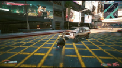

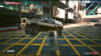

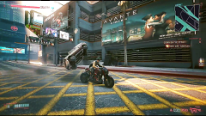

**Question:** What violates physical commonsense in this video? **Answer of Our PhysVLM:** In the video, as the player navigates through the city on a motorcycle, there is an unexpected collision with a car. The car flips dramatically into the air upon impact, which seems unrealistic given the speed and angle of the collision. This suggests a physics glitch in the game, where the collision response is exaggerated, causing the car to behave in a way that defies realworld expectations for such an interaction. The sudden and extreme flipping of the car indicates a potential issue with the collision detection or physics engine in the game. 

**Answer of GPT-4o:** The glitch in the video appears to involve the motorcycle's speed not decreasing realistically when navigating the city streets. Despite apparent high speeds and sharp turns, the vehicle seems to maintain control without skidding or crashing, which defies natural physics. **Answer of LLaVA-Next-Video:** The glitch in this video is that the motorcycle appears to be riding on the wrong side of the road. In a typical traffic scenario, vehicles drive on the right side of the road in most countries, but in this video, the motorcycle is seen riding on the left side of the road. 

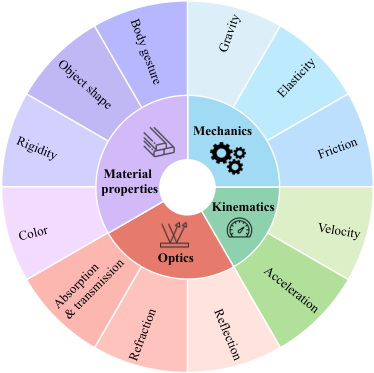

<!-- Start of picture text -->
Mechanics Material properties Kinematics Optics Color Velocity Rigidity Friction Acceleration Object shape Absorption & transmission Elasticity Refraction Reflection Body gesture Gravity <!-- End of picture text -->

Figure 1. **Left: Comparisons of physical commonsense understanding capability.** Our PhysVLM identifies that a motorcycle colliding and flipping a car is implausible while GPT-4o [92] and LLaVA-Next-Video [72] fail to accurately interpret the physical commonsense violations in the video; **Right: The taxonomy of PhysGame benchmark** including 4 primary categories and 12 fine-grained sub-categories. 

# **Abstract** 

_Recent advancements in video-based large language models (Video LLMs) have witnessed the emergence of diverse capabilities to reason and interpret dynamic visual content. Among them, gameplay videos stand out as a distinctive data source, often containing_ glitches _that defy physics commonsense. This characteristic renders them an effective benchmark for assessing the under-explored capability of physical commonsense understanding in video LLMs. In this paper, we propose_ **_PhysGame_** _as a pioneering benchmark to evaluate physical commonsense violations in gameplay videos. PhysGame comprises 880 videos associated with glitches spanning four fundamental domains (_ i.e _., mechanics, kinematics, optics, and material properties) and across 12 distinct physical commonsense. Through extensively evaluating various state-ofthe-art video LLMs, our findings reveal that the performance of current open-source video LLMs significantly lags behind that of proprietary counterparts. To bridge this_ 

_gap, we curate an instruction tuning dataset_ **_PhysInstruct_** _with 140,057 question-answering pairs to facilitate physical commonsense learning. In addition, we also propose a preference optimization dataset_ **_PhysDPO_** _with 34,358 training pairs, where the dis-preferred responses are generated conditioned on misleading titles (_ i.e _., meta information hacking), fewer frames (_ i.e _., temporal hacking) and lower spatial resolutions (_ i.e _., spatial hacking). Based on the suite of datasets, we propose_ **_PhysVLM_** _as a physical knowledge-enhanced video LLM. Extensive experiments on both physical-oriented benchmark PhysGame and general video understanding benchmarks demonstrate the state-ofthe-art performance of PhysVLM._ 

# **1. Introduction** 

Large Language Models (LLMs) [1, 12, 103, 117, 118] have achieved considerable success in understanding user instructions and delivering contextually relevant responses. Building on this foundation, video LLMs [54, 55, 62, 67, 

1 

68, 70, 76, 77, 83, 88, 141] have emerged as a fundamental video intelligence system by incorporating LLMs with perception and reasoning capabilities of dynamic scenes. Across the range of video types, _gameplay videos_ [25, 71, 90, 101, 102, 108, 109, 123, 144] present a unique challenge due to their highly dynamic and interactive environments, where agents and objects unfold in complex temporal scenes. 

Unlike real-world videos, gameplay videos frequently contain inconsistencies between the intended physics and on-screen behavior due to software bugs [71, 109]. Typically, video glitches1 encompass a broad spectrum of physical phenomena, thus naturally serving as a benchmark for physical commonsense understanding. Humans inherently develop an intuitive comprehension of the physical world through our experiences, enabling us to easily recognize violations of physical commonsense, even in the absence of formal physics education. For instance in Figure 1 (left), we can predict that the car will not be launched into the air after colliding with the motorcycle. In spite of the progress, it remains unclear how adept video LLMs are at recognizing physical commonsense violations in gameplay videos. 

Although various benchmarks [33, 38, 64, 79, 84, 121, 125] have been introduced to evaluate the fundamental capabilities of video LLMs, the community still lacks comprehensive evaluation standards for assessing video-based physical commonsense reasoning ( _cf_ . Table 1). To bridge this gap, we propose **PhysGame** , a pioneering benchmark to uncover **Phys** ical commonsense violations in **Game** play videos. We focus on the intuitive adherence to the physical commonsense instead of complex physical formulas requiring explicit domain knowledge. The PhysGame benchmark consists of 880 gameplay videos containing glitches, each annotated with a high-quality multiple-choice question specifically addressing the nature of the glitch. As illustrated in Figure 1 (right), PhysGame spans four key physical domains ( _i.e_ ., mechanics, kinematics, optics, and material properties), and encompasses 12 fine-grained categories ( _e.g_ ., gravity and velocity). The video lengths range from 2.63 seconds to 239.57 seconds, covering both short clips and videos requiring long-context reasoning. 

Based on the constructed PhysGame benchmark, we provide a comprehensive analysis of state-of-the-art proprietary LLMs, _e.g_ ., GPT-4o [92] and Gemini-1.5-pro [103], and open-source video LLMs including LLaVA-Next [72] and Video-LLaVA [68]. Our preliminary experiments on the PhysGame benchmark reveal considerable constraints in the physical commonsense understanding capabilities of existing MLLMs: 1) Existing video LLMs exhibit limited performance on the PhysGame benchmark; 2) Open-source models tend to underperform significantly compared to pro- 

1We employ the term “glitch” to describe the phenomenon of physical commonsense violation in gameplay videos. 

prietary counterparts, possibly due to the absence of suitable instruction-tuning dataset for physical commonsense reasoning. 

To this end, we additionally introduce the **PhysInstruct** dataset to facilitate **Phys** ical understanding oriented **Instruct** ion tuning [93]. We curate PhysInstruct by prompting GPT-4o [92] with gameplay videos and video-wise _meta information_ ( _i.e_ ., video titles), which typically summarize key content and provide valuable hints. According to statistics, PhysInstruct consists of 140,057 instruction-following pairs regarding video glitch content. Besides, we construct the **PhysDPO** dataset for **Phys** ical **D** irect **P** reference **O** ptimization [100, 142]. The _preferred_ responses are taken from PhysInstruct while the _dis-preferred_ responses are generated by prompting GPT-4o with misleading titles ( _i.e_ ., meta information hacking), fewer frames ( _i.e_ ., temporal hacking) and lower resolutions ( _i.e_ ., spatial hacking). 

Under the two-stage successive training with PhysInstruct and PhysDPO datasets, we train a **Phys** ical knowledge enhanced large **V** ideo **L** anguage **M** odel ( **PhysVLM** for short). PhysVLM achieves state-of-the-art performance on the PhysGame benchmark, demonstrating its advanced capability in physical commonsense understanding. Notably, it also demonstrates impressive results on generalpurpose video understanding benchmarks [38, 83]. For example, PhysVLM attains an overall accuracy of 61.1% on Video-MME [38] with the use of subtitles and an average score of 3.83 on VCG benchmark [83]. 

We emphasize that our focus of PhysVLM is not on introducing novel architectural designs or training strategies. Instead, we aim to integrate the existing architecture and datasets to establish a _solid baseline with strong performance_ on both physical commonsense and general video understanding datasets ( _cf_ . Sec.4.2 and Sec.4.3). We envision that PhysVLM designed in the _simple yet effective_ principle will offer insights for advancing future research efforts in video LLMs. 

In summary, our contributions are in three-folds: 

- _Physical commonsense benchmark_ . The PhysGame benchmark is collected to uncover physical commonsense violations in gameplay videos. 

- _Instruction-following and preference-tuning datasets_ . We introduce the PhysInstruct dataset to facilitate the supervised fine-tuning and the PhysDPO dataset via the meta-information, temporal, and spatial hacking for direct preference optimization. 

- _Physical knowledge enhanced Video LLM_ . We propose PhysVLM, which not only demonstrates state-of-the-art performance on PhysGame but also exhibits leading performance on general video understanding benchmarks. 

2 

Table 1. **Comparison with existing benchmarks for video LLMs** in terms of the video number ( **#Videos** ), the average video duration ( **Len.** ), the number of QA pair ( **#QA Pairs** ), the average QA pair tokens ( **QA Tokens** ), the manually/automatic annotation manner ( **M/A** ), whether the benchmarks are gameplay video based ( **Game-Bsd** ), whether the questions are physical commonsense classified ( **Phys-Clsf** ), and whether the benchmarks contain meta information ( **Meta-info** ). 

|**Benchmarks**|**#Videos**|**Len.(s)**|**#QA Pairs**|**QA Tokens**|**Anno.**|**Game-Bsd**|**Phys-Clsf**|**Meta-info**|
|---|---|---|---|---|---|---|---|---|
|MSRVTT-QA [129]|2,990|15.2|72,821|8.4|A|✗|✗|✗|
|MSVD-QA [129]|504|9.8|13,157|7.6|A|✗|✗|✗|
|TGIF-QA [51]|9,575|3.0|8,506|20.5|A&M|✗|✗|✗|
|ActivityNet-QA [137]|800|111.4|8,000|10.2|M|✗|✗|✗|
|TVQA [56]|2,179|11.2|15,253|27.8|M|✗|✗|✓|
|How2QA [65]|1,166|15.3|2,852|16.9|M|✗|✗|✓|
|STAR [124]|914|11.9|7,098|19.5|A|✗|✗|✗|
|NExT-QA [128]|1,000|39.5|8,564|25.3|A|✗|✗|✗|
|MVBench [64]|3,641|16.0|4,000|27.3|A|✗|✗|✗|
|Video-Bench [91]|5,917|56.0|17,036|21.3|A&M|✗|✗|✗|
|EgoSchema [84]|5,063|180.0|5,063|126.8|A&M|✗|✗|✗|
|AutoEval-Video [27]|327|14.6|327|11.9|M|✗|✗|✗|
|TempCompass [79]|410|11.4|7,540|49.2|A&M|✗|✗|✗|
|Video-MME [38]|900|1017.9|2,700|35.7|M|✗|✗|✓|
|LVBench [121]|103|4,101|1,549|32.0|M|✗|✗|✗|
|LongVideoBench [125]|3,763|473.0|6,678|84.1|A&M|✗|✗|✗|
|**PhysGame (Ours)**|880|25.9|880|66.9|M|✓|✓|✓|

Table 2. **Comparison with existing gameplay video benchmarks** in terms of whether they are video-based ( **Vid-Bsd** ), whether they follow an instructional format ( **Instruct** ), and support multi-modal evaluations ( **MModal** ). 

|**Benchmarks**|**Vid-Bsd**|**Instruct**|**MModal**|
|---|---|---|---|
|GameBunny [107]|✗|✓|✓|
|Taesiri_et.al_[109]|✓|✗|✓|
|GameBugDescript [110]|✓|✓|✗|
|GlitchBench [111]|✗|✓|✓|
|**PhysGame (Ours)**|✓|✓|✓|

# **2. Related Work** 

**Benchmarks for Video LMMs.** Integrating visual, temporal, and linguistic inputs, Video LMMs opening doors to a wide range of applications including video understanding [14, 17, 138], editing [15, 31], healthcare [74, 134], _etc_ . Primarily, video LLMs have been evaluated on classical video question-answering (QA) benchmarks [51, 56, 65, 124, 129, 137], _e.g_ ., MSVD-QA [129], MSRVTT-QA [129], and ActivityNet-QA [137]. Since these benchmarks can often be addressed using a sparse set of frames [125], recent research [64, 66, 80, 83, 95, 128] focuses on the assessment of temporal dynamics in videos. Video-ChatGPT [83] introduces a video-based generative performance benchmark, which augments videos from ActivityNet-QA [137] with dense descriptive captions and human annotated questionanswer pairs. MVBench [64] emphasizes temporally sensitive videos and encompasses a wide range of temporal tasks by automatically converting public annotations into 

multiple-choice QA formats. Recently, there has been a remarkable research interest in advancing long-form video understanding. EgoSchema [84] targets 3-minute-long egocentric videos, while MovieChat1K [106] specializes in 10-minute-long movie videos. Recent pre-prints [33, 38, 121, 125], including Video-MME [38], LVBench [121], and LongVideoBench [125], have extended the scope of long video understanding to consider more general themes and intricate reasoning tasks. Despite of the progress, few of existing benchmarks ( _cf_ . Table 1) evaluate the physical commonsense reasoning capability in video LLMs, which acts as a critical step towards human-like video comprehension. In this paper, we bridge this gap by introducing a suite of datasets: PhysInstruct for supervised fine-tuning, PhysDPO for preference alignment, and PhysGame for evaluation. 

**Gameplay Video Understanding.** Digital games [47, 130] are considered pivotal in pursuing artificial general intelligence, as they act as controllable real-world simulators and create complex problem-solving contexts. Therefore, gameplay videos are typically employed as benchmarks for evaluating the capabilities of vision-language models from the perspectives of environment perception [3, 46], context reasoning [75, 120], decision-making [26, 98], _etc_ . The majority of existing games can be classified into two categories: 1) _Competition games_ [35, 43, 44, 48, 49, 63, 82, 105, 115, 143] in which players compete against one another, with the objective of outperforming others to achieve victory. Notable examples include StarCraft II [82, 105], Pok´emon Battles [48], Chess [35, 63, 115] and Poker [43, 44, 49, 143]. Ma et al. [82] introduce TextStarCraft II, 

3 

a natural language-based interface that equips LLMs with the functionality to play StarCraft II, fostering more effective reasoning and decision-making capabilities; 2) _Cooperation games_ [22, 24, 39, 40, 42, 96, 97, 126] are structured around collaboration, requiring players to work together to achieve shared goals. These games emphasize teamwork, communication, and joint problem-solving, where players must coordinate efforts to succeed and reach mutual accomplishments. In Overcooked-AI [22], the preparation of an onion soup requires two agents to collaborate by loading three onions into a cooking pot, thereby initiating a cooking process that spans 20-time steps. 

The most relevant line of research to ours is on the topic of game bug detection [107, 109–112]. Existing methods, however, either focus the classification/retrieval tasks [109] or limited in the static image domain [107, 111] ( _cf_ . Table 2). The prior work [110] employs LLMs to detect bugs in game videos with the reliance on pre-extracted event-wise _textual_ descriptions and lacks support for multi-modal evaluations. In contrast, our PhysVLM addresses all these limitations and supports multi-modal instruction evaluations in videos. 

**Physical Commonsense Understanding.** Even before language acquisition, children start to grasp fundamental physical commonsense by observing the properties of the world around them [45]. However, acquiring such physical commonsense knowledge remains a major challenge for artificial intelligence systems. The topic of physical commonsense understanding has seen significant attention across a range of fields, _e.g_ ., visual physical reasoning [57], video generation [7, 86], and robotics [2, 13]. A collection of works [2, 5, 9, 10, 23, 36, 37, 57, 87, 135] has centered on learning physical and causal reasoning through _synthetic_ dynamic scenarios, either from video frames [8, 11, 28, 34, 36, 37, 41, 57, 87, 119, 122, 136], or from the symbolic environment representations [9, 23]. Within the field of video generation, recent efforts [7, 86] are increasingly exploring whether generative models demonstrate an understanding of intuitive physical commonsense. In robotics, learning from intuitive physics has been demonstrated effective in visuomotor planning [13], tool usage [116], and construction [89]. This paper investigates video LLMs’ physical commonsense reasoning skills and verifies their significance for enhancing general video understanding. 

# **3. Dataset & Method** 

This section details the design of the evaluation benchmark PhysGame (Sec. 3.1), supervised fine-tuning (SFT) dataset PhysInstruct (Sec. 3.2), and the direct preference optimization (DPO) dataset PhysDPO (Sec. 3.3). The optimization procedure for PhysVLM is discussed in Section 3.4. 

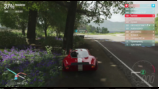

**_Question_ : How would you describe the glitch in the video? A: Blocked by a tree, the car's speed instantly surged from zero to over 200 mph.** B: While the player's car is on the bridge, it casts no shadow. C: On the left lane of the tree-lined road, there are flickering red light patches. D: The clouds in the sky exhibit an unusual green hue. 

Figure 2. **The annotated multi-choice question** in PhysGame. The correct option is annotated in green. 

Table 3. **The average tokens of four options** in the annotations of PhysGame benchmark. 

||**Opt. A**|**Opt. B**|**Opt. C**|**Opt. D**|
|---|---|---|---|---|
|Avg. tokens|14.40|14.49|14.46|14.47|

## **3.1. PhysGame Benchmark** 

Building on the intuitive cognition of physical commonsense, PhysGame benchmark introduces a comprehensive taxonomy for task categorization including four primary domains, _i.e_ ., mechanics, kinematics, optics, and material properties, and 12 fine-grained categories ( _cf_ . Figure 1). 

- _Mechanics_ : This category deals with forces and torques as well as their effects on motion, which provides the foundational principles to interpret and analyze the motion of objects in videos. Typical cases include gravity, elasticity, and friction. 

- _Kinematics_ : This domain studies motion without considering forces, which involves fine-grained categories including velocity and acceleration over time. 

- _Optics_ : It focuses on the behavior and properties of light as well as its interactions with matter. It includes reflection, refraction, and absorption & transmission. 

- _Material properties_ : It refers to the inherent material characteristics including color, rigidity, object shape, and human body gesture. 

**Video Collection and Filter.** The videos in PhysGame are mainly crawled from the reddit page2 which contains gameplay videos with unusual events and glitches. To balance different categories, we also augment videos from YouTube via keyword searching. We conduct manual checks based on the following two criteria: 1) _Duplicate check_ : The Reddit discussion forum may feature multiple references to the same video, resulting in duplicate downloading. We manually check to confirm that each video in PhysGame is distinct; 2) _Content check_ : The pool of downloaded videos may incorporate non-game elements, which we rigorously filter out of our PhysGame benchmark. **Annotation Scheme.** Based on the collected gameplay 

> 2www.reddit.com/r/GamePhysics/ 

4 

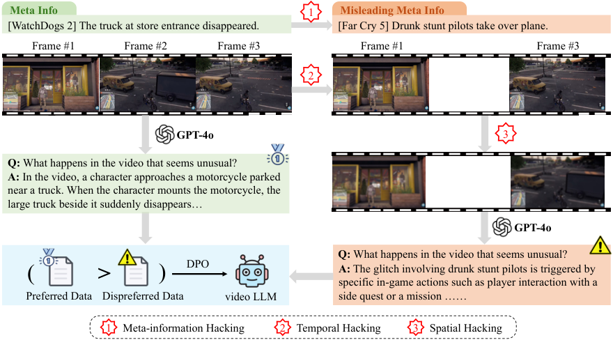

<!-- Start of picture text -->
Meta Info 1 Misleading Meta Info [WatchDogs 2] The truck at store entrance disappeared. [Far Cry 5] Drunk stunt pilots take over plane. Frame #1 Frame #2 Frame #3 Frame #1 Frame #3 2 GPT-4o 3 Q:  What happens in the video that seems unusual? A:  In the video, a character approaches a motorcycle parked near a truck. When the character mounts the motorcycle, the large truck beside it suddenly disappears… GPT-4o Q:  What happens in the video that seems unusual? DPO ( > A: specific in-game actions such as player interaction with a  The glitch involving drunk stunt pilots is triggered by Preferred Data Dispreferred Data video LLM side quest or a mission …… 1 Meta-information Hacking 2 Temporal Hacking 3 Spatial Hacking ( <!-- End of picture text -->

Figure 3. **Overview of the direct preference optimization training** , where the preferred data is generated with the guidance of associated meta-information ( _i.e_ ., title) while dispreferred data is generated with misleading titles ( _i.e_ ., meta-information hacking), fewer frames ( _i.e_ ., temporal hacking) and lower resolutions ( _i.e_ ., spatial hacking). 

videos, we create the question-answer pairs in a four-way multiple-choice format to facilitate convenient evaluation. Specifically, the correct options describe the video-specific glitches that contravene physical commonsense principles. It is important to note that some videos may exhibit multiple glitches. We therefore instruct expert annotators to review the entire video to ensure all the appearing glitches are included in the correct answer. 

To enhance the plausibility of the distractor options, we have provided expert annotators with three guiding principles: **1)** Instead of imagining arbitrary glitches, the glitch in the distractor options should be highly correlated to the individuals or actions observed in the videos. For example in Figure 2, the distractor option B includes car and shadow that are genuinely present in the video. This annotation principle forces video LLMs to comprehend the glitchy content, rather than merely selecting answers by identifying contained objects or actions; **2)** The four choice options should be of similar length, which helps prevent any preference biases in video LLMs. From Table 3, it can be observed that all four options exhibit comparable token numbers; **3)** To mitigate choice bias, the distribution of the correct option among the four choices should be equitable, ( _i.e_ ., 25% likelihood for each option). 

**Quality Control.** To guarantee the quality of our dataset, we conduct a two-fold quality control process including human inspection and automatic LLM-assisted inspection: **1)** All the initially annotated question-answering pairs undergo rigorous cross-inspection by different human anno- 

tators. For the correct options, the inspectors must assess whether they comprehensively and accurately describe all instances of physical commonsense violations present. For the distractor options, the inspectors are required to evaluate whether they are sufficiently deceptive, specifically by including objects or actions depicted in the video; **2)** We exclude question-answering pairs that can be correctly answered by GPT-4o [92] solely based on the question and options without the need to view the video. By statistics, we limit the accuracy of GPT-4o in the question-only scenario to less than 25%. Through the rigorous construction and review process, we present the PhysGame benchmark which is of high quality and well-balanced. The specific statistics are available in Table 1. 

## **3.2. PhysInstruct Dataset** 

To improve the physical commonsense understanding ability of video LLMs, we develop the PhysInstruct dataset for supervised fine-tuning. The video collection procedure follows the same process as that in PhysGame. To prevent data leakage, we diligently exclude any videos included in PhysGame. We follow the self-instruction paradigm [58] to construct PhysInstruct by prompting GPT-4o [92]. 

In terms of the instruction generation3 , we aspire for the questions to be as diverse as possible. We set up three question types, varying from direct to indirect assessment of the glitches in videos: i) explicitly inquiring about glitches in 

> 3Refer to the supplementary material for detailed prompts. 

5 

**_Question_ :** What is the funny or unexpected moment in the video? 

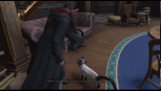

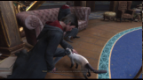

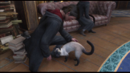

**_Title_ :** [Hogwarts Legacy] I think I pulled a leg muscle while petting the cat. **_Answer w/ title_ :** In the video, the character bends to pet a cat, and their leg seems to clip awkwardly through the floor or themselves, which looks like a stretching motion that isn't possible in real life. This creates a humorous glitch as the character's posture becomes exaggerated while interacting with the cat. **_Answer w/o title_ :** There doesn’t seem to be any visible glitch or inconsistency with the physics in the video. The movements of the character and the cat appear natural and seamless in the environment. Everything aligns well with the magical and academic theme of the space. 

Figure 4. **Example cases in the PhysInstruct dataset** with ( _w/_ ) or without ( _w/o_ ) meta-information hints. 

the video, ii) probing anomalies present in the video, iii) or merely straightforward questions regarding the video content. We adopt in-context learning [32] with three examples corresponding to the mentioned three scenarios: i) _What is the description of the glitch observed in the video?_ ii) _Are there any abnormalities present in the videos?_ iii) _Please provide a description of the video content._ 

As for the response generation3 , the preliminary experiments suggest that the intuitive prompting method leads to remarkable errors, regardless of how we adjust the prompt contents. To alleviate this, we propose a _meta-information guided prompting_ strategy. Specifically, we found that the meta-information ( _e.g_ ., title) associated with each video offers insight into the fundamental content. For example in Figure 4, the title indicates the glitch concerning leg muscle. Therefore, we propose to incorporate video-wise meta-information in the prompt, resulting in more accurate instruction-following generation ( _cf_ . Figure 4). In Figure 4, the meta-information helps GPT-4o to detect the leg gesture glitch, while its absence leads to the degradation of physical commonsense understanding. In total, we generate 140,057 instruction-following pairs. 

## **3.3. PhysDPO Dataset** 

We construct the preference alignment dataset PhysDPO to deliver more trustworthy and reliable responses. As shown in Figure 3, we regard the generated answers in the PhysInstruct dataset as the preferred responses and the dispreferred responses are generated via the combination of meta-information hacking, temporal hacking, and spatial hacking. We prompt GPT-4o with the misleading metainformation as well as video frames with the reduced frame count and decreased frame resolution3 . Specifically, the dispreferred data are generated based on one single frame with both height and width reduced to 1/16 of the original dimensions. Through the above generation process, we compile 

the PhysDPO dataset with 34,358 training pairs. 

## **3.4. PhysVLM** 

Through our experiments in Sec.4.2, we observe that the capabilities of current open-source models are markedly inferior to those of proprietary models. To establish a strong open-source baseline for physical commonsense understanding, we propose PhysVLM by employing cuttingedge architecture and high-quality training datasets. **Architecture.** For the architecture design, we primarily adopt PPLLaVA [78], solely substituting the Vicuna-7B [30] LLM with the high-performing Qwen2-7B [131]. **Supervised Fine-tuning.** We introduce the hybrid training datasets that include our physics-oriented datasets alongside general image and video datasets. Following LLaVANeXT Interleave [59], we utilize a combined dataset comprising 300K images randomly sampled from the LLaVA1.5 [73] training dataset, 300K video samples in LLavaHound [142], and our PhysInstruct dataset, totaling around 740k training samples. We apply the conventional autoregressive loss in this stage. 

**Direct Preference Optimization.** We use the preferred and dis-preferred data in both LLaVA-Hound-DPO-17k [142] and our self-constructed PhysDPO in this stage, leading to a total of 51k training samples. The training loss follows the standard methodology [100, 142]. 

# **4. Experiments** 

## **4.1. Experimental Settings** 

**Implementation Details.** For SFT training, the pooling kernel and strides are set to (1 _,_ 3 _,_ 3) for image inputs and (2 _,_ 3 _,_ 3) for video inputs. PhysVLM lasts for one epoch with a batch size of 256 and a learning rate of 2e-5. The input frame is set to 32 following PPLLaVA [78]. For DPO training, the pooling kernel and strides are set to (1 _,_ 3 _,_ 3), and the input frame is set to 16. The DPO training lasts two epochs with a batch size of 64 and a learning rate of 5e _−_ 6. All experiments are conducted on 8 NVIDIA A100 GPUs. 

## **4.2. Evaluations on PhysGame** 

**Evaluation Settings.** We benchmark PhysGame on 8 proprietary multi-modal LLMs, _i.e_ ., Claude3.5-Sonnet [4], Claude3.5-SonnetV2 [4], Gemini-1.5-pro [114], Gemini1.5-pro-flash [114], GPT-4V [1], GPT-4o-0806 [92], GPT4o-mini-0718 [92] and Qwen-VL-max [6], as well as 8 open-source models including LLaVA-Next-Video [72], Video-LLaVA [68], LLaVA-OneVision [58], InternVL2 [29], VideoChat2 [64], ST-LLM [77], Chat-UniVi [54] and PPLLaVA[78]. We follow Video-MME [38] to utilize the official frame configurations provided for each video LLM. We employ accuracy as the evaluation metric for our curated multi-choice questions. The evaluation prompt is 

6 

Table 4. **Evaluation results (%) of open-source and proprietary multi-modal LLMs on PhysGame.** The fine-grained categories include gravity, elasticity, friction, velocity, acceleration, reflection, refraction, absorption & transmission, color, rigidity, object shape, and body gesture. AVG denotes the average accuracy. PhysVLM-SFT denotes PhysVLM only undergoes supervised fine-tuning while PhysVLM-DPO denotes PhysVLM with consecutive supervised fine-tuning and direct preference optimization. 

|**Models**||**AVG**|**M** |**echani** |**cs** |**Kine** |**matics** |l|**Optics** |||**Mat** |**erial** ||
|---|---|---|---|---|---|---|---|---|---|---|---|---|---|---|
||||Grav.|Elast.|Fric.|Velo.|Acc.|Refl.|Refr.|Abs.|Col.|Rig.|Sha.|Gest.|
|||||**_Prop_**|**_rietary_**|**_Multi-m_**|**_odal LL_**|**_Ms_**|||||||
|Claude3.5-Sonnet|[4]|54.3|**50.7**|58.8|50.6|**53.2**|59.1|**50.0**|50.0|49.2|64.4|52.7|50.0|**62.1**|
|Claude3.5-SonnetV2|[4]|47.6|46.5|52.5|46.6|37.2|53.4|47.8|50.0|33.9|55.6|54.1|43.8|51.7|
|Gemini-1.5-pro|[114]|55.2|**50.7**|**70.0**|48.9|51.1|59.1|**50.0**|42.9|**52.5**|**71.1**|**56.8**|53.1|58.6|
|Gemini-1.5-pro-flash|[114]|48.5|47.9|52.5|51.7|43.6|51.1|43.5|53.6|33.9|64.4|43.2|46.9|49.4|
|GPT-4V|[1]|45.9|40.8|60.0|48.3|34.0|48.9|43.5|46.4|42.4|53.3|45.9|37.5|44.8|
|GPT-4o-0806|[92]|**56.1**|47.9|61.3|**59.1**|43.6|**61.4**|43.5|53.6|50.8|68.9|54.1|**65.6**|63.2|
|GPT-4o-mini-0718|[92]|40.3|43.7|43.8|39.2|35.1|44.3|30.4|46.4|42.4|44.4|37.8|37.5|41.4|
|Qwen-VL-max|[6]|50.9|**50.7**|53.8|51.1|31.9|46.6|**50.0**|**60.7**|50.8|64.4|48.6|**65.6**|59.8|
|||||**_Open_**|**_-source_**|**_Multi-_**|**_modal L_**|**_LMs_**|||||||
|LLaVA-Next-Video|[72]|32.2|43.7|33.8|27.3|34.0|22.7|21.7|35.7|23.7|35.6|41.9|34.4|37.9|
|Video-LLaVA|[68]|29.0|32.4|22.5|27.8|31.9|26.1|19.6|35.7|32.2|31.1|36.5|28.1|27.6|
|LLaVA-OneVision|[58]|47.7|50.7|50.0|46.0|39.4|45.5|43.5|**71.4**|**40.7**|55.6|44.6|**56.2**|52.9|
|InternVL2|[29]|33.4|29.6|31.2|38.6|35.1|30.7|30.4|53.6|35.6|26.7|29.7|18.8|34.5|
|VideoChat2|[64]|34.3|33.8|35.0|29.5|41.5|28.4|28.3|32.1|33.9|33.3|41.9|21.9|44.8|
|ST-LLM|[77]|32.8|32.4|26.2|26.7|37.2|28.4|37.0|25.0|28.8|33.3|40.5|37.5|46.0|
|Chat-UniVi|[54]|29.5|28.2|27.5|29.5|39.4|23.9|28.3|32.1|30.5|31.1|18.9|28.1|35.6|
|PPLLaVA|[78]|38.4|45.1|38.8|42.6|30.9|30.7|41.3|39.3|35.6|44.4|39.2|18.8|43.7|
|**PhysVLM-SFT**||56.7|54.9|62.5|**60.2**|51.1|**63.6**|**45.7**|57.1|28.8|**64.4**|51.4|50.0|72.4|
|**PhysVLM-DPO**||**59.5**|**64.8**|**66.3**|**60.2**|**59.6**|60.2|39.1|67.9|35.6|57.8|**62.2**|37.5|**78.2**|

Table 5. **Evaluation results (%) on Video-MME.** “ _w/_ subs” and “ _w/o_ subs” respectively denote “with subtitles” and “without subtitles”. 

|**Models**||**LLM** **Params**|**Short** _w/o_subs|**(%)** _w/_ subs|**Mediu** _w/o_subs|**m (%)** _w/_ subs|**Long** _w/o_subs|**(%)** _w/_ subs|**Overal** _w/o_subs|**l (%)** _w/_ subs|
|---|---|---|---|---|---|---|---|---|---|---|
|InternVL-Chat-V1.5|[29]|20B|60.2|61.7|46.4|49.1|45.6|46.6|50.7|52.4|
|LLaVA-NeXT-Video|[72]|34B|61.7|65.1|50.1|52.2|44.3|47.2|52.0|54.9|
|VILA-1.5|[69]|34B|68.1|68.9|58.1|57.4|50.8|52.0|59.0|59.4|
|LLaVA-OneVision|[58]|72B|76.7|79.3|62.2|66.9|60.0|62.4|66.3|69.6|
|Qwen-VL-Chat|[6]|7B|46.9|47.3|38.7|40.4|37.8|37.9|41.1|41.9|
|Video-LLaVA|[68]|7B|45.3|46.1|38.0|40.7|36.2|38.1|39.9|41.6|
|ST-LLM|[76]|7B|45.7|48.4|36.8|41.4|31.3|36.9|37.9|42.3|
|VideoChat2-Mistral|[64]|7B|48.3|52.8|37.0|39.4|33.2|39.2|39.5|43.8|
|Chat-UniVi-V1.5|[54]|7B|45.7|51.2|40.3|44.6|35.8|41.8|40.6|45.9|
|LLaVA-NeXT-Video|[72]|7B|45.9|49.8|40.3|44.3|36.6|41.0|40.9|45.0|
|PPLLaVA|[78]|7B|58.7|62.8|45.6|50.4|42.2|47.4|48.8|53.6|
|**PhysVLM-SFT**||7B|64.1|68.0|**55.0**|**61.7**|46.4|50.3|55.2|60.0|
|**PhysVLM-DPO**||7B|**66.1**|**70.0**|54.3|59.6|**47.1**|**53.8**|**55.8**|**61.1**|

available in the supplementary material. **Performance Analysis.** The evaluation results on the PhysGame benchmark are demonstrated in Table 4. Among all proprietary models, GPT-4o and Gemini-1.5-pro demonstrate the best performance, achieving average accuracy scores of 56.1% and 55.2%, respectively. Across all the fine-grained domains, GPT-4o achieves superior performance in friction and acceleration. In contrast, Gemini-1.5pro shows a stronger capability in understanding physical commonsense related to gravity, elasticity, reflection, ab- 

sorption & transmission, color, and rigidity. 

Furthermore, existing open-source models fall significantly behind proprietary models. Even the best-performing open-source model, LLaVA-OneVision, reaches only 47.7% average accuracy. In comparison, our proposed PhysVLM achieved state-of-the-art performance among all proprietary and open-source models. Compared to opensource methods, our PhysVLM attains the highest performance in 6 domains out of the total 12 evaluated domains. Notably, PhysVLM-DPO surpasses the best-performing 

7 

Table 6. **Evaluation results on VCG benchmark [83].** Methods marked by_∗_ use DPO or PPO [104]. CI, DO, CU, TU, and CO respectively denote correctness of information, detail orientation, contextual understanding, temporal understanding, and consistency. AVG is the average result. 

|**Methods**|**CI**|**DO**|**CU**|**TU**|**CO**|**AVG**|
|---|---|---|---|---|---|---|
|VideoChat|2.23|2.50|2.53|1.94|2.24|2.29|
|Video-ChatGPT|2.50|2.57|2.69|2.16|2.20|2.42|
|BT-Adapter|2.68|2.69|3.27|2.34|2.46|2.69|
|Chat-UniVi|2.89|2.91|3.46|2.89|2.81|2.99|
|VideoChat2|3.02|2.88|3.51|2.66|2.81|2.98|
|LLaMA-VID|2.96|3.00|3.53|2.46|2.51|2.89|
|ST-LLM|3.23|3.05|3.74|2.93|2.81|3.15|
|PLLaVA|3.21|2.86|3.62|2.33|2.93|2.99|
|LLaVA-Next-Video|3.39|**3.29**|**3.92**|2.60|3.12|3.26|
|PPLLaVA|3.32|3.20|3.88|**3.00**|3.20|3.32|
|**PhysVLM-SFT**|**3.59**|3.07|3.89|2.74|**3.44**|**3.35**|
|LLaVA-Next-Video_∗_|3.64|3.45|4.17|2.95|4.08|3.66|
|PPLLaVA_∗_|3.85|3.56|4.21|**3.21**|3.81|3.73|
|**PhysVLM-DPO**_∗_|**3.89**|**3.69**|**4.26**|3.11|**4.19**|**3.83**|

|**Methods**|**AVG**|Table 7. **Ablation studies** **of the temporal, spatial,**|
|---|---|---|
|PhysVLM-DPO|**59.5**|**and meta-info hacking** in|
|_w/o_temporal hacking _w/o_spatial hacking _w/o_meta-info hacking|57.6 57.3 57.4|the PhysDPO dataset gen- eration process.|

Table 8. **Ablations of training data** in SFT and DPO stages. AVG denotes the average accuracy on the PhysGame benchmark. 

|**Stage**|**Training Data**|**AVG**|
|---|---|---|
|SFT|LLava-Hound|40.7|
|SFT|LLava-Hound[142], LLaVA-Image [73]|46.0|
|SFT|LLava-Hound, LLaVA-Image,**PhysInstruct**|**56.7**|
|DPO|LLava-Hound-DPO [142]|52.9|
|DPO|LLava-Hound-DPO,**PhysDPO**|**59.5**|

bilities of the proposed PhysVLM model in general video understanding. 

## **4.4. Ablations** 

proprietary model GPT-4o by an absolute margin of 3.4% in the metric of average accuracy. 

## **4.3. Evaluations of General Video Understanding** 

To further demonstrate the generalizability of our model, we conducted experiments on general video LLM benchmarks including Video-MME [38] and VCG benchmarks [83]. We follow the common practice by using GPT-3.5-turbo0613 version for the evaluation of the VCG benchmark. Video-MME is in the format of multichoice questions and thus the evaluation is more objective by eliminating the reliance on GPT. 

The comparison results on the Video-MME benchmark are demonstrated in Table 5. Our PhysVLM achieves superior performance among all the 7-B models. Surprisingly, as the 7B model, both PhysVLM-SFT and PhysVLM-DPO outperform the 34B model LLaVA-NeXT-Video by 3.2% and 3.8% absolute improvements on the overall performance without using subtitles. By comparing PhysVLMSFT and PhysVLM-DPO, we find that DPO training using the proposed PhysDPO data results in performance gains on both short and long videos, while performance on mediumlength videos experiences a slight decline. 

We summarize the results on the VCG benchmark in Table 6. In the case of models using only SFT, our PhysVLMSFT achieves the best performance in terms of the average score. In the evaluation across four subcategories, PhysVLM-SFT performs exceptionally well in the correctness of information and consistency categories. Compared to PPLLaVA and LLaVA-Next-Video which use DPO or PPO training, our PhysVLM-DPO also demonstrates superior performance, further validating the outstanding capa- 

**Ablations of DPO Dataset Generation.** In Section 3.3, the dis-preferred responses in PhysDPO are generated by prompting GPT-4o with misleading titles ( _i.e_ ., meta information hacking), fewer frames ( _i.e_ ., temporal hacking) and lower spatial resolutions ( _i.e_ ., spatial hacking). We ablate on these three kinds of hacking in Table 7. We found that removing any one of the three components leads to a decline in overall performance. For instance, omitting temporal hacking results in a 1.9% decrease in the final PhysVLM performance on the AVG metric. 

**Ablations of Training Data.** We use the hybrid training dataset in both the SFT and DPO training stages. Here we ablate on each dataset to investigate the specific contributions. We report the average accuracy on the PhysGame benchmark in Table 8. The comparison results demonstrate that introducing PhysInstruct and PhysDPO respectively leads to 10.7% and 6.6% performance boosts, further validating the effectiveness of the curated datasets. More ablation results on Video-MME and VCG benchmarks are available in the supplementary material. 

# **5. Conclusion** 

This paper investigates current video LLMs’ understanding of physical commonsense in gameplay videos. To achieve this, we introduce PhysGame benchmark, consisting of glitchy gameplay videos accompanied by annotated question-answer pairs to identify and analyze physical commonsense violations. The extensive experiments reveal that the performance of open-source models falls significantly behind that of proprietary counterparts. To this end, we propose PhysVLM as an open-source physical-knowledgeenhanced video LLM. To facilitate training, we curate a 

8 

suite of datasets including PhysInstruct for instruction tuning and PhysDPO for preference alignment. Experiments manifest that PhysVLM achieves state-of-the-art performance on both physical-oriented benchmark PhysGame and general video understanding benchmarks. 

# **References** 

- [1] Josh Achiam, Steven Adler, Sandhini Agarwal, Lama Ahmad, Ilge Akkaya, Florencia Leoni Aleman, Diogo Almeida, Janko Altenschmidt, Sam Altman, Shyamal Anadkat, et al. Gpt-4 technical report. _arXiv preprint arXiv:2303.08774_ , 2023. 1, 6, 7 

- [2] Pulkit Agrawal, Ashvin V Nair, Pieter Abbeel, Jitendra Malik, and Sergey Levine. Learning to poke by poking: Experiential learning of intuitive physics. _Advances in neural information processing systems_ , 29, 2016. 4 

- [3] Nader Akoury, Qian Yang, and Mohit Iyyer. A framework for exploring player perceptions of llm-generated dialogue in commercial video games. In _Findings of the Association for Computational Linguistics: EMNLP 2023_ , pages 2295– 2311, 2023. 3 

- [4] Anthropic. Claude 3.5 sonnet, 2024. 6, 7 

- [5] Tayfun Ates, M Samil Atesoglu, Cagatay Yigit, Ilker Kesen, Mert Kobas, Erkut Erdem, Aykut Erdem, Tilbe Goksun, and Deniz Yuret. Craft: A benchmark for causal reasoning about forces and interactions. _arXiv preprint arXiv:2012.04293_ , 2020. 4 

- [6] Jinze Bai, Shuai Bai, Shusheng Yang, Shijie Wang, Sinan Tan, Peng Wang, Junyang Lin, Chang Zhou, and Jingren Zhou. Qwen-vl: A frontier large vision-language model with versatile abilities. _arXiv preprint arXiv:2308.12966_ , 2023. 6, 7 

- [7] Hritik Bansal, Zongyu Lin, Tianyi Xie, Zeshun Zong, Michal Yarom, Yonatan Bitton, Chenfanfu Jiang, Yizhou Sun, Kai-Wei Chang, and Aditya Grover. Videophy: Evaluating physical commonsense for video generation. _arXiv preprint arXiv:2406.03520_ , 2024. 4 

- [8] Fabien Baradel, Natalia Neverova, Julien Mille, Greg Mori, and Christian Wolf. Cophy: Counterfactual learning of physical dynamics. In _International Conference on Learning Representations_ , 2021. 4 

- [9] Peter Battaglia, Razvan Pascanu, Matthew Lai, Danilo Jimenez Rezende, et al. Interaction networks for learning about objects, relations and physics. _Advances in neural information processing systems_ , 29, 2016. 4 

- [10] Peter W Battaglia, Jessica B Hamrick, and Joshua B Tenenbaum. Simulation as an engine of physical scene understanding. _Proceedings of the National Academy of Sciences_ , 110(45):18327–18332, 2013. 4 

- [11] Daniel Bear, Elias Wang, Damian Mrowca, Felix Jedidja Binder, Hsiao-Yu Tung, RT Pramod, Cameron Holdaway, Sirui Tao, Kevin A Smith, Fan-Yun Sun, et al. Physion: Evaluating physical prediction from vision in humans and machines. In _Thirty-fifth Conference on Neural Information Processing Systems Datasets and Benchmarks Track (Round 1)_ , 2021. 4 

- [12] Tom Brown, Benjamin Mann, Nick Ryder, Melanie Subbiah, Jared D Kaplan, Prafulla Dhariwal, Arvind Neelakantan, Pranav Shyam, Girish Sastry, Amanda Askell, et al. Language models are few-shot learners. _Advances in neural information processing systems_ , 33:1877–1901, 2020. 1 

- [13] Arunkumar Byravan, Felix Leeb, Franziska Meier, and Dieter Fox. Se3-pose-nets: Structured deep dynamics models for visuomotor planning and control. _arXiv preprint arXiv:1710.00489_ , 2017. 4 

- [14] Meng Cao, Long Chen, Mike Zheng Shou, Can Zhang, and Yuexian Zou. On pursuit of designing multi-modal transformer for video grounding. In _Proceedings of the 2021 Conference on Empirical Methods in Natural Language Processing_ , pages 9810–9823, 2021. 3 

- [15] Meng Cao, Haozhi Huang, Hao Wang, Xuan Wang, Li Shen, Sheng Wang, Linchao Bao, Zhifeng Li, and Jiebo Luo. Unifacegan: a unified framework for temporally consistent facial video editing. _IEEE Transactions on Image Processing_ , 30:6107–6116, 2021. 3 

- [16] Meng Cao, Ji Jiang, Long Chen, and Yuexian Zou. Correspondence matters for video referring expression comprehension. In _Proceedings of the 30th ACM International Conference on Multimedia_ , pages 4967–4976, 2022. 

- [17] Meng Cao, Tianyu Yang, Junwu Weng, Can Zhang, Jue Wang, and Yuexian Zou. Locvtp: Video-text pre-training for temporal localization. In _European Conference on Computer Vision_ , pages 38–56. Springer, 2022. 3 

- [18] Meng Cao, Can Zhang, Long Chen, Mike Zheng Shou, and Yuexian Zou. Deep motion prior for weakly-supervised temporal action localization. _IEEE Transactions on Image Processing_ , 31:5203–5213, 2022. 

- [19] Meng Cao, Fangyun Wei, Can Xu, Xiubo Geng, Long Chen, Can Zhang, Yuexian Zou, Tao Shen, and Daxin Jiang. Iterative proposal refinement for weakly-supervised video grounding. In _Proceedings of the IEEE/CVF Conference on Computer Vision and Pattern Recognition_ , pages 6524–6534, 2023. 

- [20] Meng Cao, Yuyang Liu, Yingfei Liu, Tiancai Wang, Jiahua Dong, Henghui Ding, Xiangyu Zhang, Ian Reid, and Xiaodan Liang. Continual llava: Continual instruction tuning in large vision-language models. _arXiv preprint arXiv:2411.02564_ , 2024. 

- [21] Meng Cao, Haoran Tang, Jinfa Huang, Peng Jin, Can Zhang, Ruyang Liu, Long Chen, Xiaodan Liang, Li Yuan, and Ge Li. Rap: Efficient text-video retrieval with sparseand-correlated adapter. _arXiv preprint arXiv:2405.19465_ , 2024. 

- [22] Micah Carroll, Rohin Shah, Mark K Ho, Tom Griffiths, Sanjit Seshia, Pieter Abbeel, and Anca Dragan. On the utility of learning about humans for human-ai coordination. _Advances in neural information processing systems_ , 32, 2019. 4 

- [23] Michael B Chang, Tomer Ullman, Antonio Torralba, and Joshua B Tenenbaum. A compositional object-based approach to learning physical dynamics. _arXiv preprint arXiv:1612.00341_ , 2016. 4 

9 

- [24] Jiaqi Chen, Yuxian Jiang, Jiachen Lu, and Li Zhang. S-agents: Self-organizing agents in open-ended environments. In _ICLR 2024 Workshop on Large Language Model (LLM) Agents_ , 2024. 4 

- [25] Ke Chen, Yufei Li, Yingfeng Chen, Changjie Fan, Zhipeng Hu, and Wei Yang. Glib: towards automated test oracle for graphically-rich applications. In _Proceedings of the 29th ACM Joint Meeting on European Software Engineering Conference and Symposium on the Foundations of Software Engineering_ , pages 1093–1104, 2021. 2 

- [26] Weize Chen, Yusheng Su, Jingwei Zuo, Cheng Yang, Chenfei Yuan, Chi-Min Chan, Heyang Yu, Yaxi Lu, Yi-Hsin Hung, Chen Qian, et al. Agentverse: Facilitating multiagent collaboration and exploring emergent behaviors. In _The Twelfth International Conference on Learning Representations_ , 2023. 3 

- [27] Xiuyuan Chen, Yuan Lin, Yuchen Zhang, and Weiran Huang. Autoeval-video: An automatic benchmark for assessing large vision language models in open-ended video question answering. _arXiv preprint arXiv:2311.14906_ , 2023. 3 

- [28] Zhenfang Chen, Shilong Dong, Kexin Yi, Yunzhu Li, Mingyu Ding, Antonio Torralba, Joshua B Tenenbaum, and Chuang Gan. Compositional physical reasoning of objects and events from videos. _arXiv preprint arXiv:2408.02687_ , 2024. 4 

- [29] Zhe Chen, Weiyun Wang, Hao Tian, Shenglong Ye, Zhangwei Gao, Erfei Cui, Wenwen Tong, Kongzhi Hu, Jiapeng Luo, Zheng Ma, et al. How far are we to gpt-4v? closing the gap to commercial multimodal models with opensource suites. _arXiv preprint arXiv:2404.16821_ , 2024. 6, 

   - 7 

- [30] Wei-Lin Chiang, Zhuohan Li, Zi Lin, Ying Sheng, Zhanghao Wu, Hao Zhang, Lianmin Zheng, Siyuan Zhuang, Yonghao Zhuang, Joseph E. Gonzalez, Ion Stoica, and Eric P. Xing. Vicuna: An open-source chatbot impressing gpt-4 with 90%* chatgpt quality, 2023. 6, 15, 16 

- [31] Jiahua Dong, Wenqi Liang, Hongliu Li, Duzhen Zhang, Meng Cao, Henghui Ding, Salman Khan, and Fahad Shahbaz Khan. How to continually adapt text-to-image diffusion models for flexible customization? _arXiv preprint arXiv:2410.17594_ , 2024. 3 

- [32] Qingxiu Dong, Lei Li, Damai Dai, Ce Zheng, Jingyuan Ma, Rui Li, Heming Xia, Jingjing Xu, Zhiyong Wu, Tianyu Liu, et al. A survey on in-context learning. _arXiv preprint arXiv:2301.00234_ , 2022. 6 

- [33] Yifan Du, Kun Zhou, Yuqi Huo, Yifan Li, Wayne Xin Zhao, Haoyu Lu, Zijia Zhao, Bingning Wang, Weipeng Chen, and Ji-Rong Wen. Towards event-oriented long video understanding. _arXiv preprint arXiv:2406.14129_ , 2024. 2, 3 

- [34] Frederik Ebert, Chelsea Finn, Alex X Lee, and Sergey Levine. Self-supervised visual planning with temporal skip connections. _CoRL_ , 12(16):23, 2017. 4 

- [35] Xidong Feng, Yicheng Luo, Ziyan Wang, Hongrui Tang, Mengyue Yang, Kun Shao, David Mguni, Yali Du, and Jun Wang. Chessgpt: Bridging policy learning and language modeling. _Advances in Neural Information Processing Systems_ , 36, 2024. 3 

- [36] Chelsea Finn, Ian Goodfellow, and Sergey Levine. Unsupervised learning for physical interaction through video prediction. _Advances in neural information processing systems_ , 29, 2016. 4 

- [37] Katerina Fragkiadaki, Pulkit Agrawal, Sergey Levine, and Jitendra Malik. Learning visual predictive models of physics for playing billiards. _arXiv preprint arXiv:1511.07404_ , 2015. 4 

- [38] Chaoyou Fu, Yuhan Dai, Yondong Luo, Lei Li, Shuhuai Ren, Renrui Zhang, Zihan Wang, Chenyu Zhou, Yunhang Shen, Mengdan Zhang, et al. Video-mme: The first-ever comprehensive evaluation benchmark of multi-modal llms in video analysis. _arXiv preprint arXiv:2405.21075_ , 2024. 2, 3, 6, 8 

- [39] Chuang Gan, Jeremy Schwartz, Seth Alter, Damian Mrowca, Martin Schrimpf, James Traer, Julian De Freitas, Jonas Kubilius, Abhishek Bhandwaldar, Nick Haber, et al. Threedworld: A platform for interactive multi-modal physical simulation. In _Thirty-fifth Conference on Neural Information Processing Systems Datasets and Benchmarks Track (Round 1)_ , 2021. 4 

- [40] Chuang Gan, Siyuan Zhou, Jeremy Schwartz, Seth Alter, Abhishek Bhandwaldar, Dan Gutfreund, Daniel LK Yamins, James J DiCarlo, Josh McDermott, Antonio Torralba, et al. The threedworld transport challenge: A visually guided task-and-motion planning benchmark for physically realistic embodied ai. _arXiv preprint arXiv:2103.14025_ , 2021. 4 

- [41] Rohit Girdhar and Deva Ramanan. Cater: A diagnostic dataset for compositional actions & temporal reasoning. In _International Conference on Learning Representations_ , 2021. 4 

- [42] Ran Gong, Qiuyuan Huang, Xiaojian Ma, Hoi Vo, Zane Durante, Yusuke Noda, Zilong Zheng, Song-Chun Zhu, Demetri Terzopoulos, Li Fei-Fei, et al. Mindagent: Emergent gaming interaction. _arXiv preprint arXiv:2309.09971_ , 2023. 4 

- [43] Jiaxian Guo, Bo Yang, Paul Yoo, Bill Yuchen Lin, Yusuke Iwasawa, and Yutaka Matsuo. Suspicion-agent: Playing imperfect information games with theory of mind aware gpt-4. _arXiv preprint arXiv:2309.17277_ , 2023. 3 

- [44] Akshat Gupta. Are chatgpt and gpt-4 good poker players?– a pre-flop analysis. _arXiv preprint arXiv:2308.12466_ , 2023. 3 

- [45] Susan J Hespos and Elizabeth S Spelke. Conceptual precursors to language. _Nature_ , 430(6998):453–456, 2004. 4 

- [46] Sirui Hong, Xiawu Zheng, Jonathan Chen, Yuheng Cheng, Jinlin Wang, Ceyao Zhang, Zili Wang, Steven Ka Shing Yau, Zijuan Lin, Liyang Zhou, et al. Metagpt: Meta programming for multi-agent collaborative framework. _arXiv preprint arXiv:2308.00352_ , 2023. 3 

- [47] Sihao Hu, Tiansheng Huang, Fatih Ilhan, Selim Tekin, Gaowen Liu, Ramana Kompella, and Ling Liu. A survey on large language model-based game agents. _arXiv preprint arXiv:2404.02039_ , 2024. 3 

- [48] Sihao Hu, Tiansheng Huang, and Ling Liu. Pok _\_ ’ellmon: A human-parity agent for pok _\_ ’emon battles with large language models. _arXiv preprint arXiv:2402.01118_ , 2024. 3 

10 

- [49] Chenghao Huang, Yanbo Cao, Yinlong Wen, Tao Zhou, and Yanru Zhang. Pokergpt: An end-to-end lightweight solver for multi-player texas hold’em via large language model. _arXiv preprint arXiv:2401.06781_ , 2024. 3 

- [50] Xiaoshuang Huang, Hongxiang Li, Meng Cao, Long Chen, Chenyu You, and Dong An. Cross-modal conditioned reconstruction for language-guided medical image segmentation. _arXiv preprint arXiv:2404.02845_ , 2024. 

- [51] Yunseok Jang, Yale Song, Youngjae Yu, Youngjin Kim, and Gunhee Kim. Tgif-qa: Toward spatio-temporal reasoning in visual question answering. In _Proceedings of the IEEE conference on computer vision and pattern recognition_ , pages 2758–2766, 2017. 3 

- [52] Jiang Ji, Meng Cao, Tengtao Song, Long Chen, Yi Wang, and Yuexian Zou. Video referring expression comprehension via transformer with content-conditioned query. In _Proceedings of the 1st International Workshop on Deep Multimodal Learning for Information Retrieval_ , pages 39– 48, 2023. 

- [53] Ji Jiang, Meng Cao, Tengtao Song, and Yuexian Zou. Video referring expression comprehension via transformer with content-aware query. _arXiv preprint arXiv:2210.02953_ , 2022. 

- [54] Peng Jin, Ryuichi Takanobu, Wancai Zhang, Xiaochun Cao, and Li Yuan. Chat-univi: Unified visual representation empowers large language models with image and video understanding. In _Proceedings of the IEEE/CVF Conference on Computer Vision and Pattern Recognition_ , pages 13700– 13710, 2024. 1, 6, 7 

- [55] Yang Jin, Zhicheng Sun, Kun Xu, Liwei Chen, Hao Jiang, Quzhe Huang, Chengru Song, Yuliang Liu, Di Zhang, Yang Song, et al. Video-lavit: Unified video-language pre-training with decoupled visual-motional tokenization. _arXiv preprint arXiv:2402.03161_ , 2024. 1 

- [56] Jie Lei, Licheng Yu, Mohit Bansal, and Tamara L Berg. Tvqa: Localized, compositional video question answering. In _Empirical Methods in Natural Language Processing_ , 2018. 3 

- [57] Adam Lerer, Sam Gross, and Rob Fergus. Learning physical intuition of block towers by example. In _International conference on machine learning_ , pages 430–438. PMLR, 2016. 4 

- [58] Bo Li, Yuanhan Zhang, Dong Guo, Renrui Zhang, Feng Li, Hao Zhang, Kaichen Zhang, Yanwei Li, Ziwei Liu, and Chunyuan Li. Llava-onevision: Easy visual task transfer. _arXiv preprint arXiv:2408.03326_ , 2024. 5, 6, 7 

- [59] Feng Li, Renrui Zhang, Hao Zhang, Yuanhan Zhang, Bo Li, Wei Li, Zejun Ma, and Chunyuan Li. Llava-next-interleave: Tackling multi-image, video, and 3d in large multimodal models. _arXiv preprint arXiv:2407.07895_ , 2024. 6 

- [60] Hongxiang Li, Meng Cao, Xuxin Cheng, Yaowei Li, Zhihong Zhu, and Yuexian Zou. G2l: Semantically aligned and uniform video grounding via geodesic and game theory. In _Proceedings of the IEEE/CVF International Conference on Computer Vision_ , pages 12032–12042, 2023. 

- [61] Hongxiang Li, Meng Cao, Xuxin Cheng, Zhihong Zhu, Yaowei Li, and Yuexian Zou. Generating templated caption for video grounding. _arXiv preprint arXiv_ , 2301:2, 2023. 

- [62] KunChang Li, Yinan He, Yi Wang, Yizhuo Li, Wenhai Wang, Ping Luo, Yali Wang, Limin Wang, and Yu Qiao. Videochat: Chat-centric video understanding. _arXiv preprint arXiv:2305.06355_ , 2023. 1 

- [63] Kenneth Li, Aspen K Hopkins, David Bau, Fernanda Vi´egas, Hanspeter Pfister, and Martin Wattenberg. Emergent world representations: Exploring a sequence model trained on a synthetic task. In _The Eleventh International Conference on Learning Representations_ , 2023. 3 

- [64] Kunchang Li, Yali Wang, Yinan He, Yizhuo Li, Yi Wang, Yi Liu, Zun Wang, Jilan Xu, Guo Chen, Ping Luo, et al. Mvbench: A comprehensive multi-modal video understanding benchmark. In _Proceedings of the IEEE/CVF Conference on Computer Vision and Pattern Recognition_ , pages 22195–22206, 2024. 2, 3, 6, 7 

- [65] Linjie Li, Yen-Chun Chen, Yu Cheng, Zhe Gan, Licheng Yu, and Jingjing Liu. Hero: Hierarchical encoder for video+ language omni-representation pre-training. In _Proceedings of the 2020 Conference on Empirical Methods in Natural Language Processing (EMNLP)_ , pages 2046– 2065, 2020. 3 

- [66] Shicheng Li, Lei Li, Shuhuai Ren, Yuanxin Liu, Yi Liu, Rundong Gao, Xu Sun, and Lu Hou. Vitatecs: A diagnostic dataset for temporal concept understanding of videolanguage models. _arXiv preprint arXiv:2311.17404_ , 2023. 3 

- [67] Yanwei Li, Chengyao Wang, and Jiaya Jia. Llama-vid: An image is worth 2 tokens in large language models. _arXiv preprint arXiv:2311.17043_ , 2023. 1 

- [68] Bin Lin, Bin Zhu, Yang Ye, Munan Ning, Peng Jin, and Li Yuan. Video-llava: Learning united visual representation by alignment before projection. _arXiv preprint arXiv:2311.10122_ , 2023. 2, 6, 7 

- [69] Ji Lin, Hongxu Yin, Wei Ping, Pavlo Molchanov, Mohammad Shoeybi, and Song Han. Vila: On pre-training for visual language models. In _Proceedings of the IEEE/CVF Conference on Computer Vision and Pattern Recognition_ , pages 26689–26699, 2024. 7 

- [70] Kevin Lin, Faisal Ahmed, Linjie Li, Chung-Ching Lin, Ehsan Azarnasab, Zhengyuan Yang, Jianfeng Wang, Lin Liang, Zicheng Liu, Yumao Lu, et al. Mm-vid: Advancing video understanding with gpt-4v (ision). _arXiv preprint arXiv:2310.19773_ , 2023. 2 

- [71] Carlos Ling, Konrad Tollmar, and Linus Gissl´en. Using deep convolutional neural networks to detect rendered glitches in video games. In _Proceedings of the AAAI Conference on Artificial Intelligence and Interactive Digital Entertainment_ , pages 66–73, 2020. 2 

- [72] Haotian Liu, Chunyuan Li, Yuheng Li, Bo Li, Yuanhan Zhang, Sheng Shen, and Yong Jae Lee. Llava-next: Improved reasoning, ocr, and world knowledge, 2024. 1, 2, 6, 7 

- [73] Haotian Liu, Chunyuan Li, Qingyang Wu, and Yong Jae Lee. Visual instruction tuning. _Advances in neural information processing systems_ , 36, 2024. 6, 8 

- [74] Junling Liu, Ziming Wang, Qichen Ye, Dading Chong, Peilin Zhou, and Yining Hua. Qilin-med-vl: Towards chi- 

11 

nese large vision-language model for general healthcare. _arXiv preprint arXiv:2310.17956_ , 2023. 3 

- [75] Jijia Liu, Chao Yu, Jiaxuan Gao, Yuqing Xie, Qingmin Liao, Yi Wu, and Yu Wang. Llm-powered hierarchical language agent for real-time human-ai coordination. _arXiv preprint arXiv:2312.15224_ , 2023. 3 

- [76] Ruyang Liu, Chen Li, Yixiao Ge, Ying Shan, Thomas H Li, and Ge Li. One for all: Video conversation is feasible without video instruction tuning. _arXiv preprint arXiv:2309.15785_ , 2023. 2, 7 

- [77] Ruyang Liu, Chen Li, Haoran Tang, Yixiao Ge, Ying Shan, and Ge Li. St-llm: Large language models are effective temporal learners. _arXiv preprint arXiv:2404.00308_ , 2024. 2, 6, 7 

- [78] Ruyang Liu, Haoran Tang, Haibo Liu, Yixiao Ge, Ying Shan, Chen Li, and Jiankun Yang. Ppllava: Varied video sequence understanding with prompt guidance. _arXiv preprint arXiv:2411.02327_ , 2024. 6, 7, 15 

- [79] Yuanxin Liu, Shicheng Li, Yi Liu, Yuxiang Wang, Shuhuai Ren, Lei Li, Sishuo Chen, Xu Sun, and Lu Hou. Tempcompass: Do video llms really understand videos? _arXiv preprint arXiv:2403.00476_ , 2024. 2, 3 

- [80] Ye Liu, Zongyang Ma, Zhongang Qi, Yang Wu, Ying Shan, and Chang Wen Chen. Et bench: Towards open-ended event-level video-language understanding. _arXiv preprint arXiv:2409.18111_ , 2024. 3 

- [81] Yuanjiang Luo, Hongxiang Li, Xuan Wu, Meng Cao, Xiaoshuang Huang, Zhihong Zhu, Peixi Liao, Hu Chen, and Yi Zhang. Textual inversion and self-supervised refinement for radiology report generation. In _International Conference on Medical Image Computing and Computer-Assisted Intervention_ , pages 681–691. Springer, 2024. 

- [82] Weiyu Ma, Qirui Mi, Yongcheng Zeng, Xue Yan, Yuqiao Wu, Runji Lin, Haifeng Zhang, and Jun Wang. Large language models play starcraft ii: Benchmarks and a chain of summarization approach. _arXiv preprint arXiv:2312.11865_ , 2023. 3 

- [83] Muhammad Maaz, Hanoona Rasheed, Salman Khan, and Fahad Shahbaz Khan. Video-chatgpt: Towards detailed video understanding via large vision and language models. _arXiv preprint arXiv:2306.05424_ , 2023. 2, 3, 8 

- [84] Karttikeya Mangalam, Raiymbek Akshulakov, and Jitendra Malik. Egoschema: A diagnostic benchmark for very longform video language understanding. _Advances in Neural Information Processing Systems_ , 36:46212–46244, 2023. 2, 3 

- [85] Yangjun Mao, Jun Xiao, Dong Zhang, Meng Cao, Jian Shao, Yueting Zhuang, and Long Chen. Improving reference-based distinctive image captioning with contrastive rewards. _ACM Transactions on Multimedia Computing, Communications and Applications_ , 2023. 

- [86] Fanqing Meng, Jiaqi Liao, Xinyu Tan, Wenqi Shao, Quanfeng Lu, Kaipeng Zhang, Yu Cheng, Dianqi Li, Yu Qiao, and Ping Luo. Towards world simulator: Crafting physical commonsense-based benchmark for video generation. _arXiv preprint arXiv:2410.05363_ , 2024. 4 

- [87] Roozbeh Mottaghi, Mohammad Rastegari, Abhinav Gupta, and Ali Farhadi. “what happens if...” learning to predict the effect of forces in images. In _Computer Vision– ECCV 2016: 14th European Conference, Amsterdam, The Netherlands, October 11–14, 2016, Proceedings, Part IV 14_ , pages 269–285. Springer, 2016. 4 

- [88] Shehan Munasinghe, Rusiru Thushara, Muhammad Maaz, Hanoona Abdul Rasheed, Salman Khan, Mubarak Shah, and Fahad Khan. Pg-video-llava: Pixel grounding large video-language models. _arXiv preprint arXiv:2311.13435_ , 2023. 2 

- [89] Lakshmi Nair, Jonathan Balloch, and Sonia Chernova. Tool macgyvering: Tool construction using geometric reasoning. In _2019 international conference on robotics and automation (ICRA)_ , pages 5837–5843. IEEE, 2019. 4 

- [90] Alfredo Nantes, Ross Brown, and Frederic Maire. A framework for the semi-automatic testing of video games. In _Proceedings of the AAAI Conference on Artificial Intelligence and Interactive Digital Entertainment_ , pages 197– 202, 2008. 2 

- [91] Munan Ning, Bin Zhu, Yujia Xie, Bin Lin, Jiaxi Cui, Lu Yuan, Dongdong Chen, and Li Yuan. Video-bench: A comprehensive benchmark and toolkit for evaluating video-based large language models. _arXiv preprint arXiv:2311.16103_ , 2023. 3 

- [92] OpenAI. Hello gpt-4o. _OpenAI Blog_ , 2024. 1, 2, 5, 6, 7 

- [93] Long Ouyang, Jeffrey Wu, Xu Jiang, Diogo Almeida, Carroll Wainwright, Pamela Mishkin, Chong Zhang, Sandhini Agarwal, Katarina Slama, Alex Ray, et al. Training language models to follow instructions with human feedback. _Advances in neural information processing systems_ , 35: 27730–27744, 2022. 2 

- [94] Savelii Pashkov. Video game industry market analysis: Approaches that resulted in industry success and high demand. 2021. 15 

- [95] Viorica Patraucean, Lucas Smaira, Ankush Gupta, Adria Recasens, Larisa Markeeva, Dylan Banarse, Skanda Koppula, Mateusz Malinowski, Yi Yang, Carl Doersch, et al. Perception test: A diagnostic benchmark for multimodal video models. _Advances in Neural Information Processing Systems_ , 36, 2024. 3 

- [96] Xavier Puig, Kevin Ra, Marko Boben, Jiaman Li, Tingwu Wang, Sanja Fidler, and Antonio Torralba. Virtualhome: Simulating household activities via programs. In _Proceedings of the IEEE conference on computer vision and pattern recognition_ , pages 8494–8502, 2018. 4 

- [97] Xavier Puig, Tianmin Shu, Shuang Li, Zilin Wang, YuanHong Liao, Joshua B Tenenbaum, Sanja Fidler, and Antonio Torralba. Watch-and-help: A challenge for social perception and human-ai collaboration. In _International Conference on Learning Representations_ , 2021. 4 

- [98] Chen Qian, Xin Cong, Cheng Yang, Weize Chen, Yusheng Su, Juyuan Xu, Zhiyuan Liu, and Maosong Sun. Communicative agents for software development. _arXiv preprint arXiv:2307.07924_ , 6, 2023. 3 

- [99] Alec Radford, Jong Wook Kim, Chris Hallacy, Aditya Ramesh, Gabriel Goh, Sandhini Agarwal, Girish Sastry, 

12 

Amanda Askell, Pamela Mishkin, Jack Clark, et al. Learning transferable visual models from natural language supervision. In _International conference on machine learning_ , pages 8748–8763. PMLR, 2021. 15 

- [100] Rafael Rafailov, Archit Sharma, Eric Mitchell, Christopher D Manning, Stefano Ermon, and Chelsea Finn. Direct preference optimization: Your language model is secretly a reward model. _Advances in Neural Information Processing Systems_ , 36, 2024. 2, 6 

- [101] Farrukh Rahman. Weak supervision for label efficient visual bug detection. _arXiv preprint arXiv:2309.11077_ , 2023. 2 

- [102] Geeta Rani, Upasana Pandey, Aniket Anil Wagde, and Vijaypal Singh Dhaka. A deep reinforcement learning technique for bug detection in video games. _International Journal of Information Technology_ , 15(1):355–367, 2023. 2 

- [103] Machel Reid, Nikolay Savinov, Denis Teplyashin, Dmitry Lepikhin, Timothy Lillicrap, Jean-baptiste Alayrac, Radu Soricut, Angeliki Lazaridou, Orhan Firat, Julian Schrittwieser, et al. Gemini 1.5: Unlocking multimodal understanding across millions of tokens of context. _arXiv preprint arXiv:2403.05530_ , 2024. 1, 2 

- [104] John Schulman, Filip Wolski, Prafulla Dhariwal, Alec Radford, and Oleg Klimov. Proximal policy optimization algorithms. _arXiv preprint arXiv:1707.06347_ , 2017. 8 

- [105] Xiao Shao, Weifu Jiang, Fei Zuo, and Mengqing Liu. Swarmbrain: Embodied agent for real-time strategy game starcraft ii via large language models. _arXiv preprint arXiv:2401.17749_ , 2024. 3 

- [106] Enxin Song, Wenhao Chai, Guanhong Wang, Yucheng Zhang, Haoyang Zhou, Feiyang Wu, Haozhe Chi, Xun Guo, Tian Ye, Yanting Zhang, et al. Moviechat: From dense token to sparse memory for long video understanding. In _Proceedings of the IEEE/CVF Conference on Computer Vision and Pattern Recognition_ , pages 18221–18232, 2024. 

   - 3 

- [107] Mohammad Reza Taesiri and Cor-Paul Bezemer. Videogamebunny: Towards vision assistants for video games. _arXiv preprint arXiv:2407.15295_ , 2024. 3, 4, 15 

- [108] Mohammad Reza Taesiri, Moslem Habibi, and Mohammad Amin Fazli. A video game testing method utilizing deep learning. _Iran Journal of Computer Science_ , 17(2), 2020. 2 

- [109] Mohammad Reza Taesiri, Finlay Macklon, and Cor-Paul Bezemer. Clip meets gamephysics: Towards bug identification in gameplay videos using zero-shot transfer learning. In _Proceedings of the 19th International Conference on Mining Software Repositories_ , pages 270–281, 2022. 2, 3, 4, 15 

- [110] Mohammad Reza Taesiri, Finlay Macklon, Yihe Wang, Hengshuo Shen, and Cor-Paul Bezemer. Large language models are pretty good zero-shot video game bug detectors. _arXiv preprint arXiv:2210.02506_ , 2022. 3, 4, 15 

- [111] Mohammad Reza Taesiri, Tianjun Feng, Cor-Paul Bezemer, and Anh Nguyen. Glitchbench: Can large multimodal models detect video game glitches? In _Proceedings of the IEEE/CVF Conference on Computer Vision and Pattern Recognition_ , pages 22444–22455, 2024. 3, 4, 15 

- [112] Mohammad Reza Taesiri, Finlay Macklon, Sarra Habchi, and Cor-Paul Bezemer. Searching bug instances in gameplay video repositories. _IEEE Transactions on Games_ , 2024. 4 

- [113] Haoran Tang, Meng Cao, Jinfa Huang, Ruyang Liu, Peng Jin, Ge Li, and Xiaodan Liang. Muse: Mamba is efficient multi-scale learner for text-video retrieval. _arXiv preprint arXiv:2408.10575_ , 2024. 

- [114] Gemini Team, Petko Georgiev, Ving Ian Lei, Ryan Burnell, Libin Bai, Anmol Gulati, Garrett Tanzer, Damien Vincent, Zhufeng Pan, Shibo Wang, et al. Gemini 1.5: Unlocking multimodal understanding across millions of tokens of context. _arXiv preprint arXiv:2403.05530_ , 2024. 6, 7 

- [115] Shubham Toshniwal, Sam Wiseman, Karen Livescu, and Kevin Gimpel. Chess as a testbed for language model state tracking. In _Proceedings of the AAAI Conference on Artificial Intelligence_ , pages 11385–11393, 2022. 3 

- [116] Marc A Toussaint, Kelsey Rebecca Allen, Kevin A Smith, and Joshua B Tenenbaum. Differentiable physics and stable modes for tool-use and manipulation planning. _Robotics: Science and systems foundation_ , 2018. 4 

- [117] Hugo Touvron, Thibaut Lavril, Gautier Izacard, Xavier Martinet, Marie-Anne Lachaux, Timoth´ee Lacroix, Baptiste Rozi`ere, Naman Goyal, Eric Hambro, Faisal Azhar, et al. Llama: Open and efficient foundation language models. _arXiv preprint arXiv:2302.13971_ , 2023. 1 

- [118] Hugo Touvron, Louis Martin, Kevin Stone, Peter Albert, Amjad Almahairi, Yasmine Babaei, Nikolay Bashlykov, Soumya Batra, Prajjwal Bhargava, Shruti Bhosale, et al. Llama 2: Open foundation and fine-tuned chat models. _arXiv preprint arXiv:2307.09288_ , 2023. 1 

- [119] Hsiao-Yu Tung, Mingyu Ding, Zhenfang Chen, Daniel Bear, Chuang Gan, Josh Tenenbaum, Dan Yamins, Judith Fan, and Kevin Smith. Physion++: Evaluating physical scene understanding that requires online inference of different physical properties. _Advances in Neural Information Processing Systems_ , 36, 2024. 4 

- [120] Shenzhi Wang, Chang Liu, Zilong Zheng, Siyuan Qi, Shuo Chen, Qisen Yang, Andrew Zhao, Chaofei Wang, Shiji Song, and Gao Huang. Avalon’s game of thoughts: Battle against deception through recursive contemplation. _arXiv preprint arXiv:2310.01320_ , 2023. 3 

- [121] Weihan Wang, Zehai He, Wenyi Hong, Yean Cheng, Xiaohan Zhang, Ji Qi, Shiyu Huang, Bin Xu, Yuxiao Dong, Ming Ding, et al. Lvbench: An extreme long video understanding benchmark. _arXiv preprint arXiv:2406.08035_ , 2024. 2, 3 

- [122] Nicholas Watters, Daniel Zoran, Theophane Weber, Peter Battaglia, Razvan Pascanu, and Andrea Tacchetti. Visual interaction networks: Learning a physics simulator from video. _Advances in neural information processing systems_ , 30, 2017. 4 

- [123] Benedict Wilkins and Kostas Stathis. Learning to identify perceptual bugs in 3d video games. _arXiv preprint arXiv:2202.12884_ , 2022. 2 

- [124] Bo Wu, Shoubin Yu, Zhenfang Chen, Joshua B Tenenbaum, and Chuang Gan. Star: A benchmark for situated reasoning 

13 

in real-world videos. In _Thirty-fifth Conference on Neural Information Processing Systems Datasets and Benchmarks Track (Round 2)_ , 2021. 3 

- [125] Haoning Wu, Dongxu Li, Bei Chen, and Junnan Li. Longvideobench: A benchmark for long-context interleaved video-language understanding. _arXiv preprint arXiv:2407.15754_ , 2024. 2, 3 

- [126] Sarah A Wu, Rose E Wang, James A Evans, Joshua B Tenenbaum, David C Parkes, and Max Kleiman-Weiner. Too many cooks: Bayesian inference for coordinating multi-agent collaboration. _Topics in Cognitive Science_ , 13 (2):414–432, 2021. 4 

- [127] Xuan Wu, Hongxiang Li, Yuanjiang Luo, Xuxin Cheng, Xianwei Zhuang, Meng Cao, and Keren Fu. Uncertaintyaware sign language video retrieval with probability distribution modeling. In _European Conference on Computer Vision_ , pages 390–408. Springer, 2025. 

- [128] Junbin Xiao, Xindi Shang, Angela Yao, and Tat-Seng Chua. Next-qa: Next phase of question-answering to explaining temporal actions. In _Proceedings of the IEEE/CVF conference on computer vision and pattern recognition_ , pages 9777–9786, 2021. 3 

- [129] Dejing Xu, Zhou Zhao, Jun Xiao, Fei Wu, Hanwang Zhang, Xiangnan He, and Yueting Zhuang. Video question answering via gradually refined attention over appearance and motion. In _Proceedings of the 25th ACM international conference on Multimedia_ , pages 1645–1653, 2017. 3 

- [130] Xinrun Xu, Yuxin Wang, Chaoyi Xu, Ziluo Ding, Jiechuan Jiang, Zhiming Ding, and B¨orje F Karlsson. A survey on game playing agents and large models: Methods, applications, and challenges. _arXiv preprint arXiv:2403.10249_ , 2024. 3 

- [131] An Yang, Baosong Yang, Binyuan Hui, Bo Zheng, Bowen Yu, Chang Zhou, Chengpeng Li, Chengyuan Li, Dayiheng Liu, Fei Huang, et al. Qwen2 technical report. _arXiv preprint arXiv:2407.10671_ , 2024. 6, 15, 16 

- [132] Bang Yang, Meng Cao, and Yuexian Zou. Concept-aware video captioning: Describing videos with effective prior information. _IEEE Transactions on Image Processing_ , 2023. 

- [133] Dongming Yang, Yuexian Zou, Can Zhang, Meng Cao, and Jie Chen. Rr-net: Relation reasoning for end-to-end humanobject interaction detection. _IEEE Transactions on Circuits and Systems for Video Technology_ , 32(6):3853–3865, 2021. 

   - [137] Zhou Yu, Dejing Xu, Jun Yu, Ting Yu, Zhou Zhao, Yueting Zhuang, and Dacheng Tao. Activitynet-qa: A dataset for understanding complex web videos via question answering. In _Proceedings of the AAAI Conference on Artificial Intelligence_ , pages 9127–9134, 2019. 3 

   - [138] Can Zhang, Meng Cao, Dongming Yang, Jie Chen, and Yuexian Zou. Cola: Weakly-supervised temporal action localization with snippet contrastive learning. In _Proceedings of the IEEE/CVF conference on computer vision and pattern recognition_ , pages 16010–16019, 2021. 3 

   - [139] Can Zhang, Meng Cao, Dongming Yang, Ji Jiang, and Yuexian Zou. Synergic learning for noise-insensitive webly-supervised temporal action localization. _Image and Vision Computing_ , 113:104247, 2021. 

   - [140] Can Zhang, Tianyu Yang, Junwu Weng, Meng Cao, Jue Wang, and Yuexian Zou. Unsupervised pre-training for temporal action localization tasks. In _Proceedings of the IEEE/CVF conference on computer vision and pattern recognition_ , pages 14031–14041, 2022. 

   - [141] Hang Zhang, Xin Li, and Lidong Bing. Video-llama: An instruction-tuned audio-visual language model for video understanding. In _Proceedings of the 2023 Conference on Empirical Methods in Natural Language Processing: System Demonstrations_ , pages 543–553, 2023. 2 

   - [142] Ruohong Zhang, Liangke Gui, Zhiqing Sun, Yihao Feng, Keyang Xu, Yuanhan Zhang, Di Fu, Chunyuan Li, Alexander Hauptmann, Yonatan Bisk, et al. Direct preference optimization of video large multimodal models from language model reward. _arXiv preprint arXiv:2404.01258_ , 2024. 2, 6, 8 

   - [143] Wenqi Zhang, Ke Tang, Hai Wu, Mengna Wang, Yongliang Shen, Guiyang Hou, Zeqi Tan, Peng Li, Yueting Zhuang, and Weiming Lu. Agent-pro: Learning to evolve via policy-level reflection and optimization. _arXiv preprint arXiv:2402.17574_ , 2024. 3 

   - [144] Yan Zheng, Xiaofei Xie, Ting Su, Lei Ma, Jianye Hao, Zhaopeng Meng, Yang Liu, Ruimin Shen, Yingfeng Chen, and Changjie Fan. Wuji: Automatic online combat game testing using evolutionary deep reinforcement learning. In _2019 34th IEEE/ACM International Conference on Automated Software Engineering (ASE)_ , pages 772–784. IEEE, 2019. 2 

- [134] Qichen Ye, Junling Liu, Dading Chong, Peilin Zhou, Yining Hua, Fenglin Liu, Meng Cao, Ziming Wang, Xuxin Cheng, Zhu Lei, et al. Qilin-med: Multi-stage knowledge injection advanced medical large language model. _arXiv preprint arXiv:2310.09089_ , 2023. 3 

- [135] Tian Ye, Xiaolong Wang, James Davidson, and Abhinav Gupta. Interpretable intuitive physics model. In _Proceedings of the European Conference on Computer Vision (ECCV)_ , pages 87–102, 2018. 4 

- [136] Kexin Yi, Chuang Gan, Yunzhu Li, Pushmeet Kohli, Jiajun Wu, Antonio Torralba, and Joshua B Tenenbaum. Clevrer: Collision events for video representation and reasoning. In _International Conference on Learning Representations_ , 2020. 4 

14 

# **6. Supplementary Material** 

This supplementary material is organized as follows. We firstly clarify our motivation in designing the proposed benchmark and methodology in Sec 6.1. Then, we present more ablation studies in Sec 6.2. The qualitative comparison results are illustrated in Sec 6.3. Finally, the prompts for supervised fine-tuning (SFT), direct preference optimization (DPO), and evaluation are detailed in Sec 6.4. 

Table 9. **Hyper-parameter ablations** of (a) the sampled frame number _N_ in temporal hacking and (b) the frame resolution scale factor _γ_ in spatial hacking for PhysDPO construction. 

|_N_|1|2|4|
|---|---|---|---|
|**AVG**|**59.5**|58.1|57.8|
|_γ_|1/8|1/16|1/32|
|**AVG**|57.1|**59.5**|58.6|

## **6.1. Motivation Clarification** 

**Q:** _Why use gameplay videos rather than real-world videos for benchmarking physical commonsense understanding?_ **A:** Compared to real-world videos, gameplay videos offer several advantages for physical commonsense benchmarks: 1) **Easier to define:** Instead of complex physical formulas, this paper focuses on the intuitive adherence to the physical commonsense. Given real-world videos, it is both _challenging_ and _unnecessary_ to exhaustively cover and interpret all normal physical phenomena. In contrast, gameplay videos typically contain glitches that violate physical commonsense. This can simplify the definition and evaluation of the physical commonsense understanding, _i.e_ ., focusing on interpreting physical commonsense violation rather than trying to enumerate all the existing normal physical phenomena; 2) **More meaningful:** The video game industry generates substantial annual revenue with billions of gamers [94]. Automatically detecting in-game glitches acts as a highly demanding task for gameplay video stress testing. Therefore, developing video LLMs to uncover physical commonsense violations in gameplay videos may potentially offer one automatic and end-to-end solution. 

**Q:** _Differences from prior gameplay glitch datasets._ **A:** We have briefly clarified the differences between our proposed PhysGame benchmark and existing gameplay glitch datasets in the related work section of the main paper. Here, we provide more detailed discussions. 

The overall comparisons with existing benchmarks are illustrated in Table 2. Taesiri _et.al_ [109] focus on gameplay video retrieval by leveraging the zero-shot transfer capabilities of the large-scale pre-trained CLIP model [99]. Several existing works are limited in the static image domain [107, 111]. GlitchBench [111] is proposed for video-game quality assurance by evaluating the reasoning capabilities of LMMs under unusual and glitched scenarios. This paper has two drawbacks: 1) It is limited in the image-based LLMs and fails to evaluate the capabilities of video LLMs; 2) GlitchBench [111] uses Llama-2-70b-Chat as a judge to evaluate the model’s responses. This open-ended evaluation is unreliable and unstable due to the change in the version of the judge model. Our proposed PhysGame benchmark advances this by constructing multiple-choice questions, which facilitates more convenient evaluations. GameBugDescript [110] is a pure-text benchmark with the 

reliance on pre-extracted event-wise _textual_ descriptions and lacks support for multi-modal evaluations. In contrast, our PhysVLM addresses all these limitations and supports multi-modal instruction evaluations in videos. 

## **6.2. More Ablation Studies** 

**Ablation on LLMs in PhysVLM.** Our PhysVLM is built upon PPLLaVA [78] by substituting the Vicuna-7B [30] LLM with the high-performing Qwen2-7B [131]. To verify the necessity, we report the experimental results on PhysGame with Vicuna-7B LLM in Table 10. Experimental results demonstrate that Qwen2-7B significantly enhances the performance on physical commonsense understanding, establishing the proposed PhysVLM as a strong baseline. **Ablations on Training Data.** We utilize the hybrid training dataset across both the SFT and DPO training stages. We perform the ablation study to assess the individual contributions of each dataset. The ablative results on PhysVLM have been presented in Table 8 of the main paper and we provide the results on Video-MME and VCG benchmarks in Table 12 and Table 11, respectively. As shown, the introduction of PhysInstruct and PhysDPO datasets enables sustained performance improvements for PhysVLM on the PhysGame and VCG benchmarks. However, these two datasets have limited impact on the Video-MME benchmark, possibly because Video-MME places greater emphasis on long-video understanding. Despite this, given the substantial performance gains observed on the PhysGame and VCG benchmarks, we argue that the PhysInstruct and PhysDPO datasets possess substantial merit. 

**Hyper-parameter Ablations** The PhysDPO dataset is constructed conditioned on misleading titles ( _i.e_ ., meta information hacking), fewer frames ( _i.e_ ., temporal hacking) and lower spatial resolutions ( _i.e_ ., spatial hacking). For implementation, we set the sampled frame number _N_ to 1 and the frame resolution scale factor _γ_ to 1/16. We conduct the hyper-parameter ablation studies of _N_ and _γ_ in Table 9. 

## **6.3. Visualizations** 

We provide the qualitative comparison results in both the formats of open-ended questions ( _cf_ . Figure 5 and Figure 6) and multi-choice questions ( _cf_ . Figure 7). The visualization 

15 

Table 10. **Ablations on LLMs in PhysVLM** with Vicuna-7B [30] or Qwen2-7B [131]. 

|**Stage**|**LLMs**|**AVG**|**M**|**echanic**|**s**|**Kinem**|**atics**||**Optics**|||**Mat**|**erial**||
|---|---|---|---|---|---|---|---|---|---|---|---|---|---|---|
||||Grav.|Elast.|Fric.|Velo.|Acc.|Refl.|Refr.|Abs.|Col.|Rig.|Sha.|Gest.|
|**SFT**|Vicuna|44.7|47.9|45.0|48.9|**52.1**|48.9|30.4|42.9|**28.8**|28.9|50.0|31.2|48.3|
|**SFT**|Qwen-2|**56.7**|**54.9**|**62.5**|**60.2**|51.1|**63.6**|**45.7**|**57.1**|**28.8**|**64.4**|**51.4**|**50.0**|**72.4**|
|**DPO**|Vicuna|48.2|56.3|52.5|50.6|**59.6**|48.9|28.3|35.7|28.8|31.1|47.3|**37.5**|60.9|
|**DPO**|Qwen-2|**59.5**|**64.8**|**66.3**|**60.2**|**59.6**|**60.2**|**39.1**|**67.9**|**35.6**|**57.8**|**62.2**|**37.5**|**78.2**|

Table 11. **Ablations on training data** on VCG benchmark. 

|**Stage**|**Training Data**|**CI**|**DO**|**CU**|**TU**|**CO**|**AVG**|
|---|---|---|---|---|---|---|---|
|SFT|LLava-Hound|3.48|2.88|3.74|2.58|3.02|3.14|
|SFT|LLava-Hound, LLaVA-Image|3.43|2.99|3.73|2.56|3.12|3.17|
|SFT|LLava-Hound, LLaVA-Image, PhysInstruct|**3.59**|**3.07**|**3.89**|**2.74**|**3.44**|**3.35**|
|DPO|LLava-Hound-DPO|3.94|3.43|4.25|**3.12**|4.05|3.76|
|DPO|LLava-Hound-DPO, PhysDPO|**3.89**|**3.69**|**4.26**|3.11|**4.19**|**3.83**|

Table 12. **Ablations on training data** on Video-MME benchmark. 

|**Models**|**Training Data**|**Short** _w/o_subs|**(%)** _w/_ subs|**Mediu** _w/o_subs|**m (%)** _w/_ subs|**Long** _w/o_subs|**(%)** _w/_ subs|**Overal** _w/o_subs|**l (%)** _w/_ subs|
|---|---|---|---|---|---|---|---|---|---|
|SFT|LLava-Hound|65.6|68.9|55.3|60.4|47.7|52.4|56.2|60.6|
|SFT|LLava-Hound, LLaVA-Image|65.2|68.3|54.9|60.2|47.6|52.8|55.9|60.4|
|SFT|LLava-Hound, LLaVA-Image, PhysInstruct|64.1|68.0|55.0|61.7|46.4|50.3|55.2|60.0|
|DPO|LLava-Hound-DPO|66.0|70.2|53.6|60.5|47.3|52.8|55.6|61.2|
|DPO|LLava-Hound-DPO, PhysDPO|66.1|70.0|54.3|59.6|47.1|53.8|55.8|61.1|

results manifest that our proposed PhysVLM effectively understands and interprets phenomena in videos that violate physical commonsense, further advancing the development of video LLMs. 

## **6.4. Prompts** 

The prompts for SFT data, DPO data, and evaluation are illustrated in Table 13, Table 14, and Table 15. 

16 

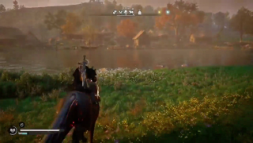

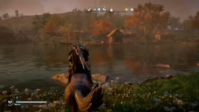

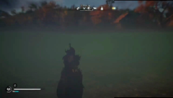

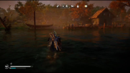

**Question:** Describe the visual glitches observed in the video. 

**Answer of Our PhysVLM:** In the video, the player is riding a horse through a landscape and into a body of water. Initially, everything appears normal as the horse moves smoothly across the terrain and into the water. However, as the horse continues to move deeper into the water, it begins to behave unusually. The horse and rider seem to pass through the water as if it were solid ground, and at one point, the horse appears to be walking underwater, which defies typical in-game physics and real-world expectations. This suggests a glitch in the game's handling of water interaction for the horse and rider. 

**Answer of GPT-4o:** The visual glitch observed in the video involves a character on horseback approaching a body of water. As the horse and rider enter the water, the game briefly displays a distorted effect where the visuals become warped and stretched, creating irregular lines and shapes. This glitch momentarily disrupts the normal rendering of the scene before the character and horse are shown correctly under the water again, and then continuing to move through it. 

**Answer of LLaVA-Next-Video:** The visual glitch observed in the video is a graphical error where the horse's head appears to be disconnected from its body. This creates a surreal and disjointed appearance, as if the horse's head is floating independently above its body. This glitch is likely due to a technical issue or a bug in the game's rendering process, causing the horse's head to be displayed incorrectly in relation to its body. It is not a normal visual representation and can be quite jarring to the player, as it breaks the immersion of the game. 

(a) 

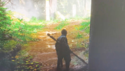

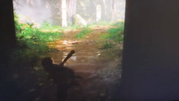

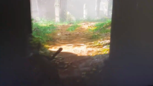

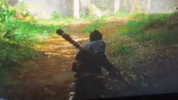

**Question:** What violates physical commonsense in this video? 

**Answer of Our PhysVLM:** In the video, there is a noticeable issue with the character's movement as they transition from a dimly lit area to a brighter, sunlit path. The character appears to be walking with a consistent gait, but there is a slight inconsistency in the way the lighting and shadows adjust as they move. The character's shadow seems to lag slightly behind, and there is a moment where the lighting seems to flicker or change abruptly, suggesting a potential issue with how the environment's lighting is rendered or synchronized with the character's movement. This could indicate a minor bug in the game's lighting or rendering system. 

**Answer of GPT-4o:** The glitch in this video appears to be that the character is getting stuck or resetting back to the same starting position whenever they try to exit the area. This could be due to a collision detection issue or an invisible barrier preventing progress. The character seems to cycle back to the same point repeatedly instead of moving forward through the scene. 

**Answer of LLaVA-Next-Video:** The video you've described appears to be a scene from a video game, possibly from the "The Last of Us" series, where the player character is navigating through a forest. The glitch in this scene is that the character's movement is not smooth and fluid, but rather jerky and stuttered, which is not typical for a well-optimized game. This could be due to a variety of reasons such as a low frame rate, poor performance, or a bug in the game's animation system. It's not a typical behavior for a character in a welldesigned game, as they are usually animated with a higher level of fluidity and smoothness to provide a more immersive experience. 

(b) 

Figure 5. **Qualitative examples** of open-ended questions. 

17 

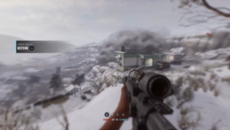

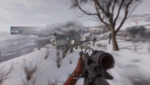

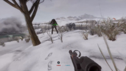

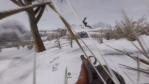

**Question:** Could you describe the error occurring in the game video? 

**Answer of Our PhysVLM:** In the video, there is a noticeable glitch where one of the characters appears to be floating or levitating above the ground. The player is moving through a snowy landscape, aiming their weapon, and at one point, an enemy character seems to defy the expected behavior by hovering instead of walking or running. This unexpected movement suggests a physics or animation bug within the game. 

**Answer of GPT-4o:** The error in the game video appears to be related to a graphical glitch. The entire screen is significantly blurred, which can affect visibility and gameplay. This could be due to a depth of field setting or a rendering issue, causing the environment and characters to appear out of focus. 

**Answer of LLaVA-Next-Video:** In the video, a player is seen holding a gun and aiming it at a target, but the game seems to be experiencing a glitch where the target is not moving or reacting to the player's actions. The player is unable to shoot the target, and the game's response to the player's actions is delayed or unresponsive. This could be due to a bug in the game's programming or a temporary issue with the server. The player's character is standing in a snowy environment, and the game's graphics are not smooth, indicating that the game may be experiencing technical difficulties. The player's character is also wearing a helmet, and the environment is quite barren, with no other players or objects visible in the immediate vicinity. 

(a) 

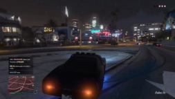

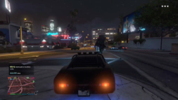

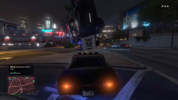

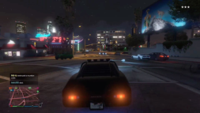

**Question:** What glitch was triggered during the gameplay? 

**Answer of Our PhysVLM:** In the video, the player is driving a high-performance sports car through the city at night when police cars begin to pursue. As the police close in, the player's car collides with one of the police vehicles. This collision seems to trigger a physics glitch where the police car unexpectedly flips into the air, which is not typical behavior for such a collision in the game. The unexpected aerial maneuver suggests a possible issue with the collision detection or physics engine in the game. 

**Answer of GPT-4o:** The glitch triggered during the gameplay seems to be related to a vehicle collision or physics bug. The vehicle appears to be in unexpected positions or behaving strangely, indicating a potential glitch in the game's physics engine. This could be a common occurrence in open-world games where objects interact unpredictably. 

**Answer of LLaVA-Next-Video:** The image you've provided appears to be from a video game, possibly from a racing or driving simulation game, given the environment and the vehicles. The glitch that seems to have been triggered is the car's rear lights not functioning correctly. The tail lights are not illuminating properly, which could be due to a bug in the game's rendering or a glitch in the physics engine. This can happen in video games where the car's lighting system is not functioning as intended, causing the tail lights to appear as if they are not lit or are not functioning correctly. This can sometimes be a visual glitch that can be fixed by restarting the game or a more serious issue that requires a patch or update to the game. 

(b) 

Figure 6. **Qualitative examples** of open-ended questions. 

18 

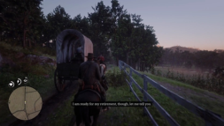

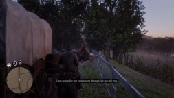

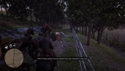

**Question:** What best describes the glitch observed in the video? 

A: An NPC riding a horse collided with a wagon and got stuck between it and a fence. 

B: The player riding a horse collieded with a wagon causing the player fell out of the map. C: An NPC riding a horse collided with a wagon and then disappeared completely. 

D: The player riding a horse clipped with a wagon and an NPC. 

**Answer of Our PhysVLM:** A. 

**Answer of GPT-4o:** C. 

**Answer of LLaVA-Next-Video:** B. 

(a) 

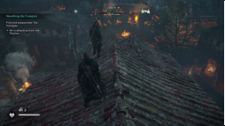

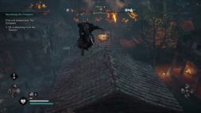

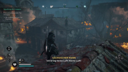

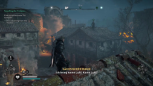

**Question:** What glitch is present in the gameplay footage? 

A: The NPC is not moving normally; instead, its model is floating and translating above the buildings. 

B: The NPC jumped into the tree and disappeared on the road after he ran for a while. 

C: The player's character suddenly flew into the air in an unrealistic manner. 

D: The NPC is moving fastly and stuck on the roof after jumping from the ground. 

**Answer of Our PhysVLM:** A. 

**Answer of GPT-4o:** D. 

**Answer of LLaVA-Next-Video:** D. 

(b) 

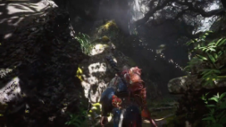

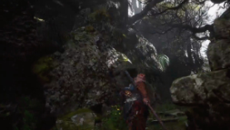

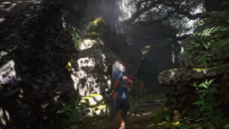

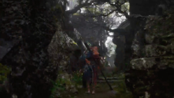

**Question:** Which event in the game triggered the glitch? 

A: When the player moves forward, the viewpoint exhibits abnormal shaking, and the direction tracking is erratic. 

B: When the player moves forward, the trees ahead are modeled incorrectly, floating in mid-air. 

C: When the player moves forward, the lighting and shadows behave abnormally. 

D: When the player moves forward, the rocks are modeled incorrectly, with part of the texture missing. 

**Answer of Our PhysVLM:** C. 

**Answer of GPT-4o:** B. **Answer of LLaVA-Next-Video:** A. 

(c) 

Figure 7. **Qualitative examples** of multi-choice questions. The correct options are marked in green. 

19 

Table 13. **Prompt** for instruction-tuning data generation in PhysInstruct. 

“role”: “system” 

You are an AI visual assistant, and you are seeing a video and a title as a hint. Watch the video carefully and analyze the events and object movements, focusing on any inconsistencies with physical laws. Please design a conversation between you and the person asking about the game description and the glitch especially. Example questions: What is the description of the glitch observed in the video? Are there any abnormalities present in the videos? Please provide a description of the video content. 

“role”: “user” Title of the video: “ _{_ title _}_ ”. This hint might not be accurate. Your analysis should be based primarily on your own observations and understanding of the video and do not imply the title in any of your generation. Please directly design questions like the example and answer them in detail. Ensure that all descriptions are at the video level, do not refer to “images” or “frames”. 

Table 14. **Prompt** for response generation in PhysDPO. The false ~~t~~ itle is randomly selected from the other videos and the question is instantiated by the same instruction in PhysInstruct. 

“role”: “system” 

You are an AI visual assistant, and you are seeing a video and a title as a hint. Watch the video carefully and analyze the events and object movements, focusing on any inconsistencies with physical laws. Please design a conversation between you and the person asking about the game description and the glitch especially. 

“role”: “user” Title of the video: “ _{_ false ~~t~~ itle _}_ ”, Questions: “ _{_ question _}_ ”. Please repeat the question (Question:) and answer them in detail (Answer:). Ensure that all descriptions are at the video level, do not refer to “images” or “frames”. 

Table 15. **Prompt** for evaluation generation in PhysGame. 

Watch the video carefully and analyze the events and object movements, focusing on any inconsistencies with physical laws. Identify and highlight instances where the behavior deviates from expected real-world physics, and select the most accurate option to describe the detected glitch. 

Answer with the option letter from the given choices directly. 

20 

