Published in Transactions on Machine Learning Research <u>(January/2026)</u> 

# **Order from Chaos: Physical World Understanding from Glitchy Gameplay Videos** 

**Meng Cao****1**_∗_ **, Haoran Tang****2**_∗_ **, Haoze Zhao****1**_∗_ **, Mingfei Han****1** **, Ruyang Liu****2** **, Qiang Sun****1,3**_†_ **, Xiaojun Chang****1** **, Ian Reid****1** **, Xiaodan Liang****1,4**_†_ 

> **1Mohamed bin Zayed University of Artificial Intelligence 2Peking University** 

> **3University of Toronto 4Sun Yat-sen University** 

> ***Authors contributed equally to this research.** 

- **†Corresponding author.** 

**Reviewed on OpenReview:** **`https://openreview.net/forum?id=Oe5TdpPv1b`** 

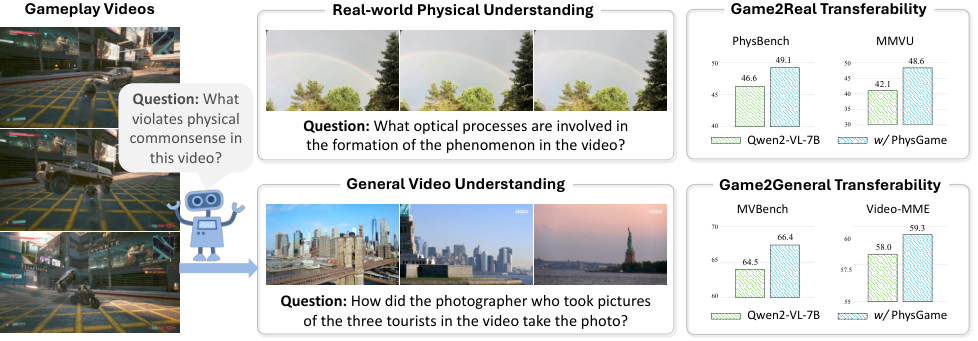

<!-- Start of picture text -->
Gameplay Videos Real-world Physical Understanding Game2Real Transferability PhysBench MMVU 50 49.1 50 48.6 46.6 45 42.1 Question:  What  45 4035 violates physical  Question:  What optical processes are involved in  40 30 commonsense in  the formation of the phenomenon in the video?  Qwen2-VL-7B w/  PhysGame this video? General Video Understanding Game2General Transferability MVBench Video-MME 70 59.3 66.4 60 58.0 65 64.5 57.5 Question:  How did the photographer who took pictures  60 55 of the three tourists in the video take the photo?  Qwen2-VL-7B w/  PhysGame <!-- End of picture text -->

Figure 1: We propose PhysGame, an instruction-tuning dataset constructed from gameplay videos with glitch-induced question-answer pairs. Our method demonstrates consistent performance improvements on downstream benchmarks for both real-world physical understanding (Game2Real) and general video understanding (Game2General) tasks. 

## **Abstract** 

Understanding the physical world, including object dynamics, material properties, and causal interactions, remains a core challenge in artificial intelligence. Although recent multi-modal large language models (MLLMs) have demonstrated impressive general reasoning capabilities, they still fall short of achieving human-level understanding of physical principles. Existing datasets for physical reasoning either rely on real-world videos, which incur high annotation costs, or on synthetic simulations, which suffer from limited realism and diversity. In this paper, we propose a novel paradigm that leverages glitches in gameplay videos, referring to visual anomalies that violate predefined physical laws, as a rich and scalable supervision source for physical world understanding. We introduce PhysGame, an instruction-tuning dataset containing 140,057 glitch-centric question–answer pairs across five physical domains and sixteen fine-grained categories. To ensure data accuracy, we design a meta-information–guided prompting strategy that utilizes gameplay metadata such as titles and descriptions to guide high-quality QA generation. Complementing PhysGame, we construct GameBench, an expert-annotated benchmark with 880 glitch-identified gameplay videos designed to evaluate physical reasoning capabilities. Extensive experiments show that PhysGame significantly enhances both Game2Real transferability, improving the real-world physical reasoning performance of Qwen2.5-VL by 2.5% on PhysBench, and Game2General 

1 

Published in Transactions on Machine Learning Research <u>(January/2026)</u> 

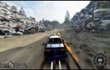

**_Question:_** Is there any notable glitch in the video that affects the gameplay? **_Answer_ :** While navigating the course, the car door is oddly hanging open, which does not seem to affect its speed or performance. This could be considered a minor glitch, as such damage should typically impact aerodynamics or handling in a realistic scenario. There is no major collision effect noticeable when cars collide, suggesting the physics might not fully replicate real-world damage 

**_Question:_** How would you describe the glitch in the video? **_Option_ :** 

A: Blocked by a tree, the car's speed instantly surged from zero to over 200 mph. B: While the player's car is on the bridge, it casts no shadow. C: On the left lane of the tree-lined road, there are flickering red light patches. D: The clouds in the sky exhibit an unusual green hue. 

Figure 2: **Sampled examples** in the proposed PhysGame instructing dataset (left) and the GameBench evaluation benchmark (right). 

transferability, yielding a 1.9% gain on the MVBench benchmark. Moreover, PhysGametuned models achieve a 3.7% absolute improvement on GameBench, demonstrating enhanced robustness in detecting physical implausibilities. These results indicate that learning from gameplay anomalies offers a scalable and effective pathway toward advancing physical world understanding in multimodal intelligence. 

## **1 Introduction** 

“In all chaos there is a cosmos, in all disorder a secret order." 

- Carl Jung, _Archetypes and the Collective Unconscious_ 

Physical world understanding McCloskey et al. (1983); Melnik et al. (2024); Duan et al. (2022) represents a fundamental challenge in artificial intelligence, encompassing the understanding of physical properties, object interactions, and temporal dynamics. Even before language acquisition, children begin to grasp fundamental principles of the physical world by observing the environment around them Hespos & Spelke (2004). While recent multi-modal large language models (MLLMs) Achiam et al. (2023); Reid et al. (2024); Brown et al. (2020); Touvron et al. (2023) have achieved remarkable advancements across various domains, their capabilities in physical world understanding remain substantially inferior to human-level intelligence Wang et al. (2024c); Zheng et al. (2024); Chow et al. (2025); Zhao et al. (2025); Xiang et al. (2025). For example, on the physical understanding benchmark PhysBench Chow et al. (2025), the state-of-the-art MLLM GPT-4o OpenAI (2024) achieves merely 49.49% average accuracy, falling far short of the human-level performance (95.87%). 

The majority of existing physical world understanding datasets can be categorized into two types: _1) Realworld video data_ Chow et al. (2025); Zhao et al. (2025); Xiang et al. (2025): While capable of capturing complex backgrounds and heterogeneous compositional elements for physical reasoning, such data typically requires high annotation costs involving careful curation of specific video types and time-consuming questionanswering (QA) annotation processes; 2) _Simulator-generated synthetic data_ Yi et al. (2020); Zheng et al. (2024); Chen et al. (2022); Bear et al. (2021): These datasets employ physical simulators ( _e.g_ ., Blender Conlan (2017) and Unity Haas (2014)) to create controllable scenarios for physical reasoning. However, they often exhibit uniform backgrounds and simplistic visual primitives ( _e.g_ ., cube, cylinder), leading to a substantial domain gap between synthetic representations and complex real-world physical scenarios Wang et al. (2024c). Based on the preceding analysis, we contend that neither data type is well-suited as a source for generating _large-scale instruction-tuning datasets_ aimed at physical world understanding. 

In this paper, we propose an alternative perspective by learning from glitches in gameplay videos Chen et al. (2021); Ling et al. (2020); Nantes et al. (2008), _i.e_ ., inconsistencies between pre-defined physical rules and observed visual manifestations caused by rendering errors, physics engine limitations, or unexpected object interactions. For example, Figure 1 illustrates an implausible scenario in which a motorcycle unrealistically propels a car into the air, violating basic physical laws. Our motivation is inspired by the _philosophical_ 

2 

Published in Transactions on Machine Learning Research <u>(January/2026)</u> 

_notion of Order from Chaos_ , which emphasizes that understanding often emerges more clearly by identifying and characterizing deviations from expected regularities. In other words, explicitly modeling violations of physical rules enables a sharper grasp of the principles that normally govern the physical world. To this end, we introduce **PhysGame** , an instruction-tuning dataset constructed by harvesting **game** play videos with glitches to advance **phy** sical world understanding. PhysGame contains 140,057 question–answer pairs targeting glitch-related content across five key physical domains ( _i.e_ ., mechanics, optics, material properties, thermodynamics, and electromagnetism) and sixteen fine-grained categories ( _e.g_ ., gravity and velocity). To ensure the accuracy of the generated QA pairs, we propose a meta-information–guided prompting strategy, which incorporates video-associated metadata ( _e.g_ ., content-summarizing video titles) when prompting leading MLLMs such as GPT-4o OpenAI (2024). Furthermore, we introduce **GameBench** , a complementary evaluation benchmark comprising 880 glitch-identified gameplay videos, each accompanied by expert-curated multiple-choice questions that explicitly probe glitch characteristics. The sampled examples of PhysGame instruction dataset and GameBench evaluation benchmark are presented in Figure 2. Compared to existing approaches, our proposed PhysGame captures dynamic and diverse scenes that resemble real-world physical complexity, while remaining highly scalable due to the abundance of online data and reduced annotation cost through glitch identification. In addition, incorporating previously unseen glitches from the PhysGame dataset during post-training further enhances generalization and remedies the deficiencies of current MLLMs in glitch identification within gameplay videos. For example, built upon Qwen2-VL Wang et al. (2024a), post-training with the PhysGame dataset yields an absolute improvement of 6.3% in average accuracy on our constructed GameBench benchmark ( _cf_ . Table 3). 

In terms of the aforementioned advantages, we demonstrate that PhysGame consistently enhances downstream benchmark performance across both physical understanding and general video understanding tasks. Specifically, two transferability characteristics of PhysGame are highlighted: 1) **Game2Real** Transferability: Despite being constructed from _simulated_ gameplay videos, PhysGame finetuning significantly improves _real-world_ physical reasoning. As shown in Figure 1, Qwen2-VL Bai et al. (2025) achieves 2.5% absolute improvement (46.6% _vs_ . 49.1%) on PhysBench benchmark Chow et al. (2025) after finetuning on the proposed PhysGame dataset; 2) **Game2General** : Physical knowledge acquired from gameplay videos can generalize to broader and general-purpose video understanding tasks. For example, the PhysGame-enhanced Qwen2.5VL Bai et al. (2025) shows 1.3% performance gain (58.0% _vs_ . 59.3%) on Video-MME Fu et al. (2024) benchmark. This dual transferability paradigm demonstrates that gameplay-derived training bridges both simulation-to-reality and physical-to-general understanding, offering new pathways for scalable and effective multi-modal intelligence development. 

In summary, our contributions are in three-folds: 

- We pioneer the use of gameplay videos as a novel training medium for physical world understanding, which overcomes the simplified settings in synthetic data while avoiding the high annotation costs of real-world video curation. 

- We introduce PhysGame and GameBench, establishing a suite of scalable datasets for physics-oriented instruction tuning and evaluation, respectively. 

- Experimental results validate the Game2Real and Game2General transferabilities of the proposed PhysGame dataset, bridging the simulated physics data and real-world physical understanding tasks as well as general video understanding tasks. 

## **2 Related Work** 

**Physical World Understanding.** Recent advances in physical understanding have driven interdisciplinary research spanning psychology Bobrow (1984); Hespos et al. (2016); McCloskey et al. (1983), language reasoning Bisk et al. (2020); Forbes et al. (2019), visual reasoning Lerer et al. (2016); Yi et al. (2020), video generation Meng et al. (2024); Bansal et al. (2024), robotics Agrawal et al. (2016); Byravan et al. (2017), _etc_ . The primary datasets for physical understanding Battaglia et al. (2016); Chang et al. (2016) employ symbolic representation by encoding physical knowledge through textual descriptors ( _e.g_ ., object attributes and interaction rules). However, such representations fundamentally lack the capacity to capture complex visual information, resulting in compromised perception. The recent datasets can be categorized into two 

3 

Published in Transactions on Machine Learning Research <u>(January/2026)</u> 

Table 1: **(a) Comparisons of physical understanding datasets** ; **(b) Comparisons with existing gameplay video benchmarks** in terms of whether they are video-based, whether they follow an instructionfollowing format, and support multi-modal evaluations. 

|**Dataset**|**Photo-** **realistic**|**Scalable** **to Collect**|**Instruct** **Tuning**|**Dataset**||**Video-** **Based**|**Instruct** **Tuning**|**Multi-** **modality**|
|---|---|---|---|---|---|---|---|---|
|PhysBench Taesiri & Bezemer (2024)|✓|✗|✗|GameBunny Taesiri & Bezemer|(2024)|✗|✓|✓|
|MMVU _et.al_ Taesiri et al. (2022a)|✓|✗|✗|Taesiri _et.al_ Taesiri et al. (2022a|)|✓|✗|✓|
|CLEVER Taesiri et al. (2022b)|✗|✓|✗|GameBugDescript Taesiri et al.|(2022b)|✓|✓|✗|
|Comphy Chen et al. (2024e)|✗|✓|✗|GlitchBench Taesiri et al. (2024|a)|✗|✓|✓|
|**PhysGame (Ours)**|✓|✓|✓|**PhysGame (Ours)**||✓|✓|✓|
|(a)|||||(b)||||

principal types: 1) Real-world observational datasets capturing natural physical phenomena Chow et al. (2025); Zhao et al. (2025). This kind of dataset requires labor-intensive video curation, inherently limiting scalability in physical scenario coverage; 2) Physics-simulated datasets generated through differentiable engines Yi et al. (2020); Zheng et al. (2024); Chen et al. (2022); Bear et al. (2021). While offering controllable physical environments, they are constrained to simplified geometric primitives ( _e.g_ ., rigid cuboids/spheres) and homogeneous backgrounds, leading to significant sim-to-real discrepancy in visual perception. Building on this analysis, we propose a novel approach to facilitate physical world understanding by analyzing physics glitches in gameplay videos. This method establishes a scalable framework with closer alignment to real-world physical scenarios, effectively bypassing the limitations of existing datasets. 

**Gameplay Video Understanding.** Digital games Hu et al. (2024a); Xu et al. (2024b) are considered pivotal in pursuing artificial general intelligence, as they act as controllable real-world simulators and create complex problem-solving contexts. Therefore, gameplay videos are typically employed as benchmarks for evaluating the capabilities of vision-language models from the perspectives of environment perception Hong et al. (2023); Akoury et al. (2023), context reasoning Liu et al. (2023); Wang et al. (2023), decision-making Chen et al. (2023); Qian et al. (2023), _etc_ . The majority of existing games can be classified into two categories: 1) _Competition games_ Ma et al. (2023); Shao et al. (2024); Hu et al. (2024b); Feng et al. (2024); Toshniwal et al. (2022); Li et al. (2023); Gupta (2023); Huang et al. (2024); Guo et al. (2023); Zhang et al. (2024c) in which players compete against one another, with the objective of outperforming others to achieve victory. Notable examples include StarCraft II Ma et al. (2023); Shao et al. (2024), Pokémon Battles Hu et al. (2024b), Chess Feng et al. (2024); Toshniwal et al. (2022); Li et al. (2023) and Poker Gupta (2023); Huang et al. (2024); Guo et al. (2023); Zhang et al. (2024c). Ma et al. Ma et al. (2023) introduce TextStarCraft II, a natural language-based interface that equips LLMs with the functionality to play StarCraft II, fostering more effective reasoning and decision-making capabilities; 2) _Cooperation games_ Carroll et al. (2019); Gong et al. (2023); Wu et al. (2021); Puig et al. (2021); Chen et al. (2024a); Gan et al. (2021b); Puig et al. (2018); Gan et al. (2021a) are structured around collaboration, requiring players to work together to achieve shared goals. These games emphasize teamwork, communication, and joint problem-solving, where players must coordinate efforts to succeed and reach mutual accomplishments. In Overcooked-AI Carroll et al. (2019), the preparation of an onion soup requires two agents to collaborate by loading three onions into a cooking pot, thereby initiating a cooking process that spans 20-time steps. 

The most relevant line of research to ours is on the topic of game bug detection (Taesiri et al., 2022a; 2024a; 2022b; Taesiri & Bezemer, 2024; Taesiri et al., 2024b). Existing methods, however, either focus the classification/retrieval tasks Taesiri et al. (2022a) or limited in the static image domain Taesiri & Bezemer (2024); Taesiri et al. (2024a) ( _cf_ . Table 1b). The prior work GameBugDescriptions Taesiri et al. (2022b) employs LLMs to detect bugs in game videos with the reliance on pre-extracted event-wise _textual_ descriptions and lacks support for multi-modal evaluations. In contrast, our PhysGame addresses all these limitations and supports multi-modal instruction tuning in videos. 

4 

Published in Transactions on Machine Learning Research <u>(January/2026)</u> 

||Magnetism Electrici|Gravity Elasticity|**Statistics of PhysGame**|**Value**|
|---|---|---|---|---|
|Heat conduction |ty|Friction|Total number of QA pairs Unique Videos|140,057 38,957|
||**Electro.**||Question Length (avg/max)|9.81 / 113|
|Phase change|**Thermo.**|Velocity **Mechanics**|Answer Length (avg/max) Video Length (Seconds, avg/max)|53.49 / 143 23.33 / 2611.17|
|Body gesture||Acceleration|**Statistics of GameBench**|**Value**|
|Object shap|e **Material** **properties**|Reflection    **Optics**|Total number of QA pairs Unique Videos|880 880|
||dity|Refra Abso & tra|Question Length (avg/max)|9.06 / 17|
||r Rigi|ction rption nsmi|Answer Length (avg/max)|14.46 / 38|
||Colo| ssion|Video Length (Seconds, avg/max)|25.82 / 239.57|

(a) (b) 

Figure 3: **(a) The taxonomy** and **(b) key statistics** of the PhysGame and GameBench dataset. 

## **3 Dataset Construction** 

### **3.1 PhysGame** 

Building on the intuitive cognition of physical understanding, PhysGame introduces a comprehensive taxonomy for task categorization including five primary domains, _i.e_ ., mechanics, optics, material properties, thermodynamics, and electromagnetism, and sixteen fine-grained categories ( _cf_ . Figure 3a). 

- _Mechanics_ : This category deals with forces and torques as well as their effects on motion, which provides the foundational principles to interpret and analyze the motion of objects in videos. Typical cases include gravity, elasticity, friction, velocity and acceleration over time. 

- _Optics_ : It focuses on the behavior and properties of light as well as its interactions with matter. It includes reflection, refraction, and absorption & transmission. 

- _Material properties_ : It refers to the inherent material characteristics including color, rigidity, object shape, and human body gesture. 

- _Thermodynamics_ : This category involves the study of heat, temperature, and energy transfer between systems. Typical cases include heat conduction and phase change. 

- _Electromagnetism_ : It encompasses phenomena related to the electric and magnetic fields and their interactions with matter. 

**Video Collection.** The videos of PhysGame dataset are curated from the `GamePhysics` subreddit1 , a community where users share gameplay videos exhibiting various unusual events and glitches across different games, accompanied by the users’ discussions (meta-information). This platform offers abundant glitch-containing gameplay footage alongside meta-information that broadly describes glitch characteristics, enabling the scalability of our proposed PhysGame dataset. 

**Instruction-following Generation.** We follow the self-instruction paradigm Li et al. (2024a) to construct PhysGame by prompting GPT-4o OpenAI (2024). In terms of the instruction generation, we aspire for the questions to be as diverse as possible. We set up three question types, varying from direct to indirect assessment of the glitches in videos: i) explicitly inquiring about glitches in the video, ii) probing anomalies present in the video, iii) or merely straightforward questions regarding the video content. We provide three examples corresponding to the mentioned three scenarios: i) _What is the description of the glitch observed_ 

> 1 `www.reddit.com/r/GamePhysics/` 

5 

Published in Transactions on Machine Learning Research <u>(January/2026)</u> 

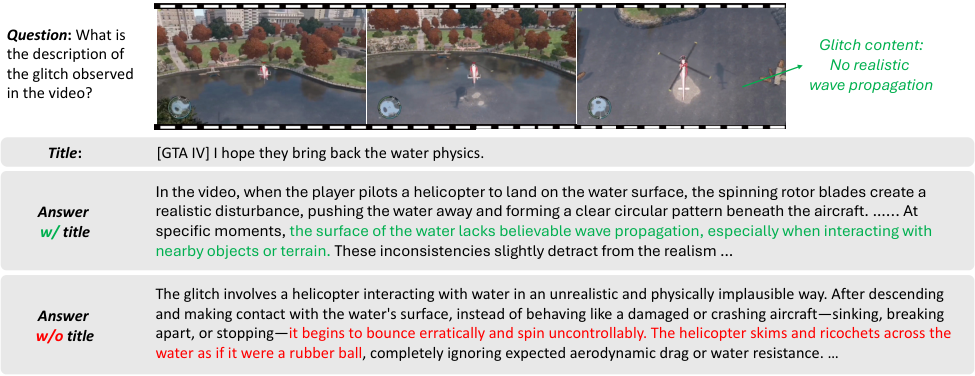

<!-- Start of picture text -->
Question :  What is Glitch content: the description of No realistic the glitch observed in the video? wave propagation Title : [GTA IV] I hope they bring back the water physics. In the video, when the player pilots a helicopter to land on the water surface, the spinning rotor blades create a Answer realistic disturbance, pushing the water away and forming a clear circular pattern beneath the aircraft. …... At w/ title specific moments, the surface of the water lacks believable wave propagation, especially when interacting with nearby objects or terrain. These inconsistencies slightly detract from the realism … The glitch involves a helicopter interacting with water in an unrealistic and physically implausible way. After descending Answer and making contact with the water's surface, instead of behaving like a damaged or crashing aircraft—sinking, breaking w/o title apart, or stopping—it begins to bounce erratically and spin uncontrollably. The helicopter skims and ricochets across the water as if it were a rubber ball, completely ignoring expected aerodynamic drag or water resistance. … <!-- End of picture text -->

Figure 4: **The generated responses in PhysGame dataset** with or without meta-information hints ( _i.e_ ., titles). The title indicates a glitch related to _water physics_ . With the title hints, the generated responses accurately identify that the surface of the water lacks realistic wave propagation; in contrast, the response contains hallucinated content without the title hints. 

Table 2: **Quality validation** for the proposed PhysGame dataset. 

|**Meta Data Acc**|**QA Acc** **_w/_ Meta**|**QA Acc** **_w/o_ Meta**|
|---|---|---|
|86%|91%|64%|

_in the video?_ ii) _Are there any abnormalities present in the videos?_ iii) _Please provide a description of the video content._ 

As for the response generation, the preliminary experiments suggest that the intuitive prompting method leads to remarkable errors. To alleviate this, we propose a _meta-information guided prompting_ strategy. Specifically, we found that the meta-information ( _e.g_ ., title) associated with each video offers insight into the fundamental content. Therefore, we propose to incorporate video-wise meta-information in the prompt, resulting in more accurate instruction-following generation. As shown in Figure 4, the meta-information helps GPT-4o to detect the “ _water physics_ " glitch, while its absence leads to the degradation of physical commonsense understanding. The key statistics of the constructed PhysGame are presented in Table 3b. 

**Quality Control.** Given the scale of our instruction dataset, per-sample manual verification proves infeasible. We implement a systematic quality validation framework by sampling 2,000 instances and conducting two-tier manual verification: 1) metadata relevance to video semantics, and 2) QA alignment with observed physical anomalies. The experiments in Table 2 show 86% metadata accuracy and 91% QA accuracy, demonstrating the overall reliability of our PhysGame. In addition, the comparison between QA accuracy with and without metadata (91% _vs_ . 64%) confirms that incorporating meta-information improves the quality of generated instruction data. 

### **3.2 GameBench** 

**Video Collection and Filter.** The video collection procedure of GameBench follows the same process as that in PhysGame. To prevent data leakage, we diligently exclude any videos included in PhysGame. We conduct manual checks based on the following two criteria: 1) _Duplicate check_ : The Reddit1 discussion forum may feature multiple references to the same video, resulting in duplicate downloading. We manually check to confirm that each video in GameBench is distinct; 2) _Content check_ : The pool of downloaded videos may incorporate non-game elements, which we rigorously filter out of our GameBench benchmark. 

6 

Published in Transactions on Machine Learning Research <u>(January/2026)</u> 

**Annotation Scheme.** Based on the collected gameplay videos, we create the question-answer pairs in a four-way multiple-choice format to facilitate convenient evaluation. Specifically, the correct options describe the video-specific glitches that contravene physical commonsense principles. It is important to note that some videos may exhibit multiple glitches. We therefore instruct expert annotators to review the entire video to ensure all the appearing glitches are included in the correct answer. 

To enhance the plausibility of the distractor options, we have provided expert annotators with three guiding principles: **1)** Instead of imagining arbitrary glitches, the glitch in the distractor options should be highly correlated to the individuals or actions observed in the videos. For example in Figure 2 (right), the distractor option B includes “ _car_ " and “ _shadow_ " that are genuinely present in the video. This annotation principle forces MLLMs to comprehend the glitchy content, rather than merely selecting answers by identifying contained objects or actions; **2)** The four choice options should be of similar length, which helps prevent any preference biases in MLLMs; **3)** To mitigate choice bias, the distribution of the correct option among the four choices should be equitable, ( _i.e_ ., 25% likelihood for each option). 

**Quality Control.** To guarantee the quality of our dataset, we conduct a two-fold quality control process: **1)** _LLM-assisted inspection_ : We exclude question-answering pairs that can be correctly answered by GPT-4o OpenAI (2024) solely based on the question and options without the need to view the video. By statistics, we limit the accuracy of GPT-4o in the question-only scenario to less than 25%; **2)** _Human inspection_ : All the initially annotated question-answering pairs undergo rigorous cross-inspection by different human annotators. For the correct options, the inspectors must assess whether they comprehensively and accurately describe all instances of physical commonsense violations present. For the distractor options, the inspectors are required to evaluate whether they are sufficiently deceptive, specifically by including objects or actions depicted in the video. Through the rigorous construction and review process, we present the GameBench benchmark which is of high quality and well-balanced. The specific statistics are available in Table 3b. 

## **4 Experiments** 

### **4.1 Experimental Settings** 

**Baseline and Implementation Details.** To evaluate the efficiency of the PhysGame dataset, we performed supervised fine-tuning on three MLLMs: Qwen2-VL-7B Wang et al. (2024a), Qwen2.5-VL-7B Bai et al. (2025), and InternVL2.5-8B Chen et al. (2024c). To prevent the model from becoming overly biased toward the gameplay video domain during fine-tuning, we additionally incorporated 20K samples from the general video instruction tuning dataset LLaVA-Hound Zhang et al. (2024b), forming a total training set of 160K samples. The Qwen series models Wang et al. (2024a); Bai et al. (2025) were trained for one epoch with a batch size of 128 and a learning rate of 2e-7, whereas InternVL2.5-8B Chen et al. (2024c) employed a higher learning rate of 1e-6 with an equivalent batch size. All models processed 32-frame video sequences as input. Experiments were conducted on 8 NVIDIA A100 GPUs. 

**Evaluation Benchmarks.** To demonstrate the broad applicability of our PhysGame dataset, we conducte experiments across both physical world understanding and general video understanding tasks: 

- _Physical World Understanding_ : Depending on the video data source, we evaluate on two categories of benchmarks: gameplay-based dataset ( _i.e_ ., our self-constructed GameBench) and real-world datasets ( _i.e_ ., PhysBench Chow et al. (2025) and MMVU Zhao et al. (2025)). 

- _General Video Understanding_ : We further validate the broad value of PhysGame through evaluations on established general video understanding benchmarks including MVBench Li et al. (2024b), VideoMME Fu et al. (2024) and LongVideoBench Wu et al. (2024). 

### **4.2 Physical Understanding** 

**Evaluation Results on GameBench.** For comparisons, we benchmark the proposed GameBench on both proprietary MLLMs ( _i.e_ ., Claude3.5-Sonnet Anthropic (2024), Claude3.5-SonnetV2 Anthropic (2024), Gemini-1.5-pro Team et al. (2024), Gemini-1.5-pro-flash Team et al. (2024), GPT-4V Achiam et al. (2023), GPT-4o-0806 OpenAI (2024), GPT-4o-mini-0718 OpenAI (2024) and Qwen-VL-max Bai et al. (2023)) and 

7 

Published in Transactions on Machine Learning Research <u>(January/2026)</u> 

Table 3: **Evaluation (%) results on the proposed GameBench benchmark** including the domains of mechanics, optics, material properties, thermodynamics, and electromagnetism. 

|**Models**|**AVG**|**Mechanics**|**Optics**|**Material**|**Thermo**|**Electro**|
|---|---|---|---|---|---|---|
|Claude3.5-Sonnet Anthropic (2024)|54.3|53.7|49.6|54.5|71.4|55.3|
|Claude3.5-SonnetV2 Anthropic (2024)|47.6|47.0|42.1|51.9|53.1|46.8|
|Gemini-1.5-pro Team et al. (2024)|55.2|55.0|49.6|58.7|63.3|51.1|
|Gemini-1.5-pro-flash Team et al. (2024)|48.5|50.4|41.4|50.3|49.0|42.6|
|GPT-4V Achiam et al. (2023)|45.9|45.9|43.6|43.9|53.1|53.2|
|GPT-4o OpenAI (2024)|56.1|55.4|48.9|60.3|67.3|55.3|
|GPT-4o-mini OpenAI (2024)|40.3|40.7|39.1|41.3|36.7|40.4|
|Qwen-VL-Max|50.9|46.8|52.6|55.0|69.4|51.1|
|LLaVA-Next-Video Liu et al. (2024b)|32.2|31.8|25.6|37.0|42.9|23.4|
|Video-LLaVA Lin et al. (2023)|29.0|29.2|28.6|31.2|30.6|17.0|
|LLaVA-OneVision|47.7|46.3|48.1|49.2|59.2|42.6|
|InternVL2 Chen et al. (2024c)|33.4|34.2|37.6|29.1|30.6|34.0|
|VideoChat2|34.3|33.1|31.6|37.0|44.9|31.9|
|ST-LLM|32.8|30.3|30.8|38.6|49.0|23.4|
|Chat-UniVi Jin et al. (2024)|29.5|30.7|30.1|30.7|20.4|21.3|
|PPLLaVA|38.4|37.7|38.3|36.0|51.0|42.6|
|Qwen2-VL-7B Wang et al. (2024a)|37.5|35.5|34.6|37.0|34.7|34.0|
|_w/_ PhysGame|**43.8**|**45.5**|**47.4**|**48.7**|**40.8**|**36.2**|
|∆|+6.3|+10.0|+12.8|+11.7|+6.1|+2.2|
|Qwen2.5-VL-7B Bai et al. (2025)|44.4|46.5|40.6|46.0|34.7|38.3|
|_w/_ PhysGame|**48.1**|**51.5**|**42.1**|**48.1**|**34.7**|**44.7**|
|∆|+3.7|+5.0|+1.5|+2.1|0.0|+6.4|
|InternVL2.5-8B Chen et al. (2024c)|38.6|35.9|33.1|43.4|59.2|40.4|
|_w/_ PhysGame|**48.0**|**44.4**|**43.6**|**56.6**|**67.3**|**40.4**|
|∆|+9.4|+8.5|+10.5|+13.2|+8.1|+0.0|

open-source models including LLaVA-Next-Video Liu et al. (2024b), Video-LLaVA Lin et al. (2023), LLaVAOneVision Li et al. (2024a), InternVL2 Chen et al. (2024d), VideoChat2 Li et al. (2024b), ST-LLM Liu et al. (2024c), Chat-UniVi Jin et al. (2024) and PPLLaVALiu et al. (2024d). We follow Video-MME Fu et al. (2024) to utilize the official frame configurations provided for each MLLM. We employ the selection accuracy as the evaluation metric for our curated multi-choice questions. 

The evaluation results on the GameBench benchmark are presented in Table 3. Key observations include: 1) _Current methods struggle on GameBench_ : Among proprietary models, GPT-4o OpenAI (2024) and Gemini1.5-pro Team et al. (2024) achieve the best performance with average accuracy scores of only 56.1% and 55.2%, respectively. As a reminder, the GPT-4o score of 56.1% is achieved on GameBench after filtering out questions that were found to be answerable by text alone (using GPT-4o itself during quality control), which further underscores the challenging nature of the benchmark. This indicates persistent challenges in understanding physical commonsense within complex, dynamically evolving scenarios; 2) _Instruction tuning on PhysGame benefits_ : Baseline models (Qwen2-VL-7B Wang et al. (2024a), Qwen2.5-VL-7B Bai et al. (2025), InternVL2.5-8B Chen et al. (2024c)) show substantial improvements after PhysGame-based instruction tuning. For instance, the PhysGame-tuned Qwen2-VL achieves an 6.3% higher average accuracy on GameBench compared to its baseline version, demonstrating the dataset’s value for gameplay-based physical reasoning; 3) _Inconsistent improvements_ : An interesting observation is that InternVL2.5-8B exhibits the most significant improvement in average accuracy after fine-tuning on PhysGame, achieving a gain of 9.4%, with consistent performance increases across all subcategories. In contrast, the Qwen-series models Wang et al. (2024a); Bai et al. (2025) show relatively limited improvement, likely because their pretrained 

8 

Published in Transactions on Machine Learning Research <u>(January/2026)</u> 

Table 4: **Evaluation (%) of Game2Real transferability** on PhysBench and MMVU. “ _w/_ PhysGame" denotes finetuning baseline models on the proposed PhysGame dataset. 

|**Models**|||**PhysBench**|||**MMVU**|
|---|---|---|---|---|---|---|
||Average|Property|Relationships|Scene|Dynamics|Val|
|GPT-4V Achiam et al. (2023)|41.3|49.6|45.8|26.3|42.2|–|
|GPT-4o OpenAI (2024)|49.5|56.9|64.8|30.2|47.0|67.4|
|GPT-4o-mini OpenAI (2024)|43.2|53.5|44.2|30.6|42.9|61.6|
|Gemini-1.5-flash Team et al. (2024)|46.1|57.4|52.2|34.3|40.9|58.8|
|Gemini-1.5-pro Team et al. (2024)|49.1|57.3|63.6|36.5|41.6|65.4|
|Llava-Next-Video Liu et al. (2024b)|35.4|38.3|30.8|34.0|37.2|28.6|
|Phi-3V Abdin et al. (2024)|38.4|43.7|37.9|34.9|36.9|–|
|VILA-1.5-8B Lin et al. (2024)|32.9|33.4|29.9|30.9|35.9|–|
|VILA-1.5-13B Lin et al. (2024)|37.2|40.5|40.2|32.0|36.1|–|
|Video-LLaVA Lin et al. (2023)|37.0|36.8|36.1|33.7|40.5|–|
|Chat-Univi-7B Jin et al. (2024)|22.2|19.3|21.0|18.9|28.5|–|
|Chat-Univi-13B Jin et al. (2024)|10.4|4.3|11.5|15.7|11.5|–|
|Claude-3.5-sonnet Anthropic (2024)|38.1|46.5|41.1|27.9|37.6|65.2|
|InternVL-Chat1.5-26B Chen et al. (2024d)|47.5|53.1|70.1|37.0|44.8|–|
|Qwen2-VL-7B Wang et al. (2024a)|46.6|54.3|60.4|39.4|47.0|42.1|
|_w/_ PhysGame|**49.1**|**57.5**|**63.2**|**41.8**|**49.1**|**48.6**|
|∆(_vs_. Qwen-2VL-7B)|+2.5|+3.2|+2.8|+2.4|+2.1|+6.5|
|Qwen2.5-VL-7B Bai et al. (2025)|45.9|54.6|63.2|37.0|46.9|48.8|
|_w/_ PhysGame|**47.6**|**57.7**|**64.1**|**38.3**|**48.2**|**50.5**|
|∆(_vs_. Qwen-2.5-VL-7B)|+1.7|+3.1|+0.9|+1.3|+1.3|+1.7|
|InternVL2.5-8B Chen et al. (2024c)|43.9|55.9|48.7|29.4|41.2|41.1|
|_w/_ PhysGame|**46.0**|**57.9**|**66.6**|**30.7**|**51.2**|**49.6**|
|∆(_vs_. InternVL2.5-8B)|+2.1|+2.0|+17.9|+1.3|+10.0|+8.5|

vision-language alignment and reasoning capabilities are already highly optimized through large-scale multimodal instruction tuning, leaving limited room for further enhancement from task-specific physical reasoning data. 

**Game2Real Transferability.** In addition to gameplay and simulator datasets, our PhysGame dataset demonstrates the Game2Real transferability on real-world physical understanding benchmarks including PhysBench Chow et al. (2025) and MMVU Zhao et al. (2025). PhysBench is proposed to evaluate MLLMs’ physical world understanding capabilities, which integrates QAs regarding property, relationships, scene, and dynamics. MMVU assesses knowledge-intensive reasoning on specialized-domain videos. We conduct experiments on its validation set. 

The Game2Real transfer performance is shown in Table 4. Across four subcategories of PhysBench and MMVU, fine-tuning models on PhysGame (denoted by “ _w/_ PhysGame" in Table 4) consistently improves their performance over the baselines, demonstrating the effectiveness of our proposed PhysGame in enhancing physical understanding and generalization. For example, Qwen2-VL-7B and InternVL2.5-8B see significant absolute gains of +2.5% and +2.1% respectively on average after fine-tuning, while Qwen2.5-VL-7B achieves the minimal improvement of +1.7%. These results confirm the strong Game2Real transferability facilitated by the PhysGame dataset. 

### **4.3 General Video Understanding Results** 

We investigate the transferability of physics knowledge learned from PhysGame to general video understanding (Game2General transferability). Our experiments span MV-Bench Li et al. (2024b), Video-MME Fu et al. (2024), and LongVideoBench Wu et al. (2024), where MV-Bench focuses on multifaceted video un- 

9 

Published in Transactions on Machine Learning Research <u>(January/2026)</u> 

Table 5: **Evaluation (%) of Game2General transferability** on MVBench, Video-MME and LongVideoBench. “w/o subs" denotes results without subtitles. “w/ PhysGame" denotes finetuning baseline models on the proposed PhysGame dataset. 

|**Models**|**MVBench**|**Vid**|**eo-MM**|**E (****_w/o_ su**|**bs)**|**LongVideoBench**|
|---|---|---|---|---|---|---|
|||AVG|Short|Medium|Long|Val|
|GPT-4V Achiam et al. (2023)|43.5|59.9|70.5|55.8|53.5|–|
|Video-LLaVA Lin et al. (2023)|–|39.9|45.3|38.0|36.2|39.1|
|LLaVA-1.5 Liu et al. (2024a)|36.0|–|–|–|–|40.3|
|PLLaVA Xu et al. (2024a)|46.6|–|–|–|–|40.2|
|Qwen-VL-Max Bai et al. (2023)|–|51.3|55.8|49.2|48.9|–|
|ShareGPT4Video-8B Chen et al. (2024b)|51.2|39.9|48.3|36.3|35.0|39.7|
|InternVL-Chat-V1.5 Chen et al. (2024d)|–|45.6|50.7|60.2|46.4|51.2|
|VideoChat2 Li et al. (2024b)|51.1|39.5|48.3|37.0|33.2|39.3|
|LongLLaVA-9B Wang et al. (2024b)|49.1|43.7|52.4|42.2|36.4|–|
|Video-CCAM-9B Fei et al. (2024)|64.6|50.3|61.9|49.2|39.6|–|
|NVILA Liu et al. (2024e)|68.1|64.2|75.7|62.2|54.8|57.7|
|Apollo Zohar et al. (2024)|–|61.3|–|–|–|58.5|
|LongVA-7B Zhang et al. (2024a)|–|52.6|61.1|50.4|46.2|51.3|
|LLaVA-Video-7B Zhang et al. (2024d)|58.6|63.3|–|–|–|58.2|
|Qwen2-VL-7B Wang et al. (2024a)|64.5|58.0|70.2|55.8|48.1|55.3|
|_w/_ PhysGame|**66.4**|**59.3**|**70.7**|**57.6**|**49.7**|**56.1**|
|∆(_vs_. Qwen-2VL-7B Wang et al. (2024a))|+1.9|+1.3|+0.5|+1.8|+1.6|+0.8|
|Qwen2.5-VL-7B Bai et al. (2025)|66.0|64.7|76.2|63.3|54.6|56.0|
|_w/_ PhysGame|**67.3**|**65.8**|**76.6**|**65.7**|**55.2**|**58.3**|
|∆(_vs_. Qwen-2.5-VL-7B Bai et al. (2025))|+1.3|+1.1|+0.4|+2.4|+0.6|+2.3|
|InternVL2.5-8B Chen et al. (2024c)|72.0|64.0|75.8|**62.8**|**53.4**|57.2|
|_w/_ PhysGame|**72.8**|**64.2**|**76.8**|62.6|53.3|**59.5**|
|∆(_vs_. InternVL2.5-8B Chen et al. (2024c))|+0.8|+0.2|+1.0|-0.2|-0.1|+2.3|

derstanding capabilities in short videos while Video-MME and LongVideoBench emphasize long-form video comprehension. All evaluations follow the official protocols. 

As shown in Table 5, finetuning models on PhysGame consistently boosts their performance across all benchmarks. For example, Qwen-2-VL-7B achieves a 1.9% improvement on MVBench and sees gains across all three temporal scopes of Video-MME, with a notable 1.8% gain on medium-length videos. Qwen-2.5-VL-7B also benefits from PhysGame, attaining a 2.3% accuracy boost in LongVideoBench. Similarly, InternVL2.58B improves from 72.0% to 72.8% on MVBench, marking a new state-of-the-art result. We also observe a slight performance drop on the medium and long video splits of the Video-MME dataset after fine-tuning on PhysGame, which may be attributed to the fact that most videos in PhysGame are short, leading InternVL2.5-8B to develop a bias toward short-duration videos. Overall, these findings confirm that physicsoriented pretraining via PhysGame not only improves physical reasoning but also enhances the generalization of video-language models to diverse and longer-duration video tasks. 

### **4.4 Ablation Studies** 

**Data-scaling effects.** To quantify the data-scaling behavior of our PhysGame dataset, we conduct additional experiments using Qwen2.5-VL-7B fine-tuned with different amounts of PhysGame data (0K, 40K, 80K, 140K) to analyze the scaling trends. As noted in Section 4.1, for real-world and general-video tasks (PhysBench, MMVU, MVBench, Video-MME, LongVideoBench), we mix PhysGame with 20K LLaVAHound samples to maintain domain balance. The results in Figure 5 demonstrate that the performance consistently improves as more PhysGame data is used. The gains are monotonic and do not plateau even at 

10 

Published in Transactions on Machine Learning Research <u>(January/2026)</u> 

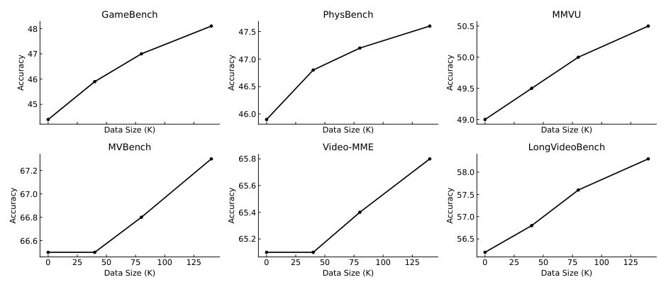

<!-- Start of picture text -->
GameBench PhysBench MMVU 48 47.5 50.5 47 47.0 50.0 46 46.5 49.5 45 46.0 49.0 Data Size (K) Data Size (K) Data Size (K) MVBench Video-MME LongVideoBench 65.8 67.2 58.0 65.6 67.0 57.5 65.4 66.8 57.0 66.6 65.2 56.5 0 25 50 75 100 125 0 25 50 75 100 125 0 25 50 75 100 125 Data Size (K) Data Size (K) Data Size (K) Accuracy Accuracy Accuracy Accuracy Accuracy Accuracy <!-- End of picture text -->

Figure 5: **Data-scaling effects** of our PhysGame dataset. 

Table 6: **Ablation study** on meta-data and training data mixture based on Qwen2.5-VL. 

|**Method**|**PhysBench**|**MMVU**|**MVBench**|**Video-MME**|**LongVideoBench**|
|---|---|---|---|---|---|
|Baseline|45.9|48.8|66.0|64.7|56.0|
|Full Mode|**47.6**|**50.5**|**67.3**|**65.8**|**58.3**|
|w/o meta-data|42.9|46.7|65.2|63.5|55.2|
|w/o data mixture|45.1|49.2|66.7|65.1|57.4|

140K samples, indicating that the dataset’s scaling potential has not been saturated. This trend validates the scalability of PhysGame and suggests that further expansion could yield additional improvements. 

**Ablations on dataset mixture.** In Section 4.1, we constructed the overall training set by combining PhysGame-140K with 20K data from LLaVA-Hound Zhang et al. (2024b). We ablate on this dataset mixture strategy by fine-tuning using only PhysGame (140K) dataset without any LLaVA-Hound data. The experimental results in Table 6, the data mixing strategy plays a clear role, particularly in enhancing generalization to real-world benchmarks ( _e.g_ ., +2.5% on PhysBench compared to using only PhysGame). 

**Ablations on training dataset composition.** We conduct fixed-budget and seed-controlled resampling to ablate on the training dataset configuration. Specifically, we fix the total training budget to 160K samples and systematically vary the mixing ratio between PhysGame (PG) and LLaVA-Hound (LH) as [0K/160K, 40K/120K, 80K/80K, 140K/20K]. A fixed random seed ensures the same LH subset is used across runs, eliminating sampling randomness. 

As the results in Table 7 indicate, using only LLaVA-Hound does not yield performance gains. For instance, with Qwen2.5-VL, only using the general video instruction tuning dataset LLaVA-Hound maintains the same results as the zero-shot evaluation (45.9%). Using only PhysGame leads to a performance drop (45.1% vs. 45.9%), likely because post-training solely on PhysGame induces a bias towards gameplay videos. Consequently, we selected a mixing ratio of 140K samples from PhysGame and 20K samples from LLaVA-Hound to achieve optimal performance. One interesting finding is that the performance of the pure PhysGame configuration (140K/0K) is slightly lower than that of the pure general-data configuration (0K/160K). This may be primarily due to two factors. First, the difference in total training samples (140K vs. 160K) gives the general-data setting a scale advantage in learning diverse visual representations. Second, training solely on PhysGame, which is visually centered on gameplay scenes, can induce a mild domain bias, slightly hindering generalization to the broader visual distributions found in real-world benchmarks like PhysBench. 

11 

Published in Transactions on Machine Learning Research <u>(January/2026)</u> 

Table 7: **Ablation study** on the configuration of PhysGame (PG) and LLaVA-Hound (LH) datasets. 

|**Configuration of PG/LH**|**0K/160K**|**40K/120K**|**80K/80K**|**140K/20K**|**140K/0K**|
|---|---|---|---|---|---|
|**AVG on PhysBench**|45.9%|46.9%|47.3%|**47.6%**|45.1%|

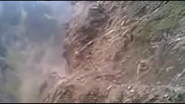

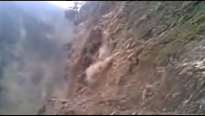

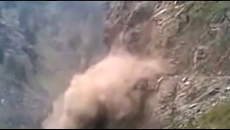

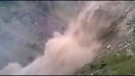

**Question:** What is the main reason for the phenomenon in the video? A. Temperature B. water C. dynamite D. human activity E. gravity 

**Qwen2.5-VL-7B:** C. 

**_w/_ PhysGame:** E. 

(a) 

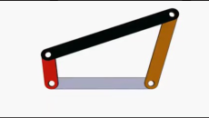

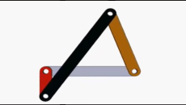

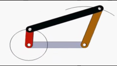

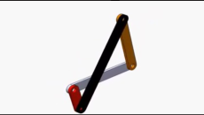

**Question:** In the mechanism depicted, the system has ______ degree(s) of freedom. **Qwen2.5-VL-7B :** two. **_w/_ PhysGame:** 1. 

(b) 

Figure 6: Comparisons between the baseline Qwen2.5-VL-7B and its PhysGame fine-tuned counterpart on MMVU benchmark. 

**Ablations of the meta-information-guided prompting.** In Section 3.1, we conduct a manual quality validation to demonstrate that meta-information enhances the quality of generated QA pairs. Here we present quantitative experiments using Qwen2.5-VL trained on PhysGame with/without meta-information guidance. Our experimental results in Table 6 demonstrate that integrating meta-information leads to a 4.7% absolute improvement (42.9% _vs_ . 47.6%) on PhysBench, which further highlights the necessity of using meta-information guidance during the prompt generation process. 

**Visualizations.** Figure 6 presents qualitative comparisons between the baseline Qwen2.5-VL-7B and its PhysGame fine-tuned counterpart on representative cases from the MMVU benchmark. In Figure 6a, the baseline model incorrectly attributes the observed landslide phenomenon to dynamite, indicating a bias toward surface-level visual cues ( _e.g_ ., explosion-like motion and dust dispersion). In contrast, the PhysGameenhanced model correctly identifies gravity as the underlying cause, demonstrating an improved ability to infer causal relationships grounded in physical principles. In Figure 6b, where the task involves determining the degree of freedom of a linkage mechanism, the baseline model outputs two, failing to account for the kinematic constraints imposed by joint connections. The PhysGame model, however, accurately infers one, reflecting a stronger grasp of motion constraints and mechanical structure reasoning. Together, these examples illustrate that PhysGame effectively bridges the gap between visual perception and intuitive physics reasoning, enabling the model to generate more physically consistent interpretations of both natural and synthetic scenes. 

12 

Published in Transactions on Machine Learning Research <u>(January/2026)</u> 

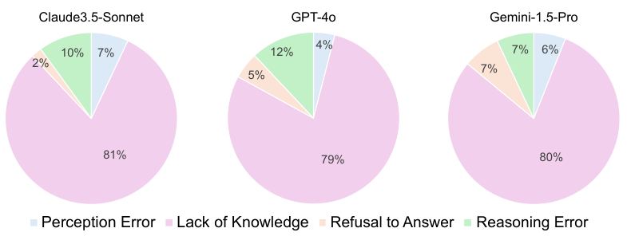

<!-- Start of picture text -->
Claude3.5-Sonnet GPT-4o Gemini-1.5-Pro 10% 7% 12% 4% 7% 6% 2% 7% 5% 81% 79% 80% Perception Error Lack of Knowledge Refusal to AnswerRefuse to Answer Failure to Follow InstrReasoning Error <!-- End of picture text -->

Figure 7: Error type analysis. 

**Error type analysis.** To investigate the bottlenecks of current MLLMs in physical world understanding, we analyze the top-performing models on the proposed GameBench benchmark: Gemini 1.5 Pro Team et al. (2024), GPT-4o OpenAI (2024), and Claude 3.5 Sonnet Anthropic (2024). We manually examine the error distribution across 100 selected cases, categorizing errors into four types: 

- _Perception error_ : MLLMs fail to correctly recognize entities, characters, or actions in the video. 

- _Lack of knowledge_ : MLLMs correctly perceive the video content but make incorrect judgments about the physical glitch. 

- _Reasoning error_ : MLLMs identifies both the video content and the glitch but fails to detect reasoning flaws in the provided answer options ( _e.g_ ., causal errors). 

- _Refusal to answer_ : MLLMs declines to respond due to limited capabilities. 

Figure 7 presents a comparative analysis of error distributions across three leading MLLMs including Claude 3.5-Sonnet, GPT-4o, and Gemini 1.5-Pro. Across all models, the dominant error type is “Lack of Knowledge", accounting for approximately 79–81% of total errors. This trend indicates that factual incompleteness or outdated knowledge remains the principal bottleneck in current large-scale multimodal reasoning systems, rather than perception or reasoning capabilities. Among the secondary categories, Reasoning Errors contribute between 7–12%, with GPT-4o showing the highest proportion (12%). Perception Errors are relatively minor (4–7%) across all models, reflecting the general maturity of visual grounding components. Refusal to Answer occurs least frequently, with Claude 3.5-Sonnet exhibiting the most conservative behavior (2%), while GPT-4o and Gemini 1.5-Pro show slightly higher refusal rates (5–7%), possibly due to stricter safety or uncertainty calibration mechanisms. Overall, the results highlight a consistent pattern: while perception and reasoning are gradually improving, the knowledge base’s coverage and retrieval precision remain the dominant limitations shaping multimodal model reliability. 

## **5 Conclusion** 

In this work, we propose PhysGame, a scalable and photo-realistic instruction-tuning dataset constructed from gameplay videos to advance physical world understanding of MLLMs. By leveraging glitch-induced annotations, PhysGame enables systematic discovery of physical inconsistencies across diverse scenarios involving mechanics, optics, material properties, thermodynamics, and electromagnetism. Compared to existing real-world or synthetic datasets, PhysGame achieves a better trade-off between realism and scalability. Extensive experiments demonstrate that PhysGame not only improves real-world physical reasoning (Game2Real), but also enhances general-purpose video understanding (Game2General). We position PhysGame as a scalable and effective paradigm for equipping MLLMs with robust physical reasoning and generalizable understanding abilities. 

13 

Published in Transactions on Machine Learning Research <u>(January/2026)</u> 

## **References** 

- Marah Abdin, Jyoti Aneja, Hany Awadalla, Ahmed Awadallah, Ammar Ahmad Awan, Nguyen Bach, Amit Bahree, Arash Bakhtiari, Jianmin Bao, Harkirat Behl, et al. Phi-3 technical report: A highly capable language model locally on your phone. _arXiv preprint arXiv:2404.14219_ , 2024. 

- Josh Achiam, Steven Adler, Sandhini Agarwal, Lama Ahmad, Ilge Akkaya, Florencia Leoni Aleman, Diogo Almeida, Janko Altenschmidt, Sam Altman, Shyamal Anadkat, et al. Gpt-4 technical report. _arXiv preprint arXiv:2303.08774_ , 2023. 

- Pulkit Agrawal, Ashvin V Nair, Pieter Abbeel, Jitendra Malik, and Sergey Levine. Learning to poke by poking: Experiential learning of intuitive physics. _Advances in neural information processing systems_ , 29, 2016. 

- Nader Akoury, Qian Yang, and Mohit Iyyer. A framework for exploring player perceptions of llm-generated dialogue in commercial video games. In _Findings of the Association for Computational Linguistics: EMNLP 2023_ , pp. 2295–2311, 2023. 

- Anthropic. Claude 3.5 sonnet, 2024. URL `https://www.anthropic.com/news/claude-3-5-sonnet` . 

- Jinze Bai, Shuai Bai, Shusheng Yang, Shijie Wang, Sinan Tan, Peng Wang, Junyang Lin, Chang Zhou, and Jingren Zhou. Qwen-vl: A frontier large vision-language model with versatile abilities. _arXiv preprint arXiv:2308.12966_ , 2023. 

- Shuai Bai, Keqin Chen, Xuejing Liu, Jialin Wang, Wenbin Ge, Sibo Song, Kai Dang, Peng Wang, Shijie Wang, Jun Tang, et al. Qwen2.5-vl technical report. _arXiv preprint arXiv:2502.13923_ , 2025. 

- Hritik Bansal, Zongyu Lin, Tianyi Xie, Zeshun Zong, Michal Yarom, Yonatan Bitton, Chenfanfu Jiang, Yizhou Sun, Kai-Wei Chang, and Aditya Grover. Videophy: Evaluating physical commonsense for video generation. _arXiv preprint arXiv:2406.03520_ , 2024. 

- Peter Battaglia, Razvan Pascanu, Matthew Lai, Danilo Jimenez Rezende, et al. Interaction networks for learning about objects, relations and physics. _Advances in neural information processing systems_ , 29, 2016. 

- Daniel Bear, Elias Wang, Damian Mrowca, Felix Jedidja Binder, Hsiao-Yu Tung, RT Pramod, Cameron Holdaway, Sirui Tao, Kevin A Smith, Fan-Yun Sun, et al. Physion: Evaluating physical prediction from vision in humans and machines. In _Thirty-fifth Conference on Neural Information Processing Systems Datasets and Benchmarks Track (Round 1)_ , 2021. 

- Yonatan Bisk, Rowan Zellers, Jianfeng Gao, Yejin Choi, et al. Piqa: Reasoning about physical commonsense in natural language. In _Proceedings of the AAAI conference on artificial intelligence_ , volume 34, pp. 7432–7439, 2020. 

- Daniel G Bobrow. Qualitative reasoning about physical systems: an introduction. _Artificial intelligence_ , 24 (1-3):1–5, 1984. 

- Tom Brown, Benjamin Mann, Nick Ryder, Melanie Subbiah, Jared D Kaplan, Prafulla Dhariwal, Arvind Neelakantan, Pranav Shyam, Girish Sastry, Amanda Askell, et al. Language models are few-shot learners. _Advances in neural information processing systems_ , 33:1877–1901, 2020. 

- Arunkumar Byravan, Felix Leeb, Franziska Meier, and Dieter Fox. Se3-pose-nets: Structured deep dynamics models for visuomotor planning and control. _arXiv preprint arXiv:1710.00489_ , 2017. 

- Micah Carroll, Rohin Shah, Mark K Ho, Tom Griffiths, Sanjit Seshia, Pieter Abbeel, and Anca Dragan. On the utility of learning about humans for human-ai coordination. _Advances in neural information processing systems_ , 32, 2019. 

- Michael B Chang, Tomer Ullman, Antonio Torralba, and Joshua B Tenenbaum. A compositional objectbased approach to learning physical dynamics. _arXiv preprint arXiv:1612.00341_ , 2016. 

14 

Published in Transactions on Machine Learning Research <u>(January/2026)</u> 

- Jiaqi Chen, Yuxian Jiang, Jiachen Lu, and Li Zhang. S-agents: Self-organizing agents in open-ended environments. In _ICLR 2024 Workshop on Large Language Model (LLM) Agents_ , 2024a. 

- Ke Chen, Yufei Li, Yingfeng Chen, Changjie Fan, Zhipeng Hu, and Wei Yang. Glib: towards automated test oracle for graphically-rich applications. In _Proceedings of the 29th ACM Joint Meeting on European Software Engineering Conference and Symposium on the Foundations of Software Engineering_ , pp. 1093– 1104, 2021. 

- Lin Chen, Xilin Wei, Jinsong Li, Xiaoyi Dong, Pan Zhang, Yuhang Zang, Zehui Chen, Haodong Duan, Zhenyu Tang, Li Yuan, et al. Sharegpt4video: Improving video understanding and generation with better captions. _Advances in Neural Information Processing Systems_ , 37:19472–19495, 2024b. 

- Weize Chen, Yusheng Su, Jingwei Zuo, Cheng Yang, Chenfei Yuan, Chi-Min Chan, Heyang Yu, Yaxi Lu, YiHsin Hung, Chen Qian, et al. Agentverse: Facilitating multi-agent collaboration and exploring emergent behaviors. In _The Twelfth International Conference on Learning Representations_ , 2023. 

- Zhe Chen, Weiyun Wang, Yue Cao, Yangzhou Liu, Zhangwei Gao, Erfei Cui, Jinguo Zhu, Shenglong Ye, Hao Tian, Zhaoyang Liu, et al. Expanding performance boundaries of open-source multimodal models with model, data, and test-time scaling. _arXiv preprint arXiv:2412.05271_ , 2024c. 

- Zhe Chen, Weiyun Wang, Hao Tian, Shenglong Ye, Zhangwei Gao, Erfei Cui, Wenwen Tong, Kongzhi Hu, Jiapeng Luo, Zheng Ma, et al. How far are we to gpt-4v? closing the gap to commercial multimodal models with open-source suites. _arXiv preprint arXiv:2404.16821_ , 2024d. 

- Zhenfang Chen, Kexin Yi, Yunzhu Li, Mingyu Ding, Antonio Torralba, Joshua B Tenenbaum, and Chuang Gan. Comphy: Compositional physical reasoning of objects and events from videos. _arXiv preprint arXiv:2205.01089_ , 2022. 

- Zhenfang Chen, Shilong Dong, Kexin Yi, Yunzhu Li, Mingyu Ding, Antonio Torralba, Joshua B Tenenbaum, and Chuang Gan. Compositional physical reasoning of objects and events from videos. _arXiv preprint arXiv:2408.02687_ , 2024e. 

- Wei Chow, Jiageng Mao, Boyi Li, Daniel Seita, Vitor Guizilini, and Yue Wang. Physbench: Benchmarking and enhancing vision-language models for physical world understanding. _arXiv preprint arXiv:2501.16411_ , 2025. 

- Chris Conlan. The blender python api. _Precision 3D Modeling and Add_ , 2017. 

- Jiafei Duan, Arijit Dasgupta, Jason Fischer, and Cheston Tan. A survey on machine learning approaches for modelling intuitive physics. In _Proceedings of the Thirty-First International Joint Conference on Artificial Intelligence_ , pp. 5444–5452. International Joint Conferences on Artificial Intelligence Organization, 2022. 

- Jiajun Fei, Dian Li, Zhidong Deng, Zekun Wang, Gang Liu, and Hui Wang. Video-ccam: Enhancing video-language understanding with causal cross-attention masks for short and long videos. _arXiv preprint arXiv:2408.14023_ , 2024. 

- Xidong Feng, Yicheng Luo, Ziyan Wang, Hongrui Tang, Mengyue Yang, Kun Shao, David Mguni, Yali Du, and Jun Wang. Chessgpt: Bridging policy learning and language modeling. _Advances in Neural Information Processing Systems_ , 36, 2024. 

- Maxwell Forbes, Ari Holtzman, and Yejin Choi. Do neural language representations learn physical commonsense? _arXiv preprint arXiv:1908.02899_ , 2019. 

- Chaoyou Fu, Yuhan Dai, Yondong Luo, Lei Li, Shuhuai Ren, Renrui Zhang, Zihan Wang, Chenyu Zhou, Yunhang Shen, Mengdan Zhang, et al. Video-mme: The first-ever comprehensive evaluation benchmark of multi-modal llms in video analysis. _arXiv preprint arXiv:2405.21075_ , 2024. 

- Chuang Gan, Jeremy Schwartz, Seth Alter, Damian Mrowca, Martin Schrimpf, James Traer, Julian De Freitas, Jonas Kubilius, Abhishek Bhandwaldar, Nick Haber, et al. Threedworld: A platform for interactive multi-modal physical simulation. In _Thirty-fifth Conference on Neural Information Processing Systems Datasets and Benchmarks Track (Round 1)_ , 2021a. 

15 

Published in Transactions on Machine Learning Research <u>(January/2026)</u> 

- Chuang Gan, Siyuan Zhou, Jeremy Schwartz, Seth Alter, Abhishek Bhandwaldar, Dan Gutfreund, Daniel LK Yamins, James J DiCarlo, Josh McDermott, Antonio Torralba, et al. The threedworld transport challenge: A visually guided task-and-motion planning benchmark for physically realistic embodied ai. _arXiv preprint arXiv:2103.14025_ , 2021b. 

- Ran Gong, Qiuyuan Huang, Xiaojian Ma, Hoi Vo, Zane Durante, Yusuke Noda, Zilong Zheng, Song-Chun Zhu, Demetri Terzopoulos, Li Fei-Fei, et al. Mindagent: Emergent gaming interaction. _arXiv preprint arXiv:2309.09971_ , 2023. 

- Jiaxian Guo, Bo Yang, Paul Yoo, Bill Yuchen Lin, Yusuke Iwasawa, and Yutaka Matsuo. Suspicion-agent: Playing imperfect information games with theory of mind aware gpt-4. _arXiv preprint arXiv:2309.17277_ , 2023. 

- Akshat Gupta. Are chatgpt and gpt-4 good poker players?–a pre-flop analysis. _arXiv preprint arXiv:2308.12466_ , 2023. 

- John K Haas. A history of the unity game engine. 2014. 

- Susan J Hespos and Elizabeth S Spelke. Conceptual precursors to language. _Nature_ , 430(6998):453–456, 2004. 

- Susan J Hespos, Alissa L Ferry, Erin M Anderson, Emily N Hollenbeck, and Lance J Rips. Five-month-old infants have general knowledge of how nonsolid substances behave and interact. _Psychological science_ , 27 (2):244–256, 2016. 

- Sirui Hong, Xiawu Zheng, Jonathan Chen, Yuheng Cheng, Jinlin Wang, Ceyao Zhang, Zili Wang, Steven Ka Shing Yau, Zijuan Lin, Liyang Zhou, et al. Metagpt: Meta programming for multi-agent collaborative framework. _arXiv preprint arXiv:2308.00352_ , 2023. 

- Sihao Hu, Tiansheng Huang, Fatih Ilhan, Selim Tekin, Gaowen Liu, Ramana Kompella, and Ling Liu. A survey on large language model-based game agents. _arXiv preprint arXiv:2404.02039_ , 2024a. 

- Sihao Hu, Tiansheng Huang, and Ling Liu. Pok _\_ ’ellmon: A human-parity agent for pok _\_ ’emon battles with large language models. _arXiv preprint arXiv:2402.01118_ , 2024b. 

- Chenghao Huang, Yanbo Cao, Yinlong Wen, Tao Zhou, and Yanru Zhang. Pokergpt: An endto-end lightweight solver for multi-player texas hold’em via large language model. _arXiv preprint arXiv:2401.06781_ , 2024. 

- Peng Jin, Ryuichi Takanobu, Wancai Zhang, Xiaochun Cao, and Li Yuan. Chat-univi: Unified visual representation empowers large language models with image and video understanding. In _Proceedings of the IEEE/CVF Conference on Computer Vision and Pattern Recognition_ , pp. 13700–13710, 2024. 

- Adam Lerer, Sam Gross, and Rob Fergus. Learning physical intuition of block towers by example. In _International conference on machine learning_ , pp. 430–438. PMLR, 2016. 

- Bo Li, Yuanhan Zhang, Dong Guo, Renrui Zhang, Feng Li, Hao Zhang, Kaichen Zhang, Yanwei Li, Ziwei Liu, and Chunyuan Li. Llava-onevision: Easy visual task transfer. _arXiv preprint arXiv:2408.03326_ , 2024a. 

- Kenneth Li, Aspen K Hopkins, David Bau, Fernanda Viégas, Hanspeter Pfister, and Martin Wattenberg. Emergent world representations: Exploring a sequence model trained on a synthetic task. In _The Eleventh International Conference on Learning Representations_ , 2023. 

- Kunchang Li, Yali Wang, Yinan He, Yizhuo Li, Yi Wang, Yi Liu, Zun Wang, Jilan Xu, Guo Chen, Ping Luo, et al. Mvbench: A comprehensive multi-modal video understanding benchmark. In _Proceedings of the IEEE/CVF Conference on Computer Vision and Pattern Recognition_ , pp. 22195–22206, 2024b. 

- Bin Lin, Bin Zhu, Yang Ye, Munan Ning, Peng Jin, and Li Yuan. Video-llava: Learning united visual representation by alignment before projection. _arXiv preprint arXiv:2311.10122_ , 2023. 

16 

Published in Transactions on Machine Learning Research <u>(January/2026)</u> 

- Ji Lin, Hongxu Yin, Wei Ping, Pavlo Molchanov, Mohammad Shoeybi, and Song Han. Vila: On pre-training for visual language models. In _Proceedings of the IEEE/CVF Conference on Computer Vision and Pattern Recognition_ , pp. 26689–26699, 2024. 

- Carlos Ling, Konrad Tollmar, and Linus Gisslén. Using deep convolutional neural networks to detect rendered glitches in video games. In _Proceedings of the AAAI Conference on Artificial Intelligence and Interactive Digital Entertainment_ , volume 16, pp. 66–73, 2020. 

- Haotian Liu, Chunyuan Li, Yuheng Li, and Yong Jae Lee. Improved baselines with visual instruction tuning. In _Proceedings of the IEEE/CVF Conference on Computer Vision and Pattern Recognition_ , pp. 26296– 26306, 2024a. 

- Haotian Liu, Chunyuan Li, Yuheng Li, Bo Li, Yuanhan Zhang, Sheng Shen, and Yong Jae Lee. Llava-next: Improved reasoning, ocr, and world knowledge, January 2024b. URL `https://llava-vl.github.io/ blog/2024-01-30-llava-next/` . 

- Jijia Liu, Chao Yu, Jiaxuan Gao, Yuqing Xie, Qingmin Liao, Yi Wu, and Yu Wang. Llm-powered hierarchical language agent for real-time human-ai coordination. _arXiv preprint arXiv:2312.15224_ , 2023. 

- Ruyang Liu, Chen Li, Haoran Tang, Yixiao Ge, Ying Shan, and Ge Li. St-llm: Large language models are effective temporal learners. _arXiv preprint arXiv:2404.00308_ , 2024c. 

- Ruyang Liu, Haoran Tang, Haibo Liu, Yixiao Ge, Ying Shan, Chen Li, and Jiankun Yang. Ppllava: Varied video sequence understanding with prompt guidance. _arXiv preprint arXiv:2411.02327_ , 2024d. 

- Zhijian Liu, Ligeng Zhu, Baifeng Shi, Zhuoyang Zhang, Yuming Lou, Shang Yang, Haocheng Xi, Shiyi Cao, Yuxian Gu, Dacheng Li, et al. Nvila: Efficient frontier visual language models. _arXiv preprint arXiv:2412.04468_ , 2024e. 

- Weiyu Ma, Qirui Mi, Yongcheng Zeng, Xue Yan, Yuqiao Wu, Runji Lin, Haifeng Zhang, and Jun Wang. Large language models play starcraft ii: Benchmarks and a chain of summarization approach. _arXiv preprint arXiv:2312.11865_ , 2023. 

- Michael McCloskey, Allyson Washburn, and Linda Felch. Intuitive physics: the straight-down belief and its origin. _Journal of Experimental Psychology: Learning, Memory, and Cognition_ , 9(4):636, 1983. 

- Andrew Melnik, Robin Schiewer, Moritz Lange, Andrei Ioan Muresanu, Animesh Garg, Helge Ritter, et al. Benchmarks for physical reasoning ai. _Transactions on Machine Learning Research_ , 2024. 

- Fanqing Meng, Jiaqi Liao, Xinyu Tan, Wenqi Shao, Quanfeng Lu, Kaipeng Zhang, Yu Cheng, Dianqi Li, Yu Qiao, and Ping Luo. Towards world simulator: Crafting physical commonsense-based benchmark for video generation. _arXiv preprint arXiv:2410.05363_ , 2024. 

- Alfredo Nantes, Ross Brown, and Frederic Maire. A framework for the semi-automatic testing of video games. In _Proceedings of the AAAI Conference on Artificial Intelligence and Interactive Digital Entertainment_ , volume 4, pp. 197–202, 2008. 

- OpenAI. Hello gpt-4o. _OpenAI Blog_ , 2024. URL `https://openai.com/index/hello-gpt-4o/` . 

- Xavier Puig, Kevin Ra, Marko Boben, Jiaman Li, Tingwu Wang, Sanja Fidler, and Antonio Torralba. Virtualhome: Simulating household activities via programs. In _Proceedings of the IEEE conference on computer vision and pattern recognition_ , pp. 8494–8502, 2018. 

- Xavier Puig, Tianmin Shu, Shuang Li, Zilin Wang, Yuan-Hong Liao, Joshua B Tenenbaum, Sanja Fidler, and Antonio Torralba. Watch-and-help: A challenge for social perception and human-ai collaboration. In _International Conference on Learning Representations_ , 2021. 

- Chen Qian, Xin Cong, Cheng Yang, Weize Chen, Yusheng Su, Juyuan Xu, Zhiyuan Liu, and Maosong Sun. Communicative agents for software development. _arXiv preprint arXiv:2307.07924_ , 6, 2023. 

17 

Published in Transactions on Machine Learning Research <u>(January/2026)</u> 

- Machel Reid, Nikolay Savinov, Denis Teplyashin, Dmitry Lepikhin, Timothy Lillicrap, Jean-baptiste Alayrac, Radu Soricut, Angeliki Lazaridou, Orhan Firat, Julian Schrittwieser, et al. Gemini 1.5: Unlocking multimodal understanding across millions of tokens of context. _arXiv preprint arXiv:2403.05530_ , 2024. 

- Xiao Shao, Weifu Jiang, Fei Zuo, and Mengqing Liu. Swarmbrain: Embodied agent for real-time strategy game starcraft ii via large language models. _arXiv preprint arXiv:2401.17749_ , 2024. 

- Mohammad Reza Taesiri and Cor-Paul Bezemer. Videogamebunny: Towards vision assistants for video games. _arXiv preprint arXiv:2407.15295_ , 2024. 

- Mohammad Reza Taesiri, Finlay Macklon, and Cor-Paul Bezemer. Clip meets gamephysics: Towards bug identification in gameplay videos using zero-shot transfer learning. In _Proceedings of the 19th International Conference on Mining Software Repositories_ , pp. 270–281, 2022a. 

- Mohammad Reza Taesiri, Finlay Macklon, Yihe Wang, Hengshuo Shen, and Cor-Paul Bezemer. Large language models are pretty good zero-shot video game bug detectors. _arXiv preprint arXiv:2210.02506_ , 2022b. 

- Mohammad Reza Taesiri, Tianjun Feng, Cor-Paul Bezemer, and Anh Nguyen. Glitchbench: Can large multimodal models detect video game glitches? In _Proceedings of the IEEE/CVF Conference on Computer Vision and Pattern Recognition_ , pp. 22444–22455, 2024a. 

- Mohammad Reza Taesiri, Finlay Macklon, Sarra Habchi, and Cor-Paul Bezemer. Searching bug instances in gameplay video repositories. _IEEE Transactions on Games_ , 2024b. 

- Gemini Team, Petko Georgiev, Ving Ian Lei, Ryan Burnell, Libin Bai, Anmol Gulati, Garrett Tanzer, Damien Vincent, Zhufeng Pan, Shibo Wang, et al. Gemini 1.5: Unlocking multimodal understanding across millions of tokens of context. _arXiv preprint arXiv:2403.05530_ , 2024. 

- Shubham Toshniwal, Sam Wiseman, Karen Livescu, and Kevin Gimpel. Chess as a testbed for language model state tracking. In _Proceedings of the AAAI Conference on Artificial Intelligence_ , volume 36, pp. 11385–11393, 2022. 

- Hugo Touvron, Louis Martin, Kevin Stone, Peter Albert, Amjad Almahairi, Yasmine Babaei, Nikolay Bashlykov, Soumya Batra, Prajjwal Bhargava, Shruti Bhosale, et al. Llama 2: Open foundation and fine-tuned chat models. _arXiv preprint arXiv:2307.09288_ , 2023. 

- Peng Wang, Shuai Bai, Sinan Tan, Shijie Wang, Zhihao Fan, Jinze Bai, Keqin Chen, Xuejing Liu, Jialin Wang, Wenbin Ge, et al. Qwen2-vl: Enhancing vision-language model’s perception of the world at any resolution. _arXiv preprint arXiv:2409.12191_ , 2024a. 

- Shenzhi Wang, Chang Liu, Zilong Zheng, Siyuan Qi, Shuo Chen, Qisen Yang, Andrew Zhao, Chaofei Wang, Shiji Song, and Gao Huang. Avalon’s game of thoughts: Battle against deception through recursive contemplation. _arXiv preprint arXiv:2310.01320_ , 2023. 

- Xidong Wang, Dingjie Song, Shunian Chen, Chen Zhang, and Benyou Wang. Longllava: Scaling multi-modal llms to 1000 images efficiently via a hybrid architecture. _arXiv preprint arXiv:2409.02889_ , 2024b. 

- Xingrui Wang, Wufei Ma, Angtian Wang, Shuo Chen, Adam Kortylewski, and Alan Yuille. Compositional 4d dynamic scenes understanding with physics priors for video question answering. _arXiv preprint arXiv:2406.00622_ , 2024c. 

- Haoning Wu, Dongxu Li, Bei Chen, and Junnan Li. Longvideobench: A benchmark for long-context interleaved video-language understanding. _arXiv preprint arXiv:2407.15754_ , 2024. 

- Sarah A Wu, Rose E Wang, James A Evans, Joshua B Tenenbaum, David C Parkes, and Max KleimanWeiner. Too many cooks: Bayesian inference for coordinating multi-agent collaboration. _Topics in Cognitive Science_ , 13(2):414–432, 2021. 

18 

Published in Transactions on Machine Learning Research <u>(January/2026)</u> 

- Kun Xiang, Heng Li, Terry Jingchen Zhang, Yinya Huang, Zirong Liu, Peixin Qu, Jixi He, Jiaqi Chen, Yu-Jie Yuan, Jianhua Han, et al. Seephys: Does seeing help thinking?–benchmarking vision-based physics reasoning. _arXiv preprint arXiv:2505.19099_ , 2025. 

- Lin Xu, Yilin Zhao, Daquan Zhou, Zhijie Lin, See Kiong Ng, and Jiashi Feng. Pllava: Parameter-free llava extension from images to videos for video dense captioning. _arXiv preprint arXiv:2404.16994_ , 2024a. 

- Xinrun Xu, Yuxin Wang, Chaoyi Xu, Ziluo Ding, Jiechuan Jiang, Zhiming Ding, and Börje F Karlsson. A survey on game playing agents and large models: Methods, applications, and challenges. _arXiv preprint arXiv:2403.10249_ , 2024b. 

- Kexin Yi, Chuang Gan, Yunzhu Li, Pushmeet Kohli, Jiajun Wu, Antonio Torralba, and Joshua B Tenenbaum. Clevrer: Collision events for video representation and reasoning. In _International Conference on Learning Representations_ , 2020. 

- Peiyuan Zhang, Kaichen Zhang, Bo Li, Guangtao Zeng, Jingkang Yang, Yuanhan Zhang, Ziyue Wang, Haoran Tan, Chunyuan Li, and Ziwei Liu. Long context transfer from language to vision. _arXiv preprint arXiv:2406.16852_ , 2024a. 

- Ruohong Zhang, Liangke Gui, Zhiqing Sun, Yihao Feng, Keyang Xu, Yuanhan Zhang, Di Fu, Chunyuan Li, Alexander Hauptmann, Yonatan Bisk, et al. Direct preference optimization of video large multimodal models from language model reward. _arXiv preprint arXiv:2404.01258_ , 2024b. 

- Wenqi Zhang, Ke Tang, Hai Wu, Mengna Wang, Yongliang Shen, Guiyang Hou, Zeqi Tan, Peng Li, Yueting Zhuang, and Weiming Lu. Agent-pro: Learning to evolve via policy-level reflection and optimization. _arXiv preprint arXiv:2402.17574_ , 2024c. 

- Yuanhan Zhang, Jinming Wu, Wei Li, Bo Li, Zejun Ma, Ziwei Liu, and Chunyuan Li. Video instruction tuning with synthetic data. _arXiv preprint arXiv:2410.02713_ , 2024d. 

- Yilun Zhao, Lujing Xie, Haowei Zhang, Guo Gan, Yitao Long, Zhiyuan Hu, Tongyan Hu, Weiyuan Chen, Chuhan Li, Junyang Song, et al. Mmvu: Measuring expert-level multi-discipline video understanding. _arXiv preprint arXiv:2501.12380_ , 2025. 

- Zhicheng Zheng, Xin Yan, Zhenfang Chen, Jingzhou Wang, Qin Zhi Eddie Lim, Joshua B Tenenbaum, and Chuang Gan. Contphy: Continuum physical concept learning and reasoning from videos. In _International Conference on Machine Learning_ , pp. 61526–61558. PMLR, 2024. 

- Orr Zohar, Xiaohan Wang, Yann Dubois, Nikhil Mehta, Tong Xiao, Philippe Hansen-Estruch, Licheng Yu, Xiaofang Wang, Felix Juefei-Xu, Ning Zhang, et al. Apollo: An exploration of video understanding in large multimodal models. _arXiv preprint arXiv:2412.10360_ , 2024. 

19 

