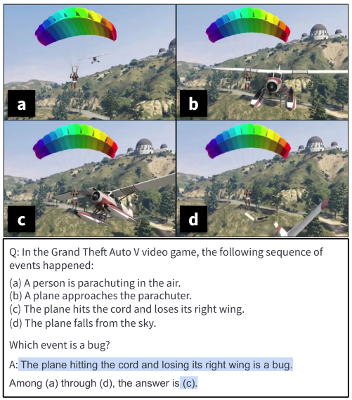
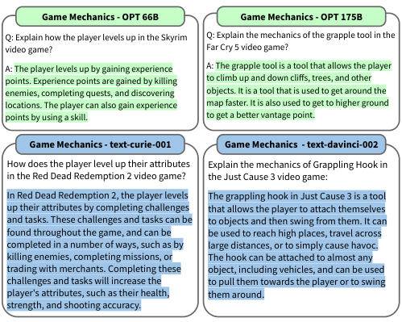
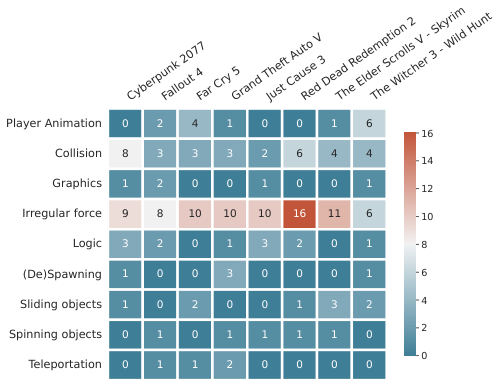

# **Large Language Models are Pretty Good Zero-Shot Video Game Bug Detectors** 

**Mohammad Reza Taesiri Finlay Macklon Yihe Wang Hengshuo Shen Cor-Paul Bezemer University of Alberta** 

**{taesiri,macklon,yihe2,hengshuo,bezemer}@ualberta.ca** 

#### **Abstract** 

Video game testing requires game-specific knowledge as well as common sense reasoning about the events in the game. While AI-driven agents can satisfy the first requirement, it is not yet possible to meet the second requirement automatically. Therefore, video game testing often still relies on manual testing, and human testers are required to play the game thoroughly to detect bugs. As a result, it is challenging to fully automate game testing. In this study, we explore the possibility of leveraging the zero-shot capabilities of large language models for video game bug detection. By formulating the bug detection problem as a question-answering task, we show that large language models can identify which event is buggy in a sequence of textual descriptions of events from a game. To this end, we introduce the GameBugDescriptions benchmark dataset, which consists of 167 buggy gameplay videos and a total of 334 question-answer pairs across 8 games. We extensively evaluate the performance of six models across the OPT and InstructGPT large language model families on our benchmark dataset. Our results show promising results for employing language models to detect video game bugs. With the proper prompting technique, we could achieve an accuracy of 70.66%, and on some video games, up to 78.94%. Our code, evaluation data and the benchmark can be found on https://asgaardlab.github.io/LLMxBugs 

## **Introduction** 

Similar to other software products, a video game must be thoroughly tested to assure its quality. Game testing is an umbrella term for many types of tests that cover different aspects of the game. For example, a rendering test aims to verify the visual quality of the output, whereas a gameplay test assesses whether the game is engaging enough. While it is possible to automate some game testing elements, e.g., by using advanced vision models to detect graphical issues automatically (Taesiri, Macklon, and Bezemer 2022), most game testing aspects still require a human tester (Pascarella et al. 2018). Two of the main challenges that prevent the automation of game testing are the difficulty to automate (1) knowledge about the game context and (2) common sense reasoning (Politowski, Petrillo, and Guéhéneuc 2021). 

Many video games rely on a physics engine that defines the rules of the world in which the game is situated (Milling- 

1Source: https://redd.it/2s5xon 

<!-- Start of picture text -->
a b c d Q: In the Grand Theft Auto V video game, the following sequence of events happened: (a) A person is parachuting in the air. (b) A plane approaches the parachuter. (c) The plane hits the cord and loses its right wing. (d) The plane falls from the sky. Which event is a bug? A : The plane hitting the cord and losing its right wing is a bug. Among (a) through (d), the answer is  (c). <!-- End of picture text -->

Figure 1: An example of using a large language model to detect a video game bug by classifying a sequence of events in the _Grand Theft Auto V_1 video game in which a collision between a plane and parachute cords leads to the plane losing its right wing. The highlighted text shows the response of the davinci model from the InstructGPT family. 

ton 2007). For some games, there are sharp contrasts between the game world and the natural laws of the real world. These differences make it hard to reason about events in video games without knowing the game context. For example, is it a bug that the player survives after falling from a very high height? Answering such a question is impossible without having knowledge about the target video game. 

In this study, we propose using the game context knowledge and common sense reasoning capabilities of large language models (LLMs) to identify buggy events in video games and classify their bug type. Recent revolutions in nat- 

ural language processing (NLP) show that scaling up language models is beneficial in many tasks (Vaswani et al. 2017; Devlin et al. 2018; Rae et al. 2021; Chowdhery et al. 2022; Thoppilan et al. 2022), such as few-shot and zero-shot learning (Brown et al. 2020; Kojima et al. 2022). Having been trained on very large datasets, LLMs have the potential to capture many details about topics in their training set, including video games. Figure 1 shows an example of successful bug detection by a language model. 

We are the first to empirically evaluate the capability of LLMs as zero-shot video game bug detectors. Our main contributions are as follows: 

1. We present the GameBugDescriptions dataset, the first dataset of videos of game bugs with a step-bystep textual description for bug detection purposes. This dataset can serve as an out-of-distribution (OOD) challenge for LLMs. 

2. We are the first to show that large language models have promising capabilities to detect video game bugs. 

3. We extensively evaluate the performance of two families of large language models on the bug detection and bug type classification tasks: InstructGPT (Ouyang et al. 2022) and OPT (Zhang et al. 2022). 

4. We analyze the robustness of language models to different descriptions of the same event for these tasks. 

Our study demonstrates the promising capabilities of LLMs to play an important role in the automation of the game testing process. 

## **Background and Related Work** 

Our work bridges the language modeling, video game, and software engineering research communities. In this section, we provide a brief overview of the relevant literature across these disciplines, in particular, on large language models and prompt engineering, and automated game testing. 

### **Large Language Models and Prompt Engineering** 

The training objective in a language model is to learn a probability distribution over some text corpus. Such a simple training objective combined with sufficient model scaling can yield large language models that are successful even for tasks for which the model was not explicitly trained (Kaplan et al. 2020; Brown et al. 2020; Chowdhery et al. 2022; Thoppilan et al. 2022). 

Prompting or prompt engineering (Liu et al. 2021) is an effective technique wherein we condition a language model on a set of manually handcrafted (Schick and Schütze 2020; Kojima et al. 2022) or automated (Gao, Fisch, and Chen 2020) templates to solve new tasks. That is, new tasks can be solved by giving natural language instructions to a pretrained model without any further training, e.g., by providing sample reasoning steps to the model (Wei et al. 2022) in a few-shot setting. Moreover, Kojima et al. (2022) showed that even with a prompting technique as simple as adding _“Let’s think step by step”_ to the beginning of the answer, it is possible to trigger the reasoning in language models, which 

leads to higher accuracy improvement on multiple benchmarks in zero-shot setting. Using graphical models Dohan et al. (2022) introduced a general formulation for prompted models, enabling probabilistic programming with LLMs. 

Several successful applications of LLMs include program synthesis (Jain et al. 2022), code generation (Chen et al. 2021) or chatbots (Thoppilan et al. 2022). However, we are the first to apply LLMs to detect bugs in video games. 

### **Automated Game Testing** 

As shown by prior work, automated game testing is challenging because game-specific knowledge and common sense reasoning are required to detect and report bugs (Pascarella et al. 2018; Politowski, Petrillo, and Guéhéneuc 2021). The majority of prior work on automated game testing focuses on methods to automatically play games, such as heuristic search strategies (Keehl and Smith 2019). Automated play techniques using reinforcement learning or evolutionary strategies (Zheng et al. 2019; Vinyals et al. 2019; Berner et al. 2019; Justesen et al. 2019) allow the testing of video games from different perspectives, such as playability, game balance, and even predicting user churn rate (Roohi et al. 2020, 2021). However, these methods are often designed to maximize a certain reward function, which might lead to progress in the game in an unintended manner and even break the game’s rules or physics engine (Baker et al. 2020; Clark and Amodei 2019). More importantly, these methods do not have common sense reasoning. 

Other prior work has leveraged computer vision and NLP techniques for automated video game testing. Several studies have proposed approaches for graphical bug detection using deep learning (Ling, Tollmar, and Gisslén 2020; Taesiri, Habibi, and Fazli 2020) or digital image processing (Macklon et al. 2022). However, these approaches do not require common sense reasoning. For example, Macklon et al. (2022) rely on graphical assets of the game as a test oracle. 

Several other studies have proposed approaches to retrieve moments from gameplay videos based on text queries (Zhang and Smith 2019; Taesiri, Macklon, and Bezemer 2022). However, to detect bugs with these approaches the bug instance must be known in advance, and therefore these gameplay event retrieval approaches do not allow for automated detection of (previously undiscovered) bugs. Our approach does not have this requirement and can therefore be used to identify previously undiscovered bugs. 

Finally, prior work has proposed NLP-based approaches to automatically improve test case descriptions for manual playtesting of games (Viggiato et al. 2022a,b), but we are the first to leverage LLMs for bug detection in video games. 

## **Bug Detection with Large Language Models** 

To automatically identify buggy events in a video game, we propose using LLMs to reason about sequences of textual descriptions of game events. We formulate the problem as a question-answering (Q&A) task (Srivastava et al. 2022) for LLMs. Here, we explain how we convert textual descriptions of a sequence of game events into a multiple-choice question and use a language model to identify the buggy event. In addition, we discuss how LLMs can assist us to classify the bug 

<!-- Start of picture text -->
Game Mechanics - OPT 66B Game Mechanics - OPT 175B Q: Explain how the player levels up in the Skyrim Q: Explain the mechanics of the grapple tool in the video game? Far Cry 5 video game? A: The player levels up by gaining experience A: The grapple tool is a tool that allows the player points. Experience points are gained by killing to climb up and down clifs, trees, and other f enemies, completing quests, and discovering objects. It is a tool that is used to get around the locations. The player can also gain experience map faster. It is also used to get to higher ground points by using a skill. to get a better vantage point. Game Mechanics - text-curie-001 Game Mechanics  - text-davinci-002 How does the player level up their attributes  Explain the mechanics of Grappling Hook in in the Red Dead Redemption 2 video game? the Just Cause 3 video game: In Red Dead Redemption 2, the player levels The grappling hook in Just Cause 3 is a tool up their attributes by completing challenges that allows the player to attach themselves and tasks. These challenges and tasks can be to objects and then swing from them. It can found throughout the game, and can be be used to reach high places, travel across completed in a number of ways, such as by large distances, or to simply cause havoc. killing enemies, completing missions, or The hook can be attached to almost any trading with merchants. Completing these object, including vehicles, and can be used challenges and tasks will increase the to pull them towards the player or to swing player's attributes, such as their health, them around. strength, and shooting accuracy. <!-- End of picture text -->

Figure 2: Examples of the game knowledge of LLMs. 

type. First, we motivate our methodology by demonstrating the game knowledge of LLMs. 

**Large Language Models and Game Knowledge:** To verify whether LLMs possess game knowledge, we conducted an informal analysis on a set of 34 multiple-choice and 10 free format questions that was designed by us. The davinci model can answer 91% of the questions correctly. Figure 2 depicts a few cases showing language models of different sizes exhibiting game-specific knowledge in a zero-shot setting. In the remainder of this section, we explain how we leverage the game knowledge of LLMs for the more challenging task of bug detection for video games. 

**Problem Formulation:** For a sequence _S_ of textual = descriptions of events _ei_ in a video game _G_ ( _S {e_ 1 _, e_ 2 _, · · · en}_ ) we design the triplet _⟨Q, S, A⟩_ , in which _Q_ is a question template and _A_ is the correct answer (i.e., the buggy event). By presenting _S_ as multiple choice options (e.g., **(a)** through **(d)** in Figure 1), this triplet allows us to use a language model to detect bugs in a game event sequence. 

We leverage _Q_ to provide context information to the language model. Identifying buggy events in a video game requires context, because events in a video game can be unrealistic yet valid for that game. For example, in the _Grand Theft Auto V_ video game, a player would die when they fall from a height, while in the _Marvel’s Spider-Man_ game, the player would not take any damage. Therefore, we modify _Q_ to include a string template _G_ , which is a placeholder for the game’s name, which is used by the language model as a reference point. We design each question as follows: 

In the [ _G_ ] video game, the following sequence of events happened: [ _S_ ] Which event is a bug? 

### **Multi-Stage Prompting** 

Following Kojima et al. (2022), we propose a two-stage prompting technique for eliciting reasoning in language models. This technique enables LLMs to provide step-bystep reasoning for their answer, leading to higher accuracy and better interpretability, which allows us to debug the final answer and understand in which step the model goes wrong. 

**Stage 1 - Elicit Reasoning:** Similar to prior work (McCann et al. 2018; Radford et al. 2019; Schick and Schütze 2021) for each triplet _⟨Q, S, A⟩_ , we use a string template “Q: [X]. [Z]" in which [X] is the input slot for concatenation of a question template _Q_ containing the game name, and the sequence of events _S_ . The “Q:" text in the template is a fixed string that implies we are asking a question. The [Z] slot is for the trigger sentence added to the beginning of the answer. The purpose of the trigger sentence is two-fold: (1) to assist the language model in reaching the answer progressively, and (2) to inject different perspectives in the classification, e.g., to see events as a game designer, player, or compared with the real world. 

We feed the question and trigger sentence to a language model to provoke step-by-step reasoning and use the generated text in Stage 2. 

**Stage 2 - Answer Extraction:** We rely on the language model to extract the final answer from the generated text, given the intermediate results, instead of performing text processing. To this end, we concatenate the inputs and results from the previous stage and append an ‘answer extraction’ prompt to the end. We can use different answer extraction prompts depending on the format of the final answer. Since we have a multiple choice format, we use the _“Among (a) through (d), the answer is”_ prompt. 

### **Bug Type Classification** 

In addition to identifying the buggy event, classifying the type of bug is helpful for bug prioritization, as described by Truelove, de Almeida, and Ahmed (2021). Therefore, as a secondary objective, we are interested in determining if language models can correctly classify video game bug types. To this end, we design another question template in which we provide the event description and the ground truth and ask the model to classify the type of the video game bug. 

In the [ _G_ ] video game, the following sequence of events happened: [ _eb_ ] What is the type of bug? [ _O_ ] 

In which _O_ contains the bug types as multiple choice options, and _eb_ is the buggy event in the original sequence. 

## **Dataset** 

To evaluate the capabilities of LLM for identifying game bugs, we created the GameBugDescriptions dataset, a collection of videos of real game bugs. Our dataset consists of a collection of 167 buggy gameplay videos, each with 2 

textual descriptions of the events in the videos, and a bugtype label per video. Each description includes up to four sentences describing the events in the video without reasoning about their bugginess. To assess the robustness of language models to different descriptions, we provide two descriptions written by two authors for each video. Each description is converted into a question-answering format as explained above, resulting in 334 question-answer pairs. We also classify all 334 descriptions into 9 different bug types. 

**Data Collection:** We start with the GamePhysics dataset (Taesiri, Macklon, and Bezemer 2022), a collection of gameplay videos from different games. Following prior work (Taesiri, Macklon, and Bezemer 2022), we focus on eight popular video games (see Table 4) from this dataset and sample a total of 200 videos. We define several exclusion criteria to manually filter out videos that are unsuitable for our study: (1) The video does not showcase a bug (but instead, e.g., a funny moment or impressive playing skills), (2) The video showcases a severe graphical bug (e.g., a glitch) and (3) The video is related to a game modification (e.g., the contents or logic of the game were changed through manual modification of the game files). 

**Labeling:** After filtering, our dataset contains 167 videos, with an average of 20 videos per game. Two of the authors labelled each video separately without exchanging information during the labelling.2 Each label contains step-by-step textual descriptions of events in the video without interpretation or reasoning about the events.3 The resulting dataset contains a total of 334 descriptions with an average of 3.9 sentences per video. In the rest of the paper, we denote each set of the descriptions as _Descr1_ and _Descr2_ . 

We also provide one bug type for each video in our dataset. One of the authors manually classified each video into a single bug type, and another author finalized the classification by combining similar bug types while confirming that each video was suitably classified. During the classification process, nine different bug types4 were extracted: 

- **Player Animation:** When the player’s body or limb is animated incorrectly, such as twisted to an abnormal angle or moving uncontrollably. 

- **Teleportation:** An instantaneous movement of an object or character from one point to another. 

- **Graphics:** Objects or backgrounds are displayed incorrectly on the screen, e.g., showing the wrong color, texture, or with the screen flickering. 

- **(De)Spawning:** An object suddenly appears in (or disappears out of) sight. 

- **Collision:** Objects are clipping through each other, or objects have interactions they are not supposed to have, like hitting an invisible wall. 

2Both authors are fluent in English. 

3These authors had no access to any language model during the labelling process and did not modify their labels in any way. 

> 4Note that several game bug taxonomies exist, however, they are not detailed enough to showcase the capabilities of LLM. The purpose of our paper is not to create a new bug taxonomy, but instead to demonstrate these capabilities. 

<!-- Start of picture text -->
Player Animation 0 2 4 1 0 0 1 6 16 Collision 8 3 3 3 2 6 4 4 14 Graphics 1 2 0 0 1 0 0 1 12 Irregular force 9 8 10 10 10 16 11 6 10 Logic 3 2 0 1 3 2 0 1 8 (De)Spawning 1 0 0 3 0 0 0 1 6 Sliding objects 1 0 2 0 0 1 3 2 4 Spinning objects 0 1 0 1 1 1 1 0 2 0 Teleportation 0 1 1 2 0 0 0 0 Cyberpunk 2077Fallout 4Far Cry 5Grand Theft Auto VJust Cause 3Red Dead Redemption 2The Elder Scrolls V - SkyrimThe Witcher 3 - Wild Hunt <!-- End of picture text -->

Figure 3: Distribution of bug types across games in the GameBugDescriptions dataset. 

- **Spinning objects:** An object is rotating without force being exerted on it. 

- **Sliding objects:** An object is sliding on the ground as if there is little or no friction. 

- **Irregular force:** An object is acted upon by a force in a way that disobeys the game’s physics, such as an object suddenly starting to float. 

- **Logic:** Non-player characters (NPCs) do things that seem illogical, such as an ambulance driving on the sidewalk or running over pedestrians. 

The _Irregular force_ type is the most common bug type among all videos. Figure 3 shows the distribution of bug types in GameBugDescriptions dataset. 

**Average CLIP Score:** To estimate the similarity between the descriptions and videos (and hence the quality of the descriptions), we calculated the CLIP Score (Radford et al. 2021) between each sentence in the event description and all frames in the video. We record the maximum similarity among frames for each sentence and report the average score for all sentences as a final score. The median CLIP Score for all 334 video descriptions in our dataset is 0.30, which has been previously used as a reasonable similarity threshold (Schuhmann et al. 2021) based on human inspection. 

## **Experimental Setup** 

We executed two tasks in our experiments: (1) buggy event identification and (2) bug type classification. In this section, we discuss the experimental setup. 

**Models:** We tested six models from the InstructGPT (Ouyang et al. 2022) and OPT (Zhang et al. 2022) families of models. We tested all four InstructGPT models (ada, babbage, curie and davinci), which contain 0.3B to 175B parameters5 . We also ran our experiments on OPT models with 66B and 175B parameters. In all experiments, we set the temperature parameter to 0, and the stopping sequence 

5https://blog.eleuther.ai/gpt3-model-sizes/ 

Table 1: The used trigger sentences. 

Table 2: Breakdown of bug type classification accuracy of the davinci model (in %) 

#### **# Trigger Sentence** 

- 1 _“Let’s reason the events according to the reference game”_ 2 _“Let’s think step by step.”_ 3 _“According to the rules of the game”_ 4 _“The reference game is”_ 5 _“Let’s think like a game tester”_ 6 _“First,”_ 7 _“Let’s think like a game designer.”_ 

to “Q:” to prevent repetition. We set max_tokens to 256 in the first stage and 32 in the answer extraction stage. For the InstructGPT models, we used the OpenAI API, and for the OPT models, we used the official implementation6 , which provides a similar API to what OpenAI offers. We hosted our OPT models on an NVIDIA DGX System with 8xA100 GPUs (80GB) and 2 TB of system memory. 

**Trigger Sentences:** We tested a total of seven trigger sentences, including two top-performing ones from prior work (Kojima et al. 2022). In particular, we included the trigger sentence _“Let’s think step by step”_ , because it has been shown to boost the performance of the davinci variant of InstructGPT across many tasks (Kojima et al. 2022). We also included _“First,”_ as a simple baseline (Ahn et al. 2022). We added five new trigger sentences to dictate different viewpoints and enforce the game’s rules to the language model. The complete list of trigger sentences can be seen in Table 1. 

**Bug Type Classification:** In the bug type classification task, we only feed the question and expect the model to choose the correct bug types without the use of any triggering sentences. 

**Evaluating the Experiments:** For the buggy event identification task, we calculated the accuracy for each set of descriptions separately, and report the average for all combinations of language models and trigger sentences. We also calculated the accuracy per game for the top performing model. To estimate the robustness of the buggy event identification under different descriptions of the same sequence of events, we used the Wilcoxon signed-rank test (Woolson 2007) to determine if there was a statistically significant difference between accuracies for each set of descriptions with the top performing model. For the bug type classification task, we determined accuracy both per bug type and on the entire dataset. We discuss the correctness of the reasoning of the models in the Discussion section. 

## **Results** 

### **Task 1: Buggy Event Identification** 

LLMs show promising zero-shot performance for buggy event identification on our dataset. Although the accuracy varies depending on the model size and trigger sentence, our results suggest that LLMs can be utilized for game bug 

6https://github.com/facebookresearch/metaseq/ 

|**Bug Type**|**Count**|**Accuracy**|
|---|---|---|
|_Player Animation_|28|96.43|
|_Teleportation_|8|75.00|
|_Graphics_|10|70.00|
|_(De)Spawning_|10|70.00|
|_Collision_|66|69.70|
|_Spinning objects_|10|50.00|
|_Sliding objects_|18|33.33|
|_Irregular force_|160|24.38|
|_Logic_|24|16.67|
|**_Average_**_(total)_|334|44.01|

detection tasks. Table 3 shows the accuracy of the models across the various trigger sentences and descriptions. 

The davinci model delivers the best performance, and it can achieve up to 70.66% accuracy using the first set of descriptions (Descr1) and the trigger sentence _“Let’s reason the events according to the reference game”_ . The accuracy averages 65.27% across the entire dataset. 

We find there are no consistent trends among different models. For example, for the OPT-66 model, the trigger sentence _“According to the rules of the game”_ leads to the best average performance (40.12%). 

**Robustness of Bug Detection:** The top performing model for buggy event identification is the davinci model, hence we focus on this model while analyzing the robustness of bug detection. The Wilcoxon signed rank test shows that only trigger sentence #1 leads to statistically significant differences between the different sets of descriptions. Therefore, the model is fairly robust with buggy event identification under most trigger sentences. However, sometimes the chosen set of descriptions can affect the accuracy. 

### **Task 2: Bug Type Classification** 

We only report the performance of the davinci model for the bug type classification task, as it was the best-performing model in the buggy event identification task. Table 2 shows the bug classification accuracy per bug type. Our results show that the davinci model can correctly predict the bug type 44.01% of the time for our set of labelled videos. The main source of misclassification is the _Irregular force_ bug type, which is also the most frequent bug type in our dataset. This type of bug is most often confused with the _Collision_ , _Graphics_ , _Animation_ , and _Teleportation_ bug types, which are all game physics bugs (with the exception of _Graphics_ ). 

The accuracy of the model also varies considerably across games. Table 4 shows the bug type classification accuracy per game. The davinci model performs best on the _Fallout 4_ game. The model performs worst on the _Red Dead Redemption 2_ game, and this poor performance correlates with the high proportion of _Irregular force_ bugs (32 out of 52) for this game in our dataset. 

Table 3: Breakdown of buggy event identification accuracy by descriptions, models and trigger sentences – Bold numbers show the highest performing model and trigger sentence combination (in %). 

|**Trigger** **Sentences**|**Descr1**|**OPT-66B** **Descr2**|_µ_|**O** **Descr1**|**PT-175B** **Descr2**|_µ_|**tex** **Descr1**|**t-ada-00** **Descr2**|**1** _µ_|**text-** **Descr1**|**babbage-** **Descr2**|**001** _µ_|**tex** **Descr1**|**t-curie-00** **Descr2**|**1** _µ_|**text-** **Descr1**|**davinci-00** **Descr2**|**2** _µ_|
|---|---|---|---|---|---|---|---|---|---|---|---|---|---|---|---|---|---|---|
|_1_|15.57|23.35|19.46|14.97|32.93|23.95|31.14|22.16|26.65|49.10|29.94|39.52|43.11|27.54|35.33|**70.66**|**59.88**|**65.27**|
|_2_|15.57|31.14|23.35|15.57|32.93|24.25|34.13|19.16|26.65|49.10|31.14|40.12|41.32|29.94|35.63|62.87|58.08|60.48|
|_3_|48.50|31.74|40.12|13.77|31.14|22.46|16.17|6.59|11.38|49.70|31.74|40.72|41.32|31.14|36.23|52.10|58.68|55.39|
|_4_|44.31|31.14|37.72|16.17|31.74|23.95|7.78|2.99|5.39|47.90|30.54|39.22|44.91|32.34|38.62|52.69|55.69|54.19|
|_5_|26.95|37.13|32.04|13.17|31.14|22.16|27.54|19.16|23.35|47.90|32.93|40.42|36.53|31.74|34.13|50.90|50.90|50.90|
|_6_|28.14|29.94|29.04|19.16|31.74|25.45|20.96|8.98|14.97|49.10|31.14|40.12|43.11|29.34|36.23|45.51|50.30|47.90|
|_7_|22.16|36.53|29.34|13.17|31.14|22.16|23.35|17.96|20.66|49.10|31.74|40.42|39.52|32.93|36.23|43.11|50.30|46.71|
|**_Average_**|28.74|31.57|30.15|15.14|31.82|23.48|23.01|13.86|18.43|48.85|31.31|40.08|41.40|30.71|36.06|53.98|54.83|54.41|

Table 4: Breakdown of accuracy of the davinci model using trigger sentence #1 for buggy event identification and bug type classification (in %). 

|**Game**|#|**Buggy E i** **Desc. 1**|**vent Identii** **Desc. 2**|**fication** _µ_|**Bug Typ i** **Desc. 1**|**e Classific** **Desc. 2**|**iation** _µ_|
|---|---|---|---|---|---|---|---|
|_Fallout 4_|19|**89.47**|68.42|**78.95**|36.84|47.37|42.11|
|_Cyberpunk_|23|60.87|**82.61**|71.74|47.83|39.13|43.48|
|_GTA V_|21|80.95|61.90|71.43|28.57|47.62|38.10|
|_Witcher 3_|21|76.19|57.14|66.67|42.86|61.90|52.38|
|_Far Cry 5_|20|65.00|60.00|62.50|**55.00**|**65.00**|**60.00**|
|_Just Cause 3_|17|58.82|64.71|61.77|41.18|52.94|47.06|
|_Skyrim_|20|65.00|50.00|57.50|35.00|45.00|40.00|
|_RDR 2_|26|69.23|38.46|53.85|34.62|30.77|32.70|

#### **Sample 1 – text-davinci-002** 

Q: In the Fallout 4 video game, the following sequence of events happened: 

- (a) A super-mutant shoots a bullet at the player 

- (b) The bullet collides with the player 

- <mark>(c)</mark> The player dies 

- <mark>(d)</mark> The player walks backwards 

Which event is a bug? 

A: **Let’s reason the events according to the reference game** Fallout 4: 

- (a) A super-mutant shoots a bullet at the player 

## **Discussion of Failure Cases** 

Here, we discuss cases in which the davinci model failed to identify or reason about the buggy event correctly. In each sample box, the ground truth label is green, red shows the model’s wrong prediction, and the bold text shows the trigger sentence and answer extraction prompt. 

**Wrong Reasoning and Wrong Prediction:** For some questions, the model fails to complete the intermediate reasoning steps, with outputs being vague or wrong, leading to wrong answers that lack justification. Sample 1 shows such a case of wrong reasoning leading to a wrong prediction for a bug7 in the _Fallout 4_ game. 

**Reasoning Does Not Match the Prediction:** Sometimes, the model’s prediction is correct, but the reasoning does not match the prediction. The model follows (some) proper steps toward the (correct) answer, but fails to justify it. In Sample 2 for the _GTA V_ game8 , the model follows the events and explains the _ragdoll_ state correctly. The problem is that the model does not justify its prediction, as it does not explain why the predicted event is the bug. 

**Wrong Assumptions:** In a few cases, the steps outputted by the model are correct, but one or some assumptions about video games are incorrect. For example, in Sample 3 for the _Far Cry 5_ game9 the davinci model attributes a bug event to a possible earthquake that is not present in the game. 

**Problem with Reference Game:** We use the _“The reference game is”_ trigger sentence to force the model to com- 

> 7https://redd.it/8bspct 

- (b) The bullet collides with the player 

(c) The player dies The player dying is the bug here, as they should not die from a single bullet. **Among (a) through (d), the answer is** (c). 

#### **Sample 2 – text-davinci-002** 

Q: In the Grand Theft Auto V video game, the following sequence of events happened: 

- (a) A person is driving a car on a freeway 

- (b) The person jumps out of the vehicle 

- <mark>(c)</mark> The person is hit by another car and ejected into the sky 

- (d) The person falls from the sky and hits the beach Which event is a bug? 

A: **Let’s reason the events according to the reference game** ’s mechanics. In GTA V, when a player exits a vehicle while it’s still in motion, the character will automatically enter a “ragdol” state and fall to the ground. If the player is then hit by another vehicle while in this ragdoll state, they will be ejected into the air. So event (c) is the bug here. 

pare the events within the context of the desired game. Surprisingly, in some cases, this leads to the model complaining about the absence of reference games. Sample 4 for the _GTA V_ game10 shows an example of the model failing to recognize the provided reference game. 

> 8https://redd.it/87lfze 

> 9https://redd.it/88gjyp 

> 10https://redd.it/2x16in 

#### **Sample 3 – text-davinci-002** 

Q: In the Far Cry 5 video game, the following sequence of events happened: 

- (a) A person approaches the exit of a building 

- <mark>(b)</mark> The door is shaking violently at the exit 

- <mark>(c)</mark> The person is launched into the sky by the door (d) The person falls back to the ground and is killed Which event is a bug? 

A: **Let’s reason the events according to the reference game** ’s logic: 

- (a) A person approaches the exit of a building - this is fine (b) The door is shaking violently at the exit - this is probably due to some kind of earthquake or explosion (c) The person is launched into the sky by the door - this is a bug, because there is no in-game logic that would explain why the door would suddenly launch the person into the sky (d) The person falls back to the ground and is killed - this is fine, because it is a natural consequence of being launched into the sky and then falling back down to the ground **Among (a) through (d), the answer is** (c). 

#### **Sample 4 – text-davinci-002** 

Q: In the Grand Theft Auto V video game, the following sequence of events happened: 

- (a) A bus is on a road 

- <mark>(b)</mark> The bus is rotating about a vertical axis on the road 

- <mark>(c)</mark> The rotating bus collides with a person 

- (d) The person is knocked to the ground Which event is a bug? A: **The reference game is** not provided so it is difficult to say which event is a bug. **Among (a) through (d), the answer is** most likely (c). 

## **Future Research Directions** 

**Improving the Poor Performance of OPT-175B:** The biggest model in the OPT family achieves a low accuracy, even compared to a smaller model of the same family, OPT66B. Manual review of the output shows that the answer extraction prompt is not suitable for this model. Often the intermediate outputs of the model are correct, but in the second stage, the model outputs a wrong choice as the final answer. Sample 5 demonstrates that the model has correct reasoning for a bug11 in the _Skyrim_ game, but fails in the answer extraction stage. Future studies should investigate how to resolve such issues with answer extraction. 

**Automating the Description of Event Sequences:** Our primary focus is reasoning about the events in a video game to detect bugs, regardless of the source of the events’ descriptions. While it is possible to incorporate a vision model to summarize the events in the video game, this information 

#### **Sample 5 – OPT-175B** 

- Q: In the The Elder Scrolls V - Skyrim video game, the following sequence of events happened: 

- (a) A person stands in front of a monster 

- <mark>(b)</mark> The monster rotates and clips through the ground (c) The monster falls off the cliff <mark>(d)</mark> The person jumps off the cliff and follows the monster Which event is a bug? A: **Let’s reason the events according to the reference game** . (a) A person stands in front of a monster This is a normal event. (b) The monster rotates and clips through the ground This is a bug. (c) The monster falls off the cliff This is a normal event. (d) The person jumps off the cliff and follows the monster This is a normal event. The answer is (d). **Among (a) through (d), the answer is** (d). 

could also be obtained directly from a game engine. A game engine can be modified to produce both graphical and textual output, which can then be used for bug detection. However, during a preliminary study, we tested CLIP-Cap (Mokady, Hertz, and Bermano 2021), ZeroCap (Tewel et al. 2022) and OFA (Wang et al. 2022) to create descriptions of videos, and found that none of them can describe frames from video games properly. Future studies should investigate how the description of event sequences can be automated. 

**Searching for an Optimal** _Q_ **:** In our dataset, it is possible to adapt the question template _Q_ as long as the sequence _S_ is not changed (in contrast to other Q&A datasets which come with a predefined question template). Future studies should search for optimal _Q_ formats that lead to higher accuracy. This process requires a held-out set for validating the results to avoid possible biases. As we are interested in assessing the inherent properties of language models in bug detection, we did not fine-tune _Q_ in our experiments, but instead designed a general format for all queries and video games. 

**Consideration Regarding Inference’s Speed:** As the number of parameters in a model increases, its memory requirement and inference time also grow. Traditional techniques like layer removal (Anwar, Hwang, and Sung 2017; Zandigohar, Erdo˘gmu¸s, and Schirner 2021) and distillation (Hinton et al. 2015) could handle this problem, but the performance may suffer. That said, Dettmers et al. (2022) showed using a two-step quantization method, it is possible to reduce the memory footprint of a large model by 2x without performance degradation. 

## **Conclusion** 

In this study, we demonstrated the promising capabilities of language models as video game bug detectors. We introduced a novel dataset of 334 question-answer pairs to exten- 

11https://redd.it/41xesk 

sively evaluate large language models across the OPT and InstructGPT families. Our results are promising but indicate there are challenges in incorporating language models for video game bug detection. In summary, we have provided a new out-of-distribution task for benchmarking large language models, and we hope to motivate researchers from both the AI and software engineering communities to further explore this promising and exciting new direction of automated video game testing. 

## **References** 

Ahn, M.; Brohan, A.; Brown, N.; Chebotar, Y.; Cortes, O.; David, B.; Finn, C.; Gopalakrishnan, K.; Hausman, K.; Herzog, A.; et al. 2022. Do as I can, not as I say: Grounding language in robotic affordances. _arXiv preprint arXiv:2204.01691_ . 

Anwar, S.; Hwang, K.; and Sung, W. 2017. Structured pruning of deep convolutional neural networks. _ACM Journal on Emerging Technologies in Computing Systems (JETC)_ , 13(3): 1–18. 

Baker, B.; Kanitscheider, I.; Markov, T.; Wu, Y.; Powell, G.; McGrew, B.; and Mordatch, I. 2020. Emergent Tool Use From Multi-Agent Autocurricula. In _International Conference on Learning Representations_ . 

Berner, C.; Brockman, G.; Chan, B.; Cheung, V.; D˛ebiak, P.; Dennison, C.; Farhi, D.; Fischer, Q.; Hashme, S.; Hesse, C.; et al. 2019. Dota 2 with large scale deep reinforcement learning. _arXiv preprint arXiv:1912.06680_ . 

Brown, T.; Mann, B.; Ryder, N.; Subbiah, M.; Kaplan, J. D.; Dhariwal, P.; Neelakantan, A.; Shyam, P.; Sastry, G.; Askell, A.; et al. 2020. Language models are few-shot learners. _Advances in neural information processing systems_ , 33: 1877– 1901. 

Chen, M.; Tworek, J.; Jun, H.; Yuan, Q.; Pinto, H. P. d. O.; Kaplan, J.; Edwards, H.; Burda, Y.; Joseph, N.; Brockman, G.; et al. 2021. Evaluating large language models trained on code. _arXiv preprint arXiv:2107.03374_ . 

Chowdhery, A.; Narang, S.; Devlin, J.; Bosma, M.; Mishra, G.; Roberts, A.; Barham, P.; Chung, H. W.; Sutton, C.; Gehrmann, S.; et al. 2022. Palm: Scaling language modeling with pathways. _arXiv preprint arXiv:2204.02311_ . 

Clark, J.; and Amodei, D. 2019. Faulty reward functions in the wild. 

Dettmers, T.; Lewis, M.; Belkada, Y.; and Zettlemoyer, L. 2022. LLM. int8 (): 8-bit Matrix Multiplication for Transformers at Scale. _arXiv preprint arXiv:2208.07339_ . 

Devlin, J.; Chang, M.-W.; Lee, K.; and Toutanova, K. 2018. Bert: Pre-training of deep bidirectional transformers for language understanding. _arXiv preprint arXiv:1810.04805_ . 

Dohan, D.; Xu, W.; Lewkowycz, A.; Austin, J.; Bieber, D.; Lopes, R. G.; Wu, Y.; Michalewski, H.; Saurous, R. A.; Sohl-dickstein, J.; et al. 2022. Language Model Cascades. _arXiv preprint arXiv:2207.10342_ . 

Gao, T.; Fisch, A.; and Chen, D. 2020. Making pre-trained language models better few-shot learners. _arXiv preprint arXiv:2012.15723_ . 

Hinton, G.; Vinyals, O.; Dean, J.; et al. 2015. Distilling the knowledge in a neural network. _arXiv preprint arXiv:1503.02531_ , 2(7). 

Jain, N.; Vaidyanath, S.; Iyer, A.; Natarajan, N.; Parthasarathy, S.; Rajamani, S.; and Sharma, R. 2022. Jigsaw: large language models meet program synthesis. In _2022 IEEE/ACM 44th International Conference on Software Engineering (ICSE)_ , 1219–1231. IEEE. 

Justesen, N.; Bontrager, P.; Togelius, J.; and Risi, S. 2019. Deep learning for video game playing. _IEEE Transactions on Games_ , 12(1): 1–20. 

Kaplan, J.; McCandlish, S.; Henighan, T.; Brown, T. B.; Chess, B.; Child, R.; Gray, S.; Radford, A.; Wu, J.; and Amodei, D. 2020. Scaling laws for neural language models. _arXiv preprint arXiv:2001.08361_ . 

Keehl, O.; and Smith, A. M. 2019. Monster carlo 2: Integrating learning and tree search for machine playtesting. In _2019 IEEE Conference on Games (CoG)_ , 1–8. IEEE. 

Kojima, T.; Gu, S. S.; Reid, M.; Matsuo, Y.; and Iwasawa, Y. 2022. Large Language Models are Zero-Shot Reasoners. In _ICML 2022 Workshop on Knowledge Retrieval and Language Models_ . 

Ling, C.; Tollmar, K.; and Gisslén, L. 2020. Using deep convolutional neural networks to detect rendered glitches in video games. In _Proceedings of the AAAI Conference on Artificial Intelligence and Interactive Digital Entertainment_ , volume 16, 66–73. 

Liu, P.; Yuan, W.; Fu, J.; Jiang, Z.; Hayashi, H.; and Neubig, G. 2021. Pre-train, prompt, and predict: A systematic survey of prompting methods in natural language processing. _arXiv preprint arXiv:2107.13586_ . 

Macklon, F.; Taesiri, M. R.; Viggiato, M.; Antoszko, S.; Romanova, N.; Paas, D.; and Bezemer, C.-P. 2022. Automatically Detecting Visual Bugs in HTML5< canvas> Games. _arXiv preprint arXiv:2208.02335_ . 

McCann, B.; Keskar, N. S.; Xiong, C.; and Socher, R. 2018. The natural language decathlon: Multitask learning as question answering. _arXiv preprint arXiv:1806.08730_ . 

Millington, I. 2007. _Game physics engine development_ . CRC Press. 

Mokady, R.; Hertz, A.; and Bermano, A. H. 2021. Clipcap: Clip prefix for image captioning. _arXiv preprint arXiv:2111.09734_ . 

Ouyang, L.; Wu, J.; Jiang, X.; Almeida, D.; Wainwright, C. L.; Mishkin, P.; Zhang, C.; Agarwal, S.; Slama, K.; Ray, A.; et al. 2022. Training language models to follow instructions with human feedback. _arXiv preprint arXiv:2203.02155_ . 

Pascarella, L.; Palomba, F.; Di Penta, M.; and Bacchelli, A. 2018. How is video game development different from software development in open source? In _2018 IEEE/ACM 15th International Conference on Mining Software Repositories (MSR)_ , 392–402. IEEE. 

Politowski, C.; Petrillo, F.; and Guéhéneuc, Y.-G. 2021. A survey of video game testing. In _2021 IEEE/ACM International Conference on Automation of Software Test (AST)_ , 90–99. IEEE. 

Radford, A.; Kim, J. W.; Hallacy, C.; Ramesh, A.; Goh, G.; Agarwal, S.; Sastry, G.; Askell, A.; Mishkin, P.; Clark, J.; et al. 2021. Learning transferable visual models from natural language supervision. In _International Conference on Machine Learning_ , 8748–8763. PMLR. 

Radford, A.; Wu, J.; Child, R.; Luan, D.; Amodei, D.; Sutskever, I.; et al. 2019. Language models are unsupervised multitask learners. _OpenAI blog_ , 1(8): 9. 

Rae, J. W.; Borgeaud, S.; Cai, T.; Millican, K.; Hoffmann, J.; Song, F.; Aslanides, J.; Henderson, S.; Ring, R.; Young, S.; et al. 2021. Scaling language models: Methods, analysis & insights from training gopher. _arXiv preprint arXiv:2112.11446_ . 

Roohi, S.; Guckelsberger, C.; Relas, A.; Heiskanen, H.; Takatalo, J.; and Hämäläinen, P. 2021. Predicting game difficulty and engagement using AI players. _Proceedings of the ACM on Human-Computer Interaction_ , 5(CHI PLAY): 1–17. 

Roohi, S.; Relas, A.; Takatalo, J.; Heiskanen, H.; and Hämäläinen, P. 2020. Predicting game difficulty and churn without players. In _Proceedings of the Annual Symposium on Computer-Human Interaction in Play_ , 585–593. 

Schick, T.; and Schütze, H. 2020. It’s not just size that matters: Small language models are also few-shot learners. _arXiv preprint arXiv:2009.07118_ . 

Schick, T.; and Schütze, H. 2021. Exploiting ClozeQuestions for Few-Shot Text Classification and Natural Language Inference. In _Proceedings of the 16th Conference of the European Chapter of the Association for Computational Linguistics: Main Volume_ , 255–269. 

Schuhmann, C.; Vencu, R.; Beaumont, R.; Kaczmarczyk, R.; Mullis, C.; Katta, A.; Coombes, T.; Jitsev, J.; and Komatsuzaki, A. 2021. Laion-400m: Open dataset of clip-filtered 400 million image-text pairs. _arXiv preprint arXiv:2111.02114_ . 

Srivastava, A.; Rastogi, A.; Rao, A.; Shoeb, A. A. M.; Abid, A.; Fisch, A.; Brown, A. R.; Santoro, A.; Gupta, A.; GarrigaAlonso, A.; et al. 2022. Beyond the Imitation Game: Quantifying and extrapolating the capabilities of language models. _arXiv preprint arXiv:2206.04615_ . 

Taesiri, M. R.; Habibi, M.; and Fazli, M. A. 2020. A video game testing method utilizing deep learning. _Iran Journal of Computer Science_ , 17(2). 

Taesiri, M. R.; Macklon, F.; and Bezemer, C.-P. 2022. CLIP meets GamePhysics: Towards bug identification in gameplay videos using zero-shot transfer learning. In _2022 IEEE/ACM 19th International Conference on Mining Software Repositories (MSR)_ , 270–281. 

Tewel, Y.; Shalev, Y.; Schwartz, I.; and Wolf, L. 2022. ZeroCap: Zero-Shot Image-to-Text Generation for VisualSemantic Arithmetic. In _Proceedings of the IEEE/CVF Conference on Computer Vision and Pattern Recognition_ , 17918–17928. 

Truelove, A.; de Almeida, E. S.; and Ahmed, I. 2021. We’ll fix it in post: what do bug fixes in video game update notes tell us? In _2021 IEEE/ACM 43rd International Conference on Software Engineering (ICSE)_ , 736–747. IEEE. 

Vaswani, A.; Shazeer, N.; Parmar, N.; Uszkoreit, J.; Jones, L.; Gomez, A. N.; Kaiser, Ł.; and Polosukhin, I. 2017. Attention is all you need. _Advances in neural information processing systems_ , 30. 

Viggiato, M.; Paas, D.; Buzon, C.; and Bezemer, C.-P. 2022a. Identifying similar test cases that are specified in natural language. _IEEE Transactions on Software Engineering_ . 

Viggiato, M.; Paas, D.; Buzon, C.; and Bezemer, C.-P. 2022b. Using natural language processing techniques to improve manual test case descriptions. In _International Conference on Software Engineering-Software Engineering in Practice (ICSE-SEIP) Track.(May 8, 2022)_ . 

Vinyals, O.; Babuschkin, I.; Czarnecki, W. M.; Mathieu, M.; Dudzik, A.; Chung, J.; Choi, D. H.; Powell, R.; Ewalds, T.; Georgiev, P.; et al. 2019. Grandmaster level in StarCraft II using multi-agent reinforcement learning. _Nature_ , 575(7782): 350–354. 

Wang, P.; Yang, A.; Men, R.; Lin, J.; Bai, S.; Li, Z.; Ma, J.; Zhou, C.; Zhou, J.; and Yang, H. 2022. OFA: Unifying Architectures, Tasks, and Modalities Through a Simple Sequence-to-Sequence Learning Framework. In _International Conference on Machine Learning_ , 23318–23340. PMLR. 

Wei, J.; Wang, X.; Schuurmans, D.; Bosma, M.; Chi, E.; Le, Q.; and Zhou, D. 2022. Chain of thought prompting elicits reasoning in large language models. _arXiv preprint arXiv:2201.11903_ . 

Woolson, R. F. 2007. Wilcoxon signed-rank test. _Wiley encyclopedia of clinical trials_ , 1–3. 

Zandigohar, M.; Erdo˘gmu¸s, D.; and Schirner, G. 2021. Netcut: Real-time dnn inference using layer removal. In _2021 Design, Automation & Test in Europe Conference & Exhibition (DATE)_ , 1845–1850. IEEE. 

Zhang, S.; Roller, S.; Goyal, N.; Artetxe, M.; Chen, M.; Chen, S.; Dewan, C.; Diab, M.; Li, X.; Lin, X. V.; et al. 2022. Opt: Open pre-trained transformer language models. _arXiv preprint arXiv:2205.01068_ . 

Zhang, X.; and Smith, A. M. 2019. Retrieving videogame moments with natural language queries. In _Proceedings of the 14th International Conference on the Foundations of Digital Games_ , 1–7. 

Zheng, Y.; Xie, X.; Su, T.; Ma, L.; Hao, J.; Meng, Z.; Liu, Y.; Shen, R.; Chen, Y.; and Fan, C. 2019. Wuji: Automatic online combat game testing using evolutionary deep reinforcement learning. In _2019 34th IEEE/ACM International Conference on Automated Software Engineering (ASE)_ , 772– 784. IEEE. 

Thoppilan, R.; De Freitas, D.; Hall, J.; Shazeer, N.; Kulshreshtha, A.; Cheng, H.-T.; Jin, A.; Bos, T.; Baker, L.; Du, Y.; et al. 2022. Lamda: Language models for dialog applications. _arXiv preprint arXiv:2201.08239_ . 

