# **VIDEOGAMEBUNNY: Towards vision assistants for video games** 

Mohammad Reza Taesiri University of Alberta mtaesiri@gmail.com 

Cor-Paul Bezemer University of Alberta bezemer@ualberta.ca 

## **Abstract** 

_Large multimodal models (LMMs) hold substantial promise across various domains, from personal assistance in daily tasks to sophisticated applications like medical diagnostics. However, their capabilities have limitations in the video game domain, such as challenges with scene understanding, hallucinations, and inaccurate descriptions of video game content, especially in open-source models. This paper describes the development of_ VIDEOGAMEBUNNY _, a LLaVA-style model based on Bunny, specifically tailored for understanding images from video games. We release intermediate checkpoints, training logs, and an extensive dataset comprising 185,259 video game images from 413 titles, along with 389,565 image-instruction pairs that include image captions, question-answer pairs, and a JSON representation of 16 elements of 136,974 images. Our experiments show that our high quality game-related data has the potential to make a relatively small model outperform the much larger state-of-the-art model LLaVa-1.6-34b (which has more than 4x the number of parameters). Our study paves the way for future research in video game understanding on tasks such as playing, commentary, and debugging. Code and data are available at: https: //videogamebunny.github.io/_ 

## **1. Introduction** 

The video game industry is projected to be valued at $321 billion by 2026 [12, 38] and continues to contribute more to the global economy. Generative Artificial Intelligence (GenAI) [41] is rapidly spreading across various sectors, disrupting the ways in which many traditional tasks are executed [6, 11]. In the realm of gaming, GenAI has the potential to enhance many aspects, such as providing a better in-game experience by generating more realistic conversations with non-playable characters (NPCs) [34] or better graphical assets [8, 17, 36, 55]. 

Large language models (LLMs) and large multimodal models (LMMs) represent advancements in GenAI with the 

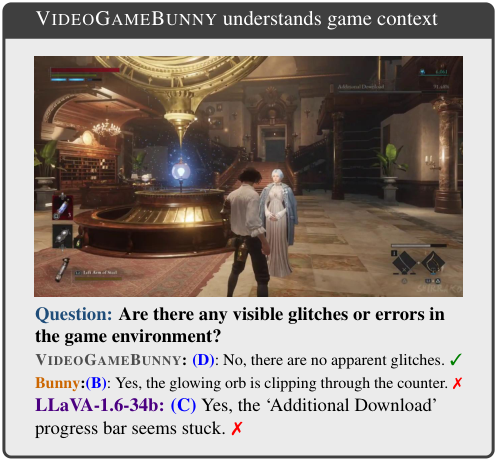

<!-- Start of picture text -->
VIDEOGAMEBUNNY understands game context Question: Are there any visible glitches or errors in the game environment? VIDEOGAMEBUNNY: (D) : No, there are no apparent glitches. ✓ Bunny:(B) : Yes, the glowing orb is clipping through the counter. ✗ LLaVA-1.6-34b: (C)  Yes, the ‘Additional Download’ progress bar seems stuck. ✗ <!-- End of picture text -->

Figure 1. VIDEOGAMEBUNNY is a model specifically fine-tuned on video game content, enabling it to understand game contexts and respond to related questions more accurately. 

potential to function as vision assistants and solve complex problems across various domains [1, 5, 45]. In video games, LMMs can offer significant benefits for both in-game experiences and game development. In-game, LMMs can serve as vision assistants, enhancing players’ experiences by guiding them through tasks like crafting new items [32]. They also have the potential to narrate the game, summarize events, and highlight critical gameplay moments [4]. For game development, LMMs have the potential to assist in detecting bugs [42], creating bug reports, and deploying automated in-game bots that interact with the environment [44]. These applications require robust models capable of understanding game content. 

Despite advances and promises, existing LMMs, particularly open-source models, encounter challenges in accurately understanding game content, such as scenes and 

1 

world physics [42] (e.g., see Fig. 1). 

In this study, we make the first important step towards addressing these challenges by releasing a suite of datasets specifically designed for video game content and introducing VIDEOGAMEBUNNY, a model trained for video game content understanding. Our study centers on the following research questions: 

- **(RQ1)** _Which type of data has the potential to improve the model’s performance?_ 

**(RQ2)** _Which data type mixture strategy improves the model’s performance the most?_ 

**(RQ3)** _How does_ VIDEOGAMEBUNNY _perform compared to state-of-the-art (SOTA) open-source models on game understanding tasks?_ Our main contributions are as follows: 

1. We release VIDEOGAMEBUNNY, a model specifically fine-tuned for video game question-answering tasks. 

2. We release a suite of datasets containing 185,259 video game images from 413 games, featuring various gameplay elements and graphical styles. Our datasets include 389,565 image-instruction pairs with captions, question-answering tasks, and JSON representations of images (see Sec. 4). 

3. We conduct experiments to demonstrate the effectiveness of different instruction datasets and their impact on the model’s performance (see Sec. 6). 

4. We release a replication package containing the training logs and intermediate checkpoints at https:// videogamebunny.github.io/. 

## **2. Background and Related Work** 

### **2.1. Large multimodal models** 

Large multimodal models (LMMs) enhance large language models (LLMs) by incorporating additional modalities such as images or audio, enabling them to process multimodal inputs and generate textual outputs. The role of the language model is to comprehend user instructions and produce responses based on the additional modality inputs provided. Standard approaches to create LMMs involve combining pre-trained models with different modalities via projection layers. These layers can be implemented using simple mechanisms such as multilayer perceptrons (MLP) [24, 27] or transformer layers [25]. Alternatively, a resampler module like Perceiver [3, 20, 21] or Qformer [10, 60] selectively chooses features to reduce the number of visual tokens based on the context and instruction, enhancing efficiency and maintaining performance. 

In this study, we focus on LMMs that accept input images and text to produce responses, particularly using the LLaVA-style architecture [29], which is one of the most popular methods [14, 26, 28, 33]. This architecture employs an MLP layer to integrate vision tokens with a language 

model. 

### **2.2. Instruction following data** 

Large models trained on massive corpora of text, such as GPT-3 [7], T5 [37], and PaLM [9], are not inherently instruction-following, meaning they do not respond to user queries. To enable these models to follow user instructions and answer queries, they usually undergo a process called instruction tuning [35, 56]. This process involves fine-tuning the models to handle specific user instructions, such as questions or commands, allowing them to respond appropriately based on the given instructions. 

In the multimodal context, particularly for models that accept visual inputs, there are various types of visual instruction-following data, such as detailed descriptions, conversational style question answering (Q&A), and complex reasoning. Researchers have explored diverse approaches to generate such data, including the use of academic text-oriented visual Q&A datasets [10]. The LLaVA model [24] demonstrated that leveraging a strong text-only LLM and an image dataset annotated with object names and bounding box information can be converted into effective visual instruction-following data. 

### **2.3. LLMs and LMMs in video games** 

LLMs have shown strong promise for integration with games for a wide range of tasks, from content creation to game-playing agents [13, 19, 30, 39, 43, 47–50, 52, 57, 59]. Large multimodal models (LMMs) can further enhance this integration by providing richer context inputs such as images and videos to enable broader applications. Projects like Cradle [44], which focuses on playing Red Dead Redemption 2 with GPT-4V [1] showcase LMMs’ abilities to identify objects, characters, and environmental features and assist in controlling the game. Beyond gameplay, LMMs have found applications in game testing [42, 43], where they are leveraged for detecting and interpreting video game bugs. 

Our study is the first to explore enhancing an LMM’s general game understanding, rather than focusing on a specific game or task. We use screenshots from 413 games, aiming to improve capabilities across various game-related tasks by developing broader game comprehension skills. 

### **2.4. Empirical analysis of large multimodal models** 

Some previous studies have conducted experiments to see how different architectural components or data sources affect the general performance of large multimodal models [22, 23, 33, 46]. For example, McKinzie et al. [33] found that the input resolution of the input image plays a crucial role in improving performance, and Laurenc¸on et al. [22] found that utilizing cross-attention between image and language is more effective than the adapter-based method. 

2 

We are the first to systematically investigate the impact of different instruction-following datasets and their combinations on the performance of LMMs in game understanding tasks. 

## **3. VIDEOGAMEBUNNY Model Architecture** 

In this section, we describe the architectural choices and configurations behind our model, VIDEOGAMEBUNNY. VIDEOGAMEBUNNY is based on Bunny [14], a family of efficient and high-performing LLMs known for their competitive or superior performance on various benchmarks compared to many open-source alternatives. 

Bunny follows the same principle as LLaVA [24, 27] for the integration of image inputs. Using a shallow network of multilayer perceptrons (MLPs) as the projection layer, vision embeddings extracted from a strong pre-trained vision model are processed and provided as image tokens for the language model. This technique effectively leverages pretrained vision and language models, allowing them to work together efficiently. 

Bunny offers various combinations of vision and language models and supports images with resolutions up to 1152 _×_ 1152 pixels. For creating VIDEOGAMEBUNNY, we selected Bunny configurations that deliver the best performance [14] while being small enough to run on a consumergrade graphics card. We use LLama-3-8B [2] as the language model and SigLIP [54] with the S2 wrapper [40] for the vision encoder. The S2 wrapper extracts features from an input image at various scales to form a multi-scale feature. This is potentially useful since video games often contain visual elements at different scales, from tiny UI icons to large objects. A multi-scale feature could capture these diverse elements. Fig. 2 shows the architecture of VIDEOGAMEBUNNY. 

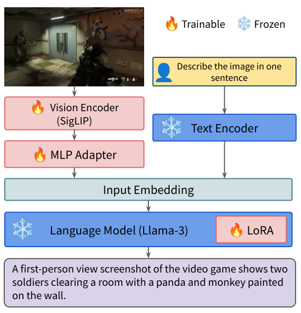

<!-- Start of picture text -->
 Trainable       Frozen Describe the image in one sentence   Vision Encoder (SigLIP) Text Encoder  MLP Adapter Input Embedding               Language Model (Llama-3)  LoRA A first-person view screenshot of the video game shows two soldiers clearing a room with a panda and monkey painted on the wall. <!-- End of picture text -->

Figure 2. Architecture overview of VIDEOGAMEBUNNY. An image input and a textual instruction are fed into the language model to produce a response. The image is passed through a separate pre-trained vision encoder and a projection layer to align the embedding space between the two models. and icons show trainable and frozen layers respectively 

In total, our dataset contains 185,259 images from 413 different video games, encompassing various genres, graphic styles, and gameplay mechanics. Fig. 3 shows some sample images from our dataset, and Fig. A5 shows the distribution of images per game. 

### **4.2. Generating instructions** 

## **4. Instruction-following Data for Video Game Content** 

One of the main challenges limiting the ability of opensource models to generalize effectively to video game content is the lack of instruction-following data specific to video games in public datasets. Our goal is to collect game-specific data to address this challenge. In this section, we explain the process of collecting and generating game-specific instruction-following data. 

### **4.1. Video game images** 

We collect images from YouTube by searching for _gameplay walkthroughs_ with _Full-HD_ , _4K_ , and _8K_ quality. These high-resolution videos ensure that downsampled frames retain more information and details compared to lower quality videos. We randomly sample frames from the downloaded videos and label them with the corresponding game name. 

Following previous studies [27, 29, 51], we employ another robust model to generate instructions in the form of user queries and responses for images in our dataset. We categorize the instructions into four types: _short captions_ ( _70,673_ samples), _long captions_ ( _70,799_ samples), _imageto-JSON_ ( _136,974_ samples) and _image-based question answering_ ( _81,122_ samples). In this section, we explain how we generate each type of instructions. Fig. 4 shows an overview of the data generation process. 

#### **4.2.1 Image captioning** 

Image captioning is a basic form of instruction-following that generates a description of the input image. An image caption can be short and concise, providing a high-level overview of the image, or very detailed, covering fine-grain details. Our dataset includes both forms of image captioning to meet user queries, whether they seek a detailed cap- 

3 

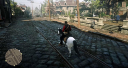

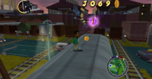

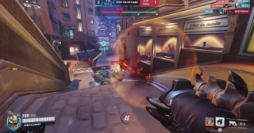

Figure 3. Our dataset includes sample video game images that showcase a wide range of characters, environments, mechanics, camera viewpoints, and artistic styles. These styles vary from western to contemporary and futuristic, and from realistic to fantasy settings. 

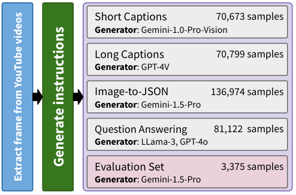

<!-- Start of picture text -->
Short Captions  70,673 samples Generator : Gemini-1.0-Pro-Vision Long Captions  70,799 samples Generator : GPT-4V Image-to-JSON  136,974 samples Generator : Gemini-1.5-Pro Question Answering  81,122  samples Generator : LLama-3, GPT-4o Evaluation Set  3,375 samples Generator : Gemini-1.5-Pro Generate instructions Extract frame from YouTube videos <!-- End of picture text -->

Figure 4. Overview of the dataset generation process. 

tion or a short summary. In addition, it includes a structured version where the image is described in 16 predefined fields. 

**Short captions** : We use Gemini-1.0-pro-vision to obtain short descriptions of a subset of images in our dataset, which includes 70,673 images. We use the “ _Describe the image_ ” prompt, which generates captions typically consisting of one or a few sentences. 

**Long captions** : While short captions provide a highlevel overview of the image, it lacks many details in the image which might be useful for the user. To address this, we use GPT-4V to get detailed captions of all images in the previous section (see Fig. A1 for the used prompt). 

**Image-to-JSON** : Another comprehensive method for describing images is converting them into a JSON format. This approach summarizes an input image into a JSON structure, with each key describing an element from the image, such as _characters in the image_ or _description of Game UI_ . Unlike typical captioning, this method provides a template that must be filled. If the image lacks a certain element, that part remains empty, indicating the absence of that element in the image. This ensures a more detailed and structured representation of the image content. 

Another benefit of describing an image in JSON is that this structured representation facilitates integration with other systems. JSON is a widely adopted format for sharing information between different software systems. Summarizing the image as JSON can help integrate LMMs in other 

systems, such as software testing pipelines, potentially verifying the game output and ensuring that the visual output has the desired properties and information. 

To create the image-to-JSON dataset, we use Gemini1.5-Pro with instructions (Fig. A2) to convert a given image into a JSON file with hierarchical levels of detail and information. The JSON file contains 16 elements that capture both high-level and fine-grained details of the image. These keys are chosen to capture game-specific elements from the image in isolation, which can be used for downstream applications, such as game testing. It starts with an overall summary of the image and then moves to specific aspects such as detailed character descriptions (including facial expressions and clothing), weather information, summaries of UI and player inventory, objects in the scene, and lighting and environmental effects. Tab. A1 shows the keys included in the JSON output. Our dataset contains 136,974 ImageJSON pairs. Fig. 5 shows a sample of information extracted from an image. 

#### **4.2.2 Question-Answering conversations** 

Moving beyond simple image descriptions, a general and capable model should be able to respond to user questions based on the content of the image. Below, we describe how we generate such data for each image (1) from its long caption and (2) directly from the image itself. 

**Llama-3-assisted visual instruction data generation** : We use Llama-3 to convert long captions generated by GPT4V into a series of question-answering conversations. This approach is similar to the original LLaVA [29] method, but instead of using an object’s name and its bounding box information, we directly utilize long captions. 

While long captions provide a rich source of information, they lack the structure of question-answer formats. For example, if a caption describes a person in the image with specific details, such as clothing, an LLM can generate a question like, _“What is the color of the dress of the person in the image?”_ By utilizing a strong text-only model, we can transform each caption into a multi-turn conversation between a user and an assistant. 

We use Llama-3-70B to transform GPT-4V captions into question-answer conversations, with the prompt shown in Fig. A3. The prompt requires questions to directly relate to 

4 

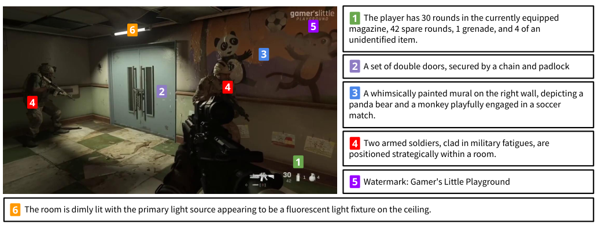

<!-- Start of picture text -->
        The player has 30 rounds in the currently equipped  1 6 5 magazine, 42 spare rounds, 1 grenade, and 4 of an unidentified item. 3         A set of double doors, secured by a chain and padlock  2 4 2         A whimsically painted mural on the right wall, depicting a  3 4 panda bear and a monkey playfully engaged in a soccer match.         Two armed soldiers, clad in military fatigues, are  4 positioned strategically within a room. 1         Watermark: Gamer's Little Playground 5         The room is dimly lit with the primary light source appearing to be a fluorescent light fixture on the ceiling.  6 <!-- End of picture text -->

Figure 5. Sample information extracted for the image-to-JSON dataset by Gemini-1.5-Pro. Each sample contains detailed information ranging from minor details to high-level descriptions, such as: **1** player inventory, **2 3** details about the environment, **4** non-player characters, **5** the screenshot’s watermark, and **6** lighting. 

the image description. We create 496,469 question-answer pairs for 70,232 images, grouping questions for each image into a multi-turn conversation. 

**Image-based question-answering** : We use GPT-4o to generate questions and their answers based on an input image in a _single_ prompt. In the prompt (Fig. A4), we first ask GPT-4o to examine the image and provide a detailed description of its content, then to generate relevant questions based on the content of the image and provide answers for each question. In the prompt, we emphasize that the questions should focus on understanding the image to avoid questions that might not be directly relevant to the image. 

### **4.3. Evaluation dataset** 

To assess model performance on video game understanding tasks, we created a multiple-choice question evaluation set using Gemini-1.5-Pro [45]. This approach allows for an efficient comparison of various models. While Gemini-1.5Pro offers significant advantages over open-source models for data generation, it does have limitations. We reduce noise in the generated questions as follows: 

1. **Initial Generation:** We use Gemini-1.5-Pro to create 4,000 questions across 10 categories related to video game content understanding (see Tab. 1). 

2. **Quality Assessment:** 

   - (a) Self-evaluation: We test Gemini-1.5-Pro on its own questions and found it achieves an accuracy of 84%. 

   - (b) Manual validation: A random sampling of questions and answers revealed a 14% error rate (incorrect or indeterminate answers). 

3. **Noise Reduction:** 

- (a) We remove 625 samples that Gemini-1.5-Pro had answered incorrectly. 

- (b) We conduct a second manual analysis and found that the error rate dropped to 9%. 

## **5. Experiments** 

In this section, we describe our experiments to explore how our collected instruction-following datasets can improve a model’s understanding of game context. We focus on three research questions: 

**(RQ1)** **_Which type of data has the potential to improve the model’s performance?_** In addressing this question, we fine-tune Bunny using a single dataset at a time to observe overall performance trends. Since the primary goal of this experiment is to identify general trends, we fine-tune Bunny on different subset sizes for each dataset only _once_ . We increase the subset size from 2K to 60K samples and stop the experiment if we observe a sharp decline in performance. 

**(RQ2)** **_Which data type mixture strategy improves the model’s performance the most?_** We evaluate different data mixing strategies at various sizes to see how both mixture and subset size change the performance of the model. We use the following four strategies: 

1. **Random:** We randomly sample without replacement from the combined dataset pool. This serves as a control group, using no specific selection strategy. 

2. **Equal:** We select an equal number of samples from each dataset to ensure a balanced representation. 

3. **Stratified:** Datasets are mixed based on _video games_ ,, maintaining the game distribution in the final dataset. This balances game representation and ensures diverse image types. We focus on game variety rather than 

5 

Table 1. Categories of questions in our dataset, along with a sample question for each category. 

|**Category**|**Description**|**Count**|
|---|---|---|
|**Action Understanding**|Recognizing and describing the actions taking place within the image. _Sample: What action is the character in the foreground performing?_|356|
|**Anomalies and Glitches**|Identifying errors, bugs, glitches, or placeholder elements within the game environment. _Sample: Describe any anomalies or glitches present in the image._|223|
|**Character Analysis**|Recognizing characters, understanding their roles, and interpreting their expressions and poses. _Sample: What is Aloy’s emotional state based on her facial expression?_|312|
|**Common Sense Reasoning**|Understanding the image using general knowledge and everyday logic. _Sample: Based on the score and time remaining, which team is likely to win the match?_|430|
|**Gameplay Mechanics**|Understanding the rules and mechanics that govern the game. _Sample: What game mechanic is most likely being utilized by the player character?_|273|
|**OCR and UI**|Reading and interpreting on-screen text and user interface elements. _Sample: What is written in the caption box at the bottom of the image?_|334|
|**Miscellaneous**|Any other type of question that does not fit into the previous categories. _Sample: What material are the containers in the image primarily made of?_|239|
|**Scene Understanding**|Recognizing and interpreting the overall environment or setting in the image. _Sample: The racetrack depicted in the image is set in what type of environment?_|566|
|**Small Details**|Identifying and interpreting small but significant details within the image. _Sample: What color is the jacket worn by the character in the foreground?_|356|
|**Spatial Reasoning**|Testing the ability to understand spatial relationships of objects present in the image. _Sample: What is the spatial relationship between the two red markers visible in the image?_|286|

instruction types. Games with insufficient samples are excluded. 

4. **Weighted:** We use the three most effective datasets from **RQ1** : image-based question-answering (GPT4o), long captions, and image-to-JSON. We assign weights: 30% each for GPT-4o and long captions, 40% for image-to-JSON. This prioritizes valuable datasets to assess their impact on model performance. 

We fine-tune Bunny on the above dataset mixture strategies with sizes ranging from 2K to 30K. We repeat each experiment three times, using different samples for each strategy to report the mean performance and standard deviation. We stop at 30K since our smallest dataset (generated by GPT-4o) contains 10K samples, and at 30K, we will exhaust the _Equal_ and _Weighted_ strategies. 

**(RQ3)** **_How does_ VIDEOGAMEBUNNY** **_perform compared to SOTA open-source models on game understanding tasks?_** Building on insights from our experiments, we create VIDEOGAMEBUNNY, a model fine-tuned on a dataset of 50K image-instruction samples compiled from all previously introduced datasets. To assess the effectiveness of fine-tuning a smaller model on game-specific data, we evaluate VIDEOGAMEBUNNY against LLaVA-1.6-34b, a SOTA open-source model with 4.2 _×_ more parameters. 

_Experiment setup:_ We instruction tune Bunny with LoRA [18] using the PEFT [31] library. Given that Bunny has been trained on real images, we unfreeze the vision encoder (SigLIP [54]) to adapt to the diverse visual styles of different games. To prevent overfitting and memorization, we fine-tune for only one epoch in all experiments. 

Given the importance of reproducibility and accessibility for all researchers, we perform all experiments on a 

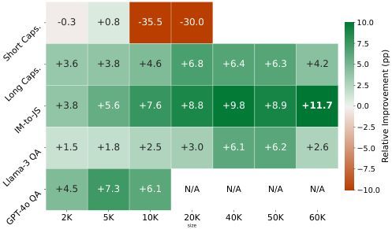

<!-- Start of picture text -->
-0.3 +0.8 -35.5 -30.0 10.0 7.5 +3.6 +3.8 +4.6 +6.8 +6.4 +6.3 +4.2 5.0 2.5 +3.8 +5.6 +7.6 +8.8 +9.8 +8.9 +11.7 0.0 2.5 +1.5 +1.8 +2.5 +3.0 +6.1 +6.2 +2.6 5.0 7.5 +4.5 +7.3 +6.1 N/A N/A N/A N/A 10.0 2K 5K 10K 20K 40K 50K 60K size Short Caps. Long Caps. IM-to-JS Llama-3 QA GPT-4o QA Relative Improvement (pp) <!-- End of picture text -->

Figure 6. Relative performance improvement (pp) of Bunny finetuned on different subsets of each dataset. The image-to-JSON dataset shows a strong positive trend, while the short captions dataset degrades performance. The best performance achieved in the experiment is highlighted in bold. 

**single NVIDIA A100 GPU (80GB)** , ensuring a balance between computational power and accessibility. The total GPU hours needed to conduct all experiments, including some preliminary tests, is approximately 900 hours, which is roughly $2,000 when using cloud providers. 

## **6. Results** 

### **RQ1: Which type of data has the potential to improve the model’s performance?** 

**The image-to-JSON dataset has the greatest potential to improve the base model’s performance.** Fig. 6 shows the performance after fine-tuning Bunny using a single dataset at a time. Fine-tuning on a subset of the image- 

6 

Table 2. Performance of models fine-tuned on a mixture of data with various strategies. The Weighted strategy leads to better performance with smaller dataset sizes, but as size increases, all strategies perform similarly. We use a strategy similar to Weighted to train VIDEOGAMEBUNNY with 50K samples. 

|Size|Random|Equal|Stratified|Weighted|
|---|---|---|---|---|
|2K|76.7 ± 0.9|77.8 ± 0.8|78.0 ± 0.2|79.0 ± 0.6|
|5K|79.2 ± 0.4|79.9 ± 0.4|80.0 ± 0.5|79.8 ± 0.6|
|10K|79.8 ± 0.8|80.8 ± 0.6|80.8 ± 0.1|81.4 ± 0.5|
|20K|81.5 ± 0.1|81.3 ± 0.7|81.8 ± 0.8|82.3 ± 0.9|
|30K|81.8 ± 0.4|81.2 ± 1.1|81.6 ± 0.7|82.6 ± 0.3|
|50K|–|–|–|**85.1**|

Table 3. Average improvement for different sizes for each category 

|Category/**Dataset Size**|**2K**|**5K**|**10K**|**20K**|**30K**|
|---|---|---|---|---|---|
|Action Understanding|1.6|2.5|2.5|3.7|3.9|
|Anomalies and Glitches|23.4|33.0|33.2|34.0|32.0|
|Character Analysis|2.6|3.9|4.2|4.7|4.4|
|Common Sense Reasoning|3.7|4.2|3.8|4.3|4.0|
|Gameplay Mechanics|4.2|5.0|6.4|8.2|8.9|
|HUD and UI|9.3|12.9|16.5|18.9|21.0|
|Miscellaneous|7.2|7.9|9.6|9.9|9.8|
|Scene Understanding|–0.2|0.6|1.3|2.0|2.0|
|Small Details|0.3|1.2|2.4|3.4|3.0|
|Spatial Reasoning|5.3|6.2|7.1|7.8|7.4|

Table 4. Performance of various models on the evaluation set (%). 

to-JSON dataset shows the greatest improvements, as this leads to an accuracy above 82% (+8.7 percentage points (pp) above the baseline of 73.3%) for subset sizes over 10K, with the best performance achieved at 60K (+11.7 pp). 

**While all datasets lead to performance improvement, short captions can degrade it.** Fine-tuning Bunny on a dataset of 10K or 20K short captions degrades performance (-35.5 pp and -30 pp), suggesting that short captions do not contain enough signal for the models to improve and can negatively affect the model. 

### **RQ2: Which data type mixture strategy improves the model’s performance the most?** 

**There is a general improvement trend as we increase the size across all strategies.** Tab. 2 shows the performance of the models that were fine-tuned using our data mixture strategies. As we increase the dataset size, the mean performance of all mixtures improves. For instance, the _Random_ strategy improves from 76.7% at 2K samples to 81.9% at 30K samples and the _Weighted_ strategy shows an improvement from 79.0% at 2K samples to 82.6% at 30K samples. This trend demonstrates the value of additional data regardless of the mixing strategy employed. 

**As the size of dataset increases, different strategies perform similarly.** The performance difference between various strategies converges as we increase the size of the datasets, and they perform similarly in terms of mean and standard deviations. Yet, the _Weighted_ method achieves the highest average among other strategies (82.6%). This convergence suggests that the choice of mixing strategy becomes less critical as more data becomes available. In contrast, smaller dataset sizes such as 2k indicate that the _Weighted_ strategy outperforms other mixture strategies, achieving an accuracy of 79.0 _±_ 0.6. 

**Having a uniform distribution of games does not significantly improve performance.** The _Stratified_ strategy, which aims to balance the representation of different games in the dataset, does not significantly enhance performance 

|**Model**|**Accuracy**|**Model**|**Accuracy**|
|---|---|---|---|
|Bunny-1.1-Llama-3-8B|73.3|LLaVA-v1.5-13b|64.6|
|VIDEOGAMEBUNNY|**85.1**|LLaVA-v1.6-vicuna-13b|71.7|
|LLaVA-v1.5-7b|61.3|LLaVA-v1.6-34b|83.9|

compared to other strategies. For example, in the 2k dataset, the _Stratified_ strategy (78.0 _±_ 0.2) is outperformed by the _Weighted_ strategy (79.0 _±_ 0.6). Similarly, in the 30k dataset, the performance of both strategies is comparable (81.6 _±_ 0.7 vs 82.6 _±_ 0.3). 

**Fine-tuning improves performance across all categories, with** **_Anomalies and Glitches_ improving the most.** Fig. A6 shows that fine-tuning improves Bunny’s performance across all categories for almost all dataset sizes. The _Anomalies and Glitches_ and _HUD and UI_ categories improve the most, with average improvements of +32.0 and +21.0, using a dataset size of 30K (Tab. 3). 

### **RQ3: How does** VIDEOGAMEBUNNY **perform compared to SOTA open-source models on game understanding tasks?** 

VIDEOGAMEBUNNY achieves **85.1%** (Tab. 2) on the evaluation set, outperforming all trained models and surpassing various open-source models (Tab. 4). It outperforms even LLaVA-1.6-34b, despite its larger parameter count, by +1.2. Breakdown of accuracy per category reveals that the most significant benefits come from game-specific categories, such as anomaly and glitch detection (+16.6) and HUD and UI (+3.0) (Tab. A2). Fig. 7 shows a sample from evaluation set where VIDEOGAMEBUNNY correctly answers a common-sense reasoning question while both Bunny and LLaVA-1.6-34b fail. 

We also conduct an informal qualitative analysis, prompting the models with more open-ended questions, which underlines that VIDEOGAMEBUNNY demonstrates an improved understanding of video game content and provides better answers (Fig. 8, and Sec. A3). 

7 

#### Models comparison in video game understanding 

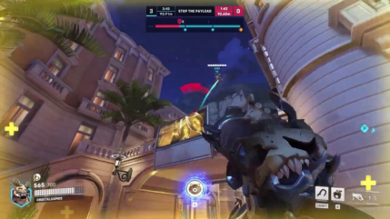

**Question: Based on the score and time remaining, which team is likely to win the match? VIDEOGAMEBUNNY: (B)** : The blue team is likely to win ✓ **Bunny: (C)** : The red team is likely to win. ✗ **LLaVA-1.6-34b: (C)** : The red team is likely to win. ✗ 

Figure 7. VIDEOGAMEBUNNY correctly utilizes information on the HUD to answer the question, while the basemodel Bunny and the larger model LLaVA-1.6-34b fail to provide a correct answer. 

## **7. Discussion** 

**Potential negative impacts:** Our study initiates the development of a model for understanding game content, with applications in game playing, testing, and commentary. The short-term implications for the gaming industry include enhancing the productivity of game testers and enhancing quality assurance processes. One possible negative impact of such advancement is the facilitation of in-game cheating. As AI models becomes more adept at understanding game contents, there is a risk that they could be used to create sophisticated cheating tools. 

**Biases and mistakes in dataset generation:** In this study, we use existing models to annotate our dataset. While this approach aligns with previous studies [29, 61] and follows the same principles as the teacher-student learning paradigm [16], we acknowledge that our data may contain biases and mistakes introduced by these existing models. 

**Quality of images:** Images in our dataset, sourced from YouTube videos, may include low-quality frames despite filtering for high-quality videos. Motion blur in video games and sampling during scene transitions can result in some blurry or less-than-ideal images. 

**Use of various models for annotation:** In the annotation process, we utilize various models depending on their availability and cost. While this process brings diversity to the labels, it is not meant to compare the different models against each other in terms of performance. 

**Use of multiple-choice questions to evaluate game understanding:** We use multiple-choice questions to evaluate 

<!-- Start of picture text -->
Models comparison in image captioning <!-- End of picture text -->

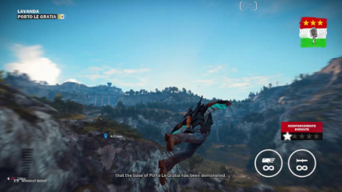

**Question: Write a short summary of the image VIDEOGAMEBUNNY:** The image is a screenshot from a video game, showing a character in mid-air, equipped with a wingsuit, flying over a mountainous landscape. The game’s HUD elements are visible, including a distance marker and a weapon indicator. ... **Bunny:** A video game scene shows a man in a _green shirt_ and blue pants jumping off a cliff. He is _holding a parachute_ and is in mid-air. ... **LLaVA-1.6-34b:** The image appears to be a screenshot from a video game, showing _a first-person perspective_ of a character in mid-air, likely after jumping or falling from a height. The character is _equipped with a parachute, which is open_ and slowing their descent. ... 

Figure 8. VIDEOGAMEBUNNY provides a detailed description of video game content in the image, while other models show inaccuracies (highlighted in _red_ ). Responses are truncated to save space. 

a model’s game understanding, as it allows for a clear comparison. While this format has been extensively for benchmarks [15, 53], it might not be the best proxy for game understanding. Future work needs to focus on human evaluation or the use of LLMs as judges [58]. 

## **8. Conclusion** 

We introduce a new instruction-following dataset, with 389,565 image-instruction pairs, specifically designed for video game understanding. We investigate the effectiveness of fine-tuning LMMs on different instruction-following dataset types and mixtures of them, and finally introduce VIDEOGAMEBUNNY, an 8B parameter model that outperforms a SOTA model, LLaVA-1.6-34b, on a game-related question answering benchmark. 

8 

## **References** 

- [1] Achiam, J., Adler, S., Agarwal, S., Ahmad, L., Akkaya, I., Aleman, F.L., Almeida, D., Altenschmidt, J., Altman, S., Anadkat, S., et al.: Gpt-4 technical report. arXiv preprint arXiv:2303.08774 (2023) 1, 2 

- [2] AI@Meta: Llama 3 model card (2024), https:// github.com/meta-llama/llama3/blob/ main/MODEL_CARD.md 3 

- [3] Alayrac, J.B., Donahue, J., Luc, P., Miech, A., Barr, I., Hasson, Y., Lenc, K., Mensch, A., Millican, K., Reynolds, M., et al.: Flamingo: a visual language model for few-shot learning. Advances in neural information processing systems **35** , 23716–23736 (2022) 2 

- [4] Anonymous: While i wait for gpt-4o with updated voice capabilities, i decided to create a prototype using multiple open source models to simulate an ai commentator who can see your screen and listen to in-game dialogue. Reddit r/OpenAI (2024), https : / / www . reddit . com / r / OpenAI / comments/1dm6lg9/while_i_wait_for_ gpt4o_with_updated_voice/, accessed: June 30, 2024 1 

- [5] Anthropic: Introducing the next generation of claude (2024), https://www.anthropic.com/ news/claude-3-family 1 

- [6] Bommasani, R., Hudson, D.A., Adeli, E., Altman, R., Arora, S., von Arx, S., Bernstein, M.S., Bohg, J., Bosselut, A., Brunskill, E., et al.: On the opportunities and risks of foundation models. arXiv preprint arXiv:2108.07258 (2021) 1 

- [7] Brown, T., Mann, B., Ryder, N., Subbiah, M., Kaplan, J.D., Dhariwal, P., Neelakantan, A., Shyam, P., Sastry, G., Askell, A., et al.: Language models are few-shot learners. Advances in neural information processing systems **33** , 1877–1901 (2020) 2 

- [8] Chen, Y., He, T., Huang, D., Ye, W., Chen, S., Tang, J., Chen, X., Cai, Z., Yang, L., Yu, G., et al.: Meshanything: Artist-created mesh generation with autoregressive transformers. arXiv preprint arXiv:2406.10163 (2024) 1 

- [9] Chowdhery, A., Narang, S., Devlin, J., Bosma, M., Mishra, G., Roberts, A., Barham, P., Chung, H.W., Sutton, C., Gehrmann, S., et al.: Palm: Scaling language modeling with pathways. Journal of Machine Learning Research **24** (240), 1–113 (2023) 2 

- [10] Dai, W., Li, J., Li, D., Tiong, A.M.H., Zhao, J., Wang, W., Li, B., Fung, P.N., Hoi, S.: Instructblip: Towards 

general-purpose vision-language models with instruction tuning. Advances in Neural Information Processing Systems **36** (2024) 2 

- [11] Eloundou, T., Manning, S., Mishkin, P., Rock, D.: Gpts are gpts: An early look at the labor market impact potential of large language models. arXiv preprint arXiv:2303.10130 (2023) 1 

- [12] Forum, W.E.: Gaming boomed in lockdown and market value will reach $320bn. World Economic Forum (2023), https://www.weforum.org/ agenda/2023/01/gaming-market-value320bn-2026/ 1 

- [13] Gallotta, R., Todd, G., Zammit, M., Earle, S., Liapis, A., Togelius, J., Yannakakis, G.N.: Large language models and games: A survey and roadmap. arXiv preprint arXiv:2402.18659 (2024) 2 

- [14] He, M., Liu, Y., Wu, B., Yuan, J., Wang, Y., Huang, T., Zhao, B.: Efficient multimodal learning from datacentric perspective. arXiv preprint arXiv:2402.11530 (2024) 2, 3 

- [15] Hendrycks, D., Burns, C., Basart, S., Zou, A., Mazeika, M., Song, D., Steinhardt, J.: Measuring massive multitask language understanding. arXiv preprint arXiv:2009.03300 (2020) 8 

- [16] Hinton, G., Vinyals, O., Dean, J.: Distilling the knowledge in a neural network. arXiv preprint arXiv:1503.02531 (2015) 8 

- [17] Holson, B.: Dimension hopper part 1 (Jun 2023), https://generalrobots.substack.com/ p/dimension-hopper-part-1 1 

- [18] Hu, E.J., Shen, Y., Wallis, P., Allen-Zhu, Z., Li, Y., Wang, S., Wang, L., Chen, W.: Lora: Low-rank adaptation of large language models. arXiv preprint arXiv:2106.09685 (2021) 6 

- [19] Hu, S., Huang, T., Ilhan, F., Tekin, S., Liu, G., Kompella, R., Liu, L.: A survey on large language modelbased game agents. arXiv preprint arXiv:2404.02039 (2024) 2 

- [20] Jaegle, A., Gimeno, F., Brock, A., Vinyals, O., Zisserman, A., Carreira, J.: Perceiver: General perception with iterative attention. In: International conference on machine learning. pp. 4651–4664. PMLR (2021) 2 

- [21] Laurenc¸on, H., Saulnier, L., Tronchon, L., Bekman, S., Singh, A., Lozhkov, A., Wang, T., Karamcheti, S., 

9 

Rush, A., Kiela, D., et al.: Obelics: An open webscale filtered dataset of interleaved image-text documents. Advances in Neural Information Processing Systems **36** (2024) 2 

- [22] Laurenc¸on, H., Tronchon, L., Cord, M., Sanh, V.: What matters when building vision-language models? arXiv preprint arXiv:2405.02246 (2024) 2 

- [23] Li, B., Zhang, H., Zhang, K., Guo, D., Zhang, Y., Zhang, R., Li, F., Liu, Z., Li, C.: Llavanext: What else influences visual instruction tuning beyond data? (May 2024), https://llavavl.github.io/blog/2024-05-25-llavanext-ablations/ 2 

- [24] Li, C., Wong, C., Zhang, S., Usuyama, N., Liu, H., Yang, J., Naumann, T., Poon, H., Gao, J.: Llavamed: Training a large language-and-vision assistant for biomedicine in one day. Advances in Neural Information Processing Systems **36** (2024) 2, 3 

- [25] Li, J., Li, D., Savarese, S., Hoi, S.: Blip-2: Bootstrapping language-image pre-training with frozen image encoders and large language models. In: International conference on machine learning. pp. 19730–19742. PMLR (2023) 2 

- [26] Lin, B., Zhu, B., Ye, Y., Ning, M., Jin, P., Yuan, L.: Video-llava: Learning united visual representation by alignment before projection. arXiv preprint arXiv:2311.10122 (2023) 2 

- [27] Liu, H., Li, C., Li, Y., Lee, Y.J.: Improved baselines with visual instruction tuning. In: Proceedings of the IEEE/CVF Conference on Computer Vision and Pattern Recognition. pp. 26296–26306 (2024) 2, 3 

- [28] Liu, H., Li, C., Li, Y., Li, B., Zhang, Y., Shen, S., Lee, Y.J.: Llava-next: Improved reasoning, ocr, and world knowledge (January 2024), https:// llava-vl.github.io/blog/2024-01-30llava-next/ 2 

- [29] Liu, H., Li, C., Wu, Q., Lee, Y.J.: Visual instruction tuning. Advances in neural information processing systems **36** (2024) 2, 3, 4, 8 

- [30] Ma, W., Mi, Q., Yan, X., Wu, Y., Lin, R., Zhang, H., Wang, J.: Large language models play starcraft ii: Benchmarks and a chain of summarization approach. arXiv preprint arXiv:2312.11865 (2023) 2 

- [31] Mangrulkar, S., Gugger, S., Debut, L., Belkada, Y., Paul, S., Bossan, B.: Peft: State-of-the-art parameterefficient fine-tuning methods. https://github. com/huggingface/peft (2022) 6 

- [32] Mashable: You can use microsoft’s copilot ai chatbot to learn how to play ’minecraft’. Mashable (2024), https://mashable.com/article/ microsoft - build - 2024 - copilot - minecraft, accessed on June 20, 2024 1 

- [33] McKinzie, B., Gan, Z., Fauconnier, J.P., Dodge, S., Zhang, B., Dufter, P., Shah, D., Du, X., Peng, F., Weers, F., et al.: Mm1: Methods, analysis & insights from multimodal llm pre-training. arXiv preprint arXiv:2403.09611 (2024) 2 

- [34] NVIDIA: Nvidia ace for games sparks life into virtual characters with generative ai (2023), https:// nvidianews.nvidia.com/news/nvidiaace - for - games - sparks - life - into - virtual-characters-with-generativeai, accessed: June 27, 2024 1 

- [35] Ouyang, L., Wu, J., Jiang, X., Almeida, D., Wainwright, C., Mishkin, P., Zhang, C., Agarwal, S., Slama, K., Ray, A., et al.: Training language models to follow instructions with human feedback. Advances in neural information processing systems **35** , 27730– 27744 (2022) 2 

- [36] Poole, B., Jain, A., Barron, J.T., Mildenhall, B.: Dreamfusion: Text-to-3d using 2d diffusion. arXiv preprint arXiv:2209.14988 (2022) 1 

- [37] Raffel, C., Shazeer, N., Roberts, A., Lee, K., Narang, S., Matena, M., Zhou, Y., Li, W., Liu, P.J.: Exploring the limits of transfer learning with a unified text-totext transformer. Journal of machine learning research **21** (140), 1–67 (2020) 2 

- [38] Research, G.V.: Video game market size, share and growth report, 2030. Grand View Research (2023), https://www.grandviewresearch.com/ industry-analysis/video-game-market 1 

- [39] Shao, X., Jiang, W., Zuo, F., Liu, M.: Swarmbrain: Embodied agent for real-time strategy game starcraft ii via large language models. arXiv preprint arXiv:2401.17749 (2024) 2 

- [40] Shi, B., Wu, Z., Mao, M., Wang, X., Darrell, T.: When do we not need larger vision models? arXiv preprint arXiv:2403.13043 (2024) 3 

- [41] Stokel-Walker, C., Van Noorden, R.: The promise and peril of generative ai. Nature **614** (7947), 214–216 (2023). https://doi.org/10.1038/d41586-023-00340-6 1 

10 

- [42] Taesiri, M.R., Feng, T., Bezemer, C.P., Nguyen, A.: Glitchbench: Can large multimodal models detect video game glitches? In: Proceedings of the IEEE/CVF Conference on Computer Vision and Pattern Recognition. pp. 22444–22455 (2024) 1, 2 

- [43] Taesiri, M.R., Macklon, F., Wang, Y., Shen, H., Bezemer, C.P.: Large language models are pretty good zero-shot video game bug detectors. arXiv preprint arXiv:2210.02506 (2022) 2 

- [44] Tan, W., Ding, Z., Zhang, W., Li, B., Zhou, B., Yue, J., Xia, H., Jiang, J., Zheng, L., Xu, X., et al.: Towards general computer control: A multimodal agent for red dead redemption ii as a case study. arXiv preprint arXiv:2403.03186 (2024) 1, 2 

- [45] Team, G., Anil, R., Borgeaud, S., Wu, Y., Alayrac, J.B., Yu, J., Soricut, R., Schalkwyk, J., Dai, A.M., Hauth, A., et al.: Gemini: a family of highly capable multimodal models. arXiv preprint arXiv:2312.11805 (2023) 1, 5 

- [46] Tong, S., Brown, E., Wu, P., Woo, S., Middepogu, M., Akula, S.C., Yang, J., Yang, S., Iyer, A., Pan, X., et al.: Cambrian-1: A fully open, vision-centric exploration of multimodal llms. arXiv preprint arXiv:2406.16860 (2024) 2 

- [47] Wang, G., Xie, Y., Jiang, Y., Mandlekar, A., Xiao, C., Zhu, Y., Fan, L., Anandkumar, A.: Voyager: An open-ended embodied agent with large language models. arXiv preprint arXiv:2305.16291 (2023) 2 

- [48] Wang, Z., Cai, S., Chen, G., Liu, A., Ma, X., Liang, Y.: Describe, explain, plan and select: Interactive planning with large language models enables open-world multi-task agents. arXiv preprint arXiv:2302.01560 (2023) 2 

- [49] Wang, Z., Cai, S., Liu, A., Jin, Y., Hou, J., Zhang, B., Lin, H., He, Z., Zheng, Z., Yang, Y., et al.: Jarvis-1: Open-world multi-task agents with memory-augmented multimodal language models. arXiv preprint arXiv:2311.05997 (2023) 2 

- [50] Wu, Y., Min, S.Y., Prabhumoye, S., Bisk, Y., Salakhutdinov, R.R., Azaria, A., Mitchell, T.M., Li, Y.: Spring: Studying papers and reasoning to play games. Advances in Neural Information Processing Systems **36** (2024) 2 

- [51] Xiao, B., Wu, H., Xu, W., Dai, X., Hu, H., Lu, Y., Zeng, M., Liu, C., Yuan, L.: Florence-2: Advancing a unified representation for a variety of vision tasks. In: 

Proceedings of the IEEE/CVF Conference on Computer Vision and Pattern Recognition. pp. 4818–4829 (2024) 3 

- [52] Xu, X., Wang, Y., Xu, C., Ding, Z., Jiang, J., Ding, Z., Karlsson, B.F.: A survey on game playing agents and large models: Methods, applications, and challenges. arXiv preprint arXiv:2403.10249 (2024) 2 

- [53] Yue, X., Ni, Y., Zhang, K., Zheng, T., Liu, R., Zhang, G., Stevens, S., Jiang, D., Ren, W., Sun, Y., et al.: Mmmu: A massive multi-discipline multimodal understanding and reasoning benchmark for expert agi. In: Proceedings of the IEEE/CVF Conference on Computer Vision and Pattern Recognition. pp. 9556– 9567 (2024) 8 

- [54] Zhai, X., Mustafa, B., Kolesnikov, A., Beyer, L.: Sigmoid loss for language image pre-training. In: Proceedings of the IEEE/CVF International Conference on Computer Vision. pp. 11975–11986 (2023) 3, 6 

- [55] Zhang, L., Wang, Z., Zhang, Q., Qiu, Q., Pang, A., Jiang, H., Yang, W., Xu, L., Yu, J.: Clay: A controllable large-scale generative model for creating highquality 3d assets (2024) 1 

- [56] Zhang, S., Dong, L., Li, X., Zhang, S., Sun, X., Wang, S., Li, J., Hu, R., Zhang, T., Wu, F., et al.: Instruction tuning for large language models: A survey. arXiv preprint arXiv:2308.10792 (2023) 2 

- [57] Zhang, W., Lu, Z.: AdaRefiner: Refining decisions of language models with adaptive feedback. In: Findings of the Association for Computational Linguistics: NAACL 2024. pp. 782–799. Association for Computational Linguistics (jun 2024), https: / / aclanthology . org / 2024 . findings - naacl.50 2 

- [58] Zheng, L., Chiang, W.L., Sheng, Y., Zhuang, S., Wu, Z., Zhuang, Y., Lin, Z., Li, Z., Li, D., Xing, E., et al.: Judging llm-as-a-judge with mt-bench and chatbot arena. Advances in Neural Information Processing Systems **36** (2024) 8 

- [59] Zheng, S., Feng, Y., Lu, Z., et al.: Steve-eye: Equipping llm-based embodied agents with visual perception in open worlds. In: The Twelfth International Conference on Learning Representations (2023) 2 

- [60] Zhu, D., Chen, J., Shen, X., Li, X., Elhoseiny, M.: Minigpt-4: Enhancing vision-language understanding with advanced large language models. arXiv preprint arXiv:2304.10592 (2023) 2 

11 

- [61] Zhu, Y., Zhu, M., Liu, N., Ou, Z., Mou, X., Tang, J.: Llava- _φ_ : Efficient multi-modal assistant with small language model. arXiv preprint arXiv:2401.02330 (2024) 8 

12 

# Supplementary Material 

## **A1. Additional details** 

### **A1.1. Prompts used to generated datasets** 

Figure A1. Long caption generation with GPT-4V 

_Please provide a detailed description of the image, ensuring that no details are omitted. Describe every element you observe within the image to provide a comprehensive account of its contents. Don’t be lazy and it is important to get everything well done._ 

Figure A2. image-to-JSON data generation 

_First, provide a detailed description of the image, including every small detail possible. Next, create ten multiplechoice questions based on the content of the image. Each question should test the understanding of the image’s content. Follow this JSON format: { ”description”: ”Full Image Description”, ”short_ _~~d~~ escription”: ”Short Image Description”, ”dialogue”: [”Any visible dialogue text as a json list”], ”on_ _~~s~~ creen_ _~~s~~ ubtitle”: ”any subtitle on the image or n/a”, ”minimap_ _~~d~~ etails”: ”Information from the minimap”, ”inventory_ _~~d~~ isplay”: ”Information about the player’s inventory”, ”score_ _~~o~~ r_ _~~p~~ rogress”: ”Details about scores or progress indicators”, ”NPC_ _~~s~~ tatus”: ”Information about NPCs”, ”event_ _~~i~~ ndicators”: ”Indicators of any special events”, ”interaction_ _~~p~~ rompts”: ”Visible prompts for player interactions”, ”game_ _~~m~~ ode”: ”Current game mode or context”, ”HUD_ _~~d~~ escription”: ”description of the game HUD or n/a if there is no HUD”, ”on_ _~~s~~ creen_ _~~w~~ atermark”: ”any watermark on the image or n/a”, ”summary_ _~~o~~ f_ _~~u~~ i_ _~~v~~ alues”: ”summary of the UI values as json or empty json if there is no UI”, ”scene_ _~~d~~ escription”: ”A high-level overview of the entire scene”, ”character_ _~~l~~ ist”: [ { ”name”: ”Character Name”, ”appearance”: ”Description of appearance”, ”clothing”: ”Description of clothing”, ”facial_ _~~e~~ xpression”: ”Description of facial expression” } ], ”object_ _~~l~~ ist”: [”Object 1”, ”Object 2”, ...], ”texture_ _~~d~~ etails”: ”a json list of object name and texture patterns that they have”, ”lighting_ _~~d~~ etails”: ”Specific information about the light sources and shadows in the scene”, ”color_ _~~p~~ alette”: [”hexadecimal color code”, ”hexadecimal color code”, ...], ”weather_ _~~c~~ onditions”: ”Description of any weather effects present, or say cannot be determined”, ”environmental_ _~~e~~ ffects”: ”Description of any environmental effects like fog, rain, fire, etc.”, ”animation_ _~~s~~ tates”: ”Descriptions of any static poses or actions implied by character positions”, ”error_ _~~l~~ og”: ”Any noticeable glitches or anomalies in the image”, ”glitches”: ”any glitch or buggy aspect of the image or none if there is nothing”, ”player_ _~~s~~ tatus”: { ”health”: ”Player’s health value”, ”equipment”: ”Player’s equipment details”, ”other_ _~~s~~ tatus”: ”Other status indicators” } }_ 

Figure A3. LLama-3-based data generation 

_Using the image description provided below, create 10 questions and their corresponding answers that pertain exclusively to the details given in the description. Format your response using JSON._ **_Image description_** _: <image description here >_ 

_Ensure your questions are relevant and directly related to the image description. For example, do not ask about elements not explicitly mentioned in the description._ 

Figure A4. GPT-4o-based data generation 

_First, provide a detailed description of the image, including every small detail possible. Next, create 10 questions answers based on the content of the image. Each question should test the understanding of the image’s content._ 

1 

Table A1. Description of entries in the JSON structure 

|**Key**|**Description**|
|---|---|
|Description|Detailed description of the image|
|Short description|Concise description of the image|
|Dialogue|A (JSON) list containing any visible dialogue text|
|On-Screen subtitle|Subtitles displayed on the image|
|Inventory display|Details of the player’s inventory visible on the image|
|HUD description|Description of the game’s Head-Up Display (HUD)|
|Scene description|High-level overview of the entire scene|
|NPC status|High level information about non-playable characters (NPCs)|
|Character list|List of characters, including their appearances, clothing, and facial expressions|
|Animation states|Descriptions of static poses or actions suggested by character positions|
|Object list|A (JSON) list containing all the visible objects in the scene|
|Texture details|A (JSON) list detailing object names and their texture patterns|
|Lighting details|Specific information about the light sources and shadows in the scene|
|Weather conditions|Description of any weather effects present, or state if they cannot be determined|
|Environmental effects|Description of environmental effects such as fog, rain, or fire|
|Player status|Player’s health, equipment details, and other status indicators|

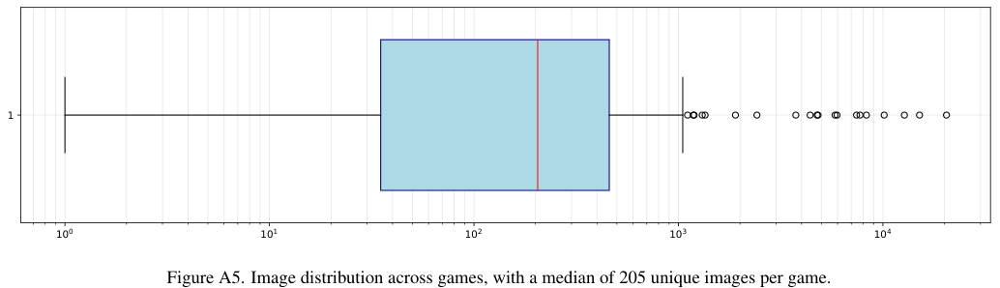

<!-- Start of picture text -->
1 10 0 10 1 10 2 10 3 10 4 Figure A5. Image distribution across games, with a median of 205 unique images per game. <!-- End of picture text -->

2 

## **A2. Additional results** 

In this section, we provide complementary results for the experiments conducted in the main text. 

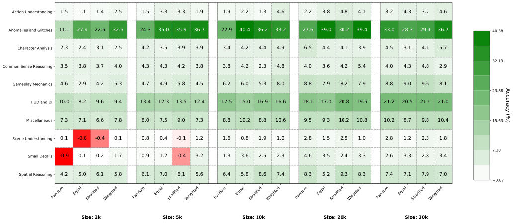

<!-- Start of picture text -->
Action Understanding 1.5 1.1 1.4 2.5 1.5 3.3 3.3 1.9 1.9 2.2 1.3 4.6 2.2 3.8 4.8 4.1 3.2 4.3 3.7 4.6 Anomalies and Glitches 11.1 27.4 22.5 32.5 24.3 35.0 35.9 36.7 22.9 40.4 36.2 33.2 27.6 39.0 30.2 39.4 33.0 28.3 29.9 36.7 40.38 Character Analysis 2.3 2.4 3.1 2.5 4.2 3.5 3.9 3.9 3.4 4.2 4.4 4.9 6.5 4.4 4.1 3.9 4.5 3.1 4.1 5.7 32.13 Common Sense Reasoning 3.5 3.8 3.7 4.0 4.3 4.3 4.2 3.8 3.8 4.2 2.3 4.8 4.0 3.6 4.2 5.4 4.0 4.3 4.8 2.9 Gameplay Mechanics 4.6 2.9 4.2 5.3 4.7 4.9 5.8 4.5 6.2 6.0 5.3 8.0 8.8 7.9 8.2 7.9 8.8 9.0 9.6 8.1 23.88 HUD and UI 10.0 8.2 9.6 9.4 13.4 12.3 13.5 12.4 17.5 15.0 16.9 16.6 18.1 17.0 20.8 19.5 21.2 20.5 21.1 21.0 Miscellaneous 7.3 7.1 6.6 7.8 8.0 7.5 9.0 7.3 8.8 10.2 8.8 10.6 9.5 9.3 10.2 10.8 10.2 8.7 9.8 10.4 15.63 Scene Understanding 0.1 -0.8 -0.4 0.1 0.8 0.4 -0.1 1.2 1.6 0.8 1.9 1.0 2.8 1.5 2.5 1.0 2.8 1.2 2.3 1.8 7.38 Small Details -0.9 0.1 0.2 1.7 0.9 1.2 -0.4 3.2 1.3 3.6 2.5 2.3 4.6 3.5 2.4 3.3 2.6 3.3 2.8 3.4 Spatial Reasoning 4.2 5.0 6.1 5.8 6.1 7.0 6.1 5.6 6.4 5.8 8.6 7.4 8.3 5.2 9.3 8.3 7.4 7.1 7.9 7.0 0.87 Size: 2k Size: 5k Size: 10k Size: 20k Size: 30k Random Equal Stratified Weighted Random Equal Stratified Weighted Random Equal Stratified Weighted Random Equal Stratified Weighted Random Equal Stratified Weighted Accuracy (%) <!-- End of picture text -->

Figure A6. Breakdown of improvement (percentage points) compared to the basemodel Bunny, after fine-tuning it on different mixture strategies by different question categories. As we increase the size of the dataset, all categories show improvement, with _Anomalies and Glitches_ showing the greatest gains. 

Table A2. Comparison of VIDEOGAMEBUNNY and LLaVA-1.6-34b 

|**Category**|**VID**|**EOGAMEBUNNY**|**LLaVA-1.6-34b**|
|---|---|---|---|
|Action Understanding|84.6|_↑_(+2.9)|81.7|
|Anomalies and Glitches|82.1|_↑_(+16.6)|65.5|
|Character Analysis|84.9|_↑_(+0.6)|84.3|
|Common Sense Reasoning|89.1|_↓_(-2.8)|91.9|
|Gameplay Mechanics|80.6|_↓_(-5.8)|86.4|
|HUD and UI|84.1|_↑_(+3.0)|81.1|
|Miscellaneous|86.2|_↑_(+1.7)|84.5|
|Scene Understanding|92.4|_↑_(+0.2)|92.2|
|Small Details|80.1|_↓_(-0.2)|80.3|
|Spatial Reasoning|78.3|_↑_(+1.0)|77.3|

3 

## **A3. Qualitative samples** 

In this section, we provide qualitative results from VIDEOGAMEBUNNY. 

Qualitative results where VIDEOGAMEBUNNY provides a detailed description of the image. 

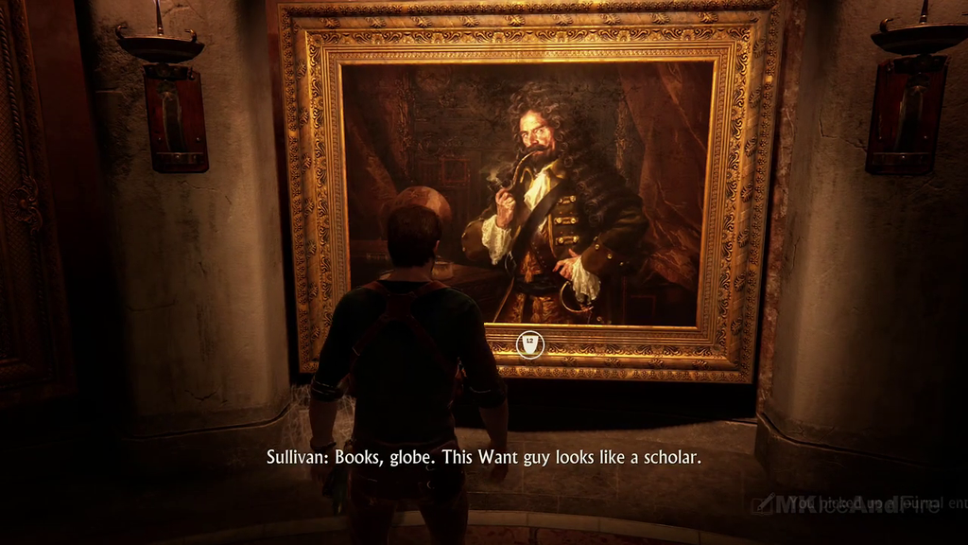

**Question: Briefly describe the image.** 

**VIDEOGAMEBUNNY:** The image is a screenshot from a video game, showing a character standing in front of a large, ornate painting. The painting depicts a man with long hair and a beard, wearing a period outfit with a high collar and a sash. The character is facing the painting, with their back to the viewer, and appears to be observing it. The room has a dimly lit, old-fashioned ambiance, with a sconce on the wall and a large, framed painting on the wall behind the character. 

Figure A7. VIDEOGAMEBUNNY provides a detailed description of the image 

4 

#### Qualitative results where VIDEOGAMEBUNNY provides a detailed description of the image. 

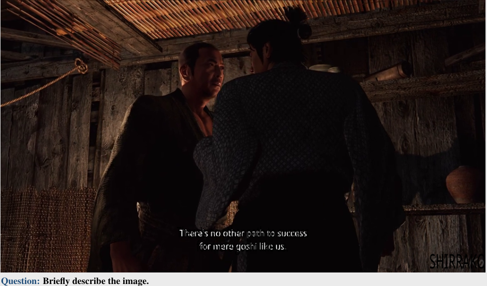

<!-- Start of picture text -->
There's no other path to success for mere goshi like us. SHIRRAKO Question: Briefly describe the image. <!-- End of picture text -->

**VIDEOGAMEBUNNY:** The image is a still from a video game, depicting two characters in a dimly lit wooden structure. The character on the left is a man with a stern expression, wearing a dark robe with a patterned design. He is facing the other character, who is partially obscured and has their back to the viewer. The second character appears to be wearing a similar robe. The scene is set in a rustic environment with wooden walls and a thatched roof. 

Figure A8. VIDEOGAMEBUNNY provides a detailed description of the image 

5 

Qualitative results where VIDEOGAMEBUNNY provides a correct answer with minor inaccuracies 

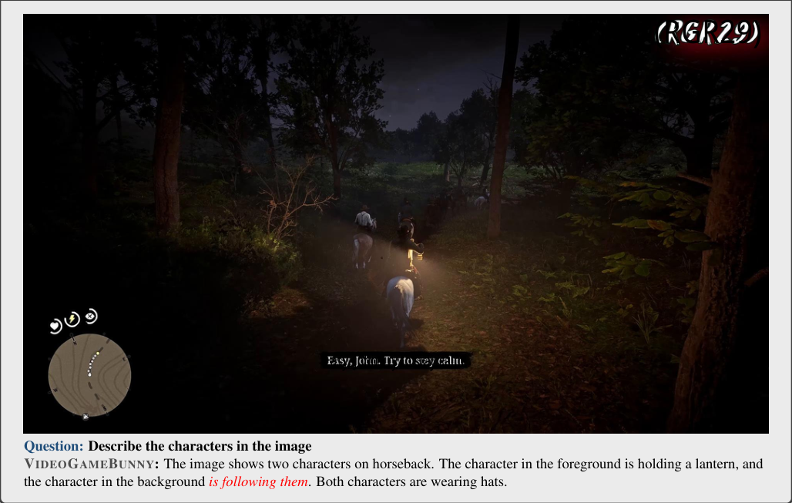

<!-- Start of picture text -->
(RGR29) Easy, John.Try to stay calm. Question: Describe the characters in the image VIDEOGAMEBUNNY: The image shows two characters on horseback. The character in the foreground is holding a lantern, and the character in the background  is following them . Both characters are wearing hats. <!-- End of picture text -->

Figure A9. VIDEOGAMEBUNNY provides a detailed description of the image with minor inaccuracies. Details that are incorrect are highlighted and emphasized in _red_ . 

6 

Qualitative results where VIDEOGAMEBUNNY provides a correct answer with some inaccuracies 

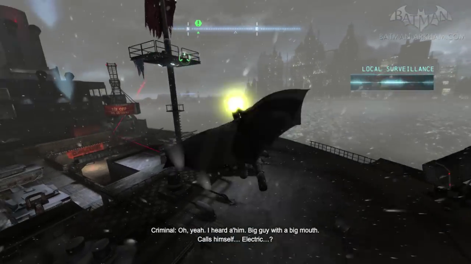

**Question: Describe the characters in the image VIDEOGAMEBUNNY:** The image shows Batman, who is in the center of the frame, flying through the air. He is wearing his iconic black suit _with a yellow utility belt_ . _Below him, there is a character named Penguin, who is wearing a tuxedo and a bowler hat._ 

Figure A10. VIDEOGAMEBUNNY hallucinates extra characters and a Batman utility belt in the image, which are not actually present. Details that are incorrect are highlighted and emphasized in _red_ . 

7 

Qualitative results where VIDEOGAMEBUNNY provide a wrong answer for a query 

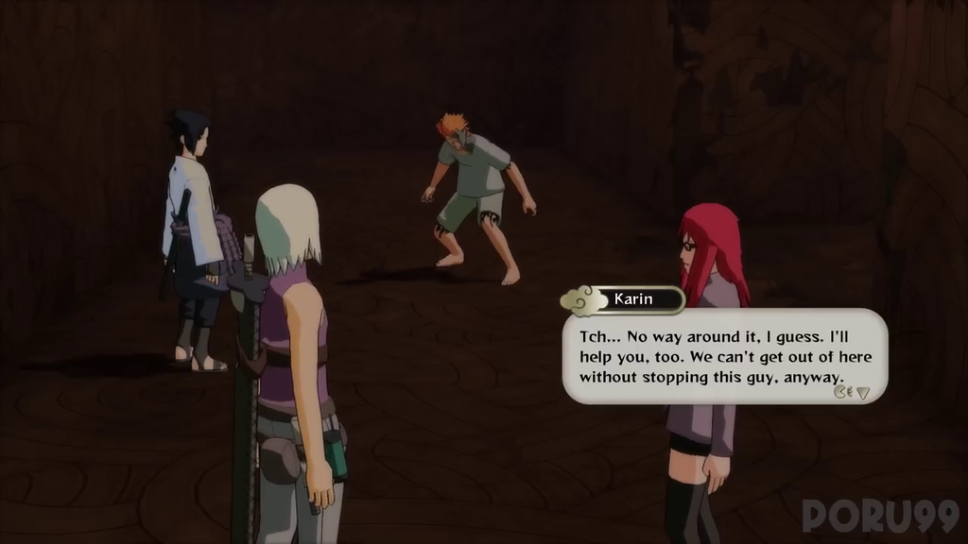

**Question: What is written on the image? VIDEOGAMEBUNNY:** The text on the image reads: ‘Tch... Tch... Tch... You way around it, I guess. Tch... Tch... Tch... I’ll tell you, without stepping this guy away...’ 

Figure A11. A sample showing that VIDEOGAMEBUNNY struggles to convert the image to text. 

8 

<!-- Start of picture text -->
Qualitative results where VIDEOGAMEBUNNY provide a wrong answer for a query <!-- End of picture text -->

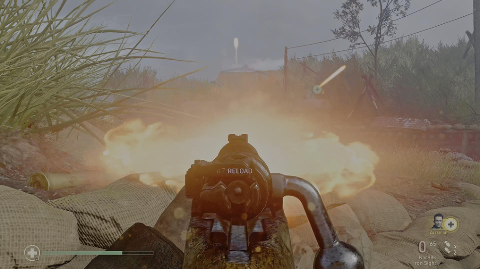

**Question: What is written on the left? VIDEOGAMEBUNNY:** The word ’RELOAD’ is written on the left side of the gun. 

Figure A12. A sample showing that VIDEOGAMEBUNNY fails to provide a correct answer. While the word _RELOAD_ is written in the center of the image, the query asks, _What is written on the left?_ which should be answered with _nothing_ . 

9 

## **A4. Sample image-to-JSON conversion** 

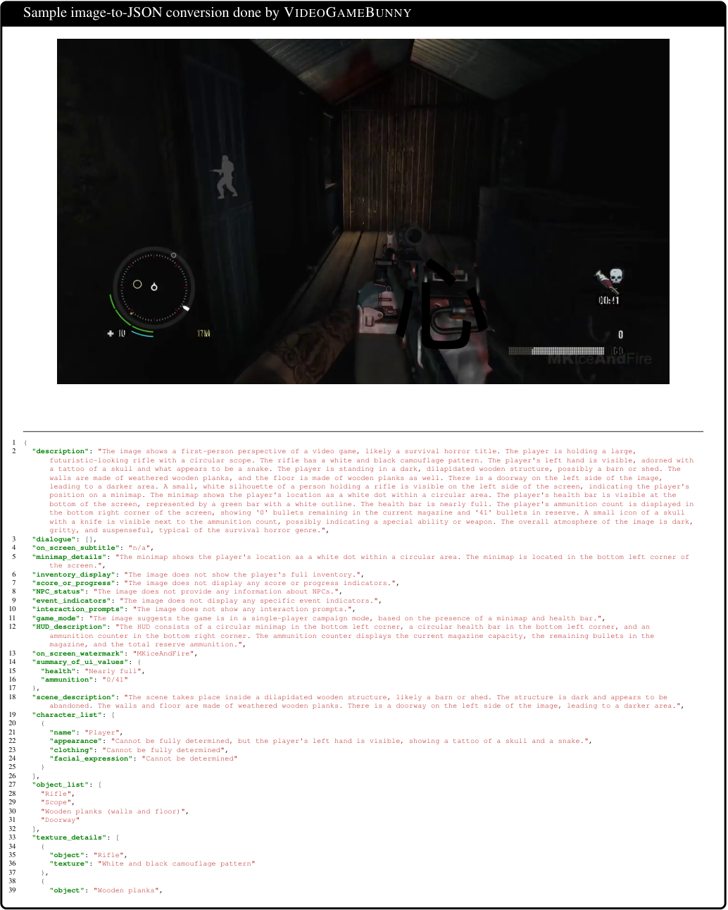

<!-- Start of picture text -->
Sample image-to-JSON conversion done by VIDEOGAMEBUNNY 00:41 10 17M 心 160 1 { 2 "description" : "The image shows a first-person perspective of a video game, likely a survival horror title. The player is holding a large, futuristic-looking rifle with a circular scope. The rifle has a white and black camouflage pattern. The player's left hand is visible, adorned with a tattoo of a skull and what appears to be a snake. The player is standing in a dark, dilapidated wooden structure, possibly a barn or shed. The walls are made of weathered wooden planks, and the floor is made of wooden planks as well. There is a doorway on the left side of the image, leading to a darker area. A small, white silhouette of a person holding a rifle is visible on the left side of the screen, indicating the player's position on a minimap. The minimap shows the player's location as a white dot within a circular area. The player's health bar is visible at the bottom of the screen, represented by a green bar with a white outline. The health bar is nearly full. The player's ammunition count is displayed in the bottom right corner of the screen, showing '0' bullets remaining in the current magazine and '41' bullets in reserve. A small icon of a skull with a knife is visible next to the ammunition count, possibly indicating a special ability or weapon. The overall atmosphere of the image is dark, gritty, and suspenseful, typical of the survival horror genre.", 3 "dialogue" : [], 4 "on_screen_subtitle" : "n/a", 5 "minimap_details" : "The minimap shows the player's location as a white dot within a circular area. The minimap is located in the bottom left corner of the screen.", 6 "inventory_display" : "The image does not show the player's full inventory.", 7 "score_or_progress" : "The image does not display any score or progress indicators.", 8 "NPC_status" : "The image does not provide any information about NPCs.", 9 "event_indicators" : "The image does not display any specific event indicators.", 10 "interaction_prompts" : "The image does not show any interaction prompts.", 11 "game_mode" : "The image suggests the game is in a single-player campaign mode, based on the presence of a minimap and health bar.", 12 "HUD_description" : "The HUD consists of a circular minimap in the bottom left corner, a circular health bar in the bottom left corner, and an ammunition counter in the bottom right corner. The ammunition counter displays the current magazine capacity, the remaining bullets in the magazine, and the total reserve ammunition.", 13 "on_screen_watermark" : "MKiceAndFire", 14 "summary_of_ui_values" : { 15 "health" : "Nearly full", 16 "ammunition" : "0/41" 17 }, 18 "scene_description" : "The scene takes place inside a dilapidated wooden structure, likely a barn or shed. The structure is dark and appears to be abandoned. The walls and floor are made of weathered wooden planks. There is a doorway on the left side of the image, leading to a darker area.", 19 "character_list" : [ 20 { 21 "name" : "Player", 22 "appearance" : "Cannot be fully determined, but the player's left hand is visible, showing a tattoo of a skull and a snake.", 23 "clothing" : "Cannot be fully determined", 24 "facial_expression" : "Cannot be determined" 25 } 26 ], 27 "object_list" : [ 28 "Rifle", 29 "Scope", 30 "Wooden planks (walls and floor)", 31 "Doorway" 32 ], 33 "texture_details" : [ 34 { 35 "object" : "Rifle", 36 "texture" : "White and black camouflage pattern" 37 }, 38 { 39 "object" : "Wooden planks", <!-- End of picture text -->

10 

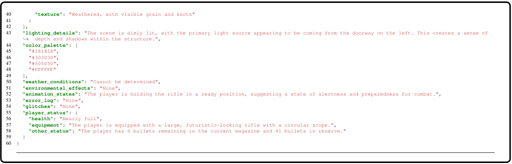

<!-- Start of picture text -->
40 "texture" : "Weathered, with visible grain and knots" 41 } 42 ], 43 "lighting_details" : "The scene is dimly lit, with the primary light source appearing to be coming from the doorway on the left. This creates a sense of �→ depth and shadows within the structure.", 44 "color_palette" : [ 45 "#181818", 46 "#303030", 47 "#505050", 48 "#FFFFFF" 49 ], 50 "weather_conditions" : "Cannot be determined", 51 "environmental_effects" : "None", 52 "animation_states" : "The player is holding the rifle in a ready position, suggesting a state of alertness and preparedness for combat.", 53 "error_log" : "None", 54 "glitches" : "None", 55 "player_status" : { 56 "health" : "Nearly full", 57 "equipment" : "The player is equipped with a large, futuristic-looking rifle with a circular scope.", 58 "other_status" : "The player has 0 bullets remaining in the current magazine and 41 bullets in reserve." 59 } 60 } <!-- End of picture text -->

#### Sample image-to-JSON conversion done by VIDEOGAMEBUNNY 

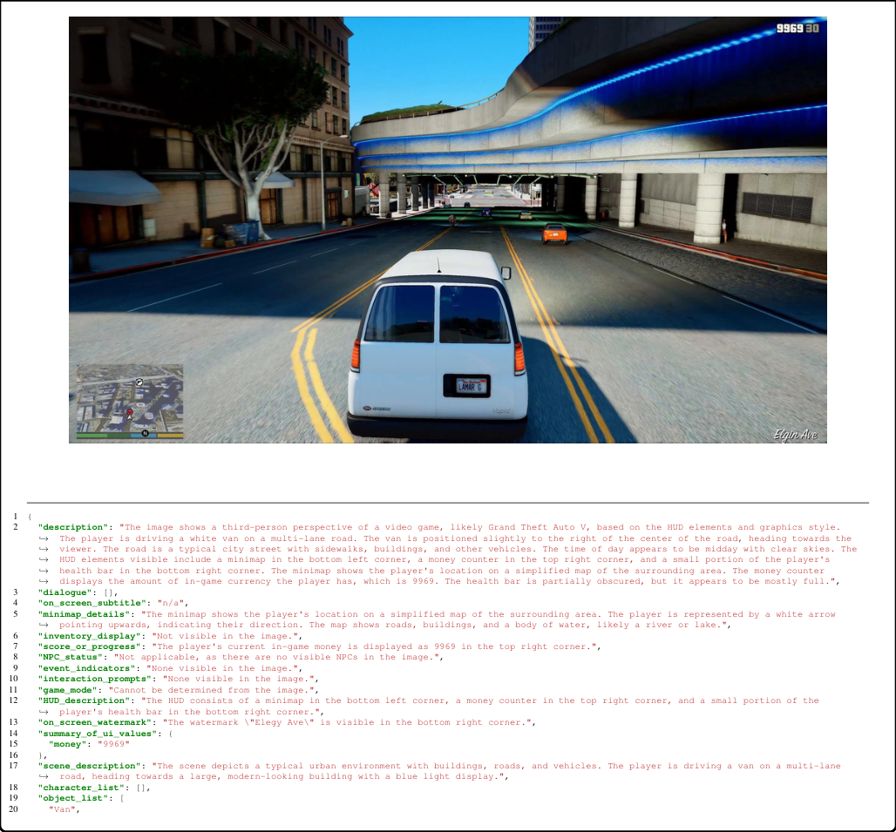

<!-- Start of picture text -->
1 { 2 "description" : "The image shows a third-person perspective of a video game, likely Grand Theft Auto V, based on the HUD elements and graphics style. �→ The player is driving a white van on a multi-lane road. The van is positioned slightly to the right of the center of the road, heading towards the �→ viewer. The road is a typical city street with sidewalks, buildings, and other vehicles. The time of day appears to be midday with clear skies. The �→ HUD elements visible include a minimap in the bottom left corner, a money counter in the top right corner, and a small portion of the player's �→ health bar in the bottom right corner. The minimap shows the player's location on a simplified map of the surrounding area. The money counter �→ displays the amount of in-game currency the player has, which is 9969. The health bar is partially obscured, but it appears to be mostly full.", 3 "dialogue" : [], 4 "on_screen_subtitle" : "n/a", 5 "minimap_details" : "The minimap shows the player's location on a simplified map of the surrounding area. The player is represented by a white arrow �→ pointing upwards, indicating their direction. The map shows roads, buildings, and a body of water, likely a river or lake.", 6 "inventory_display" : "Not visible in the image.", 7 "score_or_progress" : "The player's current in-game money is displayed as 9969 in the top right corner.", 8 "NPC_status" : "Not applicable, as there are no visible NPCs in the image.", 9 "event_indicators" : "None visible in the image.", 10 "interaction_prompts" : "None visible in the image.", 11 "game_mode" : "Cannot be determined from the image.", 12 "HUD_description" : "The HUD consists of a minimap in the bottom left corner, a money counter in the top right corner, and a small portion of the �→ player's health bar in the bottom right corner.", 13 "on_screen_watermark" : "The watermark \"Elegy Ave\" is visible in the bottom right corner.", 14 "summary_of_ui_values" : { 15 "money" : "9969" 16 }, 17 "scene_description" : "The scene depicts a typical urban environment with buildings, roads, and vehicles. The player is driving a van on a multi-lane �→ road, heading towards a large, modern-looking building with a blue light display.", 18 "character_list" : [], 19 "object_list" : [ 20 "Van", <!-- End of picture text -->

11 

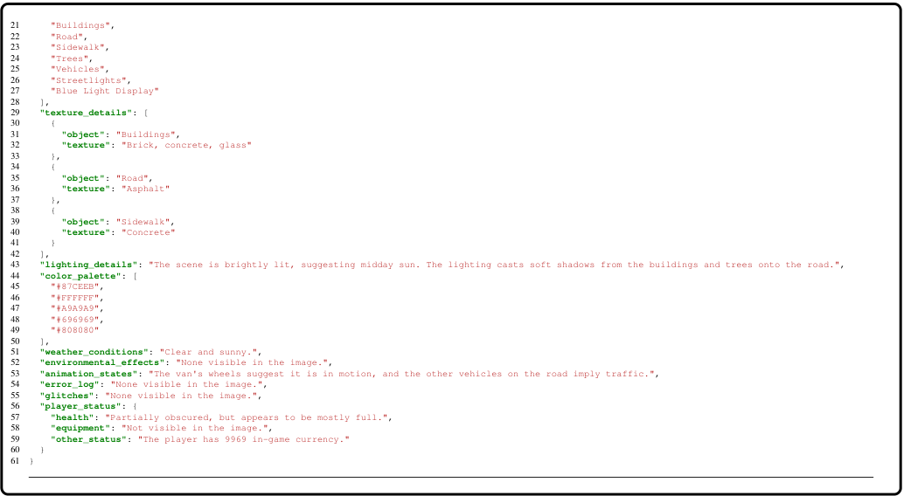

<!-- Start of picture text -->
21 "Buildings", 22 "Road", 23 "Sidewalk", 24 "Trees", 25 "Vehicles", 26 "Streetlights", 27 "Blue Light Display" 28 ], 29 "texture_details" : [ 30 { 31 "object" : "Buildings", 32 "texture" : "Brick, concrete, glass" 33 }, 34 { 35 "object" : "Road", 36 "texture" : "Asphalt" 37 }, 38 { 39 "object" : "Sidewalk", 40 "texture" : "Concrete" 41 } 42 ], 43 "lighting_details" : "The scene is brightly lit, suggesting midday sun. The lighting casts soft shadows from the buildings and trees onto the road.", 44 "color_palette" : [ 45 "#87CEEB", 46 "#FFFFFF", 47 "#A9A9A9", 48 "#696969", 49 "#808080" 50 ], 51 "weather_conditions" : "Clear and sunny.", 52 "environmental_effects" : "None visible in the image.", 53 "animation_states" : "The van's wheels suggest it is in motion, and the other vehicles on the road imply traffic.", 54 "error_log" : "None visible in the image.", 55 "glitches" : "None visible in the image.", 56 "player_status" : { 57 "health" : "Partially obscured, but appears to be mostly full.", 58 "equipment" : "Not visible in the image.", 59 "other_status" : "The player has 9969 in-game currency." 60 } 61 } <!-- End of picture text -->

#### Sample image-to-JSON conversion done by VIDEOGAMEBUNNY 

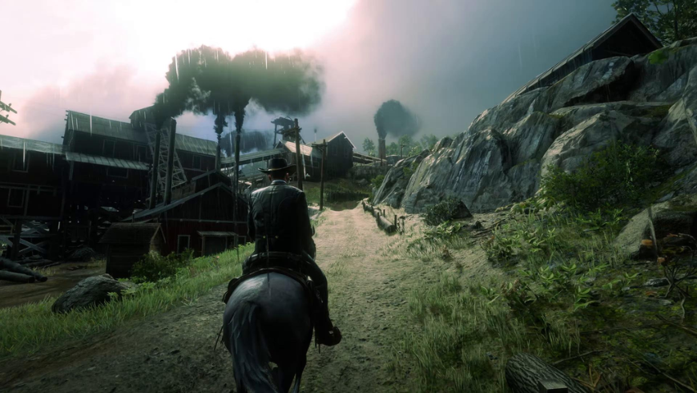

- 1 { 2 **"description"** : "The image captures a scene from the video game Red Dead Redemption 2, showcasing the protagonist, Arthur Morgan, riding his horse, _�→_ Black Jack, along a dirt path. The path leads towards a small, industrial settlement built on a cliffside. The settlement features wooden buildings _�→_ with corrugated metal roofs, characteristic of the late 19th-century American frontier. A plume of black smoke rises from a chimney in the _�→_ background, suggesting industrial activity. The surrounding environment is a mix of rocky terrain and lush vegetation, with a dense forest visible _�→_ in the distance. The sky is overcast, with a hazy, diffused light suggesting either early morning or late afternoon. The overall atmosphere is one _�→_ of quiet anticipation, as if Arthur is about to enter a new chapter in his journey.", 

- 3 **"dialogue"** : [], 

- 4 **"on_screen_subtitle"** : "n/a", 

12 

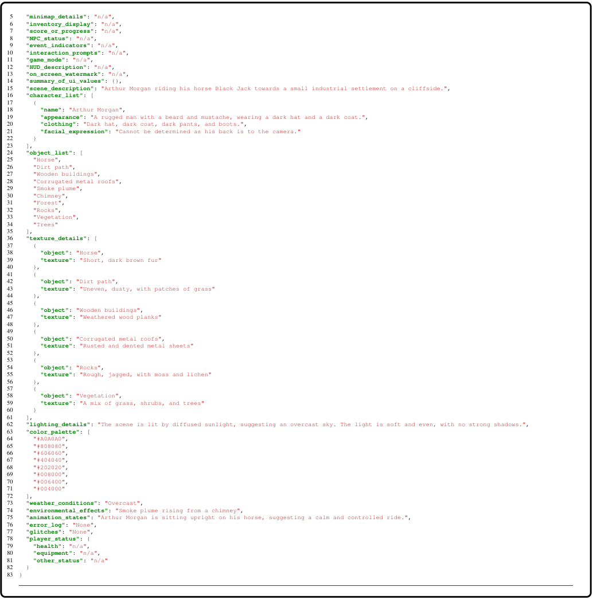

<!-- Start of picture text -->
5 "minimap_details" : "n/a", 6 "inventory_display" : "n/a", 7 "score_or_progress" : "n/a", 8 "NPC_status" : "n/a", 9 "event_indicators" : "n/a", 10 "interaction_prompts" : "n/a", 11 "game_mode" : "n/a", 12 "HUD_description" : "n/a", 13 "on_screen_watermark" : "n/a", 14 "summary_of_ui_values" : {}, 15 "scene_description" : "Arthur Morgan riding his horse Black Jack towards a small industrial settlement on a cliffside.", 16 "character_list" : [ 17 { 18 "name" : "Arthur Morgan", 19 "appearance" : "A rugged man with a beard and mustache, wearing a dark hat and a dark coat.", 20 "clothing" : "Dark hat, dark coat, dark pants, and boots.", 21 "facial_expression" : "Cannot be determined as his back is to the camera." 22 } 23 ], 24 "object_list" : [ 25 "Horse", 26 "Dirt path", 27 "Wooden buildings", 28 "Corrugated metal roofs", 29 "Smoke plume", 30 "Chimney", 31 "Forest", 32 "Rocks", 33 "Vegetation", 34 "Trees" 35 ], 36 "texture_details" : [ 37 { 38 "object" : "Horse", 39 "texture" : "Short, dark brown fur" 40 }, 41 { 42 "object" : "Dirt path", 43 "texture" : "Uneven, dusty, with patches of grass" 44 }, 45 { 46 "object" : "Wooden buildings", 47 "texture" : "Weathered wood planks" 48 }, 49 { 50 "object" : "Corrugated metal roofs", 51 "texture" : "Rusted and dented metal sheets" 52 }, 53 { 54 "object" : "Rocks", 55 "texture" : "Rough, jagged, with moss and lichen" 56 }, 57 { 58 "object" : "Vegetation", 59 "texture" : "A mix of grass, shrubs, and trees" 60 } 61 ], 62 "lighting_details" : "The scene is lit by diffused sunlight, suggesting an overcast sky. The light is soft and even, with no strong shadows.", 63 "color_palette" : [ 64 "#A0A0A0", 65 "#808080", 66 "#606060", 67 "#404040", 68 "#202020", 69 "#008000", 70 "#006400", 71 "#004000" 72 ], 73 "weather_conditions" : "Overcast", 74 "environmental_effects" : "Smoke plume rising from a chimney", 75 "animation_states" : "Arthur Morgan is sitting upright on his horse, suggesting a calm and controlled ride.", 76 "error_log" : "None", 77 "glitches" : "None", 78 "player_status" : { 79 "health" : "n/a", 80 "equipment" : "n/a", 81 "other_status" : "n/a" 82 } 83 } <!-- End of picture text -->

13 

#### Sample image-to-JSON conversion done by VIDEOGAMEBUNNY 

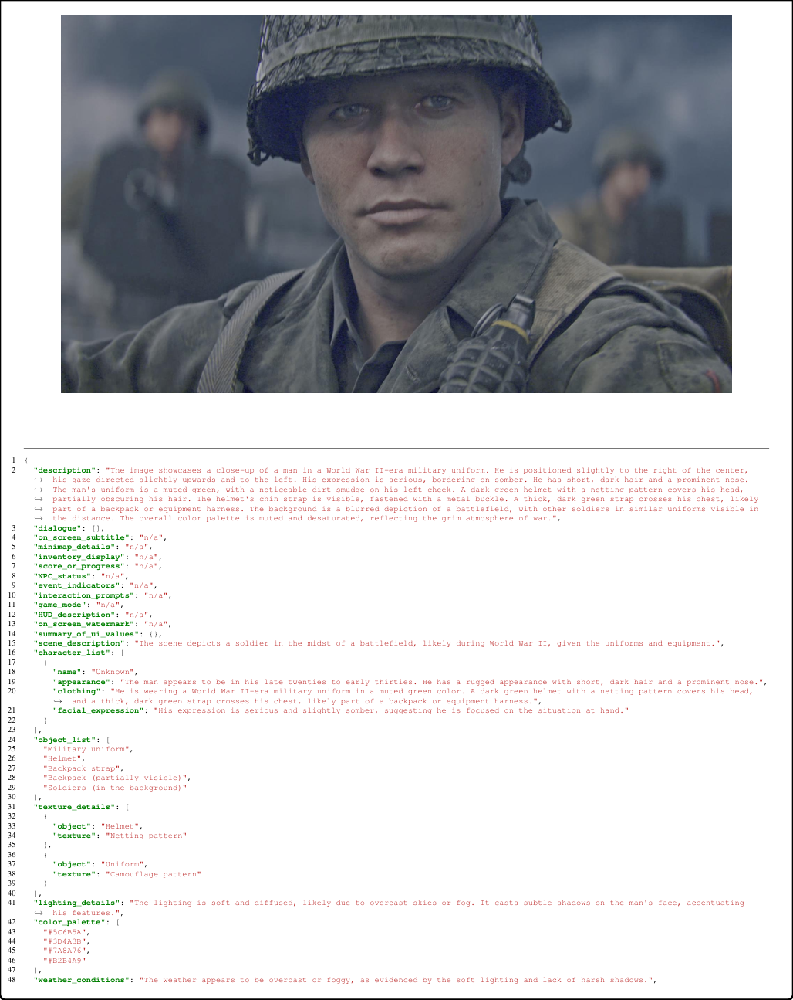

<!-- Start of picture text -->
1 { 2 "description" : "The image showcases a close-up of a man in a World War II-era military uniform. He is positioned slightly to the right of the center, �→ his gaze directed slightly upwards and to the left. His expression is serious, bordering on somber. He has short, dark hair and a prominent nose. �→ The man's uniform is a muted green, with a noticeable dirt smudge on his left cheek. A dark green helmet with a netting pattern covers his head, �→ partially obscuring his hair. The helmet's chin strap is visible, fastened with a metal buckle. A thick, dark green strap crosses his chest, likely �→ part of a backpack or equipment harness. The background is a blurred depiction of a battlefield, with other soldiers in similar uniforms visible in �→ the distance. The overall color palette is muted and desaturated, reflecting the grim atmosphere of war.", 3 "dialogue" : [], 4 "on_screen_subtitle" : "n/a", 5 "minimap_details" : "n/a", 6 "inventory_display" : "n/a", 7 "score_or_progress" : "n/a", 8 "NPC_status" : "n/a", 9 "event_indicators" : "n/a", 10 "interaction_prompts" : "n/a", 11 "game_mode" : "n/a", 12 "HUD_description" : "n/a", 13 "on_screen_watermark" : "n/a", 14 "summary_of_ui_values" : {}, 15 "scene_description" : "The scene depicts a soldier in the midst of a battlefield, likely during World War II, given the uniforms and equipment.", 16 "character_list" : [ 17 { 18 "name" : "Unknown", 19 "appearance" : "The man appears to be in his late twenties to early thirties. He has a rugged appearance with short, dark hair and a prominent nose.", 20 "clothing" : "He is wearing a World War II-era military uniform in a muted green color. A dark green helmet with a netting pattern covers his head, �→ and a thick, dark green strap crosses his chest, likely part of a backpack or equipment harness.", 21 "facial_expression" : "His expression is serious and slightly somber, suggesting he is focused on the situation at hand." 22 } 23 ], 24 "object_list" : [ 25 "Military uniform", 26 "Helmet", 27 "Backpack strap", 28 "Backpack (partially visible)", 29 "Soldiers (in the background)" 30 ], 31 "texture_details" : [ 32 { 33 "object" : "Helmet", 34 "texture" : "Netting pattern" 35 }, 36 { 37 "object" : "Uniform", 38 "texture" : "Camouflage pattern" 39 } 40 ], 41 "lighting_details" : "The lighting is soft and diffused, likely due to overcast skies or fog. It casts subtle shadows on the man's face, accentuating �→ his features.", 42 "color_palette" : [ 43 "#5C6B5A", 44 "#3D4A3B", 45 "#7A8A76", 46 "#B2B4A9" 47 ], 48 "weather_conditions" : "The weather appears to be overcast or foggy, as evidenced by the soft lighting and lack of harsh shadows.", <!-- End of picture text -->

14 

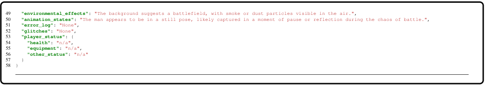

<!-- Start of picture text -->
49 "environmental_effects" : "The background suggests a battlefield, with smoke or dust particles visible in the air.", 50 "animation_states" : "The man appears to be in a still pose, likely captured in a moment of pause or reflection during the chaos of battle.", 51 "error_log" : "None", 52 "glitches" : "None", 53 "player_status" : { 54 "health" : "n/a", 55 "equipment" : "n/a", 56 "other_status" : "n/a" 57 } 58 } <!-- End of picture text -->

#### Sample image-to-JSON conversion done by VIDEOGAMEBUNNY 

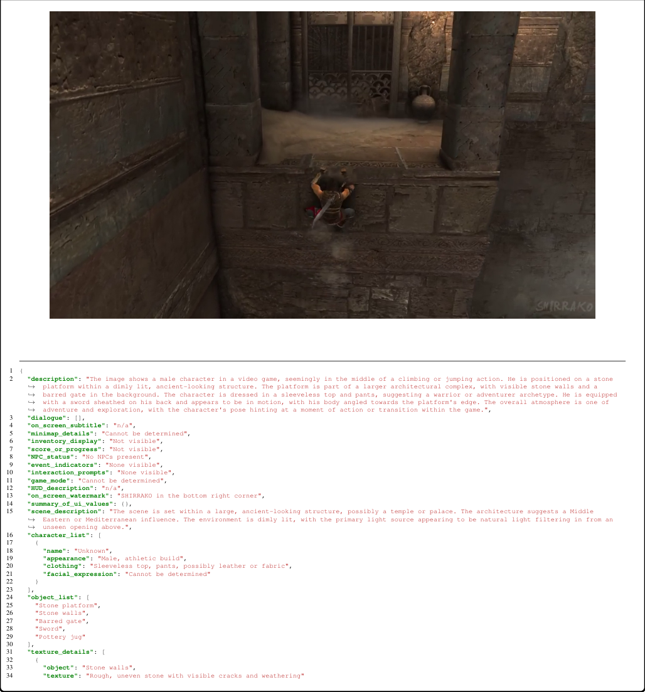

<!-- Start of picture text -->
1 { 2 "description" : "The image shows a male character in a video game, seemingly in the middle of a climbing or jumping action. He is positioned on a stone �→ platform within a dimly lit, ancient-looking structure. The platform is part of a larger architectural complex, with visible stone walls and a �→ barred gate in the background. The character is dressed in a sleeveless top and pants, suggesting a warrior or adventurer archetype. He is equipped �→ with a sword sheathed on his back and appears to be in motion, with his body angled towards the platform's edge. The overall atmosphere is one of �→ adventure and exploration, with the character's pose hinting at a moment of action or transition within the game.", 3 "dialogue" : [], 4 "on_screen_subtitle" : "n/a", 5 "minimap_details" : "Cannot be determined", 6 "inventory_display" : "Not visible", 7 "score_or_progress" : "Not visible", 8 "NPC_status" : "No NPCs present", 9 "event_indicators" : "None visible", 10 "interaction_prompts" : "None visible", 11 "game_mode" : "Cannot be determined", 12 "HUD_description" : "n/a", 13 "on_screen_watermark" : "SHIRRAKO in the bottom right corner", 14 "summary_of_ui_values" : {}, 15 "scene_description" : "The scene is set within a large, ancient-looking structure, possibly a temple or palace. The architecture suggests a Middle �→ Eastern or Mediterranean influence. The environment is dimly lit, with the primary light source appearing to be natural light filtering in from an �→ unseen opening above.", 16 "character_list" : [ 17 { 18 "name" : "Unknown", 19 "appearance" : "Male, athletic build", 20 "clothing" : "Sleeveless top, pants, possibly leather or fabric", 21 "facial_expression" : "Cannot be determined" 22 } 23 ], 24 "object_list" : [ 25 "Stone platform", 26 "Stone walls", 27 "Barred gate", 28 "Sword", 29 "Pottery jug" 30 ], 31 "texture_details" : [ 32 { 33 "object" : "Stone walls", 34 "texture" : "Rough, uneven stone with visible cracks and weathering" <!-- End of picture text -->

15 

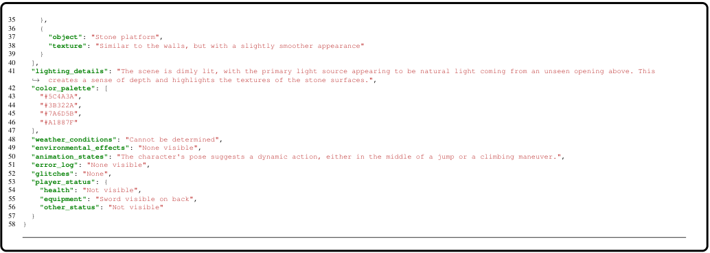

<!-- Start of picture text -->
35 }, 36 { 37 "object" : "Stone platform", 38 "texture" : "Similar to the walls, but with a slightly smoother appearance" 39 } 40 ], 41 "lighting_details" : "The scene is dimly lit, with the primary light source appearing to be natural light coming from an unseen opening above. This �→ creates a sense of depth and highlights the textures of the stone surfaces.", 42 "color_palette" : [ 43 "#5C4A3A", 44 "#3B322A", 45 "#7A6D5B", 46 "#A1887F" 47 ], 48 "weather_conditions" : "Cannot be determined", 49 "environmental_effects" : "None visible", 50 "animation_states" : "The character's pose suggests a dynamic action, either in the middle of a jump or a climbing maneuver.", 51 "error_log" : "None visible", 52 "glitches" : "None", 53 "player_status" : { 54 "health" : "Not visible", 55 "equipment" : "Sword visible on back", 56 "other_status" : "Not visible" 57 } 58 } <!-- End of picture text -->

16 

