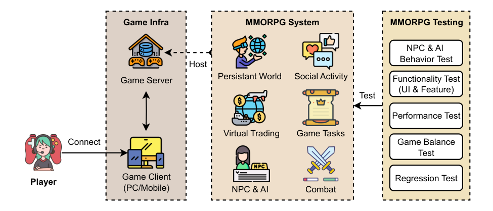
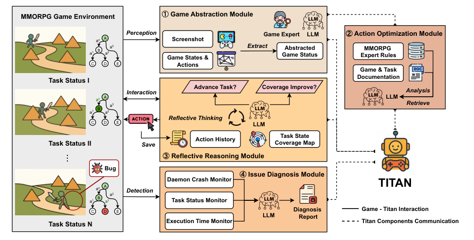

LEVERAGING LLM AGENTS FOR AUTOMATED VIDEO GAME TESTING 

# + 

PREPRINT VERSION 

**Chengjia Wang Lanling Tang Ming Yuan** Zhejiang University NetEase Fuxi AI Lab NetEase Fuxi AI Lab Hangzhou, China Hangzhou, China Hangzhou, China `cenjoy@zju.edu.cn tanglanling@corp.netease.com yuanming1220@163.com` 

|**Jiongchi Yu*** D|**Xiaofei Xie**|**Jiajun Bu**|
|---|---|---|
|Singapore Management University|Singapore Management University|Zhejiang University|
|Singapore, Singapore|Singapore, Singapore|Hangzhou, China|
|`jcyu.2022@smu.edu.sg`|`xfxie@smu.edu.sg`|`bjj@zju.edu.cn`|

## **ABSTRACT** 

Testing MMORPGs (Massively Multiplayer Online Role-Playing Games) is a critical yet laborintensive task in game development due to their complexity and frequent updating nature. Traditional automated game testing approaches struggle to achieve high state coverage and efficiency in these rich, open-ended environments, while existing LLM-based game-playing approaches are limited to shallow reasoning ability in understanding complex game state-action spaces and long-complex tasks. To address these challenges, we propose _TITAN_ , an effective LLM-driven agent framework for intelligent MMORPG testing. _TITAN_ incorporates four key components to: (1) perceive and abstract high-dimensional game states, (2) proactively optimize and prioritize available actions, (3) enable long-horizon reasoning with action trace memory and reflective self-correction, and (4) employ LLM-based oracles to detect potential functional and logic bugs with diagnostic reports. 

We implement _TITAN_ and evaluate it on two large-scale commercial MMORPGs spanning both PC and mobile platforms. In our experiments, _TITAN_ achieves significantly higher task completion rates (95%) and bug detection performance compared to existing automated game testing approaches. An ablation study further demonstrates that each core component of _TITAN_ contributes substantially to its overall performance. Notably, _TITAN_ detects four previously unknown bugs that prior testing approaches fail to identify. We provide an in-depth discussion of these results, which offer guidance for new avenues of advancing intelligent, general-purpose testing systems. Moreover, _TITAN_ has been deployed in eight real-world game QA pipelines, underscoring its practical impact as an LLM-driven game testing framework. 

**_Keywords_** Large Language Model, Game Testing, Testing Agents 

## **1 Introduction** 

Ensuring the quality of online games is a monumental challenge in software engineering. Modern MMORPGs feature vast open worlds, nonlinear task actions, myriad interactive NPCs (non-player characters), and continuously evolving gameplay mechanics Claypool and Claypool [2006]. Testing such games thoroughly for bugs is costly, time-consuming, and often incomplete Albaghajati and Ahmed [2020], Politowski et al. [2021]. Existing studies Insights [2025] estimate that quality assurance (QA) can consume most of a game’s development budget, with manual testers painstakingly 

> _∗_ Corresponding Author. 

Leveraging LLM Agents for Automated Video Game Testing 

playing through content to find glitches and verify game task logic. Moreover, popular games are updated frequently, often involving hundreds of code changes per day and, in some cases, more than three internal releases in a single day Yu et al. [2023]. Manual playtesting under such conditions is not only expensive and slow, but also inherently subjective and non-scalable. Human testers tend to follow common "happy paths" Anderson et al. [2008], Albaghajati and Ahmed [2020] while missing edge-case behaviors, and their effectiveness further declines when they are tasked with repetitive or long-duration scenarios. 

Scripted test automation Alégroth et al. [2016] simulates player actions through predefined rules but is brittle and costly to maintain, as scripts must be manually crafted for each task and frequently break under game updates. More adaptive and automated DRL-based agents (e.g., Wuji Zheng et al. [2019]) can learn strategies via exploration, yet they require extensive training, carefully designed rewards, and substantial computational resources, making them impractical for dynamic MMORPGs. Furthermore, DRL agents often overfit to short-term rewards and lack semantic understanding of the game tasks or items, limiting their ability to handle long-horizon objectives or detect subtle logic bugs. 

The rise of large language models (LLMs) has enabled agents that combine reasoning with actions in interactive environments, as demonstrated by frameworks like LangChain Chase [2022] and ReAct Yao et al. [2023]. While LLM agents show promising zero-shot generalization in text-based games and simple tasks Jeurissen et al. [2024], Li et al. [2025], directly applying them to MMORPGs remains challenging Xu et al. [2024]. ❶ MMORPGs present vast, partially observable states—covering world dynamics, NPCs, and player statistics, which is easy to exceed LLMs’ perception limits due to token and memory constraints. ❷ Their enormous action space (movement, skills, items, dialogues) makes unguided decisions prone to invalid or irrelevant actions. Existing LLM agents Jin et al. [2024] are either domain-specific (e.g., Voyager Wang et al. [2023] for Minecraft) or overly generic, struggling with task logic, long-term progress, and subtle bug detection Kwa et al. [2025]. Consequently, they cannot yet support scalable, efficient testing of industrial-scale MMORPGs. 

**Motivation.** In real-world practice, MMORPGs are becoming increasingly larger and more complex, which makes thorough testing of sophisticated tasks even more critical. At the same time, automation is urgently needed to compensate for limited human resources. Current approaches often fail to achieve even correct task execution, let alone sufficient bug coverage and performance evaluation, thereby posing significant challenges for reliable game testing. To bridge this gap, we aim to develop an intelligent game-testing agent that addresses the above limitations. Our intuition is designing an agent that requires no task-specific training, generalizes across different games, and can complete long task sequences within complex game tasks. At the same time, it should balance task completion with maximizing game testing coverage and convenience, while effectively discovering various types of bugs, particularly functionality bugs and logic bugs. To this end, we propose _TITAN_ , an LLM-driven agent framework specifically tailored for automated MMORPG testing. _TITAN_ leverages the powerful reasoning capabilities of foundation LLMs while augmenting them with domain-specific expert knowledge to optimize the testing workflow. It provides enhanced perception, document-based extraction of game information, action recommendation, memory-based reflective reasoning, and human-in-the-loop, LLM-assisted oracles for functionality-targeted bug detection. 

We implement a prototype of _TITAN_ and evaluate its performance on two large-scale commercial MMORPGs from our cooperating company. These games span both PC and mobile platforms, allowing us to assess the generalization ability and effectiveness of _TITAN_ . We construct a benchmark of 20 tasks of different difficulty levels from the two games, ranging from simple tasks with only a few steps to highly complex tasks (i.e., with over 20 steps), to thoroughly evaluate the performance of existing game-testing methods. We choose baseline approaches that include the DRL-based approach Wuji Zheng et al. [2019], and the vanilla LLM-agent-based ReAct Yao et al. [2023] for evaluating their performance in task completion and bug detection. In addition, we conduct the same set of testing tasks with three professional internal game testers for cross-comparison. 

We design a comprehensive experimental study to answer the following three key research questions: 

- **RQ1:** Can _TITAN_ complete typical MMORPG testing tasks more effectively and efficiently than existing methods? 

- **RQ2:** How does _TITAN_ perform in detecting MMORPG bugs compared to existing approaches? 

- **RQ3:** What is the contribution of each core component of _TITAN_ to its overall performance? 

Our comprehensive evaluation results demonstrate that _TITAN_ achieves significantly higher task completion rates (95%) and bug detection performance (15) compared to automated game testing approaches (best at 82% and 9, respectively). Among all the components, we find that the Reflective Reasoning Module contributes most to the performance of _TITAN_ , while all components are indispensable to the overall framework. Notably, TITAN detects bugs that are not identifiable by previous testing approaches and successfully uncovered four new bugs during our study, including new 

2 

Leveraging LLM Agents for Automated Video Game Testing 

<!-- Start of picture text -->
Game Infra MMORPG System MMORPG Testing NPC & AI Behavior Test Host Game Server Persistant World Social Activity Functionality Test (UI & Feature) Test Performance Test Virtual Trading Game Tasks Connect Game Balance Test Game Client Regression Test Player (PC/Mobile) NPC & AI Combat <!-- End of picture text -->

Figure 1: MMORPG Game Ecosystem and Testing. 

bug types such as Model Logic Bug and Hang Interaction Bug. _TITAN_ has been deployed in 8 real-world game QA pipelines, demonstrating the practical impact of LLM-driven game testing. 

In summary, this paper makes the following contributions: 

- We design the first LLM-driven testing framework specifically for testing MMORPGs, combining the flexibility and zero-shot performance of LLMs with purpose-built components, including state abstraction, action optimization, reflective thinking, and novel oracles, to address the unique challenges of large open-world game environments. Unlike prior approaches, _TITAN_ can perceive complex game states and maintain long-horizon plans, closely mimicking how human experts strategize through game tasks. 

- We implement _TITAN_ and evaluate it on two large-scale commercial MMORPGs on both PC and mobile platforms. We construct a diverse benchmark of 20 testing tasks across these games and, through rigorous experiments, reveal that _TITAN_ consistently outperforms baseline approaches across multiple metrics. 

- We provide an in-depth discussion of MMORPG testing, offering practical guidance for future development of comprehensive game testing and LLM-agent-based solutions. The _TITAN_ framework has already been adopted in the QA pipelines of several game studios, where it has uncovered new bugs and improved testing productivity. 

## **2 Background and Related Works** 

In this section, we introduce the background of MMORPGs and their specific testing development. We review existing research on automated game testing and LLM-based agents for diverse applications, specifically for game exploring. 

### **2.1 MMORPG Testing** 

Massively Multiplayer Online Role-Playing Games (MMORPGs) are large-scale online environments where players connect through game clients to persistent virtual worlds hosted on dedicated servers. As illustrated in Figure 1, MMORPG systems integrate diverse gameplay elements such as social interaction, trading, quests, and combat, all driven by complex NPC and AI behaviors. The scale and complexity of these systems introduce multifaceted testing challenges, including functionality, performance, game balance, and regression. 

Compared with single-player games, massively multiplayer online role-playing games (MMORPGs) introduce unique challenges for testing due to their persistent virtual worlds, nonlinear game task structures, and high player interactivity. Early research on software quality assurance primarily focuses on traditional testing techniques such as unit testing and GUI testing Kim et al. [2007]. However, these methods are insufficient for addressing the dynamic and emergent gameplay patterns of MMORPGs. Subsequent studies investigate large-scale load testing and network simulation approaches to evaluate server stability and concurrency performance in MMORPG environments Cho et al. [2010]. 

3 

Leveraging LLM Agents for Automated Video Game Testing 

Other work contributes datasets Li et al. [2022] and benchmarks for game testing. Further research highlights the complexity of in-game mechanics, such as non-player character (NPC) behaviors, real-time combat systems, and cooperative gameplay, which make automated testing particularly difficult Schatten et al. [2017], Suznjevic et al. [2011]. Player-behavior modeling has also been proposed to simulate diverse interaction patterns in MMORPGs Pfau et al. [2018], aiming to expose edge cases that traditional test scripts often overlook. Despite these efforts, MMORPG testing remains costly and time-consuming, as it requires not only ensuring functional correctness but also maintaining balance, fairness, and immersion in a continuously evolving game ecosystem. 

### **2.2 Automated Game Testing** 

Comprehensive surveys Politowski et al. [2022], Roque et al. [2025], Coppola et al. [2024] highlight the breadth of issues and testing practices in the game testing domain, underscoring the immaturity of current approaches. While several techniques have been proposed for testing graphical user interface (GUI) applications Memon [2007], these methods are often ineffective for game testing due to the complex tasks involved, which require a certain level of player intelligence. Inspired by the successful application of reinforcement learning in games and robotic navigation, recent research, such as Wuji Zheng et al. [2019], has adopted deep reinforcement learning (DRL) techniques for game testing. AdvTest Ma et al. [2024] proposes a diversity-oriented testing framework that leverages constraint-guided adversarial agent training to expose more diverse failure scenarios in competitive games. Beyond adversarial training, behavior-driven development has been incorporated to guide automated testing in video games Mastain and Petrillo [2024]. Widget detection-based techniques have also been explored for industrial mobile game testing Wu et al. [2023], Ye et al. [2021], demonstrating the potential of leveraging GUI component analysis to support automated game testing. Other studies Wu et al. [2020] propose reinforcement learning–based regression testing techniques that detect potential regression errors by analyzing behavioral differences between different versions of MMORPGs. Planning and learning have also been applied to video game regression testing, but remain limited in scalability Balyo et al. [2024]. However, these approaches rely heavily on task-specific training, making them suitable for fixed tasks such as regression testing of existing quests but difficult to adapt to new tasks and scenarios. In contrast, our method requires no training and can readily accommodate new game tasks introduced in version iterations. 

### **2.3 LLM-Based Game Testing** 

With the rise of LLM systems, numerous attempts have been made to develop foundational agents for complex video games such as Minecraft, StarCraft II, and Civilization Lifshitz et al. [2023], Vinyals et al. [2019], Qi et al. [2024]. Many systems rely on structured APIs and predefined action spaces (e.g., JARVIS-1 Wang et al. [2024]), which constrain generalization across games. VPT Baker et al. [2022] demonstrated end-to-end control from raw video by pretraining on human-labeled gameplay, but collecting such datasets is costly and difficult to scale. Similarly, SIMA Raad et al. [2024] trained embodied agents across multiple 3D games via behavior cloning, yet remained limited by high data demands and poor generalization. More recent efforts aim at autonomous skill acquisition: VOYAGER Wang et al. [2023] achieved continual exploration in Minecraft through self-generated curricula, while Cradle Zhang et al. [2023] leveraged multimodal LLMs to handle visually complex environments like Red Dead Redemption 2. Other works, such as UI-TARS Wu et al. [2024] explored generalist agents that can interact with arbitrary UIs. LLM agents have also been applied to simulate social behaviors in virtual communities Park et al. [2023], while multi-agent frameworks like Chimera Yu et al. [2025] demonstrate the utility of collaborative agents for complex tasks requiring action automation. Although these approaches illustrate the promise of LLM-driven gameplay, they are often limited by domain-specific designs, expensive data requirements, or weak adaptability, which hinders their direct application to large-scale MMORPG testing. 

## **3 Design** 

The _TITAN_ agent operates in a loop, interacting with the MMORPG under test, supported by four major components. In this section, we present the detailed design of each component of _TITAN_ , and their collaboration workflow is illustrated in Figure 2. 

### **3.1 Overview** 

We design the workflow of _TITAN_ by mirroring how expert testers operate the MMORPG testing: perceive the game state, choose meaningful actions, reflect on progress, and diagnose issues. At its core, a foundation model drives high-level reasoning, while supporting modules provide perception, action scaffolding, and diagnostic oracles for closed-loop interaction. The detailed workflow for _TITAN_ to test one task in the game is shown in Algorithm 1. 

4 

Leveraging LLM Agents for Automated Video Game Testing 

<!-- Start of picture text -->
MMORPG Game Environment ①  Game Abstraction Module a o A Perception Screenshot Game Expert LLM ②  Action Optimization Module a 1 B a 2 a 3 Game States & Extract Game StatusAbstracted Expert RulesMMORPG C D E Actions Game & Task Documentation Task Status I Advance Task? Coverage Improve? Interaction Analysis a o A a 3 LLM Retrieve a 1 B a 2 C D E Reflective Thinking LLM Task State Action History Task Status II  Save Coverage Map ③  Reflective Reasoning Module Bug ④  Issue Diagnosis Module a o A Detection Daemon Crash Monitor TITAN a 3 a 1 B a 2 Task Status Monitor C D E Diagnosis  Game - Titan Interaction LLM Report Task Status N Execution Time Monitor Titan Components Communication ... <!-- End of picture text -->

Figure 2: Overview of _TITAN_ Game Testing Framework. 

In each loop of _TITAN_ , the perception module captures multimodal game states, which are abstracted into expertrecommended features. Game documentation and heuristics are retrieved via a RAG (Retrieval-Augmented Generation) database to guide decisions. Based on the current state and available actions, _TITAN_ selects an action, executes it, and maintains coverage maps to balance task completion with exploration. When progress stalls, reflective reasoning revisits screenshots and histories to adjust strategies. During the execution, the issue diagnosis module monitors for failures, including unfinishable tasks, crashes, and slowdowns, are logs with contextual traces. These records feed into automated reports that assist developers in bug triage. Overall, _TITAN_ adapts testing strategies dynamically, emulating the reasoning process of skilled human testers. 

### **3.2 Perception Abstraction Module** 

The **Perception Abstraction Module** addresses the challenge of high-dimensional and heterogeneous game states in MMORPGs. Based on the expertise of experienced MMORPG testers, we observe that while different games implement their states in distinct ways, they share a set of fundamental elements and common properties (e.g., player position, health, and inventory). However, directly feeding the entire raw state into automated game testing is infeasible. 

In MMORPGs, the raw state may include continuous values (e.g., map coordinates, health points, mana, timers), categorical values (e.g., current task step identifiers, weather conditions), and sets of objects (e.g., nearby NPCs, items in inventory). Passing all of this raw data to an LLM would be problematic: the input could exceed the model’s context length, and the LLM may fail to interpret raw numbers correctly. To mitigate this, _TITAN_ first conducts feature selection and discretization. 

We work with professional testers and designers to identify the key state factors relevant to general progress in MMORPGs, which serve as template references. These include: player location, current game objectives (from the game log), player vitals (e.g., health, mana), nearby interactable NPCs or items, and active status effects. Irrelevant data (e.g., other players’ information in an online environment) is filtered out unless directly relevant to the test. 

For continuous variables that are difficult to abstract, we define meaningful buckets. For instance, player health or mana is abstracted as High, Medium, Low with thresholds defined by experts (e.g., Low HP < 20%). Temporal information is reduced to coarse categories (e.g., day/night) when appropriate. The abstractor then cleans and encodes the selected features into a concise textual or symbolic format. Grounding the state in high-level concepts dramatically reduces the search space. Based on predefined rules, the LLM proactively analyzes and interprets these abstract states before making decisions. This abstraction is crucial for generalization: as long as states in new games can be mapped to comparable descriptors (e.g., HP high/medium/low, semantic regions), the same prompting logic applies across different 

5 

Leveraging LLM Agents for Automated Video Game Testing 

MMORPGs. To facilitate portability, abstraction rules are implemented as game-agnostic templates, configured via a metadata file specific to each game. This file defines the state units and their abstraction schemes. 

### **3.3 Action Optimization Module** 

The second component of the _TITAN_ framework is the **Action Optimization Module** , which tackles the decision paralysis an agent can face in open-world games. In real MMORPG testing scenarios, a player (or agent) has a vast number of possible actions at any given state, such as _moving in any direction_ , _interacting with objects_ , _using skills_ , and more. Most of these actions are irrelevant to the current task context or even invalid. For example, if the player is conversing with an NPC, the action _Attack_ is both irrelevant and inappropriate; similarly, Use of _HealingPotion_ makes little sense if the player’s health bar is full. A naive agent without domain knowledge may still consider these options, wasting time and confusing the LLM. 

We address this by defining a set of high-level action templates for the game under test. Common templates such as Move(to=Location), Talk(to=NPC), Attack(target), Use(Item), PickUp(Item), and Explore(Direction). These templates act as "tools" the LLM agent can invoke, and each can be instantiated with parameters such as NPC name, item name, or coordinates. 

Our intuitive design of **Action Optimization Module** is that we expect it to function as a pre-selection filter and advisor for the LLM’s action choices. Specifically: ❶ Drawing on MMORPG experts’ domain knowledge, we label action–state relevance rules. When a game state matches a predefined rule, the RAG database retrieves the corresponding regulation and assembles an action bundle to recommend to the LLM. ❷ Based on game documentation and task descriptions, the LLM also extracts action–state context pairs to generate additional recommendations. The summarized rules include common MMORPG characterizations: 

- _1. If there is an active game objective involving a specific NPC or location, prioritize actions that involve traveling to or interacting with that NPC/location._ 

- _2. If the player’s HP is low during combat, suggest using a healing item or retreating rather than ignoring survival._ 

- _3. If the inventory contains game task-related items (e.g., a key) and the objective is to use it, include an action to use the item._ 

These recommendations are encoded partly as deterministic logic and partly as LLM-based heuristics. For the latter, we leverage few-shot prompting to let the agent proceed with the action prioritization (e.g., _"Given the task description and the list of possible actions, output which actions are most relevant"_ ). This is especially useful for subtle contexts where rules alone are insufficient. For example, if a task specifies _"find the hidden cave"_ , the LLM can infer that _Explore(north)_ is more relevant than _Talk(to=TownGuard)_ , even if both are technically valid moves. 

The optimization module then produces a recommended bundle (around five actions), which is passed to the subsequent decision step. The LLM is not strictly limited to these recommendations, as we preserve flexibility in case none are optimal, but the prompt biases the model toward these actions. A validation script is prepared to ensure that any chosen action, recommended or not, is syntactically valid before execution. 

By constraining choices to a small set of contextually reasonable actions, the LLM does not waste tokens enumerating irrelevant options, and the likelihood of nonsensical decisions is minimized. This design mirrors human-like intuition filtering, much like how seasoned testers instinctively focus on the most promising actions in a given situation. 

### **3.4 Reflective Reasoning Module** 

The **Reflective Reasoning Module** is central to the design of _TITAN_ to handle long and complex task sequences and to self-correct when facing difficulties. Given the state information obtained by the perception module, the action recommendations produced by the action optimization module, the accumulated action trace history, and an internally maintained state coverage map, the module selects the next action and interacts with the game. After each execution step, _TITAN_ appends the chosen action to the trace history and updates the coverage map with the current state. This global, task-centric memory helps the agent balance two objectives: completing the current task and exploring under-tested regions to improve coverage. 

Inspired by meta-cognitive strategies used by expert testers, the module provides two key capabilities: progress monitoring and self-reflection with multimodal context, which together address the lack of timely action feedback and weak global situational awareness in traditional automated testing. 

6 

Leveraging LLM Agents for Automated Video Game Testing 

**Progress Monitoring.** As _TITAN_ executes actions, it tracks testing progress. We employ simple task-status metrics such as the percentage of key task states completed, whether the game state has advanced, and whether coverage diversity (for example, action richness) has increased. If a configured number of consecutive actions or a fixed time interval passes without measurable progress, _TITAN_ triggers the reflective reasoning mechanism so that the agent re-analyzes the situation and considers alternative strategies to break out of the current impasse.2 This mechanism also helps detect logical bugs such as unreachable states or missing triggers. 

**Reflection Prompting.** When reflection is triggered, _TITAN_ pauses normal decision-making and issues a reflective prompt to the LLM. The prompt includes the current abstract state, salient game information, and a concise summary of the action and state history for the ongoing task. This history enables the LLM to diagnose possible mistakes in previous steps and to surface alternative paths that may have been missed. The LLM then produces an analysis and a plan. If the reflection proposes an alternate strategy, _TITAN_ incorporates the suggested actions into subsequent steps. If it strongly indicates a bug, _TITAN_ flags the scenario as a potential defect, while optionally attempting a small number of confirming steps before finalizing the report. The exampled prompt for failing the proceeding of the task status is shown below. 

### Reflective Reasoning Prompt 

**[Interactive Object]** : The target NPC is nearby, but interaction attempts have failed. Navigate to the NPC’s coordinates first, then try interaction. 

**[Task Progress]** : If the UI is unknown or a task overlay is open, try closing all overlays or tapping on the blank area to restore visibility. 

**[Player]** : (1) If pathfinding succeeded or interaction failed, try using the task-link action or initiating dialogue. (2) Compare current player coordinates with task-specified coordinates; if they differ, navigate to the task coordinates first. 

**[Task Requirement]** : If the task link shows "ShowNpcGift", it indicates that after entering dialogue with the NPC, giving the gift is required. 

**[Game Information]** : Player Coordinates: {x, y, z} Nearby NPCs: {NPC1, NPC2} Game Objects: {item1, item2} Action History: {Action1, Action2} Task Coverage Map: {Past Key Task1} Interactive Button Available: True 

### **— Reflection Questions —** 

1. What are possible causes for no progress? 

2. What concrete sequence of actions should be tried next (navigation, interaction method, interface cleanup, etc.)? 

3. Is this likely a bug? If yes, what type (logic/hang/interaction), and what evidence supports that (coordinate mismatch, action failures, UI overlay, etc.)? 

- **[Constraints]** : - Suggest concrete actions: e.g., navigate to NPC, click/tap interaction button, give gift, close UI overlay. 

- Prioritize actions that explore new or untested game states or paths. 

- If multiple plans are possible, order them by plausibility. 

**Execution Coverage Memory.** Beyond within-episode reflection, _TITAN_ reuses knowledge from prior episodes. We maintain a persistent memory of abstract states and actions explored in earlier runs of the same or similar game tasks, tagging transitions with outcomes such as success or bug encountered. This induces a coverage map represented as a state–action transition graph. During new tests, _TITAN_ consults this memory to inform action selection. For example, if a particular state–action pair has been tried many times without yielding progress, the agent deprioritizes it in favor of untried or promising alternatives. This cross-run reflectiveness resembles how human testers learn from prior sessions and helps systematically increase coverage across runs without unguided exploration. 

Together, these mechanisms ensure that _TITAN_ does not naively step through actions. Instead, it continuously reasons about progress, adapts its strategy when needed, and accumulates experience to become more effective over time. 

> 2Thresholds are configurable according to the testing budget. In our experiments, we set the trigger to 20 consecutive actions without progress based on empirical experiences. 

7 

Leveraging LLM Agents for Automated Video Game Testing 

### **3.5 Issue Diagnosis Module** 

During execution, the **Issue Diagnosis Module** of _TITAN_ encapsulates our approach to automated detection and reporting of potential MMORPG issues. In testing complex systems such as large-scale games, some oracles are straightforward (e.g., a crash is always a bug), but many others require contextual, functional, or logical reasoning, which has long been a major challenge. To address this, _TITAN_ integrates several complementary oracles: 

**Crash Monitor** . This component listens for unhandled exceptions, crashes, or forced terminations of the game during testing. We instrument the game client to capture crash events. Any crash is immediately recorded as a bug, along with the state and action trace that triggered it. 

**Task Status Monitor** . If the **Reflective Reasoning Module** exceeds its threshold for stalled task execution, _TITAN_ concludes that the current task is likely not completable under existing conditions. Instead of silently failing, the module triggers an oracle that flags a potential stuck issue. The LLM’s reflective output is used to generate a structured diagnosis report that includes: ❶ a brief description of the tasks and its goal, ❷ a summary of the agent’s attempted actions, ❸ analysis of why _TITAN_ believes the game task is stuck, and ❹ supporting evidence such as abstract state details or screenshots. These reports are saved for human review and can also be submitted as tickets for developers. Depending on staffing constraints and iteration urgency, the acceptance threshold for these reports may be adjusted so that all flagged cases can serve as potential issues for further triage. 

**Execution Time Monitor** . Inspired by established research in software engineering, which considers differential testing Song et al. [2025], Castellano et al. [2022], we design an oracle that monitors execution time for both actions and tasks. Each action type has an expected duration based on the average execution time recorded (This oracle will be disabled on the first time of execution). If _TITAN_ observes a significant deviation (e.g., an action that typically completes within one second now takes more than 10 seconds, or a game task expected to finish in five minutes continues for 15 minutes without progress), it will flag a performance anomaly. Such anomalies may indicate issues such as infinite loops, server lag, or resource leaks. These problems do not necessarily crash the game but can severely degrade user experience and are often overlooked by other oracles. The sensitivity of this oracle can be tuned: a narrow deviation threshold yields higher detection coverage but increases false positives, whereas a wider threshold reduces false positives at the risk of missing subtle bugs. 

By combining these assembled oracles, _TITAN_ automatically detects a broad spectrum of issues. The overall false alarm rate of _TITAN_ is 30%, which is relatively low in practice, with most false positives caused by imperfect environment adaptation during state abstraction. The synergy between the agent’s exploratory behavior and these detection mechanisms produces a robust and autonomous framework for MMORPG testing. 

## **4 Experiment Setup** 

### **4.1 Target Games** 

We select two large commercial MMORPGs from our collaborating companies for evaluation, referred to as Game A and Game B for anonymity. Specifically, Game A is a PC-based 3D MMORPG that has been released for over five years with an open-world martial arts theme. It features real-time combat, an extensive gaming system, and large world areas, with a daily active player base in the hundreds of thousands. Game B is a mobile MMORPG (Android/iOS) that has been released for ten years and has millions of downloads. It adopts a top-down perspective, tap-based controls, and auto-pathfinding to support diverse game tasks. 

These two games differ in thematic style, control schemes, and player scale, together providing a robust testbed for assessing _TITAN_ ’s generalization ability. Importantly, we did not fine-tune _TITAN_ ’s foundation model backbone, while only the state abstraction templates were adapted to each game’s API and content. This adaptation requires a one-time setup effort of less than five minutes per game. 

### **4.2 Evaluated Tasks** 

For the two selected games, we categorize all tasks according to their difficulty and complexity, based on expected completion time and overall state–action complexity. Tasks are grouped into three categories: **Simple** (approximately 10 state-action pairs), **Normal** (around 20 state-action pairs), and **Hard** (over 20 state-action pairs). Due to limited experimental time, we curated ten tasks from each game, yielding a total of twenty tasks, evenly sampled across the three categories, as summarized in Table 1. 

Since many tasks correspond to multi-step task lines, some scenarios involve reaching hard-to-access locations or triggering optional game task branches. The bugs used in our evaluation are previously reported issues from the game 

8 

Leveraging LLM Agents for Automated Video Game Testing 

||**Algorithm 1:**Algorithm of_TITAN_ framework.|
|---|---|
||**Input** **:** Game environment_G_ (control APIs, state info, screenshots); Expert knowledge_K_; Reflection & oracle thresholds(_X, Y, T_); Action feasibility rulesΦ, Test objective_O_(e.g., complete task_q_, maximize coverage). **Output :** Potential issue setI; Diagnosis reportsR.|
|**1 ** **2 **|**Initialize:** I_←_∅,R_←_∅; Global coverage mapC_←_load prior abstract state map; Action historyH_←_∅. **while**_scenario not terminated_**do** `// 1) Perception & Abstraction` |
|**3** **4** **5**|Raw state_s_raw _←_READSTATE(_G_); Screenshot_I ←_CAPTURE(_G_)(in reflective mode); _s ←_STATEABSTRACTOR(_s_raw_, K_); UPDATECOVERAGE(C_, s_); `// 2) Action Space Optimization`|
|**6** **7** **8** **9** **10**|_A_cand _←_ENUMERATETEMPLATES(_A, s_);_A ←_READACTIONS(_G_); _A_feas _←{a ∈A_cand _|_Φ(_a, s_) =true_}_; _A_rec _←_LLM-RECOMMEND(_s, O, A_feas_,_C); `// 3) LLM Reasoning & Act` _a__⋆__←_LLM-DECIDE(_s, O, A_rec_,_H); **if**VALIDATE(_a__⋆__,_Φ) =_false_**then** |
|**11**|_a__⋆__←_FALLBACK(_A_rec)|
|**12**|_o ←_EXECUTE(_G, a__⋆_);H_←_H_∪{_(_s, a__⋆__, o_)_}_; `// 4) Execution Monitoring & Reflection`|
|**13**|**if**NOCOVERAGEIMPROVE(H_, X_)**_or_**TIMEOUT(_T_)**then**|
|**14**|_π_refl _←_LLM-REFLECT(_s,_H_, I, O_); |
|**15**|**if**BUGSUSPECTED(_πrefl_)**then**|
|**16**|(_ι, ρ_)_←_MAKEDIAGNOSIS(_π_refl_, s,_H_, I_);I_←_I_∪{ι}_, R_←_R_∪{ρ}_|
|**17**|**if**ESCALATIONCOUNT_≥Y_ **then** |
|**18**|**break**|
|**19**|**else**|
|**20**|INJECTPLAN(_A_rec_, π_refl);**continue** `// 5) Optimized Oracle for MMORPG`|
|**21**|**if**CRASHDETECTED(_G_)**then**|
|**22**|(_ι, ρ_)_←_REPORTCRASH(_s,_H);I_←_I_∪{ι}_,R_←_R_∪{ρ}_;**break** |
|**23** **24**|**if**LOGICANOMALY(H) ORTIMEANOMALY(H)**then** (_ι, ρ_)_←_REPORTTOEXPERT(_s,_H_, K_);I_←_I_∪{ι}_,R_←_R_∪{ρ}_|
|**25**|**if**TASKCOMPLETE(_G, O_)**then**|
|**26** **27 **|**break** **return**(I_,_R)|

developers, drawn from six months of bug tracing and reproducibility analysis. Importantly, neither TITAN nor the baseline methods are informed of the presence or location of the bugs; they are only provided with the task description and required to play through the scenario, ideally discovering the bug during execution. 

### **4.3 Baseline Methods** 

We compare the performance of _TITAN_ in terms of efficiency and effectiveness against three baseline approaches: 

**DRL-based Approach.** We select Wuji Zheng et al. [2019] as the state-of-the-art DRL-based method for game testing. Specifically, we follow the configuration and design described in the original paper and re-implement Wuji’s evolutionary DRL algorithm with two objectives: ❶ task completion, with a reward of +1 for finishing the task and partial rewards for intermediate steps when available, and ❷ exploration, with rewards for visiting novel state features, consistent with the original design. We train separate agents for Game A and Game B under on-the-fly testing settings. For each evaluated task, the Wuji agent continues training and exploration until it either discovers the bug, completes the task, or reaches the time limit of 60 minutes. 

**LLM Agent-Based Approach.** We select one of the most widely used LLM-based agent frameworks ReAct Yao et al. [2023] for comparison. We employ the same foundation LLM models as TITAN, which are detailed in 4.4 and are prompted to alternately observe the game state and output reasoning steps and corresponding actions. The agent is 

9 

Leveraging LLM Agents for Automated Video Game Testing 

Table 1: Selected Task List 

|**Task**|**Difficutly**|**Ga** |**me A** |**Ga** |**me B** |
|---|---|---|---|---|---|
||**i**|**State**|**Action**|**State**|**Action**|
|1|Simple|9|6|8|5|
|2|Simple|11|8|6|5|
|3|Simple|15|8|13|9|
|4|Normal|14|11|19|11|
|5|Normal|19|11|15|14|
|6|Normal|20|13|16|14|
|7|Normal|26|18|18|18|
|8|Hard|23|21|28|20|
|9|Hard|32|25|25|23|
|10|Hard|33|27|25|30|

provided with the raw state dump of the game and is free to output any action; we attempt to execute the action if it is syntactically valid. This baseline is designed to evaluate how an off-the-shelf LLM agent performs on MMORPG testing tasks without additional domain-specific optimization. 

**Human Testing.** We include professional testers from our collaborating company as another baseline reference. We recruit three experienced MMORPG QA testers who are familiar with general game testing practices but new to these two specific games. Each tester plays through a subset of the selected tasks three times, and we compute the average performance to reduce randomness. Testers are provided with the task descriptions and game manuals and are allowed to manage their own time and notes as they see fit. For each task, we measure task completion, test coverage, and whether the tester successfully detected the bug. 

Although we considered comparing against purely scripted testing, such baselines are impractical due to the diverse states and flexible scenarios in the selected tasks, particularly in the complex category, where scripting unique solutions is infeasible. Instead, the human results can be viewed as a proxy for well-designed manual test cases, albeit with lower testing efficiency. 

### **4.4 Foundation Models and Experiment Devices** 

During our experiments, we used OpenAI GPT-4o as the backbone model for both _TITAN_ and ReAct, due to API budget constraints. We set the temperature to 0 to ensure deterministic outputs and reduce run-to-run variance. The prompt design included a system message assigning the agent the role of a tester along with game-specific context. Few-shot examples were provided for both normal decision-making and the reflection stage. All experiments were conducted on two high-performance servers equipped with AMD EPYC 9654 96-core processors running at 2.40GHz, providing a total of 192 cores and 1 TB of RAM. 

**Reliability of Experiment Results.** All results are averaged over five runs for _TITAN_ and the automated testing baselines (Wuji, ReAct). The results of Wuji are averaged over five independent training seeds. Human testing results are aggregated across the recruited testers three times to further mitigate randomness. 

## **5 Evaluation Result** 

In this section, we present the experimental results and address each research question in turn. Overall, _TITAN_ demonstrates superior performance across all key metrics, validating the advantages of its LLM-driven yet structured approach to game testing. Compared with existing automated methods, _TITAN_ achieves higher effectiveness and robustness, while also outperforming human experts in testing efficiency. 

### **5.1 RQ1: Task Completion Performance** 

We first examine the performance of different methods on two key dimensions: task completion ability and state exploration capacity. In practical MMORPG testing, given the increasing complexity of modern games, the ability to reliably complete game tasks forms the foundation of quality assurance. We evaluate all methods on twenty tasks drawn 

10 

Leveraging LLM Agents for Automated Video Game Testing 

Table 2: Comparison result of task completion success rates (SR) and state coverage (CV) of two MMORPGs. 

|||||**Gam**|**e A**||||
|---|---|---|---|---|---|---|---|---|
|**Task**|**TIT**|**AN**|**Re**|**Act**|**W**|**uji**|**Hu**|**man**|
||SR (%)|CV (%)|SR (%)|CV (%)|SR (%)|CV (%)|SR (%)|CV (%)|
|1|100|82.11|60|78.95|60|68.42|100|15.79|
|2|100|76.25|100|33.75|100|100.00|100|29.67|
|3|100|50|100|24|100|64.00|100|40|
|4|100|57.26|100|48.38|80|66.13|100|27.42|
|5|100|93.43|100|27.27|80|42.42|100|17.17|
|6|100|64.5|100|62|100|68.87|100|21.19|
|7|100|68.75|100|40.63|80|25.62|100|28.13|
|8|80|68.61|80|35|60|42.50|100|18.33|
|9|100|84.55|40|61.38|80|73.98|100|29.67|
|10|80|76.31|60|48.83|0|74.56|100|41.22|
|Avg|96|72.17|84|49.82|74|62.65|100|26.86|

|||||**Gam**|**e B**||||
|---|---|---|---|---|---|---|---|---|
|**Task**|**TIT**|**AN**|**Re**|**Act**|**W**|**uji**|**Hu**|**man**|
||SR (%)|CV (%)|SR (%)|CV (%)|SR (%)|CV (%)|SR (%)|CV (%)|
|1|100|88|80|47.61|100|65.71|100|65.63|
|2|100|88|100|60|100|83.3|100|88.42|
|3|100|81.19|100|50.8|100|80.36|100|58.95|
|4|100|97.37|100|81.65|80|68.37|100|19.58|
|5|100|87|100|71.42|80|13.81|100|66.04|
|6|100|70.3|80|64.89|80|34.92|100|22.01|
|7|80|46.7|60|75.71|100|58.97|100|32.98|
|8|80|73.27|80|71.66|80|54.05|100|32|
|9|100|57.1|60|63.18|100|28.69|100|69.87|
|10|80|95.63|60|97.86|80|67.43|100|23.33|
|Avg|94|74.34|82|70.13|90|48.43|100|40.88|

from the two selected games, measuring both their task success rate and the state coverage achieved across multiple runs. Table 2 summarizes the results. 

We find that _TITAN_ completes 95% of the evaluated tasks successfully, closely approaching the 100% success rate achieved by professional human testers. By contrast, the baselines lagged: the DRL-based Wuji completed approximately 82% of tasks, while the vanilla LLM agent ReAct managed only 83%. This performance gap underscores _TITAN_ ’s effectiveness in executing complex game tasks. Notably, _TITAN_ solved all simple and normal tasks and failed only twice on complex tasks involving very long action chains. In comparison, ReAct often became stuck early in the task, and Wuji occasionally failed to converge to a viable strategy within the allowed time limit. 

Beyond task success, we also measured the state coverage achieved by each method. _TITAN_ consistently visited the highest number of unique abstract states, covering on average 73.26% of the combined unique state space across all scenarios. Wuji, despite its exploratory design, reached about 54.54% coverage, while ReAct achieved only 59.98%, often becoming trapped in repetitive patterns due to insufficient guidance. The advantage of _TITAN_ lies in its reflective reasoning and coverage memory, which encourage exploration of alternative paths in repeated runs. Wuji’s exploration, though broad, remained constrained by policy biases learned during training. 

These results suggest that _TITAN_ not only excels at completing core tasks but also achieves substantially higher coverage, which is critical for thorough testing. Effective MMORPG testing requires balancing task completion with exploration of untested states to uncover subtle or edge-case bugs. _TITAN_ demonstrates this balance by pursuing main objectives while strategically deviating to explore uncharted scenarios. 

**Finding 1:** _TITAN_ not only achieves a superior task completion rate (95%) compared to Wuji (82%) and the ReAct (83%), but also exhibits markedly higher state exploration capacity, visiting the most unique abstract states among all methods. This demonstrates that _TITAN_ strikes an effective balance between reliably finishing game tasks and exploring untested game state spaces. 

11 

Leveraging LLM Agents for Automated Video Game Testing 

### **5.2 RQ2: Bug Detection Performance** 

Building on task-completion results, a more important metric is whether the agent can detect the bugs seeded in those tasks. We therefore evaluate each method’s bug-detection performance and execution efficiency over five runs per task. The results are shown in Table 3. Across the nine bugs, _TITAN_ correctly detected and reported 82% of them, outperforming prior detection methods and human experts. By comparison, Wuji detected about 45.5%, ReAct detected around 45.5%, and human testers detected approximately 18%, while they often miss subtle issues or take too long to notice them. 

We further analyze detection by bug category, as shown in Table 4: 

**Crash Bugs.** All approaches that reached the crash trigger detected the failure. The primary difference was reachability. _TITAN_ and Wuji triggered all crashes in Game A. In Game B, Wuji reached only about 30% of the crash points. The LLM baseline ReAct missed several crashes, detecting only about 80% to 83% overall, because it often failed to progress far enough to activate the trigger. Human testers, constrained to five attempts and focused on completing the task efficiently, found fewer crash cases even though they finished the tasks. 

**Hang Bugs.** Beyond crashes, we observe corner cases where progression stalled or tasks appeared to halt. Agents are well-suited to detect such conditions. In our study, certain tasks required using an item, with two valid interaction pathways: pressing an on-screen interaction key or selecting the item from the inventory. The Wuji tend to choose a single habitual pathway, whereas LLM agents vary their interaction patterns, improving the chance of exposing the stall. _TITAN_ detects two hang bugs in Game A, and ReAct detects one. 

**Logic Bugs.** These are the most difficult to uncover in daily testing. _TITAN_ ’s oracle design substantially improved the identification and analysis of stuck conditions. For example, one task in Game A required defeating six NPCs, yet after five defeats, the tasks would sometimes advance to the next step. _TITAN_ tries multiple combat strategies and surfaces the inconsistency as a potential logic defect. In contrast, Wuji often repeats a single auto-combat action, and human testers sometimes advance without noticing the mismatch, which leads to missed detections. 

Regarding execution time, we find that _TITAN_ achieves the highest efficiency among all methods. Human testers required the longest time overall, whereas _TITAN_ explored the game space much more efficiently. For Game A, ReAct performed relatively well, handling tasks more quickly than Wuji. However, for Game B, ReAct became significantly slower, sometimes even slower than human testers. This slowdown is attributable to the design of Game B, which relies heavily on mobile-style tap controls and auto-pathfinding. These mechanics produced verbose raw state dumps that confused the LLM, leading to inefficient decision-making and longer execution times. 

Overall, _TITAN_ achieved higher detection rates and did so more efficiently, aided by reflection and category-aware oracles. The combination of progress monitoring, strategy revision, and structured diagnosis enabled _TITAN_ to uncover logic and functionality errors more reliably than the baselines. 

**Finding 2:** _TITAN_ substantially outperforms baseline methods in detecting seeded bugs — not merely by increasing detection rate overall, but by detecting hard-to-reach crash, hang, and logic bugs that baselines (Wuji, ReAct) and human testers often miss. Moreover, _TITAN_ does so with greater execution efficiency and variation in interaction style, enabling early triggering of various bugs. 

### **5.3 RQ3: Ablation Study** 

To evaluate the contribution of _TITAN_ ’s core components to task execution and bug detection in MMORPGs, we conducted an ablation study under different configurations. Specifically, we focus on the three optimizable core components: the Perception Abstraction Module, the Action Optimization Module, and the Reflective Reasoning Module. All variants were coupled with the Oracle Detector, as bug identification would otherwise not be possible. We designed the following configurations: **TITAN** : full system with all three components enabled; **TITAN-A** : without the Perception Abstraction Module; **TITAN-O** : without the Action Optimization Module; **TITAN-R** : without the Reflective Reasoning Module. To validate the effectiveness of each component, we executed these variants on Game A across five independent runs. The detailed results are presented in Table 5. 

Overall, the results show that each _TITAN_ component is highly synergistic. Removing any one module led to a substantial drop in performance, while removing all three—effectively reducing _TITAN_ to a basic LLM agent—resulted in performance comparable to the ReAct baseline, with only about 83% task success and 45% bug detection. These findings support our initial hypotheses and the motivation of our design: ❶ Without state abstraction, the state space is too complex, ❷ without action regulation, the action space becomes overwhelming ❸ without reflection, long 

12 

Leveraging LLM Agents for Automated Video Game Testing 

Table 3: Comparison result of bug detection performance and task execution time of two MMORPGs. 

|||||**Gam**|**e A**||||
|---|---|---|---|---|---|---|---|---|
|**Task**|**T**|**ITAN**|**R**|**eAct**||**Wuji**|**H**|**uman**|
||#Bug|Time (m)|#Bug|Time (m)|#Bug|Time (m)|#Bug|Time (m)|
|1|1|16|1|7|1|7|0|10|
|2|1|36|1|18|0|96|0|65|
|3|1|18|1|11|1|17|1|46|
|4|1|42|1|20|1|52|0|127|
|5|0|64|0|20|0|59|0|117|
|6|0|53|0|119|0|58|0|80|
|7|1|63|0|33|0|27|0|138|
|8|0|148|0|146|0|114|0|149|
|9|2|135|0|191|1|137|0|173|
|10|2|129|1|84|1|210|1|233|
|Total|9|704|5|649|5|777|2|1138|

|||||**Gam**|**e B**||||
|---|---|---|---|---|---|---|---|---|
|**Task**|**T**|**ITAN**|**R**|**eAct**||**Wuji**|**H**|**uman**|
||#Bug|Time (m)|#Bug|Time (m)|#Bug|Time (m)|#Bug|Time (m)|
|1|0|2|0|5|0|4|0|4|
|2|0|4|0|6|0|9|0|6|
|3|1|4|1|4|1|12|0|6|
|4|0|3|0|7|0|7|0|9|
|5|1|7|0|13|1|9|1|10|
|6|1|4|0|9|0|6|0|10|
|7|1|9|0|14|1|9|1|12|
|8|1|8|1|16|1|12|1|11|
|9|1|12|0|18|0|19|0|15|
|10|0|10|0|22|0|15|0|17|
|Total|6|63|2|114|4|102|3|100|

Table 4: Distribution of identified bugs across different categories. 

|**B T**||**Gam**|**e A**|||**Gam**|**e B**||
|---|---|---|---|---|---|---|---|---|
|**ug ype**|**TITAN**|**ReAct**|**Wuji**|**Human**|**TITAN**|**ReAct**|**Wuji**|**Human**|
|Crash|5|4|5|2|6|5|2|1|
|Hang|2|1|0|0|0|0|0|0|
|Logic|2|0|0|0|0|0|0|0|
|Total|9|5|5|2|6|5|2|1|

tasks cannot be handled reliably. By addressing all of these challenges together, _TITAN_ achieves its strong overall performance. 

**Finding 3:** Each core component of _TITAN_ contributes critically to its task success and bug-detection performance. In particular, removing any one of the parameters can lead to substantial drops by up to 24% in task completion and 27% bug detection. The full _TITAN_ system outperforms all ablated variants by a clear margin, confirming the synergy among these components, especially in complex MMORPG tasks with long horizons. 

## **6 Discussion** 

### **6.1 Newly Detected Bugs** 

During our evaluation, _TITAN_ uncovers four previously unknown bugs in the selected MMORPG task scenarios. We analyze three representative categories, demonstrating how _TITAN_ ’s architectural design enables the discovery of bugs that elude conventional testing methods. 

- **Model Logic Bug** : _TITAN_ identified a severe logic bug where the character could clip through world geometry (e.g., walls and floors) into an unrendered void. This was traced to a missing asset that prevented collision 

13 

Leveraging LLM Agents for Automated Video Game Testing 

Table 5: Results of the ablation study for components in _TITAN_ . 

|**Task**||**TIT** |**AN** |||**TITA** |**N-A** |||**TITA** |**N-O** |||**TITA** |**N-R** ||
|---|---|---|---|---|---|---|---|---|---|---|---|---|---|---|---|---|
||SR (%)|CV (%)|#Bug|Time (m)|SR (%) |CV (%) |#Bug|Time (m)|SR (%)|CV (%) |#Bug|Time (m) |SR (%)|CV (%) |#Bug|Time (m)|
|1|100|82.11|1|129|60|80.55|1|40|80|86.15|1|168|80|55.61|1|12|
|2|100|76.25|1|135|100|39.71|0|24|100|30.95|1|128|100|64.45|1|30|
|3|100|50|1|148|100|48.5|1|33|100|45.8|1|152|100|32.3|1|12|
|4|100|57.26|1|64|80|62.96|0|89|100|49.36|1|78|100|53.98|1|33|
|5|100|93.43|0|63|80|86.63|0|66|100|80.13|0|55|100|36.67|0|67|
|6|100|64.5|0|42|100|31.7|0|80|100|28.2|0|48|100|96.4|0|58|
|7|100|68.75|1|53|60|80.85|1|92|80|78.65|0|57|80|47.13|0|45|
|8|80|68.61|0|16|60|64.91|0|205|80|62.81|0|24|80|39.9|0|113|
|9|100|84.55|2|36|80|81.35|2|162|100|78.35|2|33|100|63.58|2|147|
|10|80|76.31|2|18|0|74.41|1|224|40|71.71|2|20|60|58.53|1|133|
|Avg./Total|96|72.17|9|704|72|65.16|6|1015|88|61.21|8|763|90|54.86|7|650|

data from loading. The LLM-guided agent’s willingness to deviate from prescribed task execution paths and attempt unconventional interactions is crucial in surfacing this bug. In contrast, Wuji, ReAct, and human testers, who follow expected task execution routes and visible areas, never encounter this invisible-boundary issue, thus failing to expose this critical flaw in world integrity. 

- **Hang Interaction Bug** : _TITAN_ also discovers an interaction bug that causes the game to hang under a specific condition. A particular item can be used or delivered via two interfaces: a direct on-screen UI button or the inventory menu. The DRL-based Wuji agent consistently uses the inventory menu method and therefore never exposes the problem. _TITAN_ , however, leverages its holistic perception module to identify all interactable elements on screen. Its LLM-based action generation is not bound to a single optimal path and thus naturally explores alternative, valid interaction sequences. This diverse action generation led it to use the on-screen button, which triggered an unhandled UI state transition and froze the game. This class of bug, stemming from redundant but faulty UI paths, is systematically missed by agents with rigid interaction strategies. 

- **Step Counting Bug** : _TITAN_ detected a subtle quest logic error where a task requiring six enemy kills was marked complete after only five. This off-by-one error was missed by all baselines. Human testers and deterministic agents strictly follow instructions, killing all six targets and observing correct behavior. _TITAN_ ’s dynamic and reactive planning capabilities lead to this discovery. For instance, the agent might pause its combat task to engage a newly spawned resource node before returning to the quest objective. This non-linear, interrupt-driven behavior created an execution trace that exposed the faulty completion condition in the quest’s state machine. 

### **6.2 Implications** 

The development of _TITAN_ and our comprehensive evaluation offer several important implications for both the research community and the game industry, particularly in addressing the critical challenges of cost, efficiency, and adaptability in modern game testing. 

- **Prerequisite of Task Completion for Practical Adoption.** The substantial cost of game testing, often consuming nearly half of a development budget, forces many studios to severely limit regression testing, sometimes to only a single full run before a release. In this context, the primary value of an automated testing agent is not merely its ability to explore or its bug-finding potential, but first and foremost its ability to reliably complete core game tasks. An agent that frequently gets stuck or fails to finish a game task cannot be integrated into a high-stakes production pipeline, no matter how clever its exploration strategy might be. _TITAN_ ’s high task success rate, which approaches human-level reliability, demonstrates that LLM-driven agents can achieve the necessary level of robustness to serve as a foundation for automated regression testing. This capability can significantly reduce the manual burden on human testers, allowing them to focus on more creative and complex test scenarios that truly require human intuition. 

- **The Need for Adaptive MMORPG Testing Solutions.** The game industry is characterized by frequent and rapid updates, often with multiple daily builds. This pace renders traditional automation approaches economically unsustainable. Rule-based scripts require constant, expensive manual maintenance to adapt to even minor game changes. DRL-based agents, while more adaptive, require costly per-task retraining and reward engineering, making them impractical for newly introduced content or frequently evolving mechanics. _TITAN_ presents a compelling alternative: a training-free framework that leverages the zero-shot reasoning and in-context learning capabilities of LLMs. By using game-agnostic abstraction templates and RAG-retrieved knowledge, _TITAN_ can be rapidly configured for new games or new content within minutes, as demonstrated by its application to two distinct MMORPGs. This agility addresses a critical industry need for testing solutions that can keep pace with modern development cycles without incurring prohibitive costs. 

14 

Leveraging LLM Agents for Automated Video Game Testing 

- **Towards Comprehensive and Holistic Test Automation.** Beyond completing tasks, _TITAN_ demonstrates that a single agent framework can simultaneously address multiple testing objectives: functional correctness (via task completion), thoroughness (via coverage-guided exploration), and bug detection (via advanced oracles). This holistic approach moves the field beyond tools that excel in only one dimension. The framework’s ability to uncover novel bug types, such as logic errors and soft locks, that are often missed by other methods and human testers, highlights its potential to improve overall software quality and not just testing efficiency. The integration of LLM-based reflection and diagnosis further reduces the triage burden on developers by providing contextualized bug reports, shifting the role of automation from mere task execution to intelligent analysis. Similar concerns for systematic test optimization and robustness have also been emphasized in the DL testing literature Hu et al. [2024, 2025], suggesting that insights from broader AI testing can inform comprehensive game testing. 

### **6.3 Threats to Validity** 

**Internal Validity.** The non-deterministic nature of LLMs introduces stochasticity into _TITAN_ ’s decision-making. Consequently, specific bugs or execution results cannot be guaranteed to generalize across all trials. To mitigate this, we conduct all experiments over five trials and incorporate coverage-guided exploration to stabilize overall performance. Due to cost and time constraints, we use only OpenAI GPT-4o as the foundation model. However, _TITAN_ is designed to support other foundation models as well. For prompt design and parameter settings, we follow empirical guidance and best practices from our collaborating company to ensure that the results are as strong and consistent as possible. 

**External Validity.** The generalizability of our findings may be limited to MMORPGs and similar genres with rich narratives and game task-based structures. _TITAN_ ’s performance may diminish in genres that rely heavily on reflexes or minimalistic narratives, where LLM-based reasoning provides fewer advantages. Furthermore, the agent’s effectiveness depends partly on the alignment between game mechanics and the LLM’s pre-existing knowledge of conventional game logic. Our evaluation is restricted to two games due to time and budget constraints, although _TITAN_ has since been deployed in production environments of several commercial games of our collaborating game companies, suggesting its broader applicability. 

## **7 Conclusion** 

In this paper, we present _TITAN_ , the first LLM-driven agent framework for automated testing of MMORPGs. _TITAN_ integrates state abstraction, action regulation, reflective reasoning, and diagnostic oracles to address the high costs and limited reasoning capabilities of prior methods. Our evaluation on two commercial games shows that _TITAN_ outperforms state-of-the-art baselines and human testers in both task completion and bug detection. It successfully identifies four previously unknown logic and performance bugs that prior approaches miss. Ablation studies further confirm the essential contribution of each component to _TITAN_ ’s overall effectiveness. 

_TITAN_ offers a practical, training-free solution that adapts quickly to game changes, making it suitable for integration into real-world QA pipelines. More broadly, our work demonstrates the promise of structured LLM-based agents for complex game testing and opens new avenues for advancing intelligent, general-purpose testing systems. 

## **References** 

- Mark Claypool and Kajal Claypool. Latency and player actions in online games. _Communications of the ACM_ , 49(11): 40–45, 2006. 

- Aghyad Albaghajati and Moataz Ahmed. Video game automated testing approaches: An assessment framework. _IEEE transactions on games_ , 15(1):81–94, 2020. 

- Cristiano Politowski, Fabio Petrillo, and Yann-Gaël Guéhéneuc. A survey of video game testing. In _2021 IEEE/ACM International Conference on Automation of Software Test (AST)_ , pages 90–99. IEEE, 2021. 

- Business Research Insights. Game testing service market size, share, growth, and industry analysis, by type (quality assurance, quality control, testing), by application (large enterprises, small and medium-sized enterprises (smes), regional insights and forecast from 2025 to 2033. `https://www.businessresearchinsights.com/ market-reports/game-testing-service-market-110034` , 2025. Accessed: 2025-09-12. 

- Jiongchi Yu, Yuechen Wu, Xiaofei Xie, Wei Le, Lei Ma, Yingfeng Chen, Jingyu Hu, and Fan Zhang. Gamerts: A regression testing framework for video games. In _2023 IEEE/ACM 45th International Conference on Software Engineering (ICSE)_ , pages 1393–1404. IEEE, 2023. 

15 

Leveraging LLM Agents for Automated Video Game Testing 

- Eike Falk Anderson, Steffen Engel, Peter Comninos, and Leigh McLoughlin. The case for research in game engine architecture. In _Proceedings of the 2008 Conference on Future Play: Research, Play, Share_ , pages 228–231, 2008. 

- Emil Alégroth, Robert Feldt, and Pirjo Kolström. Maintenance of automated test suites in industry: An empirical study on visual gui testing. _Information and Software Technology_ , 73:66–80, 2016. 

- Yan Zheng, Xiaofei Xie, Ting Su, Lei Ma, Jianye Hao, Zhaopeng Meng, Yang Liu, Ruimin Shen, Yingfeng Chen, and Changjie Fan. Wuji: Automatic online combat game testing using evolutionary deep reinforcement learning. In _2019 34th IEEE/ACM International Conference on Automated Software Engineering (ASE)_ , pages 772–784. IEEE, 2019. 

- Harrison Chase. LangChain, October 2022. URL `https://github.com/langchain-ai/langchain` . 

- Shunyu Yao, Jeffrey Zhao, Dian Yu, Nan Du, Izhak Shafran, Karthik Narasimhan, and Yuan Cao. React: Synergizing reasoning and acting in language models. In _International Conference on Learning Representations (ICLR)_ , 2023. 

- Dominik Jeurissen, Diego Perez-Liebana, Jeremy Gow, Duygu Cakmak, and James Kwan. Playing nethack with llms: Potential & limitations as zero-shot agents. In _2024 IEEE Conference on Games (CoG)_ , pages 1–8. IEEE, 2024. 

- Xiang Li, Yiyang Hao, and Doug Fulop. Frog soup: Zero-shot, in-context, and sample-efficient frogger agents. _arXiv preprint arXiv:2505.03947_ , 2025. 

- Xinrun Xu, Yuxin Wang, Chaoyi Xu, Ziluo Ding, Jiechuan Jiang, Zhiming Ding, and Börje F Karlsson. A survey on game playing agents and large models: Methods, applications, and challenges. _arXiv preprint arXiv:2403.10249_ , 2024. 

- Claire Jin, Sudha Rao, Xiangyu Peng, Portia Botchway, Jessica Quaye, Chris Brockett, and Bill Dolan. Automatic bug detection in llm-powered text-based games using llms. _arXiv preprint arXiv:2406.04482_ , 2024. 

- Guanzhi Wang, Yuqi Xie, Yunfan Jiang, Ajay Mandlekar, Chaowei Xiao, Yuke Zhu, Linxi Fan, and Anima Anandkumar. Voyager: An open-ended embodied agent with large language models, 2023. _URL https://arxiv. org/abs/2305.16291_ , 2023. 

- Thomas Kwa, Ben West, Joel Becker, Amy Deng, Katharyn Garcia, Max Hasin, Sami Jawhar, Megan Kinniment, Nate Rush, Sydney Von Arx, et al. Measuring ai ability to complete long tasks. _arXiv preprint arXiv:2503.14499_ , 2025. 

- Jin Ryong Kim, Il Kyu Park, and Kwang Hyun Shim. The effects of network loads and latency in multiplayer online games. In _International Conference on Entertainment Computing_ , pages 427–432. Springer, 2007. 

- Chang-Sik Cho, Dong-Chun Lee, Kang-Min Sohn, Chang-Joon Park, and Ji-Hoon Kang. Scenario-based approach for blackbox load testing of online game servers. In _2010 International Conference on Cyber-Enabled Distributed Computing and Knowledge Discovery_ , pages 259–265. IEEE, 2010. 

- Zhuo Li, Yuechen Wu, Lei Ma, Xiaofei Xie, Yingfeng Chen, and Changjie Fan. Gbgallery: A benchmark and framework for game testing. _Empirical Software Engineering_ , 27(6):140, 2022. 

- Markus Schatten, Bogdan Okreaša Ðuri´c, Igor Tomiˇciˇc, and Nikola Ivkoviˇc. Automated mmorpg testing–an agent-based approach. In _International conference on practical applications of agents and multi-agent systems_ , pages 359–363. Springer, 2017. 

- Mirko Suznjevic, Ivana Stupar, and Maja Matijasevic. Mmorpg player behavior model based on player action categories. In _2011 10th Annual Workshop on Network and Systems Support for Games_ , pages 1–6. IEEE, 2011. 

- Johannes Pfau, Jan David Smeddinck, and Rainer Malaka. Towards deep player behavior models in mmorpgs. In _Proceedings of the 2018 annual symposium on computer-human interaction in play_ , pages 381–392, 2018. 

- Cristiano Politowski, Yann-Gaël Guéhéneuc, and Fabio Petrillo. Towards automated video game testing: still a long way to go. In _Proceedings of the 6th international ICSE workshop on games and software engineering: engineering fun, inspiration, and motivation_ , pages 37–43, 2022. 

- Alejandro Roque, Juan P Sotomayor, Dionny Santiago, and Peter J Clarke. A literature review of software testing practices and frameworks in the video gaming industry. _Software Testing, Verification and Reliability_ , 35(2):e70001, 2025. 

- Riccardo Coppola, Tommaso Fulcini, and Francesco Strada. Know your bugs: A survey of issues in automated game testing literature. In _2024 IEEE Gaming, Entertainment, and Media Conference (GEM)_ , pages 1–6. IEEE, 2024. 

- Atif M Memon. An event-flow model of gui-based applications for testing. _Software testing, verification and reliability_ , 17(3):137–157, 2007. 

- Xuyan Ma, Yawen Wang, Junjie Wang, Xiaofei Xie, Boyu Wu, Yiguang Yan, Shoubin Li, Fanjiang Xu, and Qing Wang. Diversity-oriented testing for competitive game agent via constraint-guided adversarial agent training. _IEEE Transactions on Software Engineering_ , 2024. 

16 

Leveraging LLM Agents for Automated Video Game Testing 

- Vincent Mastain and Fabio Petrillo. A behavior-driven development and reinforcement learning approach for videogame automated testing. In _Proceedings of the ACM/IEEE 8th International Workshop on Games and Software Engineering_ , pages 1–8, 2024. 

- Xiongfei Wu, Jiaming Ye, Ke Chen, Xiaofei Xie, Yujing Hu, Ruochen Huang, Lei Ma, and Jianjun Zhao. Widget detection-based testing for industrial mobile games. In _2023 IEEE/ACM 45th International Conference on Software Engineering: Software Engineering in Practice (ICSE-SEIP)_ , pages 173–184. IEEE, 2023. 

- Jiaming Ye, Ke Chen, Xiaofei Xie, Lei Ma, Ruochen Huang, Yingfeng Chen, Yinxing Xue, and Jianjun Zhao. An empirical study of gui widget detection for industrial mobile games. In _Proceedings of the 29th ACM Joint Meeting on European Software Engineering Conference and Symposium on the Foundations of Software Engineering_ , pages 1427–1437, 2021. 

- Yuechen Wu, Yingfeng Chen, Xiaofei Xie, Bing Yu, Changjie Fan, and Lei Ma. Regression testing of massively multiplayer online role-playing games. In _2020 IEEE international conference on software maintenance and evolution (ICSME)_ , pages 692–696. IEEE, 2020. 

- Tomáš Balyo, G Michael Youngblood, Filip Dvoˇrák, Lukáš Chrpa, and Roman Barták. On automating video game regression testing by planning and learning. _arXiv preprint arXiv:2402.12393_ , 2024. 

- Shalev Lifshitz, Keiran Paster, Harris Chan, Jimmy Ba, and Sheila McIlraith. Steve-1: A generative model for text-to-behavior in minecraft. _Advances in Neural Information Processing Systems_ , 36:69900–69929, 2023. 

- Oriol Vinyals, Igor Babuschkin, Wojciech M Czarnecki, Michaël Mathieu, Andrew Dudzik, Junyoung Chung, David H Choi, Richard Powell, Timo Ewalds, Petko Georgiev, et al. Grandmaster level in starcraft ii using multi-agent reinforcement learning. _nature_ , 575(7782):350–354, 2019. 

- Siyuan Qi, Shuo Chen, Yexin Li, Xiangyu Kong, Junqi Wang, Bangcheng Yang, Pring Wong, Yifan Zhong, Xiaoyuan Zhang, Zhaowei Zhang, et al. Civrealm: A learning and reasoning odyssey in civilization for decision-making agents. _arXiv preprint arXiv:2401.10568_ , 2024. 

- Zihao Wang, Shaofei Cai, Anji Liu, Yonggang Jin, Jinbing Hou, Bowei Zhang, Haowei Lin, Zhaofeng He, Zilong Zheng, Yaodong Yang, et al. Jarvis-1: Open-world multi-task agents with memory-augmented multimodal language models. _IEEE Transactions on Pattern Analysis and Machine Intelligence_ , 2024. 

- Bowen Baker, Ilge Akkaya, Peter Zhokov, Joost Huizinga, Jie Tang, Adrien Ecoffet, Brandon Houghton, Raul Sampedro, and Jeff Clune. Video pretraining (vpt): Learning to act by watching unlabeled online videos. _Advances in Neural Information Processing Systems_ , 35:24639–24654, 2022. 

- Maria Abi Raad, Arun Ahuja, Catarina Barros, Frederic Besse, Andrew Bolt, Adrian Bolton, Bethanie Brownfield, Gavin Buttimore, Max Cant, Sarah Chakera, et al. Scaling instructable agents across many simulated worlds. _arXiv preprint arXiv:2404.10179_ , 2024. 

- Peixin Zhang, Jun Sun, Mingtian Tan, and Xinyu Wang. Exploiting machine unlearning for backdoor attacks in deep learning system. _arXiv preprint arXiv:2310.10659_ , 2023. 

- Shiqi Wu, Ludovic Chamoin, and Qianxiao Li. Non-intrusive model combination for learning dynamical systems. _Physica D: Nonlinear Phenomena_ , 463:134152, 2024. 

- Joon Sung Park, Joseph O’Brien, Carrie Jun Cai, Meredith Ringel Morris, Percy Liang, and Michael S Bernstein. Generative agents: Interactive simulacra of human behavior. In _Proceedings of the 36th annual acm symposium on user interface software and technology_ , pages 1–22, 2023. 

- Jiongchi Yu, Xiaofei Xie, Qiang Hu, Yuhan Ma, and Ziming Zhao. Chimera: Harnessing multi-agent llms for automatic insider threat simulation. _arXiv preprint arXiv:2508.07745_ , 2025. 

- Jiaxue Song, Xiao-Yi Zhang, Paolo Arcaini, Fuyuki Ishikawa, Yong Liu, and Bin Du. Multi-agent differential testing for the game of go. In _Proceedings of the 33rd ACM International Conference on the Foundations of Software Engineering_ , pages 1453–1460, 2025. 

- Ezequiel Castellano, Xiao-Yi Zhang, Paolo Arcaini, Toru Takisaka, Fuyuki Ishikawa, Nozomu Ikehata, and Kosuke Iwakura. Explaining the behaviour of game agents using differential comparison. In _Proceedings of the 37th IEEE/ACM International Conference on Automated Software Engineering_ , pages 1–8, 2022. 

- Qiang Hu, Yuejun Guo, Xiaofei Xie, Maxime Cordy, Lei Ma, Mike Papadakis, and Yves Le Traon. Test optimization in dnn testing: a survey. _ACM Transactions on Software Engineering and Methodology_ , 33(4):1–42, 2024. 

- Qiang Hu, Yuejun Guo, Xiaofei Xie, Maxime Cordy, Wei Ma, Mike Papadakis, Lei Ma, and Yves Le Traon. Assessing the robustness of test selection methods for deep neural networks. _ACM Transactions on Software Engineering and Methodology_ , 2025. 

17 

