# **Open-Ended Video Game Glitch Detection with Agentic Reasoning and Temporal Grounding** 

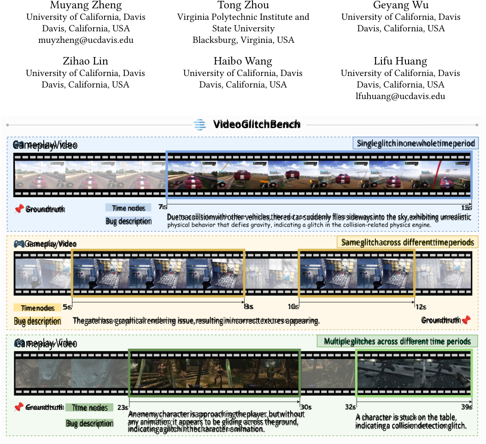

<!-- Start of picture text -->
Muyang Zheng Tong Zhou Geyang Wu University of California, Davis Virginia Polytechnic Institute and University of California, Davis Davis, California, USA State University Davis, California, USA muyzheng@ucdavis.edu Blacksburg, Virginia, USA Zihao Lin Haibo Wang Lifu Huang University of California, Davis University of California, Davis University of California, Davis Davis, California, USA Davis, California, USA Davis, California, USA lfuhuang@ucdavis.edu VideoGlitchBench GameplayVideo Singleglitchinonewholetimeperiod Groundtruth Time nodes 7s 13s Duetoacollisionwith other vehicles,thered car suddenly flies sidewaysinto the sky,exhibiting unrealistic Bug description GameplayVideo Sameglitchacross differenttimeperiods Timenodes 5s 8s 10s 12s Bug description Thegatehasa graphicalrendering issue,resultinginincorrecttextures appearing. Groundtruth  Gameplay Video Multipleglitches across different time periods Groundtruth Time nodes 23s 30s 32s 39s Anenemycharacterisapproachingtheplayer,butwithout A character is stuck on the table, Bug description any animation;it appears to be gliding across theground, indicatinga collisiondetectionglitch. indicatingaglitchinthecharacter animation. <!-- End of picture text -->

**Figure 1: We introduce VideoGlitchBench, a comprehensive benchmark designed for open-ended video game glitch detection.** 

## **Abstract** 

_Open-ended video game glitch detection_ aims to identify glitches in gameplay videos, describe them in natural language, and localize when they occur. Unlike conventional game glitch understanding tasks which have largely been framed as image-level recognition or closed-form question answering, this task requires reasoning 

about game-specific dynamics such as mechanics, physics, rendering, animation, and expected state transitions directly over continuous gameplay videos and distinguishing true glitches from unusual but valid in-game events. To support this task, we introduce **VideoGlitchBench** , the first benchmark for open-ended video game glitch detection with temporal localization. VideoGlitchBench contains 5,238 gameplay videos from 120 games, each annotated with detailed glitch descriptions and precise temporal spans, 

ACM Multimedia 2026, Rio de Janeiro, Brazil 

Muyang Zheng, Tong Zhou, Geyang Wu, Zihao Lin, Haibo Wang, and Lifu Huang 

enabling unified evaluation of semantic understanding and temporal grounding. We further propose **GliDe** , an agentic framework with three key components: a game-aware contextual memory for informed reasoning, a debate-based reflector for multi-perspective glitch detection and verification, and an event-level grounding module that recovers complete glitch intervals from fragmented temporal evidence. We also design a task-specific evaluation protocol that jointly measures semantic fidelity and temporal accuracy. Experiments show that this task remains highly challenging for current multimodal models, while GliDe achieves substantially stronger performance than corresponding vanilla model baselines. Project Page: sandyyyzheng.github.io/glide-project-page 

## **CCS Concepts** 

### • **Computing methodologies** → **Multi-agent planning** . 

## **Keywords** 

Video understanding, Agentic AI, Video game glitch detection, Multimodal large language models 

## **1 Introduction** 

Game glitches are unintended failures in gameplay, such as broken physics, rendering artifacts, animation errors, collision failures, or logic inconsistencies [18, 38]. Detecting such glitches from gameplay videos is an important capability for game quality assurance (QA) [33], where testers typically examine gameplay sessions to inspect suspicious behaviors and summarize the issue with detailed bug reports. Recent works have begun to explore game glitch understanding through tasks such as image-level glitch detection [31, 32], text-only bug reasoning [35], and closed-form (e.g., multiple-choice or yes/no) question answering over gameplay videos [6, 7]. While these settings provide testbeds for studying glitch understanding, they address only restricted aspects of the problem and fall short of the richer contextual analysis in real-world gameplay-based QA. 

To close this gap, we propose _open-ended video game glitch detection_ , a task in which a model must reason over raw gameplay videos, identify glitches in an open-ended manner, describe them in natural language, and temporally localize their occurrence as evidence for follow-up analysis. Compared with prior game glitch understanding tasks, this setting requires joint video understanding, game-aware reasoning, and temporal grounding in a unified framework. To support research on this problem, we introduce **VideoGlitchBench** , the first benchmark for open-ended video game glitch detection with temporal localization. VideoGlitchBench is constructed from community-reported gameplay videos in GamePhysics [34] through careful game category-based selection, filtering, and a semi-automated annotation pipeline, where GPT-4o [14] generates initial glitch descriptions from short video segments with Reddit discussion context, followed by human review and manual start–end timestamp annotation, yielding 5,238 high-quality, temporally grounded glitch descriptions for 120 games spanning diverse genres and glitch phenomena. 

Distinct from previous benchmarks for video understanding or video anomaly detection [22, 24, 29, 30, 39], which mainly focus on identifying specific events in real-world scenes such as surveillance, traffic, or industrial monitoring, VideoGlitchBench reveals two 

unique and critical challenges. **First** , a model must distinguish genuine glitches from behaviors that may appear abnormal visually but are actually consistent with the game’s design, mechanics, and world logic. This requires understanding not only the visual scene itself, but also the behaviors of characters and objects, the ongoing gameplay context, and the broader game background. For example, an object such as “ _a boat flying through the sky_ ” may indicate a physics failure in one game, but could be a perfectly valid event in another game with stylized or fantastical mechanics. **Second** , glitches exhibit diverse temporal patterns: some occur only briefly, while others persist over extended periods, and the same underlying glitch may reappear multiple times in a video with gaps in between. A model must therefore not only detect local failure evidence, but also determine when temporally separated observations should be linked to the same glitch event. Figure 1 shows typical examples in VideoGlitchBench, including single glitch, repeated occurrences of the same glitch, and multiple glitches within one video. 

To address these challenges, we propose **GliDe** , an agentic framework for open-ended video Game gLItch DEtection with temporal localization. The design of GliDe is directly motivated by the structure of the task. To determine whether a suspicious event is truly a glitch in a particular game context, GliDe first builds a _game-aware contextual memory_ that incrementally accumulates cues about the scene, activities, interactions, and local gameplay dynamics, thereby providing a stronger prior for later judgments. To reduce false positives caused by visually unusual yet valid gameplay behaviors, GliDe then performs _multi-step verification_ through adaptive tool use and a debate-based reflector, encouraging the model to compare a glitch hypothesis against plausible in-game explanations before reaching a decision. Finally, to handle glitches that are short-lived, long-lasting, or intermittently recurring, GliDe includes an _event-level grounding_ module that consolidates fragmented evidence across windows and recovers complete glitch intervals, including multiple disjoint occurrences of the same glitch. 

We also design a new evaluation protocol to match and compare a set of system-generated, temporally grounded glitch descriptions against the ground-truth annotations for each video, by jointly assessing their semantic matching through LLM-based scoring and temporal grounding using temporal IoU. Extensive experiments show that VideoGlitchBench is highly challenging for current video understanding models. Even strong proprietary models such as gemini-2.0-flash [11] and claude-3.5-haiku [1] achieve limited performance, with the best baseline reaching only 26.01% F1 and 0.47 mIoU, while the best vanilla open-source model achieves 21.62% F1 and the average F1 across six open-source backbones is only 14.47%, highlighting the difficulty of jointly producing accurate open-ended glitch descriptions and precise temporal localization. In contrast, GliDe consistently improves both semantic understanding and grounding across all evaluated backbones: averaged over six open-source models, it raises F1 from 14.47% to 36.05% and mIoU from 0.28 to 0.51, and all GliDe-enhanced models outperform the reported proprietary baselines on the overall metrics. These results demonstrate both the difficulty of VideoGlitchBench and the effectiveness of GliDe as a unified solution for context-aware, temporally grounded glitch detection. 

Our main contributions are summarized as follows: **(1)** We introduce VideoGlitchBench, the first benchmark for open-ended 

Open-Ended Video Game Glitch Detection with Agentic Reasoning and Temporal Grounding 

ACM Multimedia 2026, Rio de Janeiro, Brazil 

**Table 1: Comparison between VideoGlitchBench and existing game glitch datasets.** 

|**Dataset**|**Scale**|**Pipeline**|**Annotation**|**Localization**|**Evaluation**|
|---|---|---|---|---|---|
|GamePhysics [34]|26,954 videos|Semi-Auto|Game name/weak metadata|�|Retrieval relevance|
|GameBugDescriptions [35]|167 videos|Manual|Event description & Bug type|�|Multiple-choice accuracy|
|GlitchBench [32]|923 images|Manual|Short glitch description|�|Description quality|
|VideoGameBunny [31]|185,259 images|Semi-Auto|Caption & Image-to-JSON & Question-answer pairs|�|N/A (Designed for instruction-tuning)|
|GameBench [7]|880 videos|Semi-Auto|Multiple-choice questions|�|Multiple-choice accuracy|
|PhysGame [7]|38,957 videos|Semi-Auto|Question-answer pairs|�|N/A (Designed for instruction-tuning)|
|**VideoGlitchBench**|**5,238 videos**|**Semi-Auto**|**Detailed glitch description** **& start/end timestamps**|�|**Description quality & grounding** **accuracy**|

video game glitch detection with temporal localization, featuring 5,238 gameplay videos across 120 games with detailed descriptions and precise timestamps. **(2)** We propose GliDe, an agentic framework that tackles glitch detection challenges through a game-aware contextual memory, a debate-based verification mechanism, and an event-level grounding module to consolidate fragmented glitch intervals. **(3)** We design a comprehensive evaluation protocol that jointly assesses semantic fidelity and temporal localization. Extensive experiments demonstrate that GliDe significantly outperforms competitive baselines on this challenging benchmark. 

## **2 Related Work** 

**Game Glitch Understanding Benchmarks.** GamePhysics [34] introduced the first large-scale dataset of gameplay videos, containing more than 26,000 videos from over 1,800 games. Building on this, more recent research has shifted toward constructing specialized benchmarks for evaluating multimodal large language models (MLLMs) on glitch understanding tasks. GlitchBench [32] evaluates MLLMs on recognizing unusual gameplay scenarios, focusing on single-frame visual glitch detection. GameBugDescriptions [35] tests zero-shot bug detection via multiple-choice questions based on text descriptions, while GameBench [7] uses expert-annotated gameplay videos paired with multiple-choice questions to assess visual physical reasoning capabilities. To train these capabilities, PhysGame [7] provides a large-scale video instruction dataset of over 140,000 QA pairs designed to enhance physical world understanding. However, restricted to image-level detection or multiple-choice QA formats without temporal localization, these benchmarks fail to reflect the practical demands of game QA. Addressing this gap, VideoGlitchBench targets open-ended glitch detection directly from raw videos, providing both natural language descriptions and precise timestamps. Table 1 summarizes these key differences. 

**Game Glitch Detection Methods.** Existing methods for gameplay glitch detection have largely been shaped by the scope of previous benchmarks, and thus mainly operate through retrieval, question answering, or direct single-pass prediction. For example, GamePhysics [34] employs a CLIP-based retrieval approach to identify bug-related gameplay clips from textual queries, demonstrating that pretrained vision–language models can capture useful signals for glitch-related events. VideoGameBunny [31] introduces a game-oriented multimodal assistant trained on large-scale gameplay instruction data, while PhysVLM [6] enhances video language 

models with physical commonsense supervision to better detect violations of physics rules in gameplay videos. They are effective for matching predefined queries or selecting from limited answer spaces, but are insufficient for open-ended glitch detection, where models must reason over and identify genuine glitches directly from raw videos with precise temporal localization. 

**Agentic Frameworks for Video Understanding.** For complex tasks requiring selective search and temporal grounding, agentic pipelines are increasingly replacing single-pass predictions [36]. Systems like VideoAgent [37], TraveLER [28], and VideoMind [21] successfully leverage iterative planning, modular tools, and evidence collection to enhance video QA. Concurrently, in the gaming domain, automated testing agents [43] utilizing reinforcement learning [2, 4] and exploration systems (e.g., CCPT [27], Inspector [19]) are widely deployed to uncover bugs. However, these game agents focus strictly on active, interactive environment exploration, leaving a crucial gap for agentic frameworks designed to detect and temporally localize glitches from recorded gameplay videos. 

**Video Anomaly Detection (VAD)** aims to identify events deviating from normal patterns, traditionally focusing on intelligent surveillance [29]. While early methods relied on deep neural networks to model normality and detect deviations [10, 12, 20, 29], recent MLLM-based approaches have shifted towards semantic reasoning over abnormal events [24]. Representative methods such as Holmes-VAD [45] and AnomalyRuler [42] use multimodal instruction tuning or rule-based reasoning to localize and explain anomalies, while LAVAD [44] and PLOVAD [40] further leverage captioning, prompting, and video-language interaction for anomaly detection. However, unlike real-world VAD which typically detects unusual human behaviors, anomalies in gameplay videos stem from violations of game mechanics, physics simulations, or rendering pipelines [13, 41]. Consequently, video game glitch detection fundamentally differs from conventional VAD, requiring explicit reasoning over game-specific rules and virtual-world dynamics. 

## **3 VideoGlitchBench** 

Figure 2 illustrates the annotation pipeline of **VideoGlitchBench** , which comprises 3 main stages: source video selection, pseudo glitch description generation, and human validation & temporal grounding. We also provide detailed statistics in Table 2. 

ACM Multimedia 2026, Rio de Janeiro, Brazil 

Muyang Zheng, Tong Zhou, Geyang Wu, Zihao Lin, Haibo Wang, and Lifu Huang 

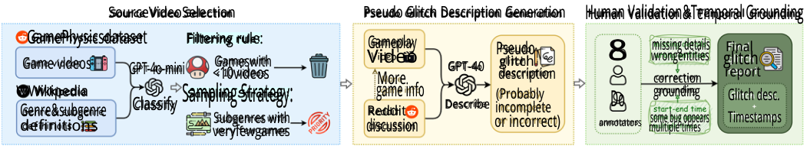

<!-- Start of picture text -->
SourceVideoSelection Pseudo Glitch Description Generation Human Validation&Temporal Grounding Game videosGamePhysicsdatasetGPT-4o-miniFiltering rule:<10videosGameswith VideoGameplayMore GPT-40 Pseudodescriptionglitch 8 wrongentitiesmissing detailscorrection glitchreportFinal WWikipedia game info Describe (Probably Do grounding Glitch desc. Genre&subgenre Classify Sampling Strategy: Reddit incomplete definitions veryfewgamesSubgenres with discussion or incorrect) annotators mulitiple timessome bug oppears Timestamps <!-- End of picture text -->

**Figure 2: The annotation pipeline of our benchmark VideoGlitchBench.** 

**Table 2: Key statistics of VideoGlitchBench.** 

|**Statistics of VideoGlitchBench**|**Value**|
|---|---|
|Total number of videos|5238|
|Game genres/subgenres|6 / 21|
|#Bugs in a single video (avg/max)|1.03 / 6|
|Video length (seconds, avg/max)|19.11 / 60.00|
|Bug description length (tokens, avg/max)|35.94 / 164|

## **3.1 Selection of Source Videos** 

Our dataset is built upon GamePhysics [34], a large-scale collection of 26,954 gameplay videos from the GamePhysics subreddit1 , where players frequently share community-reported glitches and unusual in-game events. GamePhysics provides the raw videos together with basic metadata, including game title (e.g., Cyberpunk 2077) and Reddit submission ID in filename. However, it was originally designed as a retrieval-oriented resource rather than a benchmark for open-ended glitch detection, so it does not provide verified glitch annotations, fine-grained natural-language glitch descriptions, or temporal boundaries indicating when a glitch occurs in the video. We therefore use it as the source video pool and further annotate open-ended glitch descriptions and timestamps to construct VideoGlitchBench. Although GamePhysics covers 1,873 unique games, many are represented by only one or two candidate videos without clear or confirmed glitches. To ensure sufficient coverage for reliable annotation and evaluation, we retain only games with at least ten candidate videos, yielding a final pool of 120 games. 

Among these 120 games, the number of candidate videos varies, with some games contributing far more videos than others. To promote a balanced distribution of game types in VideoGlitchBench, we first construct a taxonomy of genres and subgenres based on standard definitions from Wikipedia2 and then use GPT4o-mini [14] to assign each game title to the corresponding predefined categories. The detailed taxonomy is provided in Appendix A.1. Based on this taxonomy, we sample videos in a genre-aware manner, prioritizing underrepresented subgenres and games with fewer available videos. This sampling strategy improves diversity across genres, subgenres, and individual games, while reducing over-representation from a small number of dominant categories. As a result, we sample 5,238 gameplay videos spanning 120 games. 

## **3.2 Semi-Automated Annotation Pipeline** 

Since purely manual annotation of fine-grained, temporally grounded glitches is prohibitively expensive at scale, we introduce a semiautomated pipeline. This approach synergizes MLLM-based video understanding with rigorous human validation to ensure both efficiency and high data quality. 

**Automated generation of pseudo descriptions.** To reduce the annotation burden, we employ GPT-4o [14] to generate pseudo glitch descriptions for each selected video. Because processing fulllength gameplay videos can degrade the model’s understanding, we partition each video into short segments ( _<_ 10 seconds) and sample frames at 2 FPS, restricting the input to fewer than 20 frames per segment. To enhance generation quality, we augment the visual input with the original Reddit discussion context (i.e., post title and comments), retrieved via PRAW [5] using the submission ID embedded in each source filename. This supplementary metadata serves as a strong semantic prior, enabling the model to produce highly informative and accurate pseudo descriptions. An example of the model input and output is provided in Appendix A.2. 

**Human validation and temporal grounding.** As MLLMgenerated descriptions may omit critical details, misidentify game entities, or provide inaccurate event boundaries, all pseudo descriptions undergo rigorous human verification. To support efficient and scalable annotation, we develop a multi-user annotation interface that allows multiple annotators to inspect videos simultaneously. Annotators verify each MLLM-generated description and revise it when necessary, such as correcting factual errors, adding missing details, or refining references to game characters and objects. They also manually annotate the **exact start and end timestamps** of each glitch event within the interface, producing the precise temporal boundaries needed for temporal localization and grounding tasks. Since the pseudo descriptions are generated from short video segments, the intermediate annotations are initially segment-level. During human validation, annotators review the full video together with all segment-level pseudo descriptions, and manually merge those referring to the same underlying glitch into a unified videolevel glitch annotation. If a glitch spans multiple adjacent segments or appears in multiple disjoint segments, annotators consolidate these observations into one glitch report and assign the corresponding temporal intervals at the video level. 

> 1https://www.reddit.com/r/GamePhysics/ 

> 2https://en.wikipedia.org/wiki/Action_game 

Open-Ended Video Game Glitch Detection with Agentic Reasoning and Temporal Grounding 

ACM Multimedia 2026, Rio de Janeiro, Brazil 

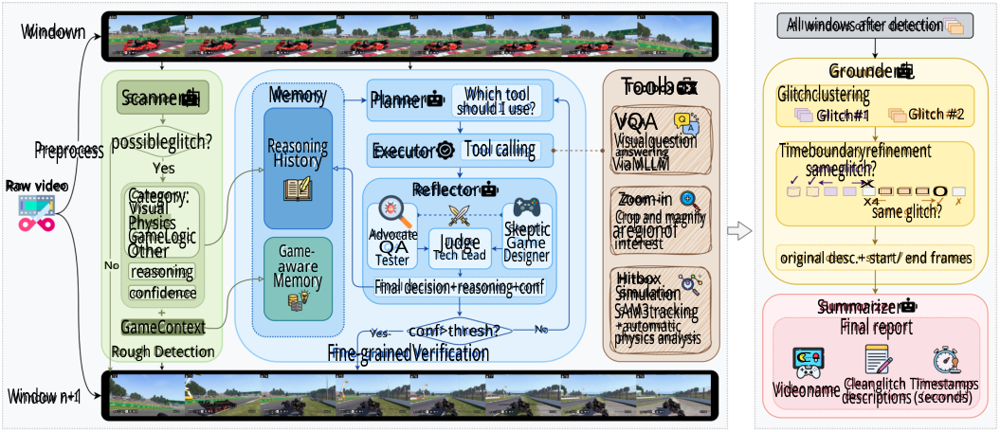

<!-- Start of picture text -->
Windown All windows after detection Grounder电 Scanner由 Memory Planner Which tool Toolbox Glitchclustering should I use? VQA Glitch#1 Glitch #2 Preprocess possibleglitch? Reasoning Executor Tool calling Visualquestionanswering Timeboundaryrefinement Raw video Yes History Reflector ViaMLLM sameglitch?X□□□0 Category: Zoom-in X4 No OtherGameLogicPhysicsVisualreasoning MemoryawareGame- AdvocateTesterQA Tech LeadJudge DesignerSkepticGame aregionofinterestCrop and magnifyHitbox original desc.+ start/ end framessame glitch? confidence Final decision+reasoning+conf Simulation SAM3tracking Summarizer GameContext Yes- conf>thresh? No +automatic Final report physics analysis Rough Detection Fine-grainedVerification C- Cleanglitch Timestamps Window n+1 Videonamedescriptions (seconds) <!-- End of picture text -->

**Figure 3: Illustration of our GliDe framework.** 

## **4 Methodology 4.1 Problem Formulation** 

Given an input gameplay video _𝑉_ , the goal of open-ended video game glitch detection is to identify all glitch events that occur in the video, generate a natural-language description for each event, and localize its temporal extent. We formulate this task as a structured set prediction problem, where each glitch report is represented as a pair ( _𝑑,𝑇_ ), with _𝑑_ denotes a free-form glitch description and _𝑇_ denotes its temporal span. Since the same glitch may recur multiple times throughout a video with gaps in between, _𝑇_ may consist of one or more disjoint intervals. For each video, the ground-truth annotations are defined as a set of such reports _𝑌_ = {( _𝑑__𝑔𝑡_ _𝑗__,𝑇_ _𝑗__𝑔𝑡_)}_𝑀_ _𝑗_ =1, and the model is required to predict a set of the same form _𝑌_ˆ = {( _𝑑𝑖__𝑝,𝑇_ _𝑖__𝑝_)} _𝑖__𝑁_ =1, where_𝑀_and_𝑁_are the numbers of ground-truth and predicted glitch reports, respectively. 

gameplay context, a **debate-based verification mechanism** for distinguishing true glitches from unusual but valid behaviors, and an **event-level grounding strategy** for merging fragmented evidence into complete glitch events. These designs are instantiated in a five-stage pipeline, as illustrated in Figure 3. 

_4.2.1 Preprocessing._ Given an input gameplay video _𝑉_ sampled at _𝜏_ FPS, we partition it into non-overlapping _𝑘_ -frame windows. The frames within each window are spatially stitched into a composite image, yielding a sequence of stitched windows W = { _𝑤 𝑗_ }_𝐿_ _𝑗_ =1, where _𝑤 𝑗_ denotes the _𝑗_ -th window and _𝐿_ is the total number of windows. This step efficiently preserves short-range temporal cues while minimizing MLLM calls for subsequent multi-step reasoning. 

_4.2.2 Initial Glitch Detection with Game-aware Memory._ GliDe starts with a **Scanner** that processes each stitched window _𝑤 𝑗_ ∈W in a single pass. For each window, the Scanner predicts: 

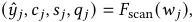

<!-- Start of picture text -->
( 𝑦  ˆ 𝑗,𝑐 𝑗,𝑠 𝑗,𝑞 𝑗 ) =  𝐹 scan ( 𝑤 𝑗 ) , <!-- End of picture text -->

## **4.2 The GliDe Framework** 

We propose GliDe, an agentic framework for open-ended video game glitch detection with temporal localization. The task is challenging for three main reasons. **First** , determining whether an unusual event is truly a glitch often requires accumulated gameplay context over time, rather than inspection of a single suspicious frame. **Second** , gameplay videos frequently contain rare yet valid in-game behaviors, such as abrupt camera shifts, exaggerated character poses during scripted animations, or sudden object movements caused by normal game mechanics; as a result, onepass judgments are prone to false positives. **Third** , a real glitch may span multiple temporal windows or reappear intermittently, so local window-level detections can be fragmented and must be consolidated into complete event-level glitch intervals. 

To address these challenges, GliDe is built around three core designs: a lightweight **game-aware memory** for preserving global 

where _𝑦_ ˆ _𝑗_ ∈{0 _,_ 1} indicates whether the window contains a potential glitch, _𝑐 𝑗_ denotes a coarse glitch category (e.g., visual, physics, or game logic), _𝑠 𝑗_ is a natural-language summary of the current gameplay context (e.g., scene type, visible entities, and ongoing behaviors), and _𝑞 𝑗_ ∈[0 _,_ 1] is the confidence score. 

The binary predictions _𝑦_ ˆ _𝑗_ are first used to filter out clearly normal windows and retain only a small set of candidate windows for deeper analysis. More importantly, the context descriptions { _𝑠 𝑗_ }_𝐿_ _𝑗_ =1 are aggregated into a compact **game-aware memory** . Specifically, we apply an LLM-based summarization function over the windowlevel context descriptions to obtain a global summary context: 

_𝑀_ = _𝐺_ ({ _𝑠 𝑗_ }_𝐿_ _𝑗_ =1)_,_ 

where _𝑀_ captures the overall gameplay scene, active entities, and ongoing dynamics in the video. This memory serves as a video-level contextual prior for downstream reasoning. Instead of judging each 

ACM Multimedia 2026, Rio de Janeiro, Brazil 

Muyang Zheng, Tong Zhou, Geyang Wu, Zihao Lin, Haibo Wang, and Lifu Huang 

suspicious window in isolation, GliDe can compare local anomalies against the broader gameplay context, which helps determine whether an unusual event is actually inconsistent with the game state or simply part of normal gameplay. 

_4.2.3 Fine-grained Verification via Debate-based Reasoning._ After initial glitch detection, each candidate window _𝑤 𝑗_ is further examined through a verification loop involving: a **Planner** , an **Executor** , and a **Reflector** . This stage will gather targeted evidence and determine whether the candidate truly corresponds to a glitch. 

At verification step _𝑡_ , the Planner takes as input the current candidate window _𝑤 𝑗_ , the Scanner’s initial hypothesis, the gameaware memory _𝑀_ , and the cumulative investigation memory _𝐼 𝑗,𝑡_ −1. It then selects the next action according to a planning policy _𝜋_ : 

_𝑎 𝑗,𝑡_ = _𝜋_ ( _𝑤 𝑗, 𝑀, 𝐼 𝑗,𝑡_ −1) _,_ 

where _𝑎 𝑗,𝑡_ specifies both the tool to invoke and its associated arguments. The available tools include: **VQA** , which asks targeted visual questions about the stitched window based on the current glitch hypothesis and the missing evidence needed for verification (e.g., “ _How does the robotic arm interact with the wall and floor structures between frames #24 and #31?_ ”); **Zoom-in** , which selects a local image region for magnified inspection; and **Object Tracking** , which provides a short target description and invokes a segmentationbased tracker (SAM3 [8]) to obtain motion evidence. The Executor applies _𝑎 𝑗,𝑡_ and returns a new observation _𝑜 𝑗,𝑡_ , which is then appended to the investigation memory. 

After each tool execution, the resulting observation is evaluated by the Reflector through a structured debate among three roles: an **Advocate** (game QA tester), a **Skeptic** (game designer), and a **Judge** (tech lead). The Advocate argues that the observed phenomenon is a genuine glitch, while the Skeptic proposes plausible in-game explanations or highlights missing evidence. The Judge then arbitrates between the two sides and produces a binary verdict: _𝑣 𝑗,𝑡_ ∈{glitch _,_ normal}, together with a confidence score _𝑐𝑜𝑛𝑓𝑗,𝑡_ ∈[0 _,_ 1]. This debate-based verification is a core design of GliDe. Rather than merely re-checking a prediction, it explicitly contrasts a glitch hypothesis against alternative explanations grounded in normal gameplay behavior. This matters because unusual motions or visual effects may still be valid under the game rules, such as exaggerated character poses during specific animations or abrupt object movements triggered by normal game mechanics. By forcing the system to reason over competing interpretations before making a decision, GliDe reduces false positives and improves verification reliability. 

The verification loop terminates when the Judge outputs a verdict with confidence above a threshold _𝜏_ , or when the maximum number of steps _𝑇_ max is reached: _𝑐𝑜𝑛𝑓𝑗,𝑡_ ≥ _𝜏_ or _𝑡_ = _𝑇_ max _._ The final verified result for window _𝑤 𝑗_ is then forwarded to the next stage. 

_4.2.4 Event-level Grounding._ The verification stage operates at the window level, whereas the target output requires event-level glitch reports with complete temporal spans. To bridge this gap, GliDe includes an **event-level Grounder** that consolidates fragmented window evidence into coherent glitch events. 

The Grounder proceeds in two steps. First, it performs **semantic clustering** over the verified glitch windows. For each pair of verified windows, an LLM judges whether their descriptions refer 

to the same underlying glitch phenomenon. Windows deemed semantically consistent are grouped into the same event cluster. This allows the framework to handle cases where the same glitch appears across non-consecutive portions of the video. Second, for each event cluster, GliDe performs **bidirectional temporal propagation** to refine the event boundaries. Starting from the initially detected windows, the model iteratively checks neighboring windows in both temporal directions and extends the boundaries whenever the same glitch remains visible. In this way, the Grounder can recover the full temporal extent of a glitch even when the initial detector only captures its most salient moments. 

_4.2.5 Structured Report Generation._ Finally, GliDe converts the grounded event clusters into the output set _𝑌_ˆ . Since a single gameplay video may contain multiple distinct glitches, the framework generates a set of structured reports rather than a single prediction. For each cluster, it summarizes the accumulated multi-window evidence into a single coherent description and converts the refined frame ranges into timestamp intervals in seconds. The final output is therefore a structured glitch report containing natural-language description together with one or more temporal spans. 

## **5 Experiments** 

## **5.1 Experimental Setup** 

We evaluate a diverse set of multimodal models, including both proprietary and open-source backbones. The proprietary models are gemini-2.0-flash [11], gpt-4o-mini [14], claude-3.5-haiku [1], and nova-lite-v1 [15]. The open-source models are Qwen2.5-VL3B/7B-Instruct [3], InternVL2.5-4B/8B [9], UI-TARS-1.5-7B [26], and LLaVA-OneVision-7B [17]. Our GliDe framework comparison is conducted on open-source models, while proprietary models are included as reference baselines. Videos are uniformly sampled at 4 FPS and divided into non-overlapping windows of 8 frames. The frames within each window are spatially stitched into a single composite image before being fed into the model. All experiments are run on four NVIDIA Quadro RTX 8000 GPUs (48GB). Please refer to Appendix B.1 for detailed experiment and evaluation setup. 

## **5.2 Evaluation Protocol** 

Open-ended video game glitch detection requires evaluating both semantic correctness and temporal localization. Since prior game glitch benchmarks mainly focus on multiple-choice accuracy or description-only quality, we design a task-specific evaluation protocol by building on SODA [23] and adapting it to our setting. For one video, let the predicted set be _𝑌_ˆ = {( _𝑑𝑖__𝑝,𝑇_ _𝑖__𝑝_)} _𝑖__𝑁_ =1and the ground-truth set be _𝑌_ = {( _𝑑__𝑔𝑡_ _𝑗__,𝑇_ _𝑗__𝑔𝑡_)}_𝑀_ _𝑗_ =1. 

**Stage 1: LLM-as-Judge Semantic Scoring.** For each prediction– ground-truth pair, we use gpt-4o-mini to score the semantic similarity between the predicted description _𝑑𝑖__𝑝_and the ground-truth description _𝑑__𝑔𝑡_ _𝑗_, denoted as_𝑆_LLM(_𝑑_ _𝑖__𝑝,𝑑𝑔𝑡_ _𝑗_)∈[0_,_5], where a higher score indicates better semantic alignment. 

**Stage 2: LLM-Weighted IoU Computation.** To support reliable matching, we combine semantic similarity and temporal overlap into a joint score, _𝑊𝑖,𝑗_ = _𝑆_ LLM ( _𝑑𝑖__𝑝,𝑑𝑔𝑡_ _𝑗_) · IoU(_𝑇_ _𝑖__𝑝,𝑇_ _𝑗__𝑔𝑡_). This score is high only when a prediction matches a ground-truth glitch in both description and temporal span. 

Open-Ended Video Game Glitch Detection with Agentic Reasoning and Temporal Grounding 

ACM Multimedia 2026, Rio de Janeiro, Brazil 

**Table 3: Comparison of vanilla models and GliDe-enhanced models on VideoGlitchBench across description generation, temporal grounding, and overall performance.** 

|**Model**|**Des**|**cription Generat**|**ion**|**Temporal Grounding**|**Overall**|
|---|---|---|---|---|---|
||**Precision (%)**|**Recall (%)**|**F1 (%)**|**mIoU**|**F1**×**IoU (%)**|
|**Proprietary Models**||||||
|gemini-2.0-flash [11]|18.36|25.35|21.29|0.44|10.55|
|gpt-4o-mini [14]|12.33|32.36|17.86|0.35|6.20|
|claude-3.5-haiku [1]|21.66|32.54|26.01|0.47|12.91|
|nova-lite-v1 [15]|6.66|23.77|10.41|0.28|2.98|
|**Open-source Models**||||||
|Qwen2.5-VL-3B-Instruct [3]|11.08|26.53|15.63|0.31|4.81|
|**+GliDe**|**32.36**(+21.28)|**39.38**(+12.85)|**35.52**(+19.89)|**0.48**(+0.17)|**17.29**(+12.48)|
|Qwen2.5-VL-7B-Instruct [3]|10.41|14.74|12.20|0.30|4.11|
|**+GliDe**|**34.55**(+24.14)|**45.09**(+30.35)|**39.12**(+26.92)|**0.53**(+0.23)|**19.46**(+15.35)|
|InternVL2.5-4B [9]|8.62|22.93|12.53|0.18|1.92|
|**+GliDe**|**29.15**(+20.53)|**36.87**(+13.94)|**32.56**(+20.03)|**0.52**(+0.34)|**15.27**(+13.35)|
|InternVL2.5-8B [9]|11.90|23.36|15.77|0.25|4.06|
|**+GliDe**|**32.64**(+20.74)|**40.97**(+17.61)|**36.33**(+20.56)|**0.50**(+0.25)|**17.04**(+12.98)|
|UI-TARS-1.5-7B [26]|19.08|24.93|21.62|0.40|9.11|
|**+GliDe**|**34.31**(+15.23)|**49.28**(+24.35)|**40.45**(+18.83)|**0.51**(+0.11)|**17.02**(+7.91)|
|LLaVA-OneVision-7B [17]|5.90|19.50|9.06|0.26|2.18|
|**+GliDe**|**30.13**(+24.23)|**34.85**(+15.35)|**32.32**(+23.26)|**0.50**(+0.24)|**16.24**(+14.06)|

**Table 4: Ablation study on the game-aware memory and debate-based verification mechanism.** 

**Table 5: Ablation study on the event-level grounding strategy across different open-source backbones (mIoU).** 

|**Variant**|**Precision (%)**|**Recall (%)**|**F1 (%)**|
|---|---|---|---|
|GliDe|34.55|45.09|39.12|
|w/o Game-aware memory|30.65|35.80|33.03|
|w/o Debate-based verification|28.94|36.21|32.17|

|**Backbone**|**GliDe**|**w/o Event-level grounding**|
|---|---|---|
|Qwen2.5-VL-7B-Instruct|0.53|0.32|
|InternVL2.5-8B|0.50|0.24|
|UI-TARS-1.5-7B|0.51|0.36|

**Stage 3: Matching.** Given the pairwise score matrix _𝑊_ ∈ R_𝑁_×_𝑀_ , we perform global one-to-one matching with the Hungarian algorithm [16]. Let the matched pairs be denoted by A = {( _𝑖, 𝑗_ )}. 

**Stage 4: Final Metrics Computation.** Based on A, we report three groups of metrics as follows. 

_Description generation._ We first measure semantic quality independently. Precision is _𝑃_ desc =� ( _𝑖,𝑗_ )∈A_𝑆_ LLM(_𝑑_ _𝑖__𝑝,𝑑𝑔𝑡_ _𝑗_)/_𝑁_, and recall is _𝑅_ desc =� ( _𝑖,𝑗_ )∈A_𝑆_ LLM(_𝑑_ _𝑖__𝑝,𝑑𝑔𝑡_ _𝑗_)/_𝑀_. Their harmonic mean [25] is reported as _𝐹_ 1desc. 

_Temporal Grounding._ We use the mean IoU over matched pairs, defined as mIoU =� ( _𝑖,𝑗_ )∈AIoU(_𝑇_ _𝑖__𝑝,𝑇_ _𝑗__𝑔𝑡_)/|A|. 

_Overall Performance._ Finally, we evaluate semantic correctness and temporal localization jointly. We compute Precision as _𝑃_ overall = �( _𝑖,𝑗_ )∈A_𝑊_ _𝑖,𝑗_/_𝑁_and recall as_𝑅_ overall= � ( _𝑖,𝑗_ )∈A_𝑊_ _𝑖,𝑗_/_𝑀_, and report their harmonic mean as _𝐹_ 1 × IoU. 

## **5.3 Main Results** 

Table 3 reports the main evaluation results on VideoGlitchBench. From these results, we summarize the following observations. 

**Current models still struggle on open-ended video game glitch detection.** Even strong multimodal models achieve only limited performance on this task. For proprietary baselines, the best 

F1 is only 26.01% (claude-3.5-haiku), with an mIoU of 0.47. For opensource baselines, the best F1 is 21.62% (UI-TARS-1.5-7B), and the average F1 across all six open-source models is only 14.47%, with an average mIoU of 0.28. These results suggest that VideoGlitchBench remains highly challenging for current MLLMs, especially when models must both describe glitches in open-ended language and localize them precisely in time. 

**GliDe consistently improves both description generation and temporal grounding.** After applying GliDe, all six opensource backbones show clear gains on all major metrics. Averaged over six open-source models, F1 improves from 14.47% to 36.05% (+21.58%), while mIoU improves from 0.28 to 0.51 (+0.23). The overall F1×IoU score also rises from 4.37% to 17.05% on average, indicating that the improvements are not limited to one aspect of the task. Notably, after applying GliDe, all open-source models achieve higher F1, mIoU and F1×IoU scores than the proprietary baselines reported in Table 3. This shows that the proposed framework brings robust improvements across different model families and improves both semantic accuracy and temporal completeness. 

**Case analysis.** We present two examples to illustrate the two core challenges of VideoGlitchBench. The first case, shown in Figure 4, highlights the difficulty of distinguishing genuine glitches 

ACM Multimedia 2026, Rio de Janeiro, Brazil 

Muyang Zheng, Tong Zhou, Geyang Wu, Zihao Lin, Haibo Wang, and Lifu Huang 

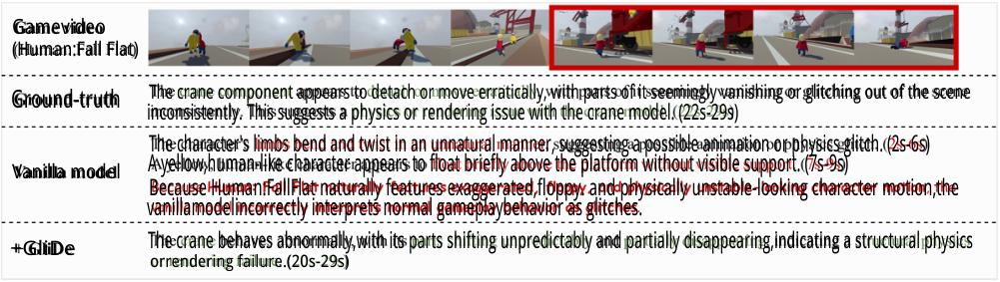

<!-- Start of picture text -->
Gamevideo (Human:Fall Flat) Ground-truth The crane component appears to detach or move erratically, with parts of it seemingly vanishing or glitching out of the scene inconsistently. This suggests a physics or rendering issue with the crane model. (22s-29s) The character's limbs bend and twist in an unnatural manner, suggesting a possible animation or physics glitch. (2s-6s) Vanilla model A yellow,human-like character appears to float briefly above the platform without visible support. (7s-9s) Because Human:FallFlat naturally features exaggerated,floppy. and physically unstable-looking character motion,the vanillamodelincorrectly interprets normal gameplaybehavior as glitches. +GliDe The crane behaves abnormally,with its parts shifting unpredictably and partially disappearing,indicating a structural physics orrendering failure.(20s-29s) <!-- End of picture text -->

**Figure 4: Qualitative comparison between the vanilla model and GliDe on a Human: Fall Flat gameplay clip.** 

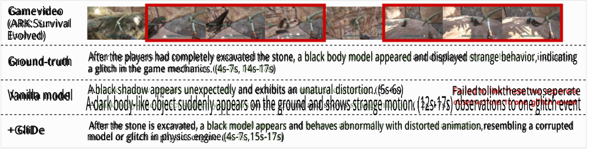

<!-- Start of picture text -->
Gamevideo (ARK:Survival Evolved) Ground-truth After the players had completely excavated the stone, a black body model appeared and displayed strange behavior, indicating a glitch in the game mechanics. (4s-7s, 14s-17s) Vanilla model A black shadow appears unexpectedly and exhibits an unatural distortion. (5s-6s) Failedtolinkthesetwoseperate A dark body-like object suddenly appears on the ground and shows strange motion. (12s-17s) observations to one glitch event +GliDe After the stone is excavated, a black model appears and behaves abnormally with distorted animation,resembling a corrupted model or glitch in physics engine.(4s-7s,15s-17s) <!-- End of picture text -->

**Figure 5: Qualitative comparison between the vanilla model and GliDe on a ARK: Survival Evolved gameplay clip.** 

from visually unusual but valid in-game behaviors. In Human: Fall Flat, the vanilla model is distracted by the game’s exaggerated and floppy character motions, falsely identifying twisted limbs and brief apparent floating as glitches, while missing the actual anomaly in the final segment. In contrast, GliDe focuses on the true cranerelated failure, producing a prediction that is much closer to the ground truth. The second case in Figure 5 highlights the temporal challenge of fragmented and repeated glitches. In ARK: Survival Evolved, the same black model anomaly appears in two disjoint intervals. The vanilla model detects the two segments separately and fails to associate them as one glitch event. By contrast, GliDe links the repeated observations through semantically consistent evidence and produces a single coherent glitch report with multiple temporal spans. These cases show that GliDe improves both context-aware verification and event-level temporal grounding. 

## **5.4 Ablation Studies** 

We conduct ablation studies on the three key designs in GliDe: game-aware memory, debate-based verification mechanism, and event-level grounding strategy, as shown in Tables 4 and 5. 

Table 4 reports the ablation results on Qwen2.5-VL-7B-Instruct. In particular, removing Game context reduces F1 from 39.12% to 33.03%, showing that game-aware memory help the model better understand ongoing gameplay and recognize valid glitches. Removing debate-based verification mechanism causes a further drop in 

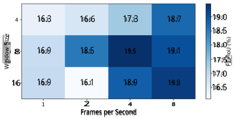

<!-- Start of picture text -->
16.3 16.6 17.3 18.7 19.0 18.5 18.0 8 16.9 18.5 19.5 19.1 Window Size 17.5F1×l 17.0 16 16.9 16.1 18.9 19.3 16.5 2 4 8 Frames per Second <!-- End of picture text -->

**Figure 6: Hyperparameter sensitivity study.** 

precision, from 34.55% to 28.94%, indicating that the debate mechanism is especially useful for filtering unreliable glitch predictions and reducing false positives. 

Table 5 shows that the event-level grounding strategy consistently improves temporal localization accuracy across three opensource models. After removing this strategy, mIoU drops significantly across all backbones, indicating that event-level grounding is essential for recovering accurate glitch intervals. This is particularly important in our setting, where a single glitch may span multiple windows or reappear across disjoint time intervals. 

Furthermore, we conduct a hyperparameter sensitivity study on FPS and window size (on Qwen2.5-VL-7B-Instruct). Figure 6 shows that GliDe remains relatively stable across different settings, 

ACM Multimedia 2026, Rio de Janeiro, Brazil 

Open-Ended Video Game Glitch Detection with Agentic Reasoning and Temporal Grounding 

while moderate temporal granularity generally gives slightly better results. The best performance is obtained at 4 FPS with a window size of 8, suggesting that this combination provides a good balance between temporal detail and contextual coverage. When the FPS is too low, short glitch evidence may be missed, while overly large window sizes can dilute local glitch signals and make reasoning less focused. These results support the default preprocessing choice used in our experiments. 

## **6 Conclusion** 

In this paper, we introduce VideoGlitchBench, a benchmark for open-ended video game glitch detection with temporal grounding. We also propose GliDe, an agentic framework designed for this task. VideoGlitchBench requires models to detect glitches from raw gameplay videos, describe them in natural language, and localize when they occur. To address this challenge, GliDe combines gameaware context, debate-based verification, and event-level grounding. Experiments show that current multimodal models still struggle on this task, while GliDe improves both description quality and temporal localization. We hope this work can support future research on game video understanding and agentic multimodal reasoning. 

## **References** 

- [1] Anthropic. 2024. Model Card Addendum: Claude 3.5 Haiku and Upgraded Claude 3.5 Sonnet. https://assets.anthropic.com/m/1cd9d098ac3e6467/original/Claude-3Model-Card-October-Addendum.pdf. 

- [2] Sinan Ariyurek, Aysu Betin-Can, and Elif Surer. 2019. Automated video game testing using synthetic and humanlike agents. _IEEE Transactions on Games_ 13, 1 (2019), 50–67. 

- [3] Shuai Bai, Keqin Chen, Xuejing Liu, Jialin Wang, Wenbin Ge, Sibo Song, Kai Dang, Peng Wang, Shijie Wang, Jun Tang, Humen Zhong, Yuanzhi Zhu, Mingkun Yang, Zhaohai Li, Jianqiang Wan, Pengfei Wang, Wei Ding, Zheren Fu, Yiheng Xu, Jiabo Ye, Xi Zhang, Tianbao Xie, Zesen Cheng, Hang Zhang, Zhibo Yang, Haiyang Xu, and Junyang Lin. 2025. Qwen2.5-VL Technical Report. _arXiv preprint arXiv:2502.13923_ (2025). 

- [4] Joakim Bergdahl, Camilo Gordillo, Konrad Tollmar, and Linus Gisslén. 2020. Augmenting automated game testing with deep reinforcement learning. In _2020 IEEE Conference on Games (CoG)_ . IEEE, 600–603. 

- [5] Bryce Boe. 2023. PRAW: The Python Reddit API Wrapper Documentation. https: //praw.readthedocs.io/. 

- [6] Meng Cao, Haoran Tang, Haoze Zhao, Hangyu Guo, Jiaheng Liu, Ge Zhang, Ruyang Liu, Qiang Sun, Ian Reid, and Xiaodan Liang. 2024. Physgame: Uncovering physical commonsense violations in gameplay videos. _arXiv preprint arXiv:2412.01800_ (2024). 

- [7] Meng Cao, Haoran Tang, Haoze Zhao, Mingfei Han, Ruyang Liu, Qiang Sun, Xiaojun Chang, Ian Reid, and Xiaodan Liang. 2026. Order from Chaos: Physical World Understanding from Glitchy Gameplay Videos. _arXiv preprint arXiv:2601.16471_ (2026). 

- [8] Nicolas Carion, Laura Gustafson, Yuan-Ting Hu, Shoubhik Debnath, Ronghang Hu, Didac Suris, Chaitanya Ryali, Kalyan Vasudev Alwala, Haitham Khedr, Andrew Huang, et al. 2025. Sam 3: Segment anything with concepts. _arXiv preprint arXiv:2511.16719_ (2025). 

- [9] Zhe Chen, Weiyun Wang, Yue Cao, Yangzhou Liu, Zhangwei Gao, Erfei Cui, Jinguo Zhu, Shenglong Ye, Hao Tian, Zhaoyang Liu, et al. 2024. Expanding Performance Boundaries of Open-Source Multimodal Models with Model, Data, and Test-Time Scaling. _arXiv preprint arXiv:2412.05271_ (2024). 

- [10] Dong Gong, Lingqiao Liu, Vuong Le, Budhaditya Saha, Moussa Reda Mansour, Svetha Venkatesh, and Anton van den Hengel. 2019. Memorizing normality to detect anomaly: Memory-augmented deep autoencoder for unsupervised anomaly detection. In _Proceedings of the IEEE/CVF international conference on computer vision_ . 1705–1714. 

- [11] Google. 2024. Introducing Gemini 2.0: our new AI model for the agentic era. https://blog.google/innovation-and-ai/models-and-research/googledeepmind/google-gemini-ai-update-december-2024/. 

- [12] Mahmudul Hasan, Jonghyun Choi, Jan Neumann, Amit K Roy-Chowdhury, and Larry S Davis. 2016. Learning temporal regularity in video sequences. In _Proceedings of the IEEE conference on computer vision and pattern recognition_ . 733–742. 

- [13] Sihao Hu, Tiansheng Huang, Gaowen Liu, Ramana Rao Kompella, Fatih Ilhan, Selim Furkan Tekin, Yichang Xu, Zachary Yahn, and Ling Liu. 2024. A survey on 

   - large language model-based game agents. _arXiv preprint arXiv:2404.02039_ (2024). 

- [14] Aaron Hurst, Adam Lerer, Adam P Goucher, Adam Perelman, Aditya Ramesh, Aidan Clark, AJ Ostrow, Akila Welihinda, Alan Hayes, Alec Radford, et al. 2024. Gpt-4o system card. _arXiv preprint arXiv:2410.21276_ (2024). 

- [15] Amazon Artificial General Intelligence. 2024. The Amazon Nova Family of Models: Technical Report and Model Card. https://www.amazon.science/publications/theamazon-nova-family-of-models-technical-report-and-model-card. 

- [16] Harold W Kuhn. 1955. The Hungarian method for the assignment problem. _Naval research logistics quarterly_ 2, 1-2 (1955), 83–97. 

- [17] Bo Li, Yuanhan Zhang, Dong Guo, Renrui Zhang, Feng Li, Hao Zhang, Kaichen Zhang, Yanwei Li, Ziwei Liu, and Chunyuan Li. 2024. LLaVA-OneVision: Easy Visual Task Transfer. _arXiv preprint arXiv:2408.03326_ (2024). 

- [18] Dayi Lin, Cor-Paul Bezemer, and Ahmed E Hassan. 2019. Identifying gameplay videos that exhibit bugs in computer games. _Empirical Software Engineering_ 24, 6 (2019), 4006–4033. 

- [19] Guoqing Liu, Mengzhang Cai, Li Zhao, Tao Qin, Adrian Brown, Jimmy Bischoff, and Tie-Yan Liu. 2022. Inspector: Pixel-based automated game testing via exploration, detection, and investigation. In _2022 IEEE Conference on Games (CoG)_ . IEEE, 237–244. 

- [20] Wen Liu, Weixin Luo, Dongze Lian, and Shenghua Gao. 2018. Future frame prediction for anomaly detection–a new baseline. In _Proceedings of the IEEE conference on computer vision and pattern recognition_ . 6536–6545. 

- [21] Ye Liu, Kevin Qinghong Lin, Chang Wen Chen, and Mike Zheng Shou. [n. d.]. VideoMind: A Chain-of-LoRA Agent for Temporal-Grounded Video Reasoning. In _NeurIPS 2025 Workshop on Bridging Language, Agent, and World Models for Reasoning and Planning_ . 

- [22] Weixin Luo, Wen Liu, and Shenghua Gao. 2017. A revisit of sparse coding based anomaly detection in stacked rnn framework. In _Proceedings of the IEEE international conference on computer vision_ . 341–349. 

- [23] Iqra Qasim, Alexander Horsch, and Dilip Prasad. 2025. Dense video captioning: A survey of techniques, datasets and evaluation protocols. _Comput. Surveys_ 57, 6 (2025), 1–36. 

- [24] Bharathkumar Ramachandra, Michael J Jones, and Ranga Raju Vatsavai. 2020. A survey of single-scene video anomaly detection. _IEEE transactions on pattern analysis and machine intelligence_ 44, 5 (2020), 2293–2312. 

- [25] Hinrich Schütze, Christopher D Manning, and Prabhakar Raghavan. 2008. _Introduction to information retrieval_ . Vol. 39. Cambridge University Press Cambridge. 

- [26] ByteDance Seed. 2025. UI-TARS-1.5. https://seed-tars.com/1.5. 

- [27] Alessandro Sestini, Linus Gisslén, Joakim Bergdahl, Konrad Tollmar, and Andrew David Bagdanov. 2022. Automated gameplay testing and validation with curiosity-conditioned proximal trajectories. _IEEE Transactions on Games_ 16, 1 (2022), 113–126. 

- [28] Chuyi Shang, Amos You, Sanjay Subramanian, Trevor Darrell, and Roei Herzig. 2024. TraveLER: A Modular Multi-LMM Agent Framework for Video QuestionAnswering. In _Proceedings of the 2024 Conference on Empirical Methods in Natural Language Processing_ . 9740–9766. 

- [29] Waqas Sultani, Chen Chen, and Mubarak Shah. 2018. Real-world anomaly detection in surveillance videos. In _Proceedings of the IEEE conference on computer vision and pattern recognition_ . 6479–6488. 

- [30] Waqas Sultani, Chen Chen, and Mubarak Shah. 2018. Real-world anomaly detection in surveillance videos. In _Proceedings of the IEEE conference on computer vision and pattern recognition_ . 6479–6488. 

- [31] Mohammad Reza Taesiri and Cor-Paul Bezemer. 2025. Videogamebunny: Towards vision assistants for video games. In _2025 IEEE/CVF Winter Conference on Applications of Computer Vision (WACV)_ . IEEE, 1403–1413. 

- [32] Mohammad Reza Taesiri, Tianjun Feng, Cor-Paul Bezemer, and Anh Nguyen. 2024. GlitchBench: Can large multimodal models detect video game glitches?. In _Proceedings of the IEEE/CVF Conference on Computer Vision and Pattern Recognition_ . 22444–22455. 

- [33] Mohammad Reza Taesiri, Abhijay Ghildyal, Saman Zadtootaghaj, Nabajeet Barman, and Cor-Paul Bezemer. [n. d.]. VideoGameQA-Bench: Evaluating VisionLanguage Models for Video Game Quality Assurance. In _The Thirty-ninth Annual Conference on Neural Information Processing Systems Datasets and Benchmarks Track_ . 

- [34] Mohammad Reza Taesiri, Finlay Macklon, and Cor-Paul Bezemer. 2022. Clip meets gamephysics: Towards bug identification in gameplay videos using zeroshot transfer learning. In _Proceedings of the 19th International Conference on Mining Software Repositories_ . 270–281. 

- [35] Mohammad Reza Taesiri, Finlay Macklon, Yihe Wang, Hengshuo Shen, and CorPaul Bezemer. 2022. Large language models are pretty good zero-shot video game bug detectors. _arXiv preprint arXiv:2210.02506_ (2022). 

- [36] Yunlong Tang, Jing Bi, Siting Xu, Luchuan Song, Susan Liang, Teng Wang, Daoan Zhang, Jie An, Jingyang Lin, Rongyi Zhu, et al. 2025. Video understanding with large language models: A survey. _IEEE Transactions on Circuits and Systems for Video Technology_ (2025). 

- [37] Xiaohan Wang, Yuhui Zhang, Orr Zohar, and Serena Yeung-Levy. 2024. Videoagent: Long-form video understanding with large language model as agent. In _European Conference on Computer Vision_ . Springer, 58–76. 

ACM Multimedia 2026, Rio de Janeiro, Brazil 

Muyang Zheng, Tong Zhou, Geyang Wu, Zihao Lin, Haibo Wang, and Lifu Huang 

- [38] Benedict Wilkins and Kostas Stathis. 2022. Learning to identify perceptual bugs in 3d video games. _arXiv preprint arXiv:2202.12884_ (2022). 

- [39] Peng Wu, Jing Liu, Yujia Shi, Yujia Sun, Fangtao Shao, Zhaoyang Wu, and Zhiwei Yang. 2020. Not only look, but also listen: Learning multimodal violence detection under weak supervision. In _European conference on computer vision_ . Springer, 322–339. 

- [40] Chenting Xu, Ke Xu, Xinghao Jiang, and Tanfeng Sun. 2025. Plovad: Prompting vision-language models for open vocabulary video anomaly detection. _IEEE Transactions on Circuits and Systems for Video Technology_ 35, 6 (2025), 5925–5938. 

- [41] Xinrun Xu, Yuxin Wang, Chaoyi Xu, Ziluo Ding, Jiechuan Jiang, Zhiming Ding, and Börje F Karlsson. 2024. A survey on game playing agents and large models: Methods, applications, and challenges. _arXiv preprint arXiv:2403.10249_ (2024). 

- [42] Yuchen Yang, Kwonjoon Lee, Behzad Dariush, Yinzhi Cao, and Shao-Yuan Lo. 2024. Follow the rules: reasoning for video anomaly detection with large language models. In _European Conference on Computer Vision_ . Springer, 304–322. 

- [43] Lance Ying, Katherine M Collins, Prafull Sharma, Cedric Colas, Kaiya Ivy Zhao, Adrian Weller, Zenna Tavares, Phillip Isola, Samuel J Gershman, Jacob D Andreas, et al. 2025. Assessing adaptive world models in machines with novel games. _arXiv preprint arXiv:2507.12821_ (2025). 

- [44] Luca Zanella, Willi Menapace, Massimiliano Mancini, Yiming Wang, and Elisa Ricci. 2024. Harnessing large language models for training-free video anomaly detection. In _Proceedings of the IEEE/CVF Conference on Computer Vision and Pattern Recognition_ . 18527–18536. 

- [45] Huaxin Zhang, Xiaohao Xu, Xiang Wang, Jialong Zuo, Chuchu Han, Xiaonan Huang, Changxin Gao, Yuehuan Wang, and Nong Sang. 2024. Holmes-vad: Towards unbiased and explainable video anomaly detection via multi-modal llm. _arXiv preprint arXiv:2406.12235_ (2024). 

## **A Details on VideoGlitchBench** 

## **A.1 Statistics** 

To support a diverse and balanced benchmark, we organize the selected games in VideoGlitchBench into a taxonomy of genres and subgenres, as shown in Figure 7. Specifically, the benchmark covers six major genres: _Action_ , _Simulation_ , _RPG_ , _Strategy_ , _Puzzle_ , and _Adventure_ . This taxonomy is used to guide genre-aware sampling, which helps reduce over-representation from a small number of dominant game types while improving coverage of underrepresented categories. 

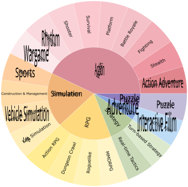

<!-- Start of picture text -->
Rhythm Wargame Action Sports Action Adventure Simulation Puzzle Adventure Puzzle Vehicle Simulation Interactive Filim Life <!-- End of picture text -->

**Figure 7: Taxonomy of VideoGlitchBench.** 

Table 6 further shows the video distribution across genres and subgenres. Action games account for the largest portion of the benchmark, covering 3,834 videos (73.20%), with _Action Adventure_ and _Shooter_ as the two largest subgenres. Simulation is the second 

largest genre with 974 videos (18.59%), followed by RPG with 313 videos (5.98%). Smaller but still meaningful portions come from Strategy, Puzzle, and Adventure. This long-tail distribution reflects the natural composition of community-reported gameplay glitches, while our sampling strategy still preserves diversity across different gameplay styles and game mechanics. 

**Table 6: Video distribution by genre and subgenre.** 

|Genre|Subgenre|Videos|Share (%)|
|---|---|---|---|
|**Action**||**3834**|**73.20**|
||Action Adventure|1533|29.27|
||Shooter|1368|26.12|
||Survival|264|5.04|
||Fighting|260|4.96|
||Battle Royale|163|3.11|
||Stealth|133|2.54|
||Platform|71|1.36|
||Wargame|30|0.57|
||Rhythm|12|0.23|
|**Simulation**||**974**|**18.59**|
||Vehicle Simulation|510|9.74|
||Construction and Management|258|4.93|
||Sports|140|2.67|
||Life Simulation|66|1.26|
|**RPG**||**313**|**5.98**|
||Action RPG|264|5.04|
||Dungeon Crawl|20|0.38|
||MMORPG|19|0.36|
||Roguelike|10|0.19|
|**Strategy**||**60**|**1.15**|
||Real-time Tactics (RTT)|30|0.57|
||Turn-based Strategy|30|0.57|
|**Puzzle**||**47**|**0.90**|
||Puzzle|47|0.90|
|**Adventure**||**10**|**0.19**|
||Interactive Film|10|0.19|

We also analyze the textual distribution of the annotated glitch descriptions. Figure 8 presents a word cloud over all bug descriptions after removing stopwords. Frequent terms such as _physics_ , _collision_ , _animation_ , _engine_ , _vehicle_ , and _character_ suggest that VideoGlitchBench covers a broad range of glitch types, including physics failures, rendering issues, animation errors, and unexpected object interactions. This observation is consistent with the goal of the benchmark: evaluating whether a model can understand and describe diverse glitch phenomena in open-ended gameplay videos. 

## **A.2 More on Annotation** 

**Example of annotation process.** Figure 9 shows a concrete example of our annotation process. The input video is first divided into short segments (< 10 seconds), and GPT-4o generates pseudo glitch 

Open-Ended Video Game Glitch Detection with Agentic Reasoning and Temporal Grounding 

ACM Multimedia 2026, Rio de Janeiro, Brazil 

**Table 7: Tool library for our agentic framework.** 

|**Tool Name**|**Description**|
|---|---|
|vqa|Submit the full stitched window image with a text question to the VLM and return a free-form answer.|
|zoom_in|Crop a specified region from one or more raw frames, upscale the result, and chain a VQA call on the cropped output. Used when the anomaly occupies a small portion of the full image.|
|object_tracking|Track a specified object across frames using SAM3, then automatically run physics analysis on the resulting centroid sequence. Physics analysis computes per-frame velocity and acceleration, and applies four rule-based anomaly detectors: (1)_position_jump_: inter-frame displacement_>_ 20% of the frame diagonal; (2)_velocity_spike_: inter-frame speed change _>_ 500 px/s; (3) _motion_freeze_: displacement _<_ 1 px for ≥4 consecutive frames; (4)_jittering_: direction reversals in≥50% of consecutive frame-pair steps.|

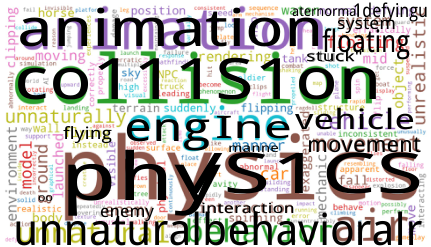

<!-- Start of picture text -->
aternormal1defyingu system animation stuck"floating co111S1on eng Inemanne vehicle movement 00 unnaturalbehavioralrphyflyingenemy /S1CSinteraction <!-- End of picture text -->

**Figure 8: Word cloud of all the bug descriptions.** 

descriptions independently for each segment. In this example, both segments describe a similar phenomenon where a truck exhibits physically implausible flying behavior. During human validation, annotators recognize that these segment-level descriptions correspond to the same underlying glitch. They therefore merge them into a single video-level glitch report, refine the description for clarity and correctness, and assign unified temporal boundaries that span the full duration of the event. This example illustrates how fragmented segment-level predictions are consolidated into coherent, temporally grounded annotations in VideoGlitchBench. 

**Annotation interface.** To support efficient and consistent annotation, we develop a multi-user annotation interface, as illustrated in Figure 10. The interface presents the gameplay video together with model-generated segment-level pseudo descriptions. For each video, annotators can review the playback, inspect segment-wise predictions with corresponding timestamps, and directly edit descriptions or assign temporal boundaries. The interface also provides simple controls for adding, merging, or discarding glitch annotations, enabling streamlined video-level labeling. 

**Annotator expertise.** All annotations are conducted by volunteers with prior experience in gaming and familiarity with common glitch phenomena, such as physics violations, rendering artifacts, and abnormal object interactions. While the annotators are not professional QA engineers, they possess sufficient domain knowledge to reliably identify and describe glitches in gameplay videos. To ensure annotation quality, all samples undergo careful review and refinement during the validation process. 

## **B Experiment Details** 

## **B.1 Full Experimental Setup** 

**Video preprocessing.** Input videos are processed using time-based frame sampling via OpenCV, extracting frames at a fixed rate of 4 FPS (i.e., one frame every 0.25 seconds), regardless of the original video frame rate. This ensures uniform temporal coverage across videos with varying native frame rates. Extracted frames are organized into non-overlapping windows of 8 frames each, yielding a temporal span of 2 seconds per window. Within each window, the 8 frames are stitched into a single composite image arranged in a 2-row × 4-column grid layout, with each frame labeled by its sequential index in the top-left corner. Stitched images are saved as JPEG. This multi-frame stitching design allows the model to observe temporal progression within a single model call. 

**Rough detection.** The Scanner is configured with a sampling temperature of 0.5 and a maximum output length of 512 tokens. In addition to the glitch label and confidence score, the Scanner produces a game_context field — a 2–4 sentence natural language description of the game genre, environment, and visible mechanics, which is propagated to all downstream modules as a lightweight retrieval-augmented context. 

**Fine-grained verification.** This module operates on each Scannerflagged window through an iterative Planner → Executor → Reflector loop, with a maximum of 5 iterations per window. The loop terminates early if the Judge’s final_confidence reaches the threshold of 0.80. All sub-agents (Planner, Advocate, Skeptic, Judge) share a single MLLM client configured with temperature 0.5 and max tokens 1,024. 

**Temporal grounding.** The Grounder consolidates per-window outputs from the previous module into temporally contiguous glitch records through two steps. **1)** Similarity clustering. Confirmed glitch windows are processed in chronological order. Each new glitch description is compared against all existing cluster descriptions via an MLLM call; if the model returns yes, the window is merged into that cluster, otherwise a new cluster is created (greedy first-match assignment). Similarity is judged on three axes: entity appearance similarity, anomaly type similarity, and behavioral similarity. **2)** Bidirectional propagation. For each confirmed glitch cluster, the Grounder expands the cluster both forward and backward by querying the model with the glitch description and the adjacent window’s image. A window is added to the cluster if the model returns yes; propagation stops at the first non-matching window. 

ACM Multimedia 2026, Rio de Janeiro, Brazil 

Muyang Zheng, Tong Zhou, Geyang Wu, Zihao Lin, Haibo Wang, and Lifu Huang 

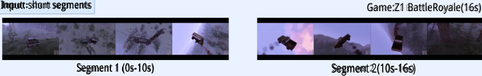

<!-- Start of picture text -->
Input: short segments Game:Z1 BattleRoyale(16s) Segment 1 (0s-10s) Segment 2(10s-16s) <!-- End of picture text -->

## GPT-4o: pseudo descriptions 

Segment 1: Thekeyframes depict an apparent glitch where the truck defies natural physics.Instead of adhering to the ground's surface,it inexplicably elevates into the air,as if propelled by an nonexistent force,causing it to fly and spin uncontrollably.This behavior is not consistent with normal gameplay mechanics and indicates a physics engine glitch. 

Segment 2: The game shows a physics glitch where a truck is flying through the air, which is not normal behavior for vehicles in a realistic game scenario.Characters appear tobe ejectedfrom thevehicle due tothe lack of gravity or collision mechanics not functioning as intended. 

## Human validation & grounding: final glitch report 

Glitch description: There is an apparent glitch where the truck defies natural physics. Instead of adhering to the ground's surface, it inexplicably elevates into the air, as if propelled by a nonexistent force,causing it to fly and spin uncontrollably.This behavior isnot consistentwith normal gameplaymechanics and indicates aphysics engineglitch. Time nodes: [2, 14] (seconds) Merge two pseudo descriptions into one 

**Figure 9: An example of the annotation process.** 

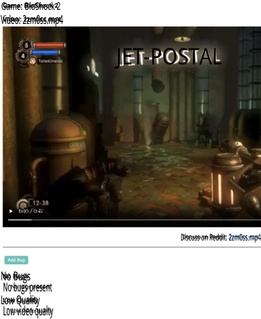

<!-- Start of picture text -->
Game: BloShock 2 Video: 2zm0ss.mp4 JET-POSTAL 0:00 /0:42 Discuss on Reddit: 2zm0ss.mp4 No Bugs  No bugs present Low Quality  Low video qualty <!-- End of picture text -->

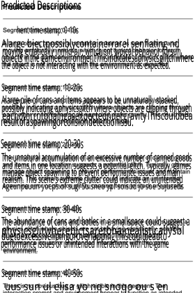

<!-- Start of picture text -->
Predicted Descriptions hent time stamp: 0-10s Alarge bjectpossiblycontainerrarel senflating nd moving erratically inmid-air, whichisnt typical behavior forsuh objects inthe gameenvironmentThisindicatesaphysicsglitchwhere the object is not interacting with the environment as expected. Segment time stamp: 10-20s Alarge pile of cans and items appears to be unnaturally stacked, possibly indicating aphysicsgltch where objects are clipping through eachothrrntbhaingasexpectedndergravityThiscouldbea resultofaspawingorcollsiondetectionissu. Segment time stamp: 20-30s The unnatural acoumulation of an excessive number of canned goods and items in one location suggests a potential gltch. Typically, games manage object spawning to prevent performance issues andmain realism. This scene's extreme clutter could indicate an unintended Ageunpeuun yoeps of sugi Suisneo ypf soisud jo soe Sujuseds Segment time stamp: 30-40s The abundance of cans and botles in a smallspace could suggest a physicsglitwherebjctsaretbhainealisticallysbl duetoexcessivelipingoroverlappingThiscouldleadto performance issues or unintended interactions with the gameenvironment. Segment time stamp: 40-50s  uus sun ul elisa yo nq snoqo ou s en <!-- End of picture text -->

**Figure 10: Annotation interface used for VideoGlitchBench.** 

Open-Ended Video Game Glitch Detection with Agentic Reasoning and Temporal Grounding 

ACM Multimedia 2026, Rio de Janeiro, Brazil 

**Final report generation.** The Summarizer receives the list of GlitchRecord objects from the Grounder and generates the final structured report. Each record’s frame-level occurrences are converted to second-level timestamps using the extraction FPS of 4.0. The Summarizer model is configured with temperature 0.5 and max tokens 512. The output report is a JSON file containing the video name, game name, a boolean no_bugs flag, a list of naturallanguage bug descriptions, and a list of [start_sec, end_sec] time intervals corresponding to each bug. 

## **B.2 Tool Implementation** 

Table 7 demonstrates our tool library. Our agentic framework is equipped with three investigation tools — vqa, zoom_in, and object_tracking. For object_tracking, the SAM3 tracker is lazily initialized on first use and its session is shared across all windows in a batch; it is allocated to a separate GPU from the main VLM. 

## **B.3 Prompts for GliDe** 

We provide the core prompts used in our framework, including those for the Scanner, Planner, Reflector (Advocate, Skeptic, Judge), Grounder, and Summarizer. 

### **Scanner (Rough Detection) Prompt** 

**Role.** You are a video game QA expert performing initial glitch screening. 

**Input.** A stitched image of _𝑁_ consecutive frames, each labelled #0, #1, . . . in temporal order. 

**Task.** Read frames in sequence, track how objects and characters change across frames, and determine whether a glitch is present. Flag uncertain cases with low confidence rather than dismissing them—false negatives are more costly than false positives. **Glitch categories:** 

- _Visual_ : texture/lighting errors, model distortion, flickering, camera clipping. 

- _Physics_ : clipping through surfaces, abnormal launch or flight, floating, jittering. 

- _Game Logic_ : AI stuck, animation frozen while character moves, interaction failures. 

• _Other_ : network desync, projectile anomalies, unclassifiable behaviors. **Confidence scale.** 0.85–1.0 obvious; 0.65–0.85 clear with minor ambiguity; 0.45–0.65 suspicious; 0.25–0.45 ambiguous; 0.0–0.25 likely normal. Prefer flagging suspicious cases at 0.5–0.7 over dismissing them. 

**game_context field (required in every response).** Describe in 2–4 sentences the game genre, environment/setting, key visible elements, and observed mechanics. This field serves as a knowledge base for later stages. 

### **Output format:** 

{ 

- "visual_cues": "Red car at constant height in frames #4-7, no support", 

- "reasoning": "Floating without ground contact, violates gravity", 

- "frame_range": [4, 5, 6, 7], 

- "confidence": 0.87, 

- "game_context": "Open-world racing game. Urban road with traffic. ..." 

- } 

- // If no glitch: omit category/visual\_cues/frame\ _range; set has\_glitch to false. 

### **Planner Prompt** 

**Role.** You are the Planner in a video game glitch detection system. 

**Input.** The Scanner’s glitch hypothesis (category, visual_cues, confidence, game_context) and a history of prior tool calls with their results. 

**Task.** Select the next investigation tool and formulate a specific, neutral question. **Always call vqa on the first iteration. Available tools:** 

- vqa: Ask a visual question about the full stitched window image. 

- zoom_in: Crop and magnify a region of one or more frames, then ask a question. Use when full-frame VQA was vague or the glitch is spatially localized. Parameters: frame_index (int or list), region (spatial name or [x1,y1,x2,y2]), question. 

- object_tracking: Track an object using SAM3; returns frame-by-frame bounding boxes, speed, and anomaly flags (position jump, motion freeze, velocity spike, jitter). Use for Physics glitches when VQA evidence is ambiguous. Parameter: object_description—a short visual description of the object (e.g., “red sports car”), **not** a description of the glitch. 

**Question style.** Ask neutral, descriptive questions—not leading confirmations. 

- Wrong: “Is the car floating?” 

- Right: “Describe the car’s vertical position relative to the ground.” 

The **first question** must establish scene context: describe all visible objects, their appearance (color, shape, size), and what they are doing. 

**Strategy.** Iteration 1: always vqa. Iteration 2: prefer object_tracking for Physics, zoom_in for Visual/Animation. Iteration 3+: conclude unless the Judge ruled needs_more_evidence with a specific follow-up question. Never repeat the same question. **Output format:** 

- "has_glitch": true, 

- "category": "Physics|Visual|Game Logic|Other", 

ACM Multimedia 2026, Rio de Janeiro, Brazil 

Muyang Zheng, Tong Zhou, Geyang Wu, Zihao Lin, Haibo Wang, and Lifu Huang 

- { "reasoning": "...", "tool": "vqa", "question": "..." } 

- { "reasoning": "...", "tool": "zoom_in", " frame_index": 5, "region": "bottom_center", " question": "..." } 

- { "reasoning": "...", "tool": "object_tracking", " object_description": "red sports car" } 

- { "reasoning": "...", "tool": "none", "conclusion": "ready_to_conclude" } 

- (4) **Challenge visual grounding:** ask whether the anomaly is concretely visible in the tool result, or whether the Advocate is repeating the Scanner’s initial hypothesis without direct visual confirmation from the investigation. 

### **Output format:** 

#### { 

- "alternative_explanations": ["explanation 1", " explanation 2"], 

- "argument": "This could be normal because...", 

- "missing_context": ["need to check X"], 

- "confidence_for_normal": 0.45 

### **Reflector – Advocate Prompt** 

- } 

**Role.** You are the Advocate (prosecutor) in a video game glitch detection system. 

**Input.** Scanner’s glitch hypothesis and the current tool result (VQA answer, zoom result, or object tracking data). **Task.** Build a case for why the observed behavior is a glitch. 

- (1) Identify abnormal behaviors **directly visible in the tool result.** 

- (2) Explain why normal game mechanics cannot account for them. 

- (3) Cite the specific physics, visual, or logic being violated. 

- (4) Always include the **specific visual appearance** of the affected object (color, shape, type) so it can be distinguished from other objects. 

### **Output format:** 

{ 

- "supporting_evidence": ["evidence 1 with object appearance", "..."], 

- "affected_object_appearance": "Red sports car with black roof", 

- "argument": "This is a glitch because...", 

- "violated_rules": ["gravity", "collision"], 

- "confidence_for_glitch": 0.85 

- } 

### **Reflector – Judge Prompt** 

**Role.** You are the Judge (neutral arbiter) in a video game glitch detection system. **Input.** Advocate output, Skeptic output, and the full tool result. 

### **Task.** 

- (1) **Visual grounding check (do this first).** Verify that the alleged anomaly is directly observable in the tool results. If the Advocate’s argument rests on the Scanner hypothesis rather than concrete investigation evidence, treat it as unsubstantiated. 

- (2) Evaluate both sides and rule: **glitch** (anomaly directly visible; Advocate provides specific evidence; Skeptic’s explanations are implausible); **normal** (Skeptic provides a plausible explanation). 

- (3) Correct the glitch category if evidence points to a different type. 

**Confidence scale.** 0.85–1.0 overwhelming; 0.70–0.85 strong; 0.55–0.70 leaning with uncertainty; below 0.55 genuinely ambiguous. 

### **Output format:** 

- { 

### **Reflector – Skeptic Prompt** 

**Role.** You are the Skeptic (defense) in a video game glitch detection system. 

**Input.** The Scanner’s glitch hypothesis and the current tool result (VQA answer, zoom result, or object tracking data). 

**Task.** Build a case for why the observed behavior is intentional game design. 

- (1) Propose alternative explanations (game mechanics, special abilities, physics features, art style choices). 

- (2) Identify missing context that could explain the behavior. 

- (3) Point out ambiguities in the evidence. 

- "advocate_summary": "...", "skeptic_summary": 

   - "...", 

- "ruling": "glitch | normal", 

- "reasoning": "The evidence favors X because...", 

- "category": "Physics|Visual|Game Logic|Other", 

- "category_corrected": false, "correction_reason": 

   - "(if corrected)", 

- "subtype": "Floating|Clipping|...", 

- "final_confidence": 0.78, "should_continue": false, 

- "next_questions": ["question 1"] 

- } 

- // When ruling="glitch" and should_continue=false, also include: 

{ 

Open-Ended Video Game Glitch Detection with Agentic Reasoning and Temporal Grounding 

ACM Multimedia 2026, Rio de Janeiro, Brazil 

"description": "Object appearance + what the glitch looks like + scene location.", "supporting_evidence": ["..."], " rejected_explanations": ["..."] 

} 

### **Grounder – Glitch Clustering Prompt** 

**Task.** Determine whether the given anomaly description belongs to an existing glitch cluster. **Criteria for similarity:** (1) similar entities—allow for minor observation variance; (2) similar anomaly type (physical, visual, animation); (3) similar abnormal behavior (e.g., float/flying, clipping/collision). 

**Input.** anomaly_description (new glitch) + existing_descriptions (cluster, in time order). **Output format:** 

- { "reasoning": "step-by-step similarity analysis", " judgement": "yes | no" } 

### **Grounder – Bidirectional Propagation Prompt** 

**Task.** Detect whether the following anomaly (or a similar one) is visible in the provided window image. Used to expand the temporal boundary of a confirmed glitch. **Criteria for similarity:** (1) similar entities ((objects, characters, creatures)) — might differ slightly due to observation variance; (2) similar anomaly type (physical, visual, animation). **Input.** anomaly_description (confirmed glitch) + stitched window image. 

### **Output format:** 

- { "reasoning": "step-by-step visual analysis of the image", "judgement": "yes | no" } 

### **Summarizer – Final Report Generation Prompt** 

**Role.** You are a video game glitch analyst. **Input.** 

Descriptions (chronological, same glitch): { descriptions} Category: {category} | Subtype: {subtype} | Time range: {time_range} 

- (3) **Do not include** frame numbers, timestamps, JSON, or code blocks. 

- (4) Use natural, descriptive language. 

**Output.** The summarized description only, without any additional text. 

## **B.4 Example Execution Trace** 

To better illustrate how GliDe operates in practice, we present a detailed execution trace on a representative example with multiple glitches. This case involves both collision-related errors (clipping through solid structures) and physics anomalies (launching and disappearance), making it a challenging scenario for reliable detection and grounding. 

The example highlights the full pipeline of GliDe, including highrecall candidate screening, iterative verification with tool-assisted reasoning, and temporal grounding across disjoint segments. In particular, it demonstrates how the framework rejects false positives through multi-step reasoning (e.g., Window 0), while leveraging tools such as VQA and object tracking to resolve harder cases. The Grounder further consolidates fragmented detections into coherent glitch reports with accurate temporal spans. 

### **Execution Trace Example of GliDe** 

**Game:** Steep **Video:** 5dq755.mp4 **Ground Truth:** 

- Clipping through wooden structures (collision failure). 

- Timestamps: [0, 5], [12, 15] 

- Character deformation / teleportation. Timestamps: [5, 6], [8, 15] 

**1. Rough Detection** 

[W0] GLITCH (Visual, 0.75) – airborne anomaly [W1] GLITCH (Physics, 0.78) – clipping through barrier [W2] GLITCH (Physics, 0.75) – abnormal motion [W3] GLITCH (Physics, 0.75) – unrealistic interaction [W4] GLITCH (Physics, 0.75) – falling through terrain [W5-7] No glitch 

- → 5 candidate glitch windows detected, covering both potential clipping and motion anomalies. 

**Game-aware context** : Action-adventure game with snowy mountain terrain. The player character, dressed in a blue outfit, seems to be exploring or interacting with the environment, as indicated by the presence of an exploration camera icon. 

**2. Fine-grained Verification** 

### **Window 0** 

Iteration 1: 

**Task.** Summarize the fragmented descriptions into a single, clear, coherent description for the final report. 

- (1) Identify the core glitch phenomenon across all descriptions. 

- (2) Write one coherent paragraph (2–4 sentences) that describes the visual/behavioral anomaly, mentions the **specific appearance** of the affected object, and states where in the scene it occurs. 

- _Planner_ → VQA: "Describe ground interaction" 

- Answer: Character appears sliding/falling with continuous ground contact _Advocate_ : glitch (possible hovering / missing collision) _Skeptic_ : normal (intentional sliding or terrain interaction) _Judge_ : **NORMAL** (confidence = 0.65, below threshold) Iteration 2: 

ACM Multimedia 2026, Rio de Janeiro, Brazil 

Muyang Zheng, Tong Zhou, Geyang Wu, Zihao Lin, Haibo Wang, and Lifu Huang 

|-_Planner_ →zoom-in (ground contact region)|
|---|
|- Observation: no clear rendering or contact anomaly →After multiple iterations (max=5), no strong evidence of rule violation **Final decision: NORMAL (false positive rejected)** **Window 1–2** i|
|-_Planner_ →VQA verification|
|- Evidence: character penetrates wooden barrier without|
|resistance→Violates collision constraint.|
|**Confirmed clipping glitch** **Window 3**|
|-_Planner_ →VQA verification |
|- Evidence: motion inconsistent with expected gravity- driven trajectory→Indicates unstable physics behavior.|
|**Confirmed physics glitch** **Window 4**|
|-_Planner_ →object tracking|
|- Observation: tracked character abruptly disappears mid-|
|trajectory →Strong evidence of physics engine failure|
|(trajectory discontinuity).|
|**Confirmed physics glitch** **3. Temporal Localization**|
|Initial clustering based on semantic similarity: - Cluster 1: [W1, W2] (clipping-related)|
|- Cluster 2: [W3, W4] (teleportation-related)|
|Bidirectional propagation with visual consistency check: - Cluster 1→[W1, W2, W4, W5, W6]|
|- Cluster 2→[W2, W3, W4, W5, W6, W7] →Expands temporal coverage to capture long-range and recurring glitches.|
|**4. Final Glitch Report Generation**|
|Bug 1 (Clipping): Character phases through a wooden bar- rier, violating collision constraints. Timestamps: [2–5], [8– 13]|
|Bug 2 (Teleportation): Character launches and disappears|
|without physical cause. Timestamps: [4–15]|

