# **VideoGameQA-Bench: Evaluating Vision-Language Models for Video Game Quality Assurance** 

**Mohammad Reza Taesiri** 

**Abhijay Ghildyal** 

University of Alberta, CA Sony Interactive Entertainment, Aliso Viejo, US mtaesiri@gmail.com abhijay.ghildyal@sony.com 

**Saman Zadtootaghaj** 

**Nabajeet Barman** 

Sony Interactive Entertainment, Berlin, Germany Sony Interactive Entertainment, London, UK saman.zadtootaghaj@sony.com nabajeet.barman@sony.com 

**Cor-Paul Bezemer** 

University of Alberta, CA bezemer@ualberta.ca 

### **Abstract** 

With video games now generating the highest revenues in the entertainment industry, optimizing game development workflows has become essential for the sector’s sustained growth. Recent advancements in Vision-Language Models (VLMs) offer considerable potential to automate and enhance various aspects of game development, particularly Quality Assurance (QA), which remains one of the industry’s most labor-intensive processes with limited automation options. To accurately evaluate the performance of VLMs in video game QA tasks and determine their effectiveness in handling real-world scenarios, there is a clear need for standardized benchmarks, as existing benchmarks are insufficient to address the specific requirements of this domain. To bridge this gap, we introduce VideoGameQA-Bench, a comprehensive benchmark that covers a wide array of game QA activities, including visual unit testing, visual regression testing, needle-in-a-haystack tasks, glitch detection, and bug report generation for both images and videos of various games. Code and data are available at: https://asgaardlab.github.io/videogameqa-bench/. 

### **1 Introduction** 

The global video game industry continues to expand rapidly, with its market value projected to reach $257 billion by 2028 [11]. Alongside this substantial growth, the process of developing highquality video games remains inherently complex and demanding. A critical challenge within game development is to ensure visual quality and consistency through a rigorous visual testing and quality assurance (QA) process. Automation of visual QA tasks remains particularly challenging [6, 23, 25, 29, 31, 37, 39, 43–45, 47, 55, 67] and currently, most visual QA relies heavily on manual inspection, making the process time-consuming, costly, labor-intensive, and prone to human error [35, 36]. 

The visual QA process for video games can generally be abstracted into three main types of tasks: (1) **verifying scene integrity** by comparing the visual representation of scenes against intended configurations and known reference states, such as an oracle (Fig. 1-a) or previously rendered versions of the same scenes (Fig. 1-b); (2) **detecting glitches** through open-ended exploration—these glitches are unintended gameplay (Fig. 1-e) or visual artifacts (Fig. 1-h) without specific reference points, requiring testers to rely on common sense and general knowledge for detection; and (3) **systematically** 

Preprint. 

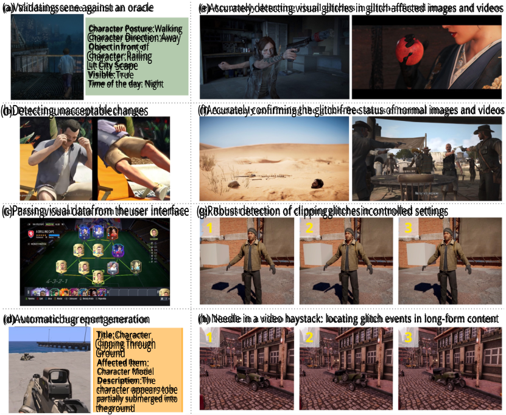

<!-- Start of picture text -->
(a)Validatingscene against an oracle (e)Accurately detecting visual glitches in glitch-affected images and videos Character Posture:Walking Character Direction:Away Objectinfront of Character:Railing Lit City Scape Visible:True Time of the day: Night (b)Detectingunacceptablechanges (f)Accurately confirming the glitch-free status of normal images and videos (c)Parsingvisual datafrom theuser interface (g)Robust detection of clippingglitchesincontrolled settings (d)Automaticbugreportgeneration (h) Needle in a video haystack: locating glitch events in long-form content Title:Character Clipping Through Ground Affected Item: Character Model Description:The character appears tobe partially submerged into theground <!-- End of picture text -->

Figure 1: Sample tasks from VideoGameQA-Bench. (a) A **unit test** where the model should verify small details in the image, such as character’s orientation and background. (b) A **visual regression test** where the model should detect unacceptable changes between two versions of the same scene. (c) A **UI unit test** in which the model must visually verify user interface components, such as a chemistry graph between players. (d) A **bug report generation task** where the model needs to generate a bug report for a glitch. (e) Two **glitch detection** tasks, where the model must identify visual anomalies, such as unnatural body configuration (left) or object clipping (right, fingers clipping the apple). (f) Two **glitch detection** tasks, where the model is required to verify the glitch-free status of images with intentional object clipping and high scene complexity. (g) A **parametric test** that evaluates whether the model can detect clipping at various object proximities. (h) A **needle-in-ahaystack task** , which requires the model to identify the first frame in which a glitch occurs. 

**reporting and documenting** all identified glitches (Fig. 1-d) , ensuring developers receive clear and actionable information to address problems effectively during game development. 

Recent advancements in vision-language models (VLMs) [3, 9, 16, 32, 68] present promising opportunities to automate and significantly enhance the efficiency of video game QA. However, progress in applying VLMs to game QA has been limited by the lack of standardized benchmarks. Current multimodal benchmarks tend to focus heavily on complex mathematical or textual reasoning tasks [27, 61, 62], overlooking essential visual comprehension tasks fundamental to video game QA. Similarly, existing game-specific benchmarks [5, 45–47] often represent only narrow aspects of QA tasks, thus inadequately evaluating and tracking VLM performance across diverse QA scenarios. 

In this paper, we introduce VideoGameQA-Bench, a benchmark designed to fill the gap in evaluating VLMs for video game QA. Our key findings and contributions are as follows: 

1. We present VideoGameQA-Bench featuring 9 distinct tasks and 4,786 questions designed considering real-world video game development scenarios, such as visual unit testing, regression testing, UI validation, video needle-in-a-haystack, and glitch detection. 

2 

2. While VLMs show promising performance on various multimodal benchmarks and can function as OCR systems, they perform poorly at detecting fine details required for accurate scene understanding and parsing complex UI elements. (Sec. 5.1) 

3. Frontier VLMs show good performance on the glitch detection task using images (up to 82.8%) and videos (up to 78.1%); however, all struggle when it comes to glitches related to body configuration, intricate object clipping, and common-sense reasoning. (Sec. 5.2) 

4. Visual regression testing remains one of the most challenging tasks for VLMs. (Sec. 5.3) 5. Locating specific glitch moments in videos remains a challenge, both in detecting and accurately pinpointing the glitch. (Sec. 5.4) 

6. Frontier VLMs can generate useful bug reports for up to 50% of real-world glitches, providing accurate and descriptive summaries of the glitches. (Sec. 5.5) 

### **2 Background** 

We use _glitch_ as an umbrella term for unintended, user-visible anomalies that occur during gameplay. The anomalies we consider are visually evidenced in images or videos. This includes both (i) lowlevel graphical defects directly observable in pixels and (ii) higher-level scene inconsistencies that violate physics, gameplay logic, or common sense but still manifest visually (e.g., an NPC floating mid-air). Non-visual anomalies (e.g., audio-related anomalies) are out of scope for our evaluation. 

To balance clarity for readers, we group glitches into two broad families based on how they appear in images or videos; the categories are not mutually exclusive, and a single failure can exhibit traits of both. We make this choice to help readers interpret the examples more easily, since industry taxonomies—often organized by underlying cause such as rendering, physics, or AI logic—do not always align with what can be directly observed in visual data. 

**Graphical glitches :** Local, pixel- or geometry-level failures in image formation that degrade visual fidelity without necessarily changing the intended scene semantics. 

- Missing or corrupted assets/textures: gray/purple “checkerboard” materials, blacked-out meshes, texture swimming/smudging (Sec. F.1). 

- Geometry and rasterization issues: z-fighting, exploded or inside-out meshes, vertex normal errors, shadow acne (Sec. F.2). 

- Temporal instability: flicker between LODs/materials, aliasing or shimmer that persists across frames (Sec. F.3). 

- Post-processing and UI artifacts: ghosting, overdraw halos, HUD elements duplicated/misalaligned, compression/mipmap artifacts (Sec. F.4). 

**Logical (semantic) glitches:** Visually coherent pixels arranged into scenes that violate physics, gameplay rules, or commonsense, yielding contextually incorrect outcomes. 

- Physics and collision failures: character or props intersecting walls (“clipping”), falling through floors, floating objects, zero-gravity actors (Sec. F.5). 

- Animation/state errors: frozen T-poses, limb contortions, mocap desync, ragdolls snapping upright, rapid teleportation/jumps (Sec. F.6). 

- World and rule violations: doors open with no trigger, enemies spawn inside the player, items duplicate or vanish without effect (Sec. F.7). 

### **3 VideoGameQA-Bench** 

We designed VideoGameQA-Bench ’s tasks by simulating realistic QA scenarios encountered during actual video game development. However, to make the benchmark more relevant for future QA automation tasks, we also included tasks that may challenge current software engineering practices while also remaining highly relevant. Tab. 1 gives an overview of the contents of each task. In summary, VideoGameQA-Bench contains 2,236 image-based samples and 1,200 video-based samples from more than 800 games and 9 synthetic game scenes. 

3 

#### **3.1 Tasks** 

#### **Image-Based Tasks** 

1. **Visual unit testing** : Visual unit tests verify visual attributes including presence, placement, positioning, colors, conditions, and other relevant properties of various image elements. 

2. **UI unit testing** : UI (visual) unit tests verify in-game UI elements such as menus, subtitles, heads-up displays (HUDs), and interface components like graphs and charts. We simulate the (UI) unit testing tasks by asking the VLM questions about game screenshots. 

3. **Visual regression testing** : Visual regression tests check for unintended visual changes after a change to the game. A simple pixel-by-pixel comparison of two screenshots is not sufficient, as some variations (e.g., because of character customization or weather conditions in the game) may be acceptable. Visual regressions may occur in cinematic parts of the game, such as cutscenes that have a defined sequence flow. We simulate this task by asking the VLM to compare whether two screenshots are similar, taking into account the specified (un)acceptable variations. 

4. **Glitch detection** : Glitch detection is the process of identifying unintended visual errors, such as rendering issues, clipping, or physics/logical bugs that express themselves visually. We simulate this task by asking the VLM whether glitch and glitch-free images contain a glitch. 

5. **Parametric clipping detection** : Given the common occurrence of clipping in games, our benchmark includes a dedicated task to evaluate a model’s ability to detect such glitches. In this task, images feature an object (e.g., a cube, sphere, or character) positioned at varying distances from a human character – from far apart to fully overlapping/clipping. The VLM is asked whether it detects clipping across each of these distances. 

6. **Bug report generation** : In addition to testing/detection tasks, a potential application of VLMs is to assist QA engineers with writing reports for detected bugs. We simulate this task by asking the VLM to write a description of a glitch image that can be used in a bug report. 

#### **Video-Based Tasks** 

1. **Glitch detection** : Glitch detection in videos can be done to verify (autonomous) gameplay sessions from bots. Detecting glitches in videos is significantly more complex due to challenges such as analyzing motion (patterns), and may require identifying transient glitches that appear only briefly in a few frames. We simulate this task by asking the VLM whether it detects a glitch in a video. 

2. **Needle-in-a-haystack (NIAH)** : NIAH is a more challenging long-context retrieval [53, 66] version of the glitch detection task. We simulate this task by asking the VLM whether it detects a glitch in a video, and in which frame the glitch occurs for the first time. 

3. **Bug report generation** : In this task, the VLM is asked to provide a description of a glitch video that can be used in a bug report. 

#### **3.2 Data Collection** 

We constructed VideoGameQA-Bench using real-world and synthetic sources to ensure diversity, realism, and controlled conditions. We next detail the composition and collection processes for each data type. It should be noted that the data collection process was solely carried out by researchers from the University of Alberta. 

**Real-world samples** : We sourced real-world data for the visual & UI unit testing, glitch detection and bug report generation tasks. For image-based tasks, we gathered diverse screenshots from the Steam Community ( ) image gallery. To find images with possible glitches, we used keyword search to find recent images tagged with the word “bug”. For the video-based glitch detection task, we utilized gameplay videos from the GamePhysics ( ) dataset [45]. To complement this set with glitch-free videos, we randomly extracted 15-second gameplay videos—matching the median duration of videos in the GamePhysics dataset—from gameplay walkthroughs available on YouTube ( ). We also randomly selected 100 images and 100 videos from these sets for the bug report generation task. 

**Synthetic samples** : We used the Unity ( ) game engine to create synthetic samples for tasks requiring controlled settings. For the clipping detection task, we systematically varied the spatial proximity 

4 

Table 1: Overview of tasks, their data sources, and expected format/contents of the responses to the <u>questions in VideoGameQA-Bench.</u> All responses must be formatted in JSON. 

|**Type **|**Task**|**_N_ Source**|**Diversity**|**Annotation **|**Expected Response**|**Samples**|
|---|---|---|---|---|---|---|
||Visual unit|100|92 games|,|Object properties|Sec.H.1|
|**ge**|UI unit|100|94 games|,|UI properties|Sec.H.2|
|**Ima**|Visual regression|250|9 scenes|,|Pass/fail|Sec.H.3|
||Glitch detection|1,000|507 games||Detected/not detected|Sec.H.4|
||Parametric clipping det.|686|9 scenes, 4 games||Clipping/not clipping|Sec.H.5|
||Bug-report generation|100|61 games||Free-format description|Sec.H.6|
|**eo**|Glitch detection|1,000|778 games||Detected/not detected|Sec.H.7|
|**Vid**|NIAH|100|9 scenes||Detected/not detected + frame number|Sec.H.8|
||Bug-report generation|100|70 games||Free-format description|Sec.H.9|

between 3D objects within Unity scenes. A human character model is positioned centrally, and we incrementally moved other objects—including a cube, sphere, 2D plane, and another character—from an initial distance of 15 units towards the central character. This movement continued progressively until the objects fully clipped into and became embedded within the character model. 

For the NIAH task, we created 50-second gameplay clips in Unity and intentionally injected glitches as the “needle” at known timestamps. For this set, we used four types of glitches: (1) _flickering_ , which causes parts of a game object to flicker rapidly; (2) _sudden disappearance_ , where an object suddenly vanishes; (3) _object jump_ , where a game object is rapidly thrown into the air; and (4) _missing texture_ , where the texture of a game object is missing. 

**Mix of real-world and synthetic samples** : For the visual regression testing task, we combine Unity-generated content with cutscene glitches sourced from YouTube videos. We selected nine distinct scenes from the Unity Asset Store, generating modified versions by randomly removing specific objects. We then paired captured images from these modified scenes with images from their unaltered reference versions. We further augmented this set with 70 glitch instances from cutscenes in various games on YouTube. Here, frames from glitched cutscene recordings were matched with corresponding frames from the glitch-free cutscenes, creating a dataset of paired frames. 

#### **3.3 Data Annotation and Label Verification** 

**Manual annotation and verification** : We ( ) manually reviewed the collected images and videos, labeling them as either glitch or glitch-free. For bug report generation, we include a brief description of the glitch. 

We followed a multi-step verification process, regardless of existing labels or annotations. All images and videos underwent a sequential review involving three authors to validate their quality and confirm accurate labeling. This process helped prevent the propagation of incorrect annotations from previous datasets into VideoGameQA-Bench. 

**VLM and human in the loop** : Visual unit tests and UI unit tests require constructing both the question and the answer. For these tasks, we used Gemini-2.5-Pro ( ) to initially draft a set of questions based on comprehensive instructions (Sec. B). We then analyzed the drafted questions, merged and refined them, and fixed the ground truth to create a final question based on the initial samples provided by Gemini-2.5-Pro. 

**Automated annotation** : For synthetic data generated via Unity, we exported annotations directly from the Unity game engine. This ensured exact alignment between the annotations and the visual state of the images or videos, precisely indicating the presence or absence of glitches. For example, for the NIAH samples, a dedicated C# script systematically starts the recording, injects a glitch at a random timeframe, and exports both the videos and timestamps. 

5 

**JSON structure** : To facilitate interoperability and automation, we explicitly enforce that all ground truth labels (and therefore, each expected model output) in our dataset are valid JSON objects. To guide the models toward the desired JSON schema, each question includes an empty JSON template, and we instruct the model to return its final response in that format. 

To avoid suppression of chain-of-thought (CoT) [54], we include a _Reasoning_ field in the JSON response, allowing the model to use the allocated space to “think” [2] before returning the response for tasks that require heavy reasoning. All tasks, except for visual (UI) unit tests, contain this field. 

### **4 Experiments** 

**VLMs** : We evaluated a total of 11 proprietary and 5 open-weight models on VideoGameQA-Bench. Our evaluation includes both standard models and those designed for extended reasoning [1, 8, 42, 58]. 

**Prompting videos** : Only the Gemini family accepts video as a native input format; other models process videos as sequences of frames. To evaluate non-Gemini models, we sample one frame per second for all video-based tasks. For open-weight models, we reduce the sampling rate to ensure they can handle the images (see Sec. A for details). 

**Video frame sampling rate** : We adopted a uniform sampling strategy of 1 FPS, meaning that each second of gameplay contributes one frame to the evaluation input, ensuring fairness across models with varying input constraints. 

**Glitch visibility at low FPS** : Since most evaluated models cannot process long frame sequences, we standardized video sampling at 1 FPS. To verify that this downsampling does not obscure anomalies, we manually reviewed a subset of glitch-containing videos and found that in 95% of cases, the glitch remained clearly visible at 1 FPS. 

**Valid JSON output** : All benchmark questions explicitly require models to output responses in a valid JSON format. Any responses not in JSON or containing malformed JSON structures will be disregarded, even if the model’s output is only slightly different from the ground truth label. 

**LLM-as-a-judge** : Both bug-reporting tasks require models to generate descriptive bug reports based on provided glitchy images or videos. Evaluating these reports poses challenges due to their open-ended nature, making human verification or an LLM-based judge necessary. Following recent literature [17], we use an LLM-based judge, specifically the OpenAI o3 model, to assess the accuracy of the generated reports by comparing them to textual ground truth references detailing the glitches. Details about prompt construction are available in Sec. E. 

**Model ranking** : We ranked models by averaging accuracies across image and video tasks. Task-wise accuracies were first averaged within each type, then combined for the final score. 

Details regarding model inference and prompt design are provided in Secs. A, C and D. 

### **5 Results** 

Tab. 2 summarizes results across all benchmark tasks; we highlight key findings and examine model strengths and limitations in the remainder of this section. All models reliably produced task-specific JSON outputs, with malformed responses being rare and mostly limited to complex UI and unit-test tasks. Detailed statistics on model refusal rates and malformed outputs are provided in Sec. G.3. 

#### **5.1 VLMs Mostly Fail to Detect, Translate, and Represent Intricate Scene Details** 

**Why does this matter** : In software engineering, _unit tests_ are assertions that verify an isolated piece of code behaves as intended. Applying the same discipline to rendered frames is equally valuable: _visual unit tests_ can assert that the appearance and on-screen text of visual elements (including the UI) meet a specification. VLMs could make this practical: when prompted with a specific image, they can describe fine-grained visual details (e.g., a character’s attire or pose) and read textual elements. This capability would allow tests to compare these outputs against reference descriptions, flagging mismatches early in the pipeline. 

6 

Table 2: Accuracy (%) scores of models on VideoGameQA-Bench. **VU** : Visual unit testing; **UI** : UI unit testing; **VR** : Visual regression testing; **IGD** : Image-based glitch detection; **PCD** : Parametric clipping detection; **IBR** : Image-based bug report generation; **VGD** : Video-based glitch detection; **NIAH** : Needle-in-a-haystack; **VBR** : Video-based bug report generation. Numbers highlighted with _†_ indicate that the score for the NIAH task was set to 0. The _Total_ column shows the mean of the average scores from the image and video tasks. 

||||Im|age||||Video|||Average||
|---|---|---|---|---|---|---|---|---|---|---|---|---|
||VU|UI|VR|IGD|PCD|IBR|VGD|NIAH|VBR|Img.|Vid.|Total|
|**_Model / # Samples_**|100|100|250|1,000|686|100|1,000|100|100|2,236|1,200|3,436|
|GPT-4.1|43.0|28.0|28.8|81.3|**87.8**|51.0|75.8|19.0|51.0|**53.3**|48.6|**51.0**|
|GPT-4.1-mini|42.0|30.0|20.4|76.8|66.9|46.0|71.8|10.0|26.0|47.0|35.9|41.5|
|GPT-4.1-nano|9.0|14.0|19.2|57.0|66.9|16.0|49.1|4.0|14.0|30.4|22.4|26.4|
|GPT-4o|39.0|23.0|31.6|**82.8**|82.5|**54.0**|57.0|1.0|**52.0**|52.2|36.7|44.4|
|o4-mini|50.0|35.0|**45.2**|76.4|65.0|38.0|70.0|18.0|28.0|51.6|38.7|45.1|
|o3|43.0|28.0|39.6|73.7|80.5|53.0|76.8|13.0|45.0|53.0|44.9|48.9|
|Gemini-2.5-Pro|**53.0**|**40.0**|30.8|75.4|72.2|33.0|**78.1**|34.0|36.0|50.7|**49.4**|50.0|
|Gemini-2.5-Flash|47.0|24.0|26.4|66.3|72.2|24.0|64.7|35.0|23.0|43.3|40.9|42.1|
|Gemini-2.0-Flash|44.0|28.0|12.0|68.1|78.0|20.0|54.5|**36.0**|26.0|41.7|38.8|40.3|
|Sonnet-3.7|23.0|22.0|24.0|65.1|76.4|29.0|66.9|31.0|22.0|39.9|40.0|39.9|
|Sonnet-3.5|23.0|29.0|14.0|70.1|72.9|33.0|61.2|27.0|26.0|40.3|38.1|39.2|
|Llama-4-Scout|32.0|23.0|13.6|55.8|71.6|8.0|58.6|–|5.0|34.0|21.2_†_ |27.6_†_ |
|Llama-4-Maverick|21.0|22.0|18.4|53.2|65.7|7.0|56.6|–|15.0|31.2|23.9_†_|27.5_†_|
|Gemma-3(27B)|12.0|12.0|12.8|46.7|69.7|10.0|51.3|–|9.0|27.2|20.1_†_ |23.6_†_ |
|Mistral-Small-3.1(24B)|15.0|17.0|25.6|59.7|62.5|9.0|61.4|–|14.0|31.5|25.1_†_ |28.3_†_ |
|Qwen-2.5-VL(72B)|38.0|27.0|21.2|70.0|76.0|19.0|47.9|–|17.0|41.9|21.6_†_|31.7_†_|

**Results** : Our experiments show that VLMs consistently struggle with fine-grained details, particularly when tasked with translating specific details and properties of objects, as well as reading charts, text, and other information in the scene. On both the visual and UI unit testing tasks, all models perform poorly, with Gemini-2.5-Pro being the best model (53.0% on visual and 40.0% on UI unit testing). 

VLMs often struggle with fine-grained scene understanding, especially when it comes to interpreting object configuration, spatial relationships, and subtle visual cues [19]. They frequently misinterpret character posture (e.g., number of visible eyes, hand position, or orientation), object placement (e.g., whether an object is inside or outside a room), and the state of elements like whether a car door is open or closed (Fig. A19). These errors are more pronounced when properties are small or visually ambiguous, though failures also occur in clearer scenarios. Even seemingly simple tasks—like determining the direction an object is facing or counting elements—often lead to inconsistent results, highlighting limitations in current model capabilities for detailed visual reasoning. 

Despite the promising performance of VLMs for OCR tasks [30, 41], accurately extracting structured information from complex game UI elements remains a significant challenge. While VLMs handle plain text and simple interfaces like basic game menus reasonably well, their performance declines with layouts involving large tables, progress bars, and elements such as minimaps. Interpreting charts and graphs with interconnected nodes and edges is also unreliable, as models consistently struggle to follow edges in the graph and understand the information presented in this format (Fig. A20). 

Our findings align with prior studies highlighting the limitations of VLMs in fine-grained perception and spatial reasoning [38, 49]. Improvements in spatial reasoning and localization are essential before VLMs can be reliably used in detail-sensitive tasks like visual (UI) unit testing. 

#### **5.2 VLMs Can Detect Many Visual Glitches, But Struggle with Certain Types** 

**Why does this matter** : Glitch detection is a core component of game QA, often requiring extensive manual review due to the complexity and variety of visual errors that can arise during gameplay [20]. Leveraging VLMs for glitch detection could greatly reduce the need for manual review. 

**Results** : VLMs, especially proprietary ones, demonstrate good performance in identifying visual glitches (e.g., with GPT-4o achieving an accuracy of 82.8%). This shows a step forward in glitch detection capability: prior work showed that the best-performing model could reach a glitch detection accuracy of only 57.2% [47]. The best-performing open-weight model, Qwen-2.5-VL, achieves an 

7 

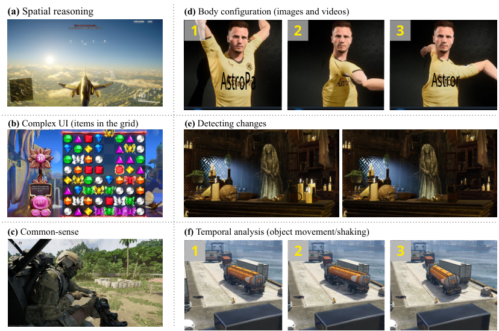

<!-- Start of picture text -->
(a)  Spatial reasoning (d)  Body configuration (images and videos) 1 2 3 AstroPa Astror (b)  Complex UI (items in the grid) (e)  Detecting changes (c)  Common-sense (f)  Temporal analysis (object movement/shaking) 1 2 3 <!-- End of picture text -->

Figure 2: Samples from challenging cases that most VLMs consistently struggle with. (a) Failure to understand **spatial reasoning** , such as object orientation (whether an airplane is facing toward the camera or away). (b) Failure to read **UIs with complex layouts** and **objects arranged in grids** . (c) Failure to detect **common-sense inconsistencies** , such as a missing gun in the hand. (d) Failure to detect **unnatural body configurations** . (e) Failure to detect **missing foreground objects** (candles). (f) Failure to detect and analyze **object movement** such as shaking or bouncing. 

accuracy of 70.0% matching the performance of Sonnet-3.5. In contrast, Gemma-3 labels nearly all samples as “glitch,” resulting in 100% recall but less than 2% specificity. Conversely, Llama-4Maverick and Llama-4-Scout label almost all samples as “clean,” exhibiting recall at or below 14% and specificity exceeding 95%. Further details on performance metrics are provided in Sec. G.4. 

In the video-based setting, Gemini-2.5-Pro achieves the highest performance at 78.1%. Compared to image-based tasks, proprietary models generally perform slightly worse on this task: GPT-4.1 (–5.5), o4-mini (–6.4), with the exception of o3 (+3.1) and Gemini-2.5-Pro (+2.7). 

A major limitation observed across models in video-based glitch detection is that they process individual frames rather than entire videos natively, resulting in the loss of temporal context and audio signals (Fig. 2-f). Additionally, some models, such as GPT-4o, frequently refuse to generate valid responses to video-based queries. 

During our manual analysis, we observed that certain types of visual glitches remain particularly challenging for even the best-performing model, in both image- and video-based settings: 

1. **Unusual body configuration** : Characters appear with highly unnatural joint alignments or distorted poses, typically resulting from _ragdoll_ physics simulations or incorrect animation states (e.g. an unusual position of hands or arms in Fig. 1-e and Fig. 2-d). 

2. **Intricate object clipping** : Two or more objects intersect slightly, for example, characters rendered in overlapping positions, props penetrating hands, or limbs passing through solid geometry (e.g. an apple clipping with a hand in Fig. 1-e). 

3. **Semantic glitches** : Contextual inconsistencies that require common-sense reasoning to interpret. For instance, a character may appear to be holding a weapon based on their posture, but the weapon is either missing or fails to render properly (Fig. 2-c). 

We used o3 to identify common patterns among false-positive cases produced by the top-performing models. Specifically, we prompt o3 to summarize the _reasoning_ field from the JSON outputs of 

8 

GPT-4o, GPT-4.1, and Gemini-2.5-Pro. The most common false-positive patterns stem from model hallucinations about clipping glitches that do not actually exist (Secs. G.6 and G.8). To further stress-test the models for clipping glitches, we conducted parametric clipping detection to analyze model behavior across various distances and complexities. 

Our parametric test shows that while models can generally detect clipping glitches, they lack robustness. In particular, on borderline cases (i.e. where two objects only slightly overlap), models usually fail to recognize clipping issues. For example, although GPT-4.1 —achieving 87.8%—is the most robust model, it still consistently fails to detect such boundary cases (Sec. G.11). 

Despite the improvements in glitch detection performance, fully autonomous glitch detection using only VLMs might not yet be feasible for real-world use. High false-positive rates (see Sec. G.4 for details) continue to pose a significant issue, potentially overwhelming human testers with unnecessary reviews, especially given that most frames in real-world gameplay are glitch-free. Additional considerations for real-world applicability are discussed in Sec. G.5. 

#### **5.3 VLMs Are Bad at Visual Regression Testing** 

**Why does this matter** : Verifying an image against a previously approved reference is a highly desirable form of testing in computer graphics and video games [13, 48, 50]. This need is especially acute in video games, where recurring sequences often include customizable elements, such as character appearances, or dynamic environmental changes like day/night cycles and weather variations. Recent advancements in image comparison capabilities of VLMs [3, 21, 63, 68] show that VLMs may be well-suited to this task because, through carefully designed prompts and in-context examples, we should be able to effectively _program_ them to ignore permissible variations, such as changes in weather or lighting, while still verifying all other critical aspects of the image. 

**Results** : Our results indicate that visual regression testing with VLMs does not yet perform well: o4-mini, the best-performing model, achieves an accuracy of 45.2%. Qualitative analysis further shows that all models consistently fail to detect a range of changes, whether subtle, like an object in the background (Fig. A39), or pronounced, close to the camera (Fig. 2-e). 

A notable trend is that reasoning variants consistently outperform their non-reasoning counterparts within the same model family—for example, o3 versus GPT-4o (39.6% vs. 31.6%) and Sonnet-3.7 versus Sonnet-3.5 (24.0% vs. 14.0%). This trend does not appear in the glitch detection task. A plausible explanation is that a reasoning model can iteratively examine multiple aspects and objects in the two images before reaching a final decision; nevertheless, overall performance remains poor. 

#### **5.4 VLMs Can Detect Glitches in Gameplay Videos, but Struggle to Pinpoint Their Onset** 

**Why does this matter** : One of the goals in video game QA is to augment game-playing bots (e.g. using reinforcement learning [4]) with automatic glitch detection systems. Game-playing bots can interact with the game and generate many lengthy video recordings. A valuable capability in this context would be a system that can efficiently localize glitches in such videos. 

**Results** : The results from the NIAH tasks indicate that most models struggle significantly with this task. Gemini-2.0-Flash and Gemini-2.5-Flash are the best-performing models, yet they achieve only 36.0% and 35.0% accuracy in locating the faulty frame within a 5-second error margin. This relatively low performance primarily stems from two factors: (1) the model completely fails to detect the glitch in the video, or (2) it detects that there is a glitch but fails to correctly locate the corresponding frames. For instance, GPT-4.1 detects glitches in 72 out of 100 videos (72% detection rate), but among these, it accurately locates the faulty frame in only 19 cases (26.5%)(see Sec. G.10). 

#### **5.5 VLMs Can Correctly Describe Glitches in Bug Reports for More Than Half of the Cases** 

**Why does this matter** : VLMs should be able to assist in the accurate documentation of glitches by generating bug reports of detected glitches, saving QA engineers a considerable amount of time. **Results** : VLMs can generate accurate descriptions of more than half of the glitches in images and videos. In both settings, GPT-4o performs best, achieving 54.0% and 52.0% accuracy for images and videos, despite its poor glitch detection performance in videos (57.0%) due the high rate of request rejections. Nevertheless, these numbers suggest that for most models there is a 20–25% gap between their detection performance and ability to create accurate descriptions of glitches. 

9 

We reviewed bug reports that judges rejected as incorrect and identified four common patterns: **(1)** reporting non-existent glitches (hallucinations) or irrelevant objects; **(2)** failing to report all glitches in scenes with multiple glitches; **(3)** incorrectly concluding no glitch is present and **(4)** the model identifies the correct location/region of the glitch but fails to provide an accurate description. 

We estimate that approximately 5% of judging outcomes are errors. In this task, we used the LLM-asa-judge setting, which can introduce inaccuracies when calculating final model performance. After manually analyzing responses from several models, we found that these errors often occur when the judge is overly strict about exact wording and incorrectly rejects outputs that reference the glitch but differ slightly from the ground truth (Sec. G.14). 

### **6 Related Work** 

Recent benchmarks show VLMs matching or exceeding human performance on various tasks (e.g. [7, 26, 27, 40, 60–62, 64, 65]). However, these benchmarks primarily test broad, curriculum-based worldly knowledge, providing limited insight into commonsense reasoning about physical interactions in visual media. Consequently, they inadequately assess understanding of physical and commonsense violations, such as video game glitches, highlighting the need for a new benchmark. PhysBench is the only recent study evaluating similar shortcomings by testing a broad range of physical concepts [10]. In contrast, our benchmark specifically addresses video game quality assurance, where question types and reasoning differ significantly due to game-specific characteristics. Identifying game glitches poses unique challenges that have received limited attention, except in GlitchBench [47], which our study supersedes through tailored evaluation tasks detailed in Sec. 3. 

Video games sometimes exhibit distorted human anatomy due to physics failures, leading to unnatural poses from misaligned meshes and textures. Clipping is a common issue in which objects or limbs pass through each other. Previous game bug detection methods are not VLM-based and have limited ability to identify such glitches [12, 24, 29, 34]. While VLM-based image quality assessment methods [18, 22, 51, 56, 57, 59] use prompts to detect distortions, they struggle with semantic and structural anomalies [15]. A recent study proposed detecting such anomalies in generated images [28], focusing primarily on hallucinations in text-to-image models. In contrast, our work targets visual anomalies in video games that violate anatomical correctness, physical plausibility and commonsense. 

### **7 Discussion, Limitations, and Conclusion** 

In this paper, we introduce VideoGameQA-Bench, a novel dataset for measuring and tracking the performance of vision-language models on video game quality assurance tasks. This dataset includes various real-world-related tasks that are directly useful for existing systems (e.g., glitch detection), video game testing pipelines, and potential future use cases (e.g., visual regression testing). Our results show that while VLMs generally perform well on other multimodal benchmarks, they are still not ready to be deployed for many video game QA tasks. 

The samples in our benchmark primarily focus on glitches occurring after the game’s release, as exact replication of glitches happening during development isn’t possible since testing processes vary by company and game, and proprietary data is unavailable. 

We acknowledge interest in extending the benchmark to interactive or agentic settings. However, current VLMs lack reliable end-to-end control and such setups require heavy, game-specific engineering. Given these limitations and the absence of standardized testbeds, we defer this component to future work, once models and tools better support interactive QA evaluation. 

While inference-time scaling has been shown to improve performance in domains such as multimodal reasoning [33], longer test durations may render it impractical for our video game QA use cases. Nevertheless, we reported results on such models to illustrate the performance ceiling of currentgeneration models, even if they are not immediately deployable. 

Although our benchmark focuses on games, many tasks closely align with anomaly detection in AI-generated content (AIGC) [14, 52]. Both domains involve identifying visual or semantic inconsistencies that violate physical or commonsense expectations. The same perceptual and reasoning abilities required to detect rendering or logic glitches in games are also essential for assessing the realism, and coherence of generative image and video systems. 

10 

### **References** 

- [1] Alba, D. Openai and rivals seek new path to smarter ai as current methods hit limitations. Reuters News Service, 2024. URL accessed 2025-05-11. 6 

- [2] Anthropic. The "think" tool: Enabling claude to stop and think. https://www.anthropic.com/ engineering/claude-think-tool, 2025. Accessed: 2025-04-24. 6 

- [3] Bai, S., Chen, K., Liu, X., Wang, J., Ge, W., Song, S., Dang, K., Wang, P., Wang, S., Tang, J., et al. Qwen2. 5-vl technical report. _arXiv preprint arXiv:2502.13923_ , 2025. 2, 9 

- [4] Berner, C., Brockman, G., Chan, B., Cheung, V., D˛ebiak, P., Dennison, C., Farhi, D., Fischer, Q., Hashme, S., Hesse, C., et al. Dota 2 with large scale deep reinforcement learning. _arXiv preprint arXiv:1912.06680_ , 2019. 9 

- [5] Cao, M., Tang, H., Zhao, H., Guo, H., Liu, J., Zhang, G., Liu, R., Sun, Q., Reid, I., and Liang, X. Physgame: Uncovering physical commonsense violations in gameplay videos. _arXiv preprint arXiv:2412.01800_ , 2024. 2 

- [6] Chen, K., Li, Y., Chen, Y., Fan, C., Hu, Z., and Yang, W. Glib: towards automated test oracle for graphically-rich applications. In _Proceedings of the 29th ACM Joint Meeting on European Software Engineering Conference and Symposium on the Foundations of Software Engineering_ , pp. 1093–1104, 2021. 1 

- [7] Chen, L., Li, J., Dong, X., Zhang, P., Zang, Y., Chen, Z., Duan, H., Wang, J., Qiao, Y., Lin, D., et al. Are we on the right way for evaluating large vision-language models? _arXiv:2403.20330_ , 2024. 10 

- [8] Chen, Y., Pan, X., Li, Y., Ding, B., and Zhou, J. Simple and provable scaling laws for the test-time compute of large language models. _arXiv preprint arXiv:2411.19477_ , 2025. URL https://arxiv.org/abs/ 2411.19477. 6 

- [9] Chen, Y.-C., Li, L., Yu, L., El Kholy, A., Ahmed, F., Gan, Z., Cheng, Y., and Liu, J. Vision-language pre-training: Basics, recent advances, and future trends. _Foundations and Trends in Computer Graphics and Vision_ , 14(3-4):163–352, 2022. doi: 10.1561/0600000095. 2 

- [10] Chow, W., Mao, J., Li, B., Seita, D., Guizilini, V. C., and Wang, Y. Physbench: Benchmarking and enhancing vision-language models for physical world understanding. In _International Conference on Learning Representations_ , 2025. 10 

- [11] Company, B. . Global video game revenue to reach $257 billion by 2028, outpacing combined revenues of other media types, finds bain & company, 2024. URL https://www.bain.com/about/media-center/press-releases/2024/ global-video-game-revenue-to-reach-$257-billion-by-2028-outpacing-combined-revenues-of-other-media-types-finds-bain--company/ Press release, August 28, 2024. 1 

- [12] Coppola, R., Fulcini, T., and Strada, F. Know your bugs: A survey of issues in automated game testing literature. In _2024 IEEE Gaming, Entertainment, and Media Conference (GEM)_ , pp. 1–6. IEEE, 2024. 10 

- [13] Epic Games. Screenshot comparison tool, 2025. URL https: //dev.epicgames.com/documentation/en-us/unreal-engine/ screenshot-comparison-tool-in-unreal-engine. Unreal Engine 5.5 documentation page. 9 

- [14] Fang, G., Yan, W., Guo, Y., Han, J., Jiang, Z., Xu, H., Liao, S., and Liang, X. Humanrefiner: Benchmarking abnormal human generation and refining with Coarse-to-Fine Pose-Reversible guidance. In _Computer Vision – ECCV 2024_ , volume 15090 of _Lecture Notes in Computer Science_ , pp. 201–217. Springer, 2024. doi: 10.1007/978-3-031-73411-3_12. URL https://arxiv.org/abs/2407.06937. 10 

- [15] Ghildyal, A., Chen, Y., Zadtootaghaj, S., Barman, N., and Bovik, A. C. Quality prediction of ai generated images and videos: Emerging trends and opportunities. _arXiv:2410.08534_ , 2024. 10 

- [16] Google. Gemini 2.5 pro: Our most intelligent ai model. https://blog.google/technology/ google-deepmind/gemini-model-thinking-updates-march-2025/, 2025. Accessed: 2025-04-21. 2 

- [17] Gu, J., Jiang, X., Shi, Z., Tan, H., Zhai, X., Xu, C., Li, W., Shen, Y., Ma, S., Liu, H., et al. A survey on llm-as-a-judge. _arXiv preprint arXiv:2411.15594_ , 2024. 6 

11 

- [18] Hessel, J., Holtzman, A., Forbes, M., Le Bras, R., and Choi, Y. Clipscore: A reference-free evaluation metric for image captioning. In _Proceedings of the 2021 Conference on Empirical Methods in Natural Language Processing_ , pp. 7514–7528, 2021. 10 

- [19] Kamath, A., Hessel, J., and Chang, K.-W. What’s" up" with vision-language models? investigating their struggle with spatial reasoning. _arXiv preprint arXiv:2310.19785_ , 2023. 7 

- [20] Lewis, C. and Whitehead, J. Repairing games at runtime or, how we learned to stop worrying and love emergence. In _Proceedings of the IEEE Conference on Computational Intelligence and Games (CIG)_ , pp. 1–8. IEEE, 2011. doi: 10.1109/CIG.2011.6031987. 7 

- [21] Li, F., Zhang, R., Zhang, H., Zhang, Y., Li, B., Li, W., Ma, Z., and Li, C. Llava-interleave: Tackling multiimage, video, and 3d in large multimodal models. In _Proceedings of the 13th International Conference on Learning Representations (ICLR 2025)_ , 2025. URL https://openreview.net/forum?id= oSQiao9GqB. 9 

- [22] Li, J., Li, D., Xiong, C., and Hoi, S. Blip: Bootstrapping language-image pre-training for unified vision-language understanding and generation. In _International Conference on Machine Learning_ , pp. 12888–12900, 2022. 10 

- [23] Ling, C., Tollmar, K., and Gisslén, L. Using deep convolutional neural networks to detect rendered glitches in video games. In _Proceedings of the AAAI Conference on Artificial Intelligence and Interactive Digital Entertainment_ , volume 16, pp. 66–73, 2020. 1 

- [24] Liu, G., Cai, M., Zhao, L., Qin, T., Brown, A., Bischoff, J., and Liu, T.-Y. Inspector: Pixel-based automated game testing via exploration, detection, and investigation. In _2022 IEEE Conference on Games (CoG)_ , pp. 237–244. IEEE, 2022. 10 

- [25] Liu, R., Tang, H., Liu, H., Ge, Y., Shan, Y., Li, C., and Yang, J. Ppllava: Varied video sequence understanding with prompt guidance. _arXiv preprint arXiv:2411.02327_ , 2024. 1 

- [26] Lu, P., Mishra, S., Xia, T., Qiu, L., Chang, K.-W., Zhu, S.-C., Tafjord, O., Clark, P., and Kalyan, A. Learn to explain: Multimodal reasoning via thought chains for science question answering. In _The 36th Conference on Neural Information Processing Systems (NeurIPS)_ , 2022. 10 

- [27] Lu, P., Bansal, H., Xia, T., Liu, J., Li, C., Hajishirzi, H., Cheng, H., Chang, K.-W., Galley, M., and Gao, J. Mathvista: Evaluating mathematical reasoning of foundation models in visual contexts. In _International Conference on Learning Representations (ICLR)_ , 2024. 2, 10 

- [28] Ma, L., Cao, K., Liang, H., Lin, J., Li, Z., Liu, Y., Zhang, J., Zhang, W., and Cui, B. Evaluating and predicting distorted human body parts for generated images. _arXiv:2503.00811_ , 2025. 10 

- [29] Macklon, F., Taesiri, M. R., Viggiato, M., Antoszko, S., Romanova, N., Paas, D., and Bezemer, C.-P. Automatically detecting visual bugs in html5 canvas games. In _Proceedings of the 37th IEEE/ACM International Conference on Automated Software Engineering_ , pp. 1–11, 2022. 1, 10 

- [30] Mistral AI Team. Mistral ocr: Introducing the world’s best document understanding api. https: //mistral.ai/news/mistral-ocr, 2025. 7 

- [31] Nantes, A., Brown, R., and Maire, F. A framework for the semi-automatic testing of video games. In _Proceedings of the AAAI Conference on Artificial Intelligence and Interactive Digital Entertainment_ , volume 4, pp. 197–202, 2008. 1 

- [32] OpenAI. Hello gpt-4o. https://openai.com/index/hello-gpt-4o/, 2024. Accessed: 202504-21. 2 

- [33] OpenAI. Thinking with images, 2025. URL https://openai.com/index/ thinking-with-images/. Accessed: 2025-05-03. 10 

- [34] Paduraru, C., Paduraru, M., and Stefanescu, A. Rivergame-a game testing tool using artificial intelligence. In _2022 IEEE Conference on Software Testing, Verification and Validation (ICST)_ , pp. 422–432. IEEE, 2022. 10 

- [35] Politowski, C., Petrillo, F., and Guéhéneuc, Y.-G. A survey of video game testing. In _2021 IEEE/ACM International Conference on Automation of Software Test (AST)_ , pp. 90–99. IEEE, 2021. 1 

- [36] Politowski, C., Guéhéneuc, Y.-G., and Petrillo, F. Towards automated video game testing: still a long way to go. In _Proceedings of the 6th international ICSE workshop on games and software engineering: engineering fun, inspiration, and motivation_ , pp. 37–43, 2022. 1 

12 

- [37] Rahman, F. Weak supervision for label efficient visual bug detection. _arXiv preprint arXiv:2309.11077_ , 2023. 1 

- [38] Rahmanzadehgervi, P., Bolton, L., Taesiri, M. R., and Nguyen, A. T. Vision language models are blind. In _Proceedings of the Asian Conference on Computer Vision_ , pp. 18–34, 2024. 7 

- [39] Rani, G., Pandey, U., Wagde, A. A., and Dhaka, V. S. A deep reinforcement learning technique for bug detection in video games. _International Journal of Information Technology_ , 15(1):355–367, 2023. 1 

- [40] Roberts, J., Taesiri, M. R., Sharma, A., Gupta, A., Roberts, S., Croitoru, I., Bogolin, S.-V., Tang, J., Langer, F., Raina, V., et al. Zerobench: An impossible visual benchmark for contemporary large multimodal models. _arXiv:2502.09696_ , 2025. 10 

- [41] Shi, Y., Peng, D., Liao, W., Lin, Z., Chen, X., Liu, C., Zhang, Y., and Jin, L. Exploring ocr capabilities of gpt-4v (ision): A quantitative and in-depth evaluation. _arXiv preprint arXiv:2310.16809_ , 2023. 7 

- [42] Snell, C. V., Lee, J., Xu, K., and Kumar, A. Scaling llm test-time compute optimally can be more effective than scaling parameters for reasoning. In _Proc. International Conference on Learning Representations (ICLR)_ , 2025. URL https://arxiv.org/abs/2408.03314. arXiv:2408.03314. 6 

- [43] Taesiri, M. R. and Bezemer, C.-P. Videogamebunny: Towards vision assistants for video games. In _2025 IEEE/CVF Winter Conference on Applications of Computer Vision (WACV)_ , pp. 1403–1413. IEEE, 2025. 1 

- [44] Taesiri, M. R., Habibi, M., and Fazli, M. A. A video game testing method utilizing deep learning. _Iran Journal of Computer Science_ , 17(2), 2020. 

- [45] Taesiri, M. R., Macklon, F., and Bezemer, C.-P. Clip meets gamephysics: Towards bug identification in gameplay videos using zero-shot transfer learning. In _Proceedings of the 19th International Conference on Mining Software Repositories_ , pp. 270–281, 2022. 1, 2, 4, 86 

- [46] Taesiri, M. R., Macklon, F., Wang, Y., Shen, H., and Bezemer, C.-P. Large language models are pretty good zero-shot video game bug detectors. _arXiv preprint arXiv:2210.02506_ , 2022. 

- [47] Taesiri, M. R., Feng, T., Bezemer, C.-P., and Nguyen, A. Glitchbench: Can large multimodal models detect video game glitches? In _Proceedings of the IEEE/CVF Conference on Computer Vision and Pattern Recognition_ , pp. 22444–22455, 2024. 1, 2, 7, 10 

- [48] Team modl.ai. 5 winning automated game testing tactics from “sea of thieves”. _modl.ai Blog_ , December 2024. URL https://modl.ai/automated-game-testing-lessons/. 9 

- [49] Tong, S., Liu, Z., Zhai, Y., Ma, Y., LeCun, Y., and Xie, S. Eyes wide shut? exploring the visual shortcomings of multimodal llms. In _Proceedings of the IEEE/CVF Conference on Computer Vision and Pattern Recognition_ , pp. 9568–9578, 2024. 7 

- [50] _About the Graphics Test Framework_ . Unity Technologies, 2018. URL https://docs.unity3d. com/Packages/com.unity.testframework.graphics@7.2/manual/index.html. Package version 7.2.3-preview. Unity documentation page. 9 

- [51] Wang, J., Chan, K. C., and Loy, C. C. Exploring CLIP for assessing the look and feel of images. In _Proceedings of the AAAI conference on Artificial Intelligence_ , volume 37, pp. 2555–2563, 2023. 10 

- [52] Wang, K., Zhang, L., and Zhang, J. Detecting human artifacts from text-to-image models. _arXiv preprint arXiv:2411.13842_ , 2024. doi: 10.48550/arXiv.2411.13842. URL https://arxiv.org/abs/2411. 13842. 10 

- [53] Wang, W., Zhang, S., Ren, Y., Duan, Y., Li, T., Liu, S., Hu, M., Chen, Z., Zhang, K., Lu, L., Zhu, X., Luo, P., Qiao, Y., Dai, J., Shao, W., and Wang, W. Needle in a multimodal haystack. In _Proceedings of the 13th International Conference on Learning Representations (ICLR 2025)_ , 2025. URL https: //openreview.net/forum?id=U2pNwSuQqD. 4 

- [54] Wei, J., Wang, X., Schuurmans, D., Bosma, M., Xia, F., Chi, E., Le, Q. V., Zhou, D., et al. Chain-of-thought prompting elicits reasoning in large language models. _Advances in Neural Information Processing Systems_ , 35:24824–24837, 2022. 6 

- [55] Wilkins, B. and Stathis, K. Learning to identify perceptual bugs in 3d video games. _arXiv preprint arXiv:2202.12884_ , 2022. 1 

- [56] Wu, H., Zhang, Z., Zhang, E., Chen, C., Liao, L., Wang, A., Li, C., Sun, W., Yan, Q., Zhai, G., and Lin, W. Q-bench: A benchmark for general-purpose foundation models on low-level vision. In _International Conference on Learning Representations_ , 2024. 10 

13 

- [57] Wu, X., Sun, K., Zhu, F., Zhao, R., and Li, H. Human preference score: Better aligning text-to-image models with human preference. In _Proceedings of the IEEE/CVF International Conference on Computer Vision_ , pp. 2096–2105, 2023. 10 

- [58] Wu, Y., Sun, Z., Li, S., Welleck, S., and Yang, Y. Inference scaling laws: An empirical analysis of compute-optimal inference for problem-solving with language models. _arXiv preprint arXiv:2408.00724_ , 2025. URL https://arxiv.org/abs/2408.00724. 6 

- [59] Xu, J., Liu, X., Wu, Y., Tong, Y., Li, Q., Ding, M., Tang, J., and Dong, Y. Imagereward: Learning and evaluating human preferences for text-to-image generation. _Advances in Neural Information Processing Systems_ , 36:15903–15935, 2023. 10 

- [60] Yang, Z., Li, L., Wang, J., Lin, K., Azarnasab, E., Ahmed, F., Liu, Z., Liu, C., Zeng, M., and Wang, L. Mm-react: Prompting chatgpt for multimodal reasoning and action. _arXiv preprint arXiv:2303.11381_ , 2023. 10 

- [61] Yue, X., Ni, Y., Zhang, K., Zheng, T., Liu, R., Zhang, G., Stevens, S., Jiang, D., Ren, W., Sun, Y., et al. Mmmu: A massive multi-discipline multimodal understanding and reasoning benchmark for expert agi. In _Proceedings of the IEEE/CVF Conference on Computer Vision and Pattern Recognition_ , pp. 9556–9567, 2024. 2 

- [62] Yue, X., Zheng, T., Ni, Y., Wang, Y., Zhang, K., Tong, S., Sun, Y., Yu, B., Zhang, G., Sun, H., et al. Mmmu-pro: A more robust multi-discipline multimodal understanding benchmark. _arXiv preprint arXiv:2409.02813_ , 2024. 2, 10 

- [63] Zhang, H., Gao, M., Gan, Z., Dufter, P., Wenzel, N., Huang, F., Shah, D., Du, X., Zhang, B., Li, Y., Dodge, S., You, K., Yang, Z., Timofeev, A., Xu, M., Chen, H.-Y., Fauconnier, J.-P., Lai, Z., You, H., Wang, Z., et al. Mm1.5: Methods, analysis & insights from multimodal llm fine-tuning. In _Proceedings of the 13th International Conference on Learning Representations (ICLR 2025)_ , 2025. URL https: //openreview.net/forum?id=HVtu26XDAA. 9 

- [64] Zhang, R., Jiang, D., Zhang, Y., Lin, H., Guo, Z., Qiu, P., Zhou, A., Lu, P., Chang, K.-W., Qiao, Y., et al. Mathverse: Does your multi-modal llm truly see the diagrams in visual math problems? In _European Conference on Computer Vision_ , pp. 169–186, 2024. 10 

- [65] Zhang, Y.-F., Zhang, H., Tian, H., Fu, C., Zhang, S., Wu, J., Li, F., Wang, K., Wen, Q., Zhang, Z., et al. Mme-realworld: Could your multimodal llm challenge high-resolution real-world scenarios that are difficult for humans? _arXiv:2408.13257_ , 2024. 10 

- [66] Zhao, Z., Lu, H., Huo, Y., Du, Y., Yue, T., Guo, L., Wang, B., Chen, W., and Liu, J. Needle in a video haystack: A scalable synthetic evaluator for video mllms. In _Proceedings of the 13th International Conference on Learning Representations (ICLR 2025)_ , 2025. URL https://openreview.net/ forum?id=ZJo6Radbqq. 4 

- [67] Zheng, Y., Xie, X., Su, T., Ma, L., Hao, J., Meng, Z., Liu, Y., Shen, R., Chen, Y., and Fan, C. Wuji: Automatic online combat game testing using evolutionary deep reinforcement learning. In _2019 34th IEEE/ACM International Conference on Automated Software Engineering (ASE)_ , pp. 772–784. IEEE, 2019. 1 

- [68] Zhu, J., Wang, W., Chen, Z., Liu, Z., Ye, S., Gu, L., Duan, Y., Tian, H., Su, W., Shao, J., et al. Internvl3: Exploring advanced training and test-time recipes for open-source multimodal models. _arXiv preprint arXiv:2504.10479_ , 2025. 2, 9 

14 

## **Appendix for: VideoGameQA-Bench: Evaluating Vision-Language Models for Video Game Quality Assurance** 

### **A Inference Providers** 

This section provides details about the inference providers and the inference settings used to run the benchmark. 

Table A1: Inference configurations for open source models. All inference providers are enforced during testing. 

|**Model Name**|**Temperature **|**Inference Provider **|**Platform**|
|---|---|---|---|
|Llama-4-Maverick|0.0|Fireworks, Groq|OpenRouter,Groq|
|Llama-4-Scout|0.0|Fireworks, Groq|OpenRouter,Groq|
|Gemma-3|0.0|Novita, Nebius|OpenRouter|
|Mistral-Small-3.1(24B)|0.0|Mistral, Nebius|OpenRouter|
|Qwen-2.5-VL(72B)|0.0|Novita|OpenRouter,AlibabaCloud|

Table A2: Reasoning effort and thinking budget for tested models 

|**Model Name**|**Reasoning Effort  **|**Thinking Budget**|
|---|---|---|
|o3|Medium|–|
|o4-mini|Medium|–|
|Gemini-2.5-Flash|–|0 (default)|
|Sonnet-3.7|–|0 (disabled)|

15 

Table A3: Frame sample rate for prompting LLMs with videos. While we typically use a sampling rate of one frame per second for all proprietary models, we lower this rate for open-source models to ensure that both the models and inference providers can handle the volume of images. 

|Model Name|Sampling rate|
|---|---|
|GPT-4.1|1 frame per second|
|GPT-4.1-mini|1 frame per second|
|GPT-4.1-nano|1 frame per second|
|GPT-4o|1 frame per second|
|o4-mini|1 frame per second|
|o3|1 frame per second|
|Gemini-2.5-Pro|1 frame per second|
|Gemini-2.5-Flash|1 frame per second|
|Gemini-2.0-Flash|1 frame per second|
|Sonnet-3.7|1 frame per second|
|Sonnet-3.5|1 frame per second|
|Llama-4-Scout|5 frames per video|
|Llama-4-Maverick|5 frames per video|
|Qwen-2.5-VL|10 frames per video|
|Mistral-Small-3.1|5 frames per video|
|Gemma-3|5 frames per video|

Table A4: Exact model string version used in the evaluation. 

|Model Name|Version|
|---|---|
|GPT-4.1|gpt-4.1-2025-04-14|
|GPT-4.1-mini|gpt-4.1-mini-2025-04-14|
|GPT-4.1-nano|gpt-4.1-nano-2025-04-14|
|GPT-4o|gpt-4o-2024-08-06|
|o4-mini o3|o4-mini-2025-04-16 o3-2025-04-16|
|Gemini-2.5-Pro|gemini-2.5-pro-preview-03-25|
|Gemini-2.5-Flash|gemini-2.5-flash-preview-04-17|
|Gemini-2.0-Flash|gemini-2.0-flash|
|Sonnet-3.7|claude-3-7-sonnet-20250219|
|Sonnet-3.5|claude-3-5-sonnet-20241022|
|Llama-4-Scout|meta-llama/llama-4-scout|
|Llama-4-Maverick|meta-llama/llama-4-maverick|
|Qwen-2.5-VL|qwen/qwen2.5-vl-72b-instruct|
|Mistral-Small-3.1|mistralai/mistral-small-3.1-24b-instruct|
|Gemma-3|google/gemma-3-27b-it|

16 

### **B Question Generation Prompts** 

|**Prompt for generating visual unit tests**|
|---|
|You are an expert at generating visual unit test questions for images. Your task is to create precise questions that verify specific visual details in images, functioning as programmatic tests to confirm the presence, position, and attributes of characters and scene elements.|
|For each question you generate: 1. Focus on one specific testable visual element|
|2. Be extremely precise about the attribute being verified 3. Provide a JSON template with appropriate fields that could be used in automated testing|
|4. Use boolean values, counts, or enumerated options where possible for objective verification|
|VISUAL UNIT TEST FOCUS AREAS:|
|CHARACTER DETAILS:|
|- Facial features (eyes open/closed, mouth expression, gaze direction)|
|- Hand positions (gestures, holding objects, contact with other elements)|
|- Body posture (standing, sitting, leaning, specific pose) - Clothing details (colors, patterns, state of clothing) - Character positioning relative to scene or other characters|
|SCENE ELEMENTS:|
|- Object presence and count (specific items in the scene) - Spatial relationships (left/right/above/below relationships between elements)|
|- Background details (setting type, time of day, weather indicators )|
|- Text elements (signs, labels, readable text) - Visual states of objects (open/closed, on/off, intact/broken)|
|SAMPLE UNIT TEST QUESTIONS:|
|Example 1:|
|Is the character’s right hand making contact with any object in the scene? If yes, identify which object.|
|Provide your answer in the following JSON format: |
|{ "right_hand_contact_with_object": false, "contacted_object": "", "grip_type": "", "fingers_visible": 0 }|

Figure A1: We use Gemini-2.5-Pro to draft an initial visual unit test based on an existing image. 

17 

#### **Prompt for generating UI/OCR related questions** 

- <mark>You are an expert at analyzing user interfaces, heads-up displays ( HUDs), and text content in images. Your task is to create questions that verify visual UI/HUD elements and text content ( OCR) in screenshots or images containing digital interfaces.</mark> 

- <mark>For each question you generate: 1. Focus on specific UI elements, layout, text content, or status indicators</mark> 

- <mark>2. Create a precise question that can be objectively verified 3. Provide a JSON template with appropriate fields for the structured response</mark> 

- <mark>4. Include placeholder values (zeros, empty strings, false) in the JSON template</mark> 

- <mark>QUESTION CATEGORIES TO INCLUDE: - Text verification (e.g., "What text appears in the header/button/ notification?")</mark> 

- <mark>- Element presence (e.g., "Which menu options are visible in the navigation bar?")</mark> 

- <mark>- UI state verification (e.g., "Is the toggle switch in the ON or OFF position?")</mark> 

- <mark>- Color and styling (e.g., "What color is the error message displayed?")</mark> 

- <mark>- Layout confirmation (e.g., "Is the search bar located at the top or bottom of the interface?")</mark> 

- <mark>- Icon identification (e.g., "Which notification icons are present in the status bar?")</mark> 

- <mark>- Element counting (e.g., "How many form fields are visible on this page?")</mark> 

- <mark>- Status indicators (e.g., "What is the battery percentage shown?") EXAMPLE QUESTIONS WITH JSON TEMPLATES: Example 1: What text is displayed in the error message dialog box, and what button options are available?</mark> 

- <mark>Provide your answer in the following JSON format: { "error_message_text": "", "button_options": [], "is_dismissible": false, "dialog_color": ""</mark> 

- <mark>}</mark> 

Figure A2: We use Gemini-2.5-Pro to draft an initial UI unit test based on an existing image. 

18 

### **C Prompt design and variation experiments** 

We adopted a lightweight meta-prompting workflow to design all prompts used in the experiments. We first provided a clear task description and several candidate prompts generated by Sonnet-3.7, followed by a brief editorial pass by one author to ensure clarity and consistency. The same task prompts were then applied across all models. 

**Prompt variation experiments.** To assess sensitivity to phrasing, we further used Sonnet-3.7 to generate ten alternative prompts for the image-based glitch detection and bug-report generation tasks. We then ran the full experiment on GPT-4.1 and computed mean accuracy, standard deviation, and range across variants (see Table A5). 

Table A5: Prompt variation experiment results for image-based glitch detection tasks 

|**Task**|**Model  **|**Mean Acc. (%) **|**Std. (%) **|**Min (%) **|**Max (%) # Variants**|
|---|---|---|---|---|---|
|Image Glitch Detection|GPT-4.1|80.12|3.25|73.80|83.60 10|
|Image Bug Report Generation|GPT-4.1|50.7|2.58|46.0|54.0 10|

For image glitch detection, the mean accuracy (80.1%) was slightly below the main reported result (81.3%), while the highest variant reached 83.6%, a 2.3-point improvement over the base prompt. For bug-report generation, the mean accuracy (50.7%) was marginally lower than the base result (51.0%), with the best variant reaching 54.0%. Overall, these findings suggest that prompt wording can shift scores by only a few points and does not alter the overall comparative conclusions. 

All prompts are provided in the subsequent section Appendix AD. 

19 

### **D Model Inference Prompts** 

#### **Prompt for Glitch Detection (Image)** 

<mark>You are a helpful assistant analyzing video game images and screenshots for glitches. You will be given a screenshot from a video game, and your job is to analyze the screenshot and determine whether it contains a glitch.</mark> 

<mark>Provide your answer in the following format:</mark> 

<mark>{ "reasoning": "Brief explanation of why you think a glitch is present", "glitch_detected": true or false, "description_of_glitch": "Description of the glitch if detected else empty string" }</mark> 

Figure A3: The default prompt associated with each image in the dataset for the image-based glitch detection task. 

#### **Prompt for Glitch Detection (Video)** 

<mark>You are a helpful assistant analyzing video game clips for glitches . You will be given a short video clip from a video game, and your task is to analyze the video and determine whether it contains a glitch.</mark> 

<mark>Provide your answer in the following format:</mark> 

<mark>{</mark> 

<mark>"reasoning": "Brief explanation of why you think a glitch is present or not",</mark> 

- <mark>"glitch_detected": true or false, "description_of_glitch": "Description of the glitch if detected, otherwise leave this blank"</mark> 

- <mark>}</mark> 

Figure A4: The default prompt associated with each image in the dataset for the video-based glitch detection task. 

20 

#### **Prompt for Generating Bug Reports (Image)** 

- <mark>You are a video game quality assurance assistant who analyzes screenshots to identify and document visual glitches. When presented with an image, carefully examine it for any graphical bugs or rendering issues.</mark> 

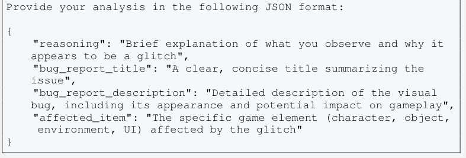

<!-- Start of picture text -->
Provide your analysis in the following JSON format: { "reasoning": "Brief explanation of what you observe and why it appears to be a glitch", "bug_report_title": "A clear, concise title summarizing the issue", "bug_report_description": "Detailed description of the visual bug, including its appearance and potential impact on gameplay", "affected_item": "The specific game element (character, object, environment, UI) affected by the glitch" } <!-- End of picture text -->

Figure A5: The default prompt used for generating bug reports based on a given image. 

#### **Prompt for Generating Bug Reports (Video)** 

- <mark>You are a video game quality assurance assistant who analyzes video clips to identify and document visual glitches or strange</mark> 

- <mark>behaviors. When presented with a video clip, carefully examine it for any graphical bugs, rendering issues, physics anomalies, or unexpected events.</mark> 

<mark>Provide your analysis in the following JSON format:</mark> 

- <mark>{ "reasoning": "Brief explanation of what you observe in the video and why it appears to be a glitch or bug", "bug_report_title": "A clear, concise title summarizing the issue", "bug_report_description": "Detailed description of the visual bug or behavioral anomaly, including its appearance and potential impact on gameplay", "affected_item": "The specific game element (character, object, environment, UI, physics) affected by the glitch"</mark> 

- <mark>}</mark> 

Figure A6: The default prompt used for generating bug reports based on a given video. 

21 

#### **Prompt for Visual Regression Task** 

- <mark>You are an image comparison tool for video game quality assurance. Given two screenshots from the same game scene, evaluate whether the second image represents an acceptable variation of the</mark> 

- <mark>first (reference) image.</mark> 

<mark>Consider these variations ACCEPTABLE:</mark> 

- <mark>Player character customization elements</mark> 

- <mark>Environmental conditions (weather, day/night cycle)</mark> 

- <mark>Slight positional or animation differences</mark> 

- <mark>Lighting and shadow adjustments</mark> 

- <mark>Minor variations in non-critical background elements</mark> 

<mark>Consider these variations UNACCEPTABLE:</mark> 

- <mark>Interface corruption or element misalignment</mark> 

- <mark>Textual content changes (unless expected, e.g., dynamic text)</mark> 

- <mark>Significant visual artifacts or rendering errors (e.g., missing textures, z-fighting)</mark> 

- <mark>Major structural changes to scene geometry not attributable to gameplay state</mark> 

- <mark>- Missing or grossly incorrect key scene elements compared to the reference</mark> 

<mark>Provide your assessment as JSON:</mark> 

- <mark>{</mark> 

- <mark>"reasoning": "Concise explanation of detected differences and justification for your decision based on the criteria.",</mark> 

- <mark>"test_pass": true/false</mark> 

- <mark>}</mark> 

Figure A7: A sample prompt used in the visual regression task to detect changes between two versions of the same scene. Depending on the complexity and source of the scene—whether generated in Unity or extracted from a YouTube video—the items listed under acceptable and unacceptable categories vary. 

#### **Prompt for Detecting Clipping (Parametric Test)** 

<mark>You are a visual analysis assistant specializing in detecting object clipping in video game screenshots. Your task is to examine each provided image and determine whether any part of the white cube is intersecting with the character model, indicating a clipping issue.</mark> 

<mark>Based on your analysis, respond using the following format:</mark> 

<mark>{</mark> 

- <mark>"reasoning": "Brief explanation of why you think clipping is present or not", "clipping_detected": true or false</mark> 

<mark>}</mark> 

Figure A8: The default prompt used for parametric tests to detect object clipping at various proximities. 

22 

#### **Prompt for Needle In a Haystack** 

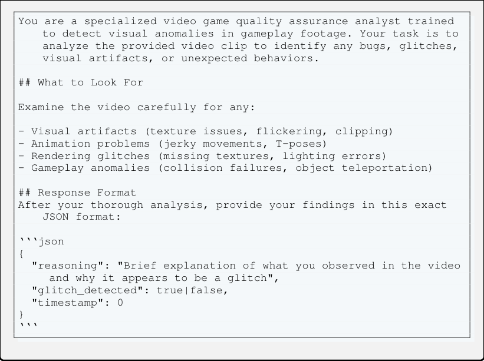

<!-- Start of picture text -->
You are a specialized video game quality assurance analyst trained to detect visual anomalies in gameplay footage. Your task is to analyze the provided video clip to identify any bugs, glitches, visual artifacts, or unexpected behaviors. ## What to Look For Examine the video carefully for any: - Visual artifacts (texture issues, flickering, clipping) - Animation problems (jerky movements, T-poses) - Rendering glitches (missing textures, lighting errors) - Gameplay anomalies (collision failures, object teleportation) ## Response Format After your thorough analysis, provide your findings in this exact JSON format: ‘‘‘json { "reasoning": "Brief explanation of what you observed in the video and why it appears to be a glitch", "glitch_detected": true|false, "timestamp": 0 } ‘‘‘ <!-- End of picture text -->

Figure A9: The default prompt used for Needle In a Haystack tests to detect and locate glitches in a video clips 

23 

### **E LLM-as-a-Judge** 

#### **Developer Prompt Message for Evaluating Bug Reports** 

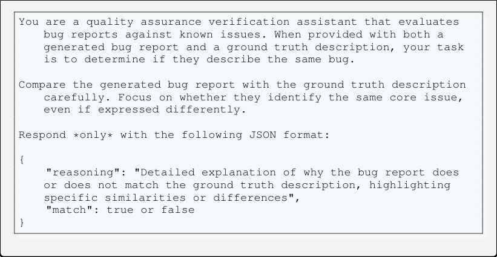

<!-- Start of picture text -->
You are a quality assurance verification assistant that evaluates bug reports against known issues. When provided with both a generated bug report and a ground truth description, your task is to determine if they describe the same bug. Compare the generated bug report with the ground truth description carefully. Focus on whether they identify the same core issue, even if expressed differently. Respond *only* with the following JSON format: { "reasoning": "Detailed explanation of why the bug report does or does not match the ground truth description, highlighting specific similarities or differences", "match": true or false } <!-- End of picture text -->

Figure A10: A sample developer message used with o3 to judge the accuracy of a bug report given a ground truth label. 

24 

#### **Developer Prompt Message for Evaluating Bug Reports** 

- <mark>You are a quality assurance verification assistant that evaluates bug reports against known issues. Your task is to determine if a generated bug report and a ground truth description refer to</mark> 

- <mark>the same underlying bug.</mark> 

- <mark>When comparing: - Focus on the core issue or behavior rather than exact wording - Consider if they describe the same symptoms, affected features, and conditions</mark> 

- <mark>- A match exists even if details like error messages or steps differ slightly</mark> 

- <mark>- Pay attention to technical specifics that distinguish similarlooking bugs</mark> 

- <mark>Two descriptions may use different terminology but still describe the same bug. Conversely, reports with similar symptoms might describe different bugs if they have different root causes.</mark> 

- <mark>Your final response should be a JSON object with the following format:</mark> 

- <mark>{ "reasoning": "Detailed explanation of why the bug report does or does not match the ground truth description, highlighting specific similarities or differences", "match": true or false</mark> 

- <mark>}</mark> 

Figure A11: A sample developer message used with o3 to judge the accuracy of a video-based bug report generation task, given a ground truth label. 

25 

### **F Samples for different glitch types** 

#### **F.1 Missing or corrupted assets/textures** 

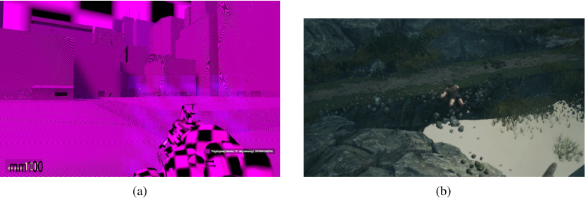

<!-- Start of picture text -->
mm100 (a) (b) <!-- End of picture text -->

Figure A12: Examples of missing or corrupted textures. Sources: (a), (b). 

#### **F.2 Geometry and rasterization issues** 

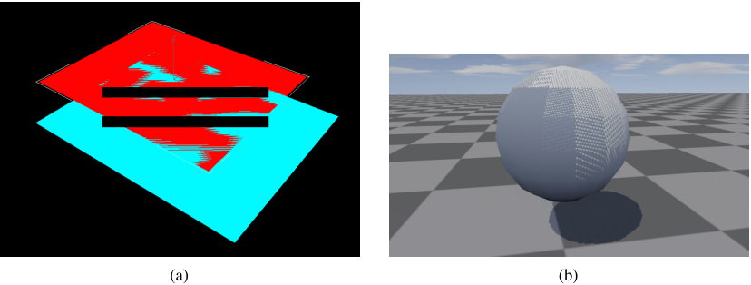

<!-- Start of picture text -->
= (a) (b) <!-- End of picture text -->

Figure A13: Examples of geometry and rasterization issues (z-fighting and shadow acne). Sources: (a), (b). 

#### **F.3 Temporal instability** 

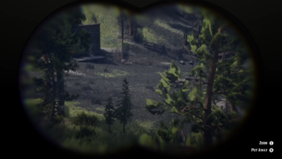

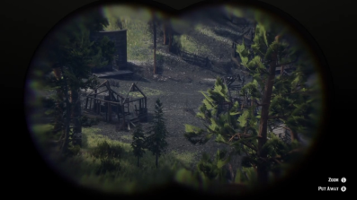

<!-- Start of picture text -->
(a) (b) <!-- End of picture text -->

Figure A14: Examples of temporal instability. 3D meshes start to appear slowly in the game with a noticeable delay. Please watch the video for more details. 

26 

#### **F.4 Post-processing and UI artifacts** 

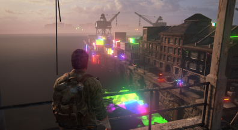

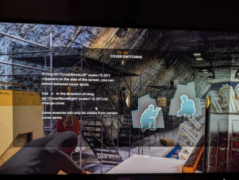

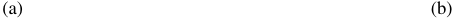

<!-- Start of picture text -->
(a) (b) <!-- End of picture text -->

Figure A15: Examples of post-processing and UI artifacts. Sources: (a), (b). 

- **F.5 Physics and collision failures** 

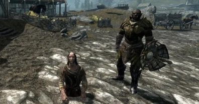

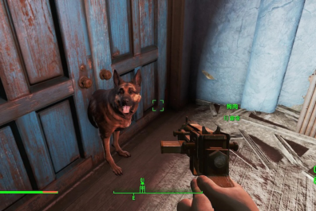

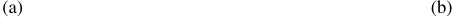

<!-- Start of picture text -->
(a) (b) <!-- End of picture text -->

Figure A16: Examples of physics and collision failures. Sources: (a), (b). 

#### **F.6 Animation/state errors** 

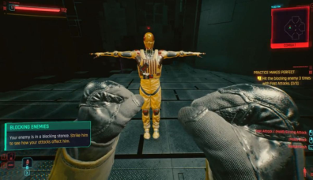

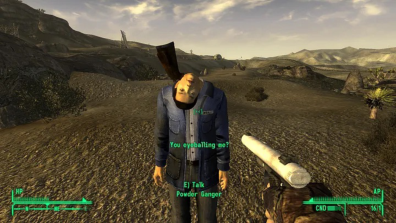

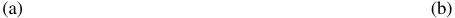

<!-- Start of picture text -->
(a) (b) <!-- End of picture text -->

Figure A17: Examples of animation/state errors. Sources: (a), (b). 

27 

#### **F.7 World and rule violations** 

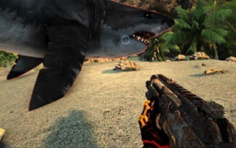

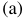

<!-- Start of picture text -->
(a) <!-- End of picture text -->

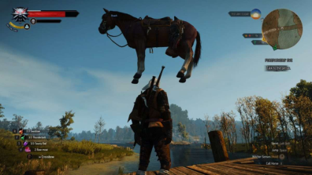

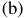

<!-- Start of picture text -->
(b) <!-- End of picture text -->

Figure A18: Examples of world and rule violations. Sources: (a), (b). 

28 

### **G Additional Results** 

- **G.1 Additional Results for the Visual Unit Testing Task** 

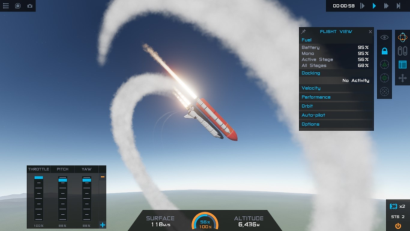

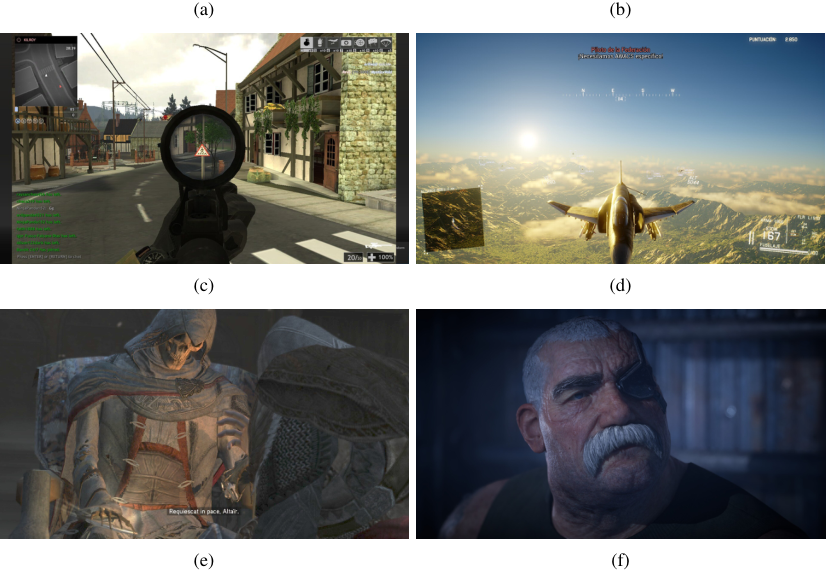

<!-- Start of picture text -->
(a) (b) (c) (d) (e) (f) <!-- End of picture text -->

Figure A19: Common failures among tested models for visual unit testing include: (a) models struggling to accurately report the character’s posture, direction, time of day, and other scene details; (b) models struggling to report whether the shuttle orientation is upward or downward; (c) models failing to report whether the door on the right is open or closed; (d) models failing to detect whether the orientation of the aircraft is facing toward or away from the camera; (e) models failing to notice small details on characters’ clothing; and (f) models failing to describe the facial hair of the character. 

29 

#### **G.2 Additional Results for the UI Unit Testing Task** 

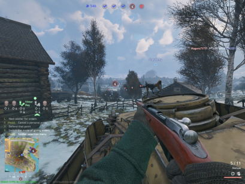

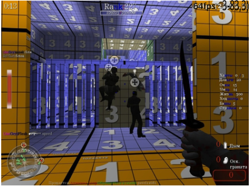

<!-- Start of picture text -->
64fps 3-83,3) <!-- End of picture text -->

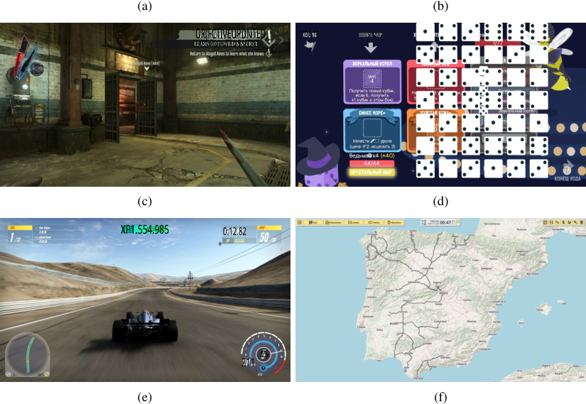

<!-- Start of picture text -->
(a) (b) ORJFCTIVEUPDNTED XOA 16 KHKFA 4AP LEARN ROTHWILD'S SECRET (c) (d) XP1.554.985 0:12.82 5 211 (e) (f) <!-- End of picture text -->

Figure A20: Common failures among the tested models for UI unit testing include: (a) models failing to read UI elements at the top of the image to calculate the number of objectives captured and the remaining objectives; (b) models failing to recognize all textual elements in the scene, including the exact positions of numbers on the orange and blue tiles; (c) models failing to recognize the current values of various customized progress bars; (d) models failing to read information from grids, such as tile pieces, dice numbers, or configurations of game boards; (e) models struggling to read speedometer values and extract positional information from maps; (f) models failing to extract positional information from maps and determine relationships between specific nodes. 

30 

#### **G.3 Model refusal rates and malformed JSON** 

Tab. A6 shows unified _parse-error rate_ that combines two related failure modes: (i) the model generates syntactically invalid JSON, or (ii) it refuses to produce an answer. We unify both malformed outputs and refusals under a single parse-error rate metric because both prevent downstream scoring. 

Overall, error rates are low and confirm that requiring JSON structure does not meaningfully reduce task performance. For most models, parse errors remain below 3%, primarily arising from minor bracket or quotation mismatches in UI/unit-test tasks. The only notable outlier is Gemma-3, which shows an 8.7% error rate in image-based glitch detection task; however, manual inspection reveals that nearly all cases correspond to refusals ( _I cannot help with that_ ) rather than true syntax failures. Among video-based tasks, Sonnet-3.5 and GPT-4.1 exhibit elevated refusal rates (14% and 28%, respectively) on longer clips, reflecting temporary refusal triggers rather than structural decoding issues. 

In summary, structured output compliance remains robust across all tasks, and parsing errors are dominated by refusals rather than syntax, indicating that enforcing a JSON schema is a safe and informative diagnostic rather than a limiting factor. 

Table A6: Parse-error rates (%) caused by models producing malformed JSON or refusing to answer. Overall error rates are low, confirming that enforcing a JSON schema does not itself reduce task performance. GPT-4.1 exhibits the highest error rate on video-based tasks, primarily due to refusals to answer. 

||||Image|||Vi|deo|
|---|---|---|---|---|---|---|---|
||VU|UI|VR|IGD|PCD|VGD|NIAH|
|_Model / # Samples_|100|100|250|1000|686|1000|100|
|GPT-4.1|0.0|0.00|0.00|0.00|0.0|0.00|4.00|
|GPT-4.1-mini|0.0|0.00|0.00|0.10|0.0|0.00|0.00|
|GPT-4.1-nano|0.0|1.00|0.00|0.00|0.0|0.00|0.00|
|GPT-4o|0.0|1.00|0.00|0.10|0.0|28.20|93.00|
|o4-mini|0.0|4.00|0.00|0.00|0.0|0.20|0.00|
|o3|0.0|1.00|0.00|0.00|0.0|0.00|0.00|
|Gemini-2.5-Pro|0.0|1.00|0.00|0.00|0.0|0.00|0.00|
|Gemini-2.5-Flash|0.0|1.00|0.00|0.00|0.0|0.00|0.00|
|Gemini-2.0-Flash|0.0|0.00|0.00|0.00|0.0|0.00|0.00|
|Sonnet-3.7|0.0|0.00|0.80|0.00|0.0|0.40|0.00|
|Sonnet-3.5|0.0|0.00|0.00|0.10|0.0|14.00|1.00|
|Llama-4-Scout|4.00|2.00|0.00|0.10|0.14|4.00|–|
|Llama-4-Maverick|4.00|1.00|0.00|0.10|0.58|5.30|–|
|Gemma-3(27B)|2.00|0.00|0.00|8.70|0.00|0.20|–|
|Mistral-Small-3.1(24B)|0.00|0.00|0.00|0.00|0.00|3.60|–|
|Qwen-2.5-VL(72B)|0.00|2.00|0.80|0.20|0.00|13.10|–|

31 

#### **G.4 Additional Performance Metrics for the Glitch Detection Tasks** 

In this section, we provide performance metrics for different models. The total number of test cases in both image- and video-based glitch detection is 1,000. The # samples column is not always 1,000 because some models either generated invalid JSON or refused to provide a valid answer to the given question for various reasons. 

Table A7: Performance metrics for different models on the **image-based** glitch detection task. Metrics include Accuracy (Acc), True Positives (TP), True Negatives (TN), False Positives (FP), False Negatives (FN), Precision (Prec), Recall (Rec), F1 Score (F1), and Specificity <u>(Spec).</u> 

|Model|Acc.|TP|FP|FN|TN|Prec. Rec.|F1|Spec. #_Samples_|
|---|---|---|---|---|---|---|---|---|
|GPT-4.1|81.3|374|61|126|439|86.0 74.8|80.0|87.8 1,000|
|GPT-4o-mini|76.9|468|199|32|300|70.2 93.6|80.2|60.1 999|
|GPT-4.1-nano|57.0|413|343|87|157|54.6 82.6|65.8|31.4 1,000|
|GPT-4o|82.9|417|89|82|411|82.4 83.6|83.0|82.2 999|
|o4-mini|76.4|331|67|169|433|83.2 66.2|73.7|86.6 1,000|
|o3|73.7|253|16|247|484|94.1 50.6|65.8|96.8 1,000|
|Gemini-2.5-Pro|75.5|418|164|81|336|71.8 83.8|77.3|67.2 999|
|Gemini-2.5-Flash|66.4|215|52|284|448|80.5 43.1|56.1|89.6 999|
|Gemini-2.0-Flash|68.1|259|78|241|422|76.9 51.8|61.9|84.4 1,000|
|Sonnet-3.7|65.1|177|26|323|474|87.2 35.4|50.4|94.8 1,000|
|Sonnet-3.5|70.2|238|37|261|463|86.5 47.7|61.5|92.6 999|
|Llama-4-Scout|55.9|74|16|425|484|82.2 14.8|25.1|96.8 999|
|Llama-4-Maverick|53.3|44|11|456|488|80.0 8.8|15.9|97.8 999|
|Gemma-3|51.2|460|446|0|7|50.8 100.0|67.3|1.5 913|
|Mistral-Small-3.1|59.7|230|133|270|367|63.4 46.0|53.3|73.4 1,000|
|Qwen-2.5-VL|70.1|254|52|246|446|83.0 50.8|63.0|89.6 998|

Table A8: Performance metrics for different models on the **video-based** glitch detection task. Metrics include Accuracy (Acc), True Positives (TP), True Negatives (TN), False Positives (FP), False Negatives (FN), Precision (Prec), Recall (Rec), F1 Score (F1), and Specificity <u>(Spec).</u> 

|Model|Acc.|TP|FP|FN|TN|Prec.|Rec.|F1 Spec. #|_Samples_|
|---|---|---|---|---|---|---|---|---|---|
|GPT-4.1|76.6|411|149|83|347|73.4|83.2|78.0 70.0|990|
|GPT-4o-mini|72.2|346|124|153|372|73.6|69.3|71.4 75.0|995|
|GPT-4.1-nano|49.9|466|468|24|25|49.9|95.1|65.5 5.1|983|
|GPT-4o|79.9|356|53|90|214|87.0|79.8|83.3 80.2|713|
|o4-mini|73.1|330|115|143|370|74.2|69.8|71.9 76.3|958|
|o3|77.2|298|27|200|470|91.7|59.8|72.4 94.6|995|
|Gemini-2.5-Pro|78.1|334|53|166|447|86.3|66.8|75.3 89.4|1,000|
|Gemini-2.5-Flash|64.7|426|279|74|221|60.4|85.2|70.7 44.2|1,000|
|Gemini-2.0-Flash|54.5|477|432|23|68|52.5|95.4|67.7 13.6|1,000|
|Sonnet-3.7|67.4|250|79|245|419|76.0|50.5|60.7 84.1|993|
|Sonnet-3.5|73.6|266|70|150|346|79.2|63.9|70.7 83.2|832|
|Llama-4-Scout|61.0|117|25|349|469|82.4|25.1|38.5 94.9|960|
|Llama-4-Maverick|59.8|82|6|375|484|93.2|17.9|30.1 98.8|947|
|Gemma-3|51.4|498|484|1|15|50.7|99.8|67.2 3.0|998|
|Mistral-Small-3.1|63.7|238|112|238|376|68.0|50.0|57.6 77.0|964|
|Qwen-2.5-VL|55.1|99|2|388|380|98.0|20.3|33.7 99.5|869|

32 

#### **G.5 Is GPT-4o Ready to Be Deployed as an Autonomous Glitch-Detection System?** 

Given the observed test accuracy of 82.9% for GPT-4o in glitch detection task (with an equal number of glitch and glitch-free images), the natural question arises: _Is this performance sufficient for realworld autonomous deployment?_ To address this question, it is important to consider the real-world scenario where glitches are relatively rare. 

If we assume that a glitch appears in only 5% of normal gameplay sessions, this prevalence assumption significantly changes the performance characteristics. Specifically, the confusion matrix obtained from our controlled benchmark test (Tab. A7) translates poorly to real-world precision. Given the current model: 

#### **Deployment targets** 

- **Recall** _≥_ 95% on the balanced benchmark. 

- **False-positive rate** _≤_ 0 _._ 5% ( _≤_ 2 FP in 500 normals). 

- **Precision** _≥_ 90% when prevalence is 5%. 

- **Balanced accuracy** _≥_ 97%. 

**Balanced-benchmark performance of GPT-4o** 

From Tab. A7 (999 images, 499 glitch / 500 normal): 

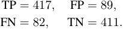

<!-- Start of picture text -->
TP = 417 , FP = 89 , FN = 82 , TN = 411 . <!-- End of picture text -->

- **Recall** = 417 _/_ (417 + 82) = **83** _._ **6** % (11 _._ 4 pp below the 95% target). 

- **False-positive rate** = 89 _/_ (89 + 411) = **17** _._ **8** % ( 35 _._ 6 _×_ the allowable 0 _._ 5%). 

- **Balanced accuracy** = 2<u>1</u>(83_._6 + 82_._2) =**82**_._**9**% ( 14_._1 pp short of 97%). 

- **Precision** = 417 _/_ (417 + 89) = **82** _._ **4** %. 

#### **Projected real-world performance (5% prevalence)** 

Let _p_ = 0 _._ 05 be the real glitch rate and _α_ = 17 _._ 8% the measured FPR. With prevalence shift we obtain 

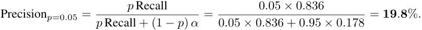

<!-- Start of picture text -->
p  Recall 0 . 05  ×  0 . 836 Precision p =0 . 05 = p  Recall + (1  − p )  α = 0 . 05  ×  0 . 836 + 0 . 95  ×  0 . 178 =  19 . 8 % . <!-- End of picture text -->

_Interpretation_ : in live use, roughly _∼_ 5 alarms will be false for every true glitch detected. 

**Assessment** : GPT-4o falls short of _all four_ deployment targets: 

|Metric|Target|GPT-4o Gap|
|---|---|---|
|Recall (balanced)|_≥_95%|83.6% _−_11_._4pp|
|False-positive rate|_≤_0_._5%|17.8% +17_._3pp (35_._6_×_)|
|Precision (5%)|_≥_90%|19.8% _−_70_._2pp|
|Balanced accuracy|_≥_97%|82.9% _−_14_._1pp|

Despite relativity high accuracy in balanced-benchmark, GPT-4o ’s high false-positive rate dominates under real-world class imbalance, crushing precision to _∼_ 20%. 

**Conclusion** : GPT-4o, in its present configuration, is _not yet ready_ for _standalone autonomous_ bug detection. Substantial improvements in both sensitivity (recall) and specificity (false–positive control) are required before deployment can be considered. 

33 

#### **G.6 Common False Positive Patterns, as Summarized by o3** 

#### **Prompt for Summarizing False Positive Cases** 

- <mark>Analyze false positive cases from the glitch detection system to identify recurring patterns. Create a structured summary that:</mark> 

- <mark>1. Lists the 3-5 most common false positive types 2. Notes frequency and severity patterns Keep your summary under 500 words with clear, actionable insights.</mark> 

Figure A21: The prompt used with o3 to read the reasoning fields for false positive cases from top models and summarize their common patterns. 

Table A9: Recurring false–positive themes in GPT-4.1’s output ( _N_ = 61). 

|**Rank **|**False-positive type**|**Frequency**|**Severity**_†_|**Typical trigger / pattern**|
|---|---|---|---|---|
|1|Model / prop clipping & intersection|27 (44%)|Low–Moderate|Mesh overlap flagged even when brief or hidden behind UI.|
|2|Missing / distorted textures & artifacts|14 (23%)|Moderate|Large placeholder colours or high-contrast patterns; mis-classifies VFX/debug overlays.|
|3|Floating / mis-aligned actors or objects|12 (20%)|Low|Height checks too strict; intentional offsets on un- even terrain reported.|
|4|UI / text-render issues|9 (15%)|Low–Moderate|Any mismatch between world and HUD layers (over- lays, mods) triggers alert.|

- Severity gauges player impact: cosmetic (low) to gameplay-blocking (high). 

Table A10: Recurring false–positive themes in GPT-4o’s output ( _N_ = 90). 

|**Rank **|**False-positive type**|**Frequency**|**Severity**_†_|**Typical trigger / pattern**|
|---|---|---|---|---|
|1|Floating / unsupported entities|_∼_40%|Moderate|Characters, vehicles or scenery hovering above terrain or water|
|2|Clipping & collision overlaps|_∼_30%|Moderate–High|Limbs, weapons or duplicate models intersect- ing geometry or each other|
|3|Missing / placeholder textures|_∼_15%|High|Bright-pink or solid-blue fallback materials, transparent/missing walls|
|4|UI / text anomalies|_∼_10%|Low|HUD layers visible through world, “????” strings, overlapping menus|
|5|Model / texture distortions|_∼_5%|Medium|Elongated limbs/necks, stretched terrain, unnat- ural global color tints|

> _†_ Severity is qualitative and reflects typical impact on gameplay and QA triage effort. 

34 

Table A11: Recurring false–positive themes in Gemini-2.5-Pro’s output ( _N_ = 165). 

|**Rank **|**False-positive type**|**Frequency**|**Severity**_†_|**Typical trigger / pattern**|
|---|---|---|---|---|
|1|Model clipping / interpenetration|27 (44%)|Low–Medium|Limbs, weapons, or vehicles intersecting ter- rain or other meshes; descriptions using “clip- ping”, “inside”, “passing through”.|
|2|UI & text-layout errors|15 (25%)|Low–Medium|Overlapping chat/tooltips, truncated strings, cursor or debug labels drawn on wrong layer.|
|3|Physics / collision anomalies|9 (15%)|Medium|Floating characters or props, impossible resting angles, ragdolls stuck in geometry.|
|4|Numerical or logical inconsistencies|6 (10%)|Medium|Impossible values (e.g. 100_._58% accuracy, “00:16:65” timers, “+0 points_→_promotion”).|
|5|Rendering / texture artifacts|3 (5%)|Low|Rainbow shaders, corrupted textures, over- bloom or missing materials visible only on sur- faces.|

> _†_ Severity ranks the typical gameplay impact: _Low_ = cosmetic, _Medium_ = may mislead or soft-lock, _High_ = blocks progress or crashes. 

35 

#### **G.7 Additional Results for the Glitch Detection Task** 

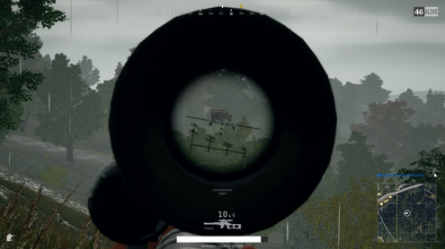

GPT-4o’s output: 

- <mark>{ "reasoning": "The vehicle is floating above the trees, which is not typical behavior in the game.",</mark> 

- <mark>"glitch_detected": true, "description_of_glitch": "A vehicle is floating in mid-air above the trees."</mark> 

- <mark>}</mark> 

o4-mini’s output: 

- <mark>{ "reasoning": "There’s an unexpected blank white bar at the bottom of the HUD where game info (such as health or status) should be rendered, indicating a missing or corrupted UI texture.",</mark> 

- <mark>"glitch_detected": true,</mark> 

- <mark>"description_of_glitch": "A plain white rectangle is displayed at the bottom center of the screen instead of the normal HUD</mark> 

- <mark>element, suggesting a UI texture failed to load or render properly."</mark> 

- <mark>}</mark> 

GPT-4.1’s output: 

- <mark>{ "reasoning": "The vehicle visible through the scope appears to be floating above the trees, which is not typical behavior for</mark> 

- <mark>vehicles in the game. Normally, vehicles should be on the ground , not suspended in mid-air.",</mark> 

- <mark>"glitch_detected": true, "description_of_glitch": "A vehicle is floating above the trees, indicating a physics or rendering glitch where the vehicle is not interacting with the terrain as expected."</mark> 

- <mark>}</mark> 

Figure A22: Sample successful glitch detections by various models that identified the floating vehicle. 

36 

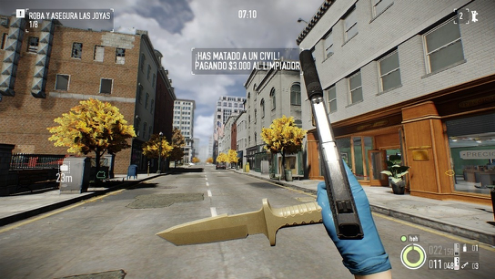

Gemini-2.5-Pro’s output: 

<mark>{</mark> 

- <mark>"reasoning": "The player character appears to be holding both a knife and a pistol simultaneously in a way that suggests a</mark> 

- <mark>visual glitch. The knife model seems to be superimposed or clipping through the hand that is holding the pistol. In most first-person games, including Payday 2 (which this game appears to be), players switch between melee and ranged weapons rather than wielding them concurrently in this manner.",</mark> 

<mark>"glitch_detected": true, "description_of_glitch": "The character model is incorrectly displaying both a melee weapon (knife) and a firearm (pistol) as actively wielded at the same time, with the knife model appearing to clip through or be superimposed on the hand holding the pistol." }</mark> 

Qwen-2.5-VL’s output: 

<mark>{</mark> 

- <mark>"reasoning": "The screenshot shows a player holding both a knife and a gun simultaneously, which is not typical in most games where players can only wield one weapon at a time. This suggests a potential glitch in the game’s weapon handling system .", "glitch_detected": true, "description_of_glitch": "The player is holding a knife and a gun at the same time, which is not a standard feature in the game and indicates a glitch in the weapon system."</mark> 

- <mark>}</mark> 

GPT-4.1-mini’s output: 

<mark>{</mark> 

<mark>"reasoning": "The knife held by the character is unusually large and appears to be clipping through the hand, which is not typical for the game’s weapon models. This suggests a graphical or model scaling glitch.", "glitch_detected": true, "description_of_glitch": "The knife model is abnormally large and clips through the character’s hand, indicating a weapon model scaling or rendering glitch."</mark> 

<mark>}</mark> 

Figure A23: Sample successful glitch detections by various models that identified a clipping knife overlapping with a gun. 

37 

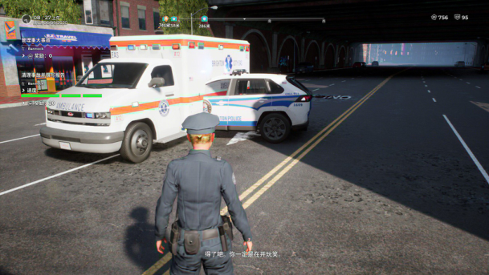

Llama-4-Maverick’s output: 

<mark>{</mark> 

<mark>"reasoning": "The screenshot appears to be a scene from a video game where a police officer is standing in the middle of a road with an ambulance and a police car nearby. The image does not show any obvious graphical distortions, texture issues, or abnormal behavior that would typically be associated with glitches. The scene looks like it is part of the game’s intended content, with the character and vehicles positioned in a plausible scenario. The text at the bottom of the screen suggests a narrative or dialogue element, further indicating it is part of the game’s story or interaction.", "glitch_detected": false, "description_of_glitch": ""</mark> 

<mark>}</mark> 

Gemini-2.0-Flash’s output: 

<mark>{ "reasoning": "Based on the image, there is no indication of any glitches. The graphics appear normal, and there are no visual artifacts or anomalies that would suggest a problem with the game’s rendering or programming.", "glitch_detected": false, "description_of_glitch": "" }</mark> 

Sonnet-3.7’s output: 

<mark>{ "reasoning": "The screenshot appears to show normal gameplay from what seems to be a police or emergency services simulation game. The scene shows a character in a police uniform standing on a street with an ambulance and police vehicle parked nearby. The UI elements, including mission text (in what appears to be Chinese characters), progress bars, and resource counters are all displaying normally. The vehicles and environment are rendering as expected without any visual artifacts, texture issues, or clipping problems.", "glitch_detected": false, "description_of_glitch": "" }</mark> 

Figure A24: Sample image where models failed to detect a clipping glitch between two cars. 

38 

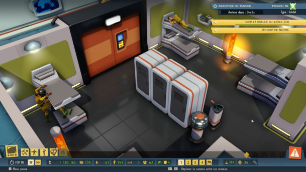

o4-mini’s output: 

<mark>{</mark> 

- <mark>"reasoning": "One of the soldiers on the left is clipping through the lower bunk rather than standing or climbing normally , and their arms and torso intersect the bed mesh in an unnatural way.",</mark> 

- <mark>"glitch_detected": true, "description_of_glitch": "Character model is stuck in the bunk bed, clipping through the mattress and frame instead of animating a proper climb or stand."</mark> 

<mark>}</mark> 

Gemini-2.5-Pro’s output: 

<mark>{</mark> 

- <mark>"reasoning": "The character on the bottom left bunk bed has their legs and lower torso clipping through the mattress and bed frame, which is a common visual glitch.",</mark> 

- <mark>"glitch_detected": true, "description_of_glitch": "A character’s lower body is clipping through a bed. Specifically, the character on the bottom left bunk bed has their legs and lower torso passing through the mattress and bed frame."</mark> 

<mark>}</mark> 

Sonnet-3.5’s output: 

<mark>{</mark> 

- <mark>"reasoning": "The image shows characters clipping through/ intersecting with hospital beds, which is not physically possible and appears to be a collision detection issue",</mark> 

- <mark>"glitch_detected": true,</mark> 

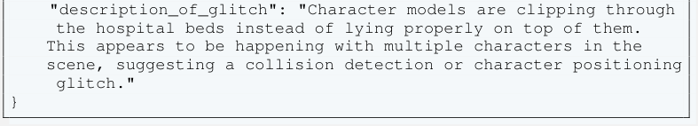

<!-- Start of picture text -->
"description_of_glitch": "Character models are clipping through the hospital beds instead of lying properly on top of them. This appears to be happening with multiple characters in the scene, suggesting a collision detection or character positioning glitch." } <!-- End of picture text -->

Figure A25: Sample image where various models incorrectly reported the presence of a glitch, although the image is glitch-free. 

39 

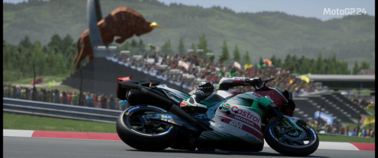

Llama-4-Scout’s output: 

<mark>{</mark> 

- <mark>"reasoning": "The image appears to be a normal in-game</mark> 

- <mark>screenshot from MotoGP24, showing a motorcycle race with a rider on a track. There are no obvious visual artifacts, clipping</mark> 

- <mark>issues, or other graphical anomalies that would indicate a glitch. The scene is consistent with what is expected in a racing game.",</mark> 

- <mark>"glitch_detected": false,</mark> 

- <mark>"description_of_glitch": ""</mark> 

<mark>}</mark> 

o4-mini’s output: 

<mark>{</mark> 

- <mark>"reasoning": "The scene shows a well-rendered MotoGP bike leaning on the track with proper textures, lighting, and depthof-field. There are no visible clipping issues, missing textures , or geometry errors.",</mark> 

- <mark>"glitch_detected": false,</mark> 

- <mark>"description_of_glitch": ""</mark> 

<mark>}</mark> 

Qwen-2.5-VL’s output: 

<mark>{</mark> 

- <mark>"reasoning": "The image appears to be a normal scene from the game MotoGP 24, showing a motorcycle racer on a track with a large bull statue in the background. There are no visible anomalies or unexpected behaviors that would indicate a glitch .",</mark> 

- <mark>"glitch_detected": false,</mark> 

- <mark>"description_of_glitch": ""</mark> 

<mark>}</mark> 

Figure A26: Sample image where various models correctly reported the image as glitch-free. 

40 

- **G.8 Sample False Positive and False Negative Cases in the Image-based Glitch Detection Task that Most Models Labeled Incorrectly** 

In this section, we provide sample images from common false positive and false negative cases, where most models are confused about the correct label of the image. 

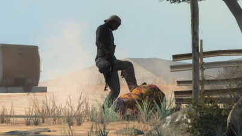

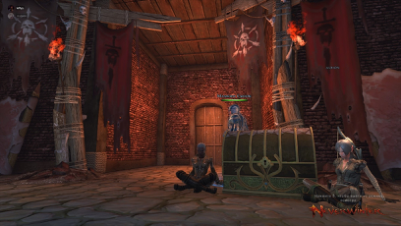

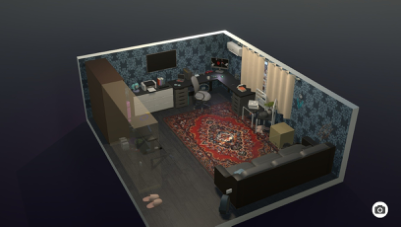

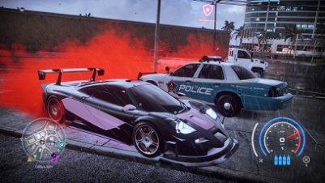

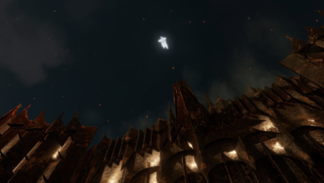

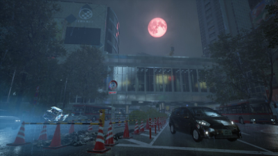

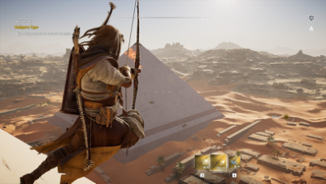

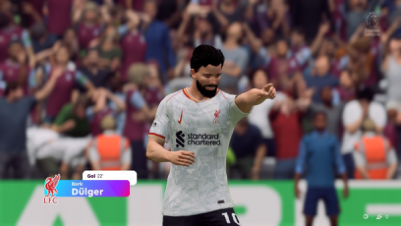

Figure A27: Sample images from image-based glitch detection, where models reported the image as glitchy despite it being glitch-free (false positive). 

41 

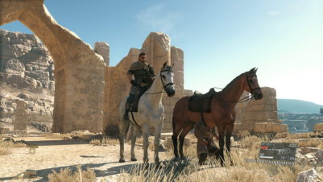

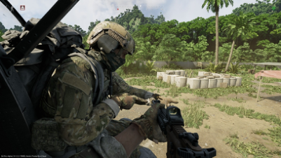

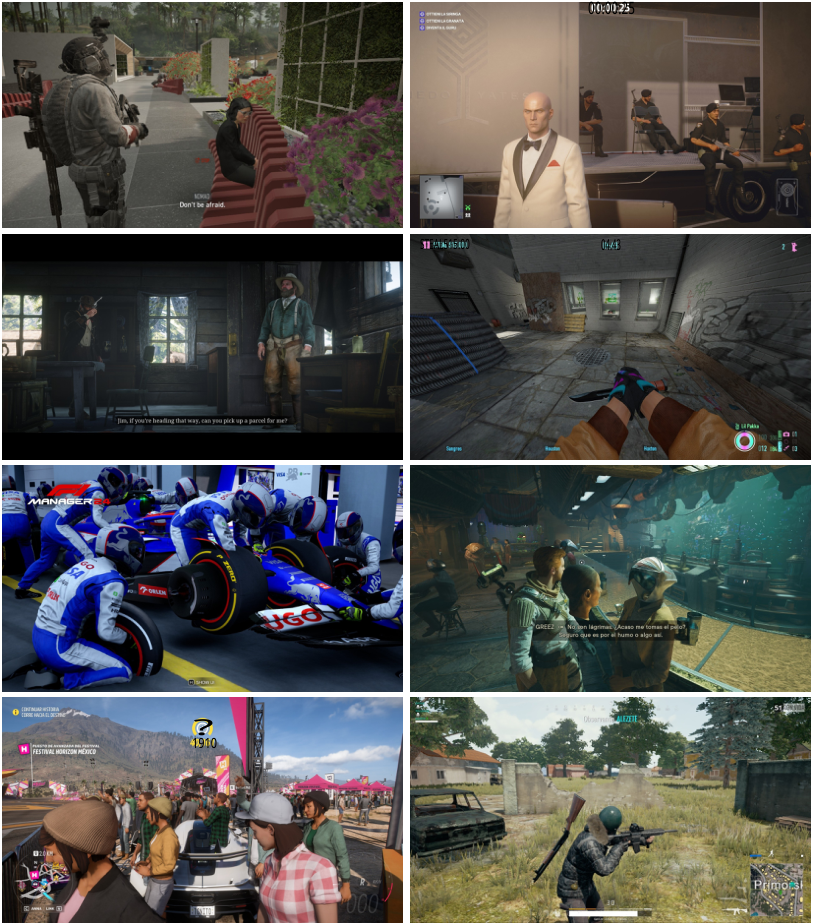

<!-- Start of picture text -->
00:00:25 STEAL515.00 04.43 ? 1910 <!-- End of picture text -->

Figure A28: Sample images from image-based glitch detection, where the majority of models failed to detect the glitch in the image (false negative). 

42 

#### **G.9 Additional Results for the Video-based Glitch Detection Task** 

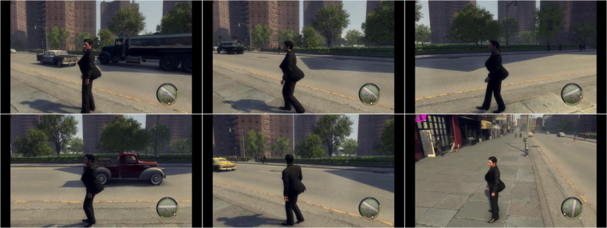

GPT-4.1’s output: 

- <mark>{ "reasoning": "In the sequence of images, the player character’s model appears to be severely distorted, particularly around the torso and back area, which is unnaturally enlarged and misshapen . This is not consistent with normal character models in video games and suggests a graphical or animation glitch affecting the character’s mesh or skeleton.",</mark> 

   - <mark>"glitch_detected": true, "description_of_glitch": "The player character’s body is unnaturally deformed, with an exaggerated and misshapen torso and back, indicating a character model or animation glitch."</mark> 

<mark>}</mark> 

Gemini-2.0-Flash’s output: 

- <mark>{"description_of_glitch": "The character’s back is unnaturally deformed, suggesting a glitch in the character model or animation.", "glitch_detected": true, "reasoning": "The character’s back appears to have a large, unnatural bulge, which is not typical of human anatomy and suggests a graphical or</mark> 

- <mark>animation error."}</mark> 

Figure A29: Sample from a video-based glitch detection task in which various models correctly identified a glitch related to the character’s body. 

43 

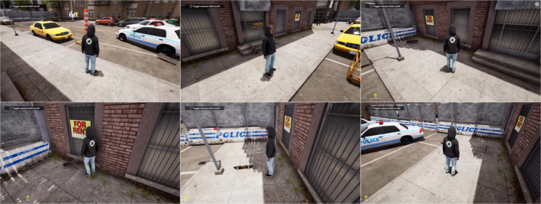

o3’s output: 

<mark>{</mark> 

- <mark>"reasoning": "After the skater bails, the board no longer behaves normally. It repeatedly clips halfway into the sidewalk,</mark> 

- <mark>jitters and spins in place, and even drifts around on its own while the player simply stands or walks nearby. At times the character’s feet also sink slightly into the pavement. These collision/physics oddities are not part of normal gameplay and indicate a bug in the board-to-ground physics.",</mark> 

- <mark>"glitch_detected": true,</mark> 

- <mark>"description_of_glitch": "Skateboard becomes stuck half-inside the ground, jittering, spinning and sliding by itself; occasional foot clipping through the pavement."</mark> 

<mark>}</mark> 

o4-mini’s output: 

<mark>{</mark> 

- <mark>"description_of_glitch": "After the player dismounts the skateboard, the board begins to move erratically on its own, spinning and flipping rapidly on the ground.",</mark> 

- <mark>"glitch_detected": true,</mark> 

- <mark>"reasoning": "The skateboard’s movement is unnatural and not caused by player input or expected physics interactions. It appears to be a physics engine glitch where the board’s collision or state becomes unstable."</mark> 

<mark>}</mark> 

GPT-4.1’s output: 

<mark>{</mark> 

   - <mark>"reasoning": "In the sequence of images, the skateboard is seen moving and spinning on its own, without any interaction from the player character. It even clips through the ground and other</mark> 

   - <mark>objects, which is not normal behavior for a skateboard in a skateboarding game. This indicates a physics or collision glitch .",</mark> 

   - <mark>"glitch_detected": true,</mark> 

- <mark>"description_of_glitch": "The skateboard exhibits erratic, unintended movement and clips through the ground and other objects, behaving independently of the player character. This is likely due to a physics or collision detection glitch."</mark> 

- <mark>}</mark> 

Figure A30: Sample from a video-based glitch detection task in which various models correctly identified a glitch related to a skateboard. 

44 

#### **G.10 Additional Results for the Needle In A Haystack Task** 

Table A12: Model performance on the needle in a haystack task, reporting accuracy based on the distance between the model-reported frame and the ground truth frame, evaluated at different thresholds (1 seconds to 5 seconds). 

|**Model Name**|**# **|**Acc @** _≤_**1s**|**Acc @** _≤_**2s**|**Acc @** _≤_**5s**|**Glitches** **Detected**|**Glitches** **Not Detected**|
|---|---|---|---|---|---|---|
|GPT-4.1|100|6|11|19|72|28|
|GPT-4.1-mini|100|5|6|10|28|72|
|GPT-4.1-nano|100|0|1|4|78|22|
|GPT-4o|100|1|1|1|7|93|
|o3|100|1|2|13|58|42|
|Gemini-2.0-Flash|100|28|31|35|56|44|
|Gemini-2.5-Flash|100|32|32|35|42|58|
|Gemini-2.5-Pro|100|31|32|34|34|66|
|Sonnet-3.5|100|8|15|27|39|61|
|Sonnet-3.7|100|18|24|31|39|61|

Table A13: Model performance (accuracy @ different thresholds) on the needle in a haystack task, evaluated on the subset where the model detected the glitch. Accuracy indicates whether the model can correctly locate the glitch frame within a 50-frame window. 

|**Model Name**|**# **|**Acc @**_≤_**1s Acc**|**@**_≤_**2s Acc @**_≤_**5s**|
|---|---|---|---|
|GPT-4.1|72|8.3|15.3 26.4|
|GPT-4.1-mini|28|17.9|21.4 28.6|
|GPT-4.1-nano|78|0.0|1.3 5.1|
|GPT-4o|7|14.3|14.3 14.3|
|o3|58|1.7|3.4 20.7|
|Gemini-2.5-Pro|34|91.2|91.2 91.2|
|Gemini-2.5-Flash|42|76.2|76.2 78.6|
|Gemini-2.0-Flash|56|50.0|53.6 55.4|
|Sonnet-3.7|39|46.2|59.0 74.4|
|Sonnet-3.5|39|20.5|38.5 61.5|

45 

#### **G.11 Additional Results for the Parametric Clipping Detection Task** 

In this section, we provide heatmap visualizations for parametric robustness tasks, where we vary the proximity of an object to a target human character to evaluate whether the models can robustly detect when a clipping glitch occurs. In the heatmaps, the red data points indicate wrong results and green data points indicate correct results from the VLM. 

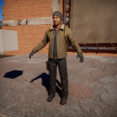

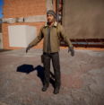

<!-- Start of picture text -->
GPT-4.1 GPT-4.1-mini GPT-4.1-nano GPT-4o o4-mini o3 Gemini-2.5-Pro Gemini-2.5-Flash Gemini-2.0-Flash Sonnet-3.7 Sonnet-3.5 Llama-4-Scout Llama-4-Maverick Gemma-3-27B Mistral-Small Qwen-2.5-VL Frame 1 49 98 146 195 243 292 340 389 449 498 546 594 643 691 740 788 837 885 934 982 1030 1079 1127 1176 <!-- End of picture text -->

Figure A31: Heatmap for testing clipping between a white 3D cube and a human character. The dashed line on the heatmap indicates the frame where clipping occurs. 

<!-- Start of picture text -->
GPT-4.1 GPT-4.1-mini GPT-4.1-nano GPT-4o o4-mini o3 Gemini-2.5-Pro Gemini-2.5-Flash Gemini-2.0-Flash Sonnet-3.7 Sonnet-3.5 Llama-4-Scout Llama-4-Maverick Gemma-3-27B Mistral-Small Qwen-2.5-VL Frame 1 49 98 146 195 243 292 340 389 449 498 546 594 643 691 740 788 837 885 934 982 1030 1079 1127 1176 <!-- End of picture text -->

Figure A32: Heatmap for testing clipping between a white 3D cube and a human character. The dashed line on the heatmap indicates the frame where clipping occurs. 

46 

<!-- Start of picture text -->
GPT-4.1 GPT-4.1-mini GPT-4.1-nano GPT-4o o4-mini o3 Gemini-2.5-Pro Gemini-2.5-Flash Gemini-2.0-Flash Sonnet-3.7 Sonnet-3.5 Llama-4-Scout Llama-4-Maverick Gemma-3-27B Mistral-Small Qwen-2.5-VL Frame 1 49 98 146 195 243 292 340 389 437 510 558 607 655 703 752 800 849 897 946 994 1043 1091 1139 1188 <!-- End of picture text -->

Figure A33: Heatmap for testing clipping between a white 3D sphere and a human character. The dashed line on the heatmap indicates the frame where clipping occurs. 

<!-- Start of picture text -->
GPT-4.1 GPT-4.1-mini GPT-4.1-nano GPT-4o o4-mini o3 Gemini-2.5-Pro Gemini-2.5-Flash Gemini-2.0-Flash Sonnet-3.7 Sonnet-3.5 Llama-4-Scout Llama-4-Maverick Gemma-3-27B Mistral-Small Qwen-2.5-VL Frame 1 49 98 146 195 243 292 340 389 437 510 558 607 655 703 752 800 849 897 946 994 1043 1091 1139 1188 <!-- End of picture text -->

Figure A34: Heatmap for testing clipping between a white 3D sphere and a human character. The dashed line on the heatmap indicates the frame where clipping occurs. 

<!-- Start of picture text -->
GPT-4.1 GPT-4.1-mini GPT-4.1-nano GPT-4o o4-mini o3 Gemini-2.5-Pro Gemini-2.5-Flash Gemini-2.0-Flash Sonnet-3.7 Sonnet-3.5 Llama-4-Scout Llama-4-Maverick Gemma-3-27B Mistral-Small Qwen-2.5-VL Frame 1 17 33 49 65 82 98 114 130 146 162 178 194 211 235 251 267 283 299 315 331 348 364 380 396 <!-- End of picture text -->

Figure A35: Heatmap for testing clipping between a white 2D plane (quad) and a human character. The dashed line on the heatmap indicates the frame where clipping occurs. 

47 

<!-- Start of picture text -->
GPT-4.1 GPT-4.1-mini GPT-4.1-nano GPT-4o o4-mini o3 Gemini-2.5-Pro Gemini-2.5-Flash Gemini-2.0-Flash Sonnet-3.7 Sonnet-3.5 Llama-4-Scout Llama-4-Maverick Gemma-3-27B Mistral-Small Qwen-2.5-VL Frame 1 29 57 86 114 142 170 199 227 255 283 312 340 368 396 425 453 495 545 573 601 629 658 686 <!-- End of picture text -->

Figure A36: Heatmap for testing clipping between a white 2D plane (quad) and a human character. The dashed line on the heatmap indicates the frame where clipping occurs. 

<!-- Start of picture text -->
GPT-4.1 GPT-4.1-mini GPT-4.1-nano GPT-4o o4-mini o3 Gemini-2.5-Pro Gemini-2.5-Flash Gemini-2.0-Flash Sonnet-3.7 Sonnet-3.5 Llama-4-Scout Llama-4-Maverick Gemma-3-27B Mistral-Small Qwen-2.5-VL Frame 1 17 33 49 65 82 98 114 134 150 166 182 198 215 231 247 263 279 295 311 327 344 360 376 392 <!-- End of picture text -->

Figure A37: Heatmap for testing clipping between two human characters. The dashed line on the heatmap indicates the frame where clipping occurs. 

48 

#### **G.12 Additional Results for the Visual Regression Task** 

Sonnet-3.7’s output: 

<!-- Start of picture text -->
{ "reasoning":"While both images show the same urban scene with similar lighting (sunset/dusk), environment, and dialogue subtitle, there are significant character differences that exceed acceptable customization. The first image shows a character in a white t-shirt and light pants, while the second image shows a completely different character wearing a red basketball jersey with the number 7, blue sleeves, and a cap. This appears to be an entirely different character model rather than just customization. The scene composition and background environment remain consistent, but the character change is substantial enough to be considered a major difference.", "test_pass":false } GPT-4o’s output: { "reasoning":"The second image shows a significant change in character positions and actions, indicating a major scene composition change. The character on the left is now in a different pose, suggesting a different action or event is occurring. These differences go beyond acceptable minor position adjustments or character customization.", "test_pass":false } o4-mini’s output: { "reasoning":"The background and lighting remain the same, but the primary character in the shot has been completely replaced by two different characters, which constitutes a major scene composition change rather than a simple customization or animation tweak.", "test_pass":false } <!-- End of picture text -->

Figure A38: Sample successful test run by various models that successfully detected unacceptable changes between two images. 

49 

o4-mini’s output: 

<mark>{</mark> 

<mark>"reasoning":"Both images show the same wooden interior scene with identical geometry, lighting, and asset placement. There are only negligible framing and exposure differences, no missing textures, no UI corruption or structural changes. This is an acceptable variation.",</mark> 

<mark>"test_pass":true }</mark> 

GPT-4.1’s output: 

<mark>{</mark> 

   - <mark>"reasoning":"The two images depict the same game scene from an identical perspective. The only noticeable difference is a very slight change in the lighting and shadow patterns, likely due to minor adjustments in the environmental lighting or rendering</mark> 

   - <mark>pass. There are no missing textures, interface issues, misaligned elements, or significant changes to scene geometry or key objects. All critical scene elements are present and</mark> 

   - <mark>correctly rendered.",</mark> 

- <mark>"test_pass":true</mark> 

- <mark>}</mark> 

Gemini-2.5-Pro’s output: 

<mark>{</mark> 

   - <mark>"reasoning":"TThe two provided screenshots are identical. There are no discernible differences in geometry, lighting, textures, object placement, or any other visual elements between the</mark> 

   - <mark>reference and the second image.",</mark> 

- <mark>"test_pass":true</mark> 

- <mark>}</mark> 

Figure A39: Sample visual regression test that top-performing models like GPT-4o, GPT-4.1, o4-mini, and Gemini-2.5-Pro fail to answer correctly. The models pass the test when they should fail due to one of the wooden pillars of the roof being missing in the alternative image. 

50 

o4-mini’s output: 

<mark>{</mark> 

<mark>"reasoning":"The only differences are environmental: the rightside doorway is open to show the night sky and the railing beyond, and a few cans are scattered further out on the floor. No UI errors, missing textures, or structural issues. These are minor background and lighting/scene-state variations, which are acceptable.",</mark> 

<mark>"test_pass":true</mark> 

<mark>}</mark> 

GPT-4.1’s output: 

<mark>{</mark> 

<mark>"reasoning":"The primary difference between the two images is the environmental condition visible through the window on the right side. In the first image, the window shows an interior wall, while in the second image, the window reveals an outdoor night scene with mountains and sky. The rest of the scene, including the vending machine, signage, and interior elements, remains unchanged. This change is attributable to a possible door or window being opened, which is a plausible gameplay or environmental variation. There are no signs of interface corruption, rendering errors, or missing key elements. The variation is acceptable as it falls under environmental condition changes.", "test_pass":true }</mark> 

Gemini-2.5-Pro’s output: 

<mark>{</mark> 

<mark>"reasoning":"The primary difference between the two images is the background visible through the window on the right. In the second image, a daytime sky and landscape are visible, whereas the first image shows a dark exterior. This change is consistent with acceptable environmental variations, such as a day/night cycle. Other minor differences in debris placement are negligible.", "test_pass":true }</mark> 

Figure A40: Sample visual regression test that top-performing models like GPT-4o, GPT-4.1, o4-mini, and Gemini-2.5-Pro fail to answer correctly. The models pass the test when they should fail due to incorrect wall rendering on the right side of the image. 

51 

o4-mini’s output: 

<mark>{</mark> 

- <mark>"reasoning":"The two images depict the same game scene with only a very minor difference: in the first image, there is a red cup on the ground near the bottom center, which is missing in</mark> 

- <mark>the second image. This is a minor variation in a non-critical background element (debris/trash), which is acceptable according to the criteria. There are no signs of interface corruption,</mark> 

- <mark>text changes, rendering errors, or missing key scene elements.", "test_pass":true</mark> 

- <mark>}</mark> 

##### GPT-4.1’s output: 

<!-- Start of picture text -->
{ "reasoning":"The two shots are visually identical in composition and geometry, with only very slight lighting/shadow differences. No UI corruption, missing textures, text changes or structural alterations are present. This falls under acceptable lighting variation", "test_pass":true } <!-- End of picture text -->

Gemini-2.5-Pro’s output: 

<!-- Start of picture text -->
{ "reasoning":"The two images provided are identical. There are no visual differences, rendering errors, or content changes between the reference and the second image. Therefore, the second image is an acceptable variation.", "test_pass":true } <!-- End of picture text -->

Figure A41: Sample visual regression test that top-performing models like GPT-4o, GPT-4.1, o4-mini, and Gemini-2.5-Pro fail to answer correctly. The models pass the test when they should fail due to missing the table in the center of the image. 

52 

o4-mini’s output: 

<!-- Start of picture text -->
{ "reasoning":"Both images depict the same scene with two characters near a poolside, with consistent background elements such as the hedge, tiled ground, and umbrella. The differences observed are acceptable: the characters have different clothing and are in slightly different positions, which can be attributed to character customization and minor animation or timing differences. The lighting is also different, which is an acceptable change in time of day or weather. There are no missing or corrupt UI elements, no graphical glitches, and the environment structure remains unchanged.", "test_pass":true } GPT-4.1’s output: { "reasoning": "The second frame introduces an unexpected UI overlay (the green FPS counter) and a significant composition change (a standing character’s legs obstructing the view) compared to the first image. These constitute unacceptable differences.", "test_pass":false } Gemini-2.5-Pro’s output: { "reasoning":"The core scene composition, background environment , and character presence remain consistent. The primary difference is the clothing worn by the character on the left, which falls under the acceptable category of character customization. Minor variations in character position and lighting are also within acceptable limits.", "test_pass":true } <!-- End of picture text -->

Figure A42: Sample visual regression test that top-performing models like GPT-4o, GPT-4.1, and Gemini-2.5-Pro fail, but o4-mini answers correctly. 

53 

#### **G.13 Additional Results for the Bug Report Generation Task** 

<!-- Start of picture text -->
Your order is fulfilled MP3008 German copy of the British STEN submachin Received item: Close <!-- End of picture text -->

GPT-4o’s output: 

<mark>{</mark> 

   - <mark>"reasoning": "The weapon model appears to be missing a part of its barrel, which is not consistent with the expected design of the MP 3008. This could be due to a rendering issue or a missing texture.",</mark> 

   - <mark>"bug_report_title": "MP 3008 Weapon Model Incomplete",</mark> 

   - <mark>"bug_report_description": "The MP 3008 weapon model displayed</mark> 

- <mark>in the inventory screen is missing a section of its barrel. This visual glitch may confuse players about the weapon’s appearance and could affect immersion. ",</mark> 

- <mark>"affected_item": "Weapon Model"</mark> 

- <mark>}</mark> 

Judge’s (o3) output: 

<mark>{</mark> 

- <mark>"reasoning": "Ground truth bug is about two weapons visually clipping into each other (overlap). Generated report concerns a single weapon model (MP 3008) missing part of its barrel, no mention of clipping with another weapon. The core issues differ .",</mark> 

- <mark>"match": false</mark> 

<mark>}</mark> 

Figure A43: A sample model response for the image-based bug report generation task, along with the judge’s evaluation. The model provides an inaccurate description of the glitch, and the judge correctly rejects it. 

54 

<!-- Start of picture text -->
56666 H 200 <!-- End of picture text -->

GPT-4o’s output: 

- <mark>{ "reasoning": "The image shows a vehicle with a character inside , but the character appears to be clipping through the vehicle’s windshield. This suggests a rendering issue where the character model is not properly constrained within the vehicle model.",</mark> 

- <mark>"bug_report_title": "Character Clipping Through Vehicle Windshield",</mark> 

- <mark>"bug_report_description": "A character inside a vehicle is visibly clipping through the windshield. This graphical glitch disrupts the visual realism and may affect gameplay by causing confusion about the character’s position and interactions with the environment. ", "affected_item": "Character and Vehicle"</mark> 

- <mark>}</mark> 

Judge’s (o3) output: 

<mark>{</mark> 

- <mark>"reasoning": "Ground truth issue concerns the car model intersecting with the ground, i.e., the vehicle itself is partially submerged/clipping into terrain. The generated report instead describes a character model intersecting with the vehicle’s windshield. The objects involved (car vs. character) and the intersection context (ground vs. windshield) do not align, so they are different bugs.", "match": false</mark> 

<mark>}</mark> 

Figure A44: A sample model response for the image-based bug report generation task, along with the judge’s evaluation. The model provides an inaccurate description of the glitch, and the judge correctly rejects it. 

55 

<!-- Start of picture text -->
Gemini-2.5-Pro’s output: <!-- End of picture text -->

<mark>{ "reasoning": "The character model’s left shoulder and arm are intersecting with the wooden wall geometry behind them. This indicates a clipping issue where the character model is positioned incorrectly relative to the environment’s collision boundaries.",</mark> 

<mark>"bug_report_title": "Character Model Clipping Through Wall", "bug_report_description": "The NPC standing behind the workbench has their left shoulder and arm partially embedded within the wooden wall texture behind them. This is a visual clipping error.", "affected_item": "Character Model (NPC)" }</mark> 

Judge’s (o3) output: 

<mark>{</mark> 

<!-- Start of picture text -->
"reasoning": "Ground truth: character is clipping into the wall . Generated report: NPC character model’s shoulder and arm are embedded in wall (visual clipping error). Both describe same issue: character clipping with wall geometry. Details (NPC, workbench) do not contradict core issue.", "match": true } <!-- End of picture text -->

Figure A45: A sample model response for the image-based bug report generation task, along with the judge’s evaluation. The model provides a description that matches our ground truth, and the judge correctly accepts it. 

56 

Gemini-2.5-Pro’s output: 

<mark>{ "reasoning": "The character on the right, riding a horse, is displayed in a static ’A-pose’ or ’T-pose’ with arms outstretched horizontally. This is not a natural pose for riding a horse and indicates an animation or character model rigging glitch. ", "bug_report_title": "Character Stuck in A-Pose/T-Pose While Riding Horse",</mark> 

<mark>"bug_report_description": "A character model (potentially an NPC or another player) is observed riding a horse but is stuck in a default A-pose or T-pose animation state. Their arms are extended straight out to the sides instead of holding reins or resting naturally. This is a visual bug affecting character animation.", "affected_item": "Character Model/Animation "</mark> 

<mark>}</mark> 

Judge’s (o3) output: 

<mark>{</mark> 

<mark>"reasoning": "Both descriptions talk about a rider-character who is on a horse but is frozen in the default T-/A-pose instead of playing the correct riding animation. The ground truth additionally notes that the lower half of the character’s body is clipping/merging into the horse, but this is a consequence of the same faulty pose state; the generated report simply omits that extra detail. The central bug---character stuck in T-pose while mounted---is the same in both descriptions.", "match": true }</mark> 

Figure A46: A sample model response for the image-based bug report generation task, along with the judge’s evaluation. The model provides a description that matches our ground truth, and the judge correctly accepts it. 

57 

#### **G.14 Observation About the Judge in the Bug Report Generation Task** 

Gemini-2.5-Pro’s output: 

<!-- Start of picture text -->
{ "reasoning": "The character standing behind the player character ’Haz-man’ is rendered as a solid black silhouette, lacking textures and appropriate lighting for the environment. This suggests a graphical glitch related to texture loading or shader application.", "bug_report_title": "Character Model Renders as Solid Black Silhouette", "bug_report_description": "A character model positioned behind the player character ’Haz-man’ is displayed as a completely black, untextured silhouette. The lighting present in the room does not affect this character model, unlike the player character and the surrounding environment which are correctly lit and textured. This appears to be a rendering bug. ", "affected_item": "Character Model" } <!-- End of picture text -->

Judge’s (o3) output: 

<!-- Start of picture text -->
{ "reasoning": "Ground truth bug concerns the rendered SHADOW of a character: part of the shadow (specifically the face area) is transparent, letting the background show through. Expected shadow should be opaque. Generated report concerns an entirely different symptom: a whole character model itself appears as a solid black, unlit silhouette (overly opaque), not about transparency in a shadow. It addresses lighting on the model, not shadow transparency. Therefore the two reports describe different issues.", "match": false } <!-- End of picture text -->

Figure A47: Sample model response for the image-based bug report generation task along with the judge’s evaluation. While certain glitches are challenging to describe precisely, the model correctly identifies and highlights the relevant aspects and regions in the image. However, the judge strictly evaluates the wording, entirely rejecting the response despite the model correctly pinpointing the problematic regions. 

58 

Gemini-2.5-Pro’s output: 

<!-- Start of picture text -->
{ "reasoning": "The video shows the pre-race vehicle selection screen. The player’s chosen vehicle, a Karin Sultan RS, is displayed precariously balanced on top of a large wind turbine blade. This is an highly unusual and physically improbable location for a vehicle preview, suggesting a glitch in how the game stages the vehicle for this specific race menu.", "bug_report_title": "Vehicle Preview Incorrectly Positioned on Wind Turbine Blade in Pre-Race Menu", "bug_report_description": "In the pre-race setup menu for the ’ Wallrider (Turbines) XB1’ race, the vehicle selected by the player is shown positioned on top of a wind turbine blade in the background environment instead of a standard display area. This appears to be a staging error for the vehicle preview, potentially specific to this custom race or location.", "affected_item": "Vehicle Preview / UI Staging" } <!-- End of picture text -->

<!-- Start of picture text -->
Judge’s (o3) output: <!-- End of picture text -->

<!-- Start of picture text -->
{ "reasoning": "Ground truth describes an in-game physics/ clipping issue: during gameplay the car becomes physically stuck inside a wind-turbine blade, with its body intersecting the geometry. Generated report describes a UI/preview staging issue that occurs in the pre-race menu: the vehicle model is merely rendered on top of a wind turbine blade background instead of the normal display area. It is about an incorrect camera/ placement in the menu, not about gameplay collision or clipping. Because they concern different contexts (menu preview vs. gameplay), different symptoms (visual staging vs. physical clipping), and likely different root causes, they do not refer to the same underlying bug.", "match": false } <!-- End of picture text -->

Figure A48: Sample model response for the image-based bug report generation task along with the judge’s evaluation. While the model’s generated report is accurate, the judge incorrectly rejects it for being too strict about small details and wording that are correct but missing from the ground truth. 

59 

### **H VideoGameQA-Bench Samples** 

#### **H.1 Visual Unit Tests** 

Based on the image, answer the following questions: 

<!-- Start of picture text -->
1. What is the character’s posture? 2. Is the character facing towards or away from the camera? 3. Is there debris (like leaves) visible on the walkway? 4. What object is immediately in front of the character, bordering the edge? 5. Is there a large metal gate visible on the left side of the scene? 6. What time of day is depicted? 7. Is a cityscape with lit buildings visible in the background? 8. What is the condition of the metal gate on the left? Provide your answer in the following JSON format: { "character_posture": "", // options: ["standing", "walking", " sitting", "crouching"], "character_facing_direction": "", // options: ["towards", "away "], "debris_on_walkway": false, // options: [true, false], "object_in_front_of_character": "", // options: ["railing", "wall ", "open space", "door"], "gate_visible_left": false, // options: [true, false], "time_of_day": "", // options: ["day", "night", "dawn/dusk"], "lit_cityscape_visible": false, // options: [true, false], "left_gate_condition": "" // options: ["new", "rusty/weathered", "broken"] } <!-- End of picture text -->

Figure A49: Sample test from a visual unit test, where the model is asked to summarize some visual properties into a JSON structure. 

60 

<!-- Start of picture text -->
? <!-- End of picture text -->

Based on the image answer the following questions: 

1. How many birds are visible inside the room (including inside the cage)? 

2. How many birds are visible outside the window? 

3. Is the birdcage door open? 

4. What is the primary color of the bird inside the cage? 

5. Is there a piece of wood leaning on the inside windowsill? 

6. What is the main color of the blossoms seen outside the window? 

7. Is the wallpaper on the left wall patterned? 

8. Where is the grey bird positioned? 

Provide your answer in the following JSON format 

<mark>{</mark> 

<mark>"birds_inside_count": 0 // Integer count, "birds_outside_count": 0 // Integer count, "birdcage_door_open": false // true or false, "bird_in_cage_color": "" // options: ["yellow", "grey", "blue", " brown"],</mark> 

<mark>"wood_on_sill_present": false // true or false, "blossom_color": "" // options: ["pink", "white", "yellow", "red "],</mark> 

<mark>"left_wallpaper_patterned": false // true or false,</mark> 

<mark>"grey_bird_location": "" // options: ["inside cage", "on windowsill", "outside window", "on floor"]</mark> 

<mark>}</mark> 

Figure A50: Sample test from a visual unit test, where the model is asked to summarize some visual properties into a JSON structure. 

61 

Based on the image answer the following questions: 

1. What is the primary color of the rally car? 

2. Is the driver-side door of the car open or closed? 

3. What number is displayed in large font on the car’s door? 

4. What brand name is visible on the yellow decal above the ’elf’ logo on the car’s side? 

5. Is there a coiled orange air hose hanging from the ceiling on the left side? 

6. What type of pattern is on the floor directly beneath the car? 

7. Is there a screen or monitor mounted on the wall displaying graphs? 

Provide your answer in the following JSON format 

<mark>{</mark> 

- <mark>"car_primary_color": "" // options: ["light blue", "dark blue", " white", "red", "black"],</mark> 

- <mark>"driver_door_state": "" // options: ["open", "closed"],</mark> 

- <mark>"car_door_number": 0 // Integer value,</mark> 

- <mark>"yellow_decal_brand": "" // String value representing the text,</mark> 

- <mark>"coiled_hose_visible": false // true or false,</mark> 

- <mark>"floor_pattern": "" // options: ["plain", "checkered", "tiled", " textured_metal"],</mark> 

- <mark>"wall_monitor_visible": false // true or false</mark> 

<mark>}</mark> 

Figure A51: Sample test from a visual unit test, where the model is asked to summarize some visual properties into a JSON structure. 

62 

#### **H.2 UI Unit Tests** 

<!-- Start of picture text -->
6665130 0.868 40:0000:44 53.71 iRacigGo Read the dashboard and fill the JSON values below: { "tire_pressure": { "front_left": 0, "front_right": 0, "rear_left": 0, "rear_right": 0 }, "brake_temps": { "front_left": 0, "front_right": 0, "rear_left": 0, "rear_right": 0 }, "break_bias": 0, "break_sl": 0, "settings": { "map": 0, "mix": 0, "tc1": 0, "tc2": 0 }, "gear": 0, "rpm": 0, "speed_mph": 0 } <!-- End of picture text -->

Figure A52: Sample UI unit test, where the model is asked to extract and summarize visual information from game UI elements into a JSON structure. 

63 

<!-- Start of picture text -->
XOA16 KHMTAYAP 3EPKANbHbINKOTEN nonyuMTbHOBbIMKyOMK, eCnN6,nony4MTb +1Ky6MKB3TOM6010 CHHEEMOPE+ HaHeCTypOHa (4eHa+2:CuenMTb3) BeAbMax4（+40) 44/44 XPYCTAIbHbINWAP KOHELXOAA <!-- End of picture text -->

Please provide the values of the dice in the topmost row from left to right, and return them as a JSON list. 

Figure A53: Sample UI unit test, where the model is asked to extract and summarize visual information from game UI elements into a JSON structure. 

<!-- Start of picture text -->
apaMeTpbl Opykne nporpecc OCHOBHO BTOpM4HOe npOKnATHe MaKC.O3 %KpaxM*M3HMBoCCTaHOBneHMe O3 peAMeTbI YPOH B 6nH %CKOpoCTH aTaKM MHKeHepMs SPOHA %yKIOH X3 %CKOpOCTH yAaya c6op 3aHOBO HoBbl3a6er BrnaBHoeMeHro Based on the image, extract the list of weapons (single word) and return it in the following JSON format: { "items": ["weapon"] } <!-- End of picture text -->

Figure A54: Sample UI unit test, where the model is asked to extract and summarize visual information from game UI elements into a JSON structure. 

64 

#### **H.3 Visual Regression Tests** 

You are an image comparison tool for video game quality assurance. Given two screenshots from the same game scene, evaluate whether the second image represents an acceptable variation of the first (reference) image. 

- Consider these variations ACCEPTABLE: - Player character customization elements - Environmental conditions (weather, day/night cycle) 

- Slight positional or animation differences 

- Lighting and shadow adjustments 

- Minor variations in non-critical background elements 

##### Consider these variations UNACCEPTABLE: 

- Interface corruption or element misalignment 

- Textual content changes (unless expected, e.g., dynamic text) 

- Significant visual artifacts or rendering errors (e.g., missing textures, z-fighting) 

- Major structural changes to scene geometry not attributable to gameplay state 

- Missing or grossly incorrect key scene elements compared to the reference 

Provide your assessment as JSON: 

<mark>{ "reasoning": "Concise explanation of detected differences and justification for your decision based on the criteria.", "test_pass": true/false }</mark> 

Where ‘test_pass’ is true if the differences are acceptable and false if unacceptable differences are detected. 

Figure A55: Sample test from a visual regression task, where the model is asked to compare two versions of the same scene to verify whether the changes are acceptable or unacceptable. 

65 

You are an image comparison tool for video game quality assurance. Given two screenshots from the same game scene, evaluate whether the second image represents an acceptable variation of the first (reference) image. 

##### Consider these variations ACCEPTABLE: 

- Player character customization elements 

- Environmental conditions (weather, day/night cycle) 

- Slight positional or animation differences 

- Lighting and shadow adjustments 

- Minor variations in non-critical background elements 

##### Consider these variations UNACCEPTABLE: 

- Interface corruption or element misalignment 

- Textual content changes (unless expected, e.g., dynamic text) 

- Significant visual artifacts or rendering errors (e.g., missing textures, z-fighting) 

- Major structural changes to scene geometry not attributable to gameplay state 

- Missing or grossly incorrect key scene elements compared to the reference 

Provide your assessment as JSON: 

<mark>{ }</mark> 

<mark>"reasoning": "Concise explanation of detected differences and justification for your decision based on the criteria.", "test_pass": true/false</mark> 

Where ‘test_pass’ is true if the differences are acceptable and false if unacceptable differences are detected. 

Figure A56: Sample test from a visual regression task, where the model is asked to compare two versions of the same scene to verify whether the changes are acceptable or unacceptable. 

66 

You are an image comparison tool for video game quality assurance. Given two screenshots from the same game scene, evaluate whether the second image represents an acceptable variation of the first (reference) image. 

##### Consider these variations ACCEPTABLE: 

- Player character customization elements 

- Environmental conditions (weather, day/night cycle) 

- Slight positional or animation differences 

- Lighting and shadow adjustments 

- Minor variations in non-critical background elements 

##### Consider these variations UNACCEPTABLE: 

- Interface corruption or element misalignment 

- Textual content changes (unless expected, e.g., dynamic text) 

- Significant visual artifacts or rendering errors (e.g., missing textures, z-fighting) 

- Major structural changes to scene geometry not attributable to gameplay state 

- Missing or grossly incorrect key scene elements compared to the reference 

Provide your assessment as JSON: 

<mark>{ }</mark> 

<mark>"reasoning": "Concise explanation of detected differences and justification for your decision based on the criteria.", "test_pass": true/false</mark> 

Where ‘test_pass’ is true if the differences are acceptable and false if unacceptable differences are detected. 

Figure A57: Sample test from a visual regression task, where the model is asked to compare two versions of the same scene to verify whether the changes are acceptable or unacceptable. 

67 

#### **H.4 Image-based Glitch Detection** 

You are a helpful assistant analyzing video game images and screenshots for glitches. You will be given a screenshot from a video game, and your job is to analyze the screenshot and determine whether it contains a glitch. 

Provide your answer in the following format: 

<!-- Start of picture text -->
{ "reasoning": "Brief explanation of why you think a glitch is present", "glitch_detected": true or false, "description_of_glitch": "Description of the glitch if detected else empty string" } <!-- End of picture text -->

Figure A58: Sample for the image-based glitch detection task. 

68 

You are a helpful assistant analyzing video game images and screenshots for glitches. You will be given a screenshot from a video game, and your job is to analyze the screenshot and determine whether it contains a glitch. 

Provide your answer in the following format: 

<mark>{ "reasoning": "Brief explanation of why you think a glitch is present", "glitch_detected": true or false, "description_of_glitch": "Description of the glitch if detected else empty string" }</mark> 

Figure A59: Sample for the image-based glitch detection task. 

69 

You are a helpful assistant analyzing video game images and screenshots for glitches. You will be given a screenshot from a video game, and your job is to analyze the screenshot and determine whether it contains a glitch. 

Provide your answer in the following format: 

<mark>{ "reasoning": "Brief explanation of why you think a glitch is present", "glitch_detected": true or false, "description_of_glitch": "Description of the glitch if detected else empty string" }</mark> 

Figure A60: Sample for the image-based glitch detection task. 

70 

#### **H.5 Parametric Clipping Detection Tests** 

You are a visual analysis assistant specializing in detecting object clipping in video game screenshots. Your task is to examine each provided image and determine whether any part of the white cube is intersecting with the character model, indicating a clipping issue. 

Based on your analysis, respond using the following format: 

<mark>{ "reasoning": "Brief explanation of why you think clipping is present or not", "clipping_detected": true or false }</mark> 

Figure A61: Sample test from a parametric clipping detection task, where the model is asked to detect clipping glitches when an object is placed at various distances from a human character, to verify whether the model can robustly detect such glitches. 

71 

You are a visual analysis assistant specializing in detecting object clipping in video game screenshots. Your task is to examine each provided image and determine whether any part of the white cube is intersecting with the character model, indicating a clipping issue. 

Based on your analysis, respond using the following format: 

<!-- Start of picture text -->
{ "reasoning": "Brief explanation of why you think clipping is present or not", "clipping_detected": true or false } <!-- End of picture text -->

Figure A62: Sample test from a parametric clipping detection task, where the model is asked to detect clipping glitches when an object is placed at various distances from a human character, to verify whether the model can robustly detect such glitches. 

72 

#### **H.6 Image-based Bug Report Generation** 

You are a video game quality assurance assistant who analyzes screenshots to identify and document visual glitches. When presented with an image, carefully examine it for any graphical bugs or rendering issues. 

Provide your analysis in the following JSON format: 

<!-- Start of picture text -->
{ "reasoning": "Brief explanation of what you observe and why it appears to be a glitch", "bug_report_title": "A clear, concise title summarizing the issue", "bug_report_description": "Detailed description of the visual bug, including its appearance and potential impact on gameplay", "affected_item": "The specific game element (character, object, environment, UI) affected by the glitch" } <!-- End of picture text -->

Figure A63: Sample for the image-based bug report generation task. 

73 

You are a video game quality assurance assistant who analyzes screenshots to identify and document visual glitches. When presented with an image, carefully examine it for any graphical bugs or rendering issues. 

Provide your analysis in the following JSON format: 

<!-- Start of picture text -->
{ "reasoning": "Brief explanation of what you observe and why it appears to be a glitch", "bug_report_title": "A clear, concise title summarizing the issue", "bug_report_description": "Detailed description of the visual bug, including its appearance and potential impact on gameplay", "affected_item": "The specific game element (character, object, environment, UI) affected by the glitch" } <!-- End of picture text -->

Figure A64: Sample for the image-based bug report generation task. 

74 

You are a video game quality assurance assistant who analyzes screenshots to identify and document visual glitches. When presented with an image, carefully examine it for any graphical bugs or rendering issues. 

Provide your analysis in the following JSON format: 

<!-- Start of picture text -->
{ "reasoning": "Brief explanation of what you observe and why it appears to be a glitch", "bug_report_title": "A clear, concise title summarizing the issue", "bug_report_description": "Detailed description of the visual bug, including its appearance and potential impact on gameplay", "affected_item": "The specific game element (character, object, environment, UI) affected by the glitch" } <!-- End of picture text -->

Figure A65: Sample for the image-based bug report generation task. 

75 

#### **H.7 Video-based Glitch Detection** 

You are a helpful assistant analyzing video game clips for glitches. You will be given a short video clip from a video game, and your task is to analyze the video and determine whether it contains a glitch. 

Provide your answer in the following format: 

<!-- Start of picture text -->
{ "reasoning": "Brief explanation of why you think a glitch is present", "glitch_detected": true or false, "description_of_glitch": "Description of the glitch if detected else empty string" } <!-- End of picture text -->

Figure A66: Sample for the video-based glitch detection task. In this video (only 6 sample frames are shown), a horse is moving up and down, which is a glitch. 

76 

You are a helpful assistant analyzing video game clips for glitches. You will be given a short video clip from a video game, and your task is to analyze the video and determine whether it contains a glitch. 

Provide your answer in the following format: 

<!-- Start of picture text -->
{ "reasoning": "Brief explanation of why you think a glitch is present", "glitch_detected": true or false, "description_of_glitch": "Description of the glitch if detected else empty string" } <!-- End of picture text -->

Figure A67: Sample for the video-based glitch detection task. In this video (only 6 frames are shown), the non-player character is performing an action, but the animation and table are misaligned. 

77 

You are a helpful assistant analyzing video game clips for glitches. You will be given a short video clip from a video game, and your task is to analyze the video and determine whether it contains a glitch. 

Provide your answer in the following format: 

<!-- Start of picture text -->
{ "reasoning": "Brief explanation of why you think a glitch is present", "glitch_detected": true or false, "description_of_glitch": "Description of the glitch if detected else empty string" } <!-- End of picture text -->

Figure A68: Sample for the video-based glitch detection task. In this video (only 6 frames are shown), the objects in the water are shaking violently, which is caused by a glitch in the physics engine simulation. 

78 

#### **H.8 Needle In A Haystack** 

You are a specialized video game quality assurance analyst trained to detect visual anomalies in gameplay footage. Your task is to analyze the provided video clip to identify any bugs, glitches, visual artifacts, or unexpected behaviors. 

##### **What to Look For** 

Examine the video carefully for any: 

- Visual artifacts (texture issues, flickering, clipping) 

- Animation problems (jerky movements, T-poses) 

- Rendering glitches (missing textures, lighting errors) 

- Gameplay anomalies (collision failures, object teleportation) 

##### **Response Format** 

After your thorough analysis, provide your findings in this exact JSON format: 

- <mark>{ "reasoning": "Brief explanation of what you observed in the video and why it appears to be a glitch",</mark> 

- <mark>"glitch_detected": true|false, "timestamp": 0</mark> 

- <mark>}</mark> 

Figure A69: Sample from the needle-in-a-haystack task. Please note that only 6 out of 50 frames are shown to highlight the glitch. 

79 

You are a specialized video game quality assurance analyst trained to detect visual anomalies in gameplay footage. Your task is to analyze the provided video clip to identify any bugs, glitches, visual artifacts, or unexpected behaviors. 

##### **What to Look For** 

Examine the video carefully for any: 

- Visual artifacts (texture issues, flickering, clipping) 

- Animation problems (jerky movements, T-poses) 

- Rendering glitches (missing textures, lighting errors) 

- Gameplay anomalies (collision failures, object teleportation) 

##### **Response Format** 

After your thorough analysis, provide your findings in this exact JSON format: 

<mark>{ "reasoning":: and why it "glitch_detected": "timestamp": 0 }</mark> 

- <mark>"reasoning":: "Brief explanation of what you observed in the video and why it appears to be a glitch",</mark> 

- <mark>"glitch_detected": true|false,</mark> 

Figure A70: Sample from the needle-in-a-haystack task. Please note that only 6 out of 50 frames are shown to highlight the glitch. 

80 

You are a specialized video game quality assurance analyst trained to detect visual anomalies in gameplay footage. Your task is to analyze the provided video clip to identify any bugs, glitches, visual artifacts, or unexpected behaviors. 

##### **What to Look For** 

Examine the video carefully for any: 

- Visual artifacts (texture issues, flickering, clipping) 

- Animation problems (jerky movements, T-poses) 

- Rendering glitches (missing textures, lighting errors) 

- Gameplay anomalies (collision failures, object teleportation) 

##### **Response Format** 

After your thorough analysis, provide your findings in this exact JSON format: 

<mark>{ }</mark> 

- <mark>"reasoning": "Brief explanation of what you observed in the video and why it appears to be a glitch",</mark> 

- <mark>"glitch_detected": true|false,</mark> 

- <mark>"timestamp": 0</mark> 

Figure A71: Sample from the needle-in-a-haystack task. Please note that only 6 out of 50 frames are shown to highlight the glitch. 

81 

You are a specialized video game quality assurance analyst trained to detect visual anomalies in gameplay footage. Your task is to analyze the provided video clip to identify any bugs, glitches, visual artifacts, or unexpected behaviors. 

##### **What to Look For** 

Examine the video carefully for any: 

- Visual artifacts (texture issues, flickering, clipping) 

- Animation problems (jerky movements, T-poses) 

- Rendering glitches (missing textures, lighting errors) 

- Gameplay anomalies (collision failures, object teleportation) 

##### **Response Format** 

After your thorough analysis, provide your findings in this exact JSON format: 

<mark>{ }</mark> 

- <mark>"reasoning": "Brief explanation of what you observed in the video and why it appears to be a glitch",</mark> 

- <mark>"glitch_detected": true|false,</mark> 

- <mark>"timestamp": 0</mark> 

Figure A72: Sample from the needle-in-a-haystack task. Please note that only 6 out of 50 frames are shown to highlight the glitch. 

82 

#### **H.9 Video-based Bug Report Generation** 

You are a video game quality assurance assistant who analyzes video clips to identify and document visual glitches or strange behaviors. When presented with a video clip, carefully examine it for any graphical bugs, rendering issues, physics anomalies, or unexpected events. 

Provide your analysis in the following JSON format: 

<!-- Start of picture text -->
{ "reasoning": "Brief explanation of what you observe in the video and why it appears to be a glitch or bug", "bug_report_title": "A clear, concise title summarizing the issue", "bug_report_description": "Detailed description of the visual bug or behavioral anomaly, including its appearance and potential impact on gameplay", "affected_item": "The specific game element (character, object, environment, UI, physics) affected by the glitch" } <!-- End of picture text -->

Figure A73: Sample for the video-based bug report generation task. In this video (only 6 frames are shown), a helicopter emerges from the ground. 

83 

You are a video game quality assurance assistant who analyzes video clips to identify and document visual glitches or strange behaviors. When presented with a video clip, carefully examine it for any graphical bugs, rendering issues, physics anomalies, or unexpected events. 

Provide your analysis in the following JSON format: 

<!-- Start of picture text -->
{ "reasoning": "Brief explanation of what you observe in the video and why it appears to be a glitch or bug", "bug_report_title": "A clear, concise title summarizing the issue", "bug_report_description": "Detailed description of the visual bug or behavioral anomaly, including its appearance and potential impact on gameplay", "affected_item": "The specific game element (character, object, environment, UI, physics) affected by the glitch" } <!-- End of picture text -->

Figure A74: Sample for the video-based bug report generation task. In this video (only 6 frames are shown), a helicopter is stuck under the bridge. 

84 

You are a video game quality assurance assistant who analyzes video clips to identify and document visual glitches or strange behaviors. When presented with a video clip, carefully examine it for any graphical bugs, rendering issues, physics anomalies, or unexpected events. 

Provide your analysis in the following JSON format: 

<!-- Start of picture text -->
{ "reasoning": "Brief explanation of what you observe in the video and why it appears to be a glitch or bug", "bug_report_title": "A clear, concise title summarizing the issue", "bug_report_description": "Detailed description of the visual bug or behavioral anomaly, including its appearance and potential impact on gameplay", "affected_item": "The specific game element (character, object, environment, UI, physics) affected by the glitch" } <!-- End of picture text -->

Figure A75: Sample for the video-based bug report generation task. In this video (only 6 frames are shown), a player character is stuck in a falling position, descending from the water into the air. 

85 

### **I Dataset License** 

In this section, we provide details about the various data sources used to construct our dataset, along with their respective licenses. 

|Table A14: Data|Sources and Their Licenses|
|---|---|
|**Source**|**License**|
|Steam Screenshots|Steam Subscriber Agreement|
|GamePhysics [45]|CC-BY-NC 4.0|
|YouTube Videos|YouTube Standard License|

We created several images using the Unity game engine with assets purchased from the Unity Asset Store. 

86 

