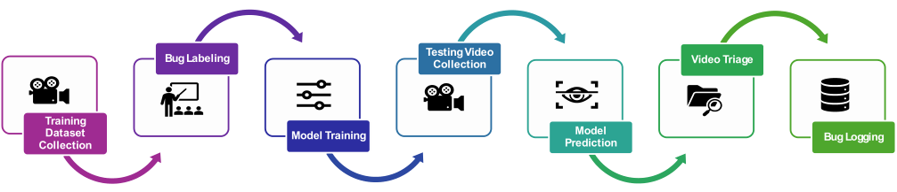
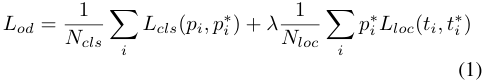
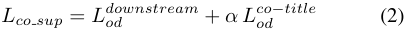
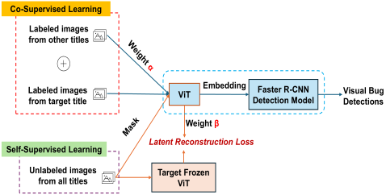
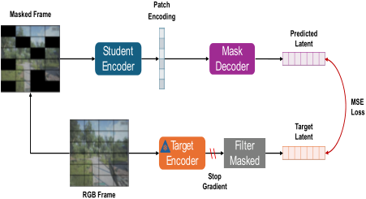
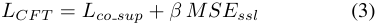
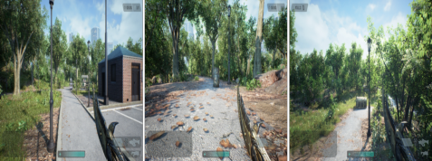
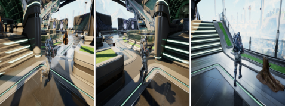
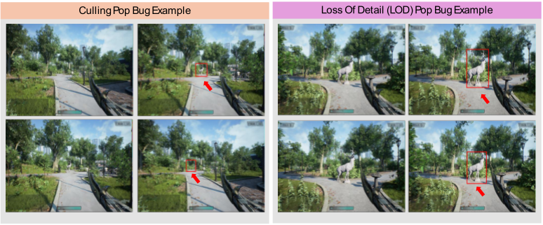
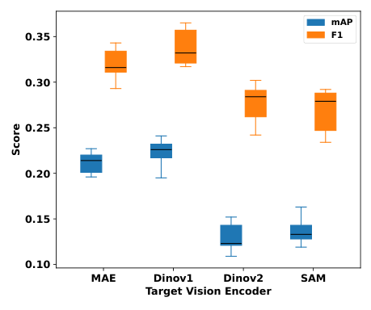

**A Hybrid Co-Finetuning Approach for Visual Bug Detection in Video Games** 

**Faliu Yi*** 1 **Sherif Abdelfattah*** 1 **Wei Huang**1 **Adrian Brown**1 

# **Abstract** 

Manual identification of visual bugs in video games is a resource-intensive and costly process, often demanding specialized domain knowledge. While supervised visual bug detection models offer a promising solution, their reliance on extensive labeled datasets presents a significant challenge due to the infrequent occurrence of such bugs. To overcome this limitation, we propose a hybrid Co-FineTuning (CFT) method that effectively integrates both labeled and unlabeled data. Our approach leverages labeled samples from the target game and diverse co-domain games, additionally incorporating unlabeled data to enhance feature representation learning. This strategy maximizes the utility of all available data, substantially reducing the dependency on labeled examples from the specific target game. The developed framework demonstrates enhanced scalability and adaptability, facilitating efficient visual bug detection across various game titles. Our experimental results show the robustness of the proposed method for game visual bug detection, exhibiting superior performance compared to conventional baselines across multiple gaming environments. Furthermore, CFT maintains competitive performance even when trained with only 50% of the labeled data from the target game. 

# **1. INTRODUCTION** 

Over the past decade, the video game industry has experienced substantial growth, driven by advancements in 3D game engines, increased computing power, expanded Internet bandwidth, and sustained consumer demand (Skwarczek, 2021). This growth has coincided with a corresponding rise in the complexity and scale of game development, necessitating the deployment of large quality assurance teams to 

> *Equal contribution 1Xbox Studios Quality AI Lab, Xbox Game Studios, Microsoft, USA. Correspondence to: Faliu Yi _<_ faliuyi@microsoft.com _>_ , Sherif Abdelfattah _<_ sherifgad@microsoft.com _>_ . 

ensure product quality. However, the escalating demand and complexity of games present a notable challenge to this approach, as expanding the workforce entails increased costs and management overhead. One of the important game quality control activities is testing for visual bugs (Taesiri et al., 2024), which might get introduced due to issues in the code, hardware infrastructure, or networking (e.g., player load). In general, game visual bugs could be categorized into two categories: 1) bugs detectable using a single frame (e.g., texture issues, object-to-object clipping, or object floating), and 2) bugs that need multi-frame (i.e., temporal context) to be detected (e.g., glitches and lighting issues). The latter category is more challenging for the need to consider the temporal context across multiple frames, which makes it more demanding and time-consuming for quality teams performing manual testing. 

Using Computer Vision (CV) models (Paduraru et al., 2021) for automatic visual bug detection is a promising solution that can significantly reduce costs and manual labor. A typical workflow for utilizing a CV model for visual bug detection is depicted in Figure 1. The workflow starts with collecting labeled samples highlighting the bugs. Visual bugs are usually preferred to be indicated within a bounding box, making it easier to locate and fix the bugs. Consequently, an object detection annotation method (Lin et al., 2014) is wellsuited to meet this requirement. Afterwards, supervised model training is initiated on the collected datasets. During deployment time, the model predicts visual bugs on new deployment samples, followed by a triage stage to verify and isolate false-positive samples. Finally, the detected bugs are logged in the database. 

Supervised machine learning-based visual bug detection is an increasingly promising approach for automating game testing workflows, offering effective and labor-efficient solutions (Davarmanesh et al., 2020; Taesiri et al., 2020; Azizi & Zaman, 2023; 2024; Ling et al., 2020). Despite the effectiveness of the supervised learning methodology, its primary limitation is the requirement for a substantial volume of labeled training data. This is particularly challenging for multi-frame bugs, which typically have a low prevalence rate in video games. Current strategies to mitigate this issue include employing weakly supervised learning with synthetic data augmentations, which are generated using task-specific domain knowledge (Rahman, 2023). Another 

**A Hybrid Co-Finetuning Approach for Visual Bug Detection in Video Games** 

<!-- Start of picture text -->
Testing Video Bug Labeling Collection Video Triage Training CollectionDataset  Model Training PredictionModel  Bug Logging <!-- End of picture text -->

_Figure 1._ A typical workflow for visual bug detection in video games. 

approach involves leveraging the inductive bias of pretrained multimodal large language models to reduce reliance on human supervision (Taesiri et al., 2022). In contrast to this prior work, our method is independent of task-specific domain knowledge and is computationally efficient, facilitating rapid deployment and broad accessibility for game development teams. 

We propose a hybrid method utilizing both supervised and self-supervised learning objectives to leverage labeled data, providing a direct signal for bug detection, and unlabeled data, providing inductive bias on the visual semantics in the gaming domain. Moreover, our method could effectively fuse data from other games during training, which we refer to as co-finetuning, to further enhance the training data efficiency characteristics. During supervised training, we fuse the supervised loss from a target game with one from a mixture of other gaming titles using a linear gating scheme. While for self-supervised learning, we adopt a novel method following a Joint Embedding Predictive Architecture (JEPA) (Assran et al., 2023) that aims to reconstruct masked patches from unlabeled training samples on a target embedding space rather than the pixel space. Targeting reconstruction on the embedding space helps to focus the learned visual representation on high-level concepts while being robust to noise and irrelevant dynamics compared to working on the pixel space (Dawid & LeCun, 2023). Moreover, we aim to distill the target embedding from large pretrained vision encoders (Kirillov et al., 2023; Caron et al., 2021; Oquab et al., 2023), which incorporates useful inductive bias and facilitates using efficient vision encoders during inference. 

To contrast the performance of our proposed method, we evaluate its bug detection performance using three different gaming environments, while comparing it to wellestablished object detection baselines (Ren et al., 2015; Redmon et al., 2016) from the Azure machine learning platform (Azure AutoML). We summarize our contribution points as follows: 

- We propose a co-finetuning method leveraging labeled data from a target game and a mixture of other games to maximize the utilization of data labeling efforts. 

- We propose a novel self-supervised learning method that harnesses unlabeled gaming data to learn an effective visual representation and enhance data efficiency. 

- We provide a comprehensive evaluation of the proposed method using multiple gaming environments resembling actual AAA games and comparing with well-established baselines trained and fine-tuned using Azure AutoML. 

# **2. RELATED WORK** 

The emergence of machine learning has introduced automated and semi-automated approaches to enhance the efficiency of bug detection. Supervised methods for visual bug detection (Davarmanesh et al., 2020; Taesiri et al., 2020; Azizi & Zaman, 2023; 2024; Ling et al., 2020; Tamm et al., 2022) are often limited by their reliance on large, labeled datasets, which are difficult to collect from specific game titles. To address this, some researchers have proposed weak supervision methods that incorporate synthetic data derived from task-specific domain knowledge to reduce the need for manual labeling (Rahman, 2023). Another approach, demonstrated in (Arnab et al., 2022), shows that cofinetuning with multiple correlated supervised tasks, such as video action classification and object detection, can improve performance over traditional transfer learning. Our work builds upon this paradigm by combining self-supervised learning with supervised objectives. In a separate effort, a zero-shot video game bug detection method (Taesiri et al., 2022) utilized inductive bias from a large multimodal language model to mitigate reliance on supervised training samples. 

**A Hybrid Co-Finetuning Approach for Visual Bug Detection in Video Games** 

# **3. PROBLEM DEFINITION** 

Following an object detection objective, our primary aim is to accurately localize and classify visual bugs as objects within an image. Consequently, the problem is formulated as the minimization of a multi-task loss function, which balances these two essential components. We assume a region proposal approach (Ren et al., 2015) where the loss function comprises a weighted sum of the classification loss, _Lcls_ , and the bounding box regression loss, _Lloc_ , applied to both a Region Proposal Network (RPN) and the final detection head. Formally, for a given region proposal, the total loss is defined as: 

<!-- Start of picture text -->
1 1 Lod = � Lcls ( pi, p ∗ i ) +  λ � p ∗ i Lloc ( ti, t∗ i ) Ncls Nloc i i (1) <!-- End of picture text -->

Here, _i_ refers to the index of an anchor (for the RPN) or a region of interest (for the detection head). _pi_ is the predicted probability of anchor _i_ being an object, while _p__∗_ _i_is its corre- sponding ground-truth label (1 for positive, 0 for negative). _ti_ represents the predicted bounding box regression offsets for anchor _i_ , and _t__∗_ _i_denotes the ground-truth bounding box regression offsets for a positive anchor _i_ . _Ncls_ is the minibatch size utilized for classification, and _Nloc_ is the number of anchor locations used for localization. Finally, _λ_ is a balancing weight used to normalize the contributions of the classification and localization losses. 

# **4. METHODOLOGY** 

In this section, we introduce the details of our proposed hybrid co-finetuning method. Figure 2 depicts the design of our proposed method, highlighting two main learning objectives, including: 1) co-supervised learning, and 2) selfsupervised learning. This design aims to harness learning signals from both labeled and unlabeled data to enhance the detection performance. We outline each of these learning objectives as follows. 

## **4.1. Co-supervised Learning Module** 

The objective of this learning module is to utilize labeled data from the downstream gaming title (i.e., the one under investigation) and from other gaming titles that might still provide relevant learning signals about the notion of bugs that we aim to detect. Thus, we combine labeled data into two groups, including the downstream and the co-title. During training, we sample mini-batches from each group and fuse the supervised loss (see Eq. 1) using a weight hyperparameter _α_ : 

<!-- Start of picture text -->
Lco s up =  L od downstream +  α L co od −title (2) <!-- End of picture text -->

<!-- Start of picture text -->
Co-Supervised Learning Labeled images from other titles Labeled images  ViT Embedding Faster R-CNN Visual Bug from target title Detection Model Detections Weight β Latent Reconstruction Loss Self- Supervised Learning Unlabeled images  Target Frozen from all titles ViT <!-- End of picture text -->

_Figure 2._ A block diagram for the Co-finetuning method design. It involves two main objectives: a self-supervised target distillation objective and a co-supervised object detection objective. 

We adopt a Faster R-CNN (Ren et al., 2015) object detection architecture with a Vision Transformer (ViT) (Dosovitskiy et al., 2020) backbone. The Faster R-CNN detection head includes a region proposal network, a classification head, and a box regression head. As per Equation 1, we utilize a cross-entropy loss for the _Lcls_ term, and a smooth L1 loss for the _Lloc_ term. 

This co-finetuning algorithm includes both co-supervised learning and self-supervised learning components. For the co-supervised learning part, there are two types of labeled images: one from the target game title and the other from different game titles. Labeled images from multiple titles can increase the diversity of multi-frame bugs and enhance performance. The labeled images from the target downstream title and other titles should have different importance during the training phase. Therefore, we assign a weight _α_ to the labeled images from other titles, which is reflected in the loss calculation. 

## **4.2. Self-supervised Learning Module** 

To leverage additional learning signals from unlabeled data that could be collected at a cheaper cost in comparison to labeled the one, we propose a Self-supervised Learning (SSL) module that works as an auxiliary loss signal generator during training time. Our SSL design is inspired by the image Masked Autoencoders (MAE) (He et al., 2022) and Image-based Joint-Embedding Predictive Architecture (I-JEPA) (Assran et al., 2023), in terms of using reconstruction after masking as a target and performing reconstruction on the latent space, respectively. Yet, our approach differs in using a separate target encoder from the one used by the architecture, which also acts as a distillation target during reconstruction. Figure 3 illustrates the workflow of our SSL module. We combine images from all titles, including the downstream one, to form an unlabeled dataset. For a given unlabeled image sample, we divide it into equal- 

**A Hybrid Co-Finetuning Approach for Visual Bug Detection in Video Games** 

<!-- Start of picture text -->
Patch Masked Frame Encoding Predicted Latent Student Mask Encoder Decoder MSE Loss Target Latent Target Filter \\ Encoder Masked Stop Gradient RGB Frame <!-- End of picture text -->

_Figure 3._ Illustration for our proposed self-supervised objective. We follow a latent masked autoencoder with a target distillation criterion, where an input frame is patchified and masked, then we feed the original version into a target encoder and the masked one to our student encoder, finally, we calculate the reconstruction error on the latent space, mainly considering masked patches. 

sized patches (similar to the ViT (Dosovitskiy et al., 2020) approach), then we create another replica by performing patch-wise random masking (with a masking ratio of 0.75) on it. We feed the original image to the target encoder, which is kept frozen during training, and the masked one to the student encoder used inside our architecture. Instead of calculating the reconstruction loss on the pixel space as in MAEs (He et al., 2022), we target to reconstruct the masked patches on the latent space of the target encoder, similar to I- JEPA (Assran et al., 2023). After encoding all the patches in the input image using the student encoder, including masked ones, we reconstruct the masked patches using a mask decoder. Finally, we match the reconstructed latents with the target ones from the target encoder to calculate our SSL loss. We note that we only focus our latent reconstruction loss on the masked patches without considering the unmasked ones by filtering them out of the loss computation. 

We utilize Mean Squared Error (MSE) to calculate the latent construction error, and we combine the SSL loss term with the co-supervised one using a hyperparameter _β_ . 

<!-- Start of picture text -->
LCF T =  Lco s up +  β MSE ssl (3) <!-- End of picture text -->

we developed using the Unreal Engine and one released Xbox game. We followed an automated data collection from experimental games using the UnrealCV plugin (Qiu & Yuille, 2016) and manual collection from the released Xbox game. We outline the games as follows: 

- **GiantMap:** This game simulates a large city park area featuring open-world characteristics with trails, playgrounds, service facilities, and natural scenery. We scatter 3D assets around the park and randomly inject visual bugs into a certain portion of them. Representative frames from GiantMap are presented in Figure 4. 

- **HighRise:** This game is part of the Shooter game demo from Unreal Engine. It simulates a futuristic indoor environment of a two-story building. HighRise is a fastpaced shooter that showcases advanced architectural designs and dynamic lighting effects. Representative frames from this game are illustrated in Figure 5. 

- **CombatGame:** This is a real combat-oriented AAA game that highlights tactical engagements, weaponbased combat, and rugged terrain. We do not show frames from this environment for privacy reasons. 

_Figure 4._ Representative frames from the GiantMap game. 

# **5. EXPERIMENTAL EVALUATION** 

_Figure 5._ Representative frames from the HighRise game. 

In this section, we introduce details of our experimental evaluation, including the dataset, baselines, experiments, and results. 

## **5.1. Data Collection and Splitting Strategy** 

We collected datasets from three distinct video game titles, each offering unique visual styles and gameplay dynamics. The selected titles include two experimental games that 

This study addresses multi-frame visual artifacts, specifically Level of Detail (LOD) pops and culling pops. An LOD pop occurs when an object’s visual representation, such as its texture or geometric detail, undergoes an abrupt change as a viewer’s distance to it varies, resulting in a discontinuous LOD transition. Conversely, a culling pop manifests as the sudden appearance or disappearance of an object 

**A Hybrid Co-Finetuning Approach for Visual Bug Detection in Video Games** 

within the rendered scene, typically in response to changes in viewer proximity or orientation. Illustrative examples of both culling and LOD pops are provided in Figure 6. 

The dataset for each game title was partitioned into training, validation, and testing sets. The training set includes approximately 4,000 pops (GiantMap: 4503, CombatGame: 4661, Highrise: 2866), while both validation and testing sets each contain roughly 500 pops (Validation: GiantMap: 500, CombatGame: 543, Highrise: 351; Testing: GiantMap: 503, CombatGame: 507, Highrise: 352). Full details on pop and image counts for all four titles are in Table 1. Note that image counts may differ from pop counts, as one image can contain multiple pops. Each pop was annotated by one person, verified by a second, and adjudicated by a third in cases of disagreement. Additionally, 2,000 unlabeled images were randomly sampled per game title. For training on each target game, the other two games will serve as co-titles. 

## **5.2. Comparison Baselines** 

We use the object detection models provided by Azure AutoML as our baseline. Azure AutoML is a cloud-based service within Microsoft Azure’s Automated Machine Learning suite that enables users to automatically build, train, and deploy machine learning models, including those for object detection. Azure AutoML supports two types of object detection architectures: a two-stage Faster R-CNN detector (Ren et al., 2015) and a single-stage YOLOv5 detector (Redmon et al., 2016; Jocher et al., 2020). When running object detection tasks, Azure AutoML automatically explores multiple variants of these models and selects the best-performing model based on a validation dataset and a specified target metric. We refer to the selected Azure AutoML variant as “AutoML” in our result reporting for brevity. In our case, the target metric is mean average precision (mAP) (Ren et al., 2015). Thus, our comparison baseline is not a single fixed model, but rather the result of an automated search across state-of-the-art deep learning architectures. All hyperparameters are tuned using the validation data, and the final model is chosen based on its performance against the mAP metric. 

For multi-frame pop data, the pop bug only becomes apparent when analyzing sequences of frames. Therefore, using a single image as input is insufficient for detecting the issue. However, Azure AutoML object detection models require input images to have exactly three channels. To address this, we construct a three-channel image using a grayscale difference stacking approach. The idea is to use a sequence of four RGB images, where the pop bug occurs in the third frame. These four RGB images are first converted to grayscale. Then, we compute the absolute differences between consecutive grayscale frames to capture motion or changes across time. These different images 

are stacked to form a new three-channel image suitable for input into the Azure AutoML model.The process is further described as follows: four RGB frames- _rgb_ 0, _rgb_ 1, _rgb_ 2, and _rgb_ 3-are used, with the pop bug occurring in _rgb_ 2. Each RGB image is converted to grayscale, resulting in _gray_ 0, _gray_ 1, _gray_ 2, and _gray_ 3. Then, the absolute differences between consecutive grayscale images are computed: _diff_ 1 = _|gray_ 1 _− gray_ 0 _|_ , _diff_ 2 = _|gray_ 2 _− gray_ 1 _|_ , and _diff_ 3 = _|gray_ 3 _− gray_ 2 _|_ where _| · |_ denotes the absolute value operation. These three different images are stacked to form a new three-channel image, denoted as img, which is subsequently used as input for both the Azure AutoML object detection model and our proposed CFT model. This image preparation step for the model input is also illustrated in Figure 7. 

## **5.3. Research Questions** 

Our experimental evaluation setup aims to assess the different aspects of the proposed hybrid co-finetuning method by answering the following research questions. 

- **[RQ1]** : How does the visual bug detection performance of the proposed method compare to wellestablished object detection baselines using the evaluation gaming environments? 

- **[RQ2]** : What would be the suitable mixing strategy when learning from mixed gaming data? 

- **[RQ3]** : What is the impact of different building blocks in the proposed hybrid co-finetuning method? 

- **[RQ4]** : Could the proposed hybrid co-finetuning method generalize its performance to other types of visual bugs in games? 

## **5.4. Results & Discussion** 

In this section, we present and discuss the evaluation results answering the defined research questions. 

## 5.4.1. VISUAL BUG DETECTION PERFORMANCE COMPARISON WITH BASELINES: 

We answer **RQ1** by assessing the CFT model performance compared to Azure AutoML baselines in terms of key evaluation metrics—mean Average Precision (mAP) (Everingham et al., 2010) and F1 score (Goutte & Gaussier, 2005). A model is considered effective if it achieves higher mAP and F1 scores than the baseline. However, even if the CFT model delivers comparable performance, it may still be preferable if it requires significantly less labeled data. This consideration is particularly important in the gaming domain, where acquiring labeled bug data is both timeconsuming and resource-intensive. Therefore, a model that 

**A Hybrid Co-Finetuning Approach for Visual Bug Detection in Video Games** 

<!-- Start of picture text -->
Culling Pop Bug Example Loss Of Detail (LOD) Pop Bug Example <!-- End of picture text -->

_Figure 6._ Two examples of pop visual bugs from the GiantMap game. On the left, a culling pop bug example. On the right, a LoD pop example. 

|Game Title Trai|ning|Vali|dation|Testing|Number of |
|---|---|---|---|---|---|
| # of pop|# of image|# of pop|# of image|# of pop # of image|Unlabeled Images|
|GiantMap 4503|4491|500|500|503 499|2000|
|CombatGame 4661 Highrise 2866|1574 2856|547 351|146 347|507 247 352 345|2000 2000|
|_Table 1._ Train-Validation-T|est data splits|and number o|f unlabeled sa **Step 3: Comb** **image**|mples across the experiment **RGB** **image** **Step 1: Gr** **ima** **Step 2: Absolute** **difference image** **ined**|al gaming datasets. **ayscale** **ge**|

_Figure 7._ An illustration of the input sliding window preparation procedure. RGB images are first converted to grayscale, then absolute deltas are computed, and finally, these deltas are combined into a three-channel image. 

**A Hybrid Co-Finetuning Approach for Visual Bug Detection in Video Games** 

maintains competitive performance while reducing the need for labeled data offers a substantial practical advantage. 

Azure AutoML automatically evaluates both Faster R-CNN and YOLO V5 for bug detection and selects the best performing baseline based on the validation dataset. We use mean average precision (mAP) with an intersection over union (IoU) threshold of 0.5 for pop bug detection. Additionally, we measure the F1 score with IoU=0.5 and a classification threshold of 0.25. We select a threshold of 0.25 for result comparison because recall is usually more important for visual bug classification. The results for these metrics, based on the testing dataset for Azure AutoML and the co-finetuning (CFT) method, are presented in Table 2. 

In order to perform a statistical significance t-test for mAP and F1 metrics for each pair, we normalized each metric value for each game title. For example, we normalized the mAP values [0 _._ 662 _,_ 0 _._ 938] from different algorithms to [0 _._ 413 = 0 _._ 662 _/_ (0 _._ 662 + 0 _._ 938) _,_ 0 _._ 586 = 0 _._ 938 _/_ (0 _._ 662 + 0 _._ 938)] for game title GiantMap. This normalization is necessary because each game title has its own testing dataset, resulting in varied scales that make cross-title comparisons incomparable. The results are shown in Table 3. Here, three samples were used, with each title contributing a single value to the statistical tests. It can be seen from Table 3 that the difference between the results from Azure AutoML and CFT is statistically significant at the 0.05 level, even with 50% training data in CFT, indicating that CFT achieves better results than Azure AutoML. Furthermore, the difference between CFT using the full training data and 50% of the training data is not statistically significant, suggesting that even with less training data, CFT can still produce comparable results. Additional t-tests were conducted on these results, as shown in Table 3. It can be observed that reducing the training dataset does not significantly degrade performance in most cases for CFT in terms of mAP. However, when the training dataset is halved in Azure AutoML, the performance drops considerably. In contrast, CFT maintains better performance in terms of mAP metrics compared to the Azure AutoML baseline when trained on only half of the dataset. 

## 5.4.2. ASSESSING THE DATA MIXING STRATEGY FOR CO-FINETUNING: 

The CFT model incorporates both co-supervised and selfsupervised learning. However, optimizing the balance of these components, specifically their weighting during training, remains an open question as indicated in **RQ2** . This study investigates the impact of explicitly tuning this mixing strategy on model performance. An unsuitable weighting scheme could either underutilize labeled data or fail to fully leverage self-supervised learning benefits. Through simulations, we aim to understand the role of this mixing 

strategy, determining whether a fixed or adaptive weighting approach yields superior results and if model performance is sensitive to these choices. This investigation will clarify whether the mixing strategy should be considered a critical hyperparameter for the CFT model. We kept all other algorithmic parameters fixed and systematically varied the weights assigned to the co-supervised learning (CSL) and self-supervised learning (SSL) components, denoted as _α_ and _β_ , respectively (see Figure 2). To determine the optimal values for these hyperparameters, we conducted a grid search over a predefined range of _α_ and _β_ , spanning from 0 to 0.6 in increments of 0.1. The best combination was selected based on performance on the validation datasets across three distinct game titles. 

Table 4 summarizes the results, indicating that the optimal _β_ value remains relatively consistent across titles, centering around 0.2. Conversely, _α_ demonstrates greater variability, suggesting its optimal value is more sensitive to individual game title characteristics. The magnitude of _α_ generally exceeds _β_ , implying the CSL component holds a more influential role in bug prediction performance. These findings suggest that while _β_ can be fixed at 0.2 for new titles, careful tuning of _α_ is recommended for dataset adaptation. This insight can streamline hyperparameter optimization when extending the visual bug detection framework to new game titles. 

|Title|mAP|F1|_β_|_α_|
|---|---|---|---|---|
|GiantMap|0.941|0.890|0.3|0.4|
|CombatGame|0.164|0.404|0.2|0.5|
|Highrise|0.384|0.471|0.2|0.3|

_Table 4._ Optimal weighting schemes for CSL and SSL across experimental gaming environments. 

## 5.4.3. ABLATION STUDY: 

To address **RQ3** , which aims to assess the impact of the CFT model’s constituent components, we conduct an ablation study evaluating the necessity and contribution of its core elements: co-supervised learning (CSL) and self-supervised learning (SSL). This involves incrementally adding CSL and SSL components to determine their influence on performance. Additionally, we investigate the effect of different backbone architectures, specifically ViT-Base (Dosovitskiy et al., 2020) and ResNet-50 (He et al., 2016), to assess the model’s sensitivity to backbone choice and identify optimal architectures for the given tasks. Finally, we explore the impact of various target encoders within the SSL component, evaluating pretrained encoders from state-of-the-art selfsupervised learning methods such as DINOv1 (Caron et al., 2021), DINOv2 (Oquab et al., 2023), MAE (He et al., 2022), 

**A Hybrid Co-Finetuning Approach for Visual Bug Detection in Video Games** 

|||m|AP|||F|1||
|---|---|---|---|---|---|---|---|---|
|Dataset|Aut|oML|CF|T|Aut|oML|C|FT|
||100%|50%|100%|50%|100%|50%|100%|50%|
|Giantmap|0.662|0.560|**0.938**|**0.945**|0.747|0.777|**0.976**|**0.969**|
|CombatGame|0.159|0.106|**0.164**|**0.158**|0.418|0.337|**0.445**|**0.450**|
|Highrise|0.209|0.202|**0.349**|**0.235**|0.312|0.355|**0.533**|**0.455**|

_Table 2._ Visual bug detection performance results compared to the best performing Azure AutoML baseline using full and half the size of the training datasets. 

|Metric|T-test|P-value|
|---|---|---|
||AutoML (100%) vs CFT (100%)|0.007|
|AP|AutoML (100%) vs CFT (50%)|0.026|
|m|CFT (100%) vs CFT (50%)|0.054|
||AutoML (50%) vs CFT (50%)|0.009|
||AutoML (100%) vs AutoML (50%)|0.007|
||AutoML (100%) vs CFT (100%)|0.004|
|F1|AutoML (100%) vs CFT (50%)|0.001|
||CFT (100%) vs CFT (50%)|0.079|
||AutoML (50%) vs CFT (50%)|0.000|
||AutoML (100%) vs AutoML (50%)|0.965|

_Table 3._ Statistical significance t-test analysis comparing the CFT method with the best performing baseline selected by Azure AutoML using full and half the size of the training data. 

and SAM (Kirillov et al., 2023), all based on the ViT-Base architecture. This analysis will clarify how target encoder selection influences the quality of learned representations and overall effectiveness. 

<!-- Start of picture text -->
mAP 0.35 F1 0.30 0.25 0.20 0.15 0.10 MAE Dinov1 Dinov2 SAM Target Vision Encoder Score <!-- End of picture text -->

_Figure 8._ Assessing the impact of using different target vision encoders on the CFT method performance. 

We also experimented with the widely adopted ResNet50 (He et al., 2016) backbone. It is crucial to note the differing input image dimensions: 600 _×_ 600 pixels for ResNet-50 versus 224 _×_ 224 pixels for ViT. The corresponding performance metrics, including mean Average Precision (mAP) and F1 score, are presented in Table 6. A comparison of these results with those obtained using the ViT-base backbone (Table 2) reveals relatively minor differences in mAP and F1 score. However, the metrics for each game title appear slightly better when using the ViT-base backbone compared to ResNet-50. To rigorously evaluate this observation, we conducted a paired t-test on the mAP scores obtained from both backbones. The resulting p-value of 0.041 indicates that the performance difference is statistically significant at the conventional p-value=0.05 threshold. This finding suggests that the ViT-base backbone yields superior visual bug detection performance relative to ResNet-50, reinforcing its potential as a more effective architecture for this task. 

To evaluate the individual contributions of CSL and SSL to visual bug detection, we conducted an ablation study using a ResNet-50 backbone. We assessed the CFT model’s performance across four configurations: with both CSL and SSL enabled, with only CSL, with only SSL, and with neither. 

Table 6 summarizes these results, where ”True” denotes inclusion and ”False” denotes exclusion of a component. The highest performance, in terms of both mean Average Precision (mAP) and F1 score, is observed when both CSL and SSL are enabled. Conversely, the absence of both components yields the lowest performance, underscoring their collective importance. 

Interestingly, enabling only SSL does not significantly improve performance over the baseline (neither component enabled), suggesting that SSL alone may be insufficient in this context. However, the inclusion of CSL, even without SSL, leads to substantial performance gains, indicating CSL’s more dominant role in enhancing the model’s comprehension of visual bugs. Nevertheless, SSL provides complementary benefits, as its addition to a CSL-enabled model further boosts performance. This demonstrates that while 

**A Hybrid Co-Finetuning Approach for Visual Bug Detection in Video Games** 

CSL is highly impactful independently, SSL contributes additional value synergistically. 

||P-Value(mAP)|P-Value(F1)|
|---|---|---|
|MAE vs SAM|0.0|0.0077|
|DINOv2 vs SAM|0.5036|0.6184|
|DINOv1 vs MAE|0.3084|0.1834|
|DINOv2 vs MAE|0.0|0.0145|
|DINOv1 vs DINOv2|0.0|0.0025|

_Table 5._ Statistical significance t-test analysis for using different target vision encoders in the self-supervised learning objective of the CFT method. 

We further investigate the impact of different target vision encoders used in the SSL component of the CFT model. Specifically, we evaluate four widely adopted pretrained Vision Transformer (ViT) encoders: DINOv1, DINOv2, MAE, and SAM. Each vision encoder is seamlessly integrated into the CFT framework. To ensure statistical robustness, we perform five independent simulation runs for each configuration using the half Highrise training dataset, which accelerates simulation without compromising generality. The results are visualized in the box-and-whisker plots shown in Figure 8. From Figure 8, we observe that the MAE and DINOv1 vision encoders yield highly overlapping distributions in both mAP and F1 score, suggesting comparable performance. To statistically validate this observation, we perform a two-sample t-test between the results of DINOv1 and MAE mAP. The resulting p-value of 0.3084 indicates that the performance difference between these two vision encoders is not statistically significant at the 0.05 level. In contrast, the performance of DINOv2 and SAM encoders is notably lower. A t-test comparing MAE and SAM mAP yields a p-value of 0.0, confirming a statistically significant difference in performance. More t-test results are given in Table 5. These findings suggest that while DINOv2 and SAM may be effective in other contexts, they are less suitable as target encoders in the SSL component of the CFT model. These results indicate that both MAE and DINOv1 serve as strong candidates for the target encoder in SSL, offering significantly better performance than DINOv2 and SAM. Given their similar effectiveness, either MAE or DINOv1 can be confidently selected for use in the CFT framework. 

## 5.4.4. GENERALIZATION TO OTHER VISUAL BUG TYPES IN GAMES: 

Answering research question **RQ4** , we evaluate the proposed method’s generalization capabilities for detecting single-frame visual bugs. These bugs primarily include 

floating object artifacts and texture distortions. Floating object bugs manifest when objects, typically expected to rest on a surface, appear suspended above it, creating a visible gap. Texture bugs are categorized as low-resolution texture defects, characterized by blurriness or lack of detail, and stretched texture distortions, where textures appear unnaturally elongated or distorted on an object’s surface. 

We evaluated the CFT model on these single-frame bug categories using the GiantMap and HighRise datasets. The GiantMap dataset includes 1,320 training, 120 validation, and 960 testing samples. The HighRise dataset comprises 3,326 training, 287 validation, and 2,450 testing samples. Evaluation results, measured by mean Average Precision (mAP) on the test sets, are presented in Table 7. As shown, CFT consistently outperforms AutoML on the GiantMap title for both floating and texture single-frame bug categories, regardless of the training dataset size (full or half). This highlights CFT’s robustness and effectiveness in this context. Conversely, for the HighRise title, CFT and AutoML exhibit comparable performance, achieving similar results, particularly within the texture bug category. 

# **6. IMPLEMENTATION DETAIL** 

Model training was primarily conducted on a server featuring an NVIDIA RTX A6000 GPU with 49 GB of memory, running Ubuntu 18.04. Training spanned 30 epochs with a base learning rate of 0.0001. The per-device batch size was initialized to 10. To achieve a larger effective batch size without exceeding GPU memory, we utilized gradient accumulation with an accumulation step of 10, resulting in an effective batch size of 100 (10×10=100). When adapting to different hardware, the per-device batch size was adjusted, while maintaining an effective batch size of 100 by proportionally modifying the accumulation step, ensuring consistent training dynamics. For optimization, the AdamW optimizer (Loshchilov & Hutter, 2017) was employed alongside a cosine annealing learning rate schedule (Loshchilov & Hutter, 2016). A warm-up phase was applied during the initial 10 epochs to stabilize early training. Additionally, L2 regularization with a weight decay coefficient of 0.0005 was used to mitigate overfitting and enhance generalization. 

# **7. CONCLUSION** 

We introduce a hybrid co-finetuning (CFT) method for multiframe visual bug detection, which enhances performance and data efficiency by leveraging both labeled and unlabeled training data. This is achieved through a hybrid workflow that fuses supervised and self-supervised learning signals from the target game domain with a co-domain derived from a mixture of other games. 

Our comprehensive evaluation compared the proposed 

**A Hybrid Co-Finetuning Approach for Visual Bug Detection in Video Games** 

||SSL: True|,|CSL: True|SSL: Tru|e, CSL: False|SSL: Fals|e, CSL: True|SSL: Fal|se, CSL: False|
|---|---|---|---|---|---|---|---|---|---|
||mAP||F1|mAP|F1|mAP|F1|mAP|F1|
|GiantMap|**0.936**||**0.918**|0.901|0.842|0.918|0.890|0.898|0.836|
|CombatGame|**0.154**||**0.438**|0.062|0.295|0.144|0.413|0.056|0.281|
|Highrise|**0.330**||**0.434**|0.061|0.169|0.329|0.418|0.057|0.090|

_Table 6._ Performance impact of co-supervised learning (CSL) and self-supervised (SSL) objectives on the CFT model performance. 

|Game Title|Auto|Floa ML|ting C|FT|Auto|Tex ML|ture C|FT|
|---|---|---|---|---|---|---|---|---|
||100%|50%|100%|50%|100%|50%|100%|50%|
|Giantmap|0.831|0.811|**0.864**|**0.850**|0.796|0.781|**0.828**|**0.803**|
|Highrise|**0.733**|**0.690**|0.721|0.618|0.965|0.954|**0.968**|**0.956**|

_Table 7._ Single frame visual bug detection performance results comparing the CFT method with the best performing Azure AutoML baseline. 

method against established baselines across three distinct AAA game titles. The performance results indicate that our method consistently outperforms the best baseline on all datasets. Notably, it maintains a statistically significant performance advantage even when trained with half the size of the original datasets. We also conducted an extensive ablation study to evaluate the impact of different architectural components within the proposed method. Finally, we demonstrated the method’s generalization potential by applying it to other types of visual bugs sampled from two additional gaming environments. 

Our future work directions are outlined. We aim to investigate methodologies for learning a shared embedding space across multiple vision modalities (Bachmann et al., 2022; Girdhar et al., 2022) during training time while restricting inference to the pixel modality for runtime efficiency. Another direction involves exploring adaptive data mixing strategies (Hejna et al., 2024) to identify an optimal scheme tailored to specific downstream gaming domains. Finally, we plan to cover additional multi-frame visual bug types, such as Z-fighting or lighting bugs. In terms of training time, under identical hyperparameter settings, the baseline model for Giantmap trains in about 1.5 hours, while the CFT takes roughly 9.3 hours. Accelerating CFT training remains a direction for further study. 

In conclusion, our CFT method effectively demonstrates the benefits of supervised co-finetuning using a mixture of other games, while simultaneously leveraging unlabeled data through self-supervised learning as an auxiliary objective. 

# **References** 

- Arnab, A., Xiong, X., Gritsenko, A., Romijnders, R., Djolonga, J., Dehghani, M., Sun, C., Luciˇ c, M., and Schmid,´ C. Beyond transfer learning: Co-finetuning for action localisation. _arXiv preprint arXiv:2207.03807_ , 2022. 

- Assran, M., Duval, Q., Misra, I., Bojanowski, P., Vincent, P., Rabbat, M. G., LeCun, Y., and Ballas, N. Self-supervised learning from images with a joint-embedding predictive architecture. In _IEEE/CVF Conference on Computer Vision and Pattern Recognition, CVPR 2023, Vancouver, BC, Canada, June 17-24, 2023_ , pp. 15619–15629. IEEE, 2023. 

- Azizi, E. and Zaman, L. Automatic bug detection in games using lstm networks. In _2023 IEEE Conference on Games (CoG)_ , pp. 1–4, 2023. 

- Azizi, E. and Zaman, L. Astrobug: Automatic game bug detection using deep learning. _IEEE Transactions on Games_ , 16(4):793–806, 2024. 

- Bachmann, R., Mizrahi, D., Atanov, A., and Zamir, A. Multimae: Multi-modal multi-task masked autoencoders. In Avidan, S., Brostow, G. J., Cisse,´ M., Farinella, G. M., and Hassner, T. (eds.), _Computer Vision - ECCV 2022 - 17th European Conference, Tel Aviv, Israel, October 23-27, 2022, Proceedings, Part XXXVII_ , volume 13697 of _Lecture Notes in Computer Science_ , pp. 348–367. Springer, 2022. 

- Caron, M., Touvron, H., Misra, I., Jegou,´ H., Mairal, J., Bojanowski, P., and Joulin, A. Emerging properties in self-supervised vision transformers. In _Proceedings of the IEEE/CVF international conference on computer vision_ , pp. 9650–9660, 2021. 

**A Hybrid Co-Finetuning Approach for Visual Bug Detection in Video Games** 

- Davarmanesh, P., Jiang, K., Ou, T., Vysogorets, A., Ivashkevich, S., Kiehn, M., Joshi, S. H., and Malaya, N. Automating artifact detection in video games. _arXiv preprint arXiv:2011.15103_ , 2020. 

- Dawid, A. and LeCun, Y. Introduction to latent variable energy-based models: A path towards autonomous machine intelligence. _CoRR_ , abs/2306.02572, 2023. 

- Dosovitskiy, A., Beyer, L., Kolesnikov, A., Weissenborn, D., Zhai, X., Unterthiner, T., Dehghani, M., Minderer, M., Heigold, G., Gelly, S., et al. An image is worth 16x16 words: Transformers for image recognition at scale. _arXiv preprint arXiv:2010.11929_ , 2020. 

- Everingham, M., Gool, L. V., Williams, C. K. I., Winn, J. M., and Zisserman, A. The pascal visual object classes (VOC) challenge. _Int. J. Comput. Vis._ , 88(2):303–338, 2010. 

- Girdhar, R., Singh, M., van der Maaten, L., Joulin, A., and Misra, I. Omnivore: A single model for many visual modalities. In _IEEE/CVF Conference on Computer Vision and Pattern Recognition, CVPR 2022, New Orleans, LA, USA, June 18-24, 2022_ , pp. 16081–16091. IEEE, 2022. 

- Goutte, C. and Gaussier, E. A probabilistic interpretation of precision, recall and f-score, with implication for evaluation. In _European conference on information retrieval_ , pp. 345–359. Springer, 2005. 

- He, K., Zhang, X., Ren, S., and Sun, J. Deep residual learning for image recognition. In _2016 IEEE Conference on Computer Vision and Pattern Recognition, CVPR 2016, Las Vegas, NV, USA, June 27-30, 2016_ , pp. 770–778. IEEE Computer Society, 2016. 

- He, K., Chen, X., Xie, S., Li, Y., Dollar, P., and Girshick,´ R. Masked autoencoders are scalable vision learners. In _Proceedings of the IEEE/CVF conference on computer vision and pattern recognition_ , pp. 16000–16009, 2022. 

- Hejna, J., Bhateja, C. A., Jiang, Y., Pertsch, K., and Sadigh, D. Remix: Optimizing data mixtures for large scale imitation learning. In Agrawal, P., Kroemer, O., and Burgard, W. (eds.), _Conference on Robot Learning, 6- 9 November 2024, Munich, Germany_ , volume 270 of _Proceedings of Machine Learning Research_ , pp. 145–164. PMLR, 2024. 

- Jocher, G., Stoken, A., Borovec, J., Changyu, L., Hogan, A., Diaconu, L., Poznanski, J., Yu, L., Rai, P., Ferriday, R., et al. ultralytics/yolov5: v3. 0. _Zenodo_ , 2020. 

- Kirillov, A., Mintun, E., Ravi, N., Mao, H., Rolland, C., Gustafson, L., Xiao, T., Whitehead, S., Berg, A. C., Lo, W.-Y., et al. Segment anything. In _Proceedings of the IEEE/CVF international conference on computer vision_ , pp. 4015–4026, 2023. 

- Lin, T.-Y., Maire, M., Belongie, S., Hays, J., Perona, P., Ramanan, D., Dollar, P., and Zitnick, C. L.´ Microsoft coco: Common objects in context. In _Computer vision–ECCV 2014: 13th European conference, zurich, Switzerland, September 6-12, 2014, proceedings, part v 13_ , pp. 740– 755. Springer, 2014. 

- Ling, C., Tollmar, K., and Gisslen, L.´ Using deep convolutional neural networks to detect rendered glitches in video games. In _Proceedings of the AAAI Conference on Artificial Intelligence and Interactive Digital Entertainment_ , volume 16, pp. 66–73, 2020. 

- Loshchilov, I. and Hutter, F. Sgdr: Stochastic gradient descent with warm restarts. _arXiv preprint arXiv:1608.03983_ , 2016. 

- Loshchilov, I. and Hutter, F. Decoupled weight decay regularization. _arXiv preprint arXiv:1711.05101_ , 2017. 

- Oquab, M., Darcet, T., Moutakanni, T., Vo, H., Szafraniec, M., Khalidov, V., Fernandez, P., Haziza, D., Massa, F., ElNouby, A., et al. Dinov2: Learning robust visual features without supervision. _arXiv preprint arXiv:2304.07193_ , 2023. 

- Paduraru, C., Paduraru, M., and Stefanescu, A. Automated game testing using computer vision methods. In _2021 36th IEEE/ACM International Conference on Automated Software Engineering Workshops (ASEW)_ , pp. 65–72, 2021. 

- Qiu, W. and Yuille, A. L. Unrealcv: Connecting computer vision to unreal engine. In Hua, G. and Jegou, H. (eds.),´ _Computer Vision - ECCV 2016 Workshops - Amsterdam, The Netherlands, October 8-10 and 15-16, 2016, Proceedings, Part III_ , volume 9915 of _Lecture Notes in Computer Science_ , pp. 909–916, 2016. 

- Rahman, F. Weak supervision for label efficient visual bug detection. _arXiv preprint arXiv:2309.11077_ , 2023. 

- Redmon, J., Divvala, S. K., Girshick, R. B., and Farhadi, A. You only look once: Unified, real-time object detection. In _2016 IEEE Conference on Computer Vision and Pattern Recognition, CVPR 2016, Las Vegas, NV, USA, June 27-30, 2016_ , pp. 779–788. IEEE Computer Society, 2016. 

- Ren, S., He, K., Girshick, R. B., and Sun, J. Faster R-CNN: towards real-time object detection with region proposal networks. In _Advances in Neural Information Processing Systems 28: Annual Conference on Neural Information Processing Systems 2015, December 7-12, 2015, Montreal, Quebec, Canada_ , pp. 91–99, 2015. 

- Skwarczek, B. How the gaming industry has leveled up during the pandemic. Forbes, 2021. [Online; Accessed: 2024-12-06]. 

**A Hybrid Co-Finetuning Approach for Visual Bug Detection in Video Games** 

- Taesiri, M., Macklon, F., Wang, Y., Shen, H., and Bezemer, C. Large language models are pretty good zero-shot video game bug detectors (2022), 2022. 

- Taesiri, M. R., Habibi, M., and Fazli, M. A. A video game testing method utilizing deep learning. _Iran Journal of Computer Science_ , 17, 2020. 

- Taesiri, M. R., Feng, T., Bezemer, C.-P., and Nguyen, A. Glitchbench: Can large multimodal models detect video game glitches? In _Proceedings of the IEEE/CVF Conference on Computer Vision and Pattern Recognition_ , pp. 22444–22455, 2024. 

- Tamm, M., Shamon, O., Leon, H. A., Tollmar, K., and Gisslen, L.´ Automatic testing and validation of level of detail reductions through supervised learning. In _2022 IEEE Conference on Games (CoG)_ , pp. 191–198, 2022. 

