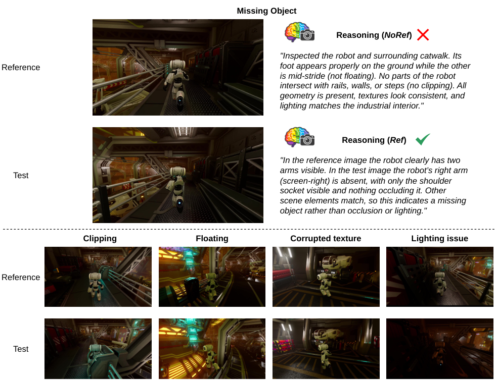
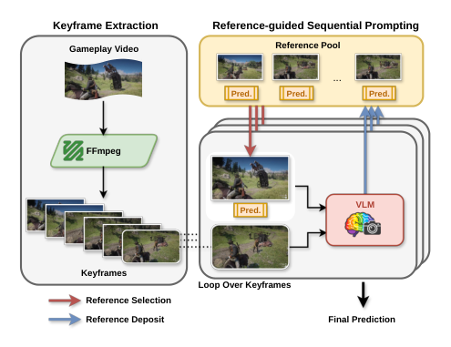
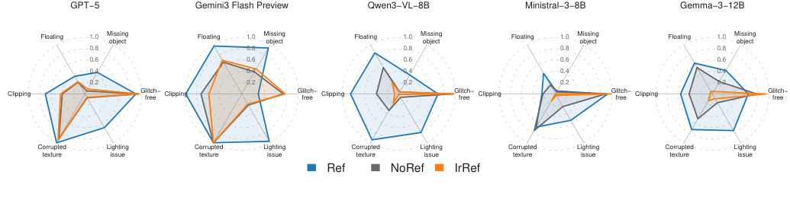

# **_RefGlitch-Bench_ : A Benchmark for Reference-based Gameplay Glitch Detection with Vision-Language Models** 

Ashley Wiens Adri´an Barahona-R´ıos 

Yakun Yu Ashley Wiens Adri´an Barahona-R´ıos University of Alberta University of Alberta Sony Interactive Entertainment 

Benedict Wilkins Sony Interactive Entertainment 

Saman Zadtootaghaj Sony Interactive Entertainment 

Nabajeet Barman Cor-Paul Bezemer Sony Interactive Entertainment University of Alberta 

## **Abstract** 

_Visual glitches in video games degrade player experience and perceived quality, yet manual quality assurance cannot keep pace with the growing test surface of modern game development. Prior automation efforts, particularly those using vision-language models (VLMs), largely operate on isolated frames without sufficient context to judge whether a glitch is present. We introduce_ RefGlitch-Bench _, a benchmark for reference-based video game glitch detection with VLMs. The key idea is to formulate glitch detection as an explicit within-video comparison problem: given a test frame, a reference frame provides a visual baseline that helps the model distinguish true glitches from benign visual variation._ RefGlitch-Bench _includes a controlled synthetic dataset with five injected glitch types and manually annotated reference/test frame pairs, enabling an oraclereference evaluation that isolates the potential benefit of reference guidance. We further establish four initial baselines for automatically selecting references from earlier frames in the same video, with_ LastCleanFrame _performing best and transferring across VLMs. Finally, we evaluate automatic reference guidance on real-world gameplay data, where it improves frame-level glitch detection beyond the controlled setting while revealing reference reliability and error propagation as key challenges._ 

## **1. Introduction** 

Video games are the most widely consumed form of interactive media, but their increasingly complex visuals and 

frequent content updates also introduce a steady stream of visual glitches. Glitches such as clipping, corrupted UI elements, and abnormal lighting undermine perceived quality and player trust, and can trigger negative reviews, refund requests, and costly customer support interactions [1, 16, 19]. At the same time, manual quality assurance (QA) is becoming increasingly costly and time-consuming. Modern games ship frequent builds across platforms, hardware configurations, and graphics settings, which makes exhaustive human review infeasible and expands the testing surface beyond what teams can reliably cover [5, 24, 26]. Together, these pressures create a clear demand for accurate and scalable automated gameplay glitch detection. 

Prior research on automated gameplay glitch detection, particularly those using VLMs, has largely operated in a single-image setting: given one screenshot, the model predicts whether it contains a visual artifact [17, 20, 23, 25]. This paradigm is inherently limited for accurate and contextual QA. First, a single image often lacks sufficient context to distinguish true glitches from benign variation ( _e.g_ ., camera motion or stylistic effects). Second, many glitches are relative or temporal in nature, and are therefore difficult to diagnose from a single screenshot. For example, GPT-5 predicts the missing-object test frame in Figure 1 as glitchfree when evaluated in isolation, because the missing robot arm is not obvious without a reference. 

These limitations motivate a reference-guided view of gameplay glitch detection. Rather than asking a VLM to judge a test frame in isolation, we formulate glitch detection as an explicit within-video comparison problem: given a test frame, the model is also provided with a reference frame that serves as an expected visual baseline. In the ex- 

1 

<!-- Start of picture text -->
Missing Object Reasoning ( NoRef ) "Inspected the robot and surrounding catwalk. Its Reference foot appears properly on the ground while the other is mid-stride (not floating). No parts of the robot intersect with rails, walls, or steps (no clipping). All geometry is present, textures look consistent, and lighting matches the industrial interior." Reasoning ( Ref ) "In the reference image the robot clearly has two Test arms visible. In the test image the robot’s right arm (screen-right) is absent, with only the shoulder socket visible and nothing occluding it. Other scene elements match, so this indicates a missing object rather than occlusion or lighting." Clipping Floating Corrupted texture Lighting issue Reference Test <!-- End of picture text -->

Figure 1. Reference/test pairs from the synthetic _RefGlitch-Bench_ dataset. Top: a **missing-object** (parts of a character/object are unexpectedly absent) example with GPT-5’s judgments with ( _Ref_ ) and without ( _NoRef_ ) a reference. Bottom: paired examples for **clipping** (a character/object intersects or passes through a solid surface), **floating** (a character/object is not in contact with the surface it should rest on), **corrupted texture** (visibly broken or incorrect surface texturing), and **lighting issue** (abnormal scene illumination not explainable by a natural change). 

ample in Figure 1, providing a reference frame with an intact robot in a similar scene makes the discrepancy clear, allowing the VLM to correctly detect the missing right arm. This design aligns with how humans often perform QA: we identify visual failures by comparing the current scene against what the same object, lighting, geometry, or layout should look like under normal gameplay. Moreover, existing benchmarks do not provide a paired reference/test structure needed to study the impact of a reference image. 

Therefore, we introduce _RefGlitch-Bench_ , a benchmark for reference-based video game glitch detection with VLMs. _RefGlitch-Bench_ is a controlled synthetic dataset built from an open-source game environment with five injected glitch types. Unlike existing multi-game benchmarks that mix diverse visual styles and provide limited percategory samples, _RefGlitch-Bench_ offers consistent ren- 

dering conditions and balanced coverage across glitch categories. Crucially, it includes manually labeled reference/test frame pairs, enabling controlled evaluation of reference guidance and performing fine-grained category-level analysis of which glitches benefit most from referencebased comparison. 

The manually constructed pairs define an oraclereference condition. Each test frame is paired with a manually selected, visually related, and verified glitch-free reference. This condition deliberately removes reference selection error so that we can isolate the potential value of reference guidance itself. It should therefore be interpreted as an empirical upper-bound condition under our fixed single-reference evaluation protocol, rather than as a realistic deployment assumption or a solution to reference selection. We then define an open automatic-reference- 

2 

selection setting in which a method selects a reference from earlier frames in the same video to aid the prediction of a test frame. We provide four initial baselines: _LastCleanFrame_ , _PreviousFrame_ , _RandomFrame_ , and _MostSimilarFrame_ . Among these simple policies, _LastCleanFrame_ , which selects the most recent preceding frame predicted to be glitch-free, performs best. Nevertheless, it remains below the oracle-reference condition and depends on potentially incorrect predictions about earlier frames. 

We further evaluate automatic reference guidance on frames from real-world gameplay videos. This experiment examines whether the frame-level benefits observed in the controlled benchmark transfer to more diverse visual conditions and, crucially, how the correctness of a selected reference affects its corresponding test-frame prediction. In summary, we make the following major contributions: 

- We introduce _RefGlitch-Bench_ , a controlled benchmark for reference-based frame-level gameplay glitch detection, comprising complete synthetic videos, and balanced reference/test pairs. It can support future research on both improved frame-level reference selection and the separate problem of aggregating frame-level signals into reliable video-level decisions. 

- We define an oracle-reference condition that uses manually scene-matched and verified glitch-free references to remove reference-selection error and isolate the potential effect of reference guidance across various VLMs. 

- We establish an open automatic-reference-selection setting, provide several initial baselines, and identify _LastCleanFrame_ as the strongest among the simple policies tested, while retaining the oracle condition as an empirical upper bound. 

- We evaluate automatic reference guidance on frame-level examples from real-world gameplay videos and quantify how incorrect references propagate to subsequent frame predictions, identifying reliable reference retrieval and verification as central open problems. 

## **2. Related Work** 

### **2.1. Gameplay Glitch Detection Benchmarks** 

Existing resources for gameplay glitch detection can be broadly grouped into image-level and video-level benchmarks. Image-level benchmarks evaluate whether models can identify visual glitches from individual screenshots. For example, GlitchBench [25] introduced a benchmark of glitch-free and glitchy screenshots from many games to evaluate whether large multimodal models can detect image-level anomalies. VideoGameBunny [23] further expands game-image understanding by releasing a large-scale collection of gameplay images and image-instruction pairs across hundreds of titles. These datasets have played an important role in establishing gameplay glitch detection as a 

multimodal reasoning problem, but they primarily evaluate glitches from isolated frames and therefore do not directly test whether additional visual context improves detection. 

Video-level benchmarks extend this setting by evaluating glitches over gameplay clips, but they remain comparatively limited. Several approaches [9, 10, 30] first segment gameplay videos using auxiliary metadata such as streamer captions, and then classify segments as glitchy or non-glitchy. However, such metadata is often unavailable during game development. More recent benchmarks study gameplay videos directly. PhysGame [4] focuses on physical commonsense violations in gameplay videos. VideoGameQABench [27] includes video-level glitch detection as part of a broader video game QA benchmark. TempGlitch [33] introduces a controlled gameplay video benchmark specifically for temporal glitch detection. Together, these datasets advance video-based gameplay understanding, but they do not explicitly provide paired reference/test frames for studying whether a visual baseline helps glitch detection. 

_RefGlitch-Bench_ is complementary to these benchmarks. Rather than evaluating models only on isolated screenshots or unpaired frame sequences, _RefGlitch-Bench_ introduces a reference-based setting in which each test frame is paired with a reference frame from the same video. This design enables controlled analysis of whether visually related context helps VLMs distinguish true glitches from benign scene variation. Moreover, existing benchmarks often span many games and mix diverse visual styles. Their samples within any single game environment or glitch category are also limited. In contrast, _RefGlitch-Bench_ provides balanced coverage across five glitch categories within a consistent game environment, enabling fine-grained categorylevel analysis of glitches. 

### **2.2. Vision-Language Models for Game QA** 

VLMs have rapidly evolved from contrastive image–text pretraining [13, 15, 21, 34, 35] into instruction-following multimodal assistants [6, 7, 14, 36], with downstream adaptation typically achieved through prompt engineering [3, 31, 32], instruction tuning [7, 14, 36], and parameter-efficient fine-tuning [11, 12]. Closed-source systems such as GPTfamily models [22] and Gemini [29] demonstrate strong multimodal reasoning capabilities, while open-weight families such as Qwen-VL [2] and Ministral [18] provide increasingly competitive alternatives with lower deployment cost. These capabilities have motivated growing interest in applying VLMs to game QA, including glitch detection, and physical commonsense evaluation in gameplay videos. Despite this progress, current evidence suggests that VLM-based gameplay glitch detection remains far from solved. GlitchBench [25] and VideoGameBunny [23] show that prompting-based methods can struggle with visual glitches across diverse games and scenes. VideoGameQA- 

3 

Bench [27] reports substantial headroom for video glitch detection, and PhysGame [4] shows that even strong VLMs have difficulty identifying physical commonsense violations in gameplay videos. These findings suggest that simply applying general-purpose VLMs to gameplay data is insufficient for robust QA automation. 

These limitations point to an evaluation gap, rather than solely a modeling gap. _RefGlitch-Bench_ addresses this gap while retaining a VLM-based evaluation setting by introducing a new dataset with manually selected reference frames for reference-based evaluation. It further establishes four initial baselines for automatic reference selection, providing a foundation for future work on more effective reference-selection strategies. 

## **3.** **_RefGlitch-Bench_ Benchmark** 

Existing benchmarks [4, 23, 25, 27] span many games, rendering styles, and camera behaviors, and they rarely provide explicit reference frames. As a result, it is difficult to isolate the effect of reference guidance. Moreover, analysis across glitch categories is often underpowered due to limited samples within any single game. To address these gaps, we introduce _RefGlitch-Bench_ , a controlled benchmark specifically designed for reference-based glitch detection, featuring (i) synthetic gameplay videos with manually annotated reference/test frame pairs, (ii) balanced coverage of five glitch types within a single, consistent game environment, and (iii) four initial baselines for automatic reference selection and reference-based detection. 

Concretely, we used the open-source Godot engine and the Third Person Shooter (TPS) demo asset as a base environment. We modified the source code to implement each glitch with fast in-engine toggling (See the supplementary material for implementation details), enabling recordings under the same camera and rendering conditions. We generated five glitch types: 

1. **Missing object** : parts of the character or object are unexpectedly missing. 

2. **Clipping** : a character or object visibly intersects or passes through another solid surface, or geometry overlaps in a way that could not occur with correct depth/occlusion. 

3. **Floating** : a character or object is visibly not in contact with the ground or surface it should be resting on, defying expected physics or gravity. 

4. **Corrupted texture** : a surface shows clearly broken or incorrect texturing. 

5. **Lighting issue** : the scene lighting is clearly wrong and not explainable by natural scene change. 

We recorded gameplay videos of 5 to 18 seconds with injected glitches. Each video clip starts with normal behavior. About one-third into the video, the glitch is triggered and 

<!-- Start of picture text -->
Keyframe Extraction Reference-guided Sequential Prompting Gameplay Video Reference Pool ... Pred. Pred. Pred. FFmpeg VLM Pred. Keyframes Loop Over Keyframes Reference Selection Reference Deposit Final Prediction <!-- End of picture text -->

Figure 2. Overview of our automatic reference selection method that consists of two stages. (1) Keyframe extraction: we extract a compact set of representative frames. (2) Reference-guided sequential prompting: we process frames in temporal order and prompt a VLM to predict whether the current test frame is glitchy, conditioned on an additional reference frame selected from a reference pool of earlier frames. Each stored reference is associated with its predicted label (“Pred.”); red arrows denote reference selection and blue arrows denote depositing newly processed frames back into the pool. 

remains active for several seconds. A few seconds before the end, the game returns to normal behavior. We recorded 100 videos for each glitch type. For each video, we sampled frames at 5 FPS to cover both glitch-free and glitchy intervals. Two annotators manually constructed the pairs by first identifying a test frame in which the target glitch was clearly visible or a clearly glitch-free frame for negative examples, and then selecting a temporally nearby, verified glitch-free frame from the same video with a similar scene configuration and a clear visual contrast to the test frame. Following this procedure, we collected 500 pairs with a glitch and 500 without a glitch, yielding 1,000 paired samples in total. Figure 1 shows example pairs for each glitch type. 

## **4. Automatic Reference Selection** 

Manually selected reference frames establish an informative upper bound on how much a visual baseline can help gameplay glitch detection, but selecting references manually is not practical at scale. Therefore, we establish a baseline approach for automatic reference selection that allows VLMs to be evaluated on gameplay videos when manual reference labels are not available. As shown in Figure 2, the approach consists of two stages. First, we extract representative keyframes from each gameplay video. Second, we process keyframes sequentially and obtain frame-level glitch predictions via reference-guided prompting. 

4 

**Keyframe Extraction.** Gameplay videos often contain substantial frame-to-frame redundancy, making direct dense-frame analysis inefficient and computationally expensive. To make detection tractable, we reduce each video into a compact set of _T_ keyframes. Specifically, we extract I-frames (intra-coded frames) from the video using _FFmpeg_ [8]. I-frames are self-contained and can be decoded independently, yielding a sparse sequence of representative frames determined by the video’s encoding settings. 

**Reference-guided Sequential Prompting.** Each keyframe is evaluated via reference-guided prompting, where the VLM judges the current frame using contextual evidence from an earlier frame in the same video. Specifically, for each extracted keyframe, we select a reference frame from a _reference pool_ that stores earlier frames along with their predicted labels (“Pred.”) as illustrated in Figure 2. For the first frame _I_ 1, the pool is empty, so we use an adapted version of the prompt (see the supplementary material) that takes a single frame and asks the VLM to determine whether _I_ 1 contains any glitch evidence based solely on observable visual cues. Once a prediction is produced, _I_ 1 and its predicted label are deposited into the pool. Starting from keyframe _t ≥_ 2, we perform reference-guided prompting. For each test frame _It_ , we select a reference frame _Rt_ from the pool according to a reference selection policy (described in Section 6.2). We then prompt the VLM with the pair ( _Rt, It_ ). The VLM outputs a frame-level prediction _y_ ˆ _t_ (glitchy vs. glitch-free) together with a brief rationale describing how the reference supports the decision. 

Since a glitchy reference would otherwise mislead the model, the prompt is conditioned on _Rt_ ’s predicted status. If _Rt_ is predicted glitch-free, the VLM is instructed to treat it as a normal baseline and flag visual discrepancies in _It_ as evidence of a glitch. If _Rt_ is predicted glitchy, the prompt warns the model accordingly and asks it to judge whether _It_ also contains evidence of a glitch. After prediction, _It_ and its predicted label are deposited into the reference pool (blue arrows in Figure 2), so that subsequent frames can draw on a reference that is temporally close to them. 

## **5. Experimental Setup** 

**Real-world Dataset.** To evaluate whether reference guidance improves glitch detection under realistic QA conditions, we further evaluated it on two state-of-the-art realworld gameplay video benchmarks: PhysGame [4] and VideoGameQA-Bench [27]. PhysGame targets physical commonsense violations in gameplay footage and contains 880 videos with glitches from diverse games, spanning four domains (mechanics, kinematics, optics, and material properties) across 12 physical commonsense categories. 

Because PhysGame contains only glitchy clips, we complemented it with 500 glitch-free videos from VideoGameQA-Bench. To match the size of our benchmark, we randomly sampled 87 videos and annotated 1,000 frames, comprising 500 glitchy and 500 glitch-free frames. Annotators assigned a binary label to each frame based on visible evidence: a frame was labeled glitchy only when a glitch was visually present, and otherwise labeled glitchfree, even when it came from a video labeled positive by PhysGame. 

**Evaluation Metrics.** We evaluate glitch detection as a binary classification task, where each frame is labeled as glitchy or glitch-free. We report the performance using standard classification metrics: accuracy, F1, precision and recall. We primarily use accuracy and F1 as headline metrics for model comparison. We report precision and recall not as standalone optimization targets, but as diagnostic metrics that help interpret performance differences. 

**VLM Backbones and Compute.** We evaluate five VLMs, including two proprietary models and three openweight models. The proprietary models are GPT-5 [22] and Gemini 3 Flash Preview [29]. The open-weight models are Qwen3-VL-8B [2], Ministral-3-8B [18], and Gemma3-12B [28]. For proprietary models, we use the official APIs. For open-weight VLMs, we use the public Unsloth AI framework. All experiments with open-weight models are run on 4 NVIDIA L40S GPUs. 

## **6. Results** 

### **6.1. RQ1: Does a manually selected reference frame improve frame-level glitch detection?** 

**Motivation.** Many gameplay glitches are subtle and easily confused with benign visual variations ( _e.g_ ., camera motion or changes in lighting). A matched reference frame from the _same video and similar scene_ can provide a baseline, enabling the VLM to attribute meaningful, unusual differences to glitches rather than to normal gameplay variation. RQ1 asks whether such a reference is useful when the reference itself is reliable. Importantly, we formulate RQ1 as an _oracle-reference evaluation_ which provides an upperbound condition that isolates whether a VLM can benefit from a relevant visual reference when one is available. 

**Design.** We used _RefGlitch-Bench_ to evaluate RQ1 under controlled conditions. Each test frame is evaluated under three prompting strategies: _Ref_ (with a relevant reference frame that was manually cherry-picked from a similar scene), _NoRef_ (test frame only), and _IrRef_ (with a reference frame unrelated to the evaluated gameplay video, with no meaningful connection to the game, scene, or objects). 

5 

<!-- Start of picture text -->
GPT−5 Gemini3 Flash Preview Qwen3−VL−8B Ministral−3−8B Gemma−3−12B Floating 1.0 Missingobject Floating 1.0 Missingobject Floating 1.0 Missingobject Floating 1.0 Missingobject Floating 1.0 Missingobject 0.8 0.8 0.8 0.8 0.8 0.6 0.6 0.6 0.6 0.6 0.4 0.4 0.4 0.4 0.4 0.2 0.2 0.2 0.2 0.2 Clippin g Gfreelitch− Clippin g Gfreelitch− Clippin g Gfreelitch− Clippin g Gfreelitch− Clippin g Gfreelitch− Corrupted Lighting Corrupted Lighting Corrupted Lighting Corrupted Lighting Corrupted Lighting texture issue texture issue texture issue texture issue texture issue Ref NoRef IrRef <!-- End of picture text -->

Figure 3. Per-category behavior of the VLMs visualized as radar plots over six classes (Glitch-free, Missing object, Clipping, Floating, Corrupted texture, Lighting issue), with lines color-coded by settings. Please zoom-in for a better view. 

|**Model**|**Setting**|**Accuracy**|**F1**|**Precision**|**Recall**|
|---|---|---|---|---|---|
||_Ref_|0.77|0.74|0.87|0.64|
|GPT5|_LastCleanFrame_|0.70|0.62|0.85|0.48|
|-|_NoRef_|0.65|0.49|0.88|0.34|
||_IrRef_|0.66|0.51|0.88|0.36|
||_Ref_|0.63|0.73|0.58|0.98|
|Gii 3 Flh Pi|_LastCleanFrame_|0.59|0.68|0.56|0.86|
|emn  as revew|_NoRef_|0.67|0.65|0.70|0.61|
||_IrRef_|0.68|0.65|0.72|0.60|
||_Ref_|0.73|0.74|0.72|0.76|
|3VL8B|_LastCleanFrame_|0.70|0.69|0.70|0.69|
|Qwen--|_NoRef_|0.62|0.42|0.88|0.28|
||_IrRef_|0.54|0.19|0.83|0.11|
||_Ref_|0.68|0.58|0.83|0.45|
|Miitl38B|_LastCleanFrame_|0.63|0.45|0.86|0.30|
|nsra--|_NoRef_|0.57|0.35|0.73|0.23|
||_IrRef_|0.50|0.03|0.44|0.02|
||_Ref_|0.63|0.63|0.63|0.63|
|G312B|_LastCleanFrame_|0.61|0.60|0.62|0.58|
|emma--|_NoRef_|0.58|0.48|0.64|0.38|
||_IrRef_|0.51|0.14|0.60|0.08|

Table 1. Overall performance under different reference settings across different VLMs. The _LastCleanFrame_ setting is discussed in RQ2. 

**Findings. Oracle reference guidance improves overall detection for most VLMs, with the largest gains in recall.** Table 1 shows that _Ref_ increases recall and F1 for all evaluated models. The improvement is particularly large for Qwen3-VL-8B, which gains +0.11 accuracy and +0.32 F1, driven by a +0.49 increase in recall. Substantial improvements are also observed for much larger proprietary models such as GPT-5, which gains +0.12 accuracy and +0.25 F1, primarily due to a +0.30 increase in recall with only a -0.01 change in precision. 

Gemini 3 Flash Preview is the main exception in terms of accuracy. Although _Ref_ increases its recall by +0.37, it also introduces substantially more false positives, resulting in a -0.04 change in accuracy. One plausible explanation is that the model over-emphasizes discrepancies between the reference and test frames and interprets benign differences ( _e.g_ ., 

minor viewpoint or UI changes) as evidence of a glitch. 

**Irrelevant reference frames often hurt performance, confirming that reference matching is critical.** Table 1 shows that for the smaller open models, _IrRef_ is always worse than the baseline. For instance, Qwen3-VL-8B drops by -0.08 accuracy and -0.23 F1, driven by a -0.17 recall decrease. Gemma-3-12B shows a similar pattern, with -0.07 accuracy and -0.34 recall, yielding a large -0.34 F1 drop. In contrast, GPT-5 remains relatively stable from _NoRef_ to _IrRef_ , and Gemini 3 Flash Preview does not degrade. One plausible reason is that stronger instruction-following models can down-weight the irrelevant reference when it is uninformative, whereas more reference-dependent models anchor their judgment to the irrelevant reference and get misled by scene-inconsistent comparisons. 

**Oracle reference guidance improves detection across all five glitch types.** Figure 3 shows consistent categorylevel benefits from _Ref_ . Detection improves for lighting, floating, clipping, and missing-object glitches in 5/5 models, and for texture glitches in 4/5 models; the remaining model already detects 100% of texture glitches both with and without a reference. Lighting glitches exhibit particularly strong and consistent gains because subtle global appearance changes can be difficult to identify from a single frame but become more salient when compared against a visual baseline. Floating and clipping also benefit consistently because a scene-matched reference helps establish the expected geometric and physical configuration of the environment. Improvements for texture and missing object glitches are somewhat less uniform because they depend more on whether the relevant object or material is visible in both frames and on the model’s ability to perform finegrained visual comparison under small viewpoint changes. 

6 

**RQ1 takeaway:** A manually selected reference provides an _oracle upper bound_ for reference-based frame-level glitch detection. This oracle condition yields gains of up to +0.32 F1 and +0.12 accuracy. Category-wise, oracle references improve lighting, floating, clipping, and missing object in 5/5 models, and improve texture in 4/5 models. 

### **6.2. RQ2: Among simple baselines, which strategy best selects a reference frame automatically?** 

**Motivation.** RQ1 establishes that a manually selected reference can substantially improve frame-level glitch detection, providing an oracle upper bound on the potential benefit of reference guidance. However, such manually selected references are not available in practical deployment. The remaining challenge is therefore to identify a useful reference automatically from earlier frames in the video. RQ2 studies this problem by establishing four simple automatic reference-selection baselines and quantifying how much of the oracle-reference benefit they can recover. 

**Design.** We evaluate four strategies for automatically selecting a reference frame on _RefGlitch-Bench_ : (1) _LastCleanFrame_ , which selects the most recent glitch-free frame; (2) _PreviousFrame_ , which selects the immediately preceding frame; (3) _RandomFrame_ , which samples a reference randomly from earlier frames; and (4) _MostSimilarFrame_ , which selects the visually most similar previous frame. We also include _NoRef_ as the baseline, and _Ref_ as the oracle upper bound. All strategies use our sequential prompting outputs from earlier frames to decide which frame is treated as the reference frame. 

We first compare these strategies using the Qwen3-VL8B backbone. This choice is motivated by practical QA constraints: video analysis often requires many VLM calls per clip, so deploying a large proprietary model like GPT-5 is often prohibitively slow and costly at scale. Qwen3VL8B offers a more realistic performance–cost trade-off for deployment, and it exhibits a large benefit from reference guidance in Table 1, making it a strong backbone for studying how reference selection affects downstream performance. After identifying the strongest baseline, we apply its selected references across all VLMs to evaluate their robustness across models. 

**Findings.** **_LastCleanFrame_ performs best among the four automatic baselines, but remains below the oraclereference condition.** Table 2 shows that _LastCleanFrame_ outperforms _PreviousFrame_ , _RandomFrame_ , _MostSimilarFrame_ , and _NoRef_ on the Qwen3-VL-8B backbone. One possible reason is that _LastCleanFrame_ satisfies two important conditions for an effective reference: it is likely to be clean, and it is temporally close to the test frame. Temporal proximity helps preserve scene layout, camera position, 

|**Strategy**|**Accuracy**|**F1**|**Precision**|**Recall**|
|---|---|---|---|---|
|_Ref_|0.73|0.74|0.72|0.76|
|_LastCleanFrame_|0.70|0.69|0.70|0.69|
|_PreviousFrame_|0.61|0.57|0.64|0.51|
|_RandomFrame_|0.67|0.66|0.68|0.63|
|_MostSimilarFrame_|0.60|0.54|0.64|0.47|
|_NoRef_|0.62|0.42|0.88|0.28|

Table 2. Performance of reference selection strategies using Qwen3-VL-8B on _RefGlitch-Bench_ . _Ref_ denotes the manually selected reference frame used in Section 6.1. 

object configuration, and animation state, while the cleanframe constraint makes the comparison more meaningful for detecting abnormal visual changes. 

In contrast, _PreviousFrame_ performs substantially worse. Although the immediately previous frame is often visually similar to the test frame, temporal adjacency alone does not guarantee that the reference is useful. The previous frame may itself contain a glitch, or may provide an ambiguous comparison. When both the reference and test frames contain the same abnormal pattern, the abnormality is no longer contrastive, making the model recognize the glitch from the test frame itself rather than from a cleanversus-glitchy comparison. This may explain why _PreviousFrame_ improves recall over _NoRef_ , but still performs far below _LastCleanFrame_ . 

A particularly surprising result is the poor performance of _MostSimilarFrame_ , suggesting that selecting the visually most similar previous frame is insufficient as an effective reference. Although visual similarity can retrieve frames with similar global appearance, object layout, or scene content, it does not guarantee the reference is clean. If the most similar frame is glitchy, or contains the same artifact as the test frame, then the comparison may provide little useful contrast. Moreover, visual similarity measured by a generic image embedding may not capture the alignment needed for glitch detection, such as matching the correct animation, object state, or local motion context. 

**_LastCleanFrame_ transfers across VLM families, but the oracle gap remains.** After selecting _LastCleanFrame_ as the best automatic baseline, we re-evaluate it across multiple VLMs in Table 1. _LastCleanFrame_ improves F1 relative to _NoRef_ for all models and improves accuracy for 4/5 models, indicating that its benefit transfers beyond the Qwen3-VL-8B backbone used for baseline comparison. However, the remaining gap between _LastCleanFrame_ and _Ref_ reinforces the central benchmark challenge revealed by RQ2: automatically identifying a reference that is both clean and relevant remains an open problem. 

7 

|**Strategy**|**Accuracy**|**F1**|**Precision**|**Recall**|**Group**|**# Frames**|**GT=1**|**GT=0**|**TPR**|**FPR**|
|---|---|---|---|---|---|---|---|---|---|---|
|_LastCleanFrame_|0.60|0.70|0.56|0.91|_LastCleanFrame_|1,000|500|500|0.91|0.71|
|_NoRef_|0.54|0.67|0.52|0.92|Has a reference|551|303|248|0.88|0.62|
||||||Glitch-free reference|367|156|211|0.94|0.58|
|. Performance o|f_LastCle_|_anFram_|_e_and_NoRe_|_f_ on the man-|Glitchy reference Has no reference|184 449|147 197|37 252|0.82 0.94|0.84 0.78|

Table 3. Performance of _LastCleanFrame_ and _NoRef_ on the manually labeled real-world subset of 1,000 frames. 

Table 4. Reference reliability analysis. TPR is measured on glitchy frames, and FPR is measured on glitch-free frames. 

**RQ2 takeaway:** Among four simple automatic referenceselection baselines, _LastCleanFrame_ performs best and improves F1 over _NoRef_ for 5/5 VLMs and accuracy for 4/5 VLMs. Together with the oracle upper bound established in RQ1, these results identify reliable joint reference retrieval and verification as an important open direction for future work. 

provide initial evidence that the benefit of reference guidance is not confined to the controlled _RefGlitch-Bench_ environment and can transfer to gameplay videos collected independently of our synthetic generation procedure. 

However, automatically selected references are imperfect. As shown in Table 4, among the 1,000 evaluated frames, 551 are evaluated with a selected reference, while 449 have no reference because they are either the first frame or no prior frame has been predicted as glitch-free and is therefore available for reference selection. Among the 551 reference-conditioned cases, 367 use a correct glitchfree reference, whereas 184 use a wrong reference whose ground-truth label is glitchy, corresponding to a wrongreference use rate of 33.4%. Hence, although _LastCleanFrame_ is effective, it introduces error propagation: frames that are incorrectly predicted as glitch-free are stored in the reference pool and used as references for later predictions. 

### **6.3. RQ3: Does automatic reference guidance transfer to real-world gameplay data?** 

**Motivation.** RQ1 establishes the potential benefit of reference guidance under an oracle condition. RQ2 then evaluates four initial strategies for obtaining such references automatically on the controlled _RefGlitch-Bench_ benchmark, with _LastCleanFrame_ emerging as the strongest baseline. RQ3 examines whether this benefit transfers beyond the controlled benchmark to real-world gameplay videos, where visual conditions are less constrained, scene transitions are more diverse, and suitable references may be more difficult to identify. This setting also provides a natural stress test of reference reliability. _LastCleanFrame_ relies on predictions from earlier frames rather than ground-truth labels: a frame predicted to be glitch-free may actually contain a glitch and can subsequently be selected as a reference. Such errors may therefore propagate to later predictions. We consequently evaluate both the overall frame-level benefit of automatic reference guidance and the downstream effect of correct versus incorrect references. 

To assess how reference reliability affects downstream prediction, we further conduct a class-conditioned analysis using true positive rate (TPR) on glitchy test frames and false positive rate (FPR) on glitch-free test frames. For glitchy test frames, wrong references reduce TPR from 0.94 to 0.82, indicating that glitchy references can make the model less sensitive to actual glitches. For glitch-free test frames, wrong references increase FPR from 0.58 to 0.84, showing that unreliable references can also cause normal frames to be misclassified as glitchy. Together, these results demonstrate that reference quality directly affects downstream prediction reliability. 

**Design.** We evaluate the 1,000 manually annotated frames from our real-world dataset under two conditions: _LastCleanFrame_ and _NoRef_ . To understand the reliability of automatic reference selection, we additionally inspect the ground-truth labels of the references selected by _LastCleanFrame_ after inference. This post-hoc analysis allows us to quantify both how often automatic selection supplies an unreliable reference and how such reference errors affect downstream test-frame predictions. 

**RQ3 takeaway:** Automatic reference guidance transfers beyond _RefGlitch-Bench_ , improving frame-level accuracy on real-world gameplay data. However, its reliability depends on the quality of the selected references, identifying reference reliability and error propagation as key open challenges. 

## **7. Conclusion** 

**Findings. Automatic reference guidance remains useful on real-world data, although its effectiveness depends on reference reliability.** As shown in Table 3, on the manually labeled real-world subset, _LastCleanFrame_ achieves higher accuracy and F1 than _NoRef_ . The improvement comes mainly from higher precision, while recall remains comparable for both settings. These results 

We introduced _RefGlitch-Bench_ , a benchmark for reference-based glitch detection with VLMs. Our central motivation is that many glitches are difficult to identify from an isolated frame: a test frame may appear plausible on its own but become clearly abnormal when compared with an appropriate visual reference. To study this setting 

8 

systematically, _RefGlitch-Bench_ provides a controlled synthetic dataset spanning five glitch types with manually annotated reference/test frame pairs, enabling an oraclereference evaluation that isolates the potential benefit of reference guidance. Across five VLMs, our experiments show that oracle references generally improve frame-level glitch detection. We further establish four initial baselines for automatic reference selection and find that _LastCleanFrame_ performs best, while still leaving a substantial gap to the oracle references. Finally, experiments on real-world gameplay data show that automatic reference guidance can improve frame-level glitch detection beyond the controlled synthetic setting, while also revealing reference reliability and error propagation as key challenges. Together, these findings position _RefGlitch-Bench_ as a foundation for future research on reference-based game QA. Promising directions include more reliable joint reference retrieval and verification, conservative reference-pool management, and broader evaluation across diverse games, engines, glitch types, and visual styles. 

## **References** 

- [1] Jessica Backus. Players’ perception of bugs and glitches in video games: An exploratory study. _arXiv preprint arXiv:2504.15408_ , 2025. 1 

- [2] Jinze Bai, Shuai Bai, Yunfei Chu, Zeyu Cui, Kai Dang, Xiaodong Deng, Yang Fan, Wenbin Ge, Yu Han, Fei Huang, et al. Qwen technical report. _arXiv preprint arXiv:2309.16609_ , 2023. 3, 5 

- [3] Maciej Besta, Nils Blach, Ales Kubicek, Robert Gerstenberger, Michal Podstawski, Lukas Gianinazzi, Joanna Gajda, Tomasz Lehmann, Hubert Niewiadomski, Piotr Nyczyk, et al. Graph of thoughts: Solving elaborate problems with large language models. In _Proceedings of the AAAI conference on artificial intelligence_ , pages 17682–17690, 2024. 3 

- [4] Meng Cao, Haoran Tang, Haoze Zhao, Hangyu Guo, Jiaheng Liu, Ge Zhang, Ruyang Liu, Qiang Sun, Ian Reid, and Xiaodan Liang. Physgame: Uncovering physical commonsense violations in gameplay videos. _arXiv preprint arXiv:2412.01800_ , 2024. 3, 4, 5 

- [5] Kenneth Chang, Batu Aytemiz, and Adam M Smith. Revealmore: Amplifying human effort in quality assurance testing using automated exploration. In _2019 IEEE Conference on Games (CoG)_ , pages 1–8. IEEE, 2019. 1 

- [6] Zhe Chen, Jiannan Wu, Wenhai Wang, Weijie Su, Guo Chen, Sen Xing, Muyan Zhong, Qinglong Zhang, Xizhou Zhu, Lewei Lu, et al. Internvl: Scaling up vision foundation models and aligning for generic visual-linguistic tasks. In _Proceedings of the IEEE/CVF conference on computer vision and pattern recognition_ , pages 24185–24198, 2024. 3 

- [7] Wenliang Dai, Junnan Li, Dongxu Li, Anthony Tiong, Junqi Zhao, Weisheng Wang, Boyang Li, Pascale N Fung, and Steven Hoi. Instructblip: Towards general-purpose visionlanguage models with instruction tuning. _Advances in neural information processing systems_ , 36:49250–49267, 2023. 3 

- [8] FFmpeg Developers. FFmpeg. https://ffmpeg.org/, 2026. 5 

- [9] Emanuela Guglielmi, Simone Scalabrino, Gabriele Bavota, and Rocco Oliveto. Using gameplay videos for detecting issues in video games. _Empirical Software Engineering_ , 28 (6):136, 2023. 3 

- [10] Emanuela Guglielmi, Gabriele Bavota, Rocco Oliveto, and Simone Scalabrino. Automatic identification of game stuttering via gameplay videos analysis. _ACM Transactions on Software Engineering and Methodology_ , 34, 2024. 3 

- [11] Neil Houlsby, Andrei Giurgiu, Stanislaw Jastrzebski, Bruna Morrone, Quentin De Laroussilhe, Andrea Gesmundo, Mona Attariyan, and Sylvain Gelly. Parameter-efficient transfer learning for nlp. In _International conference on machine learning_ , pages 2790–2799. PMLR, 2019. 3 

- [12] Edward J Hu, Yelong Shen, Phillip Wallis, Zeyuan AllenZhu, Yuanzhi Li, Shean Wang, Liang Wang, Weizhu Chen, et al. Lora: Low-rank adaptation of large language models. _Iclr_ , 1(2):3, 2022. 3 

- [13] Chao Jia, Yinfei Yang, Ye Xia, Yi-Ting Chen, Zarana Parekh, Hieu Pham, Quoc Le, Yun-Hsuan Sung, Zhen Li, and Tom Duerig. Scaling up visual and vision-language representation learning with noisy text supervision. In _International conference on machine learning_ , pages 4904–4916. PMLR, 2021. 3 

- [14] Bruce W Lee, Hyunsoo Cho, and Kang Min Yoo. Instruction tuning with human curriculum. In _Findings of the Association for Computational Linguistics: NAACL 2024_ , pages 1281–1309, 2024. 3 

- [15] Junnan Li, Ramprasaath Selvaraju, Akhilesh Gotmare, Shafiq Joty, Caiming Xiong, and Steven Chu Hong Hoi. Align before fuse: Vision and language representation learning with momentum distillation. _Advances in neural information processing systems_ , 34:9694–9705, 2021. 3 

- [16] Dayi Lin, Cor-Paul Bezemer, Ying Zou, and Ahmed E Hassan. An empirical study of game reviews on the steam platform. _Empirical Software Engineering_ , 24(1):170–207, 2019. 1 

- [17] Carlos Ling, Konrad Tollmar, and Linus Gissl´en. Using deep convolutional neural networks to detect rendered glitches in video games. In _Proceedings of the AAAI Conference on Artificial Intelligence and Interactive Digital Entertainment_ , pages 66–73, 2020. 1 

- [18] Alexander H Liu, Kartik Khandelwal, Sandeep Subramanian, Victor Jouault, Abhinav Rastogi, Adrien Sad´e, Alan Jeffares, Albert Jiang, Alexandre Cahill, Alexandre Gavaudan, et al. Ministral 3. _arXiv preprint arXiv:2601.08584_ , 2026. 3, 5 

- [19] Wentao Lu, Alexander Senchenko, Abram Hindle, and CorPaul Bezemer. Automated bug frame retrieval from gameplay videos using vision-language models. _arXiv preprint arXiv:2508.04895_ , 2025. 1 

- [20] Ciprian Paduraru. A state-aware, hierarchical deep learning framework for automated visual glitch detection in games. _Engineering Applications of Artificial Intelligence_ , 166:113497, 2026. 1 

- [21] Alec Radford, Jong Wook Kim, Chris Hallacy, Aditya Ramesh, Gabriel Goh, Sandhini Agarwal, Girish Sastry, 

9 

Amanda Askell, Pamela Mishkin, Jack Clark, Gretchen Krueger, and Ilya Sutskever. Learning transferable visual models from natural language supervision. In _Proceedings of the 38th International Conference on Machine Learning_ , pages 8748–8763. PMLR, 2021. 3 

- [22] Aaditya Singh, Adam Fry, Adam Perelman, Adam Tart, Adi Ganesh, Ahmed El-Kishky, Aidan McLaughlin, Aiden Low, AJ Ostrow, Akhila Ananthram, et al. Openai gpt-5 system card. _arXiv preprint arXiv:2601.03267_ , 2025. 3, 5 

- [23] Mohammad Reza Taesiri and Cor-Paul Bezemer. Videogamebunny: Towards vision assistants for video games. In _2025 IEEE/CVF Winter Conference on Applications of Computer Vision (WACV)_ , pages 1403–1413. IEEE, 2025. 1, 3, 4 

- [24] Mohammad Reza Taesiri, Finlay Macklon, and Cor-Paul Bezemer. Clip meets gamephysics: Towards bug identification in gameplay videos using zero-shot transfer learning. In _Proceedings of the 19th International Conference on Mining Software Repositories_ , pages 270–281, 2022. 1 

      - models for temporal glitch detection in gameplay videos. _arXiv preprint arXiv:2605.21443_ , 2026. 3 

   - [34] Xiaohua Zhai, Xiao Wang, Basil Mustafa, Andreas Steiner, Daniel Keysers, Alexander Kolesnikov, and Lucas Beyer. Lit: Zero-shot transfer with locked-image text tuning. In _Proceedings of the IEEE/CVF conference on computer vision and pattern recognition_ , pages 18123–18133, 2022. 3 

   - [35] Xiaohua Zhai, Basil Mustafa, Alexander Kolesnikov, and Lucas Beyer. Sigmoid loss for language image pre-training. In _Proceedings of the IEEE/CVF international conference on computer vision_ , pages 11975–11986, 2023. 3 

   - [36] Shengyu Zhang, Linfeng Dong, Xiaoya Li, Sen Zhang, Xiaofei Sun, Shuhe Wang, Jiwei Li, Runyi Hu, Tianwei Zhang, Guoyin Wang, et al. Instruction tuning for large language models: A survey. _ACM Computing Surveys_ , 58(7):1–36, 2026. 3 

- [25] Mohammad Reza Taesiri, Tianjun Feng, Cor-Paul Bezemer, and Anh Nguyen. Glitchbench: Can large multimodal models detect video game glitches? In _Proceedings of the IEEE/CVF Conference on Computer Vision and Pattern Recognition_ , pages 22444–22455, 2024. 1, 3, 4 

- [26] Mohammad Reza Taesiri, Finlay Macklon, Sarra Habchi, and Cor-Paul Bezemer. Searching bug instances in gameplay video repositories. _IEEE Transactions on Games_ , 16 (3):697–710, 2024. 1 

- [27] Mohammad Reza Taesiri, Abhijay Ghildyal, Saman Zadtootaghaj, Nabajeet Barman, and Cor-Paul Bezemer. VideogameQA-bench: Evaluating vision-language models for video game quality assurance. In _The Thirty-ninth Annual Conference on Neural Information Processing Systems Datasets and Benchmarks Track_ , 2025. 3, 4, 5 

- [28] Gemma Team. Gemma 3 technical report, 2025. 5 

- [29] Gemini Team, Rohan Anil, Sebastian Borgeaud, JeanBaptiste Alayrac, Jiahui Yu, Radu Soricut, Johan Schalkwyk, Andrew M Dai, Anja Hauth, Katie Millican, et al. Gemini: a family of highly capable multimodal models. _arXiv preprint arXiv:2312.11805_ , 2023. 3, 5 

- [30] Andrew Truelove, Shiyue Rong, Eduardo Santana de Almeida, and Iftekhar Ahmed. Finding the needle in a haystack: Detecting bug occurrences in gameplay videos. _arXiv preprint arXiv:2311.10926_ , 2023. 3 

- [31] Jason Wei, Xuezhi Wang, Dale Schuurmans, Maarten Bosma, Fei Xia, Ed Chi, Quoc V Le, Denny Zhou, et al. Chain-of-thought prompting elicits reasoning in large language models. _Advances in neural information processing systems_ , 35:24824–24837, 2022. 3 

- [32] Yakun Yu, Shi-ang Qi, Baochun Li, and Di Niu. Peprec: Progressive enhancement of prompting for recommendation. In _Proceedings of the 2024 Conference on Empirical Methods in Natural Language Processing_ , pages 17941–17953, 2024. 3 

- [33] Yakun Yu, Ashley Wiens, Adri´an Barahona-R´ıos, Benedict Wilkins, Saman Zadtootaghaj, Nabajeet Barman, and Cor-Paul Bezemer. Tempglitch: Evaluating vision-language 

10 

