**manuscript No.** (will be inserted by the editor) 

# **Anisotropic modified Crouzeix–Raviart finite element method for the stationary Navier–Stokes equation** 

## **Hiroki Ishizaka** 

Received: date / Accepted: date 

**Abstract** We studied an anisotropic modified Crouzeix–Raviart finite element method for the rotational form of a stationary incompressible Navier– Stokes equation with large irrotational body forces. We present an anisotropic _H_1 error estimate for the velocity of the modified Crouzeix–Raviart finite element method for the Navier–Stokes equation. The modified Crouzeix–Raviart finite element scheme was obtained using a lifting operator that mapped the velocity test functions to _H_ (div; _Ω_ )-conforming finite element spaces. Because no shape-regularity mesh conditions are imposed, anisotropic meshes can be used for the analysis. The core idea of the proof involves using the relation between the Raviart–Thomas and Crouzeix–Raviart finite element spaces. Furthermore, we present a discrete Sobolev inequality under semi-regular mesh conditions to estimate the stability of the proposed method, and confirm the results obtained through numerical experiments. 

**Keywords** Navier–Stokes equation _·_ Modified Crouzeix–Raviart (CR) finite element method _·_ Raviart–Thomas (RT) finite element method _·_ Discrete Sobolev inequality _·_ Anisotropic meshes 

**Mathematics Subject Classification (2010)** 65D05 _·_ 65N30 

## **1 Introduction** 

Let _Ω ⊂_ R_d_ and _d ∈{_ 2 _,_ 3 _}_ be a bounded polyhedral domain. The stationary Navier–Stokes problem involves determining ( _u, p_ 0) : _Ω →_ R_d_ _×_ R such that 

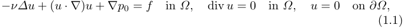

<!-- Start of picture text -->
−ν∆u  + ( u · ∇ ) u  +  ∇p 0 =  f in Ω, div  u  = 0 in Ω, u  = 0 on ∂Ω, (1.1) <!-- End of picture text -->

Hiroki Ishizaka Team FEM, Matsuyama, Japan E-mail: h.ishizaka005@gmail.com 

Hiroki Ishizaka 

2 

where _ν_ is a nonnegative parameter and _f_ : _Ω →_ R_d_ is a given function. We use the standard notations for the Lebesgue and Sobolev spaces with associated norms [8,9,10,11,13,14,20,29]. We define the curl operator [13,20] as follows: 

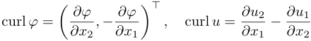

<!-- Start of picture text -->
curl  φ  = , − ∂φ , curl  u  = ∂u 2 − ∂u 1 � ∂x∂φ 2 ∂x 1 � ⊤ ∂x 1 ∂x 2 <!-- End of picture text -->

for distributions _φ_ of _D__′_ ( _Ω_ ) and _u_ of _D__′_ ( _Ω_ )2 when _d_ = 2 and 

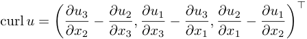

<!-- Start of picture text -->
curl  u  = − ∂u 2 , ∂u 1 − ∂u 3 , ∂u 2 − ∂u 1 � ∂u∂x 23 ∂x 3 ∂x 3 ∂x 1 ∂x 1 ∂x 2 � ⊤ <!-- End of picture text -->

for the distribution _u_ of _D__′_ ( _Ω_ )3 when _d_ = 3. These operators lead to 

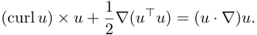

<!-- Start of picture text -->
(curl  u )  × u  + 1 2 ∇ ( u⊤u ) = ( u · ∇ ) u. <!-- End of picture text -->

This study examines the rotation form of the stationary Navier–Stokes equation (1.1), as follows: Find ( _u, p_ ) : _Ω →_ R_d_ _×_ R such that 

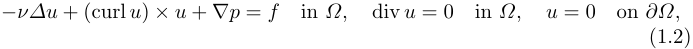

<!-- Start of picture text -->
−ν∆u  + (curl  u )  × u  +  ∇p  =  f in Ω, div  u  = 0 in Ω, u  = 0 on ∂Ω, (1.2) <!-- End of picture text -->

where _p_ represents the Bernoulli pressure _p_ := _p_ 0 + 2<u>1</u>_u⊤u_. 

Mixed finite element methods are commonly used in numerical analyses to solve incompressible Navier–Stokes equations. These methods require a discrete inf-sup condition to guarantee the stability and provide a unique solution. However, it is challenging to determine the Stokes elements that satisfy the discrete inf-sup condition for anisotropic mesh partitions. Furthermore, even on regular-shaped meshes, most of the Stokes elements of the inf-sup stable finite element spaces consider divergence-free discrete function spaces _Vh,_ div, which are non-conforming in the space of divergence-free weak functions _V_ div. When the Stokes elements are used, the velocity error depends on the pressure error ([20, Theorem 6.30, Corollary 6.33]); that is, 

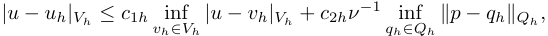

<!-- Start of picture text -->
|u − uh|Vh ≤ c 1 h vh inf ∈Vh |u − vh|Vh +  c 2 hν− 1 qh inf ∈Qh ∥p − qh∥Qh, <!-- End of picture text -->

where _uh_ denotes the discrete solution of _u_ . _Vh_ and _Qh_ are the discrete velocity and pressure spaces, respectively. If _ν_ is small and the pressure error is large, classical mixed finite element methods lead to poor velocity approximations, even when finer meshes are used. This phenomenon is known as the poor conservation of mass. 

To overcome this difficulty, using the _H_ (div; _Ω_ ) := _{v ∈ L_2 ( _Ω_ )_d_ : div _v ∈ L_2 ( _Ω_ ) _}_ -conforming velocity lifting operator _Lh_ , the schemes are modified when _Vh,_ div _̸ ⊂ V_ div by replacing the velocity test function _vh_ in the discrete momentum equation with the lifting operator _Lh_ ( _vh_ ). This idea was presented by Linke [24] for the Stokes equation, and has been widely applied in finite element methods [21,23,25,28,32]. It can be said that the discretisation is 

Anisotropic modified CR method for NS equation 

3 

pressure-robust or well balanced. In [24], as the Stokes element, the Crouzeix– Raviart (CR) finite element space for velocity and the elementwise constant discontinuous space for pressure were used for the analysis. The corresponding velocity-lifting operator maps the CR velocity test functions to the lowestorder Raviart–Thomas (RT) finite element space that conforms to _H_ (div; _Ω_ ). The modified CR finite element method leads to a pressure-independent velocity error estimate under the shape-regular mesh condition of the form 

## _|u − uh|Vh ≤ ch|u|H_ 2( _Ω_ ) _d._ 

The Navier–Stokes equations have various discrete trilinear forms for the nonlinear convection term, such as convective, skew-symmetric, and (skewsymmetric) rotational forms with modified pressure (e.g., [20]). For continuous problems, the nonlinear convection terms do not contribute to the stability estimates. However, the discrete convective form affects the discrete stability estimates and uniqueness of the velocity. Meanwhile, because the space _H_ (div; _Ω_ ) is not in _H_1 ( _Ω_ )_d_ , the pressure-robust schemes with skewsymmetric form are not possible for the conforming Stokes elements. In [26], Linke and Merdon proposed a pressure-robust method for the rotation form of the Navier–Stokes equation by using the standard discrete rotation form with an additional term, which preserves skew symmetry. Subsequently, in [28], the pressure-robust hybrid high-order (HHO) method for the skew-symmetric rotation form of the stationary Navier–Stokes equation was studied. In [32], the high-order pressure-robust method of the skew-symmetric rotation form of the stationary Navier–Stokes equation was proposed. 

The main contributions of this study are as follows: We studied a modified CR finite element method for the skew-symmetric rotation form of the stationary incompressible Navier–Stokes equation for anisotropic mesh partitions. We present the discrete Sobolev inequality and _H_1 error estimate of the modified CR finite element method by using a lifting operator in the lowest-order RT finite element space under relaxed mesh conditions (4.6). 

The remainder of this paper is organised as follows. Section 2 introduces the features of the Navier–Stokes equation in a continuous setting. Section 3 discusses the interpolation error estimates and finite element spaces. Section 4 introduces the modified CR finite element scheme and presents the main theorem of this study. Section 5 presents the numerical results. 

Throughout, we denote by _c_ a constant independent of _h_ (defined later) and of the angles and aspect ratios of simplices unless specified otherwise, and all constants _c_ are bounded from above if the maximum angle is bounded from above. These values vary across different contexts. 

Hiroki Ishizaka 

4 

## **2 Continuous problem** 

## 2.1 Weak formulation 

In finite element analysis, we derive a variational form of the continuous problem (1.2). We set _X_ := _H_1 ( _Ω_ )_d_ , _V_ := _H_ 01(_Ω_)_d_,and_Q_:=_L_2 0(_Ω_):= � _q ∈ L_2 ( _Ω_ ) : � _Ω__qdx_= 0 � with a norm _∥· ∥X_ := _∥· ∥H_ 1( _Ω_ ) _d_ . a seminorm _| · |V_ := _| · |H_ 1( _Ω_ ) _d_ , and a norm _∥· ∥Q_ := _∥· ∥L_ 2( _Ω_ ), respectively. The rotational form of the nonlinear term is defined as 

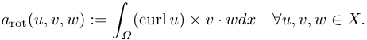

<!-- Start of picture text -->
a rot( u, v, w ) := (curl  u )  × v · wdx ∀u, v, w ∈ X. � Ω <!-- End of picture text -->

Note that _a_ rot( _u, v, v_ ) = 0 for any _u, v ∈ X_ . _a_ ( _·,·_ ) : _X × X →_ R and _b_ ( _·,·_ ) : _X × L_2 ( _Ω_ ) _→_ R denote the bilinear forms defined as 

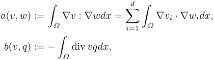

<!-- Start of picture text -->
d a ( v, w ) := ∇v :  ∇wdx  = � ∇vi · ∇widx, � Ω i =1 � Ω b ( v, q ) :=  − div  vqdx, � Ω <!-- End of picture text -->

for any ( _v, w_ ) _∈ X × X_ and ( _v, q_ ) _∈ X × L_2 ( _Ω_ ). For any _f ∈ L_2 ( _Ω_ )_d_ , the variational formulation for the Navier–Stokes equations (1.2) is to find ( _u, p_ ) _∈ V × Q_ such that 

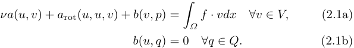

<!-- Start of picture text -->
νa ( u, v ) +  a rot( u, u, v ) +  b ( v, p ) = f · vdx ∀v ∈ V, (2.1a) � Ω b ( u, q ) = 0 ∀q ∈ Q. (2.1b) <!-- End of picture text -->

The space of the divergence-free weak function is defined as _V_ div := _{v ∈ V_ : _b_ ( _v, q_ ) = 0 _∀q ∈ Q}_ . The reduced problem in (2.1) is as follows. Find _u ∈ V_ div such that 

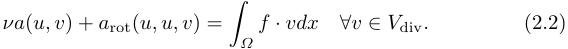

<!-- Start of picture text -->
νa ( u, v ) +  a rot( u, u, v ) = f · vdx ∀v ∈ V div . (2.2) � Ω <!-- End of picture text -->

## 2.2 Helmholtz projection 

We set _H∗_1(_Ω_) :=_H_1(_Ω_)_∩L_2 0(_Ω_) and_H_=_{v∈L_2(_Ω_)_d_:div_v_= 0_,v|∂Ω·n_= 0 _}_ , where div _v_ = 0 and _v|∂Ω · n_ = 0 signifies that � _Ω_(_v · ∇_)_qdx_=0forany _q ∈ H∗_1(_Ω_).Then,each_f∈L_2(_Ω_)_d_hasauniquedecomposition 

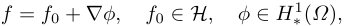

<!-- Start of picture text -->
f =  f 0 +  ∇ϕ, f 0 ∈H, ϕ ∈ H∗ 1( Ω ) , <!-- End of picture text -->

For example, see [11, Lemma 74.1] and [13,20,29]. The _L_2 -orthogonal projection _PH_ : _L_2 ( _Ω_ )_d_ _→H_ that results from this decomposition is defined as _PHf_ := _f_ 0. 

Anisotropic modified CR method for NS equation 

5 

Let _f ∈ L_2 ( _Ω_ )_d_ . For any _v ∈ H_1 ( _Ω_ )_d_ that is divergence-free and vanishes at the boundary, it holds that 

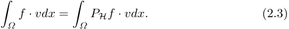

<!-- Start of picture text -->
f · vdx  = PHf · vdx. (2.3) � Ω � Ω <!-- End of picture text -->

The Poincar´e inequality yields: 

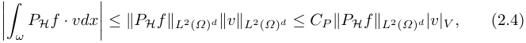

<!-- Start of picture text -->
PHf · vdx (2.4) ����� ω ���� ≤∥PHf ∥L 2( Ω ) d∥v∥L 2( Ω ) d ≤ CP ∥PHf ∥L 2( Ω ) d|v|V , <!-- End of picture text -->

where _CP_ denotes the Poincar´e constant. Furthermore, for any _u ∈ W_1_,_4 ( _Ω_ )_d_ , (curl _u_ ) _× u ∈ L_2 ( _Ω_ )_d_ holds. Then, 

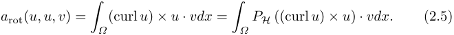

<!-- Start of picture text -->
a rot( u, u, v ) = (curl  u )  × u · vdx  = PH  ((curl  u )  × u )  · vdx. (2.5) � Ω � Ω <!-- End of picture text -->

## 2.3 Existence, uniqueness, and stability of a solution 

This section presents notable points regarding the continuity problem. These are the key features in the design of finite element schemes. 

For the trilinear form _a_ rot, from Sobolev embedding theorem _H_1 ( _Ω_ ) _�→ L_4 ( _Ω_ ), and H¨older inequality with exponents (<u>1</u> 4_,_<u>1</u> 2_,_<u>1</u> 4)weobtain _|a_ rot( _u, v, w_ ) _| ≤ N |u|V |v|V |w|V ∀u, v, w ∈ V,_ (2.6) 

where _N_ is a positive constant independent of _u_ , _v_ , and _w_ . In addition, the bilinear form _a_ is continuous on _V ×V_ and coercive on _V_ div _×V_ div. The bilinear form _b_ is continuous on _V × Q_ , and there exists a positive constant _β_ such that 

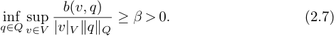

<!-- Start of picture text -->
b ( v, q ) inf ≥ β >  0 . (2.7) q∈Q v sup ∈V |v|V ∥q∥Q <!-- End of picture text -->

For example, refer to [20, Theorem 3.46], [10, Lemma 53.9], and [13, Lemma 4.1]. 

**Theorem 1** _For any f ∈ L_2 ( _Ω_ )_d_ _, there exists at least one solution of the variational formulation_ (2.1) _for the Navier–Stokes equations._ 

**Proof** The proof of its existence is found in [13, Chap. IV. Theorem 2.1] and [30, Chap. II, Theorem 1.2]. _⊓⊔_ 

We are interested in the uniqueness of the velocity solutions. This result is slightly different from the usual results. 

**Theorem 2** _For f ∈ L_2 ( _Ω_ )_d_ _, if_ 

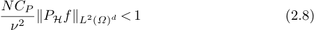

<!-- Start of picture text -->
NCP ∥PHf ∥L 2( Ω ) d <  1 (2.8) ν 2 <!-- End of picture text -->

_holds true, problem_ (2.2) _has a unique solution u ∈ V_ div _._ 

Hiroki Ishizaka 

6 

**Proof** We provide a proof of the uniqueness as follows. Let _u ∈ V_ div be the solution to problem (2.2). By setting _v_ := _u_ in (2.2) and using (2.4), we obtain 

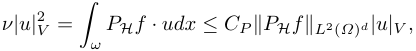

<!-- Start of picture text -->
ν|u| 2 V = PHf · udx ≤ CP ∥PHf ∥L 2( Ω ) d|u|V , � ω <!-- End of picture text -->

which leads to 

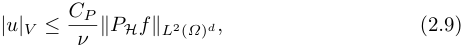

<!-- Start of picture text -->
|u|V ≤ C ν P ∥PHf ∥L 2( Ω ) d, (2.9) <!-- End of picture text -->

where _CP_ denotes the Poincar´e constant. Let _u_ 1 and _u_ 2 be solutions to problem (2.2). We set _u_ := _u_ 1 _− u_ 2 and subtract the problem (2.2) corresponding to _u_ 1 and _u_ 2. Then, 

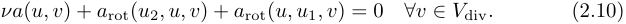

<!-- Start of picture text -->
νa ( u, v ) +  a rot( u 2 , u, v ) +  a rot( u, u 1 , v ) = 0 ∀v ∈ V div . (2.10) <!-- End of picture text -->

Setting _v_ := _u_ in (2.10) with (2.6) and (2.9), it holds that 

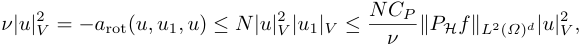

<!-- Start of picture text -->
ν|u| 2 V =  −a rot( u, u 1 , u )  ≤ N |u| 2 V |u 1 |V ≤ NCP ∥PHf ∥L 2( Ω ) d|u|V 2 , ν <!-- End of picture text -->

which leads to 

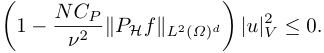

<!-- Start of picture text -->
1  − NCP ∥PHf ∥L 2( Ω ) d |u| 2 V ≤ 0 . � ν 2 � <!-- End of picture text -->

If (2.8) holds true, this inequality implies that _u_ 1 = _u_ 2. _⊓⊔_ 

_Remark 1 The stability estimate_ (2.9) _is sharper than the classical estimate |u|V ≤__C_ _ν__<u>p</u>∥f∥L_2(_Ω_)_s.Thestabilityestimateforthepressurefollowsfromthe_ _inf-sup condition_ (2.7) _. Changing the right-hand side of_ (2.2) _to f → f_ + _∇ϕ for ϕ ∈ H∗_1(_Ω_)_yields_ 

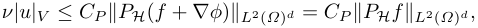

<!-- Start of picture text -->
ν|u|V ≤ CP ∥PH ( f +  ∇ϕ ) ∥L 2( Ω ) d =  CP ∥PHf ∥L 2( Ω ) d, <!-- End of picture text -->

_as PH_ ( _∇ϕ_ ) = 0 _. Therefore, the velocity is unaffected by the irrotational part of the force._ 

## **3 Modified CR finite element method** 

## 3.1 Notation 

For _k ∈_ N0 := N _∪{_ 0 _}_ , P_k_ ( _T_ ) is spanned by the restriction to _T_ by the polynomials in P_k_ , where P_k_ denotes the space of polynomials with a maximum of _k_ degrees. 

**Meshes, mesh faces, and jumps.** Let T _h_ = _{T }_ be a simplicial mesh of _Ω_ composed of closed _d_ -simplices: 

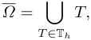

<!-- Start of picture text -->
Ω = � T, T ∈ T h <!-- End of picture text -->

Anisotropic modified CR method for NS equation 7 

where _h_ := max _T ∈_ T _h hT_ and _hT_ := diam( _T_ ). For simplicity, we assume that T _h_ is conformal; that is, T _h_ is a simplicial mesh of _Ω_ without hanging nodes. Let _Fh__i_bethesetofinteriorfaces,and_F_ _h__∂_bethesetoffacesonboundary _∂Ω_ . We set _Fh_ := _Fh__i∪F_ _h__∂_.Forany_F∈Fh_,wedefinetheunitnormal_nF_ to _F_ as follows: (i) If _F ∈Fh__i_with_F_=_T_1_∩T_2,_T_1_, T_2_∈_T_h_,let_n_1and_n_2 be the outwards unit normals of _T_ 1 and _T_ 2, respectively. Then, _nF_ is either of _{n_ 1 _, n_ 2 _}_ ; (ii) If _F ∈Fh__∂_,_nF_istheunitoutwardsnormal_n_to_∂Ω_.Wedefine the broken (piecewise) Sobolev space as 

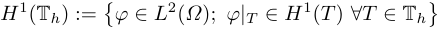

<!-- Start of picture text -->
H 1 (T h ) := � φ ∈ L 2 ( Ω ); φ|T ∈ H 1 ( T ) ∀T ∈ T h � <!-- End of picture text -->

with the seminorm 

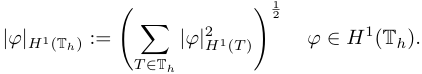

<!-- Start of picture text -->
2 |φ|H 1(T h ) := |φ| 2 H 1 ( T  ) φ ∈ H 1 (T h ) . �� T ∈ T h � 1 <!-- End of picture text -->

Let _φ ∈ H_1 (T _h_ ). Suppose that _F ∈Fh__i_with_F_=_T_1_∩T_2,_T_1_, T_2_∈_T_h_.Weset _φ_ 1 := _φ|T_ 1 and _φ_ 2 := _φ|T_ 2. We set two nonnegative real numbers _ωT_ 1 _,F_ and _ωT_ 2 _,F_ such that 

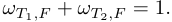

<!-- Start of picture text -->
ωT 1 ,F +  ωT 2 ,F = 1 . <!-- End of picture text -->

The jump and skew-weighted averages of _φ_ across _F_ are then defined as 

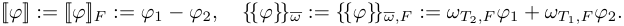

<!-- Start of picture text -->
[[ φ ]] := [[ φ ]] F :=  φ 1  − φ 2 , {{φ} } ω :=  {{φ} } ω,F :=  ω T 2 ,F φ 1 +  ω T 1 ,F φ 2 . <!-- End of picture text -->

For a boundary face _F ∈Fh__∂_with_F_=_∂T∩∂Ω_,[[_φ_]]_F_:=_φ|T_and_{{φ}__~~}~~_ _<u>ω</u>_:= _φ|T_ . For any _v ∈ H_1 (T _h_ )_d_ , the notation 

[[ _v · n_ ]] := [[ _v · n_ ]] _F_ := _v_ 1 _· nF − v_ 2 _· nF , {{v}}ω_ := _{{v}}ω,F_ := _ωT_ 1 _,F v_ 1 + _ωT_ 2 _,F v_ 2 for the jump in the normal component and weighted average of _v_ . For any _v ∈ H_1 (T _h_ )_d_ and _φ ∈ H_1 (T _h_ ), we have that 

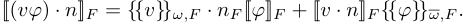

<!-- Start of picture text -->
[[( vφ )  · n ]] F =  {{v}}ω,F · nF  [[ φ ]] F + [[ v · n ]] F {{φ} } ω,F . <!-- End of picture text -->

The broken gradient operator is defined as follows: For _φ ∈ H_1 (T _h_ ), the broken gradient _∇h_ : _H_1 (T _h_ ) _→ L_2 ( _Ω_ )_d_ is defined as 

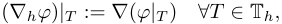

<!-- Start of picture text -->
( ∇hφ ) |T :=  ∇ ( φ|T  ) ∀T ∈ T h, <!-- End of picture text -->

Furthermore, we define a broken _H_ (div; _T_ )-space as 

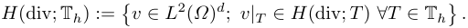

<!-- Start of picture text -->
H (div; T h ) := � v ∈ L 2 ( Ω ) d ; v|T ∈ H (div;  T ) ∀T ∈ T h � . <!-- End of picture text -->

Thus, the broken divergence operator div _h_ : _H_ (div; T _h_ ) _→ L_2 ( _Ω_ ), such that for all _v ∈ H_ (div; T _h_ ), 

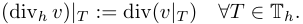

<!-- Start of picture text -->
(div h v ) |T := div( v|T  ) ∀T ∈ T h. <!-- End of picture text -->

Hiroki Ishizaka 

8 

## 3.2 Finite element spaces 

For _m ∈_ N0, we define a discontinuous finite element space as 

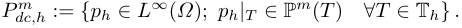

<!-- Start of picture text -->
Pdc,h m :=  {ph ∈ L∞ ( Ω ); ph|T ∈ P m ( T ) ∀T ∈ T h} . <!-- End of picture text -->

The CR finite element space is defined as 

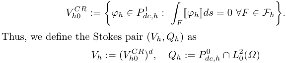

<!-- Start of picture text -->
Vh CR 0 := φh ∈ Pdc,h 1 : [[ φh ]] ds  = 0 ∀F ∈Fh . � � F � Thus, we define the Stokes pair ( Vh, Qh ) as Vh := ( Vh CR 0 ) d, Qh :=  Pdc,h 0 ∩ L 0 2( Ω ) <!-- End of picture text -->

with norms 

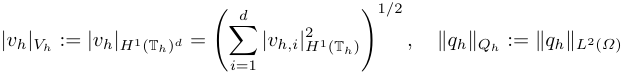

<!-- Start of picture text -->
|vh|Vh :=  |vh|H 1(T h ) d = � |vh,i| 2 H 1 (T h ) , ∥qh∥Qh :=  ∥qh∥L 2( Ω ) � i =1 d �1 / 2 <!-- End of picture text -->

for any _vh_ = ( _vh,_ 1 _, . . . , vh,d_ )_⊤_ _∈ Vh_ and _qh ∈ Qh_ . 

## 3.3 Approximation of the trilinear form _a_ rot 

The following lemma generalises [20, Lemma 6.7] (see also [28,32]). 

**Lemma 1** _It holds that for any u, v, w ∈ H_1 (T _h_ )_d_ 

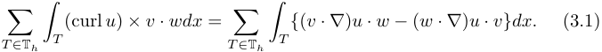

<!-- Start of picture text -->
� (curl  u )  × v · wdx  = � { ( v · ∇ ) u · w − ( w · ∇ ) u · v}dx. (3.1) T ∈ T h � T T ∈ T h � T <!-- End of picture text -->

**Proof** Let _u_ = ( _u_ 1 _, . . . , ud_ )_⊤_ _∈ H_1 (T _h_ )_d_ , _v_ = ( _v_ 1 _, . . . , vd_ )_⊤_ _∈ H_1 (T _h_ )_d_ , and _w_ = ( _w_ 1 _, . . . , wd_ )_⊤_ _∈ H_1 (T _h_ )_d_ . The following identity holds: 

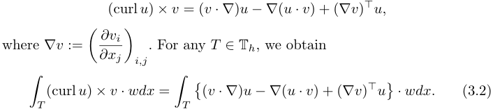

<!-- Start of picture text -->
(curl  u )  × v = ( v · ∇ ) u −∇ ( u · v ) + ( ∇v ) ⊤ u, where ∇v := . For any T ∈ T h , we obtain � ∂x∂vji � i,j (curl  u )  × v · wdx  = �( v · ∇ ) u −∇ ( u · v ) + ( ∇v ) ⊤ u � · wdx. (3.2) � T � T <!-- End of picture text -->

From Green’s formula, we obtain 

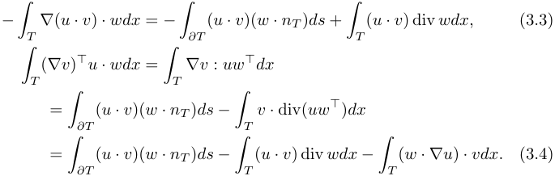

<!-- Start of picture text -->
− ∇ ( u · v )  · wdx  =  − ( u · v )( w · nT  ) ds  + ( u · v ) div  wdx, (3.3) � T � ∂T � T ( ∇v ) ⊤ u · wdx  = ∇v :  uw ⊤ dx � T � T = ( u · v )( w · nT  ) ds − v ·  div( uw ⊤ ) dx � ∂T � T = ( u · v )( w · nT  ) ds − ( u · v ) div  wdx − ( w · ∇u )  · vdx. (3.4) � ∂T � T � T <!-- End of picture text -->

Anisotropic modified CR method for NS equation 

9 

From (3.2), (3.3), and (3.4), it holds that for any _T ∈_ T _h_ , 

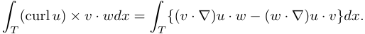

<!-- Start of picture text -->
(curl  u )  × v · wdx  = { ( v · ∇ ) u · w − ( w · ∇ ) u · v}dx. � T � T <!-- End of picture text -->

By summing over _T_ , the target identity (3.1) is obtained. 

<!-- Start of picture text -->
⊓⊔ <!-- End of picture text -->

For the classic CR finite element methods, the discretisation of the nonlinear form is as follows: 

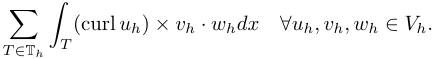

<!-- Start of picture text -->
� (curl  uh )  × vh · whdx ∀uh, vh, wh ∈ Vh. T ∈ T h � T <!-- End of picture text -->

As a lifting operator, we consider the RT interpolation operator _Ih__RT_0 : _Vh ∪ W_1_,_1 ( _Ω_ )_d_ _→ Vh__RT_0 defined in Section 4.7. The associated discrete convective trilinear form to the trilinear form (2.5) is defined as follows: 

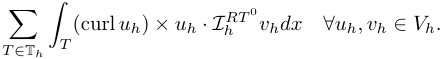

<!-- Start of picture text -->
� (curl  uh )  × uh · Ih RT  0 vhdx ∀uh, vh ∈ Vh. T ∈ T h � T <!-- End of picture text -->

Applying Lemma 1 yields 

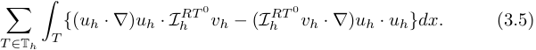

<!-- Start of picture text -->
� { ( uh · ∇ ) uh · Ih RT  0 vh − ( Ih RT  0 vh · ∇ ) uh · uh}dx. (3.5) T ∈ T h � T <!-- End of picture text -->

However, this form does not vanish by substituting _uh_ for _vh_ . Therefore, we define a discrete trilinear form _a_ rot _,h_ : ( _V_ + _Vh_ ) _×_ ( _V_ + _Vh_ ) _×_ ( _V_ + _Vh_ ) _→_ R as 

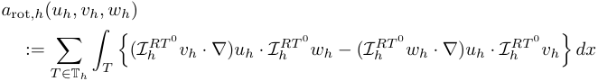

<!-- Start of picture text -->
a rot ,h ( uh, vh, wh ) := T �  ∈ T h � T �( Ih RT  0 vh · ∇ ) uh · Ih RT  0 wh − ( Ih RT  0 wh · ∇ ) uh · Ih RT  0 vh � dx <!-- End of picture text -->

for any _uh, vh, wh ∈ V_ + _Vh_ . The trilinear form _a_ rot _,h_ has two properties. For any _uh, vh, wh ∈ Vh_ , 

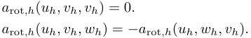

<!-- Start of picture text -->
a rot ,h ( uh, vh, vh ) = 0 . a rot ,h ( uh, vh, wh ) =  −a rot ,h ( uh, wh, vh ) . <!-- End of picture text -->

## 3.4 Modified CR finite element scheme 

We consider the CR finite element method for the Navier–Stokes equation (2.1) as follows: Find ( _uh, ph_ ) _∈ Vh × Qh_ such that 

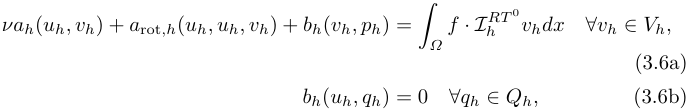

<!-- Start of picture text -->
νah ( uh, vh ) +  a rot ,h ( uh, uh, vh ) +  bh ( vh, ph ) = f · Ih RT  0 vhdx ∀vh ∈ Vh, � Ω (3.6a) bh ( uh, qh ) = 0 ∀qh ∈ Qh, (3.6b) <!-- End of picture text -->

Hiroki Ishizaka 

10 

where the discrete bilinear forms _ah_ : ( _V_ + _Vh_ ) _×_ ( _V_ + _Vh_ ) _→_ R and _bh_ : ( _V_ + _Vh_ ) _× Qh →_ R are the discrete counterparts of the bilinear forms _a_ and _b_ defined as 

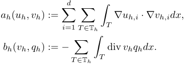

<!-- Start of picture text -->
d ah ( uh, vh ) := � � ∇uh,i · ∇vh,idx, i =1 T ∈ T h � T bh ( vh, qh ) :=  − � div  vhqhdx. T ∈ T h � T <!-- End of picture text -->

We define a discrete divergence-free weak subspace as follows: 

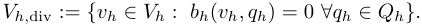

<!-- Start of picture text -->
Vh, div :=  {vh ∈ Vh : bh ( vh, qh ) = 0 ∀qh ∈ Qh}. <!-- End of picture text -->

Because _Vh,_ div _̸ ⊂ V_ div, the space _Vh,_ div is nonconforming in the space _V_ div. Then, the reduced problem of (3.6) is as follows. Find _uh ∈ Vh,_ div such that 

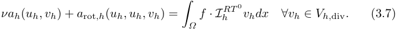

<!-- Start of picture text -->
νah ( uh, vh ) +  a rot ,h ( uh, uh, vh ) = f · Ih RT  0 vhdx ∀vh ∈ Vh, div . (3.7) � Ω <!-- End of picture text -->

The bilinear form _ah_ is continuous and coercive on _Vh ×Vh_ , and the bilinear form _bh_ is continuous on _Vh×Qh_ and satisfies the inf-sup condition; there exists a positive constant _β_ 0 such that 

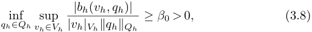

<!-- Start of picture text -->
|bh ( vh, qh ) | inf ≥ β 0  >  0 , (3.8) qh∈Qh vh sup ∈Vh |vh|Vh∥qh∥Qh <!-- End of picture text -->

because the CR interpolation operator acts as a nonconforming Fortin operator. 

## **4 Anisotropic interpolation error estimates** 

Our strategy for anisotropic interpolation errors in anisotropic meshes was proposed by [15,16,19]. 

## 4.1 Reference elements 

We now define the reference elements _T_� _⊂_ R_d_ . 

## _Two-dimensional case_ 

Let _T_� _⊂_ R2 be a reference triangle with vertices _p_ ˆ1 := (0 _,_ 0)_⊤_ , _p_ ˆ2 := (1 _,_ 0)_⊤_ , and _p_ ˆ3 := (0 _,_ 1)_⊤_ . 

Anisotropic modified CR method for NS equation 

11 

_Three-dimensional case_ In the three-dimensional case, we consider the following two cases: (i) and (ii) (see Condition 2). Let _T_� 1 and _T_� 2 be reference tetrahedra with the following vertices: (i) _T_� 1 has the vertices _p_ ˆ1 := (0 _,_ 0 _,_ 0)_⊤_ , _p_ ˆ2 := (1 _,_ 0 _,_ 0)_⊤_ , _p_ ˆ3 := (0 _,_ 1 _,_ 0)_⊤_ , and _p_ ˆ4 := (0 _,_ 0 _,_ 1)_⊤_ ; (ii) _T_� 2 has the vertices _p_ ˆ1 := (0 _,_ 0 _,_ 0)_⊤_ , _p_ ˆ2 := (1 _,_ 0 _,_ 0)_⊤_ , _p_ ˆ3 := (1 _,_ 1 _,_ 0)_⊤_ , and _p_ ˆ4 := (0 _,_ 0 _,_ 1)_⊤_ . Therefore, we set _T_� _∈{T_� 1 _, T_� 2 _}_ . The case (i) is called the _regular vertex property_ ; see [1]. 

4.2 Two-step affine mapping To an affine simplex _T ⊂_ R_d_ , we construct two affine mappings _ΦT_ �:_T_�_→T_� and _ΦT_ : _T_� _→ T_ . First, we define the affine mapping _ΦT_ �:_T_�_→T_�as _ΦT_ �:_T_�_∋x_ˆ_�→x_˜ :=_Φ_ _T_�(ˆ_x_) :=_A_� _T__x_ˆ_∈T,_� (4.1) where _A_ � _T__∈_R_d×d_isaninvertiblematrix.Wethendefinetheaffinemapping _ΦT_ : _T_� _→ T_ as follows: 

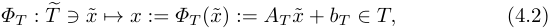

<!-- Start of picture text -->
ΦT : T � ∋ x ˜  �→ x  :=  ΦT  (˜ x ) :=  AT  ˜ x  +  bT ∈ T, (4.2) <!-- End of picture text -->

where _bT ∈_ R_d_ is a vector and _AT ∈ O_ ( _d_ ) denotes the rotation and mirrorimaging matrix. We define the affine mapping _Φ_ : _T_� _→ T_ as 

_Φ_ := _ΦT ◦ ΦT_ �:_T_�_∋x_ˆ_�→x_:=_Φ_(ˆ_x_) = (_ΦT◦Φ_ _T_�)(ˆ_x_) =_Ax_ˆ +_bT∈T,_ where _A_ := _AT A_ � _T__∈_R_d×d_. 

_Construct mapping ΦT_ �:_T_�_→T_� 

We consider the affine mapping (4.1). We define the matrix _A_ � _T__∈_R_d×d_as follows. We first define the diagonal matrix as 

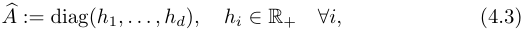

<!-- Start of picture text -->
A � := diag( h 1 , . . . , hd ) , hi ∈ R+ ∀i, (4.3) <!-- End of picture text -->

where R+ denotes the set of positive real numbers. For _d_ = 2, we define the regular matrix _A_� _∈_ R2_×_2 as 

<!-- Start of picture text -->
A � := , (4.4) 0 t �1  s � <!-- End of picture text -->

with the parameters 

_s_2 + _t_2 = 1 _, t >_ 0 _._ 

Hiroki Ishizaka 

12 

For the reference element _T_� , let T(2) be a family of triangles. 

<!-- Start of picture text -->
T � =  ΦT  � ( T  �) =  A  � T ( T  �) , AT  � := A � � A <!-- End of picture text -->

with the vertices _p_ ˜1 := (0 _,_ 0)_⊤_ , _p_ ˜2 := ( _h_ 1 _,_ 0)_⊤_ and _p_ ˜3 := ( _h_ 2 _s, h_ 2 _t_ )_⊤_ . Then, _h_ 1 = _|p_ ˜1 _− p_ ˜2 _| >_ 0 and _h_ 2 = _|p_ ˜1 _− p_ ˜3 _| >_ 0. 

For _d_ = 3, we define the regular matrices _A_� 1 _, A_� 2 _∈_ R3_×_3 as follows: 

<!-- Start of picture text -->
1 s 1 s 21 1  −s 1 s 21 A �1 := 0 t 1 s 22 0 t 1 s 22 (4.5) 0 0 t 2  , A �2 := 0 0 t 2  <!-- End of picture text -->

with the parameters 

<!-- Start of picture text -->
s 2 1 +  t 2 1 = 1 , s 1 >  0 , t 1 >  0 , h 2 s 1 ≤ h 1 / 2 , � s 2 21 +  s 2 22 +  t 2 2 = 1 , t 2 >  0 , h 3 s 21 ≤ h 1 / 2 . <!-- End of picture text -->

Therefore, we set _A_� _∈{A_� 1 _, A_� 2 _}_ . For the reference elements _T_� _i_ , _i_ = 1 _,_ 2, let T(3) _i_,_i_= 1_,_2,beafamilyoftetrahedra. 

<!-- Start of picture text -->
T � i =  ΦT  � i ( T  � i ) =  A  � Ti ( T  � i ) , AT  � i := A � i  � A, i  = 1 ,  2 , <!-- End of picture text -->

with the vertices 

<!-- Start of picture text -->
p ˜1 := (0 ,  0 ,  0) ⊤ , p ˜2 := ( h 1 ,  0 ,  0) ⊤ , p ˜4 := ( h 3 s 21 , h 3 s 22 , h 3 t 2) ⊤ , p ˜3 := ( h 2 s 1 , h 2 t 1 ,  0) ⊤ for case (i) , � p ˜3 := ( h 1  − h 2 s 1 , h 2 t 1 ,  0) ⊤ for case (ii) . <!-- End of picture text -->

Subsequently, _h_ 1 = _|p_ ˜1 _− p_ ˜2 _| >_ 0, _h_ 3 = _|p_ ˜1 _− p_ ˜4 _| >_ 0, and 

<!-- Start of picture text -->
|p ˜1  − p ˜3 | >  0 for case (i) , h 2 = � |p ˜2  − p ˜3 | >  0 for case (ii) . <!-- End of picture text -->

_Construct mapping ΦT_ : _T_� _→ T_ 

We determine the affine mapping (4.2) as follows. Let _T ∈_ T _h_ have vertices _pi_ ( _i_ = 1 _, . . . , d_ + 1). Let _bT ∈_ R_d_ be the vector and _AT ∈ O_ ( _d_ ) be the rotation and mirror imaging matrix such that 

<!-- Start of picture text -->
pi =  ΦT  (˜ pi ) =  AT  ˜ pi  +  bT , i ∈{ 1 , . . . , d  + 1 }, <!-- End of picture text -->

where vertices _pi_ ( _i_ = 1 _, . . . , d_ + 1) satisfy the following conditions: 

**Condition 1 (Case in which** _d_ = 2 **)** _Let T ∈_ T _h have vertices pi (i_ = 1 _, . . . ,_ 3 _). We assume that_ _<u>p</u>_ 2 _<u>p</u>_ 3 _is the longest edge of T , that is, hT_ := _|p_ 2 _−p_ 3 _|. We set h_ 1 = _|p_ 1 _−p_ 2 _| and h_ 2 = _|p_ 1 _−p_ 3 _|. We then assume that h_ 2 _≤ h_ 1 _. Because_ <u>12</u>_hT< h_1_≤hT ,h_1_≈hT ._ 

Anisotropic modified CR method for NS equation 

13 

**Condition 2 (Case in which** _d_ = 3 **)** _Let T ∈_ T _h have vertices pi (i_ = 1 _, . . . ,_ 4 _). Let Li (_ 1 _≤ i ≤_ 6 _) be the edges of T . We denote by L_ min _the edge of T with the minimum length; that is, |L_ min _|_ = min1 _≤i≤_ 6 _|Li|. We set h_ 2 := _|L_ min _| and assume that_ 

_the endpoints of L_ min _are either {p_ 1 _, p_ 3 _} or {p_ 2 _, p_ 3 _}._ 

_Among the four edges sharing an endpoint with L_ min _, we consider the longest edge L_(min) max_.Letp_ 1_andp_ 2_betheendpointsofedgeL_ max(min)_.Thus,wehave_ 

<!-- Start of picture text -->
h 1 =  |L (min) max |  =  |p 1 − p 2 |. <!-- End of picture text -->

_We consider cutting_ R3 _with a plane that contains the midpoint of the edge L_(min) max _and is perpendicular to the vector p_ 1 _− p_ 2 _. Thus, there are two cases._ 

_(Type i) p_ 3 _and p_ 4 _belong to the same half-space; (Type ii) p_ 3 _and p_ 4 _belong to different half-spaces._ 

_In each case, we set_ 

_(Type i) p_ 1 _and p_ 3 _as the endpoints of L_ min _, that is, h_ 2 = _|p_ 1 _− p_ 3 _|; (Type ii) p_ 2 _and p_ 3 _as the endpoints of L_ min _, that is, h_ 2 = _|p_ 2 _− p_ 3 _|._ 

_Finally, we set h_ 3 = _|p_ 1 _− p_ 4 _|. We implicitly assume that p_ 1 _and p_ 4 _belong to the same half space. Additionally, note that h_ 1 _≈ hT ._ 

4.3 Piola transformations 

The Piola transformation _Ψ_ : _L_1 ( _T_� )_d_ _→ L_1 ( _T_ )_d_ is defined as follows: 

<!-- Start of picture text -->
Ψ :  L 1 ( T � ) d → L 1 ( T ) d <!-- End of picture text -->

<!-- Start of picture text -->
1 v ˆ �→ v ( x ) :=  Ψ (ˆ v )( x ) = det( A ) Av ˆ(ˆ x ) . <!-- End of picture text -->

4.4 Additional notations and assumptions 

We define the vectors _rn ∈_ R_d_ , _n_ = 1 _, . . . , d_ as follows: If _d_ = 2, 

<!-- Start of picture text -->
r 1 := p 2  − p 1 r 2 := p 3  − p 1 |p 2  − p 1 | , |p 3  − p 1 | , <!-- End of picture text -->

and if _d_ = 3, 

<!-- Start of picture text -->
 r 2 := p 3  − p 1 for (Type i) , r 1 := | p p 2 2  −  − p p 1 1 | , r 3 := | p p 4 4  −  − p p 1 1 | ,  r 2 := |p p 3 3  −  − p p 1 2 | , for (Type ii) .  |p 3  − p 2 | <!-- End of picture text -->

Hiroki Ishizaka 

14 

For a sufficiently smooth function _φ_ and a vector function _v_ := ( _v_ 1 _, . . . , vd_ )_⊤_ , we define the directional derivative for _i ∈{_ 1 _, . . . , d}_ as 

<!-- Start of picture text -->
d ∂φ ∂φ := ( ri · ∇x ) φ  = � ( ri ) i 0 , ∂ri i 0=1 ∂xi 0 ∂v := , . . . , ∂vd = (( ri · ∇x ) v 1 , . . . ,  ( ri · ∇x ) vd ) ⊤ . ∂ri � ∂v∂r 1 i ∂ri � ⊤ multiindex β = ( β 1 , . . . , βdd )  ∈ N d 0 , we use the notation ∂ |β| φ ∂ |β| φ ∂ β φ  := ∂x β 1 1 . . . ∂xβ d d , ∂r βφ  := ∂r 1 β 1 . . . ∂r d βd , h β :=  h β 1 1 · · · hβ d d. <!-- End of picture text -->

For a multiindex _β_ = ( _β_ 1 _, . . . , βdd_ ) _∈_ N_d_ 0,weusethenotation 

It should be noted that _∂__β_ _φ̸_ = _∂r__βφ_. 

We propose a geometric parameter _HT_ in a prior paper [19]. 

**Definition 1** _The parameter HT is defined as_ 

<!-- Start of picture text -->
� di =1 hi HT := hT , |T |d <!-- End of picture text -->

_where | · |d denotes the d-dimensional Hausdorff measure._ 

Here, we introduce the geometric condition proposed by [18,19], which is equivalent to the maximum angle condition [17,19]. 

**Assumption 1** _A family of meshes {_ T _h} has a semi-regular property if there exists γ_ 0 _>_ 0 _such that_ 

<!-- Start of picture text -->
HT ≤ γ 0 ∀ T h ∈{ T h}, ∀T ∈ T h. (4.6) hT <!-- End of picture text -->

4.5 _L_2 -orthogonal projection 

For _T ∈_ T _h_ , the _L_2 -orthogonal projection _ΠT_0:_L_1(_T_)_→_P0(_T_)isdefinedas follows: 

<!-- Start of picture text -->
1 ΠT 0 φ  := φdx. |T |d � T <!-- End of picture text -->

The following theorem provides an anisotropic error estimate for the projection _ΠT_0. 

**Theorem 3** _Let p ∈_ [1 _, ∞_ ) _and q ∈_ [1 _, ∞_ ) _be such that_ 

<!-- Start of picture text -->
W 1 ,p ( T )  �→ L q ( T ) , (4.7) <!-- End of picture text -->

<!-- Start of picture text -->
that is 1  − d p ≥− d q . Then, for any φ ˆ  ∈ W  1 ,p ( T  �) with φ  := φ ˆ  ◦ Φ− 1 , d ∥ΠT 0 φ − φ∥ L q ( T  ) ≤ c|T |d q 1 − p 1 � hi ∂φ . (4.8) i =1 ���� ∂ri ���� L p ( T  ) <!-- End of picture text -->

Anisotropic modified CR method for NS equation 15 

**Proof** This proof is provided in [16, Theorem 1]. _⊓⊔_ 

<!-- Start of picture text -->
We also define the global interpolation Πh 0 to space P  0 dc,h as ( Πh 0 φ ) |T :=  Π T 0 ( φ|T ) ∀T ∈ T h, ∀φ ∈ L 1 ( Ω ) . <!-- End of picture text -->

4.6 CR finite element interpolation operator 

Let _Fi_ , 1 _≤ i ≤ d_ + 1, be the ( _d −_ 1)-dimensional subsimplex of _T_ opposite to _pi_ . Using the barycentric coordinates _{λi}__d_ _i_ =1+1:R_d→_Ronthereference element, the nodal basis functions are defined as follows: 

<!-- Start of picture text -->
θi ( x ) :=  d � d 1 − λi ( x ) � ∀i ∈{ 1 , . . . , d  + 1 }. (4.9) <!-- End of picture text -->

The local CR interpolation operator is defined as 

<!-- Start of picture text -->
d +1 1 IT CR :  W 1 , 1 ( T )  ∋ φ �→ IT CR φ  := � φds θi ∈ P 1 ( T ) . (4.10) i =1 � |Fi|d− 1 � Fi � <!-- End of picture text -->

We then present the anisotropic CR interpolation error estimate. 

**Theorem 4** _Let p ∈_ [1 _, ∞_ ) _and q ∈_ [1 _, ∞_ ) _be such that_ (4.7) _holds true. For any φ_ ˆ _∈ W_2_,p_ ( _T_� ) _with φ_ := _φ_ ˆ _◦ Φ__−_1 _, it holds that_ 

<!-- Start of picture text -->
d |IT CR φ − φ|W  1 ,q ( T  ) ≤ c|T |d q 1 − p 1 � hi ∂φ . (4.11) i =1 ���� ∂ri ���� W 1 ,p ( T  ) <!-- End of picture text -->

**Proof** This proof is found in [16, Theorem 2]. 

<!-- Start of picture text -->
⊓⊔ <!-- End of picture text -->

The vector-valued local interpolation operator 

<!-- Start of picture text -->
IT CR :  W 1 , 1 ( T ) d → P 1 ( T ) d <!-- End of picture text -->

is defined component-wise, that is, 

<!-- Start of picture text -->
IT CR v := ( IT CR v 1 , . . . , IT CR vd ) ⊤ ∀v = ( v 1 , . . . , vd ) ⊤ ∈ W 1 , 1 ( T ) d . <!-- End of picture text -->

<!-- Start of picture text -->
We define a global interpolation operator Ih CR :  W 1 , 1 ( Ω ) d → Vh as ( Ih CR v ) |T =  IT CR ( v|T  ) ∀T ∈ T h, ∀v ∈ W 1 , 1 ( Ω ) d , (4.12) <!-- End of picture text -->

where the space _Vh_ is defined in Section 3.2. 

Hiroki Ishizaka 

16 

4.7 RT finite element interpolation operator 

For a simplex _T ⊂_ R_d_ , we define the local RT polynomial space as follows: 

<!-- Start of picture text -->
RT 0 ( T ) := P 0 ( T ) d +  x P 0 ( T ) , x ∈ R d . (4.13) <!-- End of picture text -->

Let _IT__RT_0 : _W_1_,_1 ( _T_ )_d_ _→_ RT0 ( _T_ ) be the RT interpolation operator such that for any _v ∈ W_1_,_1 ( _T_ )_d_ , 

<!-- Start of picture text -->
d +1 IT RT  0 :  W 1 , 1 ( T ) d ∋ v �→IT RT  0 v := � v · nFids θT,i RT  0 ∈ RT 0 ( T ) , i =1 �� Fi � (4.14) <!-- End of picture text -->

where _θT,i__RT_0 is the local shape function (e.g. [9]) and _nFi_ is a fixed unit normal to _Fi_ . 

The following two theorems are based on element _T_ satisfying Type i or Type ii in Section 4.2 when _d_ = 3. 

**Theorem 5** _Let p ∈_ [1 _, ∞_ ) _and T be the element under Conditions 1 or 2 and satisfy (Type i) in Section 4.2 when d_ = 3 _. For any v_ ˆ _∈ W_1_,p_ ( _T_� )_d_ _with v_ = ( _v_ 1 _, . . . , vd_ )_⊤_ := _Ψ v_ ˆ _,_ 

<!-- Start of picture text -->
d HT ∂v ∥IT RT  0 v − v∥Lp ( T  ) d ≤ c � hi . (4.15) � hT i =1 ���� ∂ri ���� L p ( T  ) d +  hT ∥ div  v∥Lp ( T  ) � Proof The proof can be found in [15, Theorem 2]. ⊓⊔ Theorem 6 Let p ∈ p ∈ ∈ [1 , ∞ ∞ ) , d d  = 3 , and T T be the element with Condition 2 and satisfy (Type ii) in Section 4.2. For v ˆ ∈ W 1 ,p ( T � ) 3 with v v = ( v 1 , v 2 , v 3)) ⊤ :=  Ψ v ˆ , ∥IT RT  0 v − v∥Lp ( T  )3 ≤ c HT hT |v|W  1 ,p ( T  )3 . (4.16) hT � � <!-- End of picture text -->

**Proof** The proof can be found in [15, Theorem 2]. 

**Theorem 6** _Let p ∈ p ∈ ∈_ [1 _, ∞ ∞_ ) _, d d_ = 3 _, and T T be the element with Condition 2 and satisfy (Type ii) in Section 4.2. For v_ ˆ _∈ W_1_,p_ ( _T_� )3 _with v v_ = ( _v_ 1 _, v_ 2 _, v_ 3))_⊤_ := _Ψ v_ ˆ _,_ 

**Proof** The proof can be found in [15, Theorem 3]. 

<!-- Start of picture text -->
⊓⊔ <!-- End of picture text -->

The RT finite element space is defined as follows: 

_Vh__RT_0 := _{vh ∈ L_1 ( _Ω_ )_d_ : _vh|T ∈_ RT0 ( _T_ ) _, ∀T ∈_ T _h,_ [[ _vh · n_ ]] _F_ = 0 _, ∀F ∈Fh}._ We define the following global RT interpolation _Ih__RT_0 : _Vh ∪W_1_,_1 ( _Ω_ )_d_ _→ Vh__RT_0 as 

<!-- Start of picture text -->
( Ih RT  0 v ) |T =  IT RT  0 ( v|T  ) ∀T ∈ T h, ∀v ∈ Vh ∪ W 1 , 1 ( Ω ) d . <!-- End of picture text -->

Anisotropic modified CR method for NS equation 

17 

4.8 RT interpolation errors on anisotropic elements 

Let _T ⊂_ R2 be a simplex. For any _v ∈ H_1 ( _T_ )2 , the RT interpolation error in (4.15) with _p_ = 2 can be expressed as follows: 

<!-- Start of picture text -->
2 HT ∂v ∥IT RT  0 v − v∥L 2( T  )2 ≤ c � hi . (4.17) � hT i =1 ���� ∂ri ���� L 2 ( T  ) 2 +  hT ∥ div  v∥L 2( T  ) � <!-- End of picture text -->

The shape-regularity condition is known: there exists a constant _γ_ 1 _>_ 0 such that 

<!-- Start of picture text -->
ρT ≥ γ 1 hT ∀ T h ∈{ T h}, ∀T ∈ T h, <!-- End of picture text -->

where _ρT_ is the diameter of the largest ball that can be inscribed in _T_ and is equivalent to the following condition: there exists a constant _γ_ 2 _>_ 0 such that for any T _h ∈{_ T _h}_ and simplex _T ∈_ T _h_ , we have 

<!-- Start of picture text -->
|T | 2 ≥ γ 2 hT 2 . <!-- End of picture text -->

This proof is provided in [3, Theorem 1]. 

We considered the following four anisotropic elements: Let 0 _< s, δ ≪_ 1, _s, δ ∈_ R, and _ε >_ 1, _ε ∈_ R. 

_Example 1 Let T ⊂_ R2 _be the simplex with vertices p_ 1 := (0 _,_ 0)_⊤_ _<u>, p</u>_ 2 := (2 _s,_ 0)_⊤_ _, and p_ 3 := ( _s, δs_ )_⊤_ _. Then, we have that h_ 1 = _h_ 2 = _s_ _~~√~~_ 1 + _δ_2 _≈ s, hT_ = 2 _s, |T |_ 2 = _δs_2 _, and_ 

<!-- Start of picture text -->
h 2 T HT |T | 2 = 4 δ <  + ∞, hT = 1 + δ  δ 2 <  + ∞. <!-- End of picture text -->

_Therefore, both the shape regularity and semi-regularity conditions are satisfied. Estimate_ (4.17) _is as follows:_ 

<!-- Start of picture text -->
2 1 +  δ 2 ∂v ∥IT RT  0 v − v∥L 2( T  )2 ≤ c � δ � i =1 s � 1 +  δ 2 ���� ∂ri ���� L 2 ( T  ) 2 + 2 s∥ div  v∥L 2( T  ) � ≤ cs|v|H 1( T  )2 . <!-- End of picture text -->

_In this case, the anisotropic error_ (4.17) _is reduced to the standard error estimate._ 

_Example 2 Let T ⊂_ R2 _be the simplex with vertices p_ 1 := (0 _<u>,</u>_ 0)_⊤_ _<u>, p</u>_ 2 := (2 _s,_ 0)_⊤_ _, and p_ 3 := ( _s, s__ε_ )_⊤_ _. Then, we have that h_ 1 = _h_ 2 = _~~√~~ s_2 + _s_2_ε_ _≈ s, hT_ = 2 _s, |T |_ 2 = _s_1+_ε_ _, and_ 

<!-- Start of picture text -->
h 2 T HT = 4 s 1 −ε →∞ as s → 0 , = s 2 +  s 2 ε →∞ as s → 0 . |T | 2 hT s 1+ ε <!-- End of picture text -->

Hiroki Ishizaka 

18 

_Therefore, neither the shape-regularity nor the semi-regularity condition is satisfied. The estimate_ (4.17) _is as follows:_ 

<!-- Start of picture text -->
2 s 2 +  s 2 ε ∂v ∥IT RT  0 v − v∥L 2( T  )2 ≤ c � s 1+ ε � i =1 � s 2 +  s 2 ε ���� ∂ri ���� L 2 ( T  ) 2 + 2 s∥ div  v∥L 2( T  ) � ≤ cs 2 −ε |v|H 1( T  )2 . <!-- End of picture text -->

_In this case, when ε >_ 2 _, the estimate diverges as s →_ 0 _._ 

_Example 3 Let T ⊂_ R2 _be the simplex with vertices p_ 1 := (0 _,_ 0)_⊤_ _, p_ 2 := ( _s,_ 0)_⊤_ _, and p_ 3 := (0 _, δs_ )_⊤_ _. Then, we have that h_ 1 = _s, h_ 2 = _δs, hT_ = _s_ _~~√~~_ 1 + _δ_2 _≈ s, and |T |_ 2 =<u>1</u> 2_δs_2_,and_ 

<!-- Start of picture text -->
h 2 T HT = 2(1 +  δ 2) <  + ∞, = 2 . |T | 2 δ hT <!-- End of picture text -->

_Therefore, both the shape regularity and semi-regularity conditions are satisfied. The estimate_ (4.17) _is as follows:_ 

<!-- Start of picture text -->
∂v ∂v ∥IT RT  0 v − v∥L 2( T  )2 ≤ c s � ���� ∂r 1 ���� L 2 ( T  ) 2 +  δs ���� ∂r 2 ���� L 2 ( T  ) 2 � +  cs � 1 +  δ 2 ∥ div  v∥L 2( T  ) . <!-- End of picture text -->

_In this case, the anisotropic error_ (4.17) _is valid._ 

_Example 4 Let T ⊂_ R2 _be the simplex with vertices p_ 1 := (0 _,_ 0)_⊤_ _, p_ 2 := ( _s,_ 0)_⊤_ _, and p_ 3 := (0 _, s__ε_ )_⊤_ _. Subsequently, we obtain h_ 1 = _s, h_ 2 = _s__ε_ _, hT_ = _~~√~~ s_2 + _s_2_ε_ _≈ s, and |T |_ 2 = 2<u>1</u>_s_1+_ε,and_ 

<!-- Start of picture text -->
h 2 T HT = 2( s 2 +  s 2 ε ) →∞ as s → 0 , = 2 . |T | 2 s 1+ ε hT <!-- End of picture text -->

_Therefore, although the shape-regularity condition is not satisfied, the semiregularity condition is satisfied. The estimate_ (4.17) _is as follows:_ 

<!-- Start of picture text -->
∂v ∂v ∥IT RT  0 v − v∥L 2( T  )2 ≤ c s � ���� ∂r 1 ���� L 2 ( T  ) 2 +  sε ���� ∂r 2 ���� L 2 ( T  ) 2 � +  c � s 2 +  s 2 ε ∥ div  v∥L 2( T  ) . <!-- End of picture text -->

_In this case, the anisotropic error_ (4.17) _is valid._ 

Anisotropic modified CR method for NS equation 19 

4.9 Notable properties for analysis 

The following relationship holds between the RT interpolation _Ih__RT_0 and _L_2 - projection _Πh_0: 

**Lemma 2** _It holds that_ 

<!-- Start of picture text -->
div( IT RT  0 v ) =  ΠT 0 (div  v ) ∀v ∈ H 1 ( T ) d . (4.18) <!-- End of picture text -->

_By combining_ (4.18) _, for any v ∈ H_1 ( _Ω_ )_d_ _, it holds that_ 

<!-- Start of picture text -->
div( Ih RT  0 v ) =  Πh 0(div  v ) . (4.19) Proof This proof is provided in [9, Lemma 16.2]. ⊓⊔ <!-- End of picture text -->

Lemma 2 presents an important relationship. 

<!-- Start of picture text -->
Lemma 3 For any vh ∈ Vh RT  0 and ψh ∈ H 0 1( Ω ) +  V h CR 0 , <!-- End of picture text -->

<!-- Start of picture text -->
� ( vh · ∇ ) ψhdx  + � div  vhψhdx  = 0 . (4.20) T ∈ T h � T T ∈ T h � T <!-- End of picture text -->

**Proof** For any _vh ∈ Vh__RT_0 and _ψh ∈ H_ 01(_Ω_) +_V_ _h__CR_ 0,usingGreen’sformula and from _vh · nF ∈_ P0 ( _F_ ) for any _F ∈Fh_ , we derive 

<!-- Start of picture text -->
� ( vh · ∇ ) ψhdx  + � div  vhψhdx T ∈ T h � T T ∈ T h � T = � ( vh · nT  ) ψhds  = � [[( vhψh )  · nF  ]] ds � ∂T � F T ∈ T h F ∈Fh = � ([[ vh · n ]] F {{ψh} } ω,F +  {{v h }} ω,F · n F [[ ψ h ]] F )  ds F ∈Fh i � F + � ( vh · nF  ) ψhds  = 0 , F ∈Fh ∂ � F <!-- End of picture text -->

which leads to (4.20). 

<!-- Start of picture text -->
⊓⊔ <!-- End of picture text -->

_Note 1_ For any _wh ∈ Vh ∪ W_1_,_1 ( _Ω_ )_d_ , we use the following relation: 

<!-- Start of picture text -->
� ( Ih RT  0 wh · ∇ ) φhdx  + � ( Πh 0 div  wh ) φhdx  = 0 , φh ∈ Vh CR 0 . T ∈ T h � T T ∈ T h � T <!-- End of picture text -->

_Note 2_ Let _T ∈_ T _h_ and _k ∈_ N. We define a discrete space as follows: 

<!-- Start of picture text -->
P d,k k :=  {q ∈ P k ( T ) d : q · nT ∈ R k ( ∂T ) }, <!-- End of picture text -->

where 

R_k_ ( _∂T_ ) := _{φh ∈ L_2 ( _∂T_ ) : _φh|F ∈_ P_k_ ( _F_ ) _∀F ∈Fh}._ 

Hiroki Ishizaka 

20 

_H_ (div; _Ω_ )-conforming Brezzi–Douglas–Marini finite element space ([2]) is defined as 

_Vh__H_(div;_Ω_) := _{vh ∈ L_1 ( _Ω_ )_d_ : _vh|T ∈_ P_d,k_ _k__,∀T∈_T_h,_[[_vh · n_]]_F_= 0_,∀F∈Fh}._ Let _Ih__H_(div;_Ω_) : _Vh ∪ W_1_,_1 ( _Ω_ )_d_ _→ Vh__H_(div;_Ω_) be a global interpolation operator satisfying 

<!-- Start of picture text -->
{{Ih H (div; Ω ) v}}ω,F · nF qhds  = 0 ∀v ∈ Vh ∪ W 1 , 1 ( Ω ) d , ∀qh ∈ R k ( ∂T ) . � F <!-- End of picture text -->

By setting _vh_ := _Ih__H_(div;_Ω_) _v_ , the relation (4.20) holds. Furthermore, let _Vh__c_ be an _H_ 01(_Ω_)-conformingfiniteelementspace.Let_Lh_:_Vh∪W_1_,_1(_Ω_)_d→_ _Vh__H_(div;_Ω_) be the approximate lifting operators that preserve the optimal convergence rate of the estimated error. Because [[ _ψh_ ]] _F_ = 0 for any _ψh ∈ Vh__c_and setting _vh_ := _Lhv_ , the relation (4.20) holds. 

## **5 Discrete Sobolev inequality** 

We impose a weak elliptic regularity assumption to obtain a discrete Sobolev inequality. 

**Assumption 2** _Let p__′_ _∈_ ( _d_<u>2</u> +2_<u>d</u>,_2]_.Weassumethat,foranyq∈Lp′_(_Ω_)_,the_ _variational problem_ 

<!-- Start of picture text -->
∇z · ∇wdx  = qwdx ∀w ∈ H 0 1( Ω ) (5.1) � Ω � Ω <!-- End of picture text -->

_has a unique solution z ∈ H_ 01(_Ω_)_thatbelongstoW_2_,p′_(_Ω_)_.Inaddition,the_ _elliptic regularity estimate_ 

<!-- Start of picture text -->
∥z∥W  2 ,p ′ ( Ω ) ≤ C LE ∥q∥Lp ′ ( Ω ) <!-- End of picture text -->

_holds, where C__LE_ _is a positive constant that is independent of z._ 

_Note 3_ From the Lax–Milgram theorem, it follows that the problem (5.1) has a unique solution _z ∈ H_ 01(_Ω_). 

_Note 4_ In two dimensions, [6] may be helpful in showing that the solution _z_ belongs to _W_2_,p′_ ( _Ω_ ). A discontinuous Galerkin analysis of low-regularity solutions was reported by [7,31]. 

_Note 5_ Here, we introduce an example from [31]. Let _Ω_ := (0 _,_<u>1</u> 4)2.Thefunc- tion _q_ of the Poisson equation 

<!-- Start of picture text -->
−∆z =  q in Ω, z = 0 on ∂Ω <!-- End of picture text -->

Anisotropic modified CR method for NS equation 

21 

is provided to satisfy the exact solution: 

<!-- Start of picture text -->
z ( x, y ) :=  x x − 1 y y − 1 r − 2+ α , � 4 � � 4 � <!-- End of picture text -->

where _α ∈_ (0 _,_ 1] is a constant, and _r_ := ( _x_2 + _y_2 ) 21 . Then, 

_z ∈ H_ 01(_Ω_)_∩W_2_,p′_(_Ω_)_,_ 

for all _p__′_ _∈_ (1 _,_ 2 _−_ <u>2</u> _α_)_⊆_(1_,_2). 

**Lemma 4** _Suppose that Assumptions 1 and 2 hold. Let p ∈_ [2 _, ∞_ ) _if d_ = 2 _, or p ∈_ [2 _,_ 6] _if d_ = 3 _. Assume that there exists a positive constant C__dS_0 _independent of T and h such that_ 

<!-- Start of picture text -->
max |T |d p 1 − 1 2 hT ≤ C dS ( p ) . (5.2) T ∈ T h � � <!-- End of picture text -->

_It then holds that_ 

<!-- Start of picture text -->
∥φh∥Lp ( Ω ) ≤ C dS 0( p ) |φh|H 1(T h ) ∀φh ∈ Vh CR 0 , (5.3) <!-- End of picture text -->

_where C__dS_0(_p_) _is a positive constant independent of h and φh._ 

**Proof** Let _p__′_ be the conjugate of _p_ with1 _d_ +2_,_2].It _p_+ _p_1_′_= 1;thatis,_p′∈_(<u>2</u>_<u>d</u>_ holds that _L__p_ ( _Ω_ ) _⊂ L_2 ( _Ω_ ) _⊂ L__p′_ ( _Ω_ ) and for any _ξ ∈ L__p_ ( _Ω_ ) and _χ ∈ L_2 ( _Ω_ ), 

<!-- Start of picture text -->
⟨ξ, χ⟩Lp ( Ω ) ,Lp ′ ( Ω ) � Ω ξχdx ∥ξ∥Lp ( Ω ) = sup = sup . (5.4) χ =0 ̸ ∥χ∥Lp ′ ( Ω ) χ =0 ̸ ∥χ∥Lp ′ ( Ω ) <!-- End of picture text -->

Let _q ∈ L_2 ( _Ω_ ) and _φh ∈ Vh__CR_ 0.Considerthefollowingproblem:Find_z∈_ _H_ 01(_Ω_)suchthat 

_−∆z_ = _q_ in _Ω, z_ = 0 on _∂Ω._ 

From Assumption 2, there exists a unique solution _z ∈ H_ 01(_Ω_),thesolutionis in _z ∈ W_2_,p′_ ( _Ω_ ), and 

<!-- Start of picture text -->
∥z∥W  2 ,p ′ ( Ω ) ≤ C LE ∥q∥Lp ′ ( Ω ) . (5.5) <!-- End of picture text -->

From the Sobolev embedding theorem, the inclusion _H_1 ( _Ω_ ) _�→ L__p_ ( _Ω_ ) holds true. Therefore, it holds that 

<!-- Start of picture text -->
|z| 2 H 1 ( Ω ) = −∆zzdx  = qzdx ≤∥q∥Lp ′ ( Ω ) ∥z∥Lp ( Ω ) ≤ c∥q∥Lp ′ ( Ω ) |z|H 1( Ω ) , � Ω � Ω <!-- End of picture text -->

implying 

<!-- Start of picture text -->
|z|H 1( Ω ) ≤ c∥q∥Lp ′ ( Ω ) . (5.6) <!-- End of picture text -->

Hiroki Ishizaka 

22 

From (5.4), we have that 

<!-- Start of picture text -->
− − � Ω φhqdx � Ω φh∆zdx � Ω φh  div( ∇z ) dx ∥φh∥Lp ( Ω ) = sup = sup = sup . q̸ =0 ∥q∥Lp ′ ( Ω ) q̸ =0 ∥q∥Lp ′ ( Ω ) q̸ =0 ∥q∥Lp ′ ( Ω ) (5.7) <!-- End of picture text -->

To obtain the target estimate, we first introduce the following simple calculations: 

<!-- Start of picture text -->
− div( ∇z ) φhdx  = ( Πh 0 div( ∇z )  − div( ∇z )) φhdx − ( Πh 0 div( ∇z )) φhdx � Ω � Ω � Ω = ( Πh 0 div( ∇z )  − div( ∇z ))( φh − Π h 0 φh ) dx � Ω − (div  Ih RT  0 ( ∇z )) φhdx � Ω =  − div( ∇z ) � φh − Πh 0 φh � dx � Ω − ( ∇z −Ih RT  0 ( ∇z ))  · ∇hφhdx  + ∇z · ∇hφhdx, � Ω � Ω <!-- End of picture text -->

where 

<!-- Start of picture text -->
(div  Ih RT  0 ( ∇z )) φhdx  = � nT · Ih RT  0 ( ∇z ) φhds − Ih RT  0 ( ∇z )  · ∇hφhdx � Ω � ∂T � Ω T ∈ T h = ( ∇z −Ih RT  0 ( ∇z ))  · ∇hφhdx − ∇z · ∇hφhdx. � Ω � Ω <!-- End of picture text -->

From the H¨older inequality, we have 

<!-- Start of picture text -->
div( ∇z ) φhdx h φh∥ L p ( Ω ) ���� − � Ω ���� ≤∥∆z∥Lp′ ( Ω ) ∥φh − Π 0 + � ∥∇z −IT RT  0 ( ∇z ) ∥Lp ′ ( T  ) ∥∇hφh∥Lp ( T  ) T ∈ T h +  |z|H 1( Ω ) |φh|H 1(T h ) =:  I 1 +  I 2 +  I 3 . (5.8) <!-- End of picture text -->

Because _W_1_,p_ ( _T_ ) _⊂ L_2 ( _T_ ), and using (4.8), _I_ 1 is estimated as 

<!-- Start of picture text -->
p 1 − 1 I 1 ≤ c  max T ∈ T h � |T |d 2 hT � ∥q∥Lp ′ ( Ω ) |φh|H 1(T h ) . (5.9) <!-- End of picture text -->

Using the scaling argument ([19]), we have 

<!-- Start of picture text -->
p 1 − 2 1 HT |φh|W  1 ,p ( T  ) ≤ c|T |d |φh|H 1( T  ) . (5.10) hT <!-- End of picture text -->

Anisotropic modified CR method for NS equation 

23 

For the proof, we assume that all the norms in P1 ( _T_� ) are equivalent. Using the semi-regular mesh condition (Assumption 1), (4.15), (4.16), (5.5), and (5.10), _I_ 2 is estimated as 

<!-- Start of picture text -->
p 1 − 1 I 2 ≤ c � |T |d 2 hT |z|W  2 ,p′ ( T  ) |φh|H 1( T  ) T ∈ T h p 1 − 1 ≤ c  max T ∈ T h � |T |d 2 hT � ∥q∥Lp ′ ( Ω ) |φh|H 1(T h ) . (5.11) <!-- End of picture text -->

Using (5.6), _I_ 3 is estimated as follows: 

<!-- Start of picture text -->
I 3 ≤ c∥q∥Lp ′ ( Ω ) |φh|H 1(T h ) . (5.12) <!-- End of picture text -->

Using (5.2), (5.7), (5.8), (5.9), (5.11), and (5.12), we obtain the target inequality (5.3). _⊓⊔_ 

_Remark 2 Let |T |d ≈ h__d_ _T_+_ε_ _for any_ 1 _≤ ε ∈_ R _. We then have_ 

<!-- Start of picture text -->
|T |d p 1 − 1 2 hT ≈ hT ( d + ε ) 2 2 − p p +1 . <!-- End of picture text -->

_For example, when p_ = 4 _, if d_ + _ε <_ 4 _, there exists a positive constant δ ∈_ R _such that h__δ_ _T__→_0_ashT→_0_.Inanisotropicelement,ε_=0_,thatis,_ _−_<u>1</u> _−__<u>d</u>_ 4+1 _|T |d_ 4 _hT ≈ hT ._ 

_Remark 3 The proof of Lemma 4 is based on the regularity assumption (Assumption 2). The regularity assumption is difficult, and the domain may be restricted. For example, when p__′_ = 2 _, Ω is convex. To avoid the restrictive conditions, several methods have been proposed ([4,7,12,22]). However, these methods have been proven under the shape-regularity mesh condition. As described in Section 4.8, anisotropic meshes can be classified into two types:_ 

- _(a) those that include elements with large aspect ratios and those that do not satisfy the shape-regularity condition but satisfy the semi-regular condition (Assumption 1);_ 

- _(b) those that include elements with large aspect ratios and whose partitions satisfy the shape-regularity condition._ 

_In the case of (b), it may be possible to extend these new methods; however, in the case of (a), it is difficult to apply these methods to anisotropic meshes. In [4], discrete Poincar´e inequalities for piecewise H_1 _functions are proposed. However, the inverse, trace inequalities, and local quasi-uniformity for meshes under the shape-regular condition are used for the proof. Therefore, a careful consideration of the results in [4] may be necessary to eliminate the assumption that Ω is convex. For example, it may be necessary to assume the minimum angle condition for simplices within the macro elements. Further investigation of this issue remains a topic for future work._ 

Using the discrete Sobolev inequality, we obtain the following stability estimates of the RT interpolation. 

Hiroki Ishizaka 

24 

**Lemma 5 (Stability of the RT interpolation)** _We impose the same assumptions as in Lemma 4. It holds that_ 

<!-- Start of picture text -->
∥vh −Ih RT  0 vh∥Lp ( Ω ) d ≤ C dS 1( p ) |vh|Vh ∀vh ∈ Vh, (5.13) <!-- End of picture text -->

_∥Ih__RT_0 _vh∥Lp_ ( _Ω_ ) _d ≤ C__dS_2(_p_) _|vh|Vh ∀vh ∈ Vh,_ (5.14) 

_where C__dS_1(_p_) _and C__dS_2(_p_) _are positive constants independent of h and φh but dependent on C__dS_0(_p_) _._ 

**Proof** For _T ∈_ T _h_ , by using (4.15), (4.16), (5.2) and (5.10), we have 

_p_ <u>1</u>_−_<u>1</u> _∥vh −IT__RT_0 _vh∥Lp_ ( _T_ ) _d ≤ chT |vh|W_ 1 _,p_ ( _T_ ) _d ≤ c|T |d_ 2 _hT |vh|H_ 1( _T_ ) _d,_ 

implying 

<!-- Start of picture text -->
∥vh −Ih RT  0 vh∥Lp ( Ω ) d ≤ cC dS 0( p ) |vh|Vh. <!-- End of picture text -->

Inequality (5.14) follows from the triangle inequality, (5.2), (5.3), and (5.13). 

_⊓⊔_ 

## **6 Stability and error estimates** 

## 6.1 Well-posedness and the stability 

The boundness of _a_ rot _,h_ follows from the stability of the discrete Sobolev inequality. 

**Lemma 6** _We impose the same assumptions as those in Lemma 4 with p_ = 4 _. It holds that for any u_ ( _h_ ) _∈ V_ + _Vh and vh, wh ∈ Vh,_ 

<!-- Start of picture text -->
|a rot ,h ( u ( h ) , vh, wh ) | ≤ N CR |u ( h ) |Vh|vh|Vh|wh|Vh, (6.1) <!-- End of picture text -->

_where N__CR_ _is a positive constant independent of h but dependent on C__dS_0(4) _._ 

**Proof** From (5.14) with _p_ = 4 and the H¨older inequality with exponents (<u>1</u> 4_,_<u>1</u> 2_,_<u>1</u> 4),thetargetinequalityholds. _⊓⊔_ 

Next, we prove the well-posedness and stability of discrete problems (3.6) and (3.7). 

**Theorem 7** _We impose the same assumptions as those in Lemma 4. Then, the modified CR finite element method_ (3.7) _has at least one solution with the stability estimate:_ 

<!-- Start of picture text -->
|uh|Vh ≤ C dS 2(2) ∥PHf ∥L 2( Ω ) d. (6.2) ν <!-- End of picture text -->

_If the condition_ 

<!-- Start of picture text -->
2 N CR C dS 2(2) ∥PHf ∥L 2( Ω ) d <  1 (6.3) ν 2 <!-- End of picture text -->

_holds true, then problems_ (3.7) _and_ (3.6) _have unique solutions uh ∈ Vh,_ div _and_ ( _uh, ph_ ) _∈ Vh × Qh, respectively._ 

Anisotropic modified CR method for NS equation 

25 

**Proof** For each _wh ∈ Vh,_ div, we associate an element _Rh_ ( _wh_ ) _∈ Vh,_ div as a solution to the following linear problem: 

<!-- Start of picture text -->
νah ( Rh ( wh ) , vh ) +  a rot ,h ( wh, Rh ( wh ) , vh ) = f · Ih RT  0 vhdx ∀vh ∈ Vh, div . � Ω (6.4) <!-- End of picture text -->

The solvability follows from the fact that the corresponding homogeneous problem: 

<!-- Start of picture text -->
νah ( Rh ( wh ) , vh ) +  a rot ,h ( wh, Rh ( wh ) , vh ) = 0 ∀vh ∈ Vh, div (6.5) <!-- End of picture text -->

has a trivial solution _Rh_ ( _wh_ ) = 0. Setting _vh_ := _Rh_ ( _wh_ ) in (6.5) gives 

<!-- Start of picture text -->
0 =  ν|Rh ( wh ) | 2 Vh +  a rot ,h ( wh, Rh ( wh ) , Rh ( wh )) =  ν|Rh ( wh ) | 2 Vh . <!-- End of picture text -->

This defines the mapping _Rh_ : _Vh,_ div _→ Vh,_ div. Setting _vh_ := _Rh_ ( _wh_ ) in (6.4) gives 

<!-- Start of picture text -->
|Rh ( wh ) |Vh ≤ C dS 2(2) ∥PHf ∥L 2( Ω ) d =:  R. ν <!-- End of picture text -->

Mapping _Rh_ maps the ball _Vh,_ div _∩ BR_ := _{vh ∈ Vh,_ div : _|vh|Vh ≤ R}_ to itself. For any _wh, φh ∈ Vh,_ div, the following relation is valid: 

0 = _νah_ ( _Rh_ ( _wh_ ) _− Rh_ ( _φh_ ) _, vh_ ) + _a_ rot _,h_ ( _wh, Rh_ ( _wh_ ) _, vh_ ) _− a_ rot _,h_ ( _φh, Rh_ ( _φh_ ) _, vh_ ) 

= _νah_ ( _Rh_ ( _wh_ ) _− Rh_ ( _φh_ ) _, vh_ ) + _a_ rot _,h_ ( _wh, Rh_ ( _wh_ ) _− Rh_ ( _φh_ ) _, vh_ ) 

<!-- Start of picture text -->
+  a rot ,h ( wh − φh, Rh ( φh ) , vh ) ∀vh ∈ Vh, div . <!-- End of picture text -->

We set _vh_ := _Rh_ ( _wh_ ) _− Rh_ ( _φh_ ). Using (6.1), we obtain 

<!-- Start of picture text -->
ν|Rh ( wh )  − Rh ( φh ) | 2 Vh =  −a rot ,h ( wh − φh, Rh ( φh ) , Rh ( wh )  − Rh ( φh )) ≤ N CR |wh − φh|Vh|Rh ( φh ) |Vh|Rh ( wh )  − Rh ( φh ) |Vh, <!-- End of picture text -->

which leads to 

<!-- Start of picture text -->
|Rh ( wh )  − Rh ( φh ) |Vh ≤ N CR R|wh − φh|Vh. ν <!-- End of picture text -->

According to Brouwer’s fixed-point theorem, there exists at least one fixed point _wh ∈ Vh,_ div such that _wh_ = _Rh_ ( _wh_ ). By definition, the fixed point satisfies 

<!-- Start of picture text -->
νah ( wh, vh ) +  a rot ,h ( wh, wh, vh ) = f · Ih RT  0 vhdx ∀vh ∈ Vh, div , � Ω <!-- End of picture text -->

and 

<!-- Start of picture text -->
|wh|Vh ≤ C dS 2(2) ∥PHf ∥L 2( Ω ) d. ν <!-- End of picture text -->

Hiroki Ishizaka 

26 

Let _u_1 _h__, u_2 _h__∈Vh,_divbesolutionsto(3.7).Weset_wh_:=_u_1 _h__−u_2 _h_.Using(3.8), we obtain 

<!-- Start of picture text -->
νah ( wh, vh ) =  a rot ,h ( uh 2 , u 2 h , vh )  − a rot ,h ( u h 1 , u 1 h , vh ) =  −a rot ,h ( wh, u 2 h , vh )  − a rot ,h ( u h 1 , wh, vh ) . <!-- End of picture text -->

Setting _vh_ := _wh_ yields 

<!-- Start of picture text -->
ν|wh| 2 Vh ≤ N CR  � |u 2 h |V h +  |u 1 h |V h � |wh| 2 Vh . <!-- End of picture text -->

If _ν >_ 2 _N__CR_ _R_ , _|wh|_2 _Vh__≤_0holds,leadingto_wh≡_0. 

For the solution _uh ∈ Vh,_ div of (3.7), we show that there exists a corresponding pressure _ph ∈ Qh_ such that 

<!-- Start of picture text -->
bh ( vh, ph ) = f · Ih RT  0 vhdx − νah ( uh, vh )  − a rot ,h ( uh, uh, vh ) ∀vh ∈ Vh. � Ω (6.6) The right-hand side of (6.6) represents a linear function ℓ ( · ) on Vhh with vhh ) = 0, vhh ∈ Vh,h, div.. The problem (3.6) is well-posed from the discrete inf-sup conditions (3.8) and (6.6). ⊓⊔ <!-- End of picture text -->

The right-hand side of (6.6) represents a linear function _ℓ_ ( _·_ ) on _Vhh_ with _ℓ_ ( _vhh_ ) = 0, _vhh ∈ Vh,h,_ div.. The problem (3.6) is well-posed from the discrete inf-sup conditions (3.8) and (6.6). _⊓⊔_ 

## 6.2 Error estimates 

We introduce a Jensen-type inequality [9, Exercise 12.1]. Let _r, s_ be two nonnegative real numbers and _{xi}i∈I_ be a finite sequence of nonnegative numbers. It then holds that 

<!-- Start of picture text -->
i∈I x i s � 1 s ≤ �� i∈I x i r � r 1 if r ≤ s, r−s (6.7) ����� i∈I x i s � 1 s ≤ card( I ) rs �� i∈I x i r � r 1 if r > s. <!-- End of picture text -->

For the analysis, we define trilinear forms _a__∗_ rot _,h_:_V× V× Vh→_Rand _ε_ rot _,h_ : _V × V × Vh →_ R as 

<!-- Start of picture text -->
a ∗ rot ,h ( u, v, wh ) := � (curl  u )  × v · Ih RT  0 whdx (6.8) T ∈ T h � T = T �  ∈ T h � T �( v · ∇ ) u · Ih RT  0 wh − ( Ih RT  0 wh · ∇ ) u · v � dx, <!-- End of picture text -->

_ε_ rot _,h_ ( _u, v, wh_ ) := _a_ rot _,h_ ( _u, v, wh_ ) _− a__∗_ rot _,h_(_u, v, wh_)_._ 

The boundness of _a__∗_ rot _,h_and_ε_rot_,h_follows fromthestability of the discrete Sobolev inequality. 

Anisotropic modified CR method for NS equation 27 

**Lemma 7** _We impose the same assumptions as those in Lemma 4 with p_ = 4 _. It holds that for any u, v ∈ V and wh ∈ Vh,_ 

_|a__∗_ rot _,h_(_u, v, wh_)_| ≤N CR∗|u|V|v|V|wh|V_ _h__,_ (6.9) _|ε_ rot _,h_ ( _u, v, wh_ ) _| ≤ N__CR∗∗_ _|u|V ∥Ih__RT_0 _v − v∥L_ 4( _Ω_ ) _d|wh|Vh,_ (6.10) 

_where N__CR∗_ _and N__CR∗∗_ _are positive constants independent of h but dependent on C__dS_0(4) _._ 

**Proof** From (5.14) with _p_ = 4 and the H¨older inequality with exponents (<u>1</u> 4_,_<u>1</u> 2_,_<u>1</u> 4),theinequality(6.9)holds. Given 

_ε_ rot _,h_ ( _u, v, wh_ ) 

<!-- Start of picture text -->
= T �  ∈ T h � T �(( Ih RT  0 v − v )  · ∇ ) u · Ih RT  0 wh − ( Ih RT  0 wh · ∇ ) u ·  ( Ih RT  0 v − v )� dx, using (5.14) with p  = 4, the H¨older inequality with exponents ( 4 1 , 1 2 , 1 4 ) yields the inequality (6.10). ⊓⊔ <!-- End of picture text -->

We first introduce two lemmata for error analysis. 

**Lemma 8** _Let T be the element that satisfies Condition 1 or 2 and is of Type i, as described in Section 4.2, when d_ = 3 _. We impose the same assumptions as those in Lemma 4 with p_ = 4 _. Let_ ( _u, p_ ) _∈ V × Q be the solution to_ (2.1) _and uh ∈ Vh,_ div _be the solution to_ (3.7) _. We assume u ∈ H_2 ( _Ω_ ) _. For any φh ∈ Vh,_ div _, it holds that_ 

<!-- Start of picture text -->
|a rot ,h ( uh, uh, φh )  − a ∗ rot ,h ( u, u, φh ) | ≤ N CR |uh − u  +  φh|Vh|uh|Vh|φh|Vh +  N CR |φh| 2 Vh |uh|V h +  N CR |u|V |uh − u  +  φh|Vh|φh|Vh d ∂u +  N 1 CR∗∗ |u|V � � hj |φh|Vh, (6.11) j =1 T ∈ T h ���� ∂rj ���� L 4 ( T  ) d <!-- End of picture text -->

_where N_ 1_CR∗∗_ _is a positive constant independent of h but dependent on N__CR∗∗_ _._ 

**Proof** For any _φh ∈ Vh,_ div, as _a_ rot _,h_ ( _u, φh, φh_ ) = 0, it holds that 

<!-- Start of picture text -->
a rot ,h ( uh, uh, φh )  − a ∗ rot ,h ( u, u, φh ) <!-- End of picture text -->

<!-- Start of picture text -->
=  a rot ,h ( uh − u, uh, φh ) +  a rot ,h ( u, uh, φh )  − a rot ,h ( u, u, φh ) +  a rot ,h ( u, u, φh )  − a ∗ rot ,h ( u, u, φh ) <!-- End of picture text -->

- = _a_ rot _,h_ ( _uh − u, uh, φh_ ) + _a_ rot _,h_ ( _u, uh − u, φh_ ) + _ε_ rot _,h_ ( _u, u, φh_ ) 

- = _a_ rot _,h_ ( _uh − u_ + _φh, uh, φh_ ) _− a_ rot _,h_ ( _φh, uh, φh_ ) 

- + _a_ rot _,h_ ( _u, uh − u_ + _φh, φh_ ) + _ε_ rot _,h_ ( _u, u, φh_ ) _._ 

Hiroki Ishizaka 

28 

Using (4.15), (6.1), (6.9), (6.10), and div _u_ = 0, we obtain 

<!-- Start of picture text -->
|a rot ,h ( uh, uh, φh )  − a ∗ rot ,h ( u, u, φh ) | ≤ N CR |uh − u  +  φh|Vh|uh|Vh|φh|Vh +  N CR |φh| 2 Vh |uh|V h +  N CR |u|V |uh − u  +  φh|Vh|φh|Vh +  N CR∗∗ |u|V ∥Ih RT  0 u − u∥L 4( Ω ) d|φh|Vh ≤ N CR |uh − u  +  φh|Vh|uh|Vh|φh|Vh +  N CR |φh| 2 Vh |uh|V h +  N CR |u|V |uh − u  +  φh|Vh|φh|Vh d ∂u +  N 1 CR∗∗ |u|V � � hj |φh|Vh, j =1 T ∈ T h ���� ∂rj ���� L 4 ( T  ) d <!-- End of picture text -->

which is the target inequality. 

_⊓⊔_ 

**Lemma 9** _Let T be the element that satisfies Condition 1 or 2 and is of Type i, as described in Section 4.2, when d_ = 3 _. We now impose Assumption 1. Let_ ( _u, p_ ) _∈ V × Q and uh ∈ Vh,_ div _be the solutions to_ (2.1) _and_ (3.7) _, respectively. We assume_ ( _u, p_ ) _∈ H_2 ( _Ω_ ) _× H_1 ( _Ω_ ) _. For any φh ∈ Vh,_ div _, it holds that_ 

<!-- Start of picture text -->
rot ,h ( u, u, φh )  − f · Ih RT  0 φhdx ���� νah ( u, φh ) +  a∗ � Ω ���� d ∂u   ≤ cν � � hj +  h∥∆u∥L 2( Ω ) d (6.12)  j =1 T ∈ T h ���� ∂rj ���� H 1 ( T  ) d  |φh|Vh. <!-- End of picture text -->

**Proof** Let _φh ∈ Vh,_ div. From _f_ = _−ν∆u_ + (curl _u_ ) _× u_ + _∇p_ , (6.8), and � _Ω__∇p · I_ _h__RT_0 _φhdx_ = 0, we obtain 

<!-- Start of picture text -->
a ∗ rot ,h ( u, u, φh )  − f · Ih RT  0 φhdx  =  ν ∆u · Ih RT  0 φhdx. � Ω � Ω <!-- End of picture text -->

Using the relation between the RT and CR finite elements (see Lemma 3) and (4.19) yields 

<!-- Start of picture text -->
d νah ( u, φh ) =  ν � � ( ∇ui −Ih RT  0 ∇ui )  · ∇φh,idx − ν Πh 0 ∆u · φhdx. i =1 T ∈ T h � T � Ω <!-- End of picture text -->

Anisotropic modified CR method for NS equation 

29 

Therefore, from the stability of _Πh_0,(4.8),and(4.15),itholdsthat 

<!-- Start of picture text -->
rot ,h ( u, u, φh )  − f · Ih RT  0 φhdx ���� νah ( u, φh ) +  a∗ � Ω ���� d ≤ ν � � |∇ui −Ih RT  0 ∇ui||∇φh,i|dx  +  ν |∆u||Ih RT  0 φh − φh|dx i =1 T ∈ T h � T � Ω +  ν |∆u − Πh 0 ∆u||φh − Π h 0 φh|dx � Ω d  ∂∇ui  ≤ cν � � hj +  h∥∆u∥L 2( Ω ) d  i,j =1 T ∈ T h ���� ∂rj ���� L 2 ( T  ) d  |φh|Vh, <!-- End of picture text -->

which leads to the target estimate using the Jensen-type inequality (6.7). _⊓⊔_ 

The following theorem is an error estimate for the velocity: 

**Theorem 8** _Let T be the element satisfying Condition 1 or 2 and be of Type i, as discussed in Section 4.2, when d_ = 3 _. We impose the same assumptions as those in Lemma 4 with p_ = 4 _. Let_ ( _u, p_ ) _∈ V × Q and uh ∈ Vh,_ div _be the solutions of_ (2.1) _and_ (3.7) _, respectively. We assume_ ( _u, p_ ) _∈ H_2 ( _Ω_ )_d_ _×H_1 ( _Ω_ ) _. Furthermore, we impose uniqueness conditions in_ (2.8) _and_ (6.3) _. It then holds that_ 

<!-- Start of picture text -->
|u − uh|Vh ≤ C ( σ, ∥PHf ∥L 2( Ω ) d ) d ∂u ∂u × � � hj +  h∥∆u∥L 2( Ω ) d + � � hj , � j =1 d T ∈ T h ���� ∂rj ���� H 1 ( T  ) d j =1 T ∈ T h ���� ∂rj ���� L 4 ( T  ) d � (6.13) <!-- End of picture text -->

_where C_ ( _σ, ∥PHf ∥L_ 2( _Ω_ ) _d_ ) _is a positive constant independent of h and σ is defined in the proof._ 

**Proof** For any _wh ∈ Vh,_ div, we have that 

<!-- Start of picture text -->
|u − uh|Vh ≤|u − wh|Vh +  |wh − uh|Vh. (6.14) <!-- End of picture text -->

<!-- Start of picture text -->
Using (2.9), (6.2), (6.11) with φh :=  wh − uh , and (6.12) yields ν|φh| 2 Vh =  νah ( φh, φh ) <!-- End of picture text -->

<!-- Start of picture text -->
=  νah ( wh − u, φh ) +  νah ( u, φh ) +  a ∗ rot ,h ( u, u, φh )  − f · Ih RT  0 φhdx � Ω +  a rot ,h ( uh, uh, φh )  − a ∗ rot ,h ( u, u, φh ) ≤ ν|u − wh|Vh|φh|Vh + rot ,h ( u, u, φh )  − f · Ih RT  0 φhdx ���� νah ( u, φh ) +  a∗ � Ω ���� + �� a rot ,h ( uh, uh, φh )  − a∗ rot ,h ( u, u, φh ) �� , <!-- End of picture text -->

Hiroki Ishizaka 

30 

which leads to 

<!-- Start of picture text -->
d ∂u   |φh|Vh ≤|u − wh|Vh +  c � � hj +  h∥∆u∥L 2( Ω ) d  j =1 T ∈ T h ���� ∂rj ���� H 1 ( T  ) d  + N CRC dS 2(2) ∥PHf ∥L 2( Ω ) d|wh − u|Vh + N CRC dS 2(2) ∥PHf ∥L 2( Ω ) d|φh|Vh ν 2 ν 2 d 1 CP ∂u + N CR ν 2 CP ∥PHf ∥L 2( Ω ) d|wh − u|Vh + N CR ν ∗∗ 2 ∥PHf ∥L 2( Ω ) d � j =1 T �  ∈ T hhj ���� ∂rj ���� L 4 ( T  ) d . (6.15) <!-- End of picture text -->

Condition (6.3) leads to 

<!-- Start of picture text -->
1  − N CRC dS 2(2) >  0 . ∥PHf ∥L 2( Ω ) d = ν 2  − N CRC dS 2(2) ∥PHf ∥L 2( Ω ) d ν 2 ν 2 <!-- End of picture text -->

Thus, _σ_ := _ν_2 _− N__CR_ _C__dS_2(2) _∥PHf ∥L_ 2( _Ω_ ) _d >_ 0. Therefore, using (6.14), (2.8), and (6.3) yields 

<!-- Start of picture text -->
|u − uh|Vh ≤ �2 +  C 0( σ, ∥PHf ∥L 2( Ω ) d )� |u − wh|Vh d ∂u +  C 1( σ, ∥PHf ∥L 2( Ω ) d ) � � hj j =1 T ∈ T h ���� ∂rj ���� L 4 ( T  ) d d ∂u   +  C 2( σ ) � � hj +  h∥∆u∥L 2( Ω ) d  j =1 T ∈ T h ���� ∂rj ���� H 1 ( T  ) d  . <!-- End of picture text -->

As _wh ∈ Vh,_ div is set arbitrarily, setting _wh_ := _IT__CR_ _u_ yields the target inequality with the Jensen-type inequality. _⊓⊔_ 

Next, we prove the _L_2 error estimate for pressure. 

**Theorem 9** _Let T be the element satisfying Condition 1 or 2 and be of Type i, as discussed in Section 4.2, when d_ = 3 _. We impose the same assumptions as those in Lemma 4 with p_ = 4 _. Let_ ( _u, p_ ) _∈ V × Q and_ ( _uh, ph_ ) _∈ Vh × Qh be the solutions of_ (2.1) _and_ (3.6) _, respectively. We assume_ ( _u, p_ ) _∈ H_2 ( _Ω_ ) _×H_1 ( _Ω_ ) _. Furthermore, we impose the uniqueness conditions_ (2.8) _and_ (6.3) _. It then holds that_ 

<!-- Start of picture text -->
∂u ∥p − ph∥Qh ≤ C ( σ ) � � hj +  h∥∆u∥L 2( Ω ) d � j =1 d T ∈ T h ���� ∂rj ���� H 1 ( T  ) d d d ∂u ∂p +  |u|V � � hj + � � hj , j =1 T ∈ T h ���� ∂rj ���� L 4 ( T  ) d j =1 T ∈ T h ���� ∂rj ���� L 2 ( T  )� (6.16) <!-- End of picture text -->

_where C_ ( _σ_ ) _is a positive constant independent of h._ 

Anisotropic modified CR method for NS equation 

31 

**Proof** To estimate the pressure error _∥p − ph∥Qh_ , we use the inf-sup stability relation (3.8). For an arbitrary _qh ∈ Qh_ , it follows that 

<!-- Start of picture text -->
∥p − ph∥Qh ≤∥p − qh∥Qh +  ∥qh − ph∥Qh bh ( vh, qh − ph ) ≤∥p − qh∥Qh + 1 sup β 0 vh∈Vh |vh|Vh ≤∥p − qh∥Qh + 1 sup bh ( vh, qh − p ) + 1 sup bh ( vh, p − ph ) β 0 vh∈Vh |vh|Vh β 0 vh∈Vh |vh|Vh bh ( vh, p − ph ) ≤ 1 + 1 ∥p − qh∥Qh + 1 sup . (6.17) � β 0 � β 0 vh∈Vh |vh|Vh <!-- End of picture text -->

Let _vh ∈ Vh_ . From _f_ = _−ν∆u_ + (curl _u_ ) _× u_ + _∇p_ and (6.8), we obtain that 

<!-- Start of picture text -->
− f · Ih RT  0 φhdx � Ω =  ν ∆u · Ih RT  0 φhdx − a ∗ rot ,h ( u, u, φh )  − ∇p · Ih RT  0 vhdx. (6.18) � Ω � Ω <!-- End of picture text -->

Using the relation between the RT and CR finite elements (see Lemma 3) and (4.18) yields 

<!-- Start of picture text -->
d νah ( u, vh ) =  ν � � ( ∇ui −Ih RT  0 ∇ui )  · ∇vh,idx − ν Πh 0 ∆u · vhdx. i =1 T ∈ T h � T � Ω (6.19) <!-- End of picture text -->

Using the Gauss–Green formula and (4.19), we obtain 

<!-- Start of picture text -->
− ∇p · Ih RT  0 vhdx  = pΠh 0 div h vhdx  = p  div h vhdx. (6.20) � Ω � Ω � Ω <!-- End of picture text -->

Here, we used _Πh_0div_h vh_=div_h vh_becausediv_vh_isconstanton_T_.Using (6.18), (6.19), and (6.20), we obtain 

<!-- Start of picture text -->
bh ( vh, p − ph ) =  bh ( vh, p )  − f · Ih RT  0 vhdx  +  νah ( uh, vh ) +  a rot ,h ( uh, uh, vh ) � Ω =  νah ( uh − u, vh ) +  a rot ,h ( uh, uh, vh )  − a ∗ rot ,h ( u, u, vh ) +  ν ∆u · Ih RT  0 vhdx − ν Πh 0 ∆u · vhdx � Ω � Ω d +  ν � � ( ∇ui −Ih RT  0 ∇ui )  · ∇vh,idx i =1 T ∈ T h � T =:  I 1 +  I 2 +  I 3 +  I 4 +  I 5 +  I 6 . (6.21) <!-- End of picture text -->

_I_ 1 is easily estimated as follows: 

<!-- Start of picture text -->
|I 1 | ≤ ν|u − uh|Vh|vh|Vh. (6.22) <!-- End of picture text -->

Hiroki Ishizaka 

32 

Using (2.8), (2.9), (6.2), (6.3), (4.15), (6.1), (6.9), (6.10), and div _u_ = 0, the estimate of _I_ 2 + _I_ 3 follows from 

<!-- Start of picture text -->
|I 2 +  I 3 | ≤|a rot ,h ( uh − u, uh, vh ) |  +  |a rot ,h ( u, uh − u, vh ) |  +  |ε rot ,h ( u, u, vh ) | ≤ N CR |uh − u|Vh|uh|Vh|vh|Vh +  N CR |u|V |uh − u|Vh|vh|Vh d ∂u +  N 1 CR∗∗ |u|V � � hj |vh|Vh. (6.23) j =1 T ∈ T h ���� ∂rj ���� L 4 ( T  ) d <!-- End of picture text -->

As proof of Lemma 9, _I_ 4 + _I_ 5 + _I_ 6 is estimated as 

<!-- Start of picture text -->
d ∂u   |I 4 +  I 5 +  I 6 | ≤ cν � � hj +  h∥∆u∥L 2( Ω ) d  j =1 T ∈ T h ���� ∂rj ���� H 1 ( T  ) d  |vh|Vh. (6.24) <!-- End of picture text -->

From (4.8), it holds that 

<!-- Start of picture text -->
d ∂p qh inf ∈Qh ∥p − qh∥Qh ≤∥p − Π h 0 p∥Q h ≤ c � j =1 T �  ∈ T h hj ���� ∂rj ���� L 2 ( T  ) . (6.25) <!-- End of picture text -->

By using (6.17), (6.21), (6.22), (6.23), (6.24), and (6.25) with (6.13), we obtain the target estimate. _⊓⊔_ 

## **7 Numerical experiments** 

This section presents the results of the numerical experiments. Let _d_ = 2 and _Ω_ := (0 _,_ 1)2 . The function _f_ of the Navier–Stokes equation (1.2), 

<!-- Start of picture text -->
−ν∆u  + (curl  u )  × u  +  ∇p  =  f in Ω, div  u  = 0 in Ω, u  =  g on ∂Ω, (7.1) <!-- End of picture text -->

is given as satisfying exact solutions ( _u, p_ ), where _g_ : _Ω →_ R2 is a given function and _g ∈ H_ 21 ( _∂Ω_ )2 satisfies � _∂Ω__g · nds_= 0.WeapplythePicarditeration to linearise the nonlinear problem (3.6). For _n_ = 0 _,_ 1 _, . . ._ , find ( _u__n_ _h_+1 _, p__n_ _h_+1 ) _∈ Vh × Qh_ such that, for any ( _vh, qh_ ) _∈ Vh × Qh_ , 

<!-- Start of picture text -->
νah ( u n h +1 , vh ) +  a rot ,h ( uh n, un h +1 , vh ) +  bh ( vh, p n h +1 ) = f · Ih RT  0 vhdx, � Ω (7.2a) bh ( u n h +1 , qh ) = 0 , (7.2b) <!-- End of picture text -->

with the initial data _u_0 _h_:=_I_ _h__CR_ _uex_ , _p_0 _h_:=_Π_ _h_0_pex_,where_uex_and_pex_are exact solutions. The boundary condition is imposed by _u__n_ _h_+1 _|∂Ω_ = _gh_ for an appropriate approximation _gh_ of _g_ . We proceed with the iteration until the following end criterion is satisfied: _|u__n_ _h_+1 _− u__n_ _h__|V_ _h_+_∥pn_ _h_+1 _− p__n_ _h__∥Q_ _h__<_10_−_10 (_|u_ _h__n|V_ _h_+_∥pn_ _h__∥Q_ _h_)_._ 

Anisotropic modified CR method for NS equation 

33 

If an exact solution _u_ is known, then the errors _eN_ := _u − uN_ and _e_ 2 _N_ := _u − u_ 2 _N_ are computed numerically for the two division numbers _N_ and 2 _N_ . The convergence indicator _r_ is defined as follows: 

<!-- Start of picture text -->
1 r = log(2) log � ∥∥ee 2 NN∥∥XX � . <!-- End of picture text -->

We compute the convergence order with respect to the norms defined by 

<!-- Start of picture text -->
Err ( Vh ) := |u − uN |Vh , Err ( L 2 ) := ∥u − uN ∥L 2( Ω ) d , |u|Vh ∥u∥L 2( Ω ) d Err ( Qh ) := ∥p − pN ∥Qh . ∥p∥Qh <!-- End of picture text -->

Numerical calculations are performed to confirm that the mesh conditions are satisfied. The semiregularity mesh condition defined in (4.6) is equivalent to the maximum angle condition. The following parameters are computed: 

<!-- Start of picture text -->
|L 3 | 2 |L 1 ||L 2 | MinAngle  := max , MaxAngle  := max , T ∈ T h |T |d T ∈ T h |T |d <!-- End of picture text -->

where _Li_ , _i_ = 1 _,_ 2 _,_ 3 _,_ denote the edges of the simplex _T ∈_ T _h_ with _|L_ 1 _| ≤ |L_ 2 _| ≤|L_ 3 _|_ . Furthermore, to verify the condition (5.2) with _p_ = 4, we compute 

<!-- Start of picture text -->
− 1 DisSov  := max |T |d 4 hT . T ∈ T h � � <!-- End of picture text -->

See Tables 1, 2 and 6. 

# _Np_ denotes the number of nodal points on _Vh×Qh_ , including those on the boundary. We used the GMRES(500) method with the ILU(0) preconditioner for the calculations. 

## 7.1 Example 1 

We set _φ_ ( _x_ 1 _, x_ 2) := 64 _x_2 1(_x_1_−_1)2_x_2 2(_x_2_−_1)2.Thefunction_f_oftheNavier– Stokes equation (7.1) with _ν_ = 10_−_1 and _g_ = 0 is given such that the exact solution is 

<!-- Start of picture text -->
∂φ ∂x 2 � uu 21� = curl  φ  = � − ∂x ∂φ 1 � , p  = 1 1 +  u 2 2 )  − 0 . 1238397581254773 + 105(1  − x 2)3  − 105 2 ( u 2 4 . <!-- End of picture text -->

It is noteworthy that � _Ω__pdx ≈_0. 

Let _N ∈{_ 4 _,_ 8 _,_ 16 _,_ 32 _,_ 64 _,_ 128 _}_ be the division number of each side of the bottom and height edges of _Ω_ . The following mesh partitions are considered. Let ( _x_ 1_i, xi_ 2)_T_and_i∈_NbegrippointsofthetriangulationsT_h_definedas follows: 

Hiroki Ishizaka 

34 

(Mesh I) We use the anisotropic mesh partitions. 

<!-- Start of picture text -->
i ε x i 1 := i x i 2 := , i ∈{ 0 , . . . , N }, N , N ( - ) <!-- End of picture text -->

where _ε ∈{_ 1 _._ 0 _,_ 2 _._ 0 _,_ 4 _._ 0 _}_ (Fig. 1). Condition (5.2) is satisfied when _ε_ = 1 _._ 0 _,_ 2 _._ 0 but not when _ε_ = 4 _._ 0. 

<!-- Start of picture text -->
0.4 <!-- End of picture text -->

**Fig. 1** (Mesh I) Anisotropic mesh, _N_ = 8 and _ε_ = 2 _._ 0 

**Table 1** Mesh (I), mesh conditions, _ε_ = 2 _._ 0 

|_N_|#_Np_|_MinAngle_|_MaxAngle_|_DisSov_|
|---|---|---|---|---|
|4|144|8.50|2.00|1.04199|
|8|544|1.63e+01|2.00|7.63521e-01|
|16|2,112|3.21e+01|2.00|5.95764e-01|
|32|8,320|6.41e+01|2.00|5.00244e-01|
|64|33,024|1.28e+02|2.00|4.20500e-01|
|128|131,584|2.56e+02|2.00|3.53564e-01|

**Table 2** Mesh (I), mesh conditions, _ε_ = 4 _._ 0 

|_N_|#_Np_|_MinAngle_|_MaxAngle_|_DisSov_|
|---|---|---|---|---|
|4|144|1.28031e+02|2.00|1.68200|
|8|544|1.02400e+03|2.00|2.00000|
|16|2,112|8.19200e+03|2.00|2.37841|
|32|8,320|6.55360e+04|2.00|2.82843|
|64|33,024|5.24288e+05|2.00|3.36359|
|128|131,584|4.19430e+06|2.00|4.00000|

The theoretical results of the modified CR finite element method for an anisotropic mesh partition are numerically verified and presented in Tables 3, 4, and 5. When _ϵ_ = 4 _._ 0, the condition (5.2) is not satisfied. However, the 

Anisotropic modified CR method for NS equation 

35 

numerical result indicates an optimal convergence rate as the meshes become finer. 

**Table 3** Mesh (I), Example 1, _ε_ = 1 _._ 0 

|_N_|_h_|_Err_(_Vh_)|_r_|_Err_(_L_2)|_r_|_Err_(_Qh_)|_r_|
|---|---|---|---|---|---|---|---|
|4|3.54e-01|9.30891e-01||5.57356e-01||2.77363e-01||
|8|1.77e-01|5.06405e-01|0.88|1.63541e-01|1.77|1.39270e-01|0.99|
|16|8.84e-02|2.59214e-01|0.97|4.33267e-02|1.92|6.97005e-02|1.00|
|32|4.42e-02|1.30439e-01|0.99|1.10344e-02|1.97|3.48582e-02|1.00|
|64|2.21e-02|6.53276e-02|1.00|2.77257e-03|1.99|1.74301e-02|1.00|
|128|1.10e-02|3.26775e-02|1.00|6.93973e-04|2.00|8.71516e-03|1.00|

**Table 4** Mesh (I), Example 1, _ε_ = 2 _._ 0 

|_N_|_h_|_Err_(_Vh_)|_r_|_Err_(_L_2)|_r_|_Err_(_Qh_)|_r_|
|---|---|---|---|---|---|---|---|
|4|5.04e-01|1.04386||7.54616e-01||2.28331e-01||
|8|2.66e-01|6.00986e-01|0.80|2.50020e-01|1.59|1.13984e-01|1.00|
|16|1.36e-01|3.14178e-01|0.94|7.08474e-02|1.82|5.69444e-02|1.00|
|32|6.90e-02|1.59284e-01|0.98|1.85985e-02|1.93|2.84658e-02|1.00|
|64|3.47e-02|7.99483e-02|0.99|4.71970e-03|1.98|1.42321e-02|1.00|
|128|1.74e-02|4.00138e-02|1.00|1.18479e-03|1.99|7.11597e-03|1.00|

**Table 5** Mesh (I), Example 1, _ε_ = 4 _._ 0 

|_N_|_h_|_Err_(_Vh_)|_r_|_Err_(_L_2)|_r_|_Err_(_Qh_)|_r_|
|---|---|---|---|---|---|---|---|
|4|7.28e-01|1.13521||9.15578e-01||3.45283e-01||
|8|4.32e-01|8.34160e-01|0.44|5.29158e-01|0.79|1.65246e-01|1.06|
|16|2.36e-01|4.72051e-01|0.82|1.80204e-01|1.55|8.17474e-02|1.02|
|32|1.23e-01|2.47274e-01|0.93|5.25128e-02|1.78|4.07539e-02|1.00|
|64|6.30e-02|1.25537e-01|0.98|1.39353e-02|1.91|2.03619e-02|1.00|
|128|3.19e-02|6.30344e-02|0.99|3.54646e-03|1.97|1.01790e-02|1.00|

## 7.2 Example 2 

The second example demonstrates the robustness of the proposed scheme against large irrotational body forces on anisotropic mesh partitions. We consider the numerical example inspired by [27,28,32]. The exact solution ( _u, p_ ) to (7.1) with velocity and pressure is given by 

<!-- Start of picture text -->
− � uu 21� = � x � x 1  − 2  − 2 1 2 1 �� , − 1 p  = x 1  − 1 + x 2  − 1 � 2 �2 � 2 �2 6 + 105(1  − x 2)3  − 10 4 5 . <!-- End of picture text -->

Hiroki Ishizaka 

36 

It is noteworthy that _Ω__pdx_=0.Bysetting_ν_=1,theforceisexactly irrotational, that is, 

<!-- Start of picture text -->
ff 12 = − 3  ×  10 5 0(1  − x 2) 2 . （）（ <!-- End of picture text -->

Let _N ∈{_ 4 _,_ 8 _,_ 16 _,_ 32 _,_ 64 _,_ 128 _}_ be the division number of each side of the bottom and height edges of _Ω_ . The following mesh partitions are considered. Let ( _x_ 1_i, xi_ 2)_T_begrippointsofthetriangulationsT_h_definedasfollows.Let _i ∈_ N. 

(Mesh II) Anisotropic mesh which comes from [5] (Fig. 2) 

<!-- Start of picture text -->
iπ iπ x i 1 := 1 1  − cos , x i 2 := 1 1  − cos , i ∈{ 0 , . . . , N }. 2 N 2 N - （( -) )- （ ( - ) <!-- End of picture text -->

**Fig. 2** (Mesh II) Anisotropic mesh, _N_ = 8 

**Table 6** Mesh (II), mesh conditions 

|_N_|#_Np_|_MinAngle_|_MaxAngle_|_DisSov_|
|---|---|---|---|---|
|4|144|5.65685|2.00|1.00000|
|8|544|1.04525e+01|2.00|7.94187e-01|
|16|2,112|2.05033e+01|2.00|6.66204e-01|
|32|8,320|4.08092e+01|2.00|5.59870e-01|
|64|33,024|8.15201e+01|2.00|4.70722e-01|
|128|131,584|1.62991e+02|2.00|3.95813e-01|

Tables 7, and 8 numerically verify the theoretical results of the modified CR finite element method for an anisotropic mesh partition and confirm the robustness towards irrotational body forces on anisotropic mesh partitions. 

Anisotropic modified CR method for NS equation 

37 

### **Table 7** Mesh (I), Example 2, _ε_ = 1 _._ 0 

|_N_|_h_|_Err_(_Vh_)|_r_|_Err_(_L_2)|_r_|_Err_(_Qh_)|_r_|
|---|---|---|---|---|---|---|---|
|4|3.54e-01|9.09364e-07||5.47195e-07||2.77362e-01||
|8|1.77e-01|2.66354e-06|-|1.24705e-06|-|1.39270e-01|0.99|
|16|8.84e-02|1.97022e-06|-|1.24596e-06|-|6.97007e-02|1.00|
|32|4.42e-02|1.73889e-06|-|9.04173e-07|-|3.48583e-02|1.00|
|64|2.21e-02|1.26862e-06|-|5.57509e-07|-|1.74301e-02|1.00|
|128|1.10e-02|1.43621e-06|-|8.86565e-07|-|8.71518e-03|1.00|

**Table 8** Mesh (II), Example 2 

|_N_|_h_|_Err_(_Vh_)|_r_|_Err_(_L_2)|_r_|_Err_(_Qh_)|_r_|
|---|---|---|---|---|---|---|---|
|4|5.00e-01|2.98226e-06||1.08150e-06||2.87956e-01||
|8|2.71e-01|2.81107e-06|-|1.70024e-06|-|1.49758e-01|0.94|
|16|1.38e-01|4.52069e-06|-|2.75827e-06|-|7.54093e-02|0.99|
|32|6.93e-02|2.36901e-06|-|9.65821e-07|-|3.77670e-02|1.00|
|64|3.47e-02|2.73752e-06|-|1.11624e-06|-|1.88912e-02|1.00|
|128|1.74e-02|2.08281e-06|-|8.56957e-07|-|9.44656e-03|1.00|

## **8 Concluding remarks** 

We developed a modified CR finite element method for the rotation form of the stationary incompressible Navier–Stokes equation on anisotropic mesh partitions. The proposed method achieves pressure-independent velocity error estimates. Numerical examples were used to verify the theoretical results. In the future, we will extend the proposed approach to time-dependent Navier– Stokes problems and high-Reynolds-number flows. 

Moreover, in Numerical Example 2, we imposed an inhomogeneous Dirichlet boundary condition on the simply connected domain, although we did not study this case. In general, we assume that _Ω ⊂_ R_d_ , _d ∈{_ 2 _,_ 3 _}_ , is open, bounded, and connected, but multiply-connected, and its boundary _Γ_ is Lipschitz-continuous for the analysis. We consider _Γ_ 0 as the exterior boundary of _Ω_ , and the other components of _Γ_ using _Γi_ , 1 _≤ i ≤ M_ . For _M ∈_ N, we assume that 

<!-- Start of picture text -->
g · nds  = 0 , 0  ≤ i ≤ M, (8.1) � Γi <!-- End of picture text -->

where _n_ = ( _n_ 1 _, . . . , nd_ )_T_ denotes the unit outwards normal to _Γi_ , 0 _≤ i ≤ M_ . (8.1) is called the stringent outflow condition. In addition, from the divergence formula, 

<!-- Start of picture text -->
g · nds  = div  udx  = 0 . (8.2) � Γ � Ω <!-- End of picture text -->

This is known as the general outflow condition. We plan to extend the proposed approach to problems imposed by other boundary conditions, including the inhomogeneous Dirichlet boundary conditions. 

Hiroki Ishizaka 

38 

**Acknowledgements** We thank the Reviewers for their valuable comments and suggestions. 

## **References** 

1. Acosta, G., Dur´an, R.G.: The maximum angle condition for mixed and nonconforming elements: Application to the Stokes equations. SIAM J. Numer. Anal. 37, 18–36 (1999) 

2. Boffi, D., Brezzi, F., Fortin, M.: Mixed Finite Element Methods and Applications. Springer Verlag, New York (2013) 

3. Brandts, J., Korotov, S., Kˇr´ıˇzek, M.: On the equivalence of regularity criteria for triangular and tetrahedral finite element partitions. Comput. Math, Appl. **55** , 2227–2233 (2008) 

4. Brenner, S. C.: Poincar´e–Friedrichs inequalities for piecewise _H_1 functions. SIAM J. Numer. Anal. **41** (1), 306–324 (2003) 

5. Chen, S., Liu, M., Qiao, Z.: An anisotropic nonconforming element for fourth order elliptic singular perturbation problem. Int. J. Numer. Anal. Model. **7** (4), 766–784 (2010) 

6. Dauge, M.: Elliptic boundary value problems on corner domains. vol. 1341 of Lecture Notes in Mathematics, Springer Verlag, Berlin (1988) 

7. Di Pietro, D. A., Ern, A.: Mathematical Aspects of Discontinuous Galerkin Methods. Springer Verlag (2012) 

8. Ern, A., Guermond, J. L.: Theory and Practice of Finite Elements. Springer Verlag, New York (2004) 

9. Ern, A., Guermond, J.L.: Finite Elements I: Galerkin Approximation, Elliptic and Mixed PDEs. Springer Verlag, New York (2021) 

10. Ern, A., Guermond, J.L.: Finite Elements II: Galerkin Approximation, Elliptic and Mixed PDEs. Springer Verlag, New York (2021) 

11. Ern, A., Guermond, J.L.: Finite Elements III: First-Order and Time-Dependent PDEs. Springer Verlag, New York (2021) 

12. Girault, V., Li, J., Rivi`ere, B.: Strong convergence of discrete DG solutions of the heat equation. J. Numer. Math. **24** (4), 235–252 (2016) 

13. Girault, V., Raviart, P.A.: Finite Element Methods for Navier-Stokes Equations. Springer Verlag (1986) 

14. Grisvard, P.: Elliptic Problems in Nonsmooth Domains. SIAM (2011) 

15. Ishizaka, H.: Anisotropic Raviart–Thomas interpolation error estimates using a new geometric parameter. Calcolo **59** (4) (2022) 

16. Ishizaka, H.: Morley finite element analysis for fourth-order elliptic equations under a semi-regular mesh condition. Applications of Mathematics, (2024) accepted 

17. Ishizaka, H., Kobayashi, K., Suzuki, R., Tsuchiya, T.: A new geometric condition equivalent to the maximum angle condition for tetrahedrons. Comput. Math. Appl. 99, 323–328 (2021) 

18. Ishizaka, H., Kobayashi, K., Tsuchiya, T.: General theory of interpolation error estimates on anisotropic meshes. Jpn. J. Ind. Appl. Math. 38(1), 163–191 (2021) 

19. Ishizaka, H., Kobayashi, K., Tsuchiya, T.: Anisotropic interpolation error estimates using a new geometric parameter. Jpn. J. Ind. Appl. Math., **40** (1), 475–512 (2023) 

20. John, V.: Finite Element Methods for Incompressible Flow Problems. Springer (2016) 

21. John, V., Linke, A., Merdon, C., Neilan, M., Rebholz, L.G.: On the divergence constraint in mixed finite element methods for incompressible flows. SIAM Rev. **59** (3), 492–544 (2017) 

22. Lasis, A., S¨uli, E.: Poincar´e-type Inequalities for Broken Sobolev Spaces. Tech. Report 03/10, Oxford University Computing Laboratory, Oxford, UK (2003). 

23. Lederer, P., Linke, A., Merdon, C., Sch¨oberl, J.: Divergence-free reconstruction operators for pressure-robust Stokes discretization with continuous pressure finite elements. SIAM J. Numer. Anal. **55** (5), 1291–1314 (2017) 

24. Linke, A.: On the role of the Helmholtz decomposition in mixed methods for incompressible flows and a new variational crime. Comput. Methods Appl. Mech. Eng. **268** , 782-800 (2014) 

Anisotropic modified CR method for NS equation 39 

25. Linke, A., Matthies, G., Tobiska, L.: Robust arbitrary order mixed nite element methods for the incompressible Stokes equations with pressure-independent velocity errors. ESIAM: M2AN 50, 289–309 (2016) 

26. Linke, A., Merdon, C.: Pressure-robustness and discrete Helmholtz projectors in mixed finite element methods for the incompressible Navier–Stokes equations. Comput. Methods Appl. Mech. Eng. **311** , 304–326 (2016) 

27. Linke, A., Merdon, C.: On velocity errors due to irrotational forces in the Navier–Stokes momentum balance. J. Comput. Phys. **313** , 654–661 (2016) 

28. Quiroz, D.C., Di Pietro, D.A.: A Hybrid High-Order method for the incompressible Navier–Stokes problem robust for large irrotational body forces. Comput. Math. Appl. **79** , 2655–2677 (2020) 

29. Sohr, H.: The Navier-Stokes Equations: An Elementary Functional Analytic Approach. Birkh¨auser, Boston, Basel, Berlin (2001) 

30. Temam, R.: Navier-Stokes Equations, Theory and Numerical Analysis, Third, (revised) edition. North-Holland, Amsterdam (2001) 

31. Wihler, T. P., Rivi`ere, B.: Discontinuous Galerkin Methods for Second-Order Elliptic PDE with Low-Regularity Solutions. J. Sci. Comput. **46** , 151–165 (2011) 

32. Yang, D., He, Y., Zhang, Y.: Analysis and computation of a pressure-robust method for the rotation form of the incompressible Navier–Stokes equations with high-order finite elements. Computers & Mathematics with Applications **112** (15), 1–22 (2022) 

