Draft version November 29, 2023 Typeset using LA TEX **twocolumn** style in AASTeX631 

# **Constraining Neutrino Cosmologies with Nonlinear Reconstruction** 

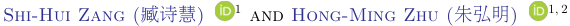

<!-- Start of picture text -->
Shi-Hui Zang ( 臧诗慧 ) 1 and Hong-Ming Zhu ( 朱弘明 ) 1, 2 <!-- End of picture text -->

> 1 _National Astronomy Observatories, Chinese Academy of Sciences, 20A Datun Road, Beijing 100101, China_ 

> 2 _Canadian Institute for Theoretical Astrophysics, 60 St. George Street, Toronto, Ontario M5S 3H8, Canada_ 

# ABSTRACT 

Nonlinear gravitational evolution induces strong nonlinearities in the observed cosmological density fields, leading to positive off-diagonal correlations in the power spectrum covariance. This has caused the information saturation in the power spectrum, e.g., the neutrino mass constraints from the nonlinear power spectra are lower than their linear counterparts by a factor of _∼_ 2 at _z_ = 0. In this paper, we explore how nonlinear reconstruction methods improve the cosmological information from nonlinear cosmic fields. By applying nonlinear reconstruction to cold dark matter fields from the Quijote simulations, we find that nonlinear reconstruction can improve the constraints on cosmological parameters significantly, nearly reaching the linear theory limit. For neutrino mass, the result is only 12% lower than the linear power spectrum, i.e., the theoretical best result. This makes nonlinear reconstruction an efficient and useful method to extract neutrino information from current and upcoming galaxy surveys. 

_Keywords:_ Cosmology (343) — Large-scale structure of the universe (902) 

# 1. INTRODUCTION 

The large-scale structure of the Universe as traced by galaxy clustering provides one of the best windows on fundamental physics including neutrino masses, dark energy, inflation and gravity. The ongoing and future galaxy redshift surveys have the potential of greatly improving our constraints on cosmology and fundamental physics (e.g., DESI DESI Collaboration et al. 2016; Euclid Amendola et al. 2018; Euclid Collaboration et al. 2020; SPHEREx Dor´e et al. 2014; Subaru Prime Focus Spectrograph Takada et al. 2014; Vera Rubin Observatory/LSST LSST Science Collaboration et al. 2009; Roman Space Telescope/WFIRST Akeson et al. 2019; MegaMapper Schlegel et al. 2022). To fully exploit these powerful surveys, it is necessary to understand how to optimally extract information from the observed galaxy density fields. 

Cosmological constraints derived from galaxy power spectrum are connected to extracting information from linear (or mildly nonlinear) modes, for which the coupling with other modes can be assumed be to subdominant and have evolved independently from the early 

stages of the Universe (Ferraro et al. 2022). However, at low redshifts and on small scales, nonlinear evolution leads to the coupling of modes on different scales and typically causes significant correlations in the smallscale power spectrum (Meiksin & White 1999; Rimes & Hamilton 2005, 2006). These positive off-diagonal correlations in the power spectrum covariance lead to the information saturation in the power spectrum (Rimes & Hamilton 2005, 2006; Villaescusa-Navarro et al. 2020; Bayer et al. 2021), i.e., the cosmological information does not increase when increasing the wavenumber in the nonlinear regime. For example, the constraints on neutrino mass from the nonlinear power spectra are lower than their linear counterparts by a factor of 2 at redshift _z_ = 0 (Bayer et al. 2022). 

The constraints on cosmological parameters including neutrino mass scale approximately linearly with the primordial physics Figure of Merit (FoM), which counts the total number of linear modes accessible to a galaxy redshift survey (see Sailer et al. 2021; Ferraro et al. 2022, for more discussions). Nonlinear structure formation erases the correlation with the initial conditions and leads to a loss of information, which degrades the FoM of low redshift surveys significantly. Therefore, recovering more linear modes from the observed nonlinear fields can im- 

hmzhu@nao.cas.cn 

2 

prove the FoM and cosmological constraints greatly and thus maximize the scientific return of future surveys. 

Reconstruction has been an efficient technique to restore the baryonic acoustic oscillation (BAO) feature in the linear power spectrum (Eisenstein et al. 2007) and has been widely used to analyse the galaxy survey data (e.g., SDSS Padmanabhan et al. 2012, BOSS Alam et al. 2017; eBOSS Alam et al. 2021). In standard reconstruction, the linear displacement field estimated from the observed nonlinear density under the Zel’dovich approximation is used to move galaxies, which reverses the large-scale bulk flows and partially restores the linear BAO signal (Eisenstein et al. 2007). Recently nonlinear reconstruction algorithms have been developed to further improve upon the standard reconstruction by solving the full nonlinear displacement field (Zhu et al. 2017; Schmittfull et al. 2017; Shi et al. 2018). The reconstruction methods works extraordinarily well for reducing the uncertainty on the BAO scale. Slightly more generally, the reconstruction can restore information about the linear modes that were corrupted by nonlinear structure formation and a higher primordial FoM can be obtained. It has been shown that nonlinear reconstruction reduces the off-diagonal components of power spectrum covariance prominently and increase the information content of power spectrum amplitude substantially (see e.g., Pan et al. 2017). Recently, Wang et al. (2022) have explored the improvement of cosmological constraints using the standard reconstruction algorithm, while Fl¨oss & Meerburg (2023) have studied improving constraints using neural network based reconstruction, in particular primordial non-Gaussianity. 

In this paper, we explore how nonlinear reconstruction improves the constraints on cosmological parameters, with a focus on neutrino mass. This improves upon the previous study (Pan et al. 2017), which only considered one parameter, the power spectrum amplitude. We use the Quijote simulations (Villaescusa-Navarro et al. 2020) to compute the pre- and post-reconstruction power spectrum covariance and perform a detailed Fisher analysis. We find that nonlinear reconstruction can efficiently reduce the mode-coupling effects in the nonlinear field and improve the cosmological constraints significantly, almost reaching the linear theory limit, which is an important step towards optimal extraction of neutrino mass information on small scales and has profound implications for future galaxy redshift surveys. 

This paper is organized as follows. In Section 2, we describe the reconstruction algorithms and Fisher matrix. In Section 3, we present the numerical implementation of the Fisher analysis. In Section 4, we show the numerical results. We discuss and conclude in Section 5. 

# 2. METHOD 

Neutrinos with finite mass suppress the small-scale power spectrum below the neutrino free-streaming scale (Bond et al. 1980; Lesgourgues & Pastor 2006). The suppression is proportional to the sum of neutrino masses, thus allowing us to measure or constrain the total neutrino mass _Mν_ . Detecting the minimum neutrino mass from the effects of neutrinos on the total matter _δm_ and cold dark matter (CDM)+baryon perturbations _δcb_ is one of the key science goals of the near-term and future galaxy surveys. 

For galaxy clustering in the presence of massive neutrinos, the now-standard approximation that galaxies trace the CDM+baryon density field _δcb_ has been shown to be an excellent approximation well into the quasi-linear regime (Castorina et al. 2015). The galaxy overdensity is given by _δg_ = _F_ [ _δcb_ ] and at linear order _δg_ = _bδcb_ , where _b_ is the linear galaxy bias. Recently, Bayer et al. (2022) demonstrated that all the information of neutrinos in the CDM field is in the linear power spectrum set by the initial conditions for _k_ ≲ 1 _h_ Mpc_−_1 using the phasematched _N_ -body simulations. Thus, galaxy clustering, which is based on the _δcb_ field will have negligible constraining power on neutrino masses beyond that which exists in the linear density field over the same range of scales (Bayer et al. 2022). They have found similar conclusions for other parameters such as the total matter density Ω _m_ and primordial power spectrum amplitude _As_ . While the late-time linear power spectrum is not an observable, it provides a bound on the error of neutrino masses available from galaxy clustering. However, the nonlinear power spectrum does not reach this bound, because of the positive off-diagonal components in its covariance which degrades the constraints substantially. The resulting constraining power of the nonlinear power spectrum for _δcb_ is a factor of 2 lower than the linear one (Bayer et al. 2022). 

Therefore, there is still room for improving neutrino mass constraints from galaxy clustering and potentially a factor of 2 better constraints can be achieved. The goal of this paper is to investigate whether nonlinear reconstruction can recover the information from the nonlinear _δcb_ field to the linear theory limit. 

In this section, we review the reconstruction algorithms including standard and nonlinear reconstruction and describe the Fisher analysis of cosmological information. 

# 2.1. _Reconstruction_ 

Reconstruction is an efficient way to reduce nonlinearities induced by the large-scale bulk flows. The standard reconstruction has been first proposed to reconstruct the 

3 

linear BAO signal (Eisenstein et al. 2007). The algorithm devised by Eisenstein et al. (2007) consists of the following steps: 

- Smooth the nonlinear density field with a Gaussian kernel _WR_ ( _k_ ) of scale _R_ , to filter out small-scale modes. 

- Compute the shift **_s_** from the smoothed density field using the Zel’dovich approximation, **_s_** ( **_k_** ) = _− k__ik_2_WR_(_k_)_δ_(**_k_**)_._ (1) 

- Move the galaxies by **_s_** to compute the “displaced” density field, _δd_ ( **_x_** ). 

- Shift an spatially uniform distribution of particles by **_s_** to form the shifted density field, _δs_ ( **_x_** ). 

- The reconstructed density field is defined as _δr_ ( **_x_** ) _≡ δd_ ( **_x_** ) _− δs_ ( **_x_** ). 

The Zel’dovich approximation only captures the linear displacement on large scales, limiting the efficacy of standard reconstruction to relatively large scales, _k ∼_ 0 _._ 2 _h_ Mpc_−_1 . Recent new reconstruction algorithms have been presented to solve the nonlinear displacement field (Zhu et al. 2017; Schmittfull et al. 2017; Shi et al. 2018), which improve upon the linear standard reconstruction with a substantially improved small-scale performance. While these methods are different in the detailed numerical implementations, the underlying physical principles are the same, i.e., solving the full displacement from the mass conservation relation. In the following analysis, we use the algorithm of Schmittfull et al. (2017), solving the displacement field iteratively using the fast Fourier transform, which is efficient and easy to apply. The reconstruction algorithm devised by Schmittfull et al. (2017) consists of the following steps: 

   4. Move the object by the displacement **_s_** and update the object’s position. 

- Compute the total displacement of each object **_χ_** (ˆ **_q_** end) = **_q_** ˆend _−_ **_x_** start, where **_x_** start is the starting position before the first iteration step and **_q_** ˆend is the end position of each object after iteration ( **_x_** start is the Eulerian position of each object and **_q_** ˆend is the estimated Lagrangian position). 

- Paint the estimated displacement **_χ_** (ˆ **_q_** end) defined on the estimated Lagrangian position **_q_** ˆend to a regular grid and truncate the small-scale modes beyond _k_ Ny. 

- The reconstructed density field from nonlinear reconstruction is _δnr_ ( **_q_** ) = _∇q ·_ **_χ_** ( **_q_** ) _._ (4) 

An improved estimation of the small-scale displacement allows us to recover more small-scale linear modes. The cross-correlation coefficient of the reconstructed field with the linear initial conditions is higher than 0.5 for _k_ ≲ 1 _h_ Mpc_−_1 (Zhu et al. 2017; Schmittfull et al. 2017; Shi et al. 2018). Note that such an improvement can also be achieved by combining the standard reconstruction and convolutional neural networks (see Shallue & Eisenstein 2022; Fl¨oss & Meerburg 2023). 

# 2.2. _Fisher analysis_ 

To quantify the cosmological information in the power spectrum of pre- and post-reconstruction fields, we use the Fisher information matrix (Fisher 1925). The Fisher matrix is defined as 

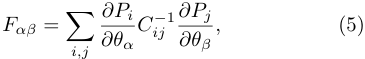

<!-- Start of picture text -->
∂Pi ∂Pj Fαβ = � Cij − 1 , (5) ∂θα ∂θβ i,j <!-- End of picture text -->

- Iteratively displace objects as follows: 

   1. From the catalog, compute the density field on the grid. 

   2. Smooth the density field with the Gaussian window _WR_ ( _k_ ), with smoothing scale 

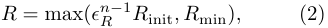

<!-- Start of picture text -->
R  = max( ϵ n R − 1 R init , R min) , (2) <!-- End of picture text -->

in the _n_ th iteration step and truncate smallscale modes by setting _δ_ ( **_k_** ) = 0 if _k > k_ Ny, where _k_ Ny is the Nyquist frequency. 

3. Compute the negative Zel’dovich displacement 

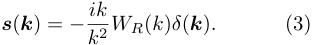

<!-- Start of picture text -->
s ( k ) =  − ik (3) k 2 WR ( k ) δ ( k ) . <!-- End of picture text -->

where _Pi_ = _P_ ( _ki_ ) is the power spectrum of the _i_ th bin and _Cij_ is the power spectrum covariance matrix, and _θa_ represents the cosmological parameters (Tegmark 1997). We have neglected the dependence of covariance on the cosmological parameters to avoid underestimating the errors (Carron 2013). 

The inverse of the Fisher matrix gives the covariance matrix of the parameters and the expected errors on the parameters are equal to the square root of the diagonal elements of _F__−_1 , 

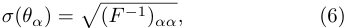

<!-- Start of picture text -->
σ ( θα ) = � ( F − 1 ) αα, (6) <!-- End of picture text -->

which represents the minimum error achievable. 

4 

# 3. SIMULATIONS 

To compute the covariance matrix of the power spectrum and the response of power spectrum with respect to the cosmological parameters, we use the Quijote simulations (Villaescusa-Navarro et al. 2020), run with the TreePM code `Gadget-III` , an improved version of `Gadget-II` (Springel 2005). Each simulation evolves 5123 CDM particles (plus 5123 neutrino particles for nonzero neutrino mass) in a cosmological volume of 1 ( _h__−_1 Gpc)3 . The Quijote simulations have been widely used to quantify the information content of nonlinear statistics (e.g., Villaescusa-Navarro et al. 2020; Hahn et al. 2020; Massara et al. 2021; Bayer et al. 2021; Paillas et al. 2022). More details of the Quijote simulations can be found in Villaescusa-Navarro et al. (2020). 

We consider six cosmological parameters, Ω _m_ , Ω _b_ , _h_ , _ns_ , _σ_ 8, and _Mν_ . We use 5 _,_ 000 simulations of the fiducial cosmology to compute the covariance matrix. We use 1 _,_ 000 simulations to compute the derivatives with respect to each parameter. The detailed information of simulations we used in the analysis is shown in Table 1. We have performed a detailed convergence test and verified that our results are converged, i.e., the constraints do not change much if the power spectrum covariance and derivatives are evaluated with less simulations (See Appendix A for more details). 

We use the snapshot of CDM particles from the simulation output at redshift _z_ = 0. Here we assume baryons trace CDM. We compute the nonlinear _δcb_ field on a 5123 grid using the cloud-in-cell interpolation scheme. For standard reconstruction, we use a Gaussian smoothing of scale _R_ = 10 _h__−_1 Mpc, _WR_ ( _k_ ) = _e__−_(_kR_)2_/_2 following Eisenstein et al. (2007). For nonlinear reconstruction, we use _R_ init = 10 _h__−_1 Mpc, _ϵR_ = 0 _._ 5, and _R_ min = 1 _h__−_1 Mpc. We use eight iteration steps in the reconstruction (Schmittfull et al. 2017). 

# 3.1. _Covariance matrix_ 

We estimate the covariance matrix using 5 _,_ 000 simulations of the fiducial cosmology as 

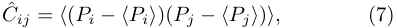

<!-- Start of picture text -->
C ˆ ij =  ⟨ ( Pi −⟨Pi⟩ )( Pj −⟨Pj⟩ ) ⟩, (7) <!-- End of picture text -->

where _⟨·⟩_ denotes the ensemble average over simulations. The covariance matrix for fields _δcb_ , _δr_ and _δnr_ are estimated numerically using the Quijote simulations. 

For the linear density field (a Gaussian random field), the power spectrum covariance matrix is diagonal, 

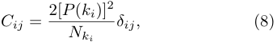

<!-- Start of picture text -->
Cij = 2[ P ( ki )]2 δij, (8) Nki <!-- End of picture text -->

where _Nki_ is the number of Fourier modes in the corresponding _ki_ bin. This can be directly computed us- 

ing the linear power spectrum at _z_ = 0 from the linear Boltzmann code CAMB (Lewis et al. 2000). 

Since the covariance matrix is estimated from simulations, it is itself a random variable with errors. The matrix inversions lead to biased constraints on the parameters. To account for this, we apply a correction to the covariance matrix (Percival et al. 2022; Paillas et al. 2022) 

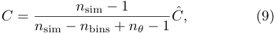

<!-- Start of picture text -->
n sim  − 1 C = C, ˆ (9) n sim  − n bins +  nθ − 1 <!-- End of picture text -->

where _n_ sim is the number of simulations to calculate the covariance matrix, _nθ_ is the number of parameters in Fisher analysis, _n_ bins is the number of power spectrum bins. In our case, we have 5 _,_ 000, _nθ_ = 6, and _n_ bins depends on the maximum wavenumber _k_ max included in the analysis. We have checked that this correction factor is less than 1% for _k_ max _<_ 0 _._ 5 _h_ Mpc_−_1 . 

# 3.2. _Derivatives_ 

For the parameters Ω _m,_ Ω _b, h, ns_ and _σ_ 8, we use a central difference scheme to compute the derivatives, 

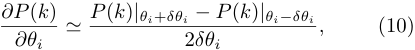

<!-- Start of picture text -->
∂P ( k ) ≃ P ( k ) |θi + δθi − P ( k ) |θi−δθi , (10) ∂θi 2 δθi <!-- End of picture text -->

where _P_ ( _k_ ) is the measured power spectrum from simulations and only the considered parameter is varied and other parameters are fixed. We have used 500 pairs of simulations to calculate each derivative using Eq. (10). 

For neutrino mass _Mν_ , the second term in the numerator of Eq. (10) corresponds to a cosmology with negative neutrino mass, since the fiducial value of the neutrino mass is at the boundary of the allowed region, i.e., _Mν_ = 0. Therefore, we use a first-order forward difference scheme to compute the derivative, 

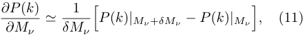

<!-- Start of picture text -->
∂P ( k ) 1 ≃ P ( k ) |Mν + δMν − P ( k ) |Mν , (11) ∂Mν δMν � � <!-- End of picture text -->

where the fiducial neutrino mass _Mν_ = 0. We use 1,000 simulations to compute the derivative with respect to the neutrino mass. 

# 4. RESULTS 

In this section, we present the reconstruction results, including the cross-correlation coefficient, power spectrum covariance matrix, and cosmological parameter constraints. 

# 4.1. _Cross-correlation coefficient_ 

To quantify the reconstruction performance, we use the cross-correlation coefficient, 

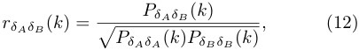

<!-- Start of picture text -->
PδAδB ( k ) rδAδB ( k ) = , (12) � PδAδA ( k ) PδB δB ( k ) <!-- End of picture text -->

5 

|Name|Ω_m_|Ω_b_|_h_|_ns_|_σ_8|_Mν_ [eV]|ICs|Realizations|
|---|---|---|---|---|---|---|---|---|
|Fiducial|0.3175|0.049|0.6711|0.9624|0.834|0.0|2LPT|5,000|
|Fiducial ZA|0.3175|0.049|0.6711|0.9624|0.834|0.0|Zel’dovich|500|
|Ω+ _m_|0.3275|0.049|0.6711|0.9624|0.834|0.0|2LPT|500|
|Ω_−_ _m_|0.3075|0.049|0.6711|0.9624|0.834|0.0|2LPT|500|
|Ω++ _b_|0.3175|0.051|0.6711|0.9624|0.834|0.0|2LPT|500|
|Ω_−−_ _b_|0.3175|0.047|0.6711|0.9624|0.834|0.0|2LPT|500|
|_h_+|0.3175|0.049|0.6911|0.9624|0.834|0.0|2LPT|500|
|_h__−_|0.3175|0.049|0.6511|0.9624|0.834|0.0|2LPT|500|
|_n_+ _s_|0.3175|0.049|0.6711|0.9824|0.834|0.0|2LPT|500|
|_n__−_ _s_|0.3175|0.049|0.6711|0.9424|0.834|0.0|2LPT|500|
|_σ_+ 8|0.3175|0.049|0.6711|0.9624|0.849|0.0|2LPT|500|
|_σ__−_ 8|0.3175|0.049|0.6711|0.9624|0.819|0.0|2LPT|500|
|_M_ + _ν_|0.3175|0.049|0.6711|0.9624|0.834|0.1|Zel’dovich|500|

**Table 1.** The details of the Quijote simulations used in this work. The fiducial cosmology contains 5 _,_ 000 simulations, which are used to estimate the power spectrum covariance matrix. Other simulations with different cosmological parameters are used to compute the partial derivatives of the power spectrum to cosmological parameters, where only the considered parameter is varied and other parameters are fixed. The initial conditions are generated at _z_ = 127 using the second-order Lagrangian perturbation theory, except for the neutrino simulations where the Zel’dovich approximation is used. 

where _PδAδA_ ( _k_ ) and _PδB δB_ ( _k_ ) are the power spectrum of fields _δA_ ( _k_ ) and _δB_ ( _k_ ), and _PδAδB_ ( _k_ ) is the cross-power spectrum between the two fields. 

In Figure 1, we plot the cross-correlation coefficient 

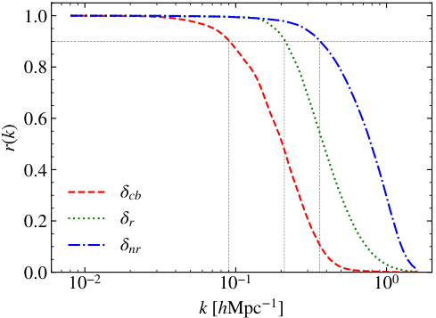

<!-- Start of picture text -->
1.0 0.8 0.6 0.4 cb 0.2 r nr 0.0 10 −2 10 −1 10 0 k [hMpc 1 ] k()r <!-- End of picture text -->

pecially at small scales. While being competitive with nonlinear reconstruction at large scales _k_ ≲ 0 _._ 2 _h_ Mpc_−_1 , the standard reconstruction has a lower correlation with the linear field _δL_ at smaller scales _k_ ≳ 0 _._ 2 _h_ Mpc_−_1 , which needs to be improved by solving the small-scale displacement or using the convolutional neural network (e.g. Zhu et al. 2017; Schmittfull et al. 2017; Shi et al. 2018; Shallue & Eisenstein 2022). Nevertheless, we expect that both reconstruction methods can recover more small-scale linear modes, i.e., a much higher primordial physics FoM, and therefore improve the cosmological constraints. 

Note that reconstruction algorithms based on solving the full nonlinear displacement have a similar performance with correlation coefficient _r_ ( _k_ ) ≳ 0 _._ 5 at _k_ ≲ 1 _h_ Mpc_−_1 (Zhu et al. 2017; Schmittfull et al. 2017; Shi et al. 2018). To reduce the computational cost, we have used the iterative algorithm of Schmittfull et al. (2017). 

# 4.2. _Full shape reconstructed power spectrum_ 

**Figure 1.** The cross-correlation coefficient with the linear initial conditions for the nonlinear _δcb_ field, the reconstructed fields using standard reconstruction _δr_ and nonlinear reconstruction _δnr_ . While both reconstruction algorithms improve the correlation with the linear initial conditions substantially, the nonlinear method has a better performance on smaller scales, _k_ ≳ 0 _._ 2 _h_ Mpc_−_1 . 

with the linear initial conditions _δL_ for the nonlinear _δcb_ field, the reconstructed fields using standard reconstruction _δr_ and nonlinear reconstruction _δnr_ . We note that the both reconstruction algorithms improve the correlation with the linear density field substantially, es- 

Figure 2 shows the measured power spectra divided by the linear initial power spectrum linearly scaled to the redshift _z_ = 0 of the simulation. The original nonlinear power and linear power agree within 5% at _k <_ 0 _._ 15 _h_ Mpc_−_1 , and the reconstructed power spectrum agrees with the linear power spectrum within 5% at _k <_ 0 _._ 16 _h_ Mpc_−_1 . Nonlinear reconstruction slightly extends the _k_ range where the linear theory is valid. As we have noticed in Fig. 1, the cross-correlation coefficient _r_ becomes smaller than unity on smaller scales, we would have to add corrections to the linear power spectrum to model the power spectrum after reconstruction. 

6 

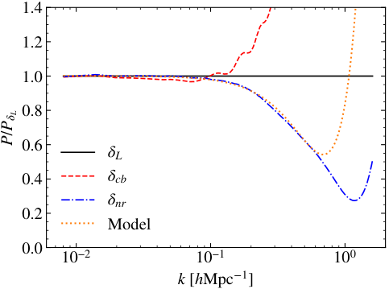

<!-- Start of picture text -->
1.4 1.2 1.0 0.8 0.6 L 0.4 cb nr 0.2 Model 0.0 10 −2 10 −1 10 0 k [hMpc 1 ] /PPL <!-- End of picture text -->

**Figure 2.** Power spectra from the simulations at _z_ = 0, divided by the linear initial power spectrum linearly scaled to _z_ = 0. The reconstructed power spectrum agrees with the linear power spectrum within 5% at _k <_ 0 _._ 16 _h_ Mpc_−_1 , while the original nonlinear power and linear power agree within 5% at _k <_ 0 _._ 15 _h_ Mpc_−_1 . Compared to the nonlinear density without reconstruction, nonlinear reconstruction slightly improves the agreement with the linear linear power spectrum. However, the best-fit theoretical model agrees with the reconstructed power spectrum within 1% at _k_ ≲ 0 _._ 24 _h_ Mpc_−_1 and 3% at _k_ ≲ 0 _._ 5 _h_ Mpc_−_1 . 

The fact that nonlinear reconstruction misses smallscale broadband power relative to the linear power is not necessarily a problem. All that is needed to estimate cosmological parameters is a theoretical model describing the reconstructed power spectrum as a function of cosmological parameters. Following the literature on modeling the reconstructed power spectrum (see e.g. Noh et al. 2009; Padmanabhan et al. 2009; White 2015), we use a simple theoretical model to fit the power spectrum after reconstruction, 

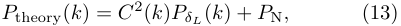

<!-- Start of picture text -->
P theory( k ) =  C 2 ( k ) PδL ( k ) +  P N , (13) <!-- End of picture text -->

where the propagator _C_ ( _k_ ) = _e__−k_2Σ2_/_2 describes the damping of the linear power spectrum, _PδL_ is the linear initial power spectrum linearly scaled to redshift _z_ = 0, and the noise power spectrum _P_ N quantifies the nonlinearities after reconstruction. We then fit the two parameters Σ and _P_ N by minimizing the sum of squares 

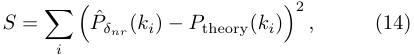

<!-- Start of picture text -->
S = � � P ˆ δnr ( ki )  − P theory( ki )�2 , (14) i <!-- End of picture text -->

where the hat denotes the reconstructed power spectrum estimated from simulations and _ki_ denotes the power spectrum in the _i_ th bin. Here, we directly use the measured linear initial power spectrum _P_ˆ _δL_ when computing the theoretical model, to reduce the impact 

of variations due to the cosmic variance. The maximum wavenumber included in the fitting is _k_ max = 0 _._ 8 _h_ Mpc_−_1 . We use equal weights for all _k_ bins to avoid over-fitting small scales. The best-fit parameters are Σ = 1 _._ 67 _h__−_1 Mpc and _P_ N = 38 [( _h__−_1 Mpc)3 ]. The best-fit theoretical model agrees with the reconstructed power spectrum within 1% at _k_ ≲ 0 _._ 24 _h_ Mpc_−_1 and 3% at _k_ ≲ 0 _._ 5 _h_ Mpc_−_1 , which makes it possible to perform cosmological parameter inference at the percent level using the reconstructed power spectrum. However, when applying to galaxy surveys, more complexities have to be considered such as galaxy biasing and redshift space distortions, which will be explored in the future. 

On smaller scales, _k_ ≳ 0 _._ 5 _h_ Mpc_−_1 , the model predicts a higher noise level than the data. This is partly due to that the simple white noise term misses the scaledependence of the residual nonlinearities. Additional improvements on small scales may be possible by using the effective field theory of large-scale structure. On small scales we would have to add more counterterms to this simple model to match the reconstructed power spectrum (e.g., Schmittfull et al. 2017). We leave this for future work. 

In the following analysis, we use the reconstructed power spectrum in the simulation to compute the Fisher information. 

# 4.3. _Covariance matrix_ 

We apply two reconstruction algorithms to the 5 _,_ 000 simulations of fiducial cosmology and compute the covariance matrix of the power spectrum. 

In Figure 3, we plot the correlation matrix, i.e., the normalized covariance matrix, defined as _Cij/_ ~~�~~ _CiiCjj_ , where _Cij_ is the covariance matrix. For the nonlinear _δcb_ field, the correlation matrix is almost diagonal on large scales, _k_ ≲ 0 _._ 1 _h_ Mpc_−_1 , and exhibits significant offdiagonal correlations on smaller scales, _k_ ≳ 0 _._ 1 _h_ Mpc_−_1 , which leads to the information saturation of the nonlinear power spectrum (e.g., Rimes & Hamilton 2005, 2006; Villaescusa-Navarro et al. 2020; Bayer et al. 2021). The standard reconstruction reduces the off-diagonal elements and the covariance matrix is nearly diagonal at _k_ ≲ 0 _._ 2 _h_ Mpc_−_1 , in agreement with the cross-correlation coefficient observed in Figure 1. However, the covariance matrix of nonlinear reconstruction is diagonal well into the nonlinear regime, _k_ ≲ 0 _._ 8 _h_ Mpc_−_1 , where the coupling with other modes are subdominant. This nearly diagonal covariance matrix for the _δnr_ field indicates more linear information available than the power spectra of the _δcb_ and _δr_ fields. 

With enough simulations, we have not observed large negative off-diagonal elements before and after recon- 

7 

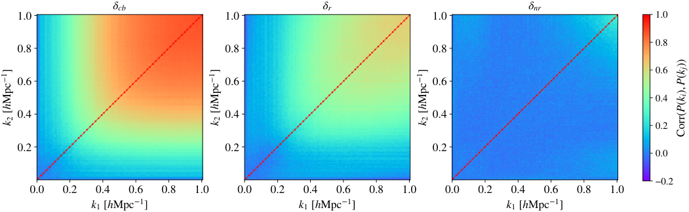

<!-- Start of picture text -->
cb r nr 1.0 1.0 1.0 1.0 0.8 0.8 0.8 0.8 0.6 0.6 0.6 0.6 0.4 0.4 0.4 0.4 0.2 0.2 0.2 0.2 0.0 −0.2 0.0 0.2 0.4 0.6 0.8 1.0 0.0 0.2 0.4 0.6 0.8 1.0 0.0 0.2 0.4 0.6 0.8 1.0 k1 [hMpc 1 ] k1 [hMpc 1 ] k1 [hMpc 1 ] 1kh[Mpc]2 1kh[Mpc]2 1kh[Mpc]2 kkCorr((),())PPij <!-- End of picture text -->

**Figure 3.** Correlation matrix for the power spectrum of the nonlinear _δcb_ field, and the reconstruction fields _δr_ and _δnr_ using standard and nonlinear reconstruction methods, respectively. The covariance matrix is estimated using 5 _,_ 000 simulations. Reconstruction reduces the off-diagonal correlation substantially. The density modes are nearly independent at _k_ ≲ 0 _._ 8 _h_ Mpc_−_1 for the nonlinear reconstruction method. 

struction. There only exists a few negative off-diagonal elements with very small absolute values _∼_ 10_−_2 , mainly due to the random statistical fluctuations. Therefore, our results should be more robust than the previous work which uses less realizations to estimate the covariance matrix (Pan et al. 2017). We have confirmed that our results have converged, i.e., the parameter constraints do not change much if less simulations are used. See Appendix A for more details of the convergence tests. 

# 4.4. _Cosmological constraints_ 

In Figure 4, we show the marginalized 1 _σ_ constraints on cosmological parameters, Ω _m_ , Ω _b_ , _h_ , _ns_ , _σ_ 8, and _Mν_ , as a function of _k_ max. On large scales where the cosmic density field evolved linearly from the initial conditions, all fields, _δL_ , _δcb_ , _δr_ , and _δnr_ , have a similar constraint on the parameters at _k_ ≲ 0 _._ 1 _h_ Mpc_−_1 . The constraints from the nonlinear _δcb_ start to saturate at _k_ max = 0 _._ 2 _h_ Mpc_−_1 , especially for _σ_ 8 and _Mν_ , for which the dominant information comes from the power spectrum amplitude. For standard reconstruction, the constraints are much better than the nonlinear _δcb_ field. The information from _δr_ continue to increase for _k_ ≳ 0 _._ 2 _h_ Mpc_−_1 and saturates at _k_ max _∼_ 0 _._ 3 _h_ Mpc_−_1 . This is due to the limited validity of the Zel’dovich approximation adopted in the standard reconstruction. However, the constraining power of the _δnr_ field is even better than _δr_ and the constraints obtained using nonlinear reconstruction continue to improve until _k_ max = 0 _._ 5 _h_ Mpc_−_1 , nearly reaching the linear theory constraints. The improvement at _k_ ≳ 0 _._ 3 _h_ Mpc_−_1 upon the standard reconstruction is mainly because a better estimation of small-scale displacement using nonlinear methods removes more shift 

nonlinearities, which is not captured by the Zel’dovich approximation. 

We notice that the constraints on neutrino mass _Mν_ with reconstruction are almost the same as the linear field at _k_ ≲ 0 _._ 25 _h_ Mpc_−_1 and the constraint still nearly reaches the linear theory limit at _k_ ≳ 0 _._ 25 _h_ Mpc_−_1 for the nonlinear reconstruction method. This result is remarkable, since the _δcb_ field and derived quantities, e.g., the halo field, contain little information about neutrino mass beyond that which exists in the linear power spectrum for _k_ ≲ 1 _h_ Mpc_−_1 , demonstrated by using phasematched simulations (Bayer et al. 2022). Therefore, the linear power spectrum provides a bound on the error that can be obtained using _δcb_ and it is exciting to see that nonlinear reconstruction can recover nearly all the information regarding neutrino mass from the nonlinear _δcb_ field. 

The _Mν −σ_ 8 degeneracy has limited the neutrino mass constraint on small scales (Villaescusa-Navarro et al. 2020; Bayer et al. 2021), which could not be reduced using power spectrum alone (See Figure 8 of Appendix B). Combining other nonlinear statistics such as halo mass function and void size function can tighten the constraint on neutrino mass by breaking the degeneracy between different parameters (e.g. Bayer et al. 2021), which will be subject of further inquiry. 

In Table 2, we list the marginalized 1 _σ_ errors for _k_ max = 0 _._ 5 _h_ Mpc_−_1 . We find that nonlinear reconstruction can achieve a significant level of improvement on all 6 parameters and the improvements to be a factor of 2.72, 2.65, 2.64, 2.65, 2.49, 2.54 for Ω _m,_ Ω _b, h, ns, σ_ 8 and _Mν_ , respectively. Thus, the constraining power of the reconstructed power spectrum _Pδnr_ , i.e., the signal to noise ratio of neutrino mass measurement _∝_ 1 _/σ_ ( _Mν_ ), is 

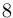

<!-- Start of picture text -->
8 <!-- End of picture text -->

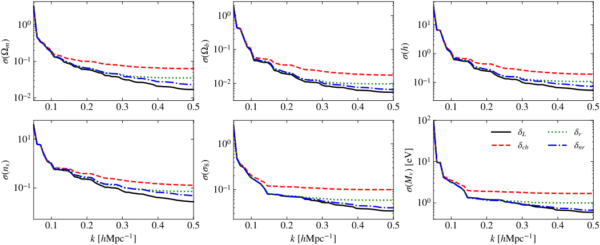

<!-- Start of picture text -->
10 0 10 0 10 1 10 −1 10 0 10 −1 10 −2 10 −1 10 −2 0.1 0.2 0.3 0.4 0.5 0.1 0.2 0.3 0.4 0.5 0.1 0.2 0.3 0.4 0.5 10 2 10 1 L r 10 0 cb nr 10 1 10 −1 10 −1 10 0 0.1 0.2 0.3 0.4 0.5 0.1 0.2 0.3 0.4 0.5 0.1 0.2 0.3 0.4 0.5 k [hMpc 1 ] k [hMpc 1 ] k [hMpc 1 ] )m )b ( ( h() ()ns ()8 () [eV]Mv <!-- End of picture text -->

**Figure 4.** The marginalized 1 _σ_ error for each cosmological parameters as a function of _k_ max. The parameter constraints from the nonlinear _δcb_ start to saturate at _k_ max = 0 _._ 2 _h_ Mpc_−_1 . The information from standard reconstruction continues to increase until _k_ max _∼_ 0 _._ 3 _h_ Mpc_−_1 , limited by the linear assumption when estimating the displacement field. The constraining power of the _δnr_ field is much better than _δcb_ and _δr_ and continues to improve until _k_ max _∼_ 0 _._ 5 _h_ Mpc_−_1 . 

||Margi|nalized F|isher C|onstrain|ts||
|---|---|---|---|---|---|---|
|Probes|Ω_m_|Ω_b_|_h_|_ns_|_σ_8|_Mν_ [eV]|
|_δcb_|0.063|0.018|0.19|0.13|0.010|1.7|
|_δr_|0.035|0.0097|0.11|0.072|0.059|0.99|
|_δnr_|0.023|0.0066|0.073|0.049|0.040|0.67|
|_δL_|0.017|0.0055|0.054|0.027|0.034|0.59|
|Improvement|2.72|2.65|2.64|2.65|2.49|2.54|

**Table 2.** Marginalized 1 _σ_ errors of cosmological parameters for _k_ max = 0 _._ 5 _h_ Mpc_−_1 .We list the constraints obtained from the power spectrum of _δcb_ , _δr_ , _δnr_ , and _δL_ , and the multiplicative improvement in the constraints with nonlinear reconstruction, compared to those from the power spectrum of _δcb_ field alone. The signal to noise ratio of neutrino mass measurement, _∝_ 1 _/σ_ ( _Mν_ ), is only 12% lower than the linear power spectrum, i.e., the theoretical upper limit achievable with the _δcb_ field. 

only 12% lower than the theoretical upper limit achievable with the _δcb_ field. 

We notice that the exact values of _σ_ ( _Mν_ ) are slightly different between our results and Bayer et al. (2022). We have confirmed that this is due to the different fiducial cosmology adopted to compute the derivatives to neutrinos. Our fiducial cosmology is for a Universe with massless neutrinos, while Bayer et al. (2022) have used a fiducial neutrino mass _Mν_ = 0 _._ 05 eV when computing the linear theory constraints. Nevertheless, we find that the relative improvements are not sensitive to these numerical details and thus this does not impact our major conclusions presented above, i.e., nonlinear reconstruction can recover almost all the neutrino information, nearly reaching the theoretical upper limit. 

|||Impr|oveme|nt|||
|---|---|---|---|---|---|---|
|Probes|Ω_m_|Ω_b_|_h_|_ns_|_σ_8|_Mν_|
|_δnr_|2.72|2.65|2.64|2.65|2.49|2.54|
|Model|1.63|1.78|1.49|1.00|1.95|2.00|

**Table 3.** Multiplicative improvement using the reconstructed power spectrum and the theoretical model for _k_ max = 0 _._ 5 _h_ Mpc_−_1 . 

In the above analysis, we have used the reconstructed power spectrum from simulations for computing the covariance matrix and derivatives to cosmological parameters. This requires an accurate modeling of the reconstructed power spectrum, which might be achieved with the emulator constructed from simulations (see e.g., Wang et al. 2023, for a recent exploration). 

When using the perturbation theory approach, usually we need to use more parameters to describe the 

4.5. _Test with the theoretical model_ 

9 

nonlinear effects in the reconstructed power spectrum, such as the simple model we introduced earlier. The constraints on cosmological parameters will degrade after marginalizing over these nuisance parameters due to possible degeneracy between parameters. We can employ the simplified model in Eq. (13) to calculate the Fisher information. In this approach, we utilize the reconstructed power spectrum covariance matrix in the simulations, while using Eq. (13) for derivative computations. In this way, we include the damping scale Σ and noise power spectrum _P_ N in the Fisher analysis. 

In Table 3, we list the multiplicative improvement using the reconstructed power spectrum from simulations and the theoretical model for _k_ max = 0 _._ 5 _h_ Mpc_−_1 . We see that the improvement of the constraint on neutrino mass is _∼_ 20% lower than using the power spectrum from simulation. However, nonlinear reconstruction can still achieve a substantial improvement, by a factor of 2, compared to the original nonlinear power spectrum. The constraints on other parameters are not as good as the neutrino mass, which is due to the degeneracy between the cosmological and nuisance parameters, especially the spectrum index _ns_ , since both the spectrum index and the damping scale change the power spectrum shape. 

# 5. DISCUSSION AND CONCLUSION 

In this paper, we apply nonlinear reconstruction to the CDM density fields from simulations and find the parameter constraints are much tighter than those from the power spectrum of _δcb_ directly, with the improvement to be a factor of _∼_ 2 for each parameter. A salient conclusion is that the constraint on neutrino mass can nearly reach that of the linear power spectrum, with a signal-to-noise ratio only 12% lower than the theoretical best result, making reconstruction an efficient way to extract cosmological information from the nonlinear galaxy survey data. 

We have assumed baryons trace CDM when using the CDM field as an approximation of the CDM+baryon distribution. This is a valid approximation on large and intermediate scales, _k_ ≲ 0 _._ 5 _h_ Mpc_−_1 , where the baryonic effects are subdominant (see e.g. Chisari et al. 2019; Villaescusa-Navarro et al. 2021). The analysis with _δcb_ corresponds to an unbiased tracer with negligible shot noise, _δg_ = _bδcb_ with _b_ = 1. Therefore, our constraints on _Mν_ should be interpreted as maximum information content in principle. Higher order biasing contributes tens of percent of the total galaxy power spectrum at _k ∼_ 0 _._ 5 _h_ Mpc_−_1 (see e.g., Schmittfull et al. 2019) and the importance of shot noise depends on the specific surveys. In future work, we plan to extend the analysis to 

simulated galaxy samples, which are more representative of real data. 

In redshift space, more information regarding neutrinos is available, since the redshift space distortions is induced by the peculiar velocity, which is sourced by the total matter field and thus is sensitive to the neutrino overdensity _δν_ (Bayer et al. 2022). Therefore, it is possible to obtain better constraints in redshift space, which we plan to explore in future. 

To obtain an unbiased inference of cosmological parameters, it is necessary to have an accurate power spectrum model for reconstruction. The modeling of standard reconstruction has been explored using both the Lagrangian perturbation theory (Noh et al. 2009; Padmanabhan et al. 2009; White 2015; Seo et al. 2016; Chen et al. 2019) and standard perturbation theory (Hikage et al. 2017, 2020). Recently, Ota et al. (2021, 2022) have explored the modeling of nonlinear displacement using Lagrangian perturbation theory. The simulationbased method such as power spectrum emulator might be needed on nonlinear scales, where the perturbation theory methods are no longer available. 

We have exclusively considered the nonlinear reconstruction methods based on solving the full nonlinear displacement field (Zhu et al. 2017; Schmittfull et al. 2017; Shi et al. 2018). The applications to halo fields and redshift-space distortions have been studied extensively (see e.g., Yu et al. 2017; Zhu et al. 2018; Wang & Pen 2019; Birkin et al. 2019; Wang et al. 2020; Liu et al. 2021; Seo et al. 2022). There are many other reconstruction methods based on different principles, e.g., iterative methods (Hada & Eisenstein 2018, 2019), optimization techniques (Seljak et al. 2017; Feng et al. 2018; Modi et al. 2018), forwarding modeling (Jasche & Wandelt 2013; Wang et al. 2014), effective field theory based likelihood (Schmidt et al. 2019; Elsner et al. 2020), fast action minimization (Nusser & Branchini 2000; Sarpa et al. 2019), machine learning (Mao et al. 2021; Shallue & Eisenstein 2022; Fl¨oss & Meerburg 2023), etc, which could also provide an improvement in the cosmological parameter constraints. 

While for the current galaxy samples such as BOSS (Alam et al. 2017) and eBOSS (Alam et al. 2021), the nonlinear reconstruction methods have a similar efficiency as standard reconstruction because of the higher shot noise. The near term and upcoming surveys such as DESI (DESI Collaboration et al. 2016), Euclid (Amendola et al. 2018; Euclid Collaboration et al. 2020), MegaMapper (Schlegel et al. 2022), etc, will generally have a much higher galaxy number density and therefore nonlinear reconstruction can achieve a better performance with the lower shot noise. We expect that 

10 

reconstruction will be a promising method to extract cosmological information from future galaxy surveys. 

We acknowledge Adrian Bayer and Gong-Bo Zhao for enlightening discussions about the Fisher matrix calculation. Hong-Ming Zhu receives support from the National Natural Science Foundation of China (NSFC) [Grant No. 11890691] and the Natural Sciences and Engineering Research Council of Canada (NSERC) [funding reference number CITA 490888-16]. Computations were performed on the Niagara supercomputer at the SciNet HPC Consortium and the SOSCIP Consortium’s CPU computing platform (Ponce et al. 2019; Loken et al. 2010). SciNet is funded by: the Canada Foundation for Innovation; the Government of Ontario; Ontario Research Fund - Research Excellence; and the University of Toronto. SOSCIP is funded by the Federal Economic Development Agency of Southern Ontario, the Province of Ontario, IBM Canada Ltd., Ontario Centres of Excellence, Mitacs and 15 Ontario academic member institutions. 

# APPENDIX 

# A. CONVERGENCE TEST 

In this appendix, we present the convergence tests of our results. In Figure 5, we show the marginalized 1 _σ_ errors 

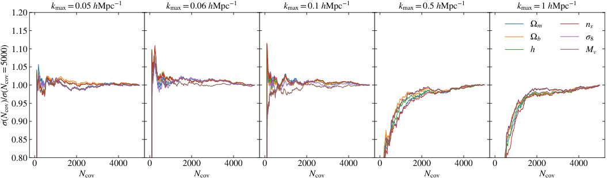

<!-- Start of picture text -->
1.20 kmax =0.05 hMpc 1 1.20 kmax =0.06 hMpc 1 1.20 kmax =0.1 hMpc 1 1.20 kmax =0.5 hMpc 1 1.20 kmax =1 hMpc 1 1.15 1.15 1.15 1.15 1.15 m ns b 8 1.10 1.10 1.10 1.10 1.10 h Mv 1.05 1.05 1.05 1.05 1.05 1.00 1.00 1.00 1.00 1.00 0.95 0.95 0.95 0.95 0.95 0.90 0.90 0.90 0.90 0.90 0.85 0.85 0.85 0.85 0.85 0.80 0.80 0.80 0.80 0.80 0 2000 4000 0 2000 4000 0 2000 4000 0 2000 4000 0 2000 4000 Ncov Ncov Ncov Ncov Ncov  =5000)()/(NNcov <!-- End of picture text -->

**Figure 5.** Marginalized 1 _σ_ error as a function of the number of simulations used to calculate the covariance matrix for nonlinear reconstruction. From left to right, we show the results for different _k_ max. For _N_ cov = 5000, a tight convergence is achieved. 

on cosmological parameters as a function of the number of simulations used to estimate the covariance matrix for nonlinear reconstruction. The results are presented as the ratio of the errors computed using _N_ cov simulations and 5000 simulations. The derivatives are computed using 500 pairs of simulations. From left to right, we show the convergence of marginalized constraints for different _k_ max. We see that the results converge well for all scales from 0 _._ 05 _h_ Mpc_−_1 to 1 _h_ Mpc_−_1 , with a small error at percent level. 

In Fig. 6, we show the derivatives of power spectrum with respect to cosmological parameters. The derivatives for the power spectrum show good convergence for 500 pairs of simulations. 

Figure 7 shows the marginalized 1 _σ_ errors with nonlinear reconstruction on the cosmological parameters as a function of the simulation pairs to compute the derivatives. The results are presented as the ratio between the errors calculated 

11 

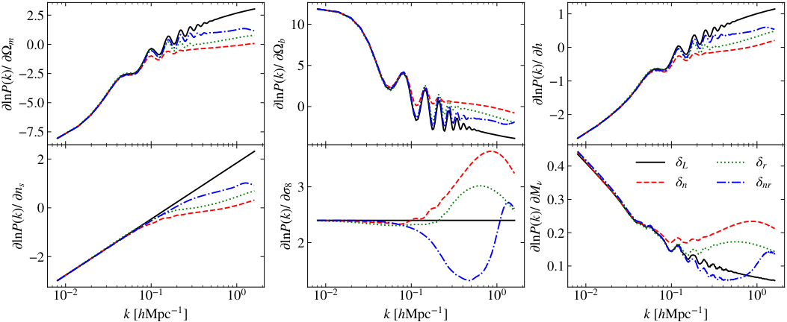

<!-- Start of picture text -->
2.5 1 10 0.0 0 5 −2.5 −1 −5.0 0 −2 −7.5 10 −2 10 −1 10 0 10 −2 10 −1 10 0 10 −2 10 −1 10 0 2 0.4 L r 3 n nr 0.3 0 0.2 2 −2 0.1 10 −2 10 −1 10 0 10 −2 10 −1 10 0 10 −2 10 −1 10 0 k [hMpc 1 ] k [hMpc 1 ] k [hMpc 1 ] m b lnk() /  P lnk() /  P lnkh() /  P lnk() /  Pns lnk() /  P8 lnk() /  PM <!-- End of picture text -->

**Figure 6.** The derivatives of the power spectrum to cosmological parameters. The derivatives are well converged using 500 pairs of simulations. 

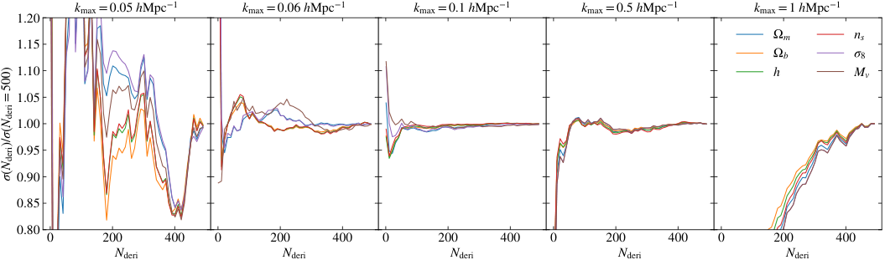

<!-- Start of picture text -->
1.20 kmax =0.05 hMpc 1 1.20 kmax =0.06 hMpc 1 1.20 kmax =0.1 hMpc 1 1.20 kmax =0.5 hMpc 1 1.20 kmax =1 hMpc 1 1.15 1.15 1.15 1.15 1.15 m ns b 8 1.10 1.10 1.10 1.10 1.10 h Mv 1.05 1.05 1.05 1.05 1.05 1.00 1.00 1.00 1.00 1.00 0.95 0.95 0.95 0.95 0.95 0.90 0.90 0.90 0.90 0.90 0.85 0.85 0.85 0.85 0.85 0.80 0.80 0.80 0.80 0.80 0 200 400 0 200 400 0 200 400 0 200 400 0 200 400 Nderi Nderi Nderi Nderi Nderi  =500)()/(NNderi <!-- End of picture text -->

**Figure 7.** Marginalized 1 _σ_ error as a function of the number of simulation pairs used to calculate the partial derivatives for nonlinear reconstruction. From left to right, we show the results for different _k_ max. For _N_ deri = 500, a good convergence is achieved for _k_ max from 0 _._ 06 _h_ Mpc_−_1 to 0 _._ 5 _h_ Mpc_−_1 . 

with _N_ Deri pairs and 500 pairs of simulations. The covariance matrix is computed using 5000 simulations. For the derivatives, a good convergence is achieved for _k_ max from 0 _._ 06 _h_ Mpc_−_1 to 0 _._ 5 _h_ Mpc_−_1 . For _k_ max = 0 _._ 05 _h_ Mpc_−_1 , the fractional error is about 20% when using 500 simulation pairs. There are not enough modes on these large scales to get converged results with the simulations available. A higher accuracy power spectrum estimation is required to obtain reliable results at _k_ max = 0 _._ 05 _h_ Mpc_−_1 , but it is fine since the dominant constraining power comes from small-scale modes. For _k_ max = 0 _._ 06 _h_ Mpc_−_1 , the results become much more stable. The fractional error is under 2% when using 500 simulation pairs to obtain partial derivatives. Therefore, we present the Fisher constraints from _k_ max = 0 _._ 06 _h_ Mpc_−_1 to _k_ max = 0 _._ 5 _h_ Mpc_−_1 as our default results. 

# B. CONFIDENCE INTERVALS 

In Figure 8, We show the two-dimensional 68% and 95% confidence intervals from the Fisher analysis for _k_ max = 0 _._ 5 _h_ Mpc_−_1 . The constraints are generally much tighter after reconstruction. However, it does not break 

12 

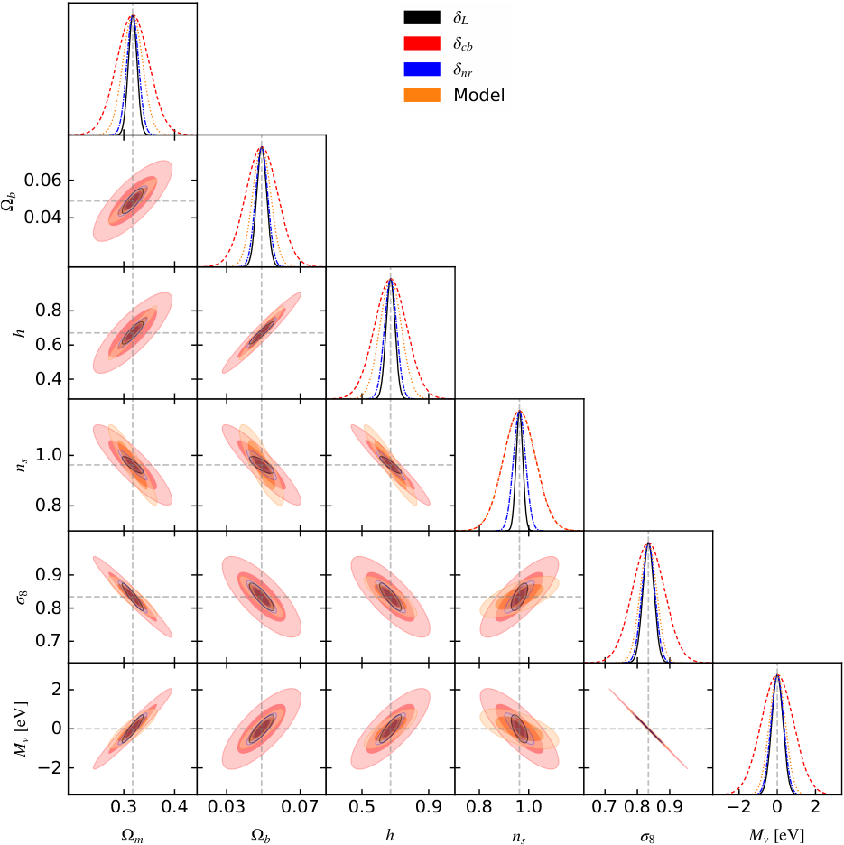

<!-- Start of picture text -->
L cb nr Model 0.06 0.04 0.8 0.6 0.4 1.0 0.8 0.9 0.8 0.7 2 0 2 0.3 0.4 0.03 0.07 0.5 0.9 0.8 1.0 0.7 0.8 0.9 2 0 2 m b h ns 8 Mv [eV] b h ns 8  [eV]Mv <!-- End of picture text -->

**Figure 8.** 68% (darker shades) and 95% (lighter shades) confidence contours for the cosmological parameters for _PδL_ (black), _Pδcb_ (red), _Pδnr_ (blue) and power spectrum with our theoretical model (orange) with _k_ max = 0 _._ 5 _h_ Mpc_−_1 . The constraints are much tighter after reconstruction. 

the strong degeneracy between _σ_ 8 and _Mν_ using the reconstructed power spectrum alone. By introducing other nonlinear statistics, a much tighter constraint can be achieved (Bayer et al. 2021). 

# REFERENCES 

Akeson, R., Armus, L., Bachelet, E., et al. 2019, arXiv Alam, S., Aubert, M., Avila, S., et al. 2021, PhRvD, 103, e-prints, arXiv:1902.05569. 083533, doi: 10.1103/PhysRevD.103.083533 https://arxiv.org/abs/1902.05569 Amendola, L., Appleby, S., Avgoustidis, A., et al. 2018, Alam, S., Ata, M., Bailey, S., et al. 2017, MNRAS, 470, Living Reviews in Relativity, 21, 2, 2617, doi: 10.1093/mnras/stx721 doi: 10.1007/s41114-017-0010-3 

13 

- Bayer, A. E., Banerjee, A., & Seljak, U. 2022, PhRvD, 105, 123510, doi: 10.1103/PhysRevD.105.123510 

- Bayer, A. E., Villaescusa-Navarro, F., Massara, E., et al. 2021, ApJ, 919, 24, doi: 10.3847/1538-4357/ac0e91 

- Birkin, J., Li, B., Cautun, M., & Shi, Y. 2019, MNRAS, 483, 5267, doi: 10.1093/mnras/sty3365 

- Bond, J. R., Efstathiou, G., & Silk, J. 1980, PhRvL, 45, 1980, doi: 10.1103/PhysRevLett.45.1980 

- Carron, J. 2013, A&A, 551, A88, 

doi: 10.1051/0004-6361/201220538 

Castorina, E., Carbone, C., Bel, J., Sefusatti, E., & Dolag, K. 2015, JCAP, 2015, 043, doi: 10.1088/1475-7516/2015/07/043 

- Chen, S.-F., Vlah, Z., & White, M. 2019, JCAP, 2019, 017, doi: 10.1088/1475-7516/2019/09/017 

- Chisari, N. E., Mead, A. J., Joudaki, S., et al. 2019, The Open Journal of Astrophysics, 2, 4, doi: 10.21105/astro.1905.06082 

- DESI Collaboration, Aghamousa, A., Aguilar, J., et al. 2016, arXiv e-prints, arXiv:1611.00036. https://arxiv.org/abs/1611.00036 

- Dor´e, O., Bock, J., Ashby, M., et al. 2014, arXiv e-prints, arXiv:1412.4872. https://arxiv.org/abs/1412.4872 

- Eisenstein, D. J., Seo, H.-J., Sirko, E., & Spergel, D. N. 2007, ApJ, 664, 675, doi: 10.1086/518712 

- Elsner, F., Schmidt, F., Jasche, J., Lavaux, G., & Nguyen, N.-M. 2020, JCAP, 2020, 029, 

doi: 10.1088/1475-7516/2020/01/029 

- Euclid Collaboration, Blanchard, A., Camera, S., et al. 2020, A&A, 642, A191, 

doi: 10.1051/0004-6361/202038071 

- Feng, Y., Seljak, U., & Zaldarriaga, M. 2018, JCAP, 2018, 043, doi: 10.1088/1475-7516/2018/07/043 

- Ferraro, S., Sailer, N., Slosar, A., & White, M. 2022, arXiv e-prints, arXiv:2203.07506. https://arxiv.org/abs/2203.07506 

- Fisher, R. A. 1925, Proceedings of the Cambridge Philosophical Society, 22, 700, doi: 10.1017/S0305004100009580 

- Fl¨oss, T., & Meerburg, P. D. 2023, arXiv e-prints, arXiv:2305.07018, doi: 10.48550/arXiv.2305.07018 

- Hada, R., & Eisenstein, D. J. 2018, MNRAS, 478, 1866, doi: 10.1093/mnras/sty1203 

- —. 2019, MNRAS, 482, 5685, doi: 10.1093/mnras/sty3137 Hahn, C., Villaescusa-Navarro, F., Castorina, E., & Scoccimarro, R. 2020, JCAP, 2020, 040, doi: 10.1088/1475-7516/2020/03/040 

- Hikage, C., Koyama, K., & Heavens, A. 2017, PhRvD, 96, 043513, doi: 10.1103/PhysRevD.96.043513 

Hikage, C., Koyama, K., & Takahashi, R. 2020, PhRvD, 101, 043510, doi: 10.1103/PhysRevD.101.043510 

- Jasche, J., & Wandelt, B. D. 2013, MNRAS, 432, 894, doi: 10.1093/mnras/stt449 

- Lesgourgues, J., & Pastor, S. 2006, PhR, 429, 307, doi: 10.1016/j.physrep.2006.04.001 

- Lewis, A., Challinor, A., & Lasenby, A. 2000, ApJ, 538, 473, doi: 10.1086/309179 

- Liu, Y., Yu, Y., & Li, B. 2021, ApJS, 254, 4, 

doi: 10.3847/1538-4365/abe868 

- Loken, C., Gruner, D., Groer, L., et al. 2010, Journal of Physics: Conference Series, 256, 012026, doi: 10.1088/1742-6596/256/1/012026 

- LSST Science Collaboration, Abell, P. A., Allison, J., et al. 2009, arXiv e-prints, arXiv:0912.0201. https://arxiv.org/abs/0912.0201 

- Mao, T.-X., Wang, J., Li, B., et al. 2021, MNRAS, 501, 1499, doi: 10.1093/mnras/staa3741 

- Massara, E., Villaescusa-Navarro, F., Ho, S., Dalal, N., & Spergel, D. N. 2021, PhRvL, 126, 011301, doi: 10.1103/ PhysRevLett.126.01130110.48550/arXiv.2001.11024 

- Meiksin, A., & White, M. 1999, MNRAS, 308, 1179, doi: 10.1046/j.1365-8711.1999.02825.x 

- Modi, C., Feng, Y., & Seljak, U. 2018, JCAP, 2018, 028, doi: 10.1088/1475-7516/2018/10/028 

- Noh, Y., White, M., & Padmanabhan, N. 2009, PhRvD, 80, 123501, doi: 10.1103/PhysRevD.80.123501 

- Nusser, A., & Branchini, E. 2000, MNRAS, 313, 587, doi: 10.1046/j.1365-8711.2000.03261.x 

- Ota, A., Seo, H.-J., Saito, S., & Beutler, F. 2021, PhRvD, 104, 123508, doi: 10.1103/PhysRevD.104.123508 

- —. 2022, arXiv e-prints, arXiv:2211.07960. https://arxiv.org/abs/2211.07960 

- Padmanabhan, N., White, M., & Cohn, J. D. 2009, PhRvD, 79, 063523, doi: 10.1103/PhysRevD.79.063523 

- Padmanabhan, N., Xu, X., Eisenstein, D. J., et al. 2012, MNRAS, 427, 2132, 

doi: 10.1111/j.1365-2966.2012.21888.x 

- Paillas, E., Cuesta-Lazaro, C., Zarrouk, P., et al. 2022, arXiv e-prints, arXiv:2209.04310. 

https://arxiv.org/abs/2209.04310 

- Pan, Q., Pen, U.-L., Inman, D., & Yu, H.-R. 2017, MNRAS, 469, 1968, doi: 10.1093/mnras/stx774 

- Percival, W. J., Friedrich, O., Sellentin, E., & Heavens, A. 2022, MNRAS, 510, 3207, 

doi: 10.1093/mnras/stab354010.48550/arXiv.2108.10402 

14 

- Ponce, M., van Zon, R., Northrup, S., et al. 2019, in Proceedings of the Practice and Experience in Advanced Research Computing on Rise of the Machines (Learning), PEARC ’19 (New York, NY, USA: Association for Computing Machinery), doi: 10.1145/3332186.3332195 

- Rimes, C. D., & Hamilton, A. J. S. 2005, MNRAS, 360, L82, doi: 10.1111/j.1745-3933.2005.00051.x 

- —. 2006, MNRAS, 371, 1205, doi: 10.1111/j.1365-2966.2006.10710.x 

- Sailer, N., Castorina, E., Ferraro, S., & White, M. 2021, JCAP, 2021, 049, doi: 10.1088/1475-7516/2021/12/049 

- Sarpa, E., Schimd, C., Branchini, E., & Matarrese, S. 2019, MNRAS, 484, 3818, doi: 10.1093/mnras/stz278 

- Schlegel, D. J., Kollmeier, J. A., Aldering, G., et al. 2022, arXiv e-prints, arXiv:2209.04322. https://arxiv.org/abs/2209.04322 

- Schmidt, F., Elsner, F., Jasche, J., Nguyen, N. M., & Lavaux, G. 2019, JCAP, 2019, 042, doi: 10.1088/1475-7516/2019/01/042 

- Schmittfull, M., Baldauf, T., & Zaldarriaga, M. 2017, PhRvD, 96, 023505, doi: 10.1103/PhysRevD.96.023505 

- Schmittfull, M., Simonovi´c, M., Assassi, V., & Zaldarriaga, M. 2019, PhRvD, 100, 043514, doi: 10.1103/PhysRevD.100.043514 

- Seljak, U., Aslanyan, G., Feng, Y., & Modi, C. 2017, JCAP, 2017, 009, doi: 10.1088/1475-7516/2017/12/009 

- Seo, H.-J., Beutler, F., Ross, A. J., & Saito, S. 2016, MNRAS, 460, 2453, doi: 10.1093/mnras/stw1138 

- Seo, H.-J., Ota, A., Schmittfull, M., Saito, S., & Beutler, F. 2022, MNRAS, 511, 1557, doi: 10.1093/mnras/stac082 

- Shallue, C. J., & Eisenstein, D. J. 2022, arXiv e-prints, arXiv:2207.12511. https://arxiv.org/abs/2207.12511 

- Shi, Y., Cautun, M., & Li, B. 2018, PhRvD, 97, 023505, doi: 10.1103/PhysRevD.97.023505 

- Springel, V. 2005, MNRAS, 364, 1105, doi: 10.1111/j. 1365-2966.2005.09655.x10.48550/arXiv.astro-ph/0505010 

- Takada, M., Ellis, R. S., Chiba, M., et al. 2014, PASJ, 66, R1, doi: 10.1093/pasj/pst019 

- Tegmark, M. 1997, PhRvL, 79, 3806, 

- doi: 10.1103/PhysRevLett.79.3806 

- Villaescusa-Navarro, F., Hahn, C., Massara, E., et al. 2020, ApJS, 250, 2, doi: 10.3847/1538-4365/ab9d82 

- Villaescusa-Navarro, F., Angl´es-Alc´azar, D., Genel, S., et al. 2021, ApJ, 915, 71, doi: 10.3847/1538-4357/abf7ba 

- Wang, H., Mo, H. J., Yang, X., Jing, Y. P., & Lin, W. P. 2014, ApJ, 794, 94, doi: 10.1088/0004-637X/794/1/94 

- Wang, X., & Pen, U.-L. 2019, ApJ, 870, 116, doi: 10.3847/1538-4357/aaf231 

- Wang, Y., Li, B., & Cautun, M. 2020, MNRAS, 497, 3451, doi: 10.1093/mnras/staa2136 

- Wang, Y., Zhao, G.-B., Koyama, K., et al. 2022, arXiv e-prints, arXiv:2202.05248. https://arxiv.org/abs/2202.05248 

- Wang, Y., Zhao, R., Zhai, Z., et al. 2023, arXiv e-prints, arXiv:2311.05848, doi: 10.48550/arXiv.2311.05848 

- White, M. 2015, MNRAS, 450, 3822, 

- doi: 10.1093/mnras/stv842 

- Yu, Y., Zhu, H.-M., & Pen, U.-L. 2017, ApJ, 847, 110, doi: 10.3847/1538-4357/aa89e7 

- Zhu, H.-M., Yu, Y., & Pen, U.-L. 2018, PhRvD, 97, 043502, doi: 10.1103/PhysRevD.97.043502 

- Zhu, H.-M., Yu, Y., Pen, U.-L., Chen, X., & Yu, H.-R. 2017, PhRvD, 96, 123502, doi: 10.1103/PhysRevD.96.123502 

