Draft version June 8, 2023 Typeset using LA TEX **twocolumn** style in AASTeX63 

## **The NANOGrav 12.5-year Data Set: Bayesian Limits on Gravitational Waves from Individual Supermassive Black Hole Binaries** 

Zaven Arzoumanian,1 Paul T. Baker ,2 Laura Blecha,3 Harsha Blumer ,4, 5 Adam Brazier,6 Paul R. Brook ,4, 5 Sarah Burke-Spolaor ,4, 5 Bence B´ecsy ,7 J. Andrew Casey-Clyde ,8 Maria Charisi ,9 Shami Chatterjee ,6 Siyuan Chen ,10 James M. Cordes ,6 Neil J. Cornish ,11 Fronefield Crawford ,12 H. Thankful Cromartie ,13 Megan E. DeCesar ,14 Paul B. Demorest ,15 Timothy Dolch ,16, 17 Brendan Drachler,18, 19 Justin A. Ellis,20 E. C. Ferrara ,21, 22, 23 William Fiore ,4, 5 Emmanuel Fonseca ,4, 5 Gabriel E. Freedman ,24 Nathan Garver-Daniels ,4, 5 Peter A. Gentile ,4, 5 Joseph Glaser ,4, 5 Deborah C. Good ,25 Kayhan G¨ultekin ,26 Jeffrey S. Hazboun ,7 Ross J. Jennings ,6 Aaron D. Johnson ,24, 27 Megan L. Jones ,24 Andrew R. Kaiser ,4, 5 David L. Kaplan ,24 Luke Zoltan Kelley ,28, 29 Joey Shapiro Key ,30 Nima Laal ,7 Michael T. Lam ,18, 19 William G Lamb ,9 T. Joseph W. Lazio,31, 27 Natalia Lewandowska ,32 Tingting Liu ,24 Duncan R. Lorimer ,4, 5 Jing Luo,33,_∗_ Ryan S. Lynch ,34 Dustin R. Madison ,4, 5 Alexander McEwen ,24 Maura A. McLaughlin ,4, 5 Chiara M. F. Mingarelli ,35, 8 Cherry Ng ,36 David J. Nice ,37 Stella Koch Ocker ,6 Ken D. Olum ,38 Timothy T. Pennucci ,39 Nihan S. Pol ,9 Scott M. Ransom ,40 Paul S. Ray ,41 Joseph D. Romano,42 Brent J. Shapiro-Albert ,43, 4, 5 Xavier Siemens ,7, 24 Joseph Simon ,31, 27 Magdalena Siwek ,44 Ren´ee Spiewak ,45 Ingrid H. Stairs ,25 Daniel R. Stinebring ,46 Kevin Stovall ,15 Joseph K. Swiggum ,37,_†_ Jessica Sydnor ,4, 5 Stephen R. Taylor ,9 Jacob E. Turner ,4, 5 Michele Vallisneri ,31, 27 Sarah J. Vigeland ,24 Haley M. Wahl ,4, 5 Gregory Walsh ,4, 5 Caitlin A. Witt_§_ ,29, 47, 4, 5 Olivia Young ,18, 19 

The NANOGrav Collaboration 

> 1 _X-Ray Astrophysics Laboratory, NASA Goddard Space Flight Center, Code 662, Greenbelt, MD 20771, USA_ 

> 2 _Department of Physics and Astronomy, Widener University, One University Place, Chester, PA 19013, USA_ 

> 3 _Department of Physics, University of Florida, 2001 Museum Rd., Gainesville, FL 32611, USA_ 

> 4 _Department of Physics and Astronomy, West Virginia University, P.O. Box 6315, Morgantown, WV 26506, USA_ 

> 5 _Center for Gravitational Waves and Cosmology, West Virginia University, Chestnut Ridge Research Building, Morgantown, WV 26505, USA_ 

> 6 _Cornell Center for Astrophysics and Planetary Science and Department of Astronomy, Cornell University, Ithaca, NY 14853, USA_ 

> 7 _Department of Physics, Oregon State University, Corvallis, OR 97331, USA_ 

> 8 _Department of Physics, University of Connecticut, 196 Auditorium Road, U-3046, Storrs, CT 06269-3046, USA_ 

> 9 _Department of Physics and Astronomy, Vanderbilt University, 2301 Vanderbilt Place, Nashville, TN 37235, USA_ 

> 10 _Kavli Institute for Astronomy and Astrophysics, Peking University, Beijing, 100871 China_ 

> 11 _Department of Physics, Montana State University, Bozeman, MT 59717, USA_ 

> 12 _Department of Physics and Astronomy, Franklin & Marshall College, P.O. Box 3003, Lancaster, PA 17604, USA_ 

> 13 _University of Virginia, Department of Astronomy, P.O. Box 400325, Charlottesville, VA 22904, USA_ 

> 14 _George Mason University, Fairfax, VA 22030, resident at the Naval Research Laboratory, Washington, DC 20375, USA_ 

> 15 _National Radio Astronomy Observatory, 1003 Lopezville Rd., Socorro, NM 87801, USA_ 

> 16 _Department of Physics, Hillsdale College, 33 E. College Street, Hillsdale, MI 49242, USA_ 

> 17 _Eureka Scientific, 2452 Delmer Street, Suite 100, Oakland, CA 94602-3017, USA_ 

> 18 _School of Physics and Astronomy, Rochester Institute of Technology, Rochester, NY 14623, USA_ 

> 19 _Laboratory for Multiwavelength Astrophysics, Rochester Institute of Technology, Rochester, NY 14623, USA_ 

> 20 _Infinia ML, 202 Rigsbee Avenue, Durham NC, 27701_ 

> 21 _Department of Astronomy, University of Maryland, College Park, MD, 20742, USA_ 

> 22 _Center for Exploration and Space Studies (CRESST), NASA/GSFC, Greenbelt, MD 20771, USA_ 

> 23 _NASA Goddard Space Flight Center, Greenbelt, MD 20771, USA_ 

Corresponding author: Caitlin A. Witt_§_ caitlin.witt@nanograv.org 

The NANOGrav Collaboration 

2 

> 24 _Center for Gravitation, Cosmology and Astrophysics, Department of Physics, University of Wisconsin-Milwaukee,_ 

_P.O. Box 413, Milwaukee, WI 53201, USA_ 

> 25 _Department of Physics and Astronomy, University of British Columbia, 6224 Agricultural Road, Vancouver, BC V6T 1Z1, Canada_ 

> 26 _University of Michigan, Dept. of Astronomy, 1085 S. University Ave., Ann Arbor, MI, 48104, USA_ 

> 27 _Theoretical AstroPhysics Including Relativity (TAPIR), MC 350-17, California Institute of Technology, Pasadena, California 91125, USA_ 

> 28 _Department of Astronomy, University of California at Berkeley, Berkeley, CA 94720, USA_ 

> 29 _Center for Interdisciplinary Exploration and Research in Astrophysics (CIERA), Northwestern University, Evanston, IL 60208_ 

> 30 _University of Washington Bothell, 18115 Campus Way NE, Bothell, WA 98011, USA_ 

> 31 _Jet Propulsion Laboratory, California Institute of Technology, 4800 Oak Grove Drive, Pasadena, CA 91109, USA_ 

> 32 _Department of Physics, State University of New York at Oswego, Oswego, NY, 13126, USA_ 

> 33 _Department of Astronomy & Astrophysics, University of Toronto, 50 Saint George Street, Toronto, ON M5S 3H4, Canada_ 

> 34 _Green Bank Observatory, P.O. Box 2, Green Bank, WV 24944, USA_ 

> 35 _Center for Computational Astrophysics, Flatiron Institute, 162 5th Avenue, New York, New York, 10010, USA_ 

> 36 _Dunlap Institute for Astronomy and Astrophysics, University of Toronto, 50 St. George St., Toronto, ON M5S 3H4, Canada_ 

> 37 _Department of Physics, Lafayette College, Easton, PA 18042, USA_ 

> 38 _Institute of Cosmology, Department of Physics and Astronomy, Tufts University, Medford, MA 02155, USA_ 

> 39 _Institute of Physics, E¨otv¨os Lor´and University, P´azm´any P. s. 1/A, 1117 Budapest, Hungary_ 

> 40 _National Radio Astronomy Observatory, 520 Edgemont Road, Charlottesville, VA 22903, USA_ 

> 41 _Space Science Division, Naval Research Laboratory, Washington, DC 20375-5352, USA_ 

> 42 _Department of Physics and Astronomy, Texas Tech University, Lubbock, TX 79409-1051, USA_ 

> 43 _Giant Army, 915A 17th Ave, Seattle WA 98122_ 

> 44 _Center for Astrophysics, Harvard University, Cambridge, MA 02138, USA_ 

> 45 _Jodrell Bank Centre for Astrophysics, Department of Physics and Astronomy, University of Manchester, Manchester M13 9PL, UK_ 

- 46 _Department of Physics and Astronomy, Oberlin College, Oberlin, OH 44074, USA_ 

- 47 _Adler Planetarium, 1300 S. DuSable Lake Shore Dr., Chicago, IL 60605, USA_ 

### (Received 2023 January 9; Accepted 2023 June 6) 

## ABSTRACT 

Pulsar timing array collaborations, such as the North American Nanohertz Observatory for Gravitational Waves (NANOGrav), are seeking to detect nanohertz gravitational waves emitted by supermassive black hole binaries formed in the aftermath of galaxy mergers. We have searched for continuous waves from individual circular supermassive black hole binaries using NANOGrav’s recent 12.5-year data set. We created new methods to accurately model the uncertainties on pulsar distances in our analysis, and we implemented new techniques to account for a common red noise process in pulsar timing array data sets while searching for deterministic gravitational wave signals, including continuous waves. As we found no evidence for continuous waves in our data, we placed 95% upper limits on the strain amplitude of continuous waves emitted by these sources. At our most sensitive frequency of 7.65 nanohertz, we placed a sky-averaged limit of _h_ 0 _<_ (6 _._ 82 _±_ 0 _._ 35) _×_ 10_−_15 , and _h_ 0 _<_ (2 _._ 66 _±_ 0 _._ 15) _×_ 10_−_15 in our most sensitive sky location. Finally, we placed a multi-messenger limit of _M <_ (1 _._ 41 _±_ 0 _._ 02) _×_ 109 _M⊙_ on the chirp mass of the supermassive black hole binary candidate 3C 66B. 

_Keywords:_ Gravitational waves – Methods: data analysis – Pulsars: general 

## 1. INTRODUCTION 

Supermassive black hole binaries (SMBHBs) are expected to form in the aftermath of galaxy mergers, when the two constituent supermassive black holes eventually 

- _∗_ Author is deceased 

> _†_ NANOGrav Physics Frontiers Center Postdoctoral Fellow 

become gravitationally bound (Begelman et al. 1980). If they are able to reach an advanced stage of evolution, with sub-parsec orbital separations, these binaries are predicted to be among the brightest sources of lowfrequency gravitational waves (GWs) in the universe, emitting at frequencies of _∼_ 10_−_9 _−_ 10_−_7 Hz. The GWs emitted by discrete SMBHBs are known as continuous waves (CWs) due to their minimal frequency evolution, 

NANOGrav 12.5-year Continuous Wave Limits 

3 

while the dominant source of nanohertz GWs is expected to be the stochastic background of GWs (GWB) that has contributions from the entire cosmic population of SMBHBs and potentially other sources (Sesana et al. 2004; Burke-Spolaor et al. 2019). 

By carefully monitoring the radio pulses from stable millisecond pulsars (MSPs) over many years, pulsar timing arrays (PTAs) should be able to detect correlated fluctuations in the pulse times of arrival due to the influence of low-frequency GWs (Detweiler 1979; Foster & Backer 1990). There are multiple PTA collaborations currently operating; among them, the North American Nanohertz Observatory for Gravitational Waves (NANOGrav; McLaughlin 2013), the Parkes Pulsar Timing Array (PPTA; Hobbs 2013a,b), and the European Pulsar Timing Array (EPTA; Desvignes et al. 2016) have each produced multiple pulsar timing data sets which have been searched for GWs. These groups, along with other pulsar timing projects, combine efforts as a consortium known as the International Pulsar Timing Array (IPTA; Verbiest et al. 2016a). 

These PTA data sets have enabled numerous searches for GWs from SMBHBs, as well as primordial GWs (e.g. Vagnozzi 2021; Benetti et al. 2022), cosmic strings (e.g., Arzoumanian et al. 2018), and cosmological phase transitions (Arzoumanian et al. 2021a; Xue et al. 2021). Modeling has suggested that the GWB signal from SMBHBs will be detected first (Rosado et al. 2015). While PTAs have not yet detected a GWB, they have placed steadily improving limits on such a signal (van Haasteren et al. 2011; Demorest et al. 2013; Shannon et al. 2013; Lentati et al. 2015; Shannon et al. 2015; Verbiest et al. 2016b; Arzoumanian et al. 2016, 2018) until around 2015, when published limits began to stabilize at a characteristic strain value of a few times 10_−_15 . In the NANOGrav 12.5-year data set (Alam et al. 2021a), PPTA second data release (Kerr et al. 2020), EPTA data release 2 (Chen et al. 2021), and IPTA data release 2 (Perera et al. 2019), not only does the upper limit no longer decrease, but a common red noise (CRN) process with characteristics similar to those predicted for a SMBHB-origin GWB was detected to high significance, albeit without evidence for the specific spatial correlation assumed for the GWB (Arzoumanian et al. 2020a; Goncharov et al. 2021; Antoniadis et al. 2022; Falxa et al. 2023). Significant effort has been dedicated to determining if the CRN is an early warning sign of a future GWB detection (Pol et al. 2021) or an anomaly due to pulsar noise modeling (Zic et al. 2022) and to the development of validity tests to determine between these two scenarios (Goncharov et al. 2022), but more data are required to make a final determination. 

While this common red-noise process is heartening for future GWB searches (Pol et al. 2021), it has sparked new challenges for CW searches, as the background takes the form of a noise process, which (like any noise process underlying a signal) will work to disrupt the sensitivity of CW searches. Over the past decades, all-sky and allfrequency CW searches have improved their sensitivity by several orders of magnitude in GW strain (e.g., Yardley et al. 2010; Arzoumanian et al. 2014; Zhu et al. 2014; Babak et al. 2016; Aggarwal et al. 2019), allowing the sensitivity horizon of PTAs to expand by several orders of magnitude. This has allowed the PTA horizon to include increasing numbers of specific systems of interest (e.g., Lommen & Backer 2001; Jenet et al. 2004; Aggarwal et al. 2019; Charisi et al. 2022). PTAs are likely to reach the sensitivities required to detect a CW soon after the GWB is detected, with recent studies suggesting this will occur in the next 5-10 years (Rosado et al. 2015; Mingarelli et al. 2017; Kelley et al. 2018; B´ecsy 

et al. 2022b). Additionally, we are working to revise and improve CW search methodologies through search speed-ups (B´ecsy et al. 2022a) and efficient sampling techniques (Aggarwal et al. 2019) as CW upper limits decrease. 

In this paper, we present the results of an all-sky search for CWs from individual circular SMBHBs in the NANOGrav 12.5-year data set. This work is an extension of the searches performed in previous NANOGrav datasets (presented in Arzoumanian et al. 2014 and Aggarwal et al. 2019 for the 5- and 11-year data sets, respectively), and uses analogous techniques to the search for CWs in the IPTA data release 2 (Falxa et al. 2023). Our new search benefited from the use of the more sensitive 12.5-year data set. Most critically, however, in this work we needed to account for the existence of an emerging common-noise signal in this data set, and understand the impact that this signal may have on CW sensitivity. 

This paper is organized as follows. In section 2, we present an overview of the data used for our analysis, details of new pulsar distance modeling methods created for CW searches, and a description of the GW signals and analysis methods used throughout this paper. In section 3, we present the results of our GW searches, and in section 4, interpret their broader astrophysical context. For the busy reader, our main results can be summarized as follows: 

- For accurate low-frequency CW searches, the CRN that has been seen in GWB searches must be accounted for in our signal modeling; otherwise, our detection metrics may report a false positive result. 

The NANOGrav Collaboration 

4 

- Once the CRN was taken into account, we found that no CWs were detected in the 12.5-year data set. 

- With this knowledge, we placed stringent limits on the CW amplitude as a function of GW frequency. For the most sensitive frequency of 7 _._ 65 _×_ 10_−_9 Hz, we reach strain 95% upper limits of _h_ 0 _<_ (6 _._ 82 _±_ 0 _._ 35) _×_ 10_−_15 , and we also placed limits on the CW amplitude at this frequency as a function of sky location. 

- While our all-sky sensitivity has improved with each subsequent NANOGrav data set, we found herein that for 85% of the sky, the upper limit at the most sensitive frequency of 7 _._ 65 _×_ 10_−_9 Hz is comparable to or worse than in previous data sets. Through extensive simulations that encompass the complex evolution of pulsar noise parameters, ephemeris updates, and Bayesian modeling, we linked this effect to the newly-detectable CRN process in the 12.5-year data set. 

- We used these limits to make inferences about the local population of SMBHBs, and limited the distance to an SMBHB emitting at 7 _._ 65 _×_ 10_−_9 Hz to be greater than 86.7 Mpc for a 109 _M⊙_ binary in the most sensitive sky location. 

- We used multi-messenger techniques to update limits on the chirp mass of the SMBHB candidate 3C 66B to be less than _M <_ (1 _._ 41 _±_ 0 _._ 02) _×_ 109 _M⊙_ and placed new limits on the chirp mass of SMBHB candidate HS 1630+2355 to be less than _M <_ (1 _._ 28 _±_ 0 _._ 03) _×_ 1010 _M⊙._ 

In section 5, we discuss the implications of these results. In section 6, we summarize our conclusions. 

## 2. METHODS 

## 2.1. _The 12.5-year Data Set_ 

We analyzed the NANOGrav 12.5-year data set, originally published as Alam et al. (2021a,b), which consists of times-of-arrival (TOAs) and timing models from 47 pulsars. Two versions of the data set were created from the original observations, taken between 2004 and 2017, using independent analyses. Here, we make use of the narrowband version of the data set (Alam et al. 2021a). This adds 2 pulsars and 1.5 years of observations over the previous 11-year data set. For GW analyses, we require the pulsars to have a timing baseline of at least 3 years; therefore, we use only 45 of the 47 pulsars included in the full data set. However, the 11-year data set 

included only 34 pulsars that could be used in GW analyses, so this addition, which includes a factor of _∼_ 1 _._ 5 increase in the number of pulse TOAs, represents a significant addition of data, increasing our sensitivity. It is important to note that the 12.5-year data set is not merely an addition of TOAs to previous releases, but a full re-analysis with an updated pipeline, described in detail in Alam et al. (2021a). Thus, our search also benefited from improved timing precision for pulsars shared with previous data sets. However, it is important to note that this reprocessing resulted in new values being measured for each pulsar’s noise parameters. 

## 2.2. _Signal Model_ 

As in previous NANOGrav searches for continuous gravitational waves, we will describe the effect of an individual SMBHB on a pulsar’s TOAs and its timing model. A starting point is the residuals, _δt_ , obtained after subtracting a basic timing model (which excludes noise and GW parameters) from the measured arrival times. While the methods remain nearly identical to previous iterations, slight alterations have been made to improve consistency with other work in the field, to reflect more recent data, and to include the CRN in the CW search. As such, we will lay out the methods with particular focus on any instances that have changed since NANOGrav’s most recent CW search (Aggarwal et al. 2019). Note that throughout this paper, we use units where _G_ = _c_ = 1, cosmology calculations assume _H_ 0 = 69 _._ 32 km s_−_1 Mpc_−_1 , and the GW derivations assume General Relativity. 

The pulsar residuals can be separated into multiple components as 

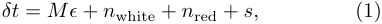

<!-- Start of picture text -->
δt  =  Mϵ  +  n white +  n red +  s, (1) <!-- End of picture text -->

where _M_ is the design matrix, which describes the linearized timing model, and _ϵ_ is a vector of the timing model parameter offsets. This term allows the timing model parameters of each pulsar to be adjusted in accordance with the presence of any additional signals. The variables _n_ white and _n_ red refer to vectors describing the pulsar white and red noise, respectively, and _s_ is a vector of GW-induced signal present in the residuals. 

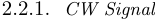

<!-- Start of picture text -->
2.2.1. CW Signal <!-- End of picture text -->

For a GW source located at right ascension _α_ and declination _δ_ , we define the polar angle _θ_ = _π/_ 2 _− δ_ and azimuthal angle _ϕ_ = _α_ . The strain of GWs emitted from such a source can be written in terms of two polarizations as 

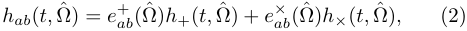

<!-- Start of picture text -->
hab ( t, Ω) = ˆ  e + ab (ˆΩ) h +( t,  ˆΩ) +  e× ab (ˆΩ) h× ( t,  ˆΩ) , (2) <!-- End of picture text -->

NANOGrav 12.5-year Continuous Wave Limits 

5 

where Ωisˆ a unit vector pointing from the the GW source to the Earth (along the direction of propagation), _h_ + _,×_ are the polarization amplitudes, and _e_+ _ab__,×_ are the polarization tensors. These can be written in the solar system barycenter frame as 

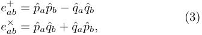

<!-- Start of picture text -->
e + ab = p ˆ ap ˆ b − q ˆ aq ˆ b (3) e × ab = p ˆ aq ˆ b  + ˆ qap ˆ b, <!-- End of picture text -->

and are constructed from basis vectors. 

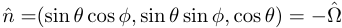

<!-- Start of picture text -->
n ˆ =(sin  θ  cos  ϕ,  sin  θ  sin  ϕ,  cos  θ ) =  − Ω ˆ <!-- End of picture text -->

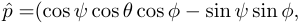

<!-- Start of picture text -->
p ˆ =(cos  ψ  cos  θ  cos  ϕ − sin  ψ  sin  ϕ, <!-- End of picture text -->

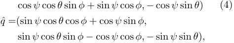

<!-- Start of picture text -->
cos  ψ  cos  θ  sin  ϕ  + sin  ψ  cos  ϕ, − cos  ψ  sin  θ ) (4) q ˆ =(sin  ψ  cos  θ  cos  ϕ  + cos  ψ  sin  ϕ, sin  ψ  cos  θ  sin  ϕ − cos  ψ  cos  ϕ, − sin  ψ  sin  θ ) , <!-- End of picture text -->

where _ψ_ is the GW polarization angle. Note that this basis is different than that used in Aggarwal et al. (2019) to maintain better consistency with previous references and the standards used by other GW detectors. Differences can be reduced to a rotation of the frame by an angle equivalent to the GW polarization angle _ψ_ . These polarization tensors are used to construct the antenna pattern function _F_+_,×_ (Ω),ˆ which describes the response of the pulsar (at unit vector _u_ ˆ) to the GW source, as in Taylor et al. (2016), where 

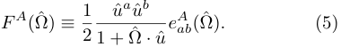

<!-- Start of picture text -->
u ˆ a u ˆ b F A (Ω) ˆ  ≡ 1 e A ab (ˆΩ) . (5) 2 1 + Ω ˆ ·  ˆ u <!-- End of picture text -->

Now, we can write the signal _s_ induced by the GW as seen in the pulsar’s residuals as 

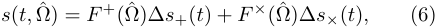

<!-- Start of picture text -->
s ( t, Ω) = ˆ  F + (Ω)∆ ˆ s +( t ) +  F × (Ω)∆ ˆ s× ( t ) , (6) <!-- End of picture text -->

where ∆ _s_ + _,×_ is the difference between the signal induced at the Earth (the “Earth term”) and at the pulsar (the “pulsar term”). This can be written as 

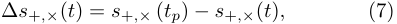

<!-- Start of picture text -->
∆ s + ,× ( t ) =  s + ,×  ( tp )  − s + ,× ( t ) , (7) <!-- End of picture text -->

where _t_ and _tp_ represent the time when the GW passes the Earth and the pulsar, respectively. These times can be related geometrically by 

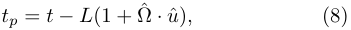

<!-- Start of picture text -->
tp =  t − L (1 + Ω ˆ ·  ˆ u ) , (8) <!-- End of picture text -->

where _u_ ˆ is the line of sight vector to the pulsar and _L_ is the distance to the pulsar (see section 2.3.4 for further discussion of this value). 

For a circular binary at zeroth post-Newtonian (0-PN) order, _s_ + _,×_ can be written as 

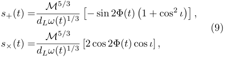

<!-- Start of picture text -->
M 5 / 3 s +( t ) = � − sin 2Φ( t ) �1 + cos 2 ι �� , dLω ( t ) 1 / 3 (9) M 5 / 3 s× ( t ) = dLω ( t ) 1 / 3 [2 cos 2Φ( t ) cos  ι ]  , <!-- End of picture text -->

where _ι_ is the inclination angle of the SMBHB, _dL_ is the luminosity distance to the source, _ω_ ( _t_ ) and Φ( _t_ ) are the time-dependent angular orbital frequency and phase, respectively, and _M ≡_ ( _m_ 1 _m_ 2)3_/_5 _/_ ( _m_ 1 + _m_ 2)1_/_5 is a combination of the two black hole masses known as the chirp mass. Again, note that the forms of these signals have been reorganized compared to those used in Aggarwal et al. (2019); due to the rotated frame of the antenna pattern functions now in use, they are equivalent. The variables _M_ and _ω_ refer to the redshifted values of these quantities, which relate to the rest-frame versions _Mr_ and _ωr_ as 

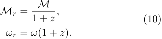

<!-- Start of picture text -->
M Mr = 1 +  z , (10) ωr =  ω (1 +  z ) . <!-- End of picture text -->

However, PTAs are currently thought to be sensitive only to individual SMBHBs in the local universe where (1 + _z_ ) _∼_ 1. 

For a CW, the initial orbital angular _ω_ 0 frequency is related to the GW frequency by _ω_ 0 = _πf_ GW, where _ω_ 0 = _ω_ ( _t_ 0). For this search, we define the reference time _t_ 0 as MJD 57933 (2017 June 29), the date of the last observation for the 12.5-year data set. The timedependent orbital phase and frequency of the binary are given by 

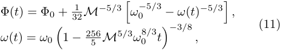

<!-- Start of picture text -->
Φ( t ) = Φ0 + 1 ω 0 − 5 / 3 , 32 M− 5 / 3 � − ω ( t ) − 5 / 3� (11) ω ( t ) =  ω 0 �1  − 256 5 M 5 / 3 ω 0 8 / 3 t � − 3 / 8 , <!-- End of picture text -->

where Φ0 refers to the initial orbital phase (Arzoumanian et al. 2014). To account for the evolution of high chirp mass binaries over our observations, rather than assuming that there is no frequency evolution, we use the full expression for _ω_ ( _t_ ) as in Aggarwal et al. (2019). 

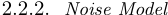

<!-- Start of picture text -->
2.2.2. Noise Model <!-- End of picture text -->

For each individual pulsar, we model both white and red noise. We use a white noise model that is identical to that used in previous NANOGrav analyses, using three parameters: EFAC, EQUAD, and ECORR. EFAC scales the template-fitting TOA uncertainties induced by finite pulse signal-to-noise ratios by a multiplicative factor, EQUAD adds white noise in quadrature, and ECORR describes white noise that is correlated across TOAs derived from data collected simultaneously (Lam et al. 2017). 

For consistency with previous NANOGrav analyses, to model individual pulsar red noise, the noise spectrum is divided into 30 linearly spaced bins, ranging from 1 _/T_ obs to 30 _/T_ obs, where _T_ obs is the total observation baseline for each pulsar. Then, the power spectral density of the 

The NANOGrav Collaboration 

6 

red noise is fit to a power-law model as in Shannon & Cordes (2010); Lam et al. (2017), where 

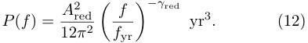

<!-- Start of picture text -->
P ( f ) = A red 2 yr 3 . (12) 12 π 2 � ff yr � −γ red <!-- End of picture text -->

Here, _f_ yr _≡_ 1 _/_ (1 year), _A_ red is the red noise amplitude, and _γ_ red is the power law spectral index. The prior on _A_ red is log-uniform in the range [ _−_ 20 _, −_ 11], while the prior on _γ_ is uniform in the range [0,7]. 

As mentioned above, for the first time, a CRN signal is now detectable in the 12.5-year data set (Arzoumanian et al. 2020a). Because of this, we included a CRN term in our signal model for a portion of our analyses, where the CRN amplitude and spectral index are held fixed to those preferred in Arzoumanian et al. (2020a). The results of searches that only model a CW necessitated this addition, and are described in detail in section 3. The power spectral density of the CRN 

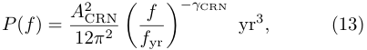

<!-- Start of picture text -->
P ( f ) = A CRN 2 yr 3 , (13) 12 π 2 � ff yr � −γ CRN <!-- End of picture text -->

takes the same form as that of the pulsar red noise in Equation 12, but with an amplitude _A_ CRN and spectral index _γ_ CRN that are common to all of the pulsars in the array. 

## 2.3. _Bayesian Methods_ 

We utilized Bayesian inference techniques to determine the posterior distributions of GW parameters. In previous CW analyses (Arzoumanian et al. 2014; Aggarwal et al. 2019), these results were compared to a frequentist metric, the _Fp_ statistic (Ellis et al. 2012) to confirm our key results. However, as this method does not currently account for a common process other than a CW in the data, more development will be necessary to produce reliable frequentist results on the 12.5-year data set through the addition of noise-marginalization capabilities, similar to Vigeland et al. (2018).. Therefore, in this work, we will focus solely on the Bayesian searches, and the frequentist analyses will be presented in a future work. 

In each analysis, we include the BayesEphem model (Vallisneri et al. 2020) to account for the uncertainties in the Solar System ephemeris, which, as first described in Arzoumanian et al. (2018), can have large impacts on the computation of GW upper limits with PTAs. We used DE438 (Folkner & Park 2018) plus BayesEphem to transform from individual observatory reference frames to an inertial frame centered at the Solar System Barycenter. 

As in previous NANOGrav CW searches, we use the `enterprise` (Ellis et al. 2019) package to construct the 

priors and evaluate the likelihood, which takes the same form as in Aggarwal et al. (2019) and Arzoumanian et al. (2014). The Markov Chain Monte Carlo (MCMC) sampler package `PTMCMCSampler` (Ellis & van Haasteren 2017) was used to explore the parameter space. Before analyzing our data, we performed a prior-recovery analysis to ensure that the sampler could search the entire prior volume. 

The CW signal model can be described by nine global parameters: 

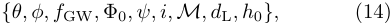

<!-- Start of picture text -->
{θ, ϕ, f GW ,  Φ0 , ψ, i, M, d L , h 0 }, (14) <!-- End of picture text -->

which describe the circular SMBHB’s: 

- position on the sky ( _θ, ϕ_ ); 

- GW frequency, related to the orbital frequency at a reference time ( _f_ GW); 

- orbital phase at a reference time (Φ0); 

- GW polarization angle ( _ψ_ ); 

- orbital inclination ( _ι_ ); 

- chirp mass ( _M_ ); 

- luminosity distance ( _d_ L); 

- strain amplitude ( _h_ 0), which is related to the chirp mass, GW frequency, and luminosity distance. 

Since _h_ 0 can be defined as 

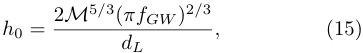

<!-- Start of picture text -->
h 0 = 2 M 5 / 3( πfGW )2 / 3 , (15) dL <!-- End of picture text -->

there is a degeneracy between _h_ 0, _M_ , _f_ GW, and _dL_ , and therefore only eight of these parameters are required to fully describe the global CW signal. The following types of searches use a variety of prior setups to sample the necessary eight global parameters, and are described below and summarized in Table 1. Including the necessary parameters to model the red noise in and distance to each of the 45 pulsars and model uncertainties in the solar system ephemeris with `BayesEphem` , there are 198 parameters in our all-sky MCMCs. 

As in Aggarwal et al. (2019), to determine if a CW has been detected by any of our analyses, we first performed a detection analysis with the priors described in Table 1, with the key difference between this and upper limit analyses being a log-uniform prior on the strain amplitude of the CW. Then, we calculated the Bayes factor using the Savage-Dickey formula (Dickey 1971), 

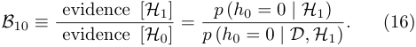

<!-- Start of picture text -->
B 10 ≡ evidence [ H 1] p ( h 0 = 0 | H 1) (16) evidence [ H 0] = p  ( h 0 = 0  | D, H 1) . <!-- End of picture text -->

Here, _H_ 1 is the model with a CW, _H_ 0 is the model without one, _p_ ( _h_ 0 = 0 _| H_ 1) is the prior at _h_ 0 = 0, and _p_ ( _h_ 0 = 0 _| D, H_ 1) is the posterior at _h_ 0 = 0. Since _H_ 1 and _H_ 0 are nested models (i.e., _H_ 0 is _H_ 1 : _h_ 0 = 

NANOGrav 12.5-year Continuous Wave Limits 

7 

0), we used the Savage-Dickey formula to estimate _p_ ( _h_ 0 = 0 _| D, H_ 1) as the average fraction of samples in the lowest-amplitude bin in a histogram of _h_ 0 samples for a range of bin sizes. We then computed the onesigma error on the Bayes factor as 

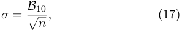

<!-- Start of picture text -->
σ = B 10 (17) √ n  , <!-- End of picture text -->

where _n_ is the number of samples in the lowestamplitude bin. As with the Bayes factor values, the average error is computed for a range of histogram bin sizes. 

Throughout this work, we computed 95% upper limits as the 95th percentile of relevant strain (or chirp mass, for multi-messenger analyses) posterior distributions. For these analyses, a uniform prior on the strain amplitude is used, which translates to a linear-exponential (LinExp) prior on log10 _h_ . The error on the 95% upper limit, due to the finite number of samples, is calculated as 

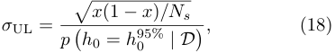

<!-- Start of picture text -->
� x (1  − x ) /Ns σ UL = (18) p � h 0 =  h 95% 0 | D � , <!-- End of picture text -->

where _x_ = 0 _._ 95 and _Ns_ is the number of effective samples in the MCMC chain. 

## 2.3.1. _All-Sky Searches_ 

To search for GWs from SMBHBs located in any direction, we use uniform priors on the source sky position (cos _θ, ϕ_ ), as well as the cosine of the source inclination cos _ι_ , polarization angle _ψ_ , and GW phase Φ0. We used log-uniform priors on _h_ 0 for detection analyses, and uniform priors on _h_ 0 for upper limit analyses, so as to set the most conservative upper limit. For both analysis types, priors on log10( _h_ 0) span the range [ _−_ 18 _, −_ 11], which accounts for an over-conservative range around the sensitivity of the most recent data sets (order _−_ 15), and the minimum of which is well below our sensitivity. 

We performed many searches at fixed values of _f_ GW, to evaluate detection statistics and our sensitivity across the entire nanohertz GW band. The lowest frequency value was set by the time span of our data set, _f_ GW = 1 _/_ (12 _._ 9 years) = 2 _._ 45 _×_ 10_−_9 Hz. The highest frequency value is limited by the observation cadence of our data (approximately one observation per 2–4 weeks). However SMBHBs at that frequency, at the mass range where their strains would be large enough to be detectable by PTAs, have exceedingly short inspiral timescales (a few weeks up to _∼_ 3 months). Thus, they are unlikely to be detectable in our data set due to rapid evolution, and therefore low residence times, at these frequencies, coupled with decreasing sensitivity of the PTA with increasing GW frequency caused by white 

noise (Islo et al. 2019; Aggarwal et al. 2020). Therefore, we set our maximum frequency to 3 _._ 178 _×_ 10_−_7 Hz (equivalent to one GW cycle every _∼_ 36 days and a GW inspiral time of _∼_ 34 days). This is the same high-frequency cutoff value used in Arzoumanian et al. (2014); Aggarwal et al. (2019). 

For most of the frequency band, we searched over log10( _M/M⊙_ ) with a log-uniform prior with a range of [7 _,_ 10]. However, for very high-frequency sources, we limit the maximum value of the prior to account for high-chirp-mass binaries never emitting GWs at the highest frequencies in our band, as they will have merged prior to emitting GWs at the searched frequency. This cutoff is relevant at _f_ GW _≥_ 1 _._ 913 _×_ 10_−_7 Hz. Assuming binaries merge when the orbital frequency is equal to the innermost stable circular orbit (ISCO) frequency, _M_ must satisfy 

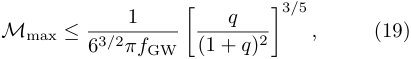

<!-- Start of picture text -->
1 q M max ≤ , (19) 6 3 / 2 πf GW � (1 +  q ) 2 �3 / 5 <!-- End of picture text -->

where _q_ is the SMBHB mass ratio. Here, we calculated the chirp mass cutoff for _q_ = 1. 

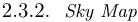

<!-- Start of picture text -->
2.3.2. Sky Map <!-- End of picture text -->

Due to the non-uniform distribution of pulsars on the sky, the NANOGrav PTA is not equally sensitive in all directions. To analyze the differences in sensitivity, once detection analyses were completed, we placed upper limits on 768 pixels distributed isotropically across the sky using `healpy` (G´orski et al. 2005; Zonca et al. 2019); each pixel covers an area of 53.72 square degrees. This value is chosen to balance `healpy` ’s requirements for map transformations with our desired resolution. These settings allow us to resolve details on the sky sensitivity map, but not overwhelm our computational capabilities or explore much beyond the expected localization capabilities of PTAs (Sesana & Vecchio 2010). We allowed the sampler to search a uniform prior across each of the 768 pixels, so as to still sample the entire sky across the entire analysis. 

Due to the large computational cost required to conduct 768 independent runs, the sky map is created at only a single frequency, and only upper limits are computed. We selected 7 _._ 65 _×_ 10_−_9 Hz, as it was the most sensitive in the sky-averaged analysis. As this is in the low-frequency regime where we expect the inclusion of the CRN to be significant, it is included in our signal model. All other modeling is done identically to section 2.3.1, and is summarized in Table 1. 

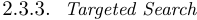

<!-- Start of picture text -->
2.3.3. Targeted Search <!-- End of picture text -->

In addition to the two variations of searches described above, we also perform a targeted search for two known 

The NANOGrav Collaboration 

8 

SMBHB candidates, 3C 66B and HS 1630+2355. Rather than a search for a generic SMBHB within a nearby galaxy cluster, as was done in Aggarwal et al. (2019) and Arzoumanian et al. (2021b), here, we targeted these binary candidates directly. 3C 66B was the subject of Arzoumanian et al. (2020b), and was first identified because of observed orbital motion in the AGN core (Sudou et al. 2003). Here, we were able to provide an updated analysis with the addition of new data included in the 12.5-year data set. HS 1630+2355. was first identified as a periodic quasar in Graham et al. (2015), and was identified as a top PTA CW candidate in Xin et al. (2021) due to its location near our best-timed pulsars. 

For the targeted search, we perform detection and upper limit analyses in the same way as in section 2.3.1, with a few differences in the model priors. Because we know the sky location and luminosity distance to 3C 66B, as well as a frequency estimate, these parameters are set to constants in this search. This allows us to place constraints directly on the (observer-frame) chirp mass of the binary, rather than its GW strain amplitude. For a detection analysis, the prior on log10� _M/M⊙_ � is log-uniform in the range [7 _,_ 10], while for upper limit analyses, the prior is uniform over this range. The remaining priors are identical to the above analyses, and are summarized in Table 1. 

## 2.3.4. _Pulsar Distance Priors_ 

In this work, we adopted a data-driven approach to handle the large uncertainties on pulsar distance measurements, which, in addition to a phase at each pulsar, affect the modeling of the pulsar terms of the CW signal. As in previous searches, the pulsar distance was used as a free parameter in the search. This allowed us to marginalize over the pulsar distance, and avoid incorrect modeling of the signal at the the location of the pulsar. Without such modeling, we would be required to dramatically increase our prior volume to allow the pulsar distances to vary across galactic scales, or, if the incorrect value were assumed, risk losing our chance at detecting the pulsar term of the CW signal. This is particularly critical at high GW frequencies, where sources evolve significantly between the Earth and pulsar terms. 

In previous versions of this search (e.g. Aggarwal et al. 2019; Arzoumanian et al. 2020b), the pulsar distance prior was constructed from a Gaussian scaled to the parallax distance and associated uncertainty listed in Verbiest et al. (2012); if no distance was listed, a value of 1 _._ 0 _±_ 0 _._ 2 kpc was assumed. While this assumption is reasonable while placing upper limits (see discussion within Arzoumanian et al. 2020b), as the PTA reaches 

sensitivities where a detection is nearly possible, an improvement was needed. 

In this work, every pulsar distance prior was constructed from a measurement or estimate. If a pulsar had a significant independent parallax measurement1 , such as from Very Long Baseline Interferometry (VLBI), or timing parallax measured in the 12.5-year data set, this value was used to construct a prior on pulsar distance ( _L_ ). 

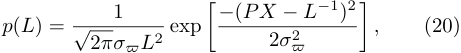

<!-- Start of picture text -->
1 p ( L ) = , (20) √ 2 πσϖL 2 exp � − ( PX 2 σ−ϖ 2 L− 1)2 � <!-- End of picture text -->

which inverts the approximately Gaussian shape of a parallax prior to describe the prior for distance (Vigeland & Vallisneri 2014). Here, significance was defined by the parallax measurement ( _ϖ_ ) having an associated uncertainty ( _σϖ_ ) of less than 30%, so as to avoid the introduction of any errors due to the Lutz-Kelker bias (Lutz & Kelker 1973). If multiple measurements of sufficient quality existed, these values and uncertainties were combined with a weighted average before being used to construct the parallax-distance prior, which ensures that the highest-quality measurements contribute the most to the resulting prior. 

If there are no parallax measurements that could be used to calculate the pulsar’s distance, the pulsar’s dispersion measure (DM) was used to construct a distance estimate using NE2001 (Cordes & Lazio 2002) and, subsequently, the distance prior. Since these values are only an estimate, we constructed a broad, nearly uniform prior for the DM-distance value and a 20% uncertainty (Cordes & Lazio 2002; Jones et al. 2017; Lam et al. 2016), with the shape 

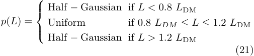

<!-- Start of picture text -->
 Half  − Gaussian if L <  0 . 8 L DM p ( L ) = Uniform if 0 . 8 LDM ≤ L ≤ 1 . 2 L DM  Half  − Gaussian if L >  1 . 2 L DM (21) <!-- End of picture text -->

Here, the Half-Gaussian additions have standard deviations of one quarter of the DM-distance uncertainty. Unlike a sharp boundary, these additions allowed the sampler to move into the edges of this prior range, which accounted for any differences in distance estimates by alternative electron density models, such as Yao et al. (2017). While pulsar distance priors will still only induce 

> 1 http://hosting.astro.cornell.edu/research/parallax/, with values compiled from Ding et al. (2020); Jennings et al. (2018); Deller et al. (2019); Guillemot et al. (2016); Stovall et al. (2014); Abdo et al. (2013); Freire et al. (2012); Verbiest et al. (2009); Lazaridis et al. (2009); Chatterjee et al. (2009); Hotan et al. (2006); Lommen et al. (2006); Jacoby et al. (2005); Splaver et al. (2005); L¨ohmer et al. (2004); Toscano et al. (1999); Camilo et al. (1994) 

NANOGrav 12.5-year Continuous Wave Limits 

9 

||All-|Sky|Sky Map|Targ|eted|
|---|---|---|---|---|---|
|Analysis Type|Detection|Upper Limit|Upper Limit|Detection|Upper Limit|
|CRN|Y/N|Y/N|Y|Y/N|Y/N|
|log10_h_|Uniform(–18,–11)|LinExp(–18,–11)|LinExp(–18,–11)|–|–|
|log10_M_|Uniform(7,_M_max)|Uniform(7,_M_max)|Uniform(7,_M_max)|Uniform(7,_M_max)|LinExp(7,_M_max)|
|log10_dL_|–|–|–|Constant|Constant|
|log10_f_GW|Constant (many)|Constant (many)|Constant (single)|Constant|Constant|
|_ϕ_|Uniform(0,2_π_)|Uniform(0,2_π_)|Uniform(pixel)|Constant|Constant|
|cos_θ_|Uniform(–1,1)|Uniform(–1,1)|Uniform(pixel)|Constant|Constant|
|_ψ_|Uniform(0,_π_)|Uniform(0,_π_)|Uniform(0,_π_)|Uniform(0,_π_)|Uniform(0,_π_)|
|Φ0|Uniform(0,2_π_)|Uniform(0,2_π_)|Uniform(0,2_π_)|Uniform(0,2_π_)|Uniform(0,2_π_)|
|cos_ι_|Uniform(–1,1)|Uniform(–1,1)|Uniform(–1,1)|Uniform(–1,1)|Uniform(–1,1)|

**Table 1.** CW parameter priors for each analysis. 

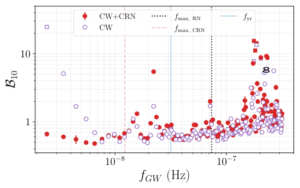

<!-- Start of picture text -->
CW+CRN f max , RN f yr CW f max , CRN 10 8 1 10 − 8 10 − 7 fGW (Hz) B 10 <!-- End of picture text -->

**Figure 1.** Savage-Dickey Bayes factors for a CW at each GW frequency. At low frequencies, inclusion of a CRN in the model (red) is necessary to avoid a false CW detection as in the CW-only model (unfilled purple). Square markers indicate a frequency where the initial analysis returned an undefined Savage-Dickey Bayes Factor, meaning the zoom-in analysis was necessary to calculate an accurate Bayes factor. With these methods, we found that no CWs are detected in the 12.5-year data set. Key frequencies are marked by vertical lines, including _f_ yr (blue solid), _f_ max _,_ RN = 30 _/Tobs_ (black dotted), and _f_ max _,_ CRN = 5 _/Tobs_ (red dashed). 

minor influences on the results of an upper limit analysis (Arzoumanian et al. 2020b), by constructing new priors to accurately handle pulsar distance measurements and estimates, we have prepared our methods for a future detection of a CW, which will be more reliant on the pulsar term of the signal than upper limit evaluations. These values and the priors used are compiled in Table 2. 

## 3. RESULTS 

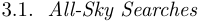

<!-- Start of picture text -->
3.1. All-Sky Searches <!-- End of picture text -->

For each GW frequency in our search, we performed a detection analysis on the 12.5-year data which marginalized over the source sky location. Figure 1 shows the Bayes factor for a CW at each searched GW frequency 

in purple. It is important to note that the Bayes factor for _f_ GW = 2 _._ 45 _×_ 10_−_9 Hz (the lowest frequency analyzed) was undefined, with a steady decrease in the following four frequency bins. Ordinarily, a very large (or undefined) Bayes factor would be a first indication for the detection of a CW. However, given the strong evidence for the existence of a CRN process in the 12.5year data set (Arzoumanian et al. 2020a), it is clear that this signal appears to be of similar form; that is, what we have detected is bright at low frequencies and declines toward higher frequency. Once a common rednoise process is added to the model, with the log10 _A_ CRN and _γ_ CRN parameters fixed to the maximum likelihood values ( _−_ 15 _._ 80 and 6 _._ 08, respectively) found by a search analogous to Arzoumanian et al. (2020a), the Bayes factors for a CW at low _f_ GW return to _<_ 1 (leftmost red points in the figure). Therefore, throughout this paper, we will present the results of many analyses with a fixed CRN included in our model. To constrain the initially undefined Bayes factor at _f_ GW = 2 _._ 45 nHz, we adapt the methodology described in Chatziioannou et al. (2014) to use a second MCMC analysis to “zoom in” on the low end of the strain prior range by limiting the prior to the 10th percentile of the original posterior. Therefore, the posterior height at _h_ 0 = 0 becomes 

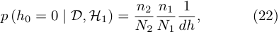

<!-- Start of picture text -->
p  ( h 0 = 0  | D, H 1) = n 2 n 1 1 (22) N 2 N 1 dh , <!-- End of picture text -->

with fractional uncertainty 

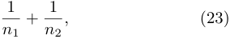

<!-- Start of picture text -->
1 + 1 , (23) n 1 n 2 <!-- End of picture text -->

where _N_ 1 is the number of samples in the initial run and _n_ 1 is the number of samples in the focused region (defined as the 10th percentile of the initial run). Then, _N_ 2 is the number of samples in the focused run, with _n_ 2 of those samples located in the lowest-amplitude bin of width _dh_ . 

The NANOGrav Collaboration 

10 

We note that a few frequencies above _f_ GW = 1 _×_ 10_−_7 Hz have _B_ 10 values that are returned as undefined. However, upon inspection, this is due to poor sampling in a few frequency bins, where the sampler does not explore low strain values, rather than a detection of a CW. This occurs in areas of parameter space where the likelihood is particularly complex and difficult to explore in a finite run-time due to the numerous complexities at _f_ GW _>_ 1 _×_ 10_−_7 Hz, such as covariances between the CW likelihood with pulsar binary orbits and potential unmodeled red noise above the 30-frequency power law cutoff (Chalumeau et al. 2022) Therefore, a few elevated Bayes factors are not unexpected. To mitigate this effect, we again apply the “zoom-in” methodology described above. After this procedure, all frequencies have Bayes factor values of _B_ 10 ≲ 10. 

The only frequency that needed this treatment for both the CW and CW+CRN models is 1 _._ 763 _×_ 10_−_7 Hz, which resulted in a Bayes factor of 15.43 in the CW+CRN case, and 7.79 in the CW-only case. While we inspected our analyses at this frequency with extra care, these Bayes factors are still relatively low compared to those required to claim a detection, especially since binaries at these high frequencies are expected to be quite rare (Kelley et al. 2018; B´ecsy et al. 2022b). For comparison, evidence in favor of a given model is generally not considered strong for Bayes factors ≲ 100 (Kass & Raftery 1995). Therefore, we will monitor this frequency in future data sets, but currently, our analyses indicate that no CWs are detected in the 12.5-year data set. 

As we found no strong evidence for a GW from an individual SMBHB in the 12.5-year data set, we proceeded to place all-sky upper limits on the GW strain, with results shown in Figure 2. We again conduct this analysis using two different models, one which includes only a CW (purple) and one which includes both a CW and a CRN process (red). While in both cases, the most sensitive frequency (that with the lowest strain upper limit) is 7 _._ 65 _×_ 10_−_9 Hz, the strain upper limits are lower when the CRN is included in the model. In this case, we can limit the strain to _h_ 0 _<_ (6 _._ 82 _±_ 0 _._ 35) _×_ 10_−_15 , while when the CRN is neglected, the best limit we can place on CW strain is _h_ 0 _<_ (9 _._ 11 _±_ 0 _._ 10) _×_ 10_−_15 . This trend of the CW+CRN model resulting in lower upper limits than a CW-only model continues until frequencies of approximately 1 _×_ 10_−_8 Hz, above which, where the effect of the power-law CRN is minimal, the upper limit values are nearly equal. Therefore, throughout the remainder of this work, we opted to include the CRN in analyses which are too computationally expensive to be completed with both models, such as the sky map anal- 

yses described in section 3.2. We note that we do not find a significantly higher upper limit at any of the frequencies where we found _B_ 10 _∼_ 10 for either the CW or CW+CRN models: this indicates that the noise sources are decreasing the posterior PDF at low strain amplitudes but not increasing the posterior PDF at the high strain amplitudes. 

We are interested in looking at how our sensitivity to CWs changes as we increase the number of pulsars and extend the observing baseline. One approach is to perform “slice” analyses, where we truncate the data set to form shorter data sets, and compare the upper limits from the sliced and full data sets (Hazboun et al. 2020). However, these sliced upper limits are not equivalent to previously published upper limits. Another approach is to directly compare this result to those of previous NANOGrav searches for CWs. In Figure 3, we compare this result to those of previous NANOGrav searches for CWs (Aggarwal et al. 2019). Direct comparisons between these data sets are complicated, due to the reprocessing of data resulting in new noise parameter values; nevertheless, such comparisons are useful to examine in order to understand how the sensitivity to CWs improves between data sets. While analyses have shown a factor of _∼_ 2 improvement between the previous three data sets, we see only a modest sensitivity improvement between the 11-year and 12.5-year data, with a difference of only 7% between the two lowest strain limits of _h_ 0 _<_ (6 _._ 82 _±_ 0 _._ 35) _×_ 10_−_15 (12.5-year) and _h_ 0 _<_ (7 _._ 33 _±_ 0 _._ 29) _×_ 10_−_15 (11-year). In addition to the smaller fractional increase in observing baseline between the 11- and 12.5-year data sets as compared to previous data sets, this is likely due to the presence of the CRN, which, while it is no longer causing a false positive in the CW search if included in the model, does represent a significant noise process that will limit our sensitivity to low-frequency CWs over the years to come (Hazboun et al. 2019b). 

To confirm this hypothesis, we calculated the sensitivity curves of the 9-, 11-, and 12.5-year data sets using each pulsar’s red and white noise contributions and timing model with `hasasia` (Hazboun et al. 2019a,b) and calculated the relative improvement of in sensitivity between each data set at high frequencies ( _> f_ yr), where red noise has little effect. We observed that on average, the `hasasia` -calculated sensitivity at these frequencies improved by a factor of 1.28 between the 9- and 11-year data sets, and 1.24 between the 11- and 12.5-year data sets. In our full Bayesian analysis, our upper limits at frequencies above _f_ yr improved by a factor of 1.52 between the 9- and 11-year data sets, and 1.40 between the 11- and 12.5-year data sets. These proportionalities 

NANOGrav 12.5-year Continuous Wave Limits 

11 

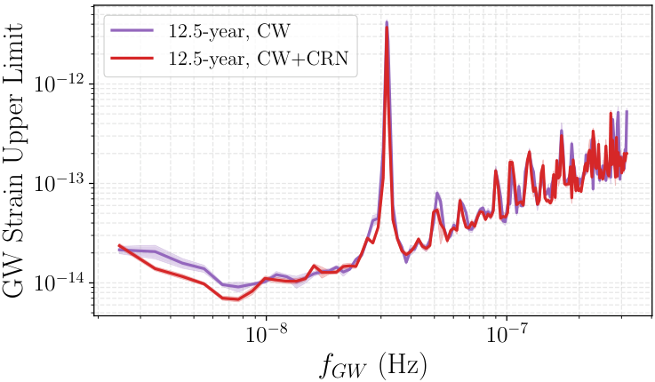

<!-- Start of picture text -->
12.5-year, CW 12.5-year, CW+CRN 10 − 12 10 − 13 10 − 14 10 − 8 10 − 7 fGW (Hz) GWStrainUpperLimit <!-- End of picture text -->

**Figure 2.** All-sky CW strain 95% upper limits and associated error regions, with (red) and without (purple) a CRN included in the model. At low frequencies, modeling the CRN is necessary to avoid over-estimating our strain upper limits. We are the least sensitive to CWs at _f_ GW =1/(1 year) due to the Earth’s orbit, creating the large feature seen in this and other figures. 

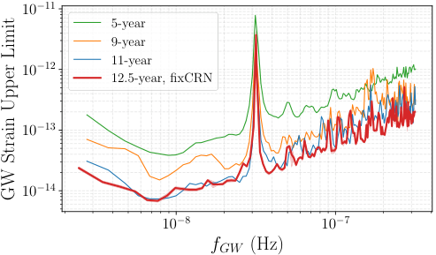

<!-- Start of picture text -->
10 − 11 5-year 9-year 11-year 10 − 12 12.5-year, fxCRN i 10 − 13 10 − 14 10 − 8 10 − 7 fGW (Hz) GWStrainUpperLimit <!-- End of picture text -->

**Figure 3.** The upper limits on CW strain are continuing to decrease. The 12.5-year data set (red curve and error region) is more sensitive than the 11-year, 9-year, and 5-year (blue, orange, and blue curves, respectively) at high frequencies. At the most sensitive frequency of _f_ GW =7 _._ 65 _×_ 10_−_9 Hz, the CRN is impeding further sensitivity improvements, and upper limits are comparable between the 12.5-year and 11-year data sets. At frequencies greater than _f_ yr, the NANOGrav’s sensitivity has improved by a factor of 1.40 since the 11-year data set. 

are even greater than our calculated improvements, so we are able to conclude that NANOGrav’s sensitivity to CWs is improving as expected at high frequencies where red noise is not dominant. 

## 3.2. _Sky Map_ 

In Figure 4, we show the GW strain upper limits for a model including a CRN at the most sensitive CW frequency _f_ GW = 7 _._ 65 _×_ 10_−_9 Hz as a function of sky 

location. As expected, the portion of the sky that is the least sensitive to CWs is that which contains the fewest pulsars. At the most sensitive pixel, the strain upper limit is _h_ 0 _<_ (2 _._ 66 _±_ 0 _._ 15) _×_ 10_−_15 , while at the least sensitive pixel, _h_ 0 _<_ (1 _._ 12 _±_ 0 _._ 05) _×_ 10_−_14 , a range of sensitivities that varies by a factor of _∼_ 4. 

In Figure 5, we compare the 12.5-year CW strain map to that constructed in Aggarwal et al. (2019) for the 11year data set by plotting ∆ _h_ 95 = _h_ 95 _,_ 12 _._ 5 _−h_ 95 _,_ 11. While a portion (14%) of the sky shows a significant reduction in strain upper limits, 85% of our pixels show an increase in strain upper limit, indicating a loss of sensitivity in the newest data set for much of the sky at our most sensitive frequency, including in the most sensitive area of the sky. 

To investigate the cause of this apparent sensitivity loss, we conducted an analysis of the simulated data utilized in Pol et al. (2021). We selected portions of the data set with included pulsars and observation baselines corresponding to the 11- and 12.5-year data sets that also included a CRN corresponding to that found in Arzoumanian et al. (2018). Then, we conducted upper limit analyses corresponding to the best-fit model for each data set (i.e. for a CW-only model for the 11-year slice, and a CW+CRN model for the 12.5-year slice) for an equatorial slice of sky pixels (i.e., for the pixels with _θ ∼ π/_ 2). When plotted against _ϕ_ in Figure 6, the patterns in ∆ _h_ 95 in the real data are well within the range represented by the same analysis in the 10 simulated data sets, each containing a different realization of the CRN. We observe that between 2 _h < RA <_ 8 _h_ , 

The NANOGrav Collaboration 

12 

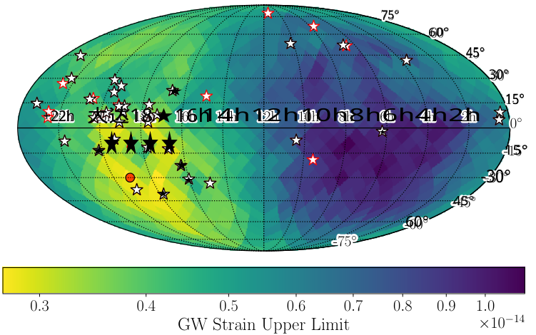

<!-- Start of picture text -->
75° 60° 45° 3 0° ★ 1 5° +22h 大达18★16h14h12h10h8h6h4h2h ★ ★★★★ ★ 1 5° ★ ★ -3 0° ★ 4 5 ° 6 0° 0 . 3 0 . 4 0 . 5 0 . 6 0 . 7 0 . 8 0 . 9 1 . 0 GW Strain Upper Limit × 10 − 14 <!-- End of picture text -->

**Figure 4.** Map of CW strain 95% upper limits at _f_ GW = 7 _._ 65 _×_ 10_−_9 Hz, the most sensitive frequency searched, for the 12.5-year data set. Pulsar locations are shown as white stars, with new pulsars added from the 12.5-year data set outlined in red. The most sensitive pixel is marked with a red dot, and is located at an RA of 19h 07m 30s and a Dec of _−_ 30_◦_ 00_′_ 00_′′_ . In this region, where the our best-timed pulsars lie, our upper limits are nearly an order of magnitude more sensitive than the least sensitive pixel. 

where NANOGrav has the fewest pulsars, the spread of upper limit difference values is by far the largest, which is consistent with our results. The mean value of ∆ _h_ 95 across each included pixel is nearly identical for the real data (∆ _h_ 95 = 1 _._ 12 _×_ 10_−_15 ) and the simulations (∆ _h_ 95 = 0 _._ 94 _×_ 10_−_15 ), and the real values are well within the intervals spanned by the ten realizations. This indicates that the change in upper limits observed are likely a statistical fluctuation within the range of expected changes shown by our simulations. Together, this allows us to confidently state that, while exact comparison between data sets is complex, this apparent pattern in our evolving sensitivity across the sky is due to the emerging CRN. This effect will have significant impacts on future PTA analyses, and will be explored more extensively in future work (Witt & Pol in prep). 

## 4. ASTROPHYSICAL LIMITATIONS OF NEARBY SMBHBS 

In recent years, numerous studies have modeled the SMBHB population in the nearby universe (Simon et al. 2014; Rosado & Sesana 2014; Schutz & Ma 2016; Mingarelli et al. 2017; Arzoumanian et al. 2021b) and multiple SMBHB candidates have been discovered with electromagnetic techniques (Sudou et al. 2003; Graham et al. 2015; Hu et al. 2020; Lehto & Valtonen 1996; Charisi et al. 2016; Liu et al. 2019). Even without a CW detection, our limits can add crucial insights into SMBHH populations, including limiting the distance to 

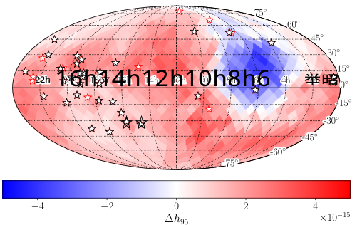

<!-- Start of picture text -->
22h  16h14h12h10h8h6 举昭 ☆☆ − 4 − 2 0 2 4 ∆ h 95 × 10 − 15 <!-- End of picture text -->

**Figure 5.** Difference in strain 95% upper limits for the 12.5year data set versus the 11-year data set at our most sensitive frequency. Blue pixels indicate a decrease in upper limit, while red pixels indicate an increase. The overall increase in upper limit across much of the sky at the most sensitive frequency was found to be due to the presence of the CRN, and is consistent with the all-sky limit shown in Figure 3. 

nearby SMBHBs and placing multi-messenger mass constraints on SMBHB candidates. 

## 4.1. _Distance Limits_ 

Our limits on CW strain can be transformed using Equation 15 to calculate the 95% lower limit on the luminosity distance to a source of a given chirp mass. The distance limits for an SMBHB with _M_ = 109 _M⊙_ are shown in Figure 7. For the most sensitive frequency 

NANOGrav 12.5-year Continuous Wave Limits 

13 

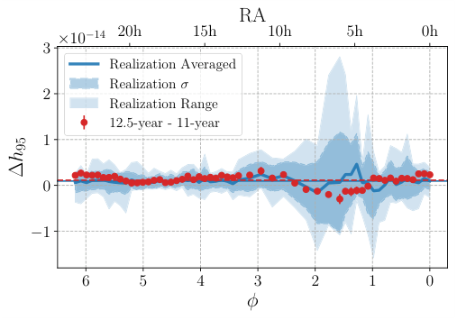

<!-- Start of picture text -->
RA × 10 − 14 20h 15h 10h 5h 0h 3 Realization Averaged Realization σ 2 Realization Range 12.5-year - 11-year 1 0 − 1 6 5 4 3 2 1 0 φ ∆ h 95 <!-- End of picture text -->

**Figure 6.** The difference in strain upper limits for an equatorial slice of the sky map shown in Figure 5 plotted against _ϕ_ (or RA). The results for the real data (red points) are well within the range of values encompassed by the range between and the standard deviation of ten realizations simulated (blue), with near-identical mean values of ∆ _h_ 95 (horizontal red and blue lines). Therefore, we conclude that the overall increase in upper limit across much of the sky at our most sensitive frequency is due to the 12.5-year data set’s sensitivity to the CRN. 

of _f_ GW = 7 _._ 65 _×_ 10_−_9 Hz, we can limit the distance to an SMBHB with _M_ = 109 _M⊙_ to _dL >_ 33.9 Mpc. These limits may be scaled to larger or smaller SMBHBs directly using Equation 15 as 

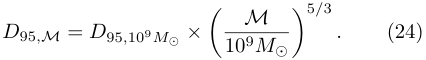

<!-- Start of picture text -->
M D 95 ,M =  D 95 , 109 M⊙ × . (24) � 10 9 M⊙ �5 / 3 <!-- End of picture text -->

However, it is important to note that while this frequency produces the lowest strain upper limit, it does not produce the farthest luminosity distance lower limit. This value is _dL >_ 35.0 Mpc at _f_ GW = 3 _._ 82 _×_ 10_−_8 Hz. 

This technique can be applied to the strain upper limit sky map as well, to calculate the 95% luminosity distance lower limit for an SMBHB emitting CWs at _f_ GW = 7 _._ 65 _×_ 10_−_9 Hz as a function of sky location. The results of this transformation are shown in Figure 8. At the most sensitive sky location, we can limit the minimum distance to an _M_ = 109 _M⊙_ SMBHB to be _dL >_ 86.7 Mpc, and that to an _M_ = 1010 _M⊙_ SMBHB to _dL >_ 4.02 Gpc. In the least sensitive sky location, we can limit the minimum distance to an _M_ = 109 _M⊙_ SMBHB to be _dL >_ 20.5 Mpc, and that to an _M_ = 1010 _M⊙_ SMBHB to _dL >_ 0.95 Gpc. These values vary by over a factor of 4 between the most and least sensitive parts of the sky. 

## 4.2. _SMBHB Number Density Limits_ 

Using our limits on the luminosity distance to an SMBHB, we can also place limits on the local num- 

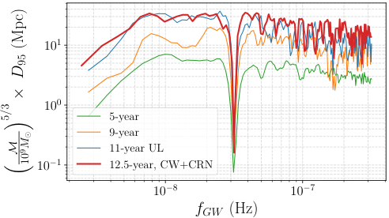

<!-- Start of picture text -->
10 1 10 0 5-year 9-year 11-year UL 10 − 1 12.5-year, CW+CRN 10 − 8 10 − 7 fGW (Hz) (Mpc) D× 95 / 35� M 9 M 10 ⊙ � <!-- End of picture text -->

**Figure 7.** The 95% lower limits on the luminosity distance to an individual SMBHB. While we can limit SMBHBs emitting GWs at the most sensitive value of _f_ GW = 7 _._ 65 _×_ 10_−_9 Hz to _dL >_ 33.9 Mpc, at _f_ GW = 3 _._ 82 _×_ 10_−_8 Hz, they can be limited to farther away at _dL >_ 35.0 Mpc. 

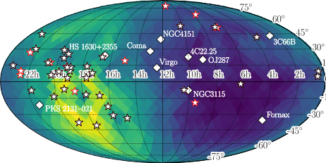

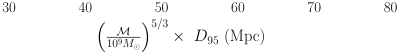

<!-- Start of picture text -->
30 40 50 60 70 80 �10 M 9 M⊙ �5 / 3 × D 95 (Mpc) <!-- End of picture text -->

**Figure 8.** Map of the 95% lower limit on the distance to individual SMBHBs with _M_ = 109 _M⊙_ and 7 _._ 65 _×_ 10_−_9 Hz. White diamonds indicate the positions of known SMBHB candidates and large galaxy clusters that could contain an SMBHB. As PTA sensitivities improve, these candidates may come into reach. 

ber density of SMBHBs of a given binary configuration. After placing a lower limit on the effective comoving distance _dc_ to sources of given binary parameters, we can say the local density is less than _nc_ = 1 _/Vc_ = [(4 _/_ 3) _πd_3 _c_]_−_1.However,toconsiderthisasalimiton the average density in some volume, that is relativelylocal but larger than the explicitly measured volume, there should be some additional pre-factor to account for the confidence of having a source within this volume based on Poisson distributions of sources. For a number of events Λ = _ncVc_ the likelihood of no detections is _P_ 0(Λ) = _e__−_Λ . To find an upper limit on the occurrence rate, ΛUL, we must integrate from that limit to infinity, such that the result matches our desired confidence level _p_ 0. Therefore, _F_ UL(ΛUL) = �Λ _∞_ UL_e−_Λ_d_Λ=1_−p_0 

The NANOGrav Collaboration 

14 

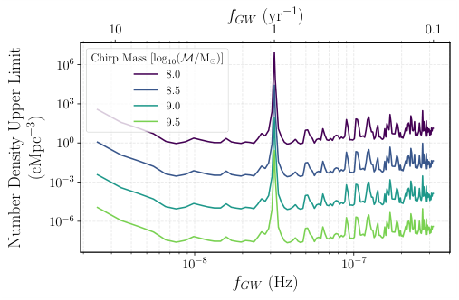

<!-- Start of picture text -->
fGW (yr − 1 ) 10 1 0.1 10 6 Chirp Mass [log10( M/ M ⊙ )] 8.0 8.5 10 3 9.0 9.5 10 0 10 − 3 10 − 6 10 − 8 10 − 7 fGW (Hz) 3(cMpc) − NumberDensityUpperLimit <!-- End of picture text -->

**Figure 9.** Number density limits of SMBHBs per comoving Mpc_−_3 in the local universe, where, as expected, we placed significantly more stringent upper limits on the largest SMBHBs than the smallest ones, with limits decreasing from those on chirp masses of 108 M _⊙_ (purple) to 108_._5 M _⊙_ (blue) to 109 M _⊙_ (teal) to 109_._5 M _⊙_ (green). 

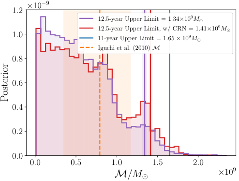

<!-- Start of picture text -->
× 10 − 9 1 . 2 12.5-year Upper Limit = 1.34 × 10 9 M⊙ 12.5-year Upper Limit, w/ CRN = 1.41 × 10 9 M⊙ 1 . 0 11-year Upper Limit = 1 . 65  ×  10 9 M⊙ Iguchi et al . (2010) M 0 . 8 0 . 6 0 . 4 0 . 2 0 . 0 0 . 0 0 . 5 1 . 0 1 . 5 2 . 0 M/M⊙ × 10 9 Posterior <!-- End of picture text -->

**Figure 10.** Posterior distributions for a targeted upper limit analysis of the SMBHB candidate 3C 66B. While 95% upper limits (red and purple lines) are lower than in the 11-year data set (blue line), they cannot rule out the model from Iguchi et al. (2010) (orange region). 

is solved as 

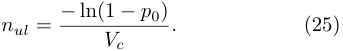

<!-- Start of picture text -->
nul = − ln(1  − p 0) . (25) Vc <!-- End of picture text -->

Here, our desired confidence level is _p_ 0 = 0 _._ 95. To calculate the co-moving distance _dc_ , we transform our luminosity distance limits (shown in Figure 7) as _dc_ = _dL/_ (1 + _z_ ), and _z_ is calculated for the relevant luminosity distance values using the `astropy` . 

The results of this calculation are shown for various SMBHB chirp masses in Figure 9. As can be expected, we find that we can place more constraining upper limits on large SMBHBs ( _M_ = 109_._5 _M⊙_ ) than smaller ones ( _M_ = 108 _M⊙_ ) in the local universe. 

## 4.3. _Multi-Messenger Analyses_ 

Using the methodology described in section 2.3.3, we conducted a multi-messenger search for GWs from the SMBHB candidate 3C 66B to provide an update to the results of (Arzoumanian et al. 2020b). The detection analyses result in nearly identical Savage-Dickey Bayes factors, whether the CRN was included or not. This is to be expected, as the CRN is very weak at frequencies as high as that of 3C 66B ( _f_ GW = 6 _._ 04 _×_ 10_−_8 Hz). The Bayes factors for the CW-only analysis and the CW+CRN analysis are 0 _._ 70 _±_ 0 _._ 02 and 0 _._ 67 _±_ 0 _._ 01, respectively. Both of these values are very near 1, meaning that the data do not indicate the presence of a CW corresponding to a binary within 3C 66B. 

Because no GW was detected, we constrain the chirp mass of a potential binary with an upper limit analysis, again performed with and without a CRN to confirm consistency. The posteriors from these two searches are plotted in Figure 10, with resulting 95% upper limits of 

_M <_ (1 _._ 41 _±_ 0 _._ 02) _×_ 109 _M⊙_ when a CRN is included, and _M <_ (1 _._ 34 _±_ 0 _._ 01) _×_ 109 _M⊙_ when only CWs are included in the signal. For comparison, the 95% chirp mass upper limit for 3C 66B from the 11-year data set was _M <_ 1 _._ 65 _×_ 109 _M⊙_ . This represents an improvement of 2 _._ 4 _×_ 108 _M⊙_ , or a factor of 1 _._ 2 smaller; by adding pulsars, extending timing baselines, and improving timing and searching methods, the PTA’s sensitivity has clearly improved. These upper limits are nearer to the value of the upper bound of the Iguchi et al. (2010) chirp mass estimate. In subsequent data sets, or by using more sophisticated analyses such as advanced noise modeling (Simon & Hazboun in prep), this error region may soon be within reach. 

In Arzoumanian et al. (2020b), it was shown that a targeted search, like this analysis, results in a factor of _∼_ 2 reduction in upper limits compared to those of an all-sky search at a corresponding GW frequency. When converted to strain amplitudes rather than chirp masses, the 95% upper limits are _h_ 0 _<_ 1 _._ 90 _×_ 10_−_14 and _h_ 0 _<_ 1 _._ 74 _×_ 10_−_14 for the searches with and without a CRN, respectively. In comparison, the all-sky analysis in section 3.1 returned strain upper limits of _h_ 0 _<_ 3 _._ 56 _×_ 10_−_14 and _h_ 0 _<_ 3 _._ 82 _×_ 10_−_14 at _f_ GW = 6 _._ 01 _×_ 10_−_8 Hz, the nearest frequency to that of 3C 66B at _f_ GW = 6 _._ 04 _×_ 10_−_8 Hz. These all-sky strain upper limits are a factor of 1 _._ 88 and 2 _._ 20 larger, very similar to the value for the 11-year data set. Therefore, the improvement in upper limits gained by using this multi-messenger technique has stayed stable across the addition of new pulsars, more data, and the emergence of the CRN. 

NANOGrav 12.5-year Continuous Wave Limits 

15 

Additionally, we performed a new search for the electromagnetic SMBHB candidate HS 1630+2355. First identified as a periodic quasar in Graham et al. (2015), this candidate is identified as a top PTA CW candidate in Xin et al. (2021) with a gravitational wave frequency of _f_ GW = 1 _._ 13 _×_ 10_−_8 Hz and a luminosity distance of 5.26 Gpc. In the 12.5-year data set, we do not detect any CWs from HS 1630+2355; in a CW+CRN analysis (necessary due to the low GW frequency), we calculate a Bayes factor of 0 _._ 74 _±_ 0 _._ 02. Then, we are able to set an upper limit of _M <_ (1 _._ 28 _±_ 0 _._ 03) _×_ 1010 _M⊙_ on the chirp mass of an SMBHB within HS 1630+2355, which corresponds to a strain of _h_ 0 _<_ 4 _._ 03 _×_ 10_−_15 . For comparison, the all-sky upper limit at the nearest frequency of _f_ GW = 1 _._ 10 _×_ 10_−_8 Hz is _h_ 0 _<_ 1 _._ 07 _×_ 10_−_14 , a factor of 2.66 larger than the targeted upper limit. Due to this candidate’s favorable position near the PTA’s most sensitive sky location, we are able to overcome the much larger source distance to set a constraining upper limit. However, this limit is still approximately 4 times larger than the estimated chirp mass of 3 _._ 15 _×_ 109 _M⊙_ (Xin et al. 2021), meaning that more data are needed to rule out or detect an SMBHB within HS 1630+2355. The simulations in Xin et al. (2021) indicate that HS 1630+2355 will not detectable even by IPTA data sets by the late 2020s, so this result is unsurprising; therefore, HS 1630+2355 will require continued monitoring until PTA sensitivity brings it into reach. 

## 4.4. _Local Detection Prospects_ 

At the most sensitive sky pixel, we conducted a final upper limit analysis across the entire frequency band, with results plotted in Figure 11. Here we observed that for all frequencies, the PTA is dramatically more sensitive to CWs from sources at this sky location than across the entire sky on average. Mingarelli et al. (2017) carried out a comprehensive study of the detection prospects of SMBHBs within a 225 Mpc volume, the completeness limit for their chosen K-band luminosity in 2MASS. Using these new 12.5-year upper limit curves, we assess our level of surprise at our current non-detection of CWs. 

Figure 11 shows an example realization of the local SMBHB population created with `nanohertz` ~~`g`~~ `ws` (Mingarelli 2017). It is one out of 75,000 Monte Carlo realizations Mingarelli et al. (2017) carried out, where they varied black hole masses via the scatter in various _M − M_ bulge relations, mass ratios, and more. While the chosen realization shows what a detectable SMBHB would look like, on average we found only 398 realizations out of the 75,000 contained detectable SMBHB systems at the best sky location. We therefore only had a 0.5% chance of making a detection of such a lo- 

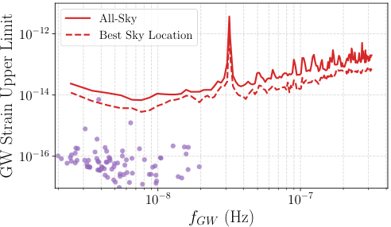

<!-- Start of picture text -->
All-Sky 10 − 12 Best Sky Location 10 − 14 10 − 16 10 − 8 10 − 7 fGW (Hz) GWStrainUpperLimit <!-- End of picture text -->

**Figure 11.** The 95% strain upper limit curve for the allsky (solid red) CW search compared with the 95% strain upper limit curve in the most sensitive sky location (red dashed). The non-detection of a nearby SMBHB is unsurprising – there was at best a 0.5% chance of making such a detection. Here we show one of the 75,000 realizations of the local Universe from Mingarelli et al. (2017). This realization shows a detectable SMBHB together with our 95% upper limit curves for both sky-averaged and best sky locations. In this realization there are 87 local SMBHBs (all within 225 Mpc); none of them lie above the sky-averaged upper limit curve, but one could be detected if it were at the most-sensitive sky location. 

cal source with the 12.5-year data set. Furthermore, when we consider the entire sky, we found an order of magnitude fewer SMBHBs were detectable – only 43 realizations contained detectable binaries. 

It is interesting to compare this result to that of our previous upper limit (Aggarwal et al. 2019). With the NANOGrav 11-year all-sky upper limits, we found 34 detectable SMBHBs and here we find 43 — an overall improvement. However, the upper limit at our best sky location has deteriorated due to the CRN, which has in turn decreased the number of detectable binaries by a factor of _∼_ 2, from a 1 _._ 2% chance of detection to 0 _._ 5%. 

As was the case in previous sections, we note that this comparison is non-trivial due to the complex changes in sensitivity between data sets, and that this deterioration is happening primarily at low frequencies where the CRN is manifesting in the data, and the most sensitive sky location is heavily affected (Figure 5 and Figure 6). Xin et al. (2021) show that at higher GW frequencies the effect of the GWB, or any equivalent CRN, is very small, so the detection prospects for local SMBHBs are unaffected. 

## 4.5. _Binary Population Model Consistency_ 

Finally, it was also useful to assess whether our current non-detection of CWs is consistent with expectations from SMBHB population models. In Figure 12 we compared an astrophysically-motivated SMBHB model 

The NANOGrav Collaboration 

16 

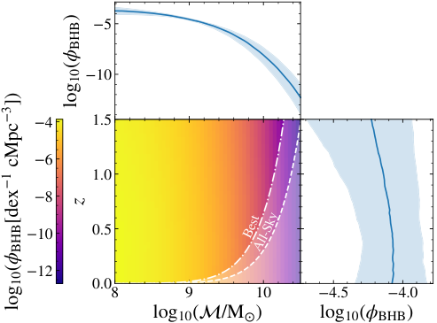

<!-- Start of picture text -->
5 10 4 1.5 6 1.0 8 10 0.5 12 0.0 8 9 10 4.5 4.0 log10( /M ) log10( BHB ) A Bestll-Sky )BHB log(10 z 13[dex])cMpcBHB log(10 <!-- End of picture text -->

**Figure 12.** The SMBHB mass function ( _ϕBHB_ ) derived from astrophysical models shows the modeled number density of SMBHBs (color-bar) across log chirp mass (log10 _M/M⊙_ ) and redshift ( _z_ ). Side panels show _ϕBHB_ in one dimension integrated across each respective variable. Regions that are inconsistent with our 12.5-year CW search are shown in white, with the all-sky (average) and most-sensitive (best) sky location upper limits shown under the solid and dash-dotted white curves, respectively. Created using methods from from Casey-Clyde et al. (in prep). 

to GW upper limits set with the 12.5-year CW search. The SMBHB model was derived from theoretical galaxy major merger rates (Chen et al. 2019), which are themselves based on observed galaxy pair fractions (Mundy et al. 2017) and theoretical galaxy merger timescales. It is related to the GWB via (Phinney 2001; Sesana 2013) 

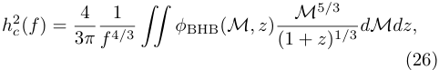

<!-- Start of picture text -->
1 M 5 / 3 h 2 c ( f ) = 4 ϕ BHB( M, z ) 3 π f 4 / 3 �� (1 +  z ) 1 / 3 dMdz, (26) <!-- End of picture text -->

where _hc_ is the characteristic strain of the GWB and _M_ is the chirp mass in the observer frame. This was fit to the results of the NANOGrav search for the GWB in the 12.5-year data set (Arzoumanian et al. 2020a), and assumes the CRN is due to a GWB, comparable to the fit in Middleton et al. (2021). 

The GW limits in Figure 12 were calculated using the most sensitive frequency of both the all-sky and mostsensitive sky location analyses. Figure 12 thus shows what regions of _z_ – _M_ parameter space were accessible to the 12.5-year CW search. Since no CWs were detected, we are able to rule out the high-mass and low– _z_ region across the entire sky and at the most sensitive sky location for the PTA’s most sensitive frequency. 

We calculate the expected number of detectable SMBHBs by relating the differential SMBHB mass function _ϕ_ BHB to the differential number of binaries per chirp 

mass, frequency, and redshift (Sesana et al. 2008) as 

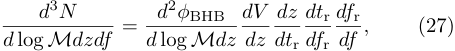

<!-- Start of picture text -->
d 3 N d 2 ϕ BHB dV dz dt r df r (27) d  log  Mdzdf = d  log  Mdz dz dt r df r df , <!-- End of picture text -->

and integrating across the relevant region of _z_ – _M_ space, while also considering the entire strain sensitivity curve in frequency space. Here, _tr_ and _fr_ are the proper time and binary gravitational wave frequency in the SMBHB’s rest frame, respectively. We find in both cases that the expected number of SMBHBs is _≪_ 1. At the all-sky sensitivity, the calculated number is 0 _._ 6+1 _−_ 0_._ _._1 4_×_10_−_4,whileatthemostsensitiveskyloca- tion, the calculated number is 8 _._ 6+12 _−_ 5 _._ 5_._9_×_10_−_4.Our non- detection of a CW signal is thus consistent with theoretical models of the SMBHB population, which predict that the most massive, and therefore loudest, SMBHBs are exceedingly rare. 

## 5. DISCUSSION AND FUTURE PROSPECTS 

While the NANOGrav PTA is continuing to increase our sensitivity to GWs by adding data from ongoing observations and adding new pulsars to the PTA, our limits on CW strains across the nanohertz GW frequency band and the sky have not improved as steadily as in previous data sets. This is due to the CRN first detected in the 12.5-year data set in Arzoumanian et al. (2020a), which has impacted the PTA’s ability to distinguish a CW source. While adding a CRN to the search model that is fixed to the maximum-likelihood values from a dedicated search avoids confusion in detection analyses, this adds a significant source of noise to the PTA, and therefore limits our sensitivity to CWs at frequencies below 10 nHz. 

We have entered an interesting era where surprising results will continue to be uncovered. In future data sets, the CRN will likely be even more apparent in the data, and may eventually resolve to be due to a stochastic GWB from SMBHBs (Pol et al. 2021). In any case, due to the multi-frequency nature of the GWB, this will continue to impact CW searches, and significant efforts will be needed to continue development on methods that will allow for efficient detection of both types of nanohertz GW signals such as in B´ecsy & Cornish (2020), as well as extensive simulations that evaluate detection possibilities, as in Pol et al. (2021), that include multiple types of GW signal in the simulated data sets. Additionally, significant effort will be needed to improve sampling methods that can efficiently explore the complex CW parameter space (B´ecsy et al. 2022a), particularly at high GW frequencies or if full eccentricity modeling is desired (Taylor et al. 2016). These complexities will only be exacerbated as data sets expand, particularly 

NANOGrav 12.5-year Continuous Wave Limits 

17 

for the complex data sets produced by the IPTA, which, while more sensitive, contain more pulsars and noise parameters over which to sample. One promising path forward are targeted searches of quasars, which may be much more likely to host SMBHBs than random galaxies (Casey-Clyde et al. in prep). Since multi-messenger analyses can improve upper limits by a factor of 2 (Arzoumanian et al. 2020b), improve detection prospects (Liu & Vigeland 2021; Charisi et al. 2022), and can be made drastically more efficient than traditional all-sky searches (Charisi et al. 2022), further development of these methods is also crucial, as with more data, electromagnetic SMBHB candidates may soon be detectable (Xin et al. 2021), and many more will be identified in upcoming surveys (Charisi et al. 2022; Witt et al. 2022). By balancing these efforts, a CW signal may soon come into reach. 

## 6. CONCLUSIONS 

With extensive Bayesian analyses, we have searched the NANOGrav 12.5-year data set for CWs from individual SMBHBs. In our detection analyses, we showed that no CWs were detected to a high degree of confidence. We then placed all-sky upper limits on the strain amplitude for all CWs emitting between 2 _._ 45 _×_ 10_−_9 Hz and 3 _._ 19 _×_ 10_−_7 Hz, as well as upper limits as a function of sky location for the 12.5-year data set’s most sensitive frequency of 7 _._ 65 _×_ 10_−_9 Hz. 

This analysis also included the development of new methods to accurately reflect the realistic distribution of possible values of pulsar distances from updated measurements. The way we treat these values in search pipelines has a significant impact on our ability to detect the pulsar term of a CW signal, and these methods will be critical as we proceed towards PTA sensitivities that enable a CW detection. 

Unlike previous data sets, the 12.5-year data set contains a significant CRN. Therefore, for the first time, we included the CRN in our Bayesian searches by fixing the model parameters to those recovered in Arzoumanian et al. (2020a). This had a significant effect on the results of many of our analyses, and proved critical to avoid a false detection of a CW at 2 _._ 45 _×_ 10_−_9 Hz. This process also significantly impeded the reduction of our upper limits limits between the 11-year and 12.5-year NANOGrav searches at the most sensitive frequency of 7 _._ 65 _×_ 10_−_9 Hz in most areas of the sky. The presence of a CRN will also impact searches for other types of signals, such as bursts with memory and fuzzy dark matter, and so searches for those sources will also need to include the CRN. 

Despite these new necessities, we are able to place significant astrophysical constraints on the local SMBHB population. In our most sensitive sky location, we can rule out the existence of any SMBHB with a mass of at least 109 _M⊙_ emitting at 7 _._ 65 _×_ 10_−_9 Hz within 86.7 Mpc. Furthermore, we demonstrate significant improvements to chirp mass upper limits of SMBHB candidates can be made through multi-messenger analysis techniques, and limit the chirp mass of 3C 66B to _M <_ (1 _._ 34 _±_ 0 _._ 01) _×_ 109 _M⊙_ . With the inclusion of more data, we will soon be able to rule out or confirm this source and other binary candidates, as well as those that are yet undiscovered. 

## 7. ACKNOWLEDGEMENTS 

_Author contributions:_ An alphabetical-order author list was used for this paper in recognition of the fact that a large, decade timescale project such as NANOGrav is necessarily the result of the work of many people. All authors contributed to the activities of the NANOGrav collaboration leading to the work presented here, and reviewed the manuscript, text, and figures prior to the paper’s submission. Additional specific contributions to this paper are as follows. ZA, HB, PRB, HTC, MED, PBD, TD, JAE, RDF, ECF, EF, NG-D, PAG, DCG, MLJ, MTL, DRL, RSL, JL, MAM, CN, DJN, TTP, NSP, SMR, KS, IHS, RS, JKS, RS and SJV developed the 12.5-year data set through a combination of observations, arrival time calculations, data checks and refinements, and timing model development and analysis; additional specific contributions to the data set are summarized in Alam et al. (2021a). CAW coordinated the writing of the paper and led the search. BB, ARK, NSP, JSy, GW, and CAW performed analyses for the project, including exploratory runs. JS and CAW developed methods to include the CRN in the search model. AB, NG-D, JG, KG, SRT, SJV, and CAW proposed for the necessary XSEDE resources to complete these analyses. NSP and CAW performed the sky map simulations. AC-C, LZK, CMFM, and CAW developed the astrophysical interpretations. ADJ provided updates to red noise empirical distributions. GEF, XS, and SJV explored the frequentist analyses. SC, DJN, MAM, and CAW updated the pulsar distance priors. SBS, CMFM, and CAW wrote the manuscript and produced the figures. We thank BB, SC, JMC, NJC, WF, KG, JSH, DLK, LZK, MTL, TJWL, MAM, DJN, KDO, JDR, SRT, and SJV for their thoughtful comments on the manuscript. 

_Acknowledgements._ This work has been carried out by the NANOGrav collaboration, which receives support from National Science Foundation (NSF) Physics 

The NANOGrav Collaboration 

18 

Frontiers Center award numbers 1430284 and 2020265. The Arecibo Observatory is a facility of the NSF operated under cooperative agreement (No. AST-1744119) by the University of Central Florida (UCF) in alliance with Universidad Ana G. M´endez (UAGM) and Yang Enterprises (YEI), Inc. The Green Bank Observatory is a facility of the NSF operated under cooperative agreement by Associated Universities, Inc. The National Radio Astronomy Observatory is a facility of the NSF operated under cooperative agreement by Associated Universities, Inc. SBS and CAW were supported in this work by NSF award grant Nos. 1458952 and 1815664. CAW acknowledges support from West Virginia University through a STEM Completion Grant, and acknowledges support from CIERA, the Adler Planetarium, and the Brinson Foundation through a CIERAAdler postdoctoral fellowship. SBS is a CIFAR Azrieli Global Scholar in the Gravity and the Extreme Universe program. MC and SRT acknowledge support from NSF grant No. AST-2007993. SRT also acknowledges support from an NSF CAREER Award PHY-2146016, and a Vanderbilt University College of Arts & Science Dean’s Faculty Fellowship. CMFM was supported in part by the National Science Foundation under Grants NSF PHY-2020265, and AST-2106552. The Flatiron Institute is supported by the Simons Foundation. Part of this research was carried out at the Jet Propulsion Laboratory, California Institute of Technology, under a contract with the National Aeronautics and Space Administration. Portions of this work performed at NRL were supported by Office of Naval Research 6.1 funding. The Flatiron Institute is supported by the Simons Foundation. Pulsar research at UBC is supported by 

an NSERC Discovery Grant and by the Canadian Institute for Advanced Research. JS and MV acknowledge support from the JPL RTD program. KDO was supported in part by the National Science Foundation under grant No. 2207267. ECF is supported by NASA under award number 80GSFC21M0002. TD and MTL are supported by an NSF Astronomy and Astrophysics Grant (AAG) award number 2009468. LZK was supported by a Cottrell Fellowships Award (No. 27985) from the Research Corporation for Science Advancement made possible by the National Science Foundation grant No. CHE2125978. MED acknowledges support from the Naval Research Laboratory by NASA under contract S-15633Y. We acknowledge the use of Thorny Flat at WVU, which is funded in part by the National Science Foundation Major Research Instrumentation Program (MRI) award No. 1726534 and WVU. This work used the Extreme Science and Engineering Discovery Environment (XSEDE), which is supported by National Science Foundation grant number ACI-1548562. Specifically, it used the Bridges-2 system, which is supported by NSF award number ACI-1928147, at the Pittsburgh Supercomputing Center (PSC) (Towns et al. 2014). 

# _Facilities:_ Arecibo, GBT 

_Software:_ `enterprise` (Ellis et al. 2019), `enterprise` ~~`e`~~ `xtensions` (Taylor et al. 2021), `PTMCMCSampler` (Ellis & van Haasteren 2017), `hasasia` (Hazboun et al. 2019a), `libstempo` (Vallisneri 2020), `tempo` (Nice et al. 2015), `tempo2` (Hobbs et al. 2006), `PINT` (Luo et al. 2019), `matplotlib` (Hunter 2007), `astropy` (Price-Whelan et al. 2018; Astropy Collaboration et al. 2013), `healpy` (Zonca et al. 2019), `HEALPix` (G´orski et al. 2005), `nanohertz` ~~`g`~~ `ws` (Mingarelli 2017) 

## APPENDIX 

## A. PULSAR DISTANCE VALUES 

## REFERENCES 

Abdo, A. A., Ajello, M., Allafort, A., et al. 2013, ApJS, 208, 17, doi: 10.1088/0067-0049/208/2/17 

Aggarwal, K., Arzoumanian, Z., Baker, P. T., et al. 2019, ApJ, 880, 116, doi: 10.3847/1538-4357/ab2236 

—. 2020, ApJ, 889, 38, doi: 10.3847/1538-4357/ab6083 Alam, M. F., Arzoumanian, Z., Baker, P. T., et al. 2021a, ApJS, 252, 4, doi: 10.3847/1538-4365/abc6a0 

—. 2021b, ApJS, 252, 5, doi: 10.3847/1538-4365/abc6a1 

- Antoniadis, J., Arzoumanian, Z., Babak, S., et al. 2022, MNRAS, 510, 4873, doi: 10.1093/mnras/stab3418 

- Arzoumanian, Z., Brazier, A., Burke-Spolaor, S., et al. 2014, ApJ, 794, 141, doi: 10.1088/0004-637X/794/2/141 

- —. 2016, ApJ, 821, 13, doi: 10.3847/0004-637X/821/1/13 Arzoumanian, Z., Baker, P. T., Brazier, A., et al. 2018, ApJ, 859, 47, doi: 10.3847/1538-4357/aabd3b 

- Arzoumanian, Z., Baker, P. T., Blumer, H., et al. 2020a, ApJL, 905, L34, doi: 10.3847/2041-8213/abd401 

NANOGrav 12.5-year Continuous Wave Limits 

19 

**Table 2.** Compiled pulsar distance values and uncertainties for each pulsar used in the 12.5-year CW analysis, along with the parallax (PX) or DM prior identifier. Values compiled using measurements from Ding et al. (2020); Jennings et al. (2018); Deller et al. (2019); Guillemot et al. (2016); Stovall et al. (2014); Abdo et al. (2013); Freire et al. (2012); Verbiest et al. (2009); Lazaridis et al. (2009); Chatterjee et al. (2009); Hotan et al. (2006); Lommen et al. (2006); Jacoby et al. (2005); Splaver et al. (2005); L¨ohmer et al. (2004); Toscano et al. (1999); Camilo et al. (1994) and Alam et al. (2021a). 

|Pulsar|Prior|Distance (kpc)|Error (kpc)|Pulsar|Prior|Distance (kpc)|Error (kpc)|
|---|---|---|---|---|---|---|---|
|B1855+09|PX|1.4|0.24|B1937+21|PX|3.55|0.64|
|B1953+29|DM|4.64|0.93|J0023+0923|PX|1.82|0.41|
|J0030+0451|PX|0.32|0.01|J0340+4130|DM|1.71|0.34|
|J0613-0200|PX|1.06|0.13|J0636+5128|PX|0.73|0.12|
|J0645+5158|PX|1.11|0.19|J0740+6620|DM|0.68|0.14|
|J0931-1902|DM|1.88|0.38|J1012+5307|PX|0.83|0.05|
|J1024-0719|PX|1.08|0.14|J1125+7819|DM|0.65|0.13|
|J1453+1902|DM|1.15|0.23|J1455-3330|PX|1.01|0.22|
|J1600-3053|PX|1.96|0.31|J1614-2230|PX|0.69|0.03|
|J1640+2224|DM|1.14|0.23|J1643-1224|PX|0.45|0.08|
|J1713+0747|PX|1.11|0.02|J1738+0333|PX|1.47|0.11|
|J1741+1351|PX|2.36|0.62|J1744-1134|PX|0.42|0.01|
|J1747-4036|DM|3.5|0.7|J1832-0836|PX|2.1|0.57|
|J1853+1303|DM|2.08|0.42|J1903+0327|DM|6.49|1.3|
|J1909-3744|PX|1.17|0.02|J1910+1256|DM|2.35|0.47|
|J1911+1347|DM|2.08|0.42|J1918-0642|PX|1.17|0.15|
|J1923+2515|DM|1.63|0.33|J1944+0907|DM|1.8|0.36|
|J2010-1323|PX|2.45|0.71|J2017+0603|DM|1.57|0.31|
|J2033+1734|DM|1.99|0.4|J2043+1711|PX|1.39|0.12|
|J2145-0750|PX|0.64|0.02|J2214+3000|DM|1.54|0.31|
|J2229+2643|DM|1.43|0.29|J2234+0611|PX|1.19|0.15|
|J2234+0944|DM|1.0|0.2|J2302+4442|DM|1.18|0.24|
|J2317+1439|PX|1.62|0.21|–|–|–|–|

- Arzoumanian, Z., Baker, P. T., Brazier, A., et al. 2020b, ApJ, 900, 102, doi: 10.3847/1538-4357/ababa1 

Arzoumanian, Z., Baker, P. T., Blumer, H., et al. 2021a, PhRvL, 127, 251302, 

doi: 10.1103/PhysRevLett.127.251302 

- Arzoumanian, Z., Baker, P. T., Brazier, A., et al. 2021b, ApJ, 914, 121, doi: 10.3847/1538-4357/abfcd3 

- Astropy Collaboration, Robitaille, T. P., Tollerud, E. J., et al. 2013, A&A, 558, A33, 

doi: 10.1051/0004-6361/201322068 

- Babak, S., Petiteau, A., Sesana, A., et al. 2016, MNRAS, 455, 1665, doi: 10.1093/mnras/stv2092 

- B´ecsy, B., & Cornish, N. J. 2020, Classical and Quantum Gravity, 37, 135011, doi: 10.1088/1361-6382/ab8bbd 

- B´ecsy, B., Cornish, N. J., & Digman, M. C. 2022a, PhRvD, 105, 122003, doi: 10.1103/PhysRevD.105.122003 

B´ecsy, B., Cornish, N. J., & Kelley, L. Z. 2022b, arXiv e-prints, arXiv:2207.01607. 

https://arxiv.org/abs/2207.01607 

- Begelman, M. C., Blandford, R. D., & Rees, M. J. 1980, Nature, 287, 307, doi: 10.1038/287307a0 

Benetti, M., Graef, L. L., & Vagnozzi, S. 2022, PhRvD, 105, 043520, doi: 10.1103/PhysRevD.105.043520 

Burke-Spolaor, S., Taylor, S. R., Charisi, M., et al. 2019, A&A Rv, 27, 5, doi: 10.1007/s00159-019-0115-7 

- Camilo, F., Foster, R. S., & Wolszczan, A. 1994, ApJL, 437, L39, doi: 10.1086/187677 

Casey-Clyde, J. A., Mingarelli, C., & Trump, J. in prep 

- Chalumeau, A., Babak, S., Petiteau, A., et al. 2022, MNRAS, 509, 5538, doi: 10.1093/mnras/stab3283 

- Charisi, M., Bartos, I., Haiman, Z., et al. 2016, MNRAS, 463, 2145, doi: 10.1093/mnras/stw1838 

- Charisi, M., Taylor, S. R., Runnoe, J., Bogdanovic, T., & Trump, J. R. 2022, MNRAS, 510, 5929, doi: 10.1093/mnras/stab3713 

- Chatterjee, S., Brisken, W. F., Vlemmings, W. H. T., et al. 2009, ApJ, 698, 250, doi: 10.1088/0004-637X/698/1/250 

- Chatziioannou, K., Cornish, N., Klein, A., & Yunes, N. 2014, PhRvD, 89, 104023, 

- doi: 10.1103/PhysRevD.89.104023 

The NANOGrav Collaboration 

20 

- Chen, S., Sesana, A., & Conselice, C. J. 2019, Monthly Notices of the Royal Astronomical Society, 488, 401, doi: 10.1093/mnras/stz1722 

- Chen, S., Caballero, R. N., Guo, Y. J., et al. 2021, MNRAS, 508, 4970, doi: 10.1093/mnras/stab2833 

- Cordes, J. M., & Lazio, T. J. W. 2002, arXiv e-prints, astro. https://arxiv.org/abs/astro-ph/0207156 

- Deller, A. T., Goss, W. M., Brisken, W. F., et al. 2019, ApJ, 875, 100, doi: 10.3847/1538-4357/ab11c7 

- Demorest, P. B., Ferdman, R. D., Gonzalez, M. E., et al. 2013, ApJ, 762, 94, doi: 10.1088/0004-637X/762/2/94 

- Desvignes, G., Caballero, R. N., Lentati, L., et al. 2016, MNRAS, 458, 3341, doi: 10.1093/mnras/stw483 

- Detweiler, S. 1979, ApJ, 234, 1100, doi: 10.1086/157593 Dickey, J. M. 1971, The Annals of Mathematical Statistics, 42, 204. http://www.jstor.org/stable/2958475 

- Ding, H., Deller, A. T., Freire, P., et al. 2020, ApJ, 896, 85, doi: 10.3847/1538-4357/ab8f27 

- Ellis, J., & van Haasteren, R. 2017, doi: 10.5281/zenodo.1037579 

- Ellis, J. A., Siemens, X., & Creighton, J. D. E. 2012, ApJ, 756, 175, doi: 10.1088/0004-637X/756/2/175 

- Ellis, J. A., Vallisneri, M., Taylor, S. R., & Baker, P. T. 2019, ENTERPRISE: Enhanced Numerical Toolbox Enabling a Robust PulsaR Inference SuitE. http://ascl.net/1912.015 

- Falxa, M., Babak, S., Baker, P. T., et al. 2023, MNRAS, doi: 10.1093/mnras/stad812 

- Folkner, W. M., & Park, R. S. 2018, Planetary ephemeris DE438 for Juno, Tech. Rep. IOM 392R-18-004, Jet Propulsion Laboratory, Pasadena, CA 

- Foster, R. S., & Backer, D. C. 1990, ApJ, 361, 300, doi: 10.1086/169195 

- Freire, P. C. C., Wex, N., Esposito-Far`ese, G., et al. 2012, MNRAS, 423, 3328, doi: 10.1111/j.1365-2966.2012.21253.x 

- Goncharov, B., Shannon, R. M., Reardon, D. J., et al. 2021, ApJL, 917, L19, doi: 10.3847/2041-8213/ac17f4 

- Goncharov, B., Thrane, E., Shannon, R. M., et al. 2022, ApJL, 932, L22, doi: 10.3847/2041-8213/ac76bb 

- G´orski, K. M., Hivon, E., Banday, A. J., et al. 2005, ApJ, 622, 759, doi: 10.1086/427976 

- Graham, M. J., Djorgovski, S. G., Stern, D., et al. 2015, MNRAS, 453, 1562, doi: 10.1093/mnras/stv1726 

- Guillemot, L., Smith, D. A., Laffon, H., et al. 2016, A&A, 587, A109, doi: 10.1051/0004-6361/201527847 

- Hazboun, J., Romano, J., & Smith, T. 2019a, The Journal of Open Source Software, 4, 1775, doi: 10.21105/joss.01775 

- Hazboun, J. S., Romano, J. D., & Smith, T. L. 2019b, PhRvD, 100, 104028, doi: 10.1103/PhysRevD.100.104028 

- Hazboun, J. S., Simon, J., Taylor, S. R., et al. 2020, ApJ, 890, 108, doi: 10.3847/1538-4357/ab68db 

- Hobbs, G. 2013a, Classical and Quantum Gravity, 30, 224007, doi: 10.1088/0264-9381/30/22/224007 

- —. 2013b, Classical and Quantum Gravity, 30, 224007, doi: 10.1088/0264-9381/30/22/224007 

- Hobbs, G. B., Edwards, R. T., & Manchester, R. N. 2006, MNRAS, 369, 655, doi: 10.1111/j.1365-2966.2006.10302.x 

- Hotan, A. W., Bailes, M., & Ord, S. M. 2006, MNRAS, 369, 1502, doi: 10.1111/j.1365-2966.2006.10394.x 

- Hu, B. X., D’Orazio, D. J., Haiman, Z., et al. 2020, MNRAS, 495, 4061, doi: 10.1093/mnras/staa1312 

- Hunter, J. D. 2007, Computing in Science & Engineering, 9, 90, doi: 10.1109/MCSE.2007.55 

- Iguchi, S., Okuda, T., & Sudou, H. 2010, ApJL, 724, L166, doi: 10.1088/2041-8205/724/2/L166 

- Islo, K., Simon, J., Burke-Spolaor, S., & Siemens, X. 2019, arXiv e-prints, arXiv:1906.11936. https://arxiv.org/abs/1906.11936 

- Jacoby, B. A., Hotan, A., Bailes, M., Ord, S., & Kulkarni, S. R. 2005, ApJL, 629, L113, doi: 10.1086/449311 

- Jenet, F. A., Lommen, A., Larson, S. L., & Wen, L. 2004, ApJ, 606, 799, doi: 10.1086/383020 

- Jennings, R. J., Kaplan, D. L., Chatterjee, S., Cordes, J. M., & Deller, A. T. 2018, ApJ, 864, 26, doi: 10.3847/1538-4357/aad084 

- Jones, M. L., McLaughlin, M. A., Lam, M. T., et al. 2017, ApJ, 841, 125, doi: 10.3847/1538-4357/aa73df 

- Kass, R. E., & Raftery, A. E. 1995, Journal of the American Statistical Association, 90, 773, doi: 10.1080/01621459.1995.10476572 

- Kelley, L. Z., Blecha, L., Hernquist, L., Sesana, A., & Taylor, S. R. 2018, MNRAS, 477, 964, doi: 10.1093/mnras/sty689 

- Kerr, M., Reardon, D. J., Hobbs, G., et al. 2020, PASA, 37, e020, doi: 10.1017/pasa.2020.11 

- Lam, M. T., Cordes, J. M., Chatterjee, S., et al. 2016, ApJ, 821, 66, doi: 10.3847/0004-637X/821/1/66 

- —. 2017, ApJ, 834, 35, doi: 10.3847/1538-4357/834/1/35 Lazaridis, K., Wex, N., Jessner, A., et al. 2009, MNRAS, 400, 805, doi: 10.1111/j.1365-2966.2009.15481.x 

- Lehto, H. J., & Valtonen, M. J. 1996, ApJ, 460, 207, doi: 10.1086/176962 

- Lentati, L., Taylor, S. R., Mingarelli, C. M. F., et al. 2015, MNRAS, 453, 2576, doi: 10.1093/mnras/stv1538 

- Liu, T., & Vigeland, S. J. 2021, ApJ, 921, 178, doi: 10.3847/1538-4357/ac1da9 

NANOGrav 12.5-year Continuous Wave Limits 

21 

- Liu, T., Gezari, S., Ayers, M., et al. 2019, ApJ, 884, 36, doi: 10.3847/1538-4357/ab40cb 

- L¨ohmer, O., Kramer, M., Driebe, T., et al. 2004, A&A, 426, 631, doi: 10.1051/0004-6361:20041031 

- Lommen, A. N., & Backer, D. C. 2001, ApJ, 562, 297, doi: 10.1086/323491 

- Lommen, A. N., Kipphorn, R. A., Nice, D. J., et al. 2006, ApJ, 642, 1012, doi: 10.1086/501067 

- Luo, J., Ransom, S., Demorest, P., et al. 2019, PINT: High-precision pulsar timing analysis package, Astrophysics Source Code Library, record ascl:1902.007. http://ascl.net/1902.007 

- Lutz, T. E., & Kelker, D. H. 1973, PASP, 85, 573, doi: 10.1086/129506 

- McLaughlin, M. A. 2013, Classical and Quantum Gravity, 30, 224008, doi: 10.1088/0264-9381/30/22/224008 

- Middleton, H., Sesana, A., Chen, S., et al. 2021, MNRAS, 502, L99, doi: 10.1093/mnrasl/slab008 

- Mingarelli, C. 2017, ChiaraMingarelli/nanohertz ~~G~~ Ws: First release!, v1.0, Zenodo, doi: 10.5281/zenodo.838712 

- Mingarelli, C. M. F., Lazio, T. J. W., Sesana, A., et al. 2017, Nature Astronomy, 1, 886, doi: 10.1038/s41550-017-0299-6 

- Mundy, C. J., Conselice, C. J., Duncan, K. J., et al. 2017, MNRAS, 470, 3507, doi: 10.1093/mnras/stx1238 

- Nice, D., Demorest, P., Stairs, I., et al. 2015, Tempo: Pulsar timing data analysis, Astrophysics Source Code Library, record ascl:1509.002. http://ascl.net/1509.002 

- Perera, B. B. P., DeCesar, M. E., Demorest, P. B., et al. 2019, MNRAS, 490, 4666, doi: 10.1093/mnras/stz2857 

- Phinney, E. S. 2001, arXiv e-prints, astro. https://arxiv.org/abs/astro-ph/0108028 

- Pol, N. S., Taylor, S. R., Kelley, L. Z., et al. 2021, ApJL, 911, L34, doi: 10.3847/2041-8213/abf2c9 

- Price-Whelan, A. M., Sip˝ocz, B. M., G¨unther, H. M., et al. 2018, AJ, 156, 123, doi: 10.3847/1538-3881/aabc4f 

- Rosado, P. A., & Sesana, A. 2014, MNRAS, 439, 3986, doi: 10.1093/mnras/stu254 

- Rosado, P. A., Sesana, A., & Gair, J. 2015, MNRAS, 451, 2417, doi: 10.1093/mnras/stv1098 

- Schutz, K., & Ma, C.-P. 2016, MNRAS, 459, 1737, 

- doi: 10.1093/mnras/stw768 

- Sesana, A. 2013, MNRAS, 433, L1, doi: 10.1093/mnrasl/slt034 

- Sesana, A., Haardt, F., Madau, P., & Volonteri, M. 2004, ApJ, 611, 623, doi: 10.1086/422185 

- Sesana, A., & Vecchio, A. 2010, PhRvD, 81, 104008, 

doi: 10.1103/PhysRevD.81.104008 

- Sesana, A., Vecchio, A., & Colacino, C. N. 2008, MNRAS, 390, 192, doi: 10.1111/j.1365-2966.2008.13682.x 

Shannon, R. M., & Cordes, J. M. 2010, ApJ, 725, 1607, doi: 10.1088/0004-637X/725/2/1607 

- Shannon, R. M., Ravi, V., Coles, W. A., et al. 2013, Science, 342, 334, doi: 10.1126/science.1238012 

- Shannon, R. M., Ravi, V., Lentati, L. T., et al. 2015, Science, 349, 1522, doi: 10.1126/science.aab1910 

- Simon, J., & Hazboun, J. in prep 

- Simon, J., Polin, A., Lommen, A., et al. 2014, ApJ, 784, 60, doi: 10.1088/0004-637X/784/1/60 

- Splaver, E. M., Nice, D. J., Stairs, I. H., Lommen, A. N., & Backer, D. C. 2005, ApJ, 620, 405, doi: 10.1086/426804 

- Stovall, K., Lynch, R. S., Ransom, S. M., et al. 2014, ApJ, 791, 67, doi: 10.1088/0004-637X/791/1/67 

- Sudou, H., Iguchi, S., Murata, Y., & Taniguchi, Y. 2003, Science, 300, 1263, doi: 10.1126/science.1082817 

- Taylor, S. R., Baker, P. T., Hazboun, J. S., Simon, J., & Vigeland, S. J. 2021, enterprise ~~e~~ xtensions. https://github.com/nanograv/enterprise ~~e~~ xtensions 

- Taylor, S. R., Huerta, E. A., Gair, J. R., & McWilliams, S. T. 2016, ApJ, 817, 70, 

doi: 10.3847/0004-637X/817/1/70 

- Toscano, M., Britton, M. C., Manchester, R. N., et al. 1999, ApJL, 523, L171, doi: 10.1086/312276 

- Towns, J., Cockerill, T., Dahan, M., et al. 2014, Computing in Science & Engineering, 16, 62, doi: 10.1109/MCSE.2014.80 

- Vagnozzi, S. 2021, MNRAS, 502, L11, 

- doi: 10.1093/mnrasl/slaa203 

- Vallisneri, M. 2020, libstempo: Python wrapper for Tempo2, Astrophysics Source Code Library, record ascl:2002.017. http://ascl.net/2002.017 

- Vallisneri, M., Taylor, S. R., Simon, J., et al. 2020, ApJ, 893, 112, doi: 10.3847/1538-4357/ab7b67 

- van Haasteren, R., Levin, Y., Janssen, G. H., et al. 2011, MNRAS, 414, 3117, 

doi: 10.1111/j.1365-2966.2011.18613.x 

- Verbiest, J. P. W., Weisberg, J. M., Chael, A. A., Lee, K. J., & Lorimer, D. R. 2012, ApJ, 755, 39, doi: 10.1088/0004-637X/755/1/39 

- Verbiest, J. P. W., Bailes, M., Coles, W. A., et al. 2009, MNRAS, 400, 951, doi: 10.1111/j.1365-2966.2009.15508.x 

- Verbiest, J. P. W., Lentati, L., Hobbs, G., et al. 2016a, MNRAS, 458, 1267, doi: 10.1093/mnras/stw347 

- —. 2016b, MNRAS, 458, 1267, doi: 10.1093/mnras/stw347 

- Vigeland, S. J., Islo, K., Taylor, S. R., & Ellis, J. A. 2018, PhRvD, 98, 044003, doi: 10.1103/PhysRevD.98.044003 

- Vigeland, S. J., & Vallisneri, M. 2014, MNRAS, 440, 1446, doi: 10.1093/mnras/stu312 

- Witt, C. A., Charisi, M., Taylor, S. R., & Burke-Spolaor, S. 2022, ApJ, 936, 89, doi: 10.3847/1538-4357/ac8356 

The NANOGrav Collaboration 

22 

Witt, C. A., & Pol, N. S. in prep 

Xin, C., Mingarelli, C. M. F., & Hazboun, J. S. 2021, ApJ, 915, 97, doi: 10.3847/1538-4357/ac01c5 

Xue, X., Bian, L., Shu, J., et al. 2021, PhRvL, 127, 251303, doi: 10.1103/PhysRevLett.127.251303 

- Yao, J. M., Manchester, R. N., & Wang, N. 2017, ApJ, 835, 29, doi: 10.3847/1538-4357/835/1/29 

Yardley, D. R. B., Hobbs, G. B., Jenet, F. A., et al. 2010, MNRAS, 407, 669, doi: 10.1111/j.1365-2966.2010.16949.x Zhu, X.-J., Hobbs, G., Wen, L., et al. 2014, MNRAS, 444, 3709, doi: 10.1093/mnras/stu1717 

- Zic, A., Hobbs, G., Shannon, R. M., et al. 2022, MNRAS, 516, 410, doi: 10.1093/mnras/stac2100 

- Zonca, A., Singer, L., Lenz, D., et al. 2019, Journal of Open Source Software, 4, 1298, doi: 10.21105/joss.01298 

