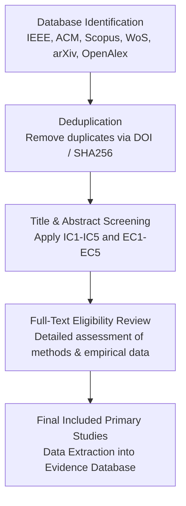

# Systematic Mapping Study Protocol

**Study Title:** Computer Vision-Based Visual Testing in Video Games: A Systematic Mapping Study of Detection Techniques, Datasets, and Evaluation Methods  
**Methodological Framework:** Petersen et al. (2015) & Kitchenham and Charters (2007)  
**Reporting Guideline:** PRISMA 2020 (Preferred Reporting Items for Systematic Reviews and Meta-Analyses)  
**Principal Investigator:** Le Tran Minh Phuc  

---

## 1. Rationale & Research Context
Quality assurance (QA) in modern 3D and 2D video games represents up to 50% of game development budgets. While automated unit testing and headless gameplay bots can verify game logic, **visual bugs**—including mesh clipping, texture pop-in, floating assets, broken shaders, ragdoll physics explosions, and HUD misalignments—remain heavily reliant on manual human playtesting.

Recent breakthroughs in Computer Vision (deep convolutional networks, vision transformers, self-supervised anomaly detection) and Vision-Language Models (VLMs) have opened avenues for automated visual bug detection. However, the current literature is fragmented across Software Engineering (SE), Computer Vision (CV), and Game AI venues, with no unified taxonomy, standardized benchmarks, or established cross-game generalization evaluations.

This Systematic Mapping Study (SMS) systematically classifies and evaluates the state of the art between January 2020 and November 2026.

---

## 2. Research Questions (RQs)

| ID | Research Question | Motivation & Mapping Target |
|---|---|---|
| **RQ1** | *What computer vision and AI techniques are employed for visual testing in video games?* | Classify algorithms: traditional CV, supervised CNN/ViT, anomaly detection (PatchCore, Autoencoders), multimodal VLMs, and reinforcement learning testers. |
| **RQ2** | *What categories and severities of visual bugs can existing methods detect?* | Develop an evidence-based taxonomy (geometry clipping, texture corruption, UI occlusions, temporal stutter, lighting glitches). |
| **RQ3** | *What datasets and benchmarks are utilized in primary studies, and how accessible are they?* | Inventory data sources: commercial vs. open-source games, synthetic vs. human playtest footage, public dataset availability, and annotation fidelity. |
| **RQ4** | *What evaluation metrics and experimental designs are applied to measure detection performance?* | Analyze precision/recall, F1-scores, false positive rates, detection latency (FPS), and tolerance to real-time rendering variations. |
| **RQ5** | *To what extent do existing methods generalize across different games, art styles, and rendering engines?* | Assess cross-game zero-shot/few-shot capabilities vs. game-specific overfitting. |
| **RQ6** | *What are the principal limitations, open challenges, and future research opportunities?* | Outline concrete research gaps (temporal glitch localization, subtle spatial defects, engine-integrated multimodal representations). |

---

## 3. Search Strategy

### 3.1 Electronic Databases
The search is conducted across major academic databases covering Computer Science, Software Engineering, and Computer Graphics:
1. **IEEE Xplore Digital Library**
2. **ACM Digital Library**
3. **Scopus**
4. **Web of Science (Core Collection)**
5. **OpenAlex / Semantic Scholar** (Open Access discovery & citation tracking)
6. **arXiv / e-prints** (Computer Vision [cs.CV], Software Engineering [cs.SE], AI [cs.AI])

### 3.2 Core Boolean Search String
```text
( "computer vision" OR "deep learning" OR "vision-language model" OR "visual anomaly detection" OR "image recognition" OR "visual regression" )
AND
( "video game" OR "game testing" OR "game quality assurance" OR "gameplay video" OR "game engine" )
AND
( "visual bug" OR "visual glitch" OR "rendering defect" OR "clipping detection" OR "graphical anomaly" OR "visual defect" )
```

---

## 4. Study Selection Criteria

### 4.1 Inclusion Criteria (IC)
- **IC1:** Published between **January 1, 2020 and November 2026**.
- **IC2:** Proposes, evaluates, or benchmarks a computer vision, deep learning, or vision-language technique for detecting visual defects, graphical glitches, or visual regressions in video games.
- **IC3:** Employs empirical evaluation on game screenshots, gameplay video frames, or rendering engine buffers.
- **IC4:** Published as a peer-reviewed journal article, conference paper, workshop proceeding, or authoritative technical preprint establishing foundational benchmarks (e.g., NeurIPS Datasets Track, arXiv milestones).
- **IC5:** Written in English with full-text accessible.

### 4.2 Exclusion Criteria (EC)
- **EC1:** Papers addressing generic non-visual game testing (e.g., pure network stress testing, functional code unit tests, fuzz testing memory leaks without visual inspection).
- **EC2:** Papers focusing solely on game-playing reinforcement learning agents without visual defect detection or visual QA capabilities.
- **EC3:** Studies using video games purely as a synthetic dataset generator for real-world robotics/autonomous driving without analyzing game visual bugs.
- **EC4:** Short abstracts, keynotes, tutorial summaries, non-technical opinion editorials, or extended abstracts (< 4 pages).
- **EC5:** Duplicate publications of the same study (the most comprehensive version is retained).

---

## 5. Selection Process & Screening Pipeline



1. **Phase 1: Identification & Deduplication** — Aggregate search queries, export BibTeX/RIS, and deduplicate using normalized titles and DOIs.
2. **Phase 2: Title & Abstract Screening** — Evaluate relevance based on inclusion/exclusion criteria.
3. **Phase 3: Full-Text Appraisal** — Review full manuscripts using MarkItDown conversions for in-depth inspection.
4. **Phase 4: Snowballing** — Backward (reference tracking) and Forward (citation tracking) snowballing on landmark papers (e.g., VideoGameQA-Bench, TempGlitch).

---

## 6. Data Extraction Scheme
For each included primary study, the following data points are extracted into `literature/evidence_table.csv`:

1. **Bibliographic Info:** Study ID, Title, Authors, Year, Publication Venue, Venue Type (Journal/Conference/Preprint), DOI, Open Access URL.
2. **Problem Scope:** Visual bug type(s) addressed, target game genre(s), 2D vs 3D, camera perspective (1st person, 3rd person, isometric).
3. **Methodology:** Algorithm family (Supervised CNN, Anomaly Detector, VLM, Classical CV, Hybrid Engine-Vision), backbone architectures (ResNet, ViT, CLIP, PatchCore), inputs used (RGB screenshots, video frame sequences, depth/normal maps, engine collision states).
4. **Data & Artifacts:** Dataset name, number of evaluated games, frame/image count, synthetic vs real playtest origin, public availability status (URL/repo).
5. **Evaluation:** Metrics reported (Precision, Recall, F1, AUROC, FPS), cross-game evaluation performed (Yes/No/Partial), baseline comparisons.
6. **Reported Gaps:** Authors' identified limitations, failure modes, computational cost, temporal reasoning bottlenecks.

---

## 7. Data Synthesis & Mapping
- **Classification Taxonomy:** Categorize techniques along two axes: *Bug Manifestation Type* (RQ2) vs. *Model Architecture Paradigm* (RQ1).
- **Bubble Plots / Heatmaps:** Correlate publication year, method family, and addressed glitch categories.
- **Empirical Gap Analysis:** Quantify the percentage of papers evaluating zero-shot cross-game transferability (RQ5) versus single-title asset memorization.
