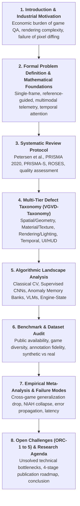

# Target Journal Submission Guidelines: Image and Vision Computing (IMAVIS)

## 1. Primary Target Venue: *Image and Vision Computing* (IMAVIS)
- **Publisher:** Elsevier / ScienceDirect
- **ISSN:** 0262-8856
- **Indexing & Metrics:**
  - **Web of Science:** Science Citation Index Expanded (SCIE)
  - **Scopus:** Q1 in *Computer Science: Computer Vision and Pattern Recognition*
  - **CORE Ranking:** Rank B (Internationally recognized, high-reputation venue)
  - **CiteScore:** ~8.5 – 9.0
  - **Impact Factor:** ~4.2 – 4.7
- **Publishing Model:** Standard Elsevier Hybrid Open Access (**$0 APC** for authors under traditional subscription publishing, with Gold Open Access optional).
- **Official URL:** [sciencedirect.com/journal/image-and-vision-computing](https://www.sciencedirect.com/journal/image-and-vision-computing)
- **Guide for Authors:** [elsevier.com/journals/image-and-vision-computing/0262-8856/guide-for-authors](https://www.elsevier.com/journals/image-and-vision-computing/0262-8856/guide-for-authors)

---

## 2. Elsevier / IMAVIS Author Guidelines & Technical Requirements

### 2.1 Mandatory Manuscript Elements
1. **Highlights (Mandatory):**
   - Exactly 3 to 5 bullet points.
   - **Strict Maximum:** **85 characters per bullet point** (including spaces).
   - Core contributions and actionable takeaways.
2. **Abstract:**
   - 150 to 250 words.
   - Structured around: Industrial Motivation $\rightarrow$ Core Problem $\rightarrow$ Methodological Protocol (Petersen et al., PRISMA 2020) $\rightarrow$ Key Empirical Findings (Taxonomy, Benchmark Audit, Failure Modes) $\rightarrow$ Future Trajectory.
3. **Keywords:**
   - 4 to 6 indexing terms: `Computer Vision`, `Visual Bug Detection`, `Video Game Quality Assurance`, `Visual Anomaly Detection`, `Vision-Language Models`, `Systematic Mapping Study`.
4. **Manuscript Class & Reference Style:**
   - Standard Elsevier LaTeX class (`elsarticle.cls` with `3p,twocolumn` or `review` format).
   - Reference style: Elsevier Numbered (`\bibliographystyle{elsarticle-num}`).
5. **Data & Code Availability Statement (Mandatory):**
   - Formal section referencing open-science repositories (e.g. GitHub/Zenodo) hosting the extracted evidence database (`evidence_table.csv`), BibTeX corpus (`papers.bib`), figure generation scripts, and reproduction tools.

---

## 3. The 8-Pillar Structural Formula of IMAVIS Survey Papers

An empirical review of top-cited surveys published in *Image and Vision Computing* demonstrates that successful survey papers follow an 8-pillar structural archetype:

### Critical Differentiators Required by IMAVIS Reviewers:
1. **Mathematical Rigor over Mere Cataloging:**
   - Formulate single-frame glitch classification: $f_{\theta}: \mathcal{X}_{\text{RGB}} \rightarrow \{0, 1\}$.
   - Formulate reference-guided pairwise comparison: $f_{\theta}: (R_t, I_t) \rightarrow \{0, 1\}$.
   - Formulate multimodal engine-state telemetry fusion: $f_{\theta}: (I_{\text{RGB}}, D, N, T_{\text{phys}}) \rightarrow \mathcal{Y}_{\text{defect}}$.
   - Formulate spatio-temporal video attention: $f_{\theta}: \{I_{t-k}, \dots, I_t\} \rightarrow [0, 1]$.
2. **Deep Algorithmic Dissection:**
   - Detail loss functions, tensor workflows, and patch feature extractors (e.g., SAM + DINO ViT negative-space weapon priors, PatchCore memory banks, cross-attention gating).
3. **Exhaustive Failure Mode Diagnostic:**
   - Deconstruct why models fail: micro-clipping spatial blindness in VLMs, temporal Needle-in-a-Haystack (NIAH) collapse, context poisoning in reference pools, and CLIP confirmation bias on environmental backgrounds.
4. **Structured Open Research Challenges (`ORC`):**
   - Explicitly define:
     - `ORC-1`: Zero-Shot Cross-Engine Domain Adaptation across Divergent Art Styles.
     - `ORC-2`: Real-Time 60 FPS Sub-Frame Temporal Glitch Localization.
     - `ORC-3`: Non-Intrusive Geometry Grounding via Engine-Vision Distillation.
     - `ORC-4`: Automated Dynamic Clean Reference Frame Selection.
     - `ORC-5`: Autonomous Multi-Agent Bug Triage and Verified Ticket Generation.

---

## 4. Backup Target Venues
1. ***Pattern Recognition* (Elsevier):**
   - Scopus Q1, Impact Factor ~7.5. Accepts comprehensive visual pattern recognition surveys.
2. ***Expert Systems with Applications* (Elsevier):**
   - Scopus Q1, Impact Factor ~7.5. Directly published landmark paper Kovacs et al. (2026) on state-aware game glitch detection.
3. ***Visual Computing for Industry, Biomedicine, and Art* (SpringerOpen):**
   - Diamond Open Access ($0 APC), Scopus Q1.
